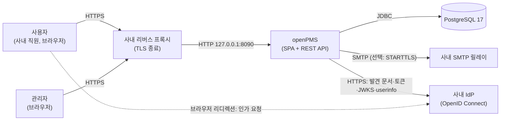
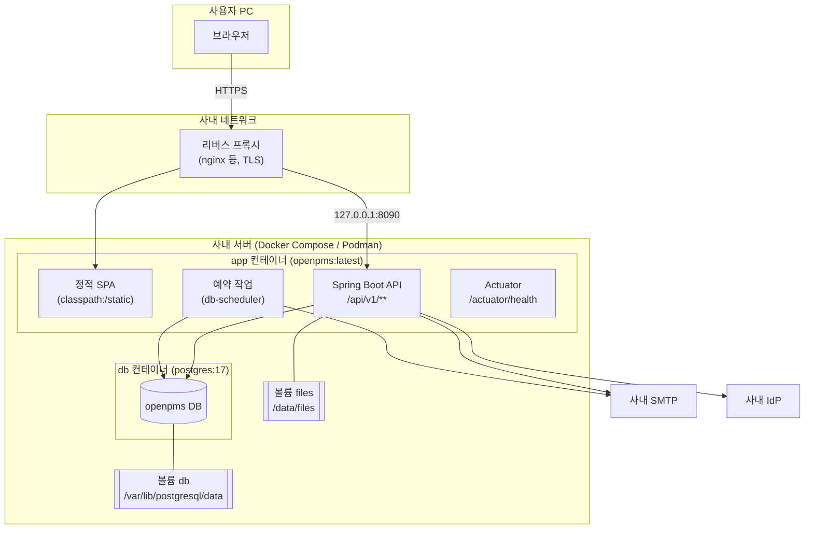
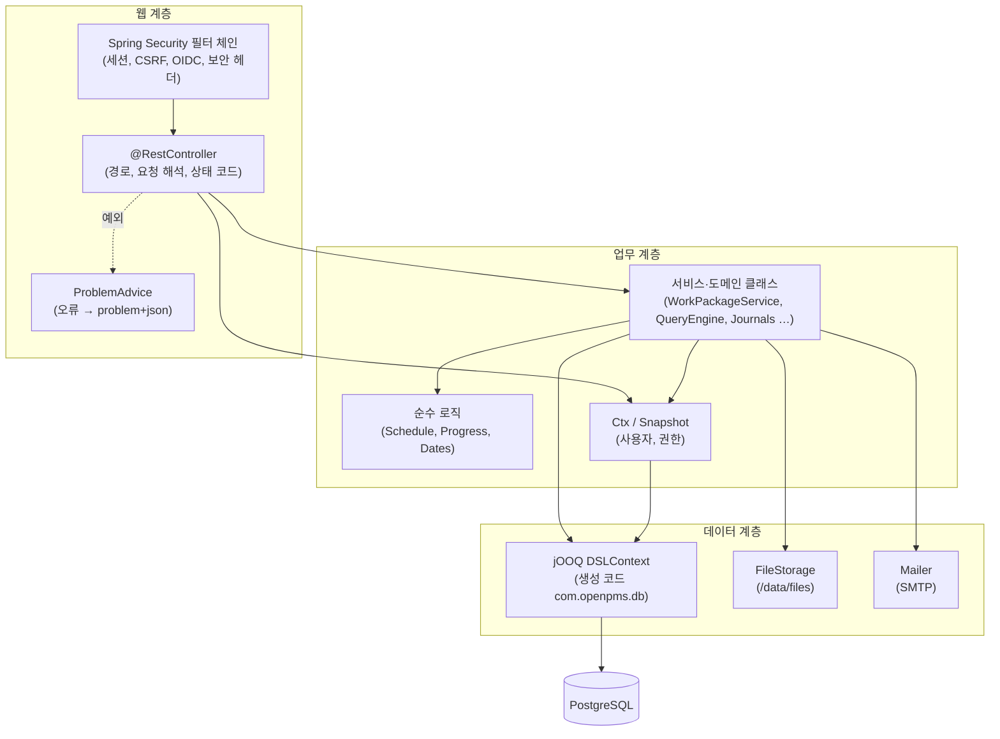
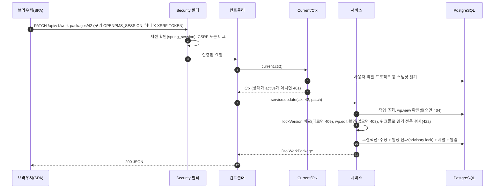
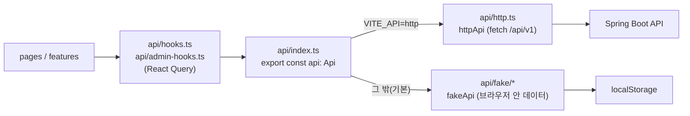
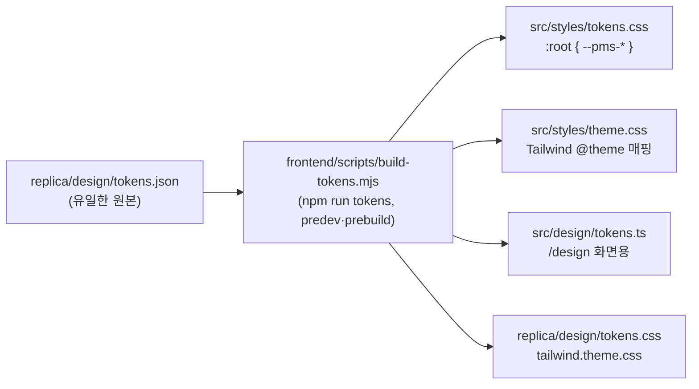
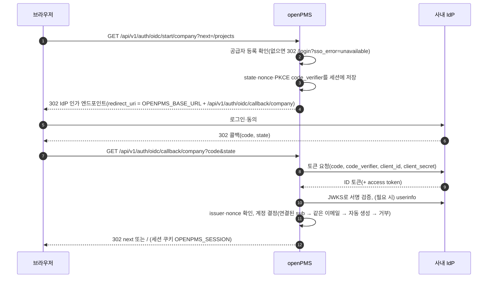

# 아키텍처 설계서

| 항목 | 내용 |
| --- | --- |
| 문서명 | openPMS 아키텍처 설계서 |
| 문서 번호 | OPMS-DEL-03 |
| 버전 | 1.2 |
| 작성일 | 2026-10-10 |
| 작성자 | openPMS 개발팀 |
| 기준 소스 | 커밋 31e39bd |

## 개정 이력

| 버전 | 일자 | 작성자 | 내용 |
| --- | --- | --- | --- |
| 1.0 | 2026-10-10 | openPMS 개발팀 | 최초 작성. 소스 코드 기준으로 시스템 구조, SW 스택, 패키지 구조, 공통 관심사, 품질 속성을 정리함 |
| 1.1 | 2026-10-11 | openPMS 개발팀 | 목록 그룹화·합계, 보드 개선, 날짜·시간 형식 설정 반영 |
| 1.2 | 2026-10-11 | openPMS 개발팀 | 문서 점검 후속(384a2f9, 31e39bd) 반영: 리버스 프록시 뒤 클라이언트 주소(`OPENPMS_TRUSTED_PROXIES`, `OPENPMS_FORWARD_HEADERS`), 로그인 실패 잠금의 관리 화면 표시, SSO 사용자의 비밀번호 만들기, 표시 형식의 인스턴스 간 반영(30초), 목록 합계 완료 %의 진행률 설정 적용, `/design` 로그인 필요. 후속 90006c2: 기본 신뢰 프록시에 Podman 네트워크(10.88–89.x) 추가 |

## 목차

1. [개요](#1-개요)
2. [아키텍처 원칙과 제약](#2-아키텍처-원칙과-제약)
3. [시스템 컨텍스트](#3-시스템-컨텍스트)
4. [배포 구조](#4-배포-구조)
5. [SW 스택](#5-sw-스택)
6. [백엔드 구조](#6-백엔드-구조)
7. [프론트엔드 구조](#7-프론트엔드-구조)
8. [공통 관심사](#8-공통-관심사)
9. [품질 속성과 설계 결정](#9-품질-속성과-설계-결정)
10. [부록 A. 계획 문서와 구현의 차이](#10-부록-a-계획-문서와-구현의-차이)

---

## 1. 개요

### 1.1 목적

이 문서는 openPMS의 소프트웨어 아키텍처를 정의합니다. 시스템이 어떤 구성 요소로 이루어지는지, 각 구성 요소가 어떤 기술을 쓰는지, 인증·권한·트랜잭션·오류 처리 같은 공통 관심사를 어떻게 처리하는지를 설명합니다. 개발, 운영, 감리 담당자가 같은 그림을 보고 판단할 수 있게 하는 것이 목적입니다.

### 1.2 범위

- 대상 시스템: openPMS. OpenProject 17.9.1의 작업 패키지·계획 기능을 사내용으로 다시 만든 클린룸 구현입니다. 원본의 소스 코드는 참고하지 않았습니다.
- 대상 구성 요소: 웹 화면(SPA), REST API 서버, 데이터베이스, 외부 연동(SMTP, OpenID Connect 공급자)
- 기준: 소스 코드가 기준입니다. 계획 문서(`replica/architecture.md`)와 다른 부분은 [부록 A](#10-부록-a-계획-문서와-구현의-차이)에 정리했습니다.

### 1.3 참조 문서

| 문서 | 위치 | 비고 |
| --- | --- | --- |
| 아키텍처 계획 | `replica/architecture.md` | 일부 내용은 구현과 다름(부록 A) |
| 백엔드 구현 기록 | `replica/backend.md` | |
| 배포 안내 | `replica/deploy.md` | 운영 절차의 기준 |
| 인터페이스 정의서 | `docs/deliverables/04-인터페이스정의서.md` | REST API 상세 |
| DB 스키마 | `backend/src/main/resources/db/migration/V1__init.sql` ~ `V10__oidc.sql` | |

### 1.4 용어

| 용어 | 뜻 |
| --- | --- |
| 작업 패키지(WP) | 일감 하나. 번호(`#123`)로 식별합니다. |
| 저널 | 작업 패키지의 변경 이력과 코멘트 한 건 |
| SPA | Single Page Application. 브라우저에서 동작하는 React 화면 |
| `Ctx` | 요청 하나의 사용자와 권한 계산 맥락(`core/Ctx.java`) |
| 스냅샷 | 권한 계산과 응답 조립에 쓰는 작은 기준 테이블들을 요청마다 한 번 읽어 둔 것(`core/Snapshot.java`) |
| IdP | 사내 계정 시스템(OpenID Connect 공급자) |
| 문제 상세 | RFC 9457 `application/problem+json` 오류 응답 |

---

## 2. 아키텍처 원칙과 제약

| 구분 | 내용 |
| --- | --- |
| 배포 단위 | 앱 컨테이너 하나(SPA + API)와 PostgreSQL 하나. 마이크로서비스와 별도 메시지 큐는 두지 않습니다. |
| 호스팅 | 사내 서버 셀프 호스팅(Docker Compose 또는 Podman). TLS는 사내 리버스 프록시에서 끝냅니다. |
| 같은 출처 | SPA와 API를 같은 출처에서 제공합니다. CORS 설정이 없고, 세션 쿠키와 CSRF 쿠키를 그대로 씁니다. |
| 클린룸 | OpenProject의 소스 코드, 내부 API, 문구를 쓰지 않습니다. 경로와 문구는 openPMS가 새로 정했습니다. |
| 비밀값 | 비밀값은 환경 변수(`.env`)로만 받습니다. 저장소에는 값이 빈 `.env.example`만 있습니다. 예외로 SSO 클라이언트 시크릿은 DB에 저장합니다(8.1.7). |
| SQL 우선 | 데이터 접근은 jOOQ로 SQL을 직접 다룹니다. 스키마는 Flyway 마이그레이션이 관리합니다. |
| 순수 로직 분리 | 일정 계산(`wp/Schedule.java`)과 진행률 계산(`wp/Progress.java`)은 DB와 Spring에 의존하지 않는 순수 Java로 둡니다. |
| 화면과 서버의 계약 | 백엔드 `api/Dto.java`와 프론트엔드 `src/api/types.ts`가 필드 단위로 같습니다. 화면은 `Api` 인터페이스만 거칩니다. |

---

## 3. 시스템 컨텍스트

### 3.1 컨텍스트 다이어그램



### 3.2 외부 주체와 연동

| 주체 | 방향 | 내용 | 프로토콜 |
| --- | --- | --- | --- |
| 사용자·관리자 | 브라우저 → openPMS | 화면 사용, API 호출 | HTTPS(프록시) → HTTP |
| 사내 리버스 프록시 | 프록시 → openPMS | TLS 종료, 업로드 한도 30MB 이상, `X-Forwarded-For`·`X-Forwarded-Proto` 헤더 전달(8.1.4) | HTTP |
| PostgreSQL 17 | openPMS → DB | 업무 데이터, 세션, 예약 작업 상태 | JDBC |
| 사내 SMTP 릴레이 | openPMS → SMTP | 초대, 비밀번호 재설정, 비밀번호 만들기, 멘션 알림, 요약 메일 | SMTP |
| 사내 IdP | openPMS ↔ IdP | SSO 로그인(인가 코드 + PKCE) | HTTPS, OpenID Connect |

외부 시스템이 openPMS를 호출하는 인터페이스(웹훅, API 토큰)는 없습니다.

---

## 4. 배포 구조

### 4.1 배포 다이어그램



### 4.2 구성 요소

| 구성 요소 | 이미지·위치 | 포트 | 설명 |
| --- | --- | --- | --- |
| `app` | `Dockerfile`로 빌드한 `openpms:latest` | 컨테이너 8090, 호스트 `127.0.0.1:${OPENPMS_PORT:-8090}` | SPA, REST API, 예약 작업, 헬스 체크를 한 프로세스에서 제공합니다. 권한 없는 사용자 `openpms`(uid 10001)로 실행합니다. |
| `db` | `docker.io/library/postgres:17` | 호스트에 열지 않음 | `app`만 접속합니다. `pg_isready` 헬스 체크가 통과한 뒤 `app`이 시작합니다. |
| 볼륨 `files` | `/data/files` | - | 첨부 파일 원본 |
| 볼륨 `db` | `/var/lib/postgresql/data` | - | DB 파일 |

### 4.3 이미지 빌드 단계

| 단계 | 베이스 이미지 | 하는 일 |
| --- | --- | --- |
| 1. web | `node:24-alpine` | `npm ci` 후 `npm run build`. 디자인 토큰을 CSS로 만들고(`prebuild`), 결과를 `backend/src/main/resources/static`에 씁니다. |
| 2. jar | `eclipse-temurin:21-jdk` | 1단계 결과를 넣고 `gradlew bootJar -x test`. jOOQ 생성 코드는 저장소에 있어 빌드에 DB가 필요 없습니다. |
| 3. runtime | `eclipse-temurin:21-jre` | jar만 복사합니다. `-XX:MaxRAMPercentage=75`로 실행합니다. |

운영 웹 빌드는 `VITE_API=http`가 없으면 실패합니다(`frontend/vite.config.ts`). 브라우저 안 가짜 데이터 계층이 운영 이미지에 실리는 것을 막기 위한 장치입니다.

### 4.4 시작 순서

1. `db` 컨테이너가 뜨고 헬스 체크를 통과합니다.
2. `app`이 시작하면 Flyway가 미적용 마이그레이션(V1~V10)을 적용합니다. 실패하면 앱이 뜨지 않습니다.
3. `FirstAdmin`이 활성 관리자가 없고 `OPENPMS_ADMIN_EMAIL`이 있으면 초대 상태의 관리자를 만들고, 24시간짜리 설정 링크를 로그에 한 번 출력합니다.
4. `OPENPMS_JOBS_ENABLED`가 true이면 예약 작업 스케줄러가 시작합니다.

백업은 앱이 하지 않습니다. 호스트에서 `pg_dump -Fc`와 `files` 볼륨 압축을 같은 시각에 받습니다(`replica/deploy.md`).

---

## 5. SW 스택

버전은 `backend/build.gradle.kts`, `frontend/package.json`(실제 설치 버전은 `package-lock.json`), `Dockerfile`, `compose.yaml`, `gradle-wrapper.properties`에서 가져왔습니다. "Boot 관리"는 Spring Boot 4.1.1의 의존성 관리가 정하는 버전이라는 뜻입니다.

### 5.1 실행 환경

| 구분 | 제품 | 버전 | 근거 |
| --- | --- | --- | --- |
| 런타임 | Eclipse Temurin JRE | 21 | `Dockerfile` |
| 언어 | Java | 21 (toolchain) | `build.gradle.kts` |
| 빌드 | Gradle | 9.7.1 | `gradle-wrapper.properties` |
| 웹 빌드 | Node.js | 24 (alpine) | `Dockerfile` |
| DBMS | PostgreSQL | 17 | `compose.yaml` |
| 컨테이너 | Docker Compose 또는 Podman | - | `compose.yaml` |

### 5.2 백엔드

| 구분 | 라이브러리 | 버전 | 용도 |
| --- | --- | --- | --- |
| 프레임워크 | Spring Boot (webmvc, validation, actuator) | 4.1.1 | REST API, 정적 SPA 제공, 헬스 체크 |
| 의존성 관리 | io.spring.dependency-management | 1.1.7 | |
| 보안 | spring-boot-starter-security | Boot 관리 | 세션 인증, CSRF, 보안 헤더 |
| SSO | spring-boot-starter-security-oauth2-client | Boot 관리 | OpenID Connect 로그인 |
| 세션 | spring-boot-starter-session-jdbc | Boot 관리 | 세션을 PostgreSQL(`spring_session`)에 저장 |
| 데이터 접근 | spring-boot-starter-jooq, jOOQ codegen 플러그인 | 플러그인 3.21.7 | 타입 안전 SQL, 코드 생성(`src/main/generated`) |
| 마이그레이션 | spring-boot-starter-flyway, flyway-database-postgresql | Boot 관리 | V1~V10 마이그레이션 |
| JDBC | org.postgresql:postgresql | Boot 관리 | |
| 메일 | spring-boot-starter-mail | Boot 관리 | 사내 SMTP 발송 |
| 템플릿 | spring-boot-starter-thymeleaf | Boot 관리 | 의존성만 있고 코드에서 쓰지 않음(메일은 일반 텍스트) |
| 예약 작업 | com.github.kagkarlsson:db-scheduler | 16.12.0 | 반복 작업, 클러스터 안전 실행 |
| HTML 정화 | owasp-java-html-sanitizer | 20260924.2 | 설명·코멘트 XSS 방지 |
| 요청 제한 | bucket4j_jdk17-core | 8.21.0 | 로그인·재설정·비밀번호 변경·비밀번호 만들기 제한 |
| 형식 판별 | Apache Tika core | 3.3.2 | 첨부 파일 형식을 내용으로 판별 |
| 엑셀 | Apache POI (poi-ooxml) | 5.4.1 | XLSX 내보내기 |
| JSON | Jackson 3 (`tools.jackson`) | Boot 관리 | 직렬화 |
| 테스트 | spring-boot-starter-webmvc-test, security-test, jooq-test, JUnit Platform | Boot 관리 | 통합 테스트(`*IT`), 단위 테스트 |

### 5.3 프론트엔드

| 구분 | 라이브러리 | 버전(설치) | 용도 |
| --- | --- | --- | --- |
| UI | React, React DOM | 19.3.0 | 화면 |
| 언어 | TypeScript | 7.0.2 | |
| 빌드 | Vite, @vitejs/plugin-react | 8.3.4 / ^6.1.2 | 개발 서버, 운영 빌드 |
| 라우팅 | react-router | 8.4.0 | SPA 라우트 |
| 서버 상태 | @tanstack/react-query | 5.104.1 | 캐시, 재시도, 무효화 |
| 스타일 | Tailwind CSS, @tailwindcss/vite | 4.3.3 | 디자인 토큰 기반 유틸리티 |
| 프리미티브 | radix-ui | 1.7.0 | 접근성 있는 대화상자·메뉴·탭 |
| 보조 | class-variance-authority, clsx, tailwind-merge | ^0.7.1 / ^2.1.1 / ^3.7.0 | 컴포넌트 변형, 클래스 결합 |
| 아이콘 | lucide-react | 1.54.0 | |
| 글꼴 | pretendard | ^1.3.9 | 한글 글꼴 |
| 리치 텍스트 | @tiptap/react, starter-kit, mention, suggestion 등 | 3.31.3 | 설명·코멘트 편집, @멘션 |
| 캘린더 | @fullcalendar/core, daygrid, interaction, react | 6.1.21 | 캘린더 화면 |
| 드래그 앤 드롭 | @dnd-kit/core, sortable, utilities | 6.3.1 / ^10.0.0 / ^3.2.2 | 보드 카드·열 이동 |
| 다국어 | i18next, react-i18next | 26.4.2 / 17.0.16 | 문자열 관리(한국어) |
| E2E 테스트 | @playwright/test, @axe-core/playwright | 1.64.0 / ^4.13.0 | 화면 흐름, 접근성 점검 |

Gantt 차트(`features/gantt/gantt-chart.tsx`)와 팀 플래너 격자(`features/planning/planner-grid.tsx`)는 외부 라이브러리 없이 직접 만들었습니다.

---

## 6. 백엔드 구조

### 6.1 계층 구조



컨트롤러는 단순한 CRUD(프로젝트, 보드, 관리 등)에서는 직접 jOOQ를 쓰고, 규칙이 많은 영역(작업 패키지, 목록, 일정)은 서비스 클래스에 맡깁니다. 별도 리포지토리 계층은 두지 않았습니다.

### 6.2 패키지 구조와 역할

기준 경로: `backend/src/main/java/com/openpms/`

| 패키지 | 주요 클래스 | 역할 |
| --- | --- | --- |
| (루트) | `OpenPmsApplication` | Spring Boot 진입점 |
| `admin` | `AdminController` | 관리 기능: 유형(양식 포함), 상태, 우선순위, 워크플로, 역할·권한 키, 사용자(초대·잠금·로그인 실패 잠금 표시와 해제·익명화), 그룹, 로그인·비밀번호 설정, 진행률 설정, 근무일·휴무일 |
| `api` | `Dto` | API 응답·요청의 JSON 모양(record). 프론트엔드 `types.ts`와 같은 필드 |
| `attachment` | `AttachmentController`, `FileStorage` | 작업 패키지 첨부 업로드·다운로드·삭제, 로컬 볼륨 저장소 |
| `auth` | `SecurityConfig`, `AuthController`, `OidcController`, `OidcLogin`, `OidcProviders`, `PasswordPolicy`, `RateLimiter`, `Sessions`, `Tokens`, `FirstAdmin` | 보안 필터 체인, 폼 로그인·로그아웃, 비밀번호 재설정·비밀번호 만들기·초대 토큰, 비밀번호 정책, 요청 제한, 세션 종료, OIDC SSO, 첫 관리자 생성 |
| `board` | `BoardController` | 보드(기본·상태·담당자·버전), 열 관리, 카드 이동, 기본 보드의 카드 넣기·빼기, 열에서 카드 만들기, 보드 필터(저장·저장 없이 보기). 필터 조건은 `QueryEngine.where`를 씀 |
| `common` | `ApiException`, `ProblemAdvice`, `In`, `Dates`, `DisplayFormats`, `Html`, `Mailer`, `SettingsRepo`, `SpaConfig` | 오류 형식, 입력 해석(잘못된 값은 422), 근무일 계산·날짜 글자 표기, 날짜·시간 형식과 주 시작 요일 설정, HTML 정화, 메일 발송, 전역 설정 읽기·쓰기, SPA 폴백 |
| `core` | `Ctx`, `Current`, `Snapshot`, `Refs`, `Text` | 요청별 사용자·권한 계산, 기준 테이블 스냅샷, 참조 DTO 변환, 한국어 정렬 |
| `customfield` | `CustomFieldController`, `CustomFields` | 사용자 정의 필드 정의(관리), 프로젝트별 사용 설정, 값 검사·표시 |
| `jobs` | `Jobs`, `JobCatalog`, `DateAlerts`, `MailJobs`, `Housekeeping`, `DevJobsController` | db-scheduler 반복 작업(날짜 알림, 멘션·요약 메일, 토큰·파일 정리), dev 프로필 전용 수동 실행 경로 |
| `misc` | `MiscController`, `SearchController` | 근무일 달력 조회, 헤더 검색 제안, 표시 형식 조회(로그인 사용자)·저장(관리자), 검색 결과 |
| `notification` | `NotificationController`, `AccountController`, `NotificationSettings`, `NotificationTexts` | 알림함, 내 계정(프로필·비밀번호 변경·비밀번호 만들기 링크 요청·세션·환경설정), 알림 설정 |
| `project` | `ProjectController` | 프로젝트(생성·수정·보관·삭제·즐겨찾기·개요·유형), 멤버, 주체 검색, 카테고리, 버전 |
| `query` | `QueryController`, `QueryEngine`, `ExportController` | 목록 쿼리 실행(필터·정렬·계층·그룹·합계), 필터 선택지, 저장된 보기, CSV·XLSX 내보내기. 그룹·합계는 페이지가 아니라 조건에 맞는 전체 작업으로 계산하고, 그룹화하면 계층 표시를 끔. 합계의 완료 %는 진행률 설정을 따름(D-23) |
| `wp` | `WorkPackageController`, `WorkPackageService`, `WorkPackageTransfers`, `Assembler`, `Journals`, `Schedule`, `ScheduleStore`, `Progress`, `TypeForms` | 작업 패키지 생성·수정·삭제, 복사·이동·일괄, 코멘트, 주시, 관계, 공유, 일정 미리 보기, 저널과 알림 생성, 일정·진행률 계산, 유형 양식 |
| `com.openpms.db` (생성) | `Tables`, `*Record` | jOOQ 코드 생성 결과(`src/main/generated`). 손으로 고치지 않습니다. |

### 6.3 요청 처리 흐름



### 6.4 데이터 접근과 스키마

- jOOQ 코드는 마이그레이션이 적용된 개발 DB에서 생성해 저장소에 넣습니다(`scripts/dev.sh gradle jooqCodegen`). 라이브러리 테이블(`spring_session*`, `scheduled_tasks`, `flyway_schema_history`)은 생성 대상에서 뺐습니다.
- 마이그레이션 목록

| 버전 | 파일 | 내용 |
| --- | --- | --- |
| V1 | `V1__init.sql` | 업무 스키마(`replica/schema.sql`) |
| V2 | `V2__libraries.sql` | Spring Session JDBC, db-scheduler 테이블 |
| V3 | `V3__seed.sql` | 기준 데이터(역할, 상태, 유형, 기본 워크플로 등). 데모 데이터는 없음 |
| V4 | `V4__jobs.sql` | 예약 작업용 컬럼(요약 메일 시각 등) |
| V5 | `V5__keep_updated_at.sql` | 설정 변경 시 `updated_at` 유지 트리거 예외 |
| V6 | `V6__work_package_shares.sql` | 작업 패키지 공유 |
| V7 | `V7__overdue_alert_default.sql` | 기한 지남 알림 기본값 |
| V8 | `V8__my_page_widgets.sql` | 내 페이지 위젯 |
| V9 | `V9__type_forms_default.sql` | 유형 양식 기본값 |
| V10 | `V10__oidc.sql` | SSO 공급자(`oidc_providers`), 계정 연결(`user_identities`) |

- dev 프로필은 `db/dev`의 V1000·V1001(개발 데이터)을 추가로 적용합니다(`out-of-order: true`).
- 작은 기준 테이블(사용자, 역할, 프로젝트, 멤버, 유형, 상태, 우선순위, 워크플로, 버전, 카테고리, 설정)은 요청마다 `Snapshot`으로 한 번 읽습니다. 작업 패키지와 저널은 항상 직접 조회합니다. 사내 규모(기준 테이블 수백 행)를 전제로 한 선택입니다.

---

## 7. 프론트엔드 구조

### 7.1 디렉터리 구조

기준 경로: `frontend/src/`

| 디렉터리 | 내용 |
| --- | --- |
| `main.tsx` | 진입점 |
| `app/` | 라우터(`router.tsx`), 전역 Provider(`providers.tsx`: React Query, 툴팁, 토스트), 인증 상태(`auth.tsx`), 레이아웃, 프로젝트 맥락, 헤더 검색 |
| `api/` | 데이터 계층. `Api` 인터페이스, 타입, 오류, React Query 훅, 가짜·HTTP 구현 |
| `pages/` | 라우트 단위 화면(로그인, 홈, 프로젝트, 작업 목록, Gantt, 보드, 캘린더·팀 플래너, 알림, 검색, 계정, 관리) |
| `features/` | 여러 화면이 함께 쓰는 기능 단위 컴포넌트(작업 패키지 상세·표·필터·날짜 대화상자, Gantt 차트, 계획 격자, 관리 공통) |
| `components/` | `ui/`(버튼, 선택, 대화상자 등 기본 컴포넌트), `domain/`(리치 텍스트 편집기, 작업 카드), `shell/`(앱 셸) |
| `i18n/` | i18next 초기화와 한국어 문자열(`ko.ts`) |
| `design/` | 디자인 토큰 TS 사본(`tokens.ts`, 생성 파일) |
| `styles/` | `tokens.css`·`theme.css`(생성 파일), `index.css`, `calendar.css` |
| `lib/` | 날짜(관리자가 정한 표시 형식·주 시작 요일 적용: `dates.ts`의 `configureDisplay`), 색, 텍스트, 테마, 미저장 경고 등 유틸리티 |
| `../e2e/` | Playwright E2E 테스트(가짜 IdP `fake-idp.mjs` 포함) |

### 7.2 데이터 계층: `Api` 인터페이스와 두 구현



| 파일 | 역할 |
| --- | --- |
| `api/api.ts` | `Api` 인터페이스. 영역별 메서드 묶음: `auth`, `account`, `projects`, `categories`, `versions`, `members`, `principals`, `workPackages`, `queries`, `boards`, `notifications`, `calendar`, `search`, `admin` |
| `api/types.ts` | 요청·응답 타입. 백엔드 `Dto.java`와 필드가 같습니다. |
| `api/http.ts` | 실제 구현. `/api/v1` 경로마다 fetch 한 번. 쿠키 `XSRF-TOKEN`을 읽어 GET 이외 요청에 `X-XSRF-TOKEN` 헤더를 붙입니다. 오류 응답의 `title`·`detail`·`errors`·`current`를 `ApiError`로 바꿉니다. 업로드는 multipart, 내보내기는 Blob으로 받습니다. |
| `api/fake/` | 백엔드가 없던 단계에 만든 브라우저 안 구현. `schema.sql`과 같은 모양의 테이블을 메모리와 localStorage에 둡니다. 권한, 일정, 진행률, 쿼리 규칙을 서버와 같은 규칙으로 구현해 두었고, 서버 구현의 동작 기준이 되었습니다. |
| `api/errors.ts` | `ApiError(status, title, detail, {fieldErrors, current})` |
| `api/hooks.ts`, `api/admin-hooks.ts` | React Query 훅. 401·403·404는 재시도하지 않고, 그 밖의 실패는 한 번 재시도합니다. 창 포커스 때 다시 읽지 않고, 10초 동안 신선한 값으로 봅니다. |

- 선택 규칙: `VITE_API=http`이면 HTTP 구현, 아니면 가짜 구현(`api/index.ts`). 운영 빌드는 `.env.production`에 `VITE_API=http`가 있어야 빌드됩니다.
- 개발 서버는 `/api`를 `http://localhost:8090`(또는 `OPENPMS_API_URL`)으로 프록시합니다.

### 7.3 화면(pages)과 기능(features)

| 영역 | 라우트(예) | 화면 파일 | 주요 기능 컴포넌트 |
| --- | --- | --- | --- |
| 인증 | `/login`, `/password-reset`, `/invitations/:token` | `pages/login.tsx`, `pages/auth-links.tsx` | SSO 버튼, 비밀번호 정책 안내 |
| 홈·내 페이지 | `/`, `/my/page` | `pages/home.tsx`, `pages/my-page.tsx` | 위젯 |
| 계정·알림 설정 | `/my/account`, `/my/notifications` | `pages/account.tsx`, `pages/notification-settings.tsx` | |
| 알림함 | `/notifications`, `/notifications/details/:number/:tab?` | `pages/notifications.tsx` | 분할 상세 |
| 검색 | `/search` | `pages/search.tsx` | `app/search-box.tsx` |
| 프로젝트 | `/projects`, `/projects/new`, `/projects/:p`, `/projects/:p/members`, `/projects/:p/settings/:section` | `pages/projects/*` | |
| 작업 목록 | `/work-packages`, `/projects/:p/work-packages`(분할 상세, 전체 상세, 새 작업) | `pages/work-packages/*` | `features/work-packages/*`(표, 필터, 속성, 활동, 관계, 파일, 주시자, 공유, 날짜 대화상자, 일괄 편집, 내보내기, 복사·이동) |
| Gantt | `/gantt`, `/projects/:p/gantt` | `pages/gantt.tsx` | `features/gantt/gantt-chart.tsx` |
| 보드 | `/projects/:p/boards`, `/boards/new`, `/boards/:id` | `pages/boards/*` | dnd-kit, 보드 필터(목록과 같은 `features/work-packages/filter-panel`), 열에서 카드 만들기, 기본 보드의 작업 넣기 |
| 캘린더·팀 플래너 | `/projects/:p/calendar(/:id)`, `/projects/:p/team-planner(/:id)` | `pages/planning/*` | `features/planning/*`, FullCalendar |
| 관리 | `/admin/types`, `/admin/types/:id/form`, `/admin/custom-fields`, `/admin/progress`, `/admin/authentication`, `/admin/statuses`, `/admin/workflows`, `/admin/priorities`, `/admin/roles(/:id)`, `/admin/users`, `/admin/groups`, `/admin/calendar` | `pages/admin/*` | `features/admin/common.tsx` |
| 디자인 확인 | `/design`(도움말 메뉴) | `pages/design-page.tsx` | 토큰·컴포넌트 견본. 384a2f9부터 로그인 필요(`RequireAuth`)이고, 캘린더처럼 별도 청크로 지연 로딩 |

서버는 파일이 없는 화면 주소(`/projects/web-platform` 등)에 `index.html`을 돌려주고, 클라이언트 라우터가 화면을 고릅니다(`common/SpaConfig.java`). `/api/`, `/actuator/`, 점(`.`)이 들어간 경로는 폴백하지 않습니다.

### 7.4 다국어(i18n)

- i18next + react-i18next로 문자열을 관리합니다(`src/i18n/index.ts`).
- 지금 제공하는 언어는 한국어 하나입니다(`lng: "ko"`, `fallbackLng: "ko"`). 문자열은 `src/i18n/ko.ts`에 있고, `Messages` 타입으로 키를 검사합니다.
- 영어를 추가하려면 같은 키를 가진 리소스 파일을 하나 더 만듭니다(features.csv의 could 항목).
- 서버가 만드는 문구(오류 제목·설명, 메일 본문, 알림 요약)는 서버 코드에 한국어로 들어 있습니다. 서버 쪽 다국어 기능(MessageSource)은 쓰지 않습니다.

### 7.5 디자인 토큰과 테마



- 색, 글꼴, 간격, 반경, 그림자를 `tokens.json` 한 곳에서 정하고, 스크립트가 CSS 변수(`--pms-*`)와 Tailwind 테마(`bg-surface`, `text-muted` 등)를 만듭니다. 생성 파일은 손으로 고치지 않습니다.
- 명도 대비는 `npm run contrast`(`replica/design/contrast.py`)로 점검합니다.
- 테마는 `system`·`light`·`dark` 세 가지입니다. `system`은 운영체제 설정(미디어 쿼리)을 따르고, 나머지는 `<html data-theme>`로 고정합니다(`lib/theme.ts`). 선택값은 서버(`users.theme`)에 저장하고, 첫 화면 깜빡임을 줄이려고 브라우저 localStorage에도 둡니다.
- 한글 글꼴은 Pretendard를 씁니다.

---

## 8. 공통 관심사

### 8.1 인증

#### 8.1.1 세션

| 항목 | 내용 |
| --- | --- |
| 방식 | 서버 세션. Spring Session JDBC가 세션을 PostgreSQL `spring_session` 테이블에 저장합니다. |
| 쿠키 | `OPENPMS_SESSION`, HttpOnly, SameSite=Lax, Secure(기본 `OPENPMS_SECURE_COOKIES=true`, dev 프로필만 해제) |
| 유지 시간 | `OPENPMS_SESSION_TIMEOUT`(기본 8h) |
| 세션 고정 방지 | 로그인할 때 세션 ID를 바꿉니다(`changeSessionId`). |
| 재시작 | 세션이 DB에 있으므로 앱을 다시 시작해도 로그인이 유지됩니다. |
| 즉시 무효화 | 요청마다 `Current.ctx()`가 사용자 상태를 확인하고, `active`가 아니면 401을 돌려줍니다. 잠금·익명화된 사용자의 남은 세션은 바로 쓸 수 없게 됩니다. 관리자 잠금, 익명화, 비밀번호 재설정은 그 사람의 세션 행을 모두 지웁니다(`Sessions.endAll`). 비밀번호 변경과 "다른 기기 로그아웃"은 현재 세션만 남깁니다(`Sessions.endOthers`). |
| 인증 불필요 경로 | `/api/v1/auth/login`, `/password-reset`, `/password-reset/confirm`, `/password-policy`, `/invitations/**`, `/sso-providers`, `/oidc/**`. `/api/**`의 나머지는 모두 로그인이 필요합니다. `/api` 밖(SPA 정적 파일, `/actuator/health`)은 공개입니다. |

폼 로그인, HTTP Basic, Spring 기본 로그아웃은 껐습니다. 로그인과 로그아웃은 `AuthController`가 JSON API로 처리합니다. 인증되지 않은 API 요청은 리디렉션 없이 401 문제 상세를 받습니다.

#### 8.1.2 CSRF

- Spring Security의 SPA용 CSRF 설정(`csrf.spa()`)을 씁니다. 서버가 `XSRF-TOKEN` 쿠키를 내려 주고, SPA가 GET 이외 요청에 `X-XSRF-TOKEN` 헤더로 되돌려 보냅니다.
- 토큰이 없거나 맞지 않으면 403 문제 상세("요청을 확인할 수 없습니다. 페이지를 새로 고친 뒤 다시 시도하세요.")를 돌려줍니다.
- 로그인 요청도 CSRF 검사를 받습니다. 첫 GET(예: `/api/v1/auth/me`) 응답에서 쿠키를 받은 뒤 로그인합니다.

#### 8.1.3 비밀번호 정책

`auth/PasswordPolicy.java`가 정책을 계산하고, 비밀번호를 정하는 모든 경로(초대 수락, 재설정 확정, 비밀번호 변경)가 같은 검사를 합니다. 관리자는 `PUT /api/v1/admin/settings/auth`로 바꿉니다.

| 설정 키(`settings`) | 기본값 | 허용 범위 | 뜻 |
| --- | --- | --- | --- |
| `auth.password_min_length` | 10 | 8~128 | 최소 길이(최대 길이는 128 고정) |
| `auth.password_required_classes` | `[]` | lower, upper, digit, special | 꼭 넣어야 하는 문자 종류 |
| `auth.password_min_classes` | 0 | 0~4 | 섞어야 하는 종류 수(필수 종류 수 이상) |
| `auth.password_reset_enabled` | true | - | "비밀번호를 잊으셨나요?" 허용 |
| `auth.lockout_attempts` | 5 | 0~50 | 연속 실패 허용 횟수(0이면 잠그지 않음) |
| `auth.lockout_minutes` | 15 | 1~1440 | 잠금 시간 |
| `auth.invitation_ttl_hours` | 168 | 1~720 | 초대 링크 유효 시간 |
| `auth.password_reset_ttl_minutes` | 60 | 10~1440 | 재설정 링크 유효 시간 |

- 비밀번호는 `DelegatingPasswordEncoder`(기본 bcrypt)로 해시해 `users.password_hash`에 저장합니다. SSO로만 쓰는 계정은 해시가 없습니다. 이런 사람은 계정 설정에서 비밀번호 만들기 링크를 받아 비밀번호를 정할 수 있습니다(8.1.5).
- 위반하면 해당 필드(`password`, `newPassword`)에 422 필드 오류를 돌려줍니다.
- 로그인한 상태가 아닌 화면은 `GET /api/v1/auth/password-policy`로 규칙을 받아 미리 안내합니다. 화면 쪽 검사는 `frontend/src/api/password-policy.ts`가 서버와 같은 규칙으로 합니다.

#### 8.1.4 로그인 실패 잠금과 요청 제한

| 대상 | 규칙 | 응답 |
| --- | --- | --- |
| 로그인 실패 | 같은 계정이 연속 `lockout_attempts`회 실패하면 `users.locked_until = 지금 + lockout_minutes`. 성공하면 횟수를 0으로 되돌립니다. 실패 횟수 기록은 오류 응답이 나가도 롤백하지 않습니다(`noRollbackFor`). 상태(`status`)는 `active` 그대로이고, 관리 · 사용자 응답의 `lockedUntil`로 보입니다(화면 "일시 잠김", `status=locked` 필터에도 포함). 관리자가 `status=active`로 바꾸면 실패 횟수와 `locked_until`을 지웁니다(384a2f9). | 401(자격 증명 불일치), 423(잠김) |
| 관리자 잠금 | `users.status = locked` | 423 |
| 로그인 요청 수 | 클라이언트 주소당 분당 `openpms.logins-per-minute`(기본 20, dev 500) | 429 |
| 재설정 메일 요청 | 클라이언트 주소당 분당 5회 | 429 |
| 비밀번호 변경 | 사용자당 분당 10회 | 429 |
| 비밀번호 만들기 링크 | 사용자당 분당 3회 | 429 |

요청 제한은 Bucket4j 메모리 버킷입니다(`auth/RateLimiter.java`). 앱 인스턴스가 하나라는 전제입니다(인스턴스를 늘리면 인스턴스마다 따로 셉니다). 키가 1만 개를 넘으면 버킷을 비웁니다.

클라이언트 주소(384a2f9): 리버스 프록시 뒤에서는 모든 연결이 프록시에서 옵니다. `server.forward-headers-strategy: ${OPENPMS_FORWARD_HEADERS:native}`로 Tomcat RemoteIpValve를 켜고, `server.tomcat.remoteip.internal-proxies: ${OPENPMS_TRUSTED_PROXIES:…}`(기본: 이 호스트 127.x·::1, Docker 브리지 172.16–31.x, Podman 네트워크 10.88–89.x)에 맞는 주소에서 온 요청만 `X-Forwarded-For`·`X-Forwarded-Proto`를 믿습니다. 주소는 `X-Forwarded-For`를 오른쪽부터 읽어 믿는 프록시를 건너뛴 첫 주소이므로, 사용자가 앞에 가짜 주소를 붙여도 요청 제한을 피할 수 없습니다(`ClientAddressIT`). 전에는 프록시 뒤의 모든 사용자가 버킷 하나를 같이 썼습니다. 프록시 없이 쓸 때는 `OPENPMS_FORWARD_HEADERS=none`으로 헤더를 무시합니다. Podman 대역은 90006c2에서 더했습니다. rootless Podman은 게시한 포트로 들어온 연결을 컨테이너 자신의 주소(예: 10.89.1.3)에서 온 것으로 앱에 넘기므로, 이 대역이 없으면 헤더가 무시되어 모두가 다시 버킷 하나를 같이 씁니다(1.2 배포 스모크에서 발견, 고친 이미지로 확인). Docker의 192.168.x 풀은 기본값에 없으므로 그때는 변수를 정합니다.

#### 8.1.5 초대·비밀번호 재설정 토큰

- 32바이트 난수를 Base64URL로 만든 일회용 토큰입니다. 원문은 메일(또는 첫 관리자 로그)에만 있고, DB(`user_tokens`)에는 SHA-256 해시만 저장합니다.
- 새 토큰을 발급하거나 하나를 쓰면 같은 사용자·같은 용도의 다른 토큰은 모두 무효가 됩니다(`Tokens.revokeAll`).
- 만료, 사용됨, 알 수 없음은 모두 같은 410 응답입니다. 어떤 경우인지 드러내지 않습니다.
- 재설정 요청은 계정이 있든 없든 항상 202를 돌려줍니다(계정 존재 여부 노출 방지).
- 재설정을 확정하면 그 계정의 모든 세션이 끝납니다. 초대를 수락하면 바로 로그인됩니다.
- 비밀번호 만들기(384a2f9): 비밀번호가 없는 사람(SSO 전용)이 `POST /api/v1/me/password/setup`을 부르면 재설정과 같은 `password_reset` 토큰(유효 `auth.password_reset_ttl_minutes`)을 본인 주소로 보냅니다. 링크는 재설정 화면(`/password-reset?token=…`)입니다. `auth.password_reset_enabled`와 관계없이 보낼 수 있고, 링크가 본인 메일로만 가므로 빌린 세션만으로는 비밀번호를 더할 수 없습니다. 이미 비밀번호가 있으면 422입니다.
- 만료되거나 쓴 지 7일 지난 토큰은 `token-cleanup` 작업이 지웁니다.

#### 8.1.6 첫 관리자

활성 관리자가 없고 `OPENPMS_ADMIN_EMAIL`이 있으면, 시작할 때 그 주소로 초대 상태의 관리자를 만들고 24시간짜리 설정 링크를 로그에 한 번(WARN) 출력합니다. 기본 비밀번호는 없습니다. 관리자가 생기기 전에는 시작할 때마다 새 링크가 나오고 이전 링크는 무효가 됩니다. 그 주소가 이미 초대 상태가 아닌 계정이면 바꾸지 않고 경고만 남깁니다.

#### 8.1.7 OIDC SSO

관리자가 관리 화면에서 OpenID Connect 공급자를 등록하면, 로그인 화면에 공급자마다 버튼이 생깁니다. 이메일·비밀번호 로그인은 그대로 남습니다.

| 구성 요소 | 역할 |
| --- | --- |
| `OidcProviders` | DB(`oidc_providers`)의 공급자를 Spring Security `ClientRegistration`으로 바꿉니다. 처음 쓸 때 발견 문서(`{issuer}/.well-known/openid-configuration`)를 읽어 메모리에 둡니다. 수정·삭제하면 캐시에서 지웁니다. 꺼졌거나 없거나 닿지 않는 공급자는 등록이 없습니다. |
| `SecurityConfig.oauth2Login` | 인가 코드 흐름. 시작 `/api/v1/auth/oidc/start/{slug}`, 콜백 `/api/v1/auth/oidc/callback/{slug}`. IdP 토큰은 저장하지 않습니다(`noTokenStore`). |
| `OidcLogin` | PKCE(S256)를 켜고, 돌아갈 경로(`next`, 같은 사이트 경로만)를 세션에 둡니다. 로그인 성공 후 openPMS 계정을 결정하고, 폼 로그인과 같은 세션을 만듭니다. 실패하면 `/login?sso_error=<코드>`로 보냅니다. |
| `OidcController` | 공개 버튼 목록, 관리용 공급자 CRUD. 클라이언트 시크릿은 응답에 넣지 않고 저장 여부(`secretSet`)만 보여 줍니다. |



계정 결정 규칙(`OidcLogin.resolveUser`)

1. 이 공급자의 `sub`에 이미 연결된 계정
2. 없으면 이메일 클레임이 같은 계정. 공급자가 `email_verified=false`를 보내면 거부(`unverified`). 값이 없으면 확인된 것으로 봅니다. 연결을 새로 만듭니다(계정당 공급자별 `sub` 하나).
3. 없고 공급자의 "계정 자동 생성"이 켜져 있으면 새 활성 계정(관리자 아님, 비밀번호 없음)
4. 그 밖에는 거부(`no_account`)

잠긴 계정(`locked`, 로그인 실패 잠금 시간 중)은 거부하고, 초대 상태 계정은 활성으로 바꿉니다. 자동 생성 계정은 비밀번호가 없습니다. `GET /api/v1/auth/me`의 `hasPassword`(false)와 `signInWith`(연결된 공급자 표시 이름)로 계정 설정 화면이 비밀번호 만들기 안내를 보여 줍니다(8.1.5). 거부 코드는 `no_account`, `locked`, `unverified`, `no_email`, `cancelled`, `unavailable`, `failed`입니다.

보안상 주의: 클라이언트 시크릿은 DB `oidc_providers.client_secret`에 평문으로 저장됩니다. DB 백업 파일은 `.env`와 같은 수준으로 보호해야 합니다(`replica/deploy.md` 보안 메모).

### 8.2 권한

#### 8.2.1 `Ctx`와 권한 계산

요청마다 `Current.ctx()`가 세션의 사용자 ID로 `Ctx`를 만들고 요청 범위에 한 번만 둡니다. `Ctx`는 `Snapshot`에서 권한을 계산하고, 프로젝트별 결과를 요청 안에서 캐시합니다.

| 규칙 | 내용 |
| --- | --- |
| 관리자 | `users.is_admin`이면 모든 프로젝트 역할의 권한을 가지며, 전역 권한 2종(`global.create_projects`, `global.manage_users`)도 가집니다. |
| 멤버 | 직접 멤버십 역할과 그룹 멤버십 역할의 합집합 |
| 공개 프로젝트 | 멤버가 아니면 내장 역할 `non_member`의 권한 |
| 공유받은 작업 | 그 작업이 있는 프로젝트에 `project.view`만 추가. 작업 하나에는 공유 역할의 권한(`view`: wp.view / `comment`: + wp.comment, wp.edit_own_comments / `edit`: + wp.edit, wp.attach)을 더합니다(`Ctx.can(project, wpId, perm)`). |
| 보관된 프로젝트 | `.view`로 끝나는 권한과 `project.view_members`만 남깁니다. |
| 꺼진 모듈 | `boards` 모듈이 꺼지면 `board.view`, `board.manage`를 뺍니다. |
| 전역 권한 | `global_role_assignments`의 전역 역할에서 계산합니다. |

권한 키는 프로젝트 범위 33개와 전역 범위 2개입니다(`GET /api/v1/admin/permissions`). 목록은 인터페이스 정의서 2.3절에 있습니다.

#### 8.2.2 보이지 않는 리소스는 404

- 프로젝트는 `Ctx.findProject`가 `project.view`가 없으면 404("프로젝트를 찾을 수 없습니다.")를 돌려줍니다. 존재하지 않는 경우와 응답이 같습니다.
- 작업 패키지는 `WorkPackageService.find`가 `wp.view`(공유 포함)가 없으면 404를 돌려줍니다. 첨부, 관계, 코멘트, 보드, 저장된 보기도 같은 방식으로 404를 씁니다.
- 볼 수는 있지만 그 동작을 할 수 없으면 403입니다. 예: 프로젝트 복원(`unarchive`)은 먼저 `findProject`로 404를 판정한 뒤 관리자가 아니면 403입니다.
- 목록 쿼리는 항상 볼 수 있는 프로젝트 조건(`ctx.visibleProjects("wp.view")`, 공유 작업)을 붙입니다(`QueryEngine.visible`, `SearchController.visible`).
- 화면은 작업 패키지 응답의 `_meta.allowedActions`, `_meta.editableFields`와 프로젝트 응답의 `myPermissions`로 버튼을 그립니다. 권한 규칙을 화면에 복제하지 않습니다.

### 8.3 트랜잭션과 동시성

| 항목 | 내용 |
| --- | --- |
| 경계 | 쓰기 경로는 Spring `@Transactional`(컨트롤러 메서드 또는 서비스 메서드)로 한 요청 = 한 트랜잭션입니다. 업무 변경, 저널, 알림 행, 일정 전파 결과가 같이 커밋되거나 같이 롤백됩니다. |
| 로그인 | `@Transactional(noRollbackFor = ApiException.class)`: 실패 횟수와 잠금 기록은 401 응답에서도 남습니다. |
| SSO | `TransactionTemplate`으로 계정 결정과 연결 기록을 한 트랜잭션에서 처리합니다. |
| 낙관적 잠금 | 작업 패키지 수정·이동은 요청의 `lockVersion`이 현재 값과 다르면 409와 함께 현재 값(`current`)을 돌려줍니다. 갱신 문에도 버전 조건이 있어 경쟁 중에도 한쪽만 성공합니다. |
| 일정 직렬화 | 일정을 바꾸는 트랜잭션은 `pg_advisory_xact_lock(<고정 키>)`로 직렬화합니다(`ScheduleStore.lock`). 커밋·롤백 때 풀립니다. |
| 일괄 처리 | `POST /work-packages/bulk`는 최대 200건을 한 트랜잭션에서 처리하고, 한 건이라도 실패하면 422와 실패 목록을 돌려주며 전체를 롤백합니다. |
| 제약 위반 | 서비스가 먼저 검사하지 못한 DB 제약 위반(동시 요청 경쟁 등)은 409 "다른 데이터와 충돌합니다."로 바꿉니다. |
| 보드 순서 | 카드 위치는 실수 position으로, 앞뒤 카드 위치의 중간값을 씁니다. 기본 보드(`basic`)는 카드가 놓인 열도 `board_cards.column_id`에 저장하고, 다른 보드는 열을 작업 속성으로 계산하므로 `column_id`를 비웁니다. 기본 보드의 카드 넣기·옮기기·빼기는 작업 패키지를 바꾸지 않습니다. |

### 8.4 오류 형식

모든 API 오류는 RFC 9457 `application/problem+json`입니다(`common/ProblemAdvice.java`, 보안 필터의 401·403도 같은 형식).

```json
{
  "type": "about:blank",
  "title": "입력값을 확인하세요.",
  "status": 422,
  "detail": "제목을 입력하세요.",
  "errors": [{ "field": "subject", "message": "제목을 입력하세요." }]
}
```

| 필드 | 내용 |
| --- | --- |
| `type` | 항상 `about:blank` |
| `title` | 사용자에게 보여 줄 한국어 제목 |
| `status` | HTTP 상태 코드 |
| `detail` | 추가 설명(있을 때만) |
| `errors` | 필드 오류 목록 `[{field, message}]`(422 필드 오류일 때만). 일괄 처리 실패는 `field`에 `#번호`를 넣습니다. |
| `current` | 409 낙관적 잠금 충돌일 때 서버의 현재 작업 패키지 |

| 예외 | 상태 | 비고 |
| --- | --- | --- |
| `ApiException` | 지정한 상태 | 400·401·403·404·409·410·413·422·423·429 |
| 본문 해석 실패, 파라미터 형식 오류·누락 | 400 | "요청 형식이 올바르지 않습니다." |
| 업로드 한도 초과(multipart) | 413 | |
| 없는 정적 리소스 | 404 | |
| DB 제약 위반 | 409 | |
| 그 밖의 예외 | 500 | 서버 로그에 스택 추적, 응답에는 메시지·스택 추적 없음 |

입력 해석 도우미(`common/In.java`)는 잘못된 날짜·숫자·UUID를 500이 아니라 해당 필드의 422로 바꿉니다.

### 8.5 일정 계산과 백그라운드 작업

#### 8.5.1 작업 패키지 일정 계산

| 구성 요소 | 역할 |
| --- | --- |
| `wp/Schedule.java` | 일정 규칙 S1~S8, S11을 메모리 그래프로 계산하는 순수 Java. 근무일 수 계산, 마지막에 바꾼 두 필드(`touched`)로 나머지 하나 계산, 마일스톤, 자식이 있는 자동 일정 부모의 날짜 파생, 선행 작업 + lag 기반 시작일, 전파(위상 순서), 순환 검사 |
| `wp/ScheduleStore.java` | 그래프를 DB에서 읽고(`load`), 바뀐 작업만 날짜·`lock_version`을 갱신하며, 작업마다 원인(`cause`)이 담긴 저널을 남깁니다(`apply`). advisory lock 제공 |
| `common/Dates.java` | 근무일 판정: 설정된 ISO 요일(`calendar.working_days`)이면서 휴무일(`non_working_days`)이 아닌 날. 작업의 `ignoreNonWorkingDays`가 켜지면 모든 날을 근무일로 봅니다. |

- 날짜를 바꾸는 요청(작업 수정, 관계 추가, 삭제 후 부모 재계산)은 같은 트랜잭션에서 잠금 → 계산 → 저장을 합니다.
- 날짜 대화상자는 `POST /work-packages/{number}/schedule-preview`로 저장 없이 결과와 영향받는 작업을 미리 봅니다.
- 근무 요일을 바꾸거나 휴무일을 추가·삭제하면 요청 안에서 동기적으로 전체 재계산(`rescheduleAll`: 시작일·기간 유지, 완료일 재계산 후 전파)을 합니다.
- 진행률 설정을 바꾸면 요청 안에서 모든 작업의 완료 %·남은 작업을 다시 계산합니다(저널 없음, `updated_at` 유지).

#### 8.5.2 백그라운드 작업

db-scheduler가 PostgreSQL `scheduled_tasks` 테이블로 반복 작업을 실행합니다(`jobs/Jobs.java`). 인스턴스가 여럿이어도 한 번만 실행되고, 실패하면 다음 일정에 다시 돕니다. 스레드 2개, 폴링 10초입니다.

| 작업 | 일정 | 하는 일 |
| --- | --- | --- |
| `date-alerts` | 매시 5분(KST cron) | 담당·책임·주시 중인 열린 작업의 시작·완료 N일 전, 기한 지남 알림. 사람별 시간대의 "오늘" 기준, 유니크 인덱스로 하루 한 번 |
| `mail-mention` | 1분 간격 | 1분 지난 멘션 알림을 메일로 발송(즉시 알림을 끈 사람은 요약으로) |
| `mail-digest` | 15분마다(KST cron) | 요약 시각이 지난 사람에게 읽지 않은·보내지 않은 알림(7일 이내)을 한 통으로 발송 |
| `token-cleanup` | 매일 03:30(KST) | 만료·사용 후 7일 지난 토큰 삭제 |
| `file-sweep` | 매주 일요일 04:00(KST) | DB 행이 없는 저장소 파일과 남은 임시 파일 삭제(하루 지난 것만) |

- `OPENPMS_JOBS_ENABLED=false`이면 이 인스턴스에서 작업을 돌리지 않습니다(dev 프로필 기본 false).
- dev 프로필에서는 관리자가 `POST /api/v1/dev/jobs/{name}?at=<ISO 시각>`으로 작업을 즉시 실행할 수 있습니다. 운영 기본 프로필에는 이 경로가 없습니다.
- 알림 생성(fan-out)은 별도 작업이 아니라 저널을 쓰는 트랜잭션 안에서 바로 합니다. 수신자 한 명에 알림 한 건이고, 이유가 여러 개면 우선순위가 높은 것을 씁니다(mentioned > assigned > responsible > watched > created > commented > status_changed > priority_changed > dates_changed).
- 저널 집계: 같은 사람이 같은 작업을 집계 시간(`journals.aggregation_minutes`, 기본 5분) 안에 연속으로 바꾸고 코멘트·원인이 없으면 직전 저널에 합칩니다.

### 8.6 메일

| 항목 | 내용 |
| --- | --- |
| 발송 | Spring Mail `JavaMailSender`, 일반 텍스트(`SimpleMailMessage`). `common/Mailer.java` |
| 서버 | 사내 SMTP 릴레이(`OPENPMS_SMTP_*`). 개발은 Mailpit |
| 보내는 사람 | `OPENPMS_MAIL_FROM` |
| 링크 | `OPENPMS_BASE_URL` + 경로(`/invitations/{token}`, `/password-reset?token=…`) |
| 시간 제한 | 연결·읽기·쓰기 각 10초 |
| 실패 처리 | 사용자 요청을 실패시키지 않습니다. 로그에는 예외 클래스 이름만 남기고 제목·주소·본문은 남기지 않습니다. 알림 메일은 `emailed_at`이 비어 있으면 작업이 다시 보냅니다(적어도 한 번 발송). |
| 헬스 | 메일 헬스 지표는 껐습니다(SMTP 장애가 앱 `DOWN`으로 번지지 않게). |
| 종류 | 초대, 비밀번호 재설정, 비밀번호 만들기(SSO 전용 계정), 멘션 알림, 요약 메일 |

### 8.7 파일 저장

| 항목 | 내용 |
| --- | --- |
| 위치 | 로컬 볼륨 `OPENPMS_FILES_DIR`(컨테이너 `/data/files`). `attachment/FileStorage.java` |
| 키 | `YYYY/MM/<무작위 UUID>`. 원본 파일명을 경로에 쓰지 않습니다. 키가 루트 밖을 가리키면 거부합니다. |
| 쓰기 | 같은 폴더의 임시 파일에 쓴 뒤 원자적 이동. 반쯤 쓴 파일이 실제 키를 갖지 않습니다. |
| 한도 | 설정 `attachments.max_bytes`(기본 25MB) 초과는 413. multipart 한도는 30MB(요청 31MB), 프록시는 30MB 이상 |
| 형식 판별 | Apache Tika가 앞 64KB와 이름으로 판별합니다. 브라우저가 보낸 Content-Type은 쓰지 않습니다. |
| 무결성 | SHA-256을 계산해 DB에 저장합니다. |
| 내려받기 | png·jpeg·gif·webp만 `inline`, 나머지는 `attachment` + `application/octet-stream`. `X-Content-Type-Options: nosniff`, `Content-Security-Policy: sandbox; default-src 'none'; img-src 'self'`, `Cache-Control: private, max-age=3600` |
| 정리 | DB 행 저장이 실패하면 파일을 바로 지웁니다. 남은 파일은 `file-sweep`이 정리합니다. |
| 교체 | S3 호환 저장소로 바꾸려면 `FileStorage` 클래스를 바꿉니다. |

### 8.8 로깅

- SLF4J + Spring Boot 기본 로깅(Logback)을 씁니다. 별도 로그 설정 파일은 없고, 기본 형식의 텍스트 로그가 표준 출력으로 나갑니다(`docker compose logs app`).
- 남기는 것

| 위치 | 수준 | 내용 |
| --- | --- | --- |
| `FirstAdmin` | WARN | 첫 관리자 설정 링크(의도적으로 한 번), 기존 계정 경고 |
| `OidcLogin`, `OidcProviders` | INFO·WARN | SSO 거부 코드, IdP 오류, 발견 문서 실패 |
| `Mailer` | WARN | 메일 실패(예외 클래스 이름만) |
| `ProblemAdvice` | INFO·ERROR | 제약 위반 원인, 예상하지 못한 예외(스택 추적) |
| `Jobs` | INFO | 작업별 처리 건수(0건이면 남기지 않음) |

- 개인정보·일회용 링크·메일 본문은 로그에 남기지 않습니다(첫 관리자 링크만 예외).
- 오류 응답에는 메시지와 스택 추적을 넣지 않습니다(`server.error.include-message: never`, `include-stacktrace: never`).

### 8.9 설정(환경 변수)

설정은 `backend/src/main/resources/application.yml`이 환경 변수에서 읽습니다. 운영에서는 `compose.yaml` 옆 `.env`에 둡니다. 아래 값은 예시이며 실제 비밀값은 문서에 적지 않습니다.

| 변수 | 기본값 | 필수 | 뜻 |
| --- | --- | --- | --- |
| `OPENPMS_BASE_URL` | `http://localhost:8090` | 예 | 사용자가 여는 공개 주소(메일 링크, SSO 콜백) 예: `https://pms.example.co.kr` |
| `OPENPMS_DB_URL` | (없음) | 예 | JDBC URL. compose가 `jdbc:postgresql://db:5432/openpms`로 정함 |
| `OPENPMS_DB_USER` | (없음) | 예 | compose가 `openpms`로 정함 |
| `OPENPMS_DB_PASSWORD` | (없음) | 예 | DB 비밀번호 `<DB 비밀번호>` |
| `OPENPMS_SMTP_HOST` | `localhost` | 예 | SMTP 릴레이 주소 |
| `OPENPMS_SMTP_PORT` | `25` | | |
| `OPENPMS_SMTP_USER` / `OPENPMS_SMTP_PASSWORD` | 빈 값 | | SMTP 인증(없으면 비움) `<SMTP 비밀번호>` |
| `OPENPMS_SMTP_STARTTLS` | `false` | | |
| `OPENPMS_MAIL_FROM` | `openPMS <no-reply@example.com>` | 예 | 보내는 사람 |
| `OPENPMS_ADMIN_EMAIL` | 빈 값 | 첫 설치 | 첫 관리자 이메일 |
| `OPENPMS_SESSION_TIMEOUT` | `8h` | | 세션 유지 시간 |
| `OPENPMS_SECURE_COOKIES` | `true` | | 세션 쿠키 Secure |
| `OPENPMS_FILES_DIR` | `/data/files` | | 첨부 저장 폴더(이미지가 정함) |
| `OPENPMS_JOBS_ENABLED` | `true`(dev는 `false`) | | 예약 작업 실행 여부 |
| `OPENPMS_PORT` | `8090` | | 호스트 포트(compose, 127.0.0.1에만) |
| `OPENPMS_FORWARD_HEADERS` | `native` | | 프록시 헤더 처리(`server.forward-headers-strategy`). 프록시 없이 쓸 때 `none` |
| `OPENPMS_TRUSTED_PROXIES` | 이 호스트(127.x, ::1), Docker 브리지(172.16–31.x), Podman 네트워크(10.88–89.x)의 정규식 | | `X-Forwarded-For`·`X-Forwarded-Proto`를 믿을 프록시 주소(`server.tomcat.remoteip.internal-proxies`). 넣으면 기본값을 대신함 |
| `PORT` | `8090` | | 앱이 듣는 포트(`server.port`) |

- 코드 설정값: `openpms.logins-per-minute`(기본 20, dev 500).
- 운영 중 바꾸는 값은 DB `settings` 테이블에 있고 관리 화면에서 바꿉니다: 근무 요일·하루 근무 시간(`calendar.working_days`, `calendar.hours_per_day`), 날짜·시간 형식과 주 시작 요일(`calendar.date_format`, `calendar.time_format`, `calendar.week_starts_on`), 진행률(`progress.*`), 로그인·비밀번호(`auth.*`). 첨부 한도(`attachments.max_bytes`)와 저널 집계 시간(`journals.aggregation_minutes`)은 관리 화면이 없어 DB에서 직접 바꿉니다(05-데이터베이스설계서 7장).
- SSO 공급자 설정은 환경 변수가 아니라 DB(`oidc_providers`)에 저장합니다.

### 8.10 그 밖의 보안 설정

| 항목 | 내용 |
| --- | --- |
| 보안 헤더 | `Content-Security-Policy: default-src 'self'; img-src 'self' data:; style-src 'self' 'unsafe-inline'; frame-ancestors 'none'`, Spring Security 기본 헤더(nosniff, X-Frame-Options 등) |
| HTML 정화 | 설명·코멘트·유형 설명 템플릿은 OWASP 허용 목록으로 정화합니다(p, br, strong, em, 목록, code, pre, blockquote, h2~h4, a[href http/https/mailto, rel=noopener noreferrer], span.mention[data-user-id]). 멘션 대상은 `data-user-id`에서만 읽습니다. |
| 내보내기 | CSV·XLSX 셀이 `=` `+` `-` `@` 탭·CR로 시작하면 앞에 `'`를 붙여 수식 주입을 막습니다. |
| 컨테이너 | 권한 없는 사용자로 실행, 앱은 127.0.0.1에만, DB는 호스트에 포트를 열지 않습니다. |
| 프록시 헤더 | `X-Forwarded-For`·`X-Forwarded-Proto`는 `OPENPMS_TRUSTED_PROXIES`에 맞는 주소에서 온 것만 믿습니다(8.1.4). 정규식을 넓히면 누구나 헤더로 주소를 바꿀 수 있으므로 실제 프록시 주소만 넣습니다. |

### 8.11 시간과 날짜

- 일정 날짜(시작일, 완료일, 휴무일, 버전 기간)는 `date`(시간대 없음)입니다.
- 순간(생성·수정·로그인·읽음 시각)은 `timestamptz`이고 API에서는 오프셋이 붙은 ISO-8601 문자열입니다.
- "오늘", "이번 주", 기한 지남, 날짜 알림은 사용자 시간대(`users.time_zone`, 잘못된 값이면 Asia/Seoul) 기준입니다. 예약 작업 cron은 KST 기준입니다.
- 한국어 이름 정렬은 `Collator(Locale.KOREAN)`을 씁니다.
- 표시 형식(관리 · 달력과 날짜 · 날짜 형식): 관리자가 날짜 형식(`default`, `YYYY.MM.DD`, `YYYY-MM-DD`, `YYYY/MM/DD`, `YYYY년 M월 D일`, `DD.MM.YYYY`, `MM/DD/YYYY`), 시간 형식(`default`, `24h`, `12h`), 주 시작 요일(`default`, ISO 요일 `1`·`6`·`7`)을 정합니다. `default`는 한국식(2026.10.21, 24시간, 일요일 시작)입니다. 설정은 `common/DisplayFormats`가 `settings`에서 읽고 씁니다. API의 날짜 값 자체는 형식과 관계없이 ISO-8601입니다.

| 적용 위치 | 방식 |
| --- | --- |
| 서버 | `DisplayFormats`가 앱 준비 완료(`ApplicationReadyEvent`) 때와 저장 때 세 값을 `Dates`에 넘깁니다(`usePattern`, `useClock`). 그 뒤에도 `Dates`가 날짜를 쓸 때 마지막으로 읽은 지 30초(`Dates.RELOAD_MS`)가 지났으면 DB에서 다시 읽습니다(한 번에 한 스레드만 읽고, DB에 닿지 못하면 마지막 값을 씀, 384a2f9). `Dates.format`(날짜 형식): 사용자 정의 필드 값의 표시 문자열, 활동 기록의 시작일·완료일, 날짜 알림 요약. `Dates.formatDateTime`(날짜 형식 + 12/24시간제, 예: `2026.10.21 15:05`, `2026.10.21 오후 3:05`): 요약 메일 항목의 시각. `Dates.startOfWeek`(주 시작 요일, 기본 일요일): 목록 필터 `this_week`(이번 주)의 범위. 내보내기 파일의 시각만 `yyyy-MM-dd HH:mm`로 고정합니다(3f2161d). |
| 화면 | 로그인 확인(`app/auth.tsx`의 `RequireAuth`) 직후 `GET /api/v1/settings/display`를 받아 `lib/dates.ts`의 `configureDisplay`로 적용한 뒤 화면을 그립니다. 날짜·시각 표기, 캘린더·팀 플래너·날짜 선택 달력의 첫 요일, Gantt 주 눈금이 따릅니다. 가짜 데이터 계층의 `this_week` 필터도 같은 주 시작 요일을 씁니다. 응답을 받지 못하면 한국식 기본값을 씁니다. |

- 인스턴스가 여럿일 때: `Dates`의 날짜 형식·시간제·주 시작 요일은 JVM 메모리(정적 변수)에 있습니다. 저장한 인스턴스에는 바로 반영되고, 다른 인스턴스는 위의 다시 읽기로 30초 안에 따라옵니다(v1.1에서 '확인 필요'로 남긴 항목, `DisplayFormatsReloadIT`). 화면은 설정을 최대 5분 동안 캐시하므로 열려 있던 화면은 새로 고칠 때까지 옛 형식일 수 있습니다.

---

## 9. 품질 속성과 설계 결정

### 9.1 품질 속성 시나리오

| 품질 속성 | 요구·시나리오 | 설계 결정 | 근거·검증 |
| --- | --- | --- | --- |
| 보안(기밀성) | 다른 프로젝트 사용자가 작업·멤버·검색 결과를 볼 수 없어야 합니다. | 요청마다 `Ctx`로 권한 계산, 목록 쿼리에 볼 수 있는 프로젝트 조건 필수, 보이지 않는 리소스는 404 | `AccessIT`, `SharingIT` |
| 보안(인증) | 무차별 대입과 세션 탈취를 어렵게 합니다. | 실패 누적 잠금(관리 화면에 일시 잠김 표시), 주소별 요청 제한(믿는 프록시의 `X-Forwarded-For`), HttpOnly·SameSite·Secure 쿠키, 세션 ID 교체, CSRF 토큰, 비밀번호 정책, SSO 전용 계정의 비밀번호는 본인 메일 링크로만 | `AuthSettingsIT`, `AuthLinksIT`, `LockoutIT`, `ClientAddressIT`, `OidcIT` |
| 보안(입력) | XSS, 업로드 악용, 수식 주입을 막습니다. | HTML 허용 목록, Tika 형식 판별, 다운로드 sandbox CSP, 이미지 외 inline 금지, 내보내기 셀 이스케이프 | `ExportIT` |
| 무결성 | 동시 편집이 서로를 덮어쓰지 않아야 합니다. | `lock_version` 낙관적 잠금(409 + 현재 값), 일정 advisory lock, 일괄 처리 전부 또는 전무 | `TransfersIT`, `ScheduleTest` |
| 정확성 | 일정·진행률 계산이 규칙대로여야 합니다. | 순수 Java 모듈(`Schedule`, `Progress`)로 분리해 단위 테스트. 목록 합계의 완료 %도 작업의 ∑와 같은 진행률 규칙 | `ScheduleTest`, `ProgressTest`, `GroupingIT` |
| 가용성 | SMTP 장애가 서비스 중단으로 번지지 않아야 합니다. | 메일 실패는 로그만, 메일 헬스 끔, SMTP 시간 제한 10초, 알림 메일 재시도 | 배포 검증 기록(`replica/deploy.md`) |
| 가용성 | 재시작해도 로그인과 예약 작업 상태가 유지되어야 합니다. | Spring Session JDBC, db-scheduler 테이블 | 배포 검증 기록 |
| 운영성 | 사내 서버에서 명령 몇 개로 설치·업그레이드합니다. | 컨테이너 2개, 시작 시 Flyway 자동 적용, 첫 관리자 링크, 헬스 프로브(liveness, readiness) | `replica/deploy.md` |
| 성능 | 사내 규모(작업 수천~수만 건)에서 목록과 화면이 빠르게 응답해야 합니다. | 기준 테이블 요청별 스냅샷, 필터는 SQL 조건, 페이지 단위 DTO 조립, 가상 스레드 | 확인 필요: 부하 시험 기록 없음 |
| 이식성 | 저장소·IdP를 바꿀 수 있어야 합니다. | `FileStorage` 한 클래스로 저장소 격리, 표준 OIDC 발견 문서 사용 | |
| 변경 용이성 | 화면과 서버 계약이 어긋나지 않아야 합니다. | `Dto.java` ↔ `types.ts` 필드 일치, `Api` 인터페이스 + 가짜 구현으로 화면을 먼저 검증 | e2e 스위트(`frontend/e2e`) |
| 사용성(한국어) | 한국어 정렬·검색·글꼴이 자연스러워야 합니다. | 한국어 Collator, ILIKE 부분 일치 검색, Pretendard | |

### 9.2 주요 설계 결정

| 번호 | 결정 | 대안 | 선택 이유 | 감수한 점 |
| --- | --- | --- | --- | --- |
| AD-01 | 앱 하나 + DB 하나(모놀리스, 단일 컨테이너) | 프론트·백엔드 분리 배포, 마이크로서비스 | 사내 도구 규모에서 운영이 가장 단순하고, 같은 출처라 CORS·토큰 관리가 필요 없음 | 화면만 따로 배포할 수 없음 |
| AD-02 | jOOQ + Flyway(SQL 우선) | JPA | 동적 필터 조합, 재귀 계층 조회, jsonb를 SQL로 직접 다룸. 스키마에서 생성한 코드로 컬럼명 오류를 컴파일 단계에서 잡음 | 생성 코드를 스키마 변경마다 다시 만들어야 함 |
| AD-03 | 서버 세션(DB 저장) + CSRF 쿠키 | JWT | 즉시 무효화(잠금, 비밀번호 재설정)가 쉬움. 재시작에도 로그인 유지 | 세션 조회가 DB를 거침 |
| AD-04 | 요청별 `Snapshot` + `Ctx` 권한 계산 | 권한 캐시 서버, DB RLS | 기준 테이블이 작아 요청마다 읽어도 충분하고 정합성이 단순함. DB 계정이 하나라 RLS 대신 앱이 검사 | 기준 테이블이 매우 커지면 다시 검토 |
| AD-05 | 보이지 않는 리소스는 404 | 403 | 다른 프로젝트·작업의 존재를 드러내지 않음 | 권한 문제와 없음이 화면에서 구분되지 않음 |
| AD-06 | 일정·진행률을 순수 Java로 | DB 함수, 화면 계산 | 가장 위험한 로직을 단위 테스트로 집중 검증. 화면은 그리기만 | 그래프를 메모리에 올림(전체 작업 수에 비례) |
| AD-07 | 일정 변경을 전역 advisory lock으로 직렬화 | 행 단위 잠금 | 전파 범위를 미리 알 수 없어 행 잠금으로는 교착 위험. 사내 규모에서 대기 시간이 짧음 | 일정 변경이 동시에 몰리면 순차 처리 |
| AD-08 | db-scheduler(Postgres 테이블) | 별도 큐(Kafka, RabbitMQ), `@Scheduled` | 추가 인프라 없이 여러 인스턴스에서 한 번만 실행 | 정밀한 실시간 처리에는 맞지 않음 |
| AD-09 | 알림 fan-out을 저널 트랜잭션 안에서 동기 처리 | 일회성 작업 예약 | 저널과 알림이 함께 커밋되어 누락이 없음, 구조 단순 | 수신자가 많으면 요청 시간이 늘어남 |
| AD-10 | 첨부를 로컬 볼륨에 | DB BLOB, S3 | 셀프 호스팅에서 가장 단순, DB 백업 크기 억제 | 볼륨 백업을 따로 해야 함 |
| AD-11 | SSO 공급자를 DB에 등록(관리 화면) | 환경 변수 설정 | 재배포 없이 관리자가 추가·수정 | 클라이언트 시크릿이 DB에 평문 저장 |
| AD-12 | 화면 데이터 계층을 `Api` 인터페이스로 추상화하고 가짜 구현을 먼저 만듦 | 백엔드 완성 후 화면 개발 | 화면과 규칙을 먼저 검증하고, 서버는 같은 계약으로 구현 | 두 구현의 규칙을 함께 관리해야 함 |
| AD-13 | 운영 웹 빌드는 `VITE_API=http` 필수 | 기본값을 http로 | 가짜 데이터 계층이 운영에 실리는 사고(실제로 발생) 재발 방지 | 빌드 설정 파일 하나가 더 필요 |

---

## 10. 부록 A. 계획 문서와 구현의 차이

`replica/architecture.md`(계획)와 소스 코드(구현)가 다른 부분입니다. 이 문서는 구현을 기준으로 썼습니다.

| 번호 | 항목 | 계획(architecture.md) | 구현(코드) |
| --- | --- | --- | --- |
| D-01 | 패키지 구조 | auth, user, permission, project, member, workpackage, journal, relation, scheduling, progress, query, board, notification, mail, search, attachment, admin, settings, jobs, common | admin, api, attachment, auth, board, common, core, customfield, jobs, misc, notification, project, query, wp. 권한은 `core/Ctx`, 일정·진행률·저널·관계는 `wp`에 있음 |
| D-02 | 권한 클래스 | `PermissionService`, `VisibleProjects.condition(...)` | `Ctx.can/require/visibleProjects`, `QueryEngine.visible` |
| D-03 | 배포 파일 위치·포트 | `deploy/Dockerfile`, `deploy/compose.yaml`, 앱 포트 8080 | 저장소 최상위 `Dockerfile`, `compose.yaml`, 포트 8090 |
| D-04 | API 계약 도구 | springdoc-openapi → openapi-typescript로 타입 생성 | 사용하지 않음. `Dto.java`와 `types.ts`를 손으로 맞춤 |
| D-05 | 프론트 라이브러리 | TanStack Table·Virtual, React Hook Form + Zod | `package.json`에 없음. 표·폼은 직접 구현 |
| D-06 | 내보내기 | Commons CSV, POI SXSSF, OpenPDF(PDF), 500행 초과 시 작업 예약, `GET /exports/{jobId}` | CSV 직접 작성, POI(XSSF), PDF 없음, 5,000건 초과는 422, 작업·조회 경로 없음, `POST /work-packages/export/count` 추가 |
| D-07 | 다국어 | react-i18next(ko, en) + Spring MessageSource | 한국어만. 서버 문구는 코드에 직접 |
| D-08 | 관측 | Actuator health + Prometheus, JSON 로그 stdout | health(liveness·readiness)만 노출, 기본 텍스트 로그 |
| D-09 | 테스트 | Testcontainers, jqwik 속성 기반 테스트 | 의존성에 없음. 개발 DB 복사본에서 JUnit(`scripts/dev.sh test`) |
| D-10 | 메일 템플릿 | Thymeleaf | Thymeleaf 의존성은 있으나 미사용, 일반 텍스트 |
| D-11 | 요청 제한 | 로그인 IP·이메일당 분당 5회, 재설정 이메일당 시간당 3회 | 로그인 주소당 분당 20회(설정), 재설정 주소당 분당 5회, 비밀번호 변경 사용자당 분당 10회, 비밀번호 만들기 링크 사용자당 분당 3회. 주소는 믿는 프록시가 보낸 `X-Forwarded-For`(384a2f9) |
| D-12 | 예약 작업 | 13종(notification-fanout, mail-mention 일회성, reschedule-all, recalc-progress, export, project-copy, user-anonymize, attachment-orphans, exports-cleanup 등) | 5종(date-alerts, mail-mention 1분 주기, mail-digest, token-cleanup, file-sweep). fan-out·재계산·익명화는 요청 안에서 동기 처리 |
| D-13 | 경로 수 | 134개(527323b 이후 '총 145개: 설계 134 + 사내 SSO 7 + 보드 카드 3 + 날짜 형식 1'로 기록) | 155개(컨트롤러 기준, dev 전용 1개 포함. v1.0의 149개에 보드 카드 3개·표시 형식 2개, v1.2에 `POST /me/password/setup` 1개 추가). architecture.md는 이번 문서 갱신(2026-10-11, 384a2f9 반영)에서 '총 146개'로 기록. 상세 차이는 인터페이스 정의서 부록 |
| D-14 | 없는 경로 | `POST /projects/{project}/invitations`, `GET /home`, `PATCH /relations/{id}`, `GET /queries/{id}`, `POST /notifications/unread`, `GET /exports/{jobId}`, `PUT /admin/types/{id}/projects`, `/admin/settings/{attachments,notifications,mail}`, `POST /attachments` | 구현되지 않음. 첨부 업로드는 `POST /work-packages/{number}/attachments` |
| D-15 | 응답 모양 | 멤버·알림 목록은 page, 알림 배지는 ETag/304, 관계 추가 201, 보드 열 변경은 column | 멤버·알림은 배열(알림 최대 500건), ETag 없음, 관계 추가·주시자 추가 204, 보드 열·카드 변경은 보드 전체 |
| D-16 | 생성 멱등성 | `Idempotency-Key` 헤더(10분) | 구현되지 않음 |
| D-17 | 보관 프로젝트 권한 | `*.view` 계열만 | `.view`로 끝나는 권한 + `project.view_members` |
| D-18 | 꺼진 모듈 | 보드, 캘린더, 팀 플래너, Gantt 권한·화면 제외 | 서버 권한에서는 `board.*`만 제외 |
| D-19 | 첨부 삭제 | 파일은 커밋 후 삭제 | 트랜잭션 안에서 행 삭제 직후 파일 삭제(롤백 시 파일만 사라질 수 있음, 확인 필요) |
| D-20 | 내부 코멘트 | `POST …/comments`에 `internal` 입력 | 코멘트 API는 `bodyHtml`만 받음. 내부 코멘트 작성 경로 없음(조회 필터만 있음) |
| D-21 | SSO | should 단계, `oauth2Login` 추가 예정 | 구현됨(V10, `auth/Oidc*`). 공급자는 DB에 등록 |
| D-22 | 마이그레이션 | V1~V3(+V4~V9 언급) | V1~V10 |
| D-23 | 그룹화·합계 | 쿼리 엔진 6·7단계 | 구현됨(2bb76a8). `QueryEngine`이 조건에 맞는 전체 작업으로 그룹(`Dto.QueryResult.groups`: key, label, color, count, sums)과 전체 합계(`sums`)를 계산하고 행마다 `groupKey`를 붙임. 그룹 기준은 type, status, priority, assignee, responsible, author, version, project와 목록·사용자·예/아니요 사용자 정의 필드. 합계 대상은 work, remainingWork, doneRatio, 정수·소수 사용자 정의 필드. doneRatio는 384a2f9부터 `progress.totals`(작업량 가중·단순 평균)를 따르고 `excluded_from_totals` 상태를 빼며, 가중일 때 남은 작업이 비면 작업량으로 셈(31e39bd, `Progress.totals`도 같음). 그룹화하면 계층 표시를 끔 |
| D-24 | 보드 종류 | 6종(basic, status, assignee, version, subproject, parent_child), 보드 필터 | 4종(basic, status, assignee, version) 생성 가능(88153b7에서 basic 추가). 기본 보드의 카드 열은 `board_cards.column_id`, 보드 필터는 `boards.filters`에 저장(둘 다 V1부터 있던 컬럼, 마이그레이션 추가 없음). 카드 넣기·빼기·열에서 만들기 경로(`POST /boards/{id}/cards`, `DELETE /boards/{id}/cards/{number}`, `POST /boards/{id}/cards/new`)는 처음 설계에 없던 경로(architecture.md에는 527323b에서 구현 기록으로 추가됨) |
| D-25 | 날짜·시간 형식 | 처음 설계는 설정 키 `calendar.week_starts_on`만 정의(관리 API는 `/admin/settings/{section}`). 527323b에서 `calendar.date_format`·`calendar.time_format`와 `display` 섹션이 구현 기록으로 추가됨 | 키 `calendar.date_format`·`calendar.time_format` 추가, `calendar.week_starts_on` 사용 시작(84f6e6c). 경로는 `GET /settings/display`(로그인 사용자), `PUT /admin/settings/display`(관리자)이며 `MiscController`에 있음. 요약 메일 시각과 `this_week` 필터도 표시 형식을 따름(3f2161d) |
