# 아키텍처 설계서

| 항목 | 내용 |
| --- | --- |
| 문서명 | openPMS 아키텍처 설계서 |
| 문서 번호 | OPMS-DEL-03 |
| 버전 | 2.5 |
| 작성일 | 2026-10-10 |
| 작성자 | openPMS 개발팀 |
| 기준 소스 | 커밋 f7d37b2(ITSM 2단계 코드, 자동 테스트 전체 실행. 2.4의 기준은 76723c6, 2.3의 기준은 4889f8b) (2.2의 기준은 28856f5(백엔드)·a127540(화면, 자동 테스트 실행) (2.1의 기준은 f494f76·48f4a36, 2.0의 기준은 cab644c, 1.9의 기준은 a81a4f6, 성능 실측 `replica/perf.md` 7c9ea58) |)

## 개정 이력

| 버전 | 일자 | 작성자 | 내용 |
| --- | --- | --- | --- |
| 1.0 | 2026-10-10 | openPMS 개발팀 | 최초 작성. 소스 코드 기준으로 시스템 구조, SW 스택, 패키지 구조, 공통 관심사, 품질 속성을 정리함 |
| 1.1 | 2026-10-11 | openPMS 개발팀 | 목록 그룹화·합계, 보드 개선, 날짜·시간 형식 설정 반영 |
| 1.2 | 2026-10-11 | openPMS 개발팀 | 문서 점검 후속(384a2f9, 31e39bd) 반영: 리버스 프록시 뒤 클라이언트 주소(`OPENPMS_TRUSTED_PROXIES`, `OPENPMS_FORWARD_HEADERS`), 로그인 실패 잠금의 관리 화면 표시, SSO 사용자의 비밀번호 만들기, 표시 형식의 인스턴스 간 반영(30초), 목록 합계 완료 %의 진행률 설정 적용, `/design` 로그인 필요. 후속 90006c2: 기본 신뢰 프록시에 Podman 네트워크(10.88–89.x) 추가 |
| 1.3 | 2026-10-11 | openPMS 개발팀 | 남은 should 기능(f378a86..5d641d1) 반영: 프로젝트 템플릿(`project/ProjectCopy`, 동기 복사), 상위 프로젝트 지정, 전역 역할 배정(`PUT /admin/users/{id}/global-roles`), 하위 프로젝트·상위-하위 보드, 목록 우클릭 메뉴와 일괄 복사(`ContextMenu`, `useBulkActions`), 알림 이유·프로젝트 필터(화면에서 거름), 날짜 대화상자의 선행·후속·하위 탭, Gantt 날짜 없는 행에 막대 그리기. 마이그레이션 추가 없음. 설계 결정 AD-14·AD-15, 부록 D-26~D-28 추가 |
| 1.4 | 2026-10-11 | openPMS 개발팀 | could 기능(4fb4ca5..86e58a9) 반영: 외부 연동 API 토큰(`auth/ApiTokens`·`ApiTokenFilter`·`ApiTokenController`, Bearer, OpenAPI 3.1), 웹훅(`webhook` 패키지, 예약 작업 `webhook-delivery`), PDF 내보내기(PDFBox 3.0.4 + Pretendard OFL 글꼴 부분 내장), 기준선 비교(`query/Baselines`, 일부), 내부 코멘트, 프로젝트 복사, 개요 위젯, 고대비 테마, 권한 보고서, Gantt 라벨, 목록 강조 표시, 키보드 단축키, 활동 필터. 마이그레이션 V11~V15 추가. 시스템 컨텍스트에 외부 연동 시스템과 웹훅 수신자 추가(8.1.8 API 토큰 인증 신설). 설계 결정 AD-16~AD-19, 부록 D-29·D-30 추가. 리뷰 후속(dfde416): API 토큰으로 연동 설정(`/admin/settings/api`, `/admin/webhooks*`, `/admin/webhook-deliveries*`) 403, 작업 옮기기의 웹훅 이벤트, `token-cleanup`이 30일 지난 API 토큰·웹훅 전송 기록도 삭제, 링크 로컬·메타데이터 웹훅 주소 422 |
| 1.5 | 2026-10-11 | openPMS 개발팀 | 기준선 마무리와 운영 보강(22ed5db..99e0287) 반영: 기준선 이후 목록에서 빠진 작업(`Baselines.removed`, 임시 테이블에 그때 값을 넣고 목록 필터를 다시 적용, `QueryEngine.where`가 테이블을 받음), 생성 POST의 `Idempotency-Key`(`common/IdempotencyFilter`, V16 `idempotency_keys`, 24시간 보관), 웹훅 보강(자동 일정·첨부·프로젝트 복사 이벤트, 요청 자신의 `changes`, 사설·루프백 주소 막기 `OPENPMS_WEBHOOK_BLOCK_PRIVATE`), 알림 필터·건수·필터 읽음을 서버에서(`GET /notifications/counts`). 마이그레이션 V16(웹훅 인덱스·트리거 보완 포함). 설계 결정 AD-15·AD-19 갱신, AD-20~AD-22 추가, 부록 D-13·D-15·D-16·D-22·D-27·D-30 갱신 |
| 1.6 | 2026-10-11 | openPMS 개발팀 | 시간 기록(789bb9d·3f9d5c0) 반영: 새 패키지 `time`(`TimeController`, 경로 12개: 활동, 기록, 주간 입력표, 공수 보고서, Excel), 마이그레이션 V17(`time_activities`·`time_entries`, 모듈 `time_tracking`, 권한 `time.log`·`time.view`·`time.manage`, `projects_known_modules` 확장), 꺼진 모듈의 권한 제외에 `time.*` 추가(`Ctx.MODULE_OF`), 작업 이동 때 시간 기록의 프로젝트도 옮김(`TimeController.follow`). 화면 내 공수(`/my/timesheet`)·공수 보고서(`/projects/:p/time`)·작업 상세 시간 탭·관리 · 달력과 날짜의 시간 기록 활동, 가짜 계층 `api/fake/time.ts`. 주간 입력표 저장 흐름(6.3.1) 추가. 권한 키 33 → 36개. 설계 결정 AD-23~AD-25, 부록 D-31 추가, D-01·D-13·D-18·D-22 갱신. 후속 6d816e4(공수 보고서 합계를 DB에서 GROUP BY로 세어 건수 한도 없음, Excel 내보내기는 5만 건까지)·39c8974(작업 삭제 확인에 기록된 시간 경고) 반영 |
| 1.7 | 2026-10-11 | openPMS 개발팀 | 템플릿 복사 때 새 시작일(2f7ffb9·b63eaa0, `replica/fixes.md` #2) 반영: `POST /projects`(`templateId`와 함께)와 `POST /projects/{id}/copy`가 선택 입력 `startDate`를 받아, `ProjectCopy.Shift`가 복사한 일정을 그날 시작하도록 옮김(근무일 기준 작업은 시작·완료 모두 같은 근무일 위치 대응, 근무일 무시 작업·버전은 같은 달력일 수). 가짜 계층 `scheduleShift`(`api/fake/index.ts`)도 같은 규칙. 경로 수(187개)·마이그레이션(V17)은 그대로. 6.2 `project`, 8.3 템플릿 복사·프로젝트 복사, 8.5.1에 내용 추가, 설계 결정 AD-26 추가, 부록 D-26 갱신 |
| 1.8 | 2026-10-11 | openPMS 개발팀 | 업그레이드 안전장치(5966874, `replica/fixes.md` #3, 근거 업그레이드 불만 19건/5곳) 반영: 새 패키지 `system`(`Backups`: `pg_dump --format=custom`으로 덤프, 종류별 최근 N개 보관 / `MigrateWithBackup`: Flyway 마이그레이션 전략, 적용할 마이그레이션이 있는 업그레이드면 먼저 덤프하고 실패하면 시작을 멈춤 / `SystemController`: 관리 · 시스템 정보 `GET /admin/system`과 지금 백업 `POST /admin/system/backup`). 경로 186개 → 188개(운영 187개). 운영 이미지에 PostgreSQL 17 클라이언트(apt.postgresql.org), 볼륨 `backups`(`/data/backups`), 환경 변수 `OPENPMS_BACKUP_BEFORE_UPGRADE`·`OPENPMS_BACKUP_DIR`·`OPENPMS_BACKUP_KEEP`, Gradle `springBoot { buildInfo() }`(버전·빌드 시각). 마이그레이션은 그대로(V17). 1.3·1.4, 4.1–4.4, 5.1·5.2, 6.2 `system`, 7.3 관리, 8.8–8.10, 8.12 신설(백업과 업그레이드), 9.1 운영성, 설계 결정 AD-27 추가, 부록 D-01·D-13 갱신, D-32 추가 |
| 1.9 | 2026-10-11 | openPMS 개발팀 | 성능 예산(a81a4f6, `replica/fixes.md` #4, 근거 느림·자원 불만 14건/3곳, 실측 `replica/perf.md`) 반영: 8.3에 '가상 스레드와 잠금'(Java 21에서 모니터 안의 DB 대기가 캐리어 스레드를 붙잡아 CPU 2개 서버가 30초 멈춘 BUG-012, `Snapshot`의 `ReentrantLock`·맵 밖 조회, 우리 코드의 `synchronized` 금지)과 로그인의 트랜잭션 제거, 새 8.13 성능 예산과 용량(측정 데이터, 서버·화면 예산, 응답 gzip 압축, 해시 붙은 화면 파일 1년 캐시, 보드 열마다 50장, 실측 용량과 권장 사양), 9.1 성능 시나리오 갱신, 설계 결정 AD-28~AD-30 추가. 마이그레이션(V17)·경로 수·라이브러리는 그대로 |
| 2.0 | 2026-10-11 | openPMS 개발팀 | 화면별 도움말(cab644c, `replica/fixes.md` #5, 근거 문서와 기능을 찾기 어렵다는 불만 11건/4곳) 반영: 새 프론트엔드 모듈 `features/help`(작은 Markdown 해석기 `markdown.ts`·`markdown-view.tsx`, 매뉴얼을 빌드 때 넣는 `manuals.ts`, 화면 주소 → 절 번호 `topics.ts`, 오른쪽 패널 `help-panel.tsx`, 관리 첫 화면 목록 `capabilities.tsx`)와 화면 `pages/help.tsx`(`/help`, `/help/admin`), 새 8.14 화면 안 도움말(원문 하나: `docs/deliverables`의 07·10을 Vite `?raw`로 따로 나뉜 화면 파일에 넣음, 매뉴얼 화면 파일 이름은 ASCII, 절 번호로 연결, HTML을 통과시키지 않는 그리기), 4.3 이미지 빌드의 웹 단계가 `docs/deliverables`를 복사(빌드 컨텍스트는 저장소 최상위), 7.1·7.3 갱신, 설계 결정 AD-31·AD-32 추가. 서버·마이그레이션(V17)·경로 수·라이브러리는 그대로 |
| 2.1 | 2026-10-11 | openPMS 개발팀 | 공동 담당자(f494f76·48f4a36, `replica/fixes.md` #6, 근거 담당자를 여러 명 두고 싶다는 요청 7건/2곳, 원본 포럼 19193) 반영: 새 테이블 `work_package_assignees`(V18, 마이그레이션 18개)와 새 클래스 `wp/Assignees`(담당자 목록 읽기·검사·쓰기, `work_packages.assignee_id`를 늘 목록의 첫 사람으로 맞춤), 새 8.15 공동 담당자(불변식, 담당자 전원을 보는 곳과 주 담당자만 보는 곳, 예전 `assigneeId`의 뜻, 보드·팀 플래너의 자리 넘기기, 복사·이동·사용자 삭제), 6.2(`wp`·`board`·`query`)·6.4(V18, 개발 데이터 V1003)·7.2(가짜 데이터 계층 `api/fake/assignees.ts`, 저장 스키마 14) 갱신, 설계 결정 AD-33 추가. 경로 수·라이브러리는 그대로 |
| 2.2 | 2026-10-12 | openPMS 개발팀 | 임시 비밀번호(092767a–a127540, 설계 `docs/superpowers/specs/2026-10-12-temporary-password-design.md`) 반영: 새 테이블 `temporary_passwords`(V19, 마이그레이션 19개)와 `user_tokens.purpose`의 `password_change`, 새 클래스 `auth/TemporaryPasswords`(만들기·발급·보기·지우기·만료)와 `admin/TemporaryPasswordController`, 새 8.1.9 임시 비밀번호와 변경 토큰(세션 없이 10분짜리 일회용 변경 토큰만 주는 로그인 분기, `POST /auth/password-change`, 만료 처리, 평문의 보관과 노출 범위), 6.2(`admin`·`auth`·`common`·`jobs`)·6.4(V19)·8.1.1·8.1.3·8.1.4·8.1.5·8.1.8(토큰으로 막힌 경로에 임시 비밀번호, 퍼센트 인코딩 경로)·8.3(`IdempotencyFilter` 제외)·8.5.2(`token-cleanup`)·8.8(로그)·9.1(비밀번호 전달) 갱신, 설계 결정 AD-34 추가, 부록 D-22 갱신. 경로 3개 추가(`POST /auth/password-change`, `POST·GET /admin/users/{id}/temporary-password`), 라이브러리는 그대로 |
| 2.3 | 2026-10-13 | openPMS 개발팀 | 2.2 뒤 보안 수정(69c2760·0e229d6·cdee894·4889f8b, `replica/bugs.md`의 BUG-015·BUG-016·BUG-017과 임시 비밀번호 최종 리뷰 후속 보강) 반영: 8.1.8 API 토큰 필터가 닫힌 경로를 디코딩한 경로(`UrlPathHelper.getPathWithinApplication`)로 비교(퍼센트 인코딩 우회 BUG-015), 8.1.4 계정이 없거나 비밀번호가 없는 주소의 실패 로그인도 같은 비용으로 해시 검사(응답 시간으로 계정 유무가 드러남 BUG-017, 잠긴 계정의 423은 의도한 동작), 8.2.1 '관리자 계정은 관리자만' 규칙이 임시 비밀번호뿐 아니라 사용자 수정(잠그기·이름)·삭제(익명화)에도 적용(사용자 관리자가 관리자를 잠그고 삭제할 수 있던 BUG-016), 8.1.9 변경 토큰은 사용자 행을 잠근 뒤 검사한 해시가 그대로이고 임시 비밀번호가 살아 있을 때만 발급(`TemporaryPasswords.changeToken`, 아니면 401)·`expire`의 잠금 순서(사용자 행 먼저, 교착 방지)·비밀번호가 든 레코드의 `toString` 가림, 8.3 잠금 순서 행, 8.8 로그. 설계 결정·클래스·테이블·경로·라이브러리는 그대로 |
| 2.4 | 2026-10-14 | openPMS 개발팀 | ITSM 1단계(서비스 데스크·SLA·요청자 포털, f3e8999–76723c6, 설계 `docs/superpowers/specs/2026-10-14-itsm-design.md`) 반영: 새 패키지 `itsm`(`ServiceDesk`·`ServiceTickets`·`SlaClock`·`ServiceDeskConfig`와 컨트롤러 둘, 포털 `PortalController`·`PortalService`, 작업 `SlaJobs`·`PortalMail`), 6.3.2 포털 접수·답변 흐름, 8.2.3 요청자(멤버가 아닌 사용자)와 포털의 격리(`Acting.PORTAL`, 요청자 역할 워크플로, 404), 8.5.2 예약 작업 `sla-check`·`portal-mail`(1분 간격), 8.16 서비스 데스크와 SLA(티켓 = 작업 패키지 + `service_tickets`, `SlaClock` 순수 함수, 작업 저장과 같은 트랜잭션의 갱신, 조건부 update로 알림 한 번), 7.3 프런트엔드(`pages/portal` 따로 불러오는 화면 묶음, `features/service-desk`), 마이그레이션 V20(20개, 개발 데이터 V1004), 설계 결정 AD-35–AD-39. 새 경로 18개(192 → 210) |
| 2.5 | 2026-10-15 | openPMS 개발팀 | ITSM 2단계(서비스 카탈로그와 승인, 6d1a54c–f7d37b2, 설계 `docs/superpowers/specs/2026-10-14-itsm-phase2-catalog-design.md`, 구현 계획 `docs/superpowers/plans/2026-10-15-itsm-phase2.md`) 반영: `itsm` 패키지에 `ServiceCatalog`·`ServiceCatalogController`(카탈로그 관리), `Approvals`(승인 행 계획·저장·저널, 순수 함수 `plan`), `ApprovalService`(내 승인함·결정·승인자 바꾸기), `ApprovalController`(`/portal/approvals`), `ApprovalMail`(`approval-mail`) 추가, `WorkPackageService`에 `Acting.APPROVAL`(`statusForApproval`·`commentForApproval`), 6.3.3 카탈로그 요청과 승인 흐름, 8.2.4 승인자(멤버가 아닌 사용자)와 승인 API의 격리, 8.1.7 SSO 관리자 클레임(`OPENPMS_OIDC_MANAGER_CLAIM`), 8.3 승인 결정의 잠금 순서, 8.5.2 예약 작업 `approval-mail`(1분 간격), 8.9 환경 변수, 8.17 서비스 카탈로그와 승인, 7.2·7.3 프런트엔드(포털 항목 요청·내 승인함·승인 상세, 카탈로그 설정, 승인 패널, 가짜 계층 `api/fake/approvals.ts`와 저장 스키마 17), 마이그레이션 V21(21개, 개발 데이터 V1005), 설계 결정 AD-40–AD-46. 새 경로 13개(209 → 222, 컨트롤러 밖 1개를 더한 문서 전체 210 → 223), 새 `@RestController` 2개(23 → 25) |

## 목차

1. [개요](#1-개요)
2. [아키텍처 원칙과 제약](#2-아키텍처-원칙과-제약)
3. [시스템 컨텍스트](#3-시스템-컨텍스트)
4. [배포 구조](#4-배포-구조)
5. [SW 스택](#5-sw-스택)
6. [백엔드 구조](#6-백엔드-구조)
7. [프론트엔드 구조](#7-프론트엔드-구조)
8. [공통 관심사](#8-공통-관심사)
9. [품질 속성과 설계 결정](#9-품질-속성과-설계-결정)
10. [부록 A. 계획 문서와 구현의 차이](#10-부록-a-계획-문서와-구현의-차이)

---

## 1. 개요

### 1.1 목적

이 문서는 openPMS의 소프트웨어 아키텍처를 정의합니다. 시스템이 어떤 구성 요소로 이루어지는지, 각 구성 요소가 어떤 기술을 쓰는지, 인증·권한·트랜잭션·오류 처리 같은 공통 관심사를 어떻게 처리하는지를 설명합니다. 개발, 운영, 감리 담당자가 같은 그림을 보고 판단할 수 있게 하는 것이 목적입니다.

### 1.2 범위

- 대상 시스템: openPMS. OpenProject 17.9.1의 작업 패키지·계획 기능을 사내용으로 다시 만든 클린룸 구현입니다. 원본의 소스 코드는 참고하지 않았습니다.
- 대상 구성 요소: 웹 화면(SPA), REST API 서버, 데이터베이스, 외부 연동(SMTP, OpenID Connect 공급자, API 토큰으로 openPMS를 부르는 사내 시스템, 웹훅 수신자)
- 기준: 소스 코드가 기준입니다. 계획 문서(`replica/architecture.md`)와 다른 부분은 [부록 A](#10-부록-a-계획-문서와-구현의-차이)에 정리했습니다.

### 1.3 참조 문서

| 문서 | 위치 | 비고 |
| --- | --- | --- |
| 아키텍처 계획 | `replica/architecture.md` | 일부 내용은 구현과 다름(부록 A) |
| 백엔드 구현 기록 | `replica/backend.md` | |
| 배포 안내 | `replica/deploy.md` | 운영 절차의 기준 |
| 인터페이스 정의서 | `docs/deliverables/04-인터페이스정의서.md` | REST API 상세 |
| DB 스키마 | `backend/src/main/resources/db/migration/V1__init.sql` ~ `V21__service_catalog.sql` | |
| 고칠 계획 | `replica/fixes.md` | 원본 사용자 리뷰에서 나온 개선 계획. v1.6의 시간 기록은 #1 "주간 공수 입력표", v1.7의 새 시작일은 #2, v1.8의 업그레이드 전 자동 백업과 시스템 정보는 #3 "업그레이드 안전장치" |
| 외부 연동 API 설명 | `backend/src/main/resources/api/openapi.json`(공개 경로 `/api/v1/openapi.json`) | OpenAPI 3.1, 주요 경로만 |

### 1.4 용어

| 용어 | 뜻 |
| --- | --- |
| 작업 패키지(WP) | 일감 하나. 번호(`#123`)로 식별합니다. |
| 저널 | 작업 패키지의 변경 이력과 코멘트 한 건 |
| SPA | Single Page Application. 브라우저에서 동작하는 React 화면 |
| `Ctx` | 요청 하나의 사용자와 권한 계산 맥락(`core/Ctx.java`) |
| 스냅샷 | 권한 계산과 응답 조립에 쓰는 작은 기준 테이블들을 요청마다 한 번 읽어 둔 것(`core/Snapshot.java`) |
| IdP | 사내 계정 시스템(OpenID Connect 공급자) |
| API 토큰 | 사람이 계정 설정에서 만드는 개인 토큰(`opms_…`). `Authorization: Bearer`로 보내면 세션 없이 그 사람의 권한으로 API를 부름 |
| 웹훅 | 작업 이벤트를 다른 시스템의 주소로 보내는 서명된 HTTP POST |
| 시간 기록(공수) | 한 사람이 어느 날 어떤 작업에 쓴 시간 한 건(`time_entries`). 활동(개발·회의 등)과 메모를 붙임 |
| 주간 입력표 | 내 작업 × 한 주 7일 칸에 시간을 입력하는 화면(**내 공수**). 칸 하나 = 그날 그 작업의 내 시간 합 |
| 백업 파일(덤프) | `pg_dump --format=custom`으로 받은 DB 전체 사본 한 개(`openpms-{종류}-{라벨}-{시각}.dump`). `pg_restore`로 되돌림. 종류는 업그레이드 전(`before-upgrade`)과 직접 백업(`manual`) (v1.8) |
| 문제 상세 | RFC 9457 `application/problem+json` 오류 응답 |
| 서비스 데스크(v2.4) | 모듈 `service_desk`를 켠 비공개 프로젝트. 장애·서비스 요청 티켓을 받는다 |
| 티켓(v2.4) | 유형이 장애·서비스 요청인 작업 패키지와 그 1:1 확장 `service_tickets`(요청자, 영향도·긴급도, 처리 그룹, SLA 기한) |
| 요청자(v2.4) | 티켓을 접수한 사람. 멤버가 아니어도 포털에서 자기 티켓만 다룬다. 내장 역할 `requester`의 워크플로를 따른다 |
| 포털(v2.4) | 요청자의 접수·조회 경로(`/api/v1/portal`, 화면 `/portal`). 작업 패키지 API와 별도 |
| 서비스 카탈로그(v2.5) | 서비스 데스크가 요청자에게 내놓는 항목 목록. 분류 · 항목(유형·양식 필드·처리 그룹·기본 우선순위·승인 단계)로 이루어지며 포털에서만 요청한다 |
| 승인(v2.5) | 카탈로그 항목에 승인 단계가 있으면 요청마다 `ticket_approvals` 행을 만들어 단계 순서대로 결정을 받는 것. 처음 상태는 **승인 대기**, 모두 승인되면 **접수**, 한 번이라도 반려되면 **반려** |
| 승인자(v2.5) | 요청자의 관리자(`users.manager_id`)나 처리 그룹의 책임자(`user_groups.lead_user_id`). 서비스 데스크의 멤버가 아니어도 포털의 **내 승인함**에서 자기 차례의 승인만 다룬다 |

---

## 2. 아키텍처 원칙과 제약

| 구분 | 내용 |
| --- | --- |
| 배포 단위 | 앱 컨테이너 하나(SPA + API)와 PostgreSQL 하나. 마이크로서비스와 별도 메시지 큐는 두지 않습니다. |
| 호스팅 | 사내 서버 셀프 호스팅(Docker Compose 또는 Podman). TLS는 사내 리버스 프록시에서 끝냅니다. |
| 같은 출처 | SPA와 API를 같은 출처에서 제공합니다. CORS 설정이 없고, 세션 쿠키와 CSRF 쿠키를 그대로 씁니다. 사내 시스템은 브라우저가 아니라 서버에서 API 토큰(Bearer)으로 부르므로 CORS가 필요 없습니다(8.1.8). |
| 클린룸 | OpenProject의 소스 코드, 내부 API, 문구를 쓰지 않습니다. 경로와 문구는 openPMS가 새로 정했습니다. |
| 비밀값 | 비밀값은 환경 변수(`.env`)로만 받습니다. 저장소에는 값이 빈 `.env.example`만 있습니다. 예외로 SSO 클라이언트 시크릿(8.1.7)과 웹훅 서명 키(8.5.3)는 DB에 평문으로 저장합니다. API 토큰은 SHA-256 해시만 저장합니다(8.1.8). |
| SQL 우선 | 데이터 접근은 jOOQ로 SQL을 직접 다룹니다. 스키마는 Flyway 마이그레이션이 관리합니다. |
| 순수 로직 분리 | 일정 계산(`wp/Schedule.java`)과 진행률 계산(`wp/Progress.java`)은 DB와 Spring에 의존하지 않는 순수 Java로 둡니다. |
| 화면과 서버의 계약 | 백엔드 `api/Dto.java`와 프론트엔드 `src/api/types.ts`가 필드 단위로 같습니다. 화면은 `Api` 인터페이스만 거칩니다. |

---

## 3. 시스템 컨텍스트

### 3.1 컨텍스트 다이어그램

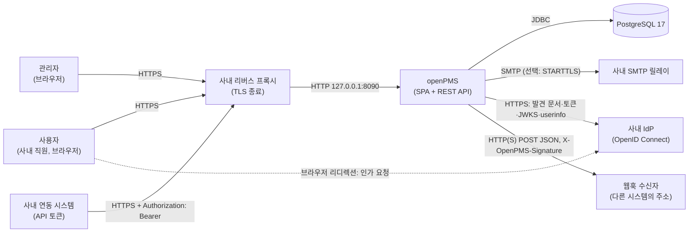

### 3.2 외부 주체와 연동

| 주체 | 방향 | 내용 | 프로토콜 |
| --- | --- | --- | --- |
| 사용자·관리자 | 브라우저 → openPMS | 화면 사용, API 호출 | HTTPS(프록시) → HTTP |
| 사내 리버스 프록시 | 프록시 → openPMS | TLS 종료, 업로드 한도 30MB 이상, `X-Forwarded-For`·`X-Forwarded-Proto` 헤더 전달(8.1.4) | HTTP |
| PostgreSQL 17 | openPMS → DB | 업무 데이터, 세션, 예약 작업 상태 | JDBC |
| 사내 SMTP 릴레이 | openPMS → SMTP | 초대, 비밀번호 재설정, 비밀번호 만들기, 멘션 알림, 요약 메일, (v2.4) 요청자 메일, (v2.5) 승인 요청·독촉 메일 | SMTP |
| 사내 IdP | openPMS ↔ IdP | SSO 로그인(인가 코드 + PKCE) | HTTPS, OpenID Connect |
| 사내 연동 시스템 | 외부 → openPMS | 개인 API 토큰으로 `/api/v1`(화면과 같은 경로)을 부름. 세션·CSRF 없이 토큰 주인의 권한, 읽기 전용 또는 읽기·쓰기(8.1.8). 설명은 `/api/v1/openapi.json` | HTTPS(프록시) → HTTP, `Authorization: Bearer` |
| 웹훅 수신자 | openPMS → 외부 | 작업 생성·변경·삭제·코멘트 이벤트를 서명된 JSON으로 보냄. 예약 작업이 15초마다 보내고 실패하면 다시 보냄(8.5.3) | HTTP(S) POST, `X-OpenPMS-Signature: sha256=…` |

외부 시스템이 openPMS를 호출하는 길은 API 토큰 하나입니다(커밋 f835e1c). openPMS가 외부를 부르는 연동은 SMTP, IdP, 웹훅(커밋 86e58a9)입니다. 웹훅을 쓰려면 `app` 컨테이너에서 수신자 주소로 나가는 네트워크(방화벽 egress)가 열려 있어야 합니다.

---

## 4. 배포 구조

### 4.1 배포 다이어그램

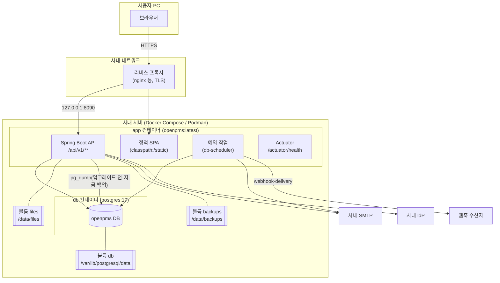

### 4.2 구성 요소

| 구성 요소 | 이미지·위치 | 포트 | 설명 |
| --- | --- | --- | --- |
| `app` | `Dockerfile`로 빌드한 `openpms:latest` | 컨테이너 8090, 호스트 `127.0.0.1:${OPENPMS_PORT:-8090}` | SPA, REST API, 예약 작업, 헬스 체크를 한 프로세스에서 제공합니다. 권한 없는 사용자 `openpms`(uid 10001)로 실행합니다. |
| `db` | `docker.io/library/postgres:17` | 호스트에 열지 않음 | `app`만 접속합니다. `pg_isready` 헬스 체크가 통과한 뒤 `app`이 시작합니다. |
| 볼륨 `files` | `/data/files` | - | 첨부 파일 원본 |
| 볼륨 `db` | `/var/lib/postgresql/data` | - | DB 파일 |
| 볼륨 `backups` | `/data/backups` | - | (v1.8) 앱이 받은 DB 덤프(`OPENPMS_BACKUP_DIR`). 이미지가 볼륨으로 선언하고 `compose.yaml`이 이름 있는 볼륨 `backups`를 붙임. 앱 사용자 `openpms` 소유. DB와 같은 서버에 있으므로 서버 밖 복사는 운영자가 따로 함 |

### 4.3 이미지 빌드 단계

| 단계 | 베이스 이미지 | 하는 일 |
| --- | --- | --- |
| 1. web | `node:24-alpine` | `npm ci` 후 `npm run build`. 디자인 토큰을 CSS로 만들고(`prebuild`), 결과를 `backend/src/main/resources/static`에 씁니다. (v2.0) 도움말이 보여 줄 `docs/deliverables`(07 사용자 매뉴얼·10 운영자 매뉴얼)도 `/src/docs/deliverables/`로 복사해 빌드 때 읽습니다(8.14). 그래서 빌드 컨텍스트는 전처럼 저장소 최상위여야 합니다. 화면 캡처(`replica/clone-screens`)는 `.dockerignore`로 빠집니다. |
| 2. jar | `eclipse-temurin:21-jdk` | 1단계 결과를 넣고 `gradlew bootJar -x test`. jOOQ 생성 코드는 저장소에 있어 빌드에 DB가 필요 없습니다. PDF용 글꼴(`resources/fonts`의 Pretendard TTF 2개, 약 5MB)과 라이선스 파일, OpenAPI 문서(`resources/api/openapi.json`)가 jar에 들어갑니다. |
| 3. runtime | `eclipse-temurin:21-jre` | jar만 복사합니다. `-XX:MaxRAMPercentage=75`로 실행합니다. (v1.8) PostgreSQL 프로젝트의 apt 저장소(apt.postgresql.org, 서명 키 ACCC4CF8)를 더해 `postgresql-client-17`을 설치합니다(`pg_dump` 17.11, `pg_restore`). 베이스 이미지(Ubuntu) 배포판의 클라이언트는 버전이 낮아 17 서버를 덤프하지 못하기 때문입니다. 설치에 쓴 `curl`은 지웁니다. `/data/files`와 `/data/backups`를 만들어 `openpms`에게 주고, `OPENPMS_FILES_DIR=/data/files`, `OPENPMS_BACKUP_DIR=/data/backups`를 정하고 두 경로를 볼륨으로 선언합니다. |

운영 웹 빌드는 `VITE_API=http`가 없으면 실패합니다(`frontend/vite.config.ts`). 브라우저 안 가짜 데이터 계층이 운영 이미지에 실리는 것을 막기 위한 장치입니다.

### 4.4 시작 순서

1. `db` 컨테이너가 뜨고 헬스 체크를 통과합니다.
2. `app`이 시작하면 Flyway가 미적용 마이그레이션(V1~V21)을 적용합니다. 실패하면 앱이 뜨지 않습니다. (v1.8) 적용은 `system/MigrateWithBackup`(Flyway 마이그레이션 전략)을 거칩니다: DB에 이미 스키마가 있고(현재 버전이 있음) 적용할 마이그레이션이 있으며 `openpms.backup.before-upgrade`가 켜져 있으면, 먼저 `before-upgrade` 덤프(라벨 `v{현재}-to-v{목표}`)를 받고 나서 마이그레이션합니다. 덤프가 실패하면 마이그레이션하지 않고 시작을 멈춥니다(8.12). 새 설치(스키마 없음)와 적용할 것이 없는 재시작은 덤프하지 않습니다. 5966874 이미지로 V17을 되돌린 DB를 다시 시작하면 덤프(약 170KB) 뒤 V17만 적용됐습니다(`replica/deploy.md`). V10 DB를 86e58a9 이미지로 올리면 V11~V15만 적용되고 데이터는 그대로입니다(2026-10-11 확인, `replica/deploy.md` 재검증 4). V15 DB(9252851 이미지)를 99e0287 이미지로 올리면 V16만 적용되고 프로젝트·작업이 그대로입니다(재검증 6). V16 DB(99e0287 이미지)를 3f9d5c0 이미지로 올리면 V17만 적용되고 데이터가 그대로이며, 기존 프로젝트에 시간 기록 모듈이 켜지고 활동 7개가 생깁니다(재검증 7).
3. `FirstAdmin`이 활성 관리자가 없고 `OPENPMS_ADMIN_EMAIL`이 있으면 초대 상태의 관리자를 만들고, 24시간짜리 설정 링크를 로그에 한 번 출력합니다.
4. `OPENPMS_JOBS_ENABLED`가 true이면 예약 작업 스케줄러가 시작합니다.

백업(v1.8): 앱은 스키마가 바뀌는 업그레이드 직전과 관리 · 시스템 정보의 **지금 백업**에서만 DB를 덤프해 `backups` 볼륨에 둡니다(8.12). 매일 정해진 시각의 백업, 첨부(`files` 볼륨) 백업, 서버 밖 보관은 앱이 하지 않으므로 호스트에서 `pg_dump -Fc`와 `files`·`backups` 볼륨 복사를 받습니다(`replica/deploy.md`, 10-운영자매뉴얼).

---

## 5. SW 스택

버전은 `backend/build.gradle.kts`, `frontend/package.json`(실제 설치 버전은 `package-lock.json`), `Dockerfile`, `compose.yaml`, `gradle-wrapper.properties`에서 가져왔습니다. "Boot 관리"는 Spring Boot 4.1.1의 의존성 관리가 정하는 버전이라는 뜻입니다.

### 5.1 실행 환경

| 구분 | 제품 | 버전 | 근거 |
| --- | --- | --- | --- |
| 런타임 | Eclipse Temurin JRE | 21 | `Dockerfile` |
| 언어 | Java | 21 (toolchain) | `build.gradle.kts` |
| 빌드 | Gradle | 9.7.1 | `gradle-wrapper.properties` |
| 웹 빌드 | Node.js | 24 (alpine) | `Dockerfile` |
| DBMS | PostgreSQL | 17 | `compose.yaml` |
| 백업 도구 | PostgreSQL 클라이언트 `postgresql-client-17`(`pg_dump`, `pg_restore`) | 17 (이미지에서 `pg_dump` 17.11 확인) | `Dockerfile`(v1.8, apt.postgresql.org) |
| 컨테이너 | Docker Compose 또는 Podman | - | `compose.yaml` |

### 5.2 백엔드

| 구분 | 라이브러리 | 버전 | 용도 |
| --- | --- | --- | --- |
| 프레임워크 | Spring Boot (webmvc, validation, actuator) | 4.1.1 | REST API, 정적 SPA 제공, 헬스 체크 |
| 의존성 관리 | io.spring.dependency-management | 1.1.7 | |
| 빌드 정보 | Spring Boot Gradle 플러그인 `springBoot { buildInfo() }` | Boot 관리 | (v1.8) `META-INF/build-info.properties`를 만들어 `BuildProperties`로 버전(0.1.0)·빌드 시각을 관리 · 시스템 정보에 보여 줌. 없으면(IDE 등에서 실행) 버전 `dev` |
| 보안 | spring-boot-starter-security | Boot 관리 | 세션 인증, CSRF, 보안 헤더 |
| SSO | spring-boot-starter-security-oauth2-client | Boot 관리 | OpenID Connect 로그인 |
| 세션 | spring-boot-starter-session-jdbc | Boot 관리 | 세션을 PostgreSQL(`spring_session`)에 저장 |
| 데이터 접근 | spring-boot-starter-jooq, jOOQ codegen 플러그인 | 플러그인 3.21.7 | 타입 안전 SQL, 코드 생성(`src/main/generated`) |
| 마이그레이션 | spring-boot-starter-flyway, flyway-database-postgresql | Boot 관리 | V1~V17 마이그레이션 |
| JDBC | org.postgresql:postgresql | Boot 관리 | |
| 메일 | spring-boot-starter-mail | Boot 관리 | 사내 SMTP 발송 |
| 템플릿 | spring-boot-starter-thymeleaf | Boot 관리 | 의존성만 있고 코드에서 쓰지 않음(메일은 일반 텍스트) |
| 예약 작업 | com.github.kagkarlsson:db-scheduler | 16.12.0 | 반복 작업, 클러스터 안전 실행 |
| HTML 정화 | owasp-java-html-sanitizer | 20260924.2 | 설명·코멘트 XSS 방지 |
| 요청 제한 | bucket4j_jdk17-core | 8.21.0 | 로그인·재설정·비밀번호 변경·비밀번호 만들기 제한 |
| 형식 판별 | Apache Tika core | 3.3.2 | 첨부 파일 형식을 내용으로 판별 |
| 엑셀 | Apache POI (poi-ooxml) | 5.4.1 | XLSX 내보내기 |
| PDF | org.apache.pdfbox:pdfbox (Apache License 2.0) | 3.0.4 | PDF 내보내기(표·보고서·Gantt, `query/PdfExport`) |
| PDF 글꼴 | Pretendard Regular·Bold TTF (SIL Open Font License 1.1) | - | `backend/src/main/resources/fonts/`. PDF에 부분(subset) 내장. 라이선스 원문 `Pretendard-OFL.txt`를 글꼴 옆에 둠. 의존성이 아니라 리소스 파일 |
| JSON | Jackson 3 (`tools.jackson`) | Boot 관리 | 직렬화 |
| 테스트 | spring-boot-starter-webmvc-test, security-test, jooq-test, JUnit Platform | Boot 관리 | 통합 테스트(`*IT`), 단위 테스트 |

### 5.3 프론트엔드

| 구분 | 라이브러리 | 버전(설치) | 용도 |
| --- | --- | --- | --- |
| UI | React, React DOM | 19.3.0 | 화면 |
| 언어 | TypeScript | 7.0.2 | |
| 빌드 | Vite, @vitejs/plugin-react | 8.3.4 / ^6.1.2 | 개발 서버, 운영 빌드 |
| 라우팅 | react-router | 8.4.0 | SPA 라우트 |
| 서버 상태 | @tanstack/react-query | 5.104.1 | 캐시, 재시도, 무효화 |
| 스타일 | Tailwind CSS, @tailwindcss/vite | 4.3.3 | 디자인 토큰 기반 유틸리티 |
| 프리미티브 | radix-ui | 1.7.0 | 접근성 있는 대화상자·메뉴·탭 |
| 보조 | class-variance-authority, clsx, tailwind-merge | ^0.7.1 / ^2.1.1 / ^3.7.0 | 컴포넌트 변형, 클래스 결합 |
| 아이콘 | lucide-react | 1.54.0 | |
| 글꼴 | pretendard | ^1.3.9 | 한글 글꼴(화면). 서버 PDF는 같은 글꼴의 TTF를 따로 둠(5.2) |
| 리치 텍스트 | @tiptap/react, starter-kit, mention, suggestion 등 | 3.31.3 | 설명·코멘트 편집, @멘션 |
| 캘린더 | @fullcalendar/core, daygrid, interaction, react | 6.1.21 | 캘린더 화면 |
| 드래그 앤 드롭 | @dnd-kit/core, sortable, utilities | 6.3.1 / ^10.0.0 / ^3.2.2 | 보드 카드·열 이동 |
| 다국어 | i18next, react-i18next | 26.4.2 / 17.0.16 | 문자열 관리(한국어) |
| E2E 테스트 | @playwright/test, @axe-core/playwright | 1.64.0 / ^4.13.0 | 화면 흐름, 접근성 점검 |

Gantt 차트(`features/gantt/gantt-chart.tsx`)와 팀 플래너 격자(`features/planning/planner-grid.tsx`)는 외부 라이브러리 없이 직접 만들었습니다.

---

## 6. 백엔드 구조

### 6.1 계층 구조

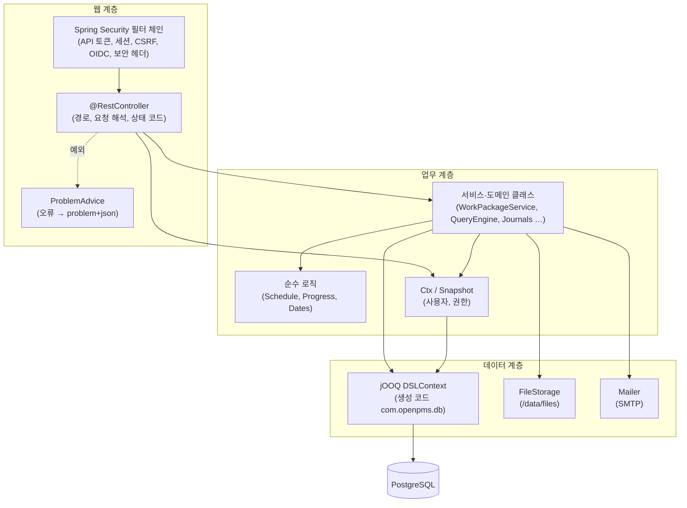

컨트롤러는 단순한 CRUD(프로젝트, 보드, 관리 등)에서는 직접 jOOQ를 쓰고, 규칙이 많은 영역(작업 패키지, 목록, 일정)은 서비스 클래스에 맡깁니다. 별도 리포지토리 계층은 두지 않았습니다.

### 6.2 패키지 구조와 역할

기준 경로: `backend/src/main/java/com/openpms/`

| 패키지 | 주요 클래스 | 역할 |
| --- | --- | --- |
| (루트) | `OpenPmsApplication` | Spring Boot 진입점 |
| `admin` | `AdminController`, `TemporaryPasswordController` | 관리 기능: 유형(양식 포함), 상태, 우선순위, 워크플로, 역할·권한 키(v1.6에 묶음 `time` 3개), 사용자(초대·잠금·로그인 실패 잠금 표시와 해제·익명화·전역 역할 배정, v2.2부터 임시 비밀번호로 만들기), 그룹, 로그인·비밀번호 설정, 진행률 설정, 근무일·휴무일. (v2.2) `TemporaryPasswordController`: 기존 사용자에게 임시 비밀번호 다시 발급과 보기(`/admin/users/{id}/temporary-password`, 8.1.9). (v2.5) 사용자 목록·만들기·수정의 `managerId`(승인자를 정하는 관리자(상사))·`noManager` 필터와 그룹의 `leadUserId`(책임자): 정하는 것은 관리자만(AD-46) |
| `api` | `Dto` | API 응답·요청의 JSON 모양(record). 프론트엔드 `types.ts`와 같은 필드 |
| `attachment` | `AttachmentController`, `FileStorage` | 작업 패키지 첨부 업로드·다운로드·삭제, 로컬 볼륨 저장소. 추가·삭제는 저널과 함께 웹훅 `work_package.updated`를 쌓음(v1.5) | (v2.4) `AttachmentStore`: 저장·내려받기를 컨트롤러에서 뺀 공통 클래스. 요청자 포털(`PortalController`)이 같이 씀(소유 확인 뒤에만 저장).
| `auth` | `SecurityConfig`, `AuthController`, `OidcController`, `OidcLogin`, `OidcProviders`, `PasswordPolicy`, `RateLimiter`, `Sessions`, `Tokens`, `FirstAdmin`, `ApiTokens`, `ApiTokenFilter`, `ApiTokenController`, `TemporaryPasswords` | 보안 필터 체인, 폼 로그인·로그아웃, 비밀번호 재설정·비밀번호 만들기·초대 토큰, 비밀번호 정책, 요청 제한, 세션 종료, OIDC SSO, 첫 관리자 생성. 외부 연동 API 토큰(발급·폐기·해시 조회, Bearer 요청 인증 필터, 내 토큰·전체 토큰·켜기/끄기 설정·OpenAPI 문서 경로, 8.1.8). (v2.2) `TemporaryPasswords`: 임시 비밀번호 만들기·발급·보기·지우기·만료, 로그인의 변경 토큰 분기와 `POST /auth/password-change`(8.1.9). (v2.5) `OidcLogin.syncManager`: SSO 로그인 때 설정 `openpms.oidc.manager-claim`의 클레임으로 `users.manager_id`를 맞춤(8.1.7) |
| `board` | `BoardController` | 보드(기본·상태·담당자·버전·하위 프로젝트·상위-하위), 열 관리, 카드 이동, 기본 보드의 카드 넣기·빼기, 열에서 카드 만들기, 보드 필터(저장·저장 없이 보기). 필터 조건은 `QueryEngine.where`를 씀. 하위 프로젝트 보드의 카드 이동은 `WorkPackageTransfers.move`(작업 옮기기)를, 상위-하위 보드는 작업 수정의 `parentNumber`를 씀. (v2.1) 담당자 보드는 카드를 담당자 목록의 사람마다 그 사람의 열에 두고, 카드 이동 요청의 `fromColumnId`로 옮겨 온 열의 사람 자리를 대상 열의 사람에게 넘김(8.15) |
| `common` | `ApiException`, `ProblemAdvice`, `In`, `Dates`, `DisplayFormats`, `Html`, `Mailer`, `SettingsRepo`, `SpaConfig`, `IdempotencyFilter` | 오류 형식, 입력 해석(잘못된 값은 422), 근무일 계산·날짜 글자 표기, 날짜·시간 형식과 주 시작 요일 설정, HTML 정화, 메일 발송, 전역 설정 읽기·쓰기, SPA 폴백, 생성 POST의 `Idempotency-Key` 처리(v1.5, 8.3. v2.2부터 임시 비밀번호가 든 응답은 보관하지 않음) |
| `core` | `Ctx`, `Current`, `Snapshot`, `Refs`, `Text` | 요청별 사용자·권한 계산, 기준 테이블 스냅샷, 참조 DTO 변환, 한국어 정렬 |
| `customfield` | `CustomFieldController`, `CustomFields` | 사용자 정의 필드 정의(관리), 프로젝트별 사용 설정, 값 검사·표시 |
| `itsm` | `ServiceDesk`, `ServiceTickets`, `SlaClock`, `ServiceDeskConfig`, `ServiceDeskConfigController`, `ServiceTicketController`, `PortalController`, `PortalService`, `PortalMail`, `SlaJobs`, `ItsmIds` | (v2.4, ITSM 1단계) 서비스 데스크. `ServiceDesk`: 작업 저장이 부르는 훅(티켓 행과 SLA 기한 만들기·갱신·첫 응답·해결, 서비스 데스크 프로젝트의 티켓 유형일 때만). `ServiceTickets`: 목록용 대량 읽기와 `Dto.ServiceTicket` 만들기. `SlaClock`: DB에 접근하지 않는 순수 함수(`add`·`workingTime`, 24시간·근무 시간 달력, 휴무일은 호출하는 쪽이 넘김, 겹치는 구간은 달력을 만들 때 거절). `ServiceDeskConfig`·`ServiceDeskConfigController`: 서비스 달력(관리자), SLA 정책·우선순위 행렬 설정, 처리 그룹 목록, 개요 요약. `ServiceTicketController`: 티켓 값 조회·편집. `PortalController`·`PortalService`: 요청자 포털(8.2.3, 6.3.2). `SlaJobs`(`sla-check`)·`PortalMail`(`portal-mail`): 예약 작업(8.5.2). `ItsmIds`: V20이 넣는 고정 id(유형·상태·역할·달력). (v2.5) 카탈로그: `ServiceCatalog`(분류·항목·양식 필드·승인 단계 읽기·쓰기, 포털용으로 여러 데스크를 질의 하나씩으로 읽는 `catalogs`)·`ServiceCatalogController`(`/projects/{p}/service-desk/catalog`, 7개 경로). 승인: `Approvals`(DB 접근이 없는 순수 함수 `plan`과 승인 행 저장·건너뛰기·저널 `approval:<id>`, `WorkPackageService`에 기대지 않음, AD-45)·`ApprovalService`(내 승인함·승인 상세·결정·처리자의 승인자 바꾸기, 상태 이동은 `WorkPackageService.statusForApproval`)·`ApprovalController`(`/portal/approvals`, 4개 경로)·`ApprovalMail`(`approval-mail`). `ServiceTicketController`에 승인 패널 경로 2개, `PortalService`에 항목 요청(`catalogItemId`)과 승인 진행. `ItsmIds`에 V21이 넣는 상태 **승인 대기**·**반려**의 id. 흐름은 6.3.3, 격리는 8.2.4, 자세한 규칙은 8.17 |
| `jobs` | `Jobs`, `JobCatalog`, `DateAlerts`, `MailJobs`, `Housekeeping`, `DevJobsController` | db-scheduler 반복 작업(날짜 알림, 멘션·요약 메일, 토큰·파일 정리(v2.2부터 기한이 지난 임시 비밀번호도), 웹훅 전송 `webhook-delivery`, (v2.4) `JobCatalog`가 `itsm`의 `sla-check`·`portal-mail`도, (v2.5) `approval-mail`도 등록), dev 프로필 전용 수동 실행 경로 |
| `misc` | `MiscController`, `SearchController` | 근무일 달력 조회, 헤더 검색 제안, 표시 형식 조회(로그인 사용자)·저장(관리자), 검색 결과 |
| `notification` | `NotificationController`, `AccountController`, `NotificationSettings`, `NotificationTexts` | 알림함(v1.5부터 이유·프로젝트 필터와 읽지 않은 수 `GET /notifications/counts`, 필터에 맞는 알림 읽음 처리를 서버에서), 내 계정(프로필·비밀번호 변경·비밀번호 만들기 링크 요청·세션·환경설정), 알림 설정 |
| `project` | `ProjectController`, `ProjectCopy` | 프로젝트(생성·수정·보관·삭제·즐겨찾기·개요·유형, 템플릿 표시, 상위 프로젝트 지정과 순환 검사, 개요 위젯 구성 `overviewWidgets`, 내부 코멘트 켜기 `internalComments`), 프로젝트 복사(`POST /projects/{id}/copy`: 원본의 project.edit + 프로젝트 만들기 권한), 멤버, 주체 검색, 카테고리, 버전. `ProjectCopy`는 템플릿이나 복사 원본에서 새 프로젝트에 모듈·유형·사용자 정의 필드·특성 값·개요 위젯·내부 코멘트 설정과 고른 항목(멤버, 버전, 카테고리, 작업, 보드, 보기)을 복사. (v1.7) 새 시작일(`startDate`)이 오면 `ProjectCopy.Shift`가 복사하는 작업·버전의 날짜를 옮김(8.5.1) |
| `query` | `QueryController`, `QueryEngine`, `ExportController`, `Baselines`, `PdfExport` | 목록 쿼리 실행(필터·정렬·계층·그룹·합계), 필터 선택지, 저장된 보기, CSV·XLSX·PDF 내보내기. 그룹·합계는 페이지가 아니라 조건에 맞는 전체 작업으로 계산하고, 그룹화하면 계층 표시를 끔. 합계의 완료 %는 진행률 설정을 따름(D-23). `Baselines`는 spec의 `baseline`(어제·1주 전·한 달 전·날짜, 그날 0시)과 비교해 그 페이지 행마다 바뀐 열의 그때 값과 새로 생긴 작업을 저널에서 되짚고(AD-19), 그때는 조건에 맞았지만 지금은 빠진 작업(`baselineRemoved`)을 임시 테이블에서 목록 필터를 다시 돌려 찾음(v1.5, AD-21). 이를 위해 `QueryEngine.where(ctx, filters, table)`·`text(text, table)`이 대상 테이블을 받음. `PdfExport`는 PDFBox로 표·보고서·Gantt PDF를 만듦(최대 1,000건, AD-18). (v2.1) 담당자 필터(`assignee`·`assigneeGroup`·`assigneeRole`)는 담당자 목록 전체를 봄(`QueryEngine.team`, 8.15). 정렬·그룹은 주 담당자(`assignee_id`) | (v2.4) 서비스 데스크 티켓 열·필터·정렬: `QueryEngine`이 `service_tickets`를 PK로 left join(쿼리 수는 그대로)해 해결 기한 정렬과 `requester`·`assignmentGroup`·`channel`·`slaBreached` 필터를 처리하고, `ExportController`가 요청자·처리 그룹·해결 기한·SLA 열을 더함. (v2.5) 필터 `catalogItem`(`service_tickets.catalog_item_id`, eq·neq)과 `approvalState`(`ticket_approvals`에 대한 `exists` 하위 질의: pending·delayed·rejected·none)와 열 `catalogItem`(내보내기 포함)을 더함. 둘 다 질의 수는 그대로.
| `system` | `Backups`, `MigrateWithBackup`, `SystemController` | (v1.8, 5966874) 업그레이드 안전장치. `Backups`: JDBC URL에서 호스트·포트·DB 이름을, 데이터소스 설정에서 사용자와 비밀번호(`PGPASSWORD` 환경 변수로)를 받아 `pg_dump --format=custom --no-owner`를 외부 프로세스로 실행, `<이름>.part`에 쓰고 끝나면 원자적으로 이름을 바꿈, 종류(`before-upgrade`·`manual`)마다 최근 `keep`개만 남기고 지움, 한 번에 하나(진행 중이면 거절), 30분 시간 제한, 실패하면 pg_dump 출력의 끝부분을 담은 오류. `MigrateWithBackup`: `FlywayMigrationStrategy` 빈. 스키마가 있고 적용할 마이그레이션이 있으면 덤프 후 `flyway.migrate()`, 덤프가 실패하면 마이그레이션하지 않고 시작 중단(8.12). `SystemController`: 관리 · 시스템 정보(관리자만) — 앱(버전·빌드 시각은 `BuildProperties`, 시작 시각, Java, 예약 작업), DB(`server_version`, `pg_database_size`), 마이그레이션(현재·적용 수·대기 수·최근 8개, Flyway `info()`), 백업(설정, `pg_dump --version`, 파일 목록), 데이터 수(활성 사용자·프로젝트·작업·첨부 바이트), 지금 백업 |
| `time` | `TimeController` | 시간 기록(v1.6, 789bb9d): 활동 목록·관리(관리자), 기록 목록·만들기·고치기·지우기, 내 한 주 읽기·저장(주간 입력표, 6.3.1), 공수 보고서(사람·작업·활동·프로젝트·날짜별 합계), Excel 내보내기(Apache POI SXSSF). 권한은 `Ctx.can`으로 `time.log`(내 것)·`time.view`(남의 것 보기)·`time.manage`(남의 것 고치기·대신 기록). 한 사람의 하루 24시간 제한. 작업을 다른 프로젝트로 옮길 때 `WorkPackageTransfers.move`가 부르는 `follow`(기록의 `project_id`를 따라 바꿈). 저널·웹훅·알림은 만들지 않음 |
| `webhook` | `Webhooks`, `WebhookController` | 웹훅 관리(관리자만), 작업 이벤트를 전송 행으로 쌓기(`enqueue`), HMAC-SHA256 서명, 전송·재시도, 테스트 전송, 다시 보내기, 받는 주소 검사(`refused`: 링크 로컬은 늘, 사설·루프백은 운영 스위치를 켰을 때)(8.5.3) | (v2.4) `enqueueSystem`: 사람이 일으키지 않은 이벤트(SLA 위반 `service_ticket.sla_breached`)는 행위자 없이 쌓음.
| `wp` | `WorkPackageController`, `WorkPackageService`, `WorkPackageTransfers`, `Assembler`, `Journals`, `Schedule`, `ScheduleStore`, `Progress`, `TypeForms` | 작업 패키지 생성·수정·삭제, 복사·이동·일괄(수정·이동·삭제·복사), 코멘트(내부 코멘트 포함), 주시, 관계, 공유, 일정 미리 보기, 저널과 알림 생성, 웹훅 이벤트 쌓기(생성·변경·삭제·코멘트, 옮기기, v1.5부터 자동 일정 전파 `ScheduleStore.apply`도), 일정·진행률 계산, 유형 양식. 작업을 옮기면 그 작업의 시간 기록 프로젝트도 바꿈(v1.6, `TimeController.follow`). (v2.1) 공동 담당자 `Assignees`: 담당자 목록(순서, 사람별 예상 시간)을 읽고 검사하고 쓰며 `assignee_id`를 첫 사람으로 맞춤. 작업 생성·수정·복사·이동, 보드 카드 이동, 사용자 삭제가 모두 이 클래스를 거침(8.15) | (v2.4) `WorkPackageService`가 포털용 진입점 `createForPortal`·`statusForPortal`·`commentForPortal`(`Acting.PORTAL`)을 갖고, 저장 경로에서 `ServiceDesk`의 훅(`created`·`updated`·`commented`)을 부름. `Assembler.allowedFor`: 역할을 주어 가능한 상태 전환을 구하는 정적 함수(포털이 내장 역할 `requester`로 부름). (v2.5) `Acting`에 `APPROVAL`이 더해지고 `statusForApproval`·`commentForApproval`이 승인자의 결정(승인 대기 → 접수·반려, 반려 사유 코멘트)을 저장 경로로 넘김. `Journals`는 키 `approval:<id>`를 항목 "승인"으로 보임.
| `com.openpms.db` (생성) | `Tables`, `*Record` | jOOQ 코드 생성 결과(`src/main/generated`). 손으로 고치지 않습니다. |

### 6.3 요청 처리 흐름

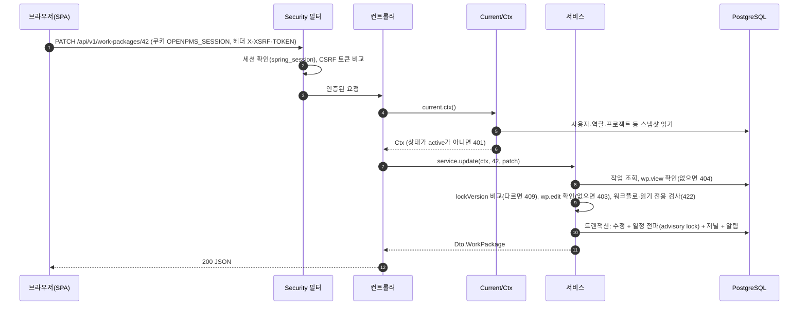

- `Idempotency-Key` 헤더가 있는 POST는 Security 필터 다음의 `IdempotencyFilter`(v1.5)를 먼저 지납니다. 같은 사람·같은 키로 이미 끝난 2xx 응답이 있으면 컨트롤러를 부르지 않고 그 응답을 돌려줍니다(8.3).

#### 6.3.1 주간 공수 입력표 저장 흐름 (v1.6)

내 공수 화면에서 Ctrl+S(또는 **저장**)를 누르면 바뀐 칸만 한 요청으로 보냅니다. 서버는 칸마다 "그날 그 작업의 내 시간 합을 이 값으로"를 적용하고, 하나라도 안 되면 전부 되돌립니다.

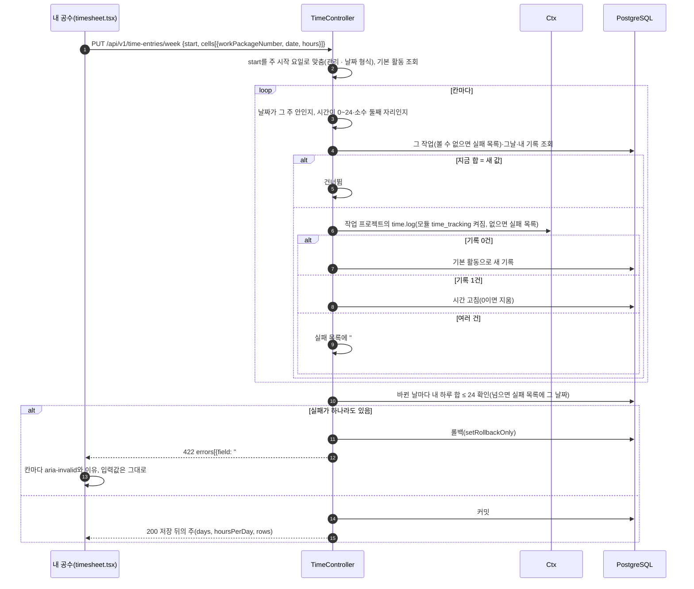

- 하루 합계가 하루 근무 시간(`calendar.hours_per_day`, 응답의 `hoursPerDay`)을 넘는 것은 서버가 막지 않습니다. 화면이 그 날 합계를 빨간 글자와 경고 아이콘, 화면 읽기용 문구로 알립니다.
- 작업 상세의 **시간** 탭은 같은 테이블을 `GET /time-entries?workPackage=`, `POST`·`PATCH`·`DELETE /time-entries`로 다룹니다(한 칸에 여러 건을 남길 수 있는 곳). 공수 보고서는 `GET /time-entries/report`가 볼 수 있는 기록(`time.view`인 프로젝트는 모든 사람의 것, `time.log`만 있으면 내 것)만 골라 DB에서 묶어(GROUP BY) 합칩니다(6d816e4부터, 건수 한도 없음). Excel 내보내기(`/export`)는 기록을 한 줄씩 읽어 5만 건까지, 기록 목록(`GET /time-entries`)은 2,000건까지입니다.

#### 6.3.2 포털 접수·답변 흐름 (v2.4)

멤버가 아닌 요청자가 서비스 데스크에 요청을 접수하고 답하는 흐름입니다. 처리자의 화면·API는 기존 작업 패키지 경로를 그대로 쓰고, 요청자만 `/api/v1/portal`을 거칩니다.

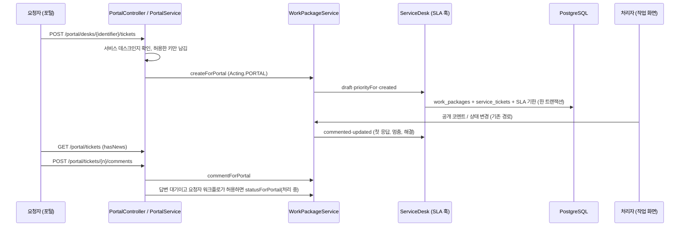

1. `PortalService.submit`은 서비스 데스크(모듈이 켜진 보관되지 않은 비템플릿 프로젝트)인지 확인하고, 요청에서 유형·제목·내용·영향도·긴급도와 그 유형에 대해 **포털에 공개**로 표시한 사용자 정의 필드의 값만 남깁니다(담당자·상태·우선순위·날짜는 버림). 포털에 보이지 않는 필수 필드는 검사하지 않습니다.
2. `WorkPackageService.createForPortal`이 일반 작업 만들기와 같은 코드(`insert`)를 `Acting.PORTAL`로 돌립니다. 요청자는 호출한 사람, 접수 경로는 `portal`, 우선순위는 영향도 × 긴급도 행렬이 정합니다. 저널·알림·웹훅·SLA 기한은 같은 트랜잭션입니다.
3. 요청자의 상태 전환(`statusForPortal`)은 `Assembler.allowedFor`에 내장 역할 `requester`(`ItsmIds.ROLE_REQUESTER`)를 줘서 그 역할의 전환을 검사합니다. 포털은 요청자 본인의 요청에서만 이 검사를 하므로 V20은 이 행들을 `applies_to = 'always'`로 넣고(관리 › 워크플로 화면이 'always' 행을 보이고 고치므로 관리자가 고칠 수 있음), 작성자로는 요청자를 넘깁니다. 관리자도 같은 검사를 받습니다.
4. 포털의 코멘트는 항상 공개 코멘트입니다. 상태가 SLA 멈춤(**답변 대기**)이고 요청자 워크플로가 **처리 중**으로 가는 길을 열어 두었으면 코멘트 직후 같은 요청에서 **처리 중**으로 되돌려 해결 시계가 다시 돌게 합니다.
5. 오래된 `lockVersion`이면 409를 주되, 작업 패키지 API와 달리 최신 내용(`current`)을 싣지 않습니다.

#### 6.3.3 카탈로그 요청과 승인 흐름 (v2.5)

요청자가 카탈로그 항목을 요청하면 항목의 승인 단계에 따라 승인 행이 만들어지고, 승인자가 포털의 **내 승인함**에서 결정합니다. 승인자도 프로젝트 멤버가 아니므로 이 흐름의 요청자·승인자는 모두 `/api/v1/portal` 아래의 경로만 부릅니다.

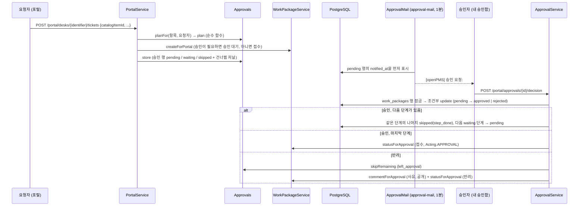

1. `PortalService.submit`은 `catalogItemId`가 있으면 항목이 이 데스크의 것이고 활성이며 데스크가 쓰는 유형인지 확인합니다(아니면 422 `catalogItem` "요청할 수 없는 항목입니다."). 항목이 유형·양식 필드·기본 우선순위·처리 그룹을 정하고, 양식 밖 값은 버리며, 항목의 필수 필드가 비어 있으면 422 `cf:<id>`입니다. 카탈로그 밖의 요청(항목 없음)은 2.4의 흐름(6.3.2) 그대로입니다.
2. `Approvals.planFor`가 항목의 단계 규칙, 요청자의 관리자(`users.manager_id`)와 항목 처리 그룹의 책임자(`user_groups.lead_user_id`, 둘 다 활성 사용자만)를 읽어 순수 함수 `Approvals.plan`에 넘깁니다. 규칙은 8.17입니다.
3. 계획에 `pending` 행이 하나라도 있으면(`needsApproval`) 처음 상태는 **승인 대기**(SLA 멈춤), 아니면 **접수**입니다. 작업은 `createForPortal`(`Acting.PORTAL`)로 만들고, 같은 트랜잭션에서 `service_tickets.catalog_item_id`와 처리 그룹을 쓰고 `Approvals.store`가 승인 행을 넣습니다. 건너뛴 행마다 저널 한 줄(`approval:<행 id>`)이 남습니다.
4. `ApprovalMail`이 차례가 온(`pending`) 승인자에게 메일을 보냅니다(8.5.2). 알림 센터를 쓰지 않습니다(AD-43).
5. `ApprovalService.decide`는 내 `pending` 행만 받습니다(아니면 404, 8.2.4). 반려는 사유가 필수입니다(422 `comment`). 작업 행을 `select … for update`로 잠근 뒤(8.3) 조건부 update로 결정을 기록하고(졌으면 409 "이미 처리된 승인입니다."), 저널 "{n}단계 {이름} 승인|반려"를 씁니다. **승인**이면 같은 단계의 나머지 `pending` 행은 `skipped`(`step_done`)가 되고 다음 `waiting` 단계가 `pending`이 되며, 다음 단계가 없으면 `statusForApproval`로 **접수**로 옮깁니다. **반려**면 남은 행을 `skipped`(`left_approval`)로 하고 `commentForApproval`로 사유를 승인자 이름의 공개 코멘트로 남긴 뒤 **반려**로 옮깁니다.
6. 상태 이동은 `Acting.APPROVAL`(8.17, AD-41)이 검사하고 저널의 작성자는 결정한 승인자입니다. 승인 대기에서 마지막 승인이나 반려가 아닌 다른 길(처리자의 **취소** 등)로 나가면 `ServiceDesk`가 `Approvals.skipRemaining`을 불러 남은 행을 정리합니다.
7. 요청자는 결과(접수·반려)를 2.4의 `portal-mail`로 받습니다.

### 6.4 데이터 접근과 스키마

- jOOQ 코드는 마이그레이션이 적용된 개발 DB에서 생성해 저장소에 넣습니다(`scripts/dev.sh gradle jooqCodegen`). 라이브러리 테이블(`spring_session*`, `scheduled_tasks`, `flyway_schema_history`)은 생성 대상에서 뺐습니다.
- 마이그레이션 목록

| 버전 | 파일 | 내용 |
| --- | --- | --- |
| V1 | `V1__init.sql` | 업무 스키마(`replica/schema.sql`) |
| V2 | `V2__libraries.sql` | Spring Session JDBC, db-scheduler 테이블 |
| V3 | `V3__seed.sql` | 기준 데이터(역할, 상태, 유형, 기본 워크플로 등). 데모 데이터는 없음 |
| V4 | `V4__jobs.sql` | 예약 작업용 컬럼(요약 메일 시각 등) |
| V5 | `V5__keep_updated_at.sql` | 설정 변경 시 `updated_at` 유지 트리거 예외 |
| V6 | `V6__work_package_shares.sql` | 작업 패키지 공유 |
| V7 | `V7__overdue_alert_default.sql` | 기한 지남 알림 기본값 |
| V8 | `V8__my_page_widgets.sql` | 내 페이지 위젯 |
| V9 | `V9__type_forms_default.sql` | 유형 양식 기본값 |
| V10 | `V10__oidc.sql` | SSO 공급자(`oidc_providers`), 계정 연결(`user_identities`) |
| V11 | `V11__internal_comments.sql` | `projects.internal_comments`(프로젝트별 내부 코멘트 켜기, 기본 false). 저장은 V1부터 있던 `journals.is_internal` |
| V12 | `V12__high_contrast_theme.sql` | `users.theme` 검사 제약에 `high_contrast` 추가 |
| V13 | `V13__overview_widgets.sql` | `projects.overview_widgets`(개요 위젯과 순서, 기본 `{description,workSummary,status,members}`) |
| V14 | `V14__api_tokens.sql` | 외부 연동 API 토큰(`api_tokens`: 이름, SHA-256 해시, 범위 read·write, 마지막 사용, 만료, 폐기) |
| V15 | `V15__webhooks.sql` | 웹훅(`webhooks`)과 전송 대기열·기록(`webhook_deliveries`, 부분 인덱스 `webhook_deliveries_due_idx`) |
| V16 | `V16__idempotency_keys.sql` | 생성 POST의 응답 보관(`idempotency_keys`: PK 사용자+키, 요청 해시, 상태, 응답 본문, 인덱스 `idempotency_keys_created_idx`). 웹훅 보완: `webhooks_created_by_idx` 인덱스, `webhooks_set_updated_at` 트리거 |
| V17 | `V17__time_tracking.sql` | 시간 기록(v1.6): `time_activities`(기본 활동 7개, 기본 하나를 부분 유일 인덱스로), `time_entries`(사람·프로젝트·작업·활동·날짜·시간·메모, 인덱스 4개), 두 테이블의 `updated_at` 트리거. 기본 역할 권한(프로젝트 관리자 `time.log`·`time.view`·`time.manage`, 멤버 `time.log`·`time.view`), `projects_known_modules` 검사에 `time_tracking`을 넣어 다시 만들고 모든 기존 프로젝트에서 켬 |
| V18 | `V18__co_assignees.sql` | 공동 담당자(v2.1): `work_package_assignees`(작업·사람·순서 0–19·사람별 예상 시간, PK(work_package_id, user_id), 작업 안 순서 유일(지연 검사), 인덱스 `work_package_assignees_user_idx`). 지금의 `assignee_id`를 순서 0(주 담당자)으로 옮겨 넣음(8.15) |
| V19 | `V19__temporary_passwords.sql` | 임시 비밀번호(v2.2): `temporary_passwords`(사용자마다 한 행: `user_id` PK·FK(삭제 시 CASCADE), 평문 `password`, `expires_at`, `issued_by`(삭제 시 null), `issued_at`, 인덱스 `temporary_passwords_issued_by_idx`·`temporary_passwords_expires_idx`), `user_tokens_purpose_check`에 `'password_change'` 추가(8.1.9) |
| V20 | `V20__service_desk.sql` | 서비스 데스크(v2.4): `service_calendars`(24시간·근무 시간, 시간대, 요일별 구간 jsonb)·`sla_policies`(프로젝트 + 유형 + 우선순위 고유, 달력, 첫 응답·해결 분)·`priority_matrix`(프로젝트 + 영향도 + 긴급도 → 우선순위)·`service_tickets`(작업과 1:1: 요청자·접수 경로·영향도·긴급도·처리 그룹·SLA 기한·멈춤·위반·임박 표시·요청자 메일 표시 3개). `statuses.sla_pause`, `custom_fields.portal_visible`, `projects_known_modules`에 `service_desk`, `roles_builtin_check`에 `requester`, `notifications_reason_check`에 `sla_warning`·`sla_breached`, `webhooks_known_events`에 `service_ticket.sla_breached`. 기본 데이터: 유형 장애·서비스 요청, 상태 접수·처리 중·답변 대기(SLA 멈춤)·해결·종료, 내장 역할 **요청자**와 처리자·요청자 워크플로, 달력 둘(평일 근무 시간, 24시간), 권한 `service.view`·`service.handle`·`service.manage`(프로젝트 관리자 셋, 멤버 앞의 둘) |
| V21 | `V21__service_catalog.sql` | 서비스 카탈로그와 승인(v2.5): `catalog_categories`(프로젝트별 분류, UNIQUE(project_id, name))·`catalog_items`(항목: 유형·기본 우선순위·처리 그룹·사용 여부, UNIQUE(project_id, name))·`catalog_item_fields`(항목 양식 필드, PK(항목, 필드)·필수 여부)·`catalog_item_approval_steps`(항목의 승인 단계, PK(항목, 단계 1–9, 승인자 종류))·`ticket_approvals`(요청마다 만든 승인 행, UNIQUE(work_package_id, step_no, approver_kind), 결정 5값, 건너뜀 이유 5값), 트리거 3개. 새 열 `users.manager_id`(자기 자신 금지 `users_manager_not_self`)·`user_groups.lead_user_id`·`service_tickets.catalog_item_id`. 기본 데이터: 상태 **승인 대기**(`sla_pause`)·**반려**(닫힘·읽기 전용·합계 제외)와 처리자(프로젝트 관리자·멤버)·요청자 역할의 **승인 대기 → 취소** 워크플로 6행. 같은 이름의 기존 상태는 먼저 ` (기존)`을 붙임 |

- dev 프로필은 `db/dev`의 V1000~V1005(개발 데이터. V1002는 시간 기록 모듈과 2026-10-05 주 기록 11건, (v2.1) V1003은 개발 데이터의 지금 담당자를 담당자 목록의 첫 사람으로 옮기고 web-platform #4 결제 API 연동을 박준호(24시간)·이하늘(16시간)이 함께 맡게 함)를 추가로 적용합니다(`out-of-order: true`). V19는 개발 데이터를 바꾸지 않았습니다. (v2.4) V1004는 서비스 데스크 개발 데이터(비공개 프로젝트 `service-desk`, 처리 그룹 둘, 처리자 박준호·이하늘, 요청자 최민지·한도윤, SLA 정책과 우선순위 행렬, 상태가 여러 가지인 티켓 6건)입니다. (v2.5) V1005는 서비스 카탈로그 개발 데이터(최민지·한도윤의 관리자 alex.kim, 그룹 책임자(1선 지원 → 박준호, 인프라 → alex.kim), 분류 하드웨어·계정·권한, 사용자 정의 필드 "노트북 기종", 항목 노트북 신청·VPN 계정·공유 폴더 권한, 승인 대기 요청 1건)입니다.
- 작은 기준 테이블(사용자, 역할, 프로젝트, 멤버, 유형, 상태, 우선순위, 워크플로, 버전, 카테고리, 설정)은 요청마다 `Snapshot`으로 한 번 읽습니다. 작업 패키지와 저널은 항상 직접 조회합니다. 사내 규모(기준 테이블 수백 행)를 전제로 한 선택입니다.

---

## 7. 프론트엔드 구조

### 7.1 디렉터리 구조

기준 경로: `frontend/src/`

| 디렉터리 | 내용 |
| --- | --- |
| `main.tsx` | 진입점 |
| `app/` | 라우터(`router.tsx`), 전역 Provider(`providers.tsx`: React Query, 툴팁, 토스트), 인증 상태(`auth.tsx`), 레이아웃, 프로젝트 맥락, 헤더 검색, 키보드 단축키(`shortcuts.tsx`) |
| `api/` | 데이터 계층. `Api` 인터페이스, 타입, 오류, React Query 훅, 가짜·HTTP 구현 |
| `pages/` | 라우트 단위 화면(로그인, 홈, 프로젝트, 작업 목록, Gantt, 보드, 캘린더·팀 플래너, 알림, 검색, 계정, 관리) |
| `features/` | 여러 화면이 함께 쓰는 기능 단위 컴포넌트(작업 패키지 상세·표·필터·날짜 대화상자, Gantt 차트, 계획 격자, 관리 공통, v2.0의 도움말 `features/help/`) |
| `components/` | `ui/`(버튼, 선택, 대화상자 등 기본 컴포넌트), `domain/`(리치 텍스트 편집기, 작업 카드), `shell/`(앱 셸) |
| `i18n/` | i18next 초기화와 한국어 문자열(`ko.ts`) |
| `design/` | 디자인 토큰 TS 사본(`tokens.ts`, 생성 파일) |
| `styles/` | `tokens.css`·`theme.css`(생성 파일), `index.css`, `calendar.css` |
| `lib/` | 날짜(관리자가 정한 표시 형식·주 시작 요일 적용: `dates.ts`의 `configureDisplay`), 색, 텍스트, 테마, 미저장 경고 등 유틸리티 |
| `../e2e/` | Playwright E2E 테스트(가짜 IdP `fake-idp.mjs` 포함) |

### 7.2 데이터 계층: `Api` 인터페이스와 두 구현

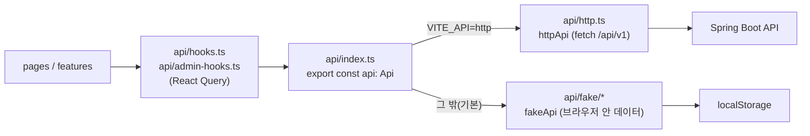

| 파일 | 역할 |
| --- | --- |
| `api/api.ts` | `Api` 인터페이스. 영역별 메서드 묶음: `auth`, `account`, `projects`, `categories`, `versions`, `members`, `principals`, `workPackages`, `queries`, `boards`, `notifications`, `calendar`, `search`, `admin` |
| `api/types.ts` | 요청·응답 타입. 백엔드 `Dto.java`와 필드가 같습니다. |
| `api/http.ts` | 실제 구현. `/api/v1` 경로마다 fetch 한 번. 쿠키 `XSRF-TOKEN`을 읽어 GET 이외 요청에 `X-XSRF-TOKEN` 헤더를 붙입니다. 무언가를 만드는 요청(프로젝트 만들기·복사, 작업 만들기·복사, 코멘트)에는 `crypto.randomUUID()`로 만든 `Idempotency-Key`를 붙이고, 연결이 끊기면 0.8초 뒤 같은 키로 한 번 더 보냅니다(v1.5). 오류 응답의 `title`·`detail`·`errors`·`current`를 `ApiError`로 바꿉니다. 업로드는 multipart, 내보내기는 Blob으로 받습니다. |
| `api/fake/` | 백엔드가 없던 단계에 만든 브라우저 안 구현. `schema.sql`과 같은 모양의 테이블을 메모리와 localStorage에 둡니다. 권한, 일정, 진행률, 쿼리 규칙을 서버와 같은 규칙으로 구현해 두었고, 서버 구현의 동작 기준이 되었습니다. (v2.1) 공동 담당자는 `api/fake/assignees.ts`가 서버 `wp/Assignees`와 같은 규칙(첫 사람이 주 담당자이고 `assigneeId`는 늘 그 사람, 예전 `assigneeId` 변경의 뜻, 20명까지)으로 처리하고, 시드도 #4 결제 API 연동을 개발 DB처럼 둘이 맡게 합니다. 브라우저에 저장된 데이터의 스키마 번호를 14로 올려, 번호가 다른 예전 데이터는 새 시드로 다시 만듭니다. (v2.5) 승인과 카탈로그는 `api/fake/approvals.ts`가 서버 `itsm/Approvals`·`ApprovalService`와 같은 규칙(승인 계획, 단계 진행, 반려 사유, 승인자 404)으로 처리하고, 저장 스키마 번호를 17로 올렸습니다(2.4는 16). |
| `api/errors.ts` | `ApiError(status, title, detail, {fieldErrors, current})` |
| `api/hooks.ts`, `api/admin-hooks.ts` | React Query 훅. 401·403·404는 재시도하지 않고, 그 밖의 실패는 한 번 재시도합니다. 창 포커스 때 다시 읽지 않고, 10초 동안 신선한 값으로 봅니다. |

- 선택 규칙: `VITE_API=http`이면 HTTP 구현, 아니면 가짜 구현(`api/index.ts`). 운영 빌드는 `.env.production`에 `VITE_API=http`가 있어야 빌드됩니다.
- 개발 서버는 `/api`를 `http://localhost:8090`(또는 `OPENPMS_API_URL`)으로 프록시합니다.

### 7.3 화면(pages)과 기능(features)

| 영역 | 라우트(예) | 화면 파일 | 주요 기능 컴포넌트 |
| --- | --- | --- | --- |
| 인증 | `/login`, `/password-reset`, `/invitations/:token` | `pages/login.tsx`, `pages/auth-links.tsx` | SSO 버튼, 비밀번호 정책 안내 |
| 홈·내 페이지 | `/`, `/my/page` | `pages/home.tsx`, `pages/my-page.tsx` | 위젯 |
| 계정·알림 설정 | `/my/account`, `/my/notifications` | `pages/account.tsx`, `pages/notification-settings.tsx` | 테마 4종(고대비 포함), "키보드 단축키" 켜기·끄기(`keyboardShortcuts` 환경설정), API 토큰 절(`features/account/api-tokens.tsx`: 만들기·한 번만 보이는 값·폐기) |
| 도움말 | `/help`, `/help/admin`(v2.0), `/help/api` | `pages/help.tsx`(v2.0, 지연 로딩), `pages/api-docs.tsx` | (v2.0) 사용자 매뉴얼·운영자 매뉴얼(목차, **매뉴얼 검색**, `#…` 주소로 절 강조, 관리자에게 다른 매뉴얼 링크), 헤더 도움말 메뉴의 **이 화면 도움말** → `features/help/help-panel.tsx`(오른쪽 패널), `features/help/*`(8.14). API 문서(인증, 범위, 버전 정책, 오류, 주요 경로). 도움말 메뉴의 "키보드 단축키"는 `app/shortcuts.tsx`의 도움말 대화상자 |
| 알림함 | `/notifications`, `/notifications/details/:number/:tab?` | `pages/notifications.tsx` | 분할 상세. 이유·프로젝트 필터는 URL(`?reason=&project=`)에 두고, v1.5부터 서버에 넘겨 거르고(`GET /notifications?reasons=&project=`) 선택지의 읽지 않은 수는 `GET /notifications/counts`로 받음(AD-15) |
| 검색 | `/search` | `pages/search.tsx` | `app/search-box.tsx` |
| 프로젝트 | `/projects`, `/projects/new`, `/projects/:p`, `/projects/:p/members`, `/projects/:p/settings/:section` | `pages/projects/*` | 새 프로젝트의 "템플릿에서 시작"(템플릿·복사할 것 선택), 새 프로젝트·설정의 "상위 프로젝트"(후보는 `useParentCandidates`: 수정 권한이 있고 자기 자신과 그 아래가 아닌 프로젝트), 설정의 "템플릿으로 쓰기", 설정 · 정보의 "프로젝트 복사" 대화상자, 설정 · 작업 설정의 "내부 코멘트". 개요(`overview.tsx`)는 위젯 대시보드(설명·작업 현황·프로젝트 상태·멤버·버전 진행·곧 완료일·최근 바뀐 작업·내게 할당된 작업)이고 project.edit가 있으면 "위젯 편집"으로 켜기·끄기·순서(바로 저장) |
| 작업 목록 | `/work-packages`, `/projects/:p/work-packages`(분할 상세, 전체 상세, 새 작업) | `pages/work-packages/*` | `features/work-packages/*`(표, 필터, 속성, 활동, 관계, 파일, 주시자, 공유, 날짜 대화상자(날짜·선행·후속·하위 탭), 일괄 편집, 내보내기(CSV·Excel·PDF), 복사·이동). 행 우클릭 메뉴는 `components/ui/overlay.tsx`의 `ContextMenu`, 일괄 바와 메뉴가 같은 동작을 `useBulkActions`(`bulk-bar.tsx`)로 씀. 보기 메뉴 "강조 표시"(spec `highlight`: none·inline·status·priority·type, 행 색은 6% 배경 + 4px 막대로 AA 유지), 툴바 "기준선"(spec `baseline`, 바뀐 셀 표시와 그때 값, 목록 아래 빠진 작업 절 `baseline-removed.tsx`). 활동 탭(`activity.tsx`)은 모두·코멘트만·변경만(브라우저에 기억)과 정렬 버튼(계정 설정 "최신 활동 위로"를 바로 바꿈), 내부 코멘트 체크·배지 |
| Gantt | `/gantt`, `/projects/:p/gantt` | `pages/gantt.tsx` | `features/gantt/gantt-chart.tsx`(날짜 없는 행을 끌어 막대 그리기, 키보드는 행의 "날짜 정하기" 버튼). 툴바 "라벨": 왼쪽·오른쪽·먼 오른쪽마다 없음·제목·담당자·상태·기간·유형·우선순위·완료 %(spec `timeline.labels`, 보기에 저장되고 URL에 남음) |
| 보드 | `/projects/:p/boards`, `/boards/new`, `/boards/:id` | `pages/boards/*` | dnd-kit, 보드 필터(목록과 같은 `features/work-packages/filter-panel`), 열에서 카드 만들기, 기본 보드의 작업 넣기, 상위-하위 보드의 열 추가(작업 검색 대화상자) |
| 캘린더·팀 플래너 | `/projects/:p/calendar(/:id)`, `/projects/:p/team-planner(/:id)` | `pages/planning/*` | `features/planning/*`, FullCalendar |
| 관리 | `/admin/types`, `/admin/types/:id/form`, `/admin/custom-fields`, `/admin/progress`, `/admin/authentication`, `/admin/statuses`, `/admin/workflows`, `/admin/priorities`, `/admin/roles(/:id)`, `/admin/roles/report`, `/admin/users`, `/admin/groups`, `/admin/calendar`, `/admin/integrations`, `/admin/system`(v1.8) | `pages/admin/*` | `features/admin/common.tsx`. 권한 보고서(`roles.tsx`의 `AdminRolesReportPage`: 역할 × 권한 표, 칸을 바로 바꾸고 바꾼 역할만 저장). 관리 첫 화면에 새 묶음 "연동" → "API와 웹훅"(`integrations.tsx`: API 토큰 켜기·끄기와 전체 토큰 목록·폐기, `webhooks.tsx`: 웹훅 목록·추가·수정·서명 키·테스트 전송·전송 기록·다시 보내기). (v1.8) 관리 사이드바의 새 묶음 "시스템" → "시스템 정보"(`system.tsx`: 앱·DB·데이터·백업 카드, 백업 파일·최근 적용 마이그레이션 표, 머리글의 **지금 백업**(`pg_dump`를 실행할 수 없으면 비활성). 가짜 데이터 계층은 줄인 정보만 보여 주고 백업은 거절). (v2.0) 관리 첫 화면(`index.tsx`) 아래 `features/help/capabilities.tsx`의 "openPMS로 할 수 있는 일"(사용자 매뉴얼의 장·절 링크) |
| 시간 기록 | `/my/timesheet`(?week=), `/projects/:p/time`, 작업 상세의 `time` 탭 | `pages/timesheet.tsx`, `pages/projects/time-report.tsx` | 주간 입력표(격자, 화살표·Enter·Ctrl+S, "1:30" 입력, 하루 근무 시간 초과 경고, 행 추가·내게 할당된 작업 불러오기, 저장 막대, 이탈 경고), `features/work-packages/time-tab.tsx`(합계·목록·기록 대화상자, 모듈과 `time.log`·`time.view`가 있을 때만 탭), 공수 보고서(묶기·비율 막대·Excel, 프로젝트 메뉴는 모듈과 `time.view`일 때). 관리 · 달력과 날짜의 `TimeActivitiesSection`(`pages/admin/calendar.tsx`). `Api.time`·`Api.admin.timeActivities`, 가짜 계층 `api/fake/time.ts`가 서버와 같은 칸 규칙·24시간·권한을 구현(v1.6) |
| 서비스 요청(포털, v2.4) | `/portal`, `/portal/new/:desk`, `/portal/tickets/:number` | `pages/portal/routes.tsx`(따로 불러오는 화면 묶음, `app/router.tsx`의 `portal/*`), `home.tsx`, `new-ticket.tsx`, `ticket.tsx` | 서비스 데스크 목록과 내 요청(진행 중·완료·전체, 새 답변), 접수 양식(유형·영향 범위·급한 정도·포털에 공개한 필드·첨부), 요청 상세(진행 기록·답변·해결 확인·다시 열기·취소·첨부). 포털은 가짜 데이터 계층(`api/fake/service-desk*`)에서도 같은 규칙으로 돎 |
| 서비스 데스크(처리자, v2.4) | 작업 상세의 `service` 탭, `/projects/:p/settings/service-desk`, `/admin/service-calendars`, 프로젝트 개요 카드 | `features/service-desk/*`(`service-tab.tsx`, `sla-panel.tsx`, `sla.ts`, `settings-section.tsx`, `summary-card.tsx`), `pages/admin/service-calendars.tsx` | 요청자·영향도·긴급도·처리 그룹 편집과 **우선순위를 행렬로 다시 정하기**, SLA 패널(남은 시간·진행 막대·상태 배지, 1분마다 갱신), SLA 정책 표와 우선순위 행렬 설정, 서비스 달력 편집, 개요의 서비스 데스크 카드. `service.view`만 있는 처리자는 프로젝트 설정에서 **서비스 데스크** 탭만 봄 |
| 카탈로그 요청과 승인(포털, v2.5) | `/portal/items/:itemId`, `/portal/approvals`, `/portal/approvals/:id` | `pages/portal/item.tsx`, `approvals.tsx`, `approval.tsx`(`routes.tsx`에 길이 더해짐) | 포털 홈의 서비스 항목 구역, 항목 요청 양식(승인 안내 "이 요청은 승인을 거쳐 처리됩니다: …", 항목의 양식 필드와 필수 오류, 첨부), 전역 메뉴 **내 승인함**(차례가 온 건수 배지), 내 승인함 목록, 승인 상세(요청 내용·양식 필드·첨부·단계 목록, 승인(의견 선택)·반려(사유 필수)). 요청 상세에는 **승인 진행** 표가 더해짐. 가짜 계층(`api/fake/approvals.ts`)도 같은 규칙으로 돎 |
| 카탈로그 설정·승인 관리(v2.5) | 프로젝트 설정 · 서비스 데스크의 **카탈로그** 절, 작업 상세 **서비스** 탭의 **승인** 패널, `/admin/users`, `/admin/groups`, 작업 목록의 카탈로그 항목 열·필터 | `features/service-desk/catalog-section.tsx`, `approval-panel.tsx`, `pages/admin/users.tsx`, `features/work-packages/filter-panel.tsx` | 분류·항목(유형·양식 필드·필수·승인 단계·처리 그룹·기본 우선순위·포털에 보이기) 편집, 승인 패널(단계별 승인자와 결정·건너뜀 이유·의견, 처리자의 승인자 바꾸기), 사용자 목록의 **관리자(상사)** 열·**관리자 없음** 토글·메뉴, 그룹 목록의 **책임자** 열·메뉴, 목록 필터 **카탈로그 항목**·**승인 상태** |
| 디자인 확인 | `/design`(도움말 메뉴) | `pages/design-page.tsx` | 토큰·컴포넌트 견본. 384a2f9부터 로그인 필요(`RequireAuth`)이고, 캘린더처럼 별도 청크로 지연 로딩 |

키보드 단축키(`app/shortcuts.tsx`, 956e130): `?` 도움말, `/` 또는 `s` 전체 검색, `n` 새 작업(프로젝트 안에서), `g` 다음 `h`·`m`·`p`·`w`·`g`·`b`·`o`·`n`·`a`로 홈·내 페이지·프로젝트·작업 목록·Gantt·보드·개요·알림·관리로 이동. 입력 칸에 쓰는 중, 대화상자·메뉴가 열린 동안, 계정 설정에서 끈 경우에는 동작하지 않습니다. 서버는 바뀌지 않았고 기존 환경설정 `keyboardShortcuts`를 씁니다.

서버는 파일이 없는 화면 주소(`/projects/web-platform` 등)에 `index.html`을 돌려주고, 클라이언트 라우터가 화면을 고릅니다(`common/SpaConfig.java`). `/api/`, `/actuator/`, 점(`.`)이 들어간 경로는 폴백하지 않습니다.

### 7.4 다국어(i18n)

- i18next + react-i18next로 문자열을 관리합니다(`src/i18n/index.ts`).
- 지금 제공하는 언어는 한국어 하나입니다(`lng: "ko"`, `fallbackLng: "ko"`). 문자열은 `src/i18n/ko.ts`에 있고, `Messages` 타입으로 키를 검사합니다.
- 영어를 추가하려면 같은 키를 가진 리소스 파일을 하나 더 만듭니다(features.csv의 could 항목).
- 서버가 만드는 문구(오류 제목·설명, 메일 본문, 알림 요약)는 서버 코드에 한국어로 들어 있습니다. 서버 쪽 다국어 기능(MessageSource)은 쓰지 않습니다.

### 7.5 디자인 토큰과 테마

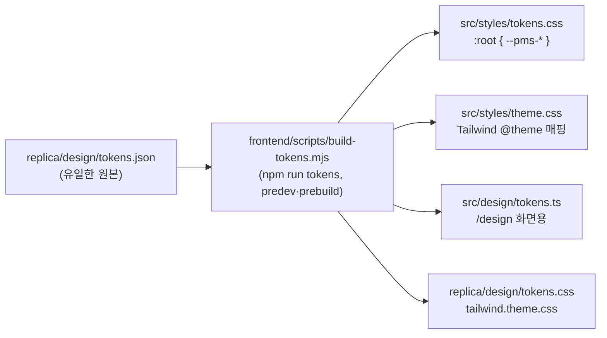

- 색, 글꼴, 간격, 반경, 그림자를 `tokens.json` 한 곳에서 정하고, 스크립트가 CSS 변수(`--pms-*`)와 Tailwind 테마(`bg-surface`, `text-muted` 등)를 만듭니다. 생성 파일은 손으로 고치지 않습니다.
- 명도 대비는 `npm run contrast`(`replica/design/contrast.py`)로 점검합니다.
- 테마는 `system`·`light`·`dark`·`high_contrast` 네 가지입니다. `system`은 운영체제 설정(미디어 쿼리)을 따르고, 나머지는 `<html data-theme>`로 고정합니다(`lib/theme.ts`). 선택값은 서버(`users.theme`, V12에서 `high_contrast` 허용)에 저장하고, 첫 화면 깜빡임을 줄이려고 브라우저 localStorage에도 둡니다.
- 고대비(a66d02e)는 라이트 계열 테마로, 토큰은 `tokens.json`의 `color-high-contrast`(검정 본문, 진한 테두리, 검정 포커스 링)입니다. 토큰 쌍 62개 모두 WCAG AA 대비를 통과합니다. 운영체제가 다크여도 고대비를 고르면 고대비가 이깁니다. e2e는 다크 시스템 설정 아래에서 고대비로 화면 5개를 axe로 검사하고, 다크 테마 검사는 실제 배경 토큰 `--pms-color-bg`를 읽어 확인합니다.
- 한글 글꼴은 Pretendard를 씁니다.

---

## 8. 공통 관심사

### 8.1 인증

#### 8.1.1 세션

| 항목 | 내용 |
| --- | --- |
| 방식 | 서버 세션. Spring Session JDBC가 세션을 PostgreSQL `spring_session` 테이블에 저장합니다. |
| 쿠키 | `OPENPMS_SESSION`, HttpOnly, SameSite=Lax, Secure(기본 `OPENPMS_SECURE_COOKIES=true`, dev 프로필만 해제) |
| 유지 시간 | `OPENPMS_SESSION_TIMEOUT`(기본 8h) |
| 세션 고정 방지 | 로그인할 때 세션 ID를 바꿉니다(`changeSessionId`). |
| 재시작 | 세션이 DB에 있으므로 앱을 다시 시작해도 로그인이 유지됩니다. |
| 즉시 무효화 | 요청마다 `Current.ctx()`가 사용자 상태를 확인하고, `active`가 아니면 401을 돌려줍니다. 잠금·익명화된 사용자의 남은 세션은 바로 쓸 수 없게 됩니다. 관리자 잠금, 익명화, 비밀번호 재설정, (v2.2) 임시 비밀번호 발급과 임시 비밀번호로 정한 첫 비밀번호는 그 사람의 세션 행을 모두 지웁니다(`Sessions.endAll`). 비밀번호 변경과 "다른 기기 로그아웃"은 현재 세션만 남깁니다(`Sessions.endOthers`). |
| 인증 불필요 경로 | `/api/v1/auth/login`, `/password-reset`, `/password-reset/confirm`, `/password-change`(v2.2), `/password-policy`, `/invitations/**`, `/sso-providers`, `/oidc/**`, 그리고 `/api/v1/openapi.json`(외부 연동 API 설명, f835e1c). `/api/**`의 나머지는 모두 로그인(세션) 또는 API 토큰(8.1.8)이 필요합니다. `/api` 밖(SPA 정적 파일, `/actuator/health`)은 공개입니다. |

폼 로그인, HTTP Basic, Spring 기본 로그아웃은 껐습니다. 로그인과 로그아웃은 `AuthController`가 JSON API로 처리합니다. 인증되지 않은 API 요청은 리디렉션 없이 401 문제 상세를 받습니다.

#### 8.1.2 CSRF

- Spring Security의 SPA용 CSRF 설정(`csrf.spa()`)을 씁니다. 서버가 `XSRF-TOKEN` 쿠키를 내려 주고, SPA가 GET 이외 요청에 `X-XSRF-TOKEN` 헤더로 되돌려 보냅니다.
- 토큰이 없거나 맞지 않으면 403 문제 상세("요청을 확인할 수 없습니다. 페이지를 새로 고친 뒤 다시 시도하세요.")를 돌려줍니다.
- 로그인 요청도 CSRF 검사를 받습니다. 첫 GET(예: `/api/v1/auth/me`) 응답에서 쿠키를 받은 뒤 로그인합니다.
- `Authorization: Bearer` 헤더가 있는 요청은 CSRF 검사에서 뺍니다(`ignoringRequestMatchers(ApiTokenFilter::isBearer)`). 이런 요청은 쿠키로 인증하지 않으므로 지킬 세션이 없고, 브라우저가 다른 사이트에서 이 헤더를 마음대로 붙일 수 없습니다(8.1.8).

#### 8.1.3 비밀번호 정책

`auth/PasswordPolicy.java`가 정책을 계산하고, 비밀번호를 정하는 모든 경로(초대 수락, 재설정 확정, 비밀번호 변경)가 같은 검사를 합니다. 관리자는 `PUT /api/v1/admin/settings/auth`로 바꿉니다.

| 설정 키(`settings`) | 기본값 | 허용 범위 | 뜻 |
| --- | --- | --- | --- |
| `auth.password_min_length` | 10 | 8~128 | 최소 길이(최대 길이는 128 고정) |
| `auth.password_required_classes` | `[]` | lower, upper, digit, special | 꼭 넣어야 하는 문자 종류 |
| `auth.password_min_classes` | 0 | 0~4 | 섞어야 하는 종류 수(필수 종류 수 이상) |
| `auth.password_reset_enabled` | true | - | "비밀번호를 잊으셨나요?" 허용 |
| `auth.lockout_attempts` | 5 | 0~50 | 연속 실패 허용 횟수(0이면 잠그지 않음) |
| `auth.lockout_minutes` | 15 | 1~1440 | 잠금 시간 |
| `auth.invitation_ttl_hours` | 168 | 1~720 | 초대 링크 유효 시간(v2.2부터 임시 비밀번호의 유효 시간도 같은 값) |
| `auth.password_reset_ttl_minutes` | 60 | 10~1440 | 재설정 링크 유효 시간 |

- 비밀번호는 `DelegatingPasswordEncoder`(기본 bcrypt)로 해시해 `users.password_hash`에 저장합니다. SSO로만 쓰는 계정은 해시가 없습니다. 이런 사람은 계정 설정에서 비밀번호 만들기 링크를 받아 비밀번호를 정할 수 있습니다(8.1.5).
- 위반하면 해당 필드(`password`, `newPassword`)에 422 필드 오류를 돌려줍니다.
- (v2.2) 임시 비밀번호는 앱이 만들어 `PasswordPolicy.check`를 한 번 더 통과시키고, 첫 로그인의 새 비밀번호(`POST /auth/password-change`)도 같은 규칙을 받습니다(8.1.9).
- 로그인한 상태가 아닌 화면은 `GET /api/v1/auth/password-policy`로 규칙을 받아 미리 안내합니다. 화면 쪽 검사는 `frontend/src/api/password-policy.ts`가 서버와 같은 규칙으로 합니다.

#### 8.1.4 로그인 실패 잠금과 요청 제한

| 대상 | 규칙 | 응답 |
| --- | --- | --- |
| 로그인 실패 | 같은 계정이 연속 `lockout_attempts`회 실패하면 `users.locked_until = 지금 + lockout_minutes`. 성공하면 횟수를 0으로 되돌립니다. 실패 횟수 기록은 오류 응답이 나가도 롤백하지 않습니다(`noRollbackFor`). 상태(`status`)는 `active` 그대로이고, 관리 · 사용자 응답의 `lockedUntil`로 보입니다(화면 "일시 잠김", `status=locked` 필터에도 포함). 관리자가 `status=active`로 바꾸면 실패 횟수와 `locked_until`을 지웁니다(384a2f9). | 401(자격 증명 불일치), 423(잠김) |
| 관리자 잠금 | `users.status = locked` | 423 |
| 계정이 없는 주소·비밀번호가 없는 계정(v2.3) | 비밀번호 해시 검사를 건너뛰지 않습니다. 계정이 없거나 비밀번호가 없으면(SSO 전용·초대됨) 앱이 시작할 때 아무도 모르는 무작위 비밀번호로 만들어 둔 해시(`AuthController.noAccountHash`)와 입력을 대조해, 실패하는 데 걸리는 시간이 계정이 있는 주소와 비슷하게 합니다. 이전에는 없는 주소 약 2 ms, 있는 주소 약 86 ms로 응답 시간이 계정 유무를 알려 줬습니다(BUG-017, `LoginTimingIT`). 잠긴 계정은 사용자에게 잠긴 이유를 알려 주려고 전처럼 423으로 답하므로 그 주소에 계정이 있다는 것은 드러납니다(의도한 동작) | 401 |
| 임시 비밀번호로 로그인(v2.2) | 비밀번호가 맞으면 실패 횟수와 잠금을 풀고 세션 없이 변경 토큰을 줌. 기한이 지났으면 임시 비밀번호를 지움(8.1.9) | 403 `password_change_required`, 401 `temporary_password_expired` |
| 로그인 요청 수 | 클라이언트 주소당 분당 `openpms.logins-per-minute`(기본 20, dev 500) | 429 |
| 재설정 메일 요청 | 클라이언트 주소당 분당 5회 | 429 |
| 비밀번호 변경 | 사용자당 분당 10회 | 429 |
| 임시 비밀번호의 새 비밀번호 정하기(v2.2) | 로그인과 같은 버킷(`login:<클라이언트 주소>`, 분당 `openpms.logins-per-minute`) | 429 |
| 비밀번호 만들기 링크 | 사용자당 분당 3회 | 429 |
| API 토큰 요청 | 토큰당 분당 300회(`token:<토큰 id>` 버킷) | 429 "요청이 너무 많습니다." |

요청 제한은 Bucket4j 메모리 버킷입니다(`auth/RateLimiter.java`). 앱 인스턴스가 하나라는 전제입니다(인스턴스를 늘리면 인스턴스마다 따로 셉니다). 키가 1만 개를 넘으면 버킷을 비웁니다.

클라이언트 주소(384a2f9): 리버스 프록시 뒤에서는 모든 연결이 프록시에서 옵니다. `server.forward-headers-strategy: ${OPENPMS_FORWARD_HEADERS:native}`로 Tomcat RemoteIpValve를 켜고, `server.tomcat.remoteip.internal-proxies: ${OPENPMS_TRUSTED_PROXIES:…}`(기본: 이 호스트 127.x·::1, Docker 브리지 172.16–31.x, Podman 네트워크 10.88–89.x)에 맞는 주소에서 온 요청만 `X-Forwarded-For`·`X-Forwarded-Proto`를 믿습니다. 주소는 `X-Forwarded-For`를 오른쪽부터 읽어 믿는 프록시를 건너뛴 첫 주소이므로, 사용자가 앞에 가짜 주소를 붙여도 요청 제한을 피할 수 없습니다(`ClientAddressIT`). 전에는 프록시 뒤의 모든 사용자가 버킷 하나를 같이 썼습니다. 프록시 없이 쓸 때는 `OPENPMS_FORWARD_HEADERS=none`으로 헤더를 무시합니다. Podman 대역은 90006c2에서 더했습니다. rootless Podman은 게시한 포트로 들어온 연결을 컨테이너 자신의 주소(예: 10.89.1.3)에서 온 것으로 앱에 넘기므로, 이 대역이 없으면 헤더가 무시되어 모두가 다시 버킷 하나를 같이 씁니다(1.2 배포 스모크에서 발견, 고친 이미지로 확인). Docker의 192.168.x 풀은 기본값에 없으므로 그때는 변수를 정합니다.

#### 8.1.5 초대·비밀번호 재설정 토큰

- 32바이트 난수를 Base64URL로 만든 일회용 토큰입니다. 원문은 메일(또는 첫 관리자 로그)에만 있고, DB(`user_tokens`)에는 SHA-256 해시만 저장합니다.
- 새 토큰을 발급하거나 하나를 쓰면 같은 사용자·같은 용도의 다른 토큰은 모두 무효가 됩니다(`Tokens.revokeAll`).
- 만료, 사용됨, 알 수 없음은 모두 같은 410 응답입니다. 어떤 경우인지 드러내지 않습니다.
- 재설정 요청은 계정이 있든 없든 항상 202를 돌려줍니다(계정 존재 여부 노출 방지).
- 재설정을 확정하면 그 계정의 모든 세션이 끝납니다. 초대를 수락하면 바로 로그인됩니다.
- 비밀번호 만들기(384a2f9): 비밀번호가 없는 사람(SSO 전용)이 `POST /api/v1/me/password/setup`을 부르면 재설정과 같은 `password_reset` 토큰(유효 `auth.password_reset_ttl_minutes`)을 본인 주소로 보냅니다. 링크는 재설정 화면(`/password-reset?token=…`)입니다. `auth.password_reset_enabled`와 관계없이 보낼 수 있고, 링크가 본인 메일로만 가므로 빌린 세션만으로는 비밀번호를 더할 수 없습니다. 이미 비밀번호가 있으면 422입니다.
- 만료되거나 쓴 지 7일 지난 토큰은 `token-cleanup` 작업이 지웁니다. 같은 작업이 폐기·만료 후 30일 지난 API 토큰(`api_tokens`)도 지웁니다(dfde416).
- (v2.2) 목적 `password_change`: 임시 비밀번호로 로그인한 사람에게 주는 변경 토큰(유효 10분, 일회용)입니다. 같은 사용자의 이전 `password_change` 토큰은 새로 발급할 때 무효가 되고, 임시 비밀번호를 다시 발급하면 `password_reset`·`password_change` 토큰이 모두 무효가 됩니다. 메일로 가는 토큰이 아니라 로그인 응답의 문제 상세에 담겨 화면의 메모리에만 있습니다(8.1.9).

#### 8.1.6 첫 관리자

활성 관리자가 없고 `OPENPMS_ADMIN_EMAIL`이 있으면, 시작할 때 그 주소로 초대 상태의 관리자를 만들고 24시간짜리 설정 링크를 로그에 한 번(WARN) 출력합니다. 기본 비밀번호는 없습니다. 관리자가 생기기 전에는 시작할 때마다 새 링크가 나오고 이전 링크는 무효가 됩니다. 그 주소가 이미 초대 상태가 아닌 계정이면 바꾸지 않고 경고만 남깁니다.

#### 8.1.7 OIDC SSO

관리자가 관리 화면에서 OpenID Connect 공급자를 등록하면, 로그인 화면에 공급자마다 버튼이 생깁니다. 이메일·비밀번호 로그인은 그대로 남습니다.

| 구성 요소 | 역할 |
| --- | --- |
| `OidcProviders` | DB(`oidc_providers`)의 공급자를 Spring Security `ClientRegistration`으로 바꿉니다. 처음 쓸 때 발견 문서(`{issuer}/.well-known/openid-configuration`)를 읽어 메모리에 둡니다. 수정·삭제하면 캐시에서 지웁니다. 꺼졌거나 없거나 닿지 않는 공급자는 등록이 없습니다. |
| `SecurityConfig.oauth2Login` | 인가 코드 흐름. 시작 `/api/v1/auth/oidc/start/{slug}`, 콜백 `/api/v1/auth/oidc/callback/{slug}`. IdP 토큰은 저장하지 않습니다(`noTokenStore`). |
| `OidcLogin` | PKCE(S256)를 켜고, 돌아갈 경로(`next`, 같은 사이트 경로만)를 세션에 둡니다. 로그인 성공 후 openPMS 계정을 결정하고, 폼 로그인과 같은 세션을 만듭니다. 실패하면 `/login?sso_error=<코드>`로 보냅니다. |
| `OidcController` | 공개 버튼 목록, 관리용 공급자 CRUD. 클라이언트 시크릿은 응답에 넣지 않고 저장 여부(`secretSet`)만 보여 줍니다. |

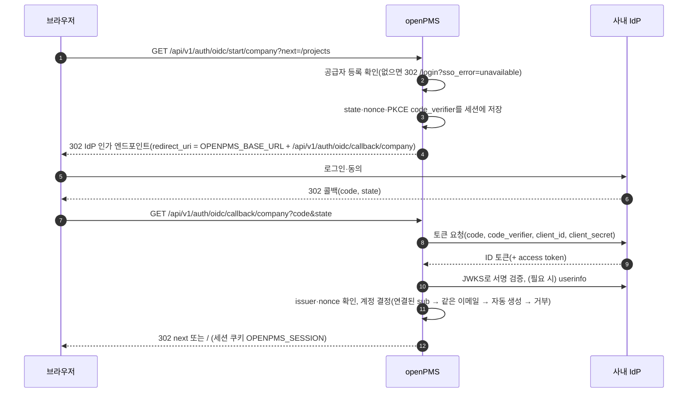

계정 결정 규칙(`OidcLogin.resolveUser`)

1. 이 공급자의 `sub`에 이미 연결된 계정
2. 없으면 이메일 클레임이 같은 계정. 공급자가 `email_verified=false`를 보내면 거부(`unverified`). 값이 없으면 확인된 것으로 봅니다. 연결을 새로 만듭니다(계정당 공급자별 `sub` 하나).
3. 없고 공급자의 "계정 자동 생성"이 켜져 있으면 새 활성 계정(관리자 아님, 비밀번호 없음)
4. 그 밖에는 거부(`no_account`)

잠긴 계정(`locked`, 로그인 실패 잠금 시간 중)은 거부하고, 초대 상태 계정은 활성으로 바꿉니다. 자동 생성 계정은 비밀번호가 없습니다. `GET /api/v1/auth/me`의 `hasPassword`(false)와 `signInWith`(연결된 공급자 표시 이름)로 계정 설정 화면이 비밀번호 만들기 안내를 보여 줍니다(8.1.5). 거부 코드는 `no_account`, `locked`, `unverified`, `no_email`, `cancelled`, `unavailable`, `failed`입니다.

(v2.5) 승인자 지정: 설정 `openpms.oidc.manager-claim`(환경 변수 `OPENPMS_OIDC_MANAGER_CLAIM`, 기본 비어 있음)에 클레임 이름을 주면, 로그인 성공 뒤 `OidcLogin.syncManager`가 그 클레임 값(관리자의 이메일)과 같은 이메일을 가진 활성 사용자(본인 제외)로 `users.manager_id`를 맞춥니다. 클레임이 없거나 일치하는 사람이 없으면 값을 그대로 둡니다(관리 화면에서 정한 값을 지우지 않음).

보안상 주의: 클라이언트 시크릿은 DB `oidc_providers.client_secret`에 평문으로 저장됩니다. DB 백업 파일은 `.env`와 같은 수준으로 보호해야 합니다(`replica/deploy.md` 보안 메모).

#### 8.1.8 API 토큰 인증 (외부 연동)

사내 시스템이 openPMS를 부를 때 쓰는 개인 토큰입니다(f835e1c, V14). 사람마다 계정 설정 · API 토큰에서 만들고, 화면과 같은 `/api/v1` 경로를 그 사람의 권한으로 부릅니다.

| 구성 요소 | 역할 |
| --- | --- |
| `ApiTokens` | 발급: `opms_` + 32바이트 난수(Base64URL). 원문은 만든 응답에 한 번만 담고 DB(`api_tokens.token_hash`)에는 SHA-256만 저장. 이름 1~60자, 범위 `read`·`write`, 만료 30·90·365일 또는 없음, 사람당 폐기되지 않은 토큰 20개까지. 조회(`resolve`): 해시가 같고 폐기·만료되지 않았고 주인이 `active`이며 로그인 실패 잠금 중이 아니어야 함. `last_used_at`은 최대 1분에 한 번 기록 |
| `ApiTokenFilter` | Spring Security 체인에서 `CsrfFilter` 앞에 놓인 필터. `/api/`로 시작하고 `Authorization: Bearer`가 있는 요청만 다룸. 세션을 만들지 않고 그 요청에만 토큰 주인으로 인증(`SecurityContext`를 요청 끝에 비움). 이후 `Current.ctx()`가 세션 요청과 같은 방식으로 권한을 계산 |
| `ApiTokenController` | `GET·POST /me/api-tokens`, `DELETE /me/api-tokens/{id}`(본인), `GET /admin/api-tokens`, `DELETE /admin/api-tokens/{id}`, `GET·PUT /admin/settings/api`(관리자), `GET /openapi.json`(공개) |

필터의 판단 순서와 응답(모두 문제 상세):

1. 설정 `api.tokens_enabled`가 false(관리 · API와 웹훅에서 끔) → 401 "API 토큰을 쓰지 않도록 설정되어 있습니다." 새 토큰 발급도 403.
2. 토큰이 없거나 폐기·만료, 주인이 활성이 아니거나 잠김 → 401 "API 토큰이 올바르지 않거나 만료되었습니다."
3. 닫힌 경로 `/api/v1/auth/**`(`/api/v1/auth/me`는 허용), `/api/v1/me/password*`, `/api/v1/me/api-tokens`, `/api/v1/admin/api-tokens`, 연동 설정 `/api/v1/admin/settings/api`·`/api/v1/admin/webhooks`·`/api/v1/admin/webhook-deliveries`(dfde416), (v2.2) `/temporary-password`로 끝나는 경로(임시 비밀번호 발급·보기) → 403 "API 토큰으로는 로그인·비밀번호·토큰·연동 설정을 다룰 수 없습니다." 토큰으로 로그인·비밀번호·토큰과 토큰 스위치·웹훅을 다룰 수 없게 합니다(관리자의 쓰기 토큰도). (v2.3) 이 필터는 닫힌 경로를 Spring이 라우팅하는 것과 같은 디코딩된 경로(`UrlPathHelper.getPathWithinApplication`)로 비교합니다. 2.2까지는 디코딩 전 요청 주소(`getRequestURI`)로 비교해, `/me/%61pi-tokens`처럼 글자 하나를 퍼센트 인코딩하면 필터는 닫힌 경로로 보지 않고 Spring MVC는 `/me/api-tokens`로 라우팅해 토큰이 막힌 경로(토큰 목록·생성, 웹훅, 비밀번호)에 닿았습니다(BUG-015, `ApiTokensIT`). Spring Security의 방화벽은 `%2F`·`%25`·`%3B` 같은 일부 인코딩만 거부하고 `%61` 같은 글자 인코딩은 통과시킵니다. (v2.2) 임시 비밀번호의 만들기·발급·보기는 이 필터 말고도 `TemporaryPasswordController`와 `AdminController.createUser`(`method: temporaryPassword`)가 `ApiTokenFilter.isBearer`로 같은 거절을 합니다(`TemporaryPasswordIT`). 디코딩 전 주소를 쓰는 나머지 두 곳(SSO 공급자 이름 확인, 중복 방지 저장)은 퍼센트 인코딩 입력을 더 엄격하게 막는 쪽이라 그대로입니다.
4. 읽기 전용(`read`) 토큰은 GET·HEAD·OPTIONS와 읽기용 POST(`/work-packages/query`, `/work-packages/export`, `/work-packages/export/count`)만 → 그 밖은 403 "읽기 전용 토큰입니다."
5. 토큰당 분당 300회를 넘으면 429(메모리 버킷, 인스턴스마다 따로 셈).

- 권한은 토큰 주인의 권한 그대로입니다. 관리자의 쓰기 토큰은 관리자 API도 부를 수 있습니다. 토큰으로 한 변경은 저널에 주인의 이름으로 남고, 토큰으로 했는지 화면으로 했는지는 구분하지 않습니다.
- 관리자는 모든 사람의 토큰(주인, 이름, 범위, 만든 날, 최근 사용, 만료)을 보고 폐기할 수 있습니다. 토큰 원문은 관리자에게도 보이지 않습니다.
- 버전 정책: 경로는 `/api/v1`이고, v1 안에서는 응답 필드를 더하기만 합니다. 필드를 빼거나 뜻을 바꾸는 변경은 `/api/v2`로 냅니다(도움말 · API 문서).
- `/api/v1/openapi.json`은 OpenAPI 3.1 문서(`resources/api/openapi.json`, 손으로 씀)로 주요 경로 11개(9252851에서 내보내기 건수 추가)와 인증 방식(`token`), 오류 모양만 담습니다. 전체 경로는 인터페이스 정의서에 있습니다.
- 검증: `ApiTokensIT`(한 번만 보이는 값과 해시만 저장, 읽기 전용은 PATCH 403, 닫힌 경로 403, (v2.3) 퍼센트 인코딩한 글자가 든 경로도 403, 관리자 쓰기 토큰으로 웹훅·토큰 스위치 403, 세션·CSRF 없이 쓰기, 멤버 토큰으로 관리 API 403, 폐기 후 401, 끄면 401·발급 403, OpenAPI 공개), e2e F15-H1·H2.

#### 8.1.9 임시 비밀번호와 변경 토큰 (v2.2)

관리자가 사용자를 메일 없이 등록하거나 다시 발급하는 임시 비밀번호입니다(092767a–28856f5, V19, 설계 `docs/superpowers/specs/2026-10-12-temporary-password-design.md`). 임시 비밀번호로는 세션을 만들지 않습니다. 일회용 변경 토큰으로 사용자 자신의 비밀번호를 정해야 로그인됩니다.

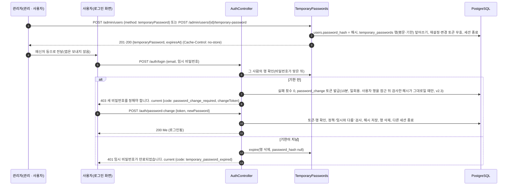

| 항목 | 내용 |
| --- | --- |
| 보관 | `temporary_passwords`: PK `user_id`(사용자마다 한 행, 사용자 행이 지워지면 CASCADE), 평문 `password`, `expires_at`, `issued_by`(발급한 관리자, 그 사용자가 지워지면 null), `issued_at`. 다시 발급하면 같은 행을 덮어씁니다(upsert). 로그인 확인은 늘 `users.password_hash`로 하고, 행이 있다는 것은 지금 비밀번호가 임시라는 뜻입니다 |
| 만들기 | `TemporaryPasswords.generate`: `SecureRandom`, 길이 max(16, 정책 최소 길이), 문자 집합에서 `0 O 1 l I`를 뺌, 특수 문자는 `!@#$%*-_+=?`만, 소문자·대문자·숫자·특수 문자를 하나씩 넣고 섞은 뒤 `PasswordPolicy.check`를 한 번 더 통과시킴(`TemporaryPasswordsTest`) |
| 기한 | 발급 시각 + `auth.invitation_ttl_hours`(기본 168시간) |
| 발급 | `TemporaryPasswords.issue`(`@Transactional`): 해시 저장, 실패 횟수 0·잠금 시각 지움, 행 upsert, `password_reset`·`password_change` 토큰 모두 무효, `Sessions.endAll`. 컨트롤러가 그 전에 대상이 초대 상태이면 `active`로 바꾸고 초대 토큰을 무효로 함. 만들기(`POST /admin/users`의 `method: temporaryPassword`)는 계정을 `active`로 만들고 초대 토큰·메일은 만들지 않음 |
| 보기 | `GET /admin/users/{id}/temporary-password`: 행이 있고 기한 안일 때만 평문과 발급자·발급 시각을 돌려주고, 아니면 404 |
| 권한 | 사용자 관리자(관리자 또는 `global.manage_users`), 관리자 계정은 관리자만(v2.3부터 사용자 수정·삭제도 같은 규칙, 8.2.1), 나 자신 422, 잠긴 계정 422, 삭제됨·없음 404. API 토큰은 쓸 수 없음(8.1.8) |
| 로그인 | 비밀번호가 맞은 뒤에 행을 확인합니다. 행이 있고 기한 안이면 실패 횟수와 잠금을 풀고 세션 없이 `password_change` 토큰을 문제 상세의 `current`에 담아 403으로 돌려줍니다. (v2.3) 토큰은 `TemporaryPasswords.changeToken`이 줍니다. 로그인이 비밀번호 해시를 검사하는 동안(약 0.1초, 트랜잭션 밖) 관리자가 다시 발급하거나 사용자가 비밀번호를 정했을 수 있으므로, 사용자 행을 잠근 뒤 지금의 `password_hash`가 검사한 해시와 같고 임시 비밀번호가 아직 기한 안일 때만 토큰을 줍니다. 아니면 틀린 비밀번호와 같은 401(**이메일 또는 비밀번호가 올바르지 않습니다.**)입니다. 사용자 행을 먼저 잠그는 순서가 같아서, 다시 발급과 겹치면 다시 발급이 먼저 끝나 해시가 달라 토큰이 나가지 않거나(`UT-121`), 이 토큰이 먼저 만들어지고 다시 발급이 그 토큰을 무효로 합니다. 기한이 지났으면 `expire`가 행과 `users.password_hash`를 함께 지우고 401을 돌려줍니다. 틀린 비밀번호는 전처럼 401이고 실패 횟수가 쌓입니다. `password_hash`가 null인 활성 계정은 SSO 전용 계정과 같은 상태라, 다시 발급하거나 재설정 메일을 받기 전까지 비밀번호로 로그인하지 못합니다 |
| 변경 | `POST /auth/password-change`(공개, 로그인과 같은 요청 제한): 토큰이 없거나 만료·사용됨이거나, 계정이 `active`가 아니거나, 임시 비밀번호가 이미 없어졌거나 기한이 지났으면(그 사이 재설정 링크·초대 수락·본인 변경이 있었거나 기한이 지남) 모두 같은 410입니다. 정책 위반과 임시 비밀번호와 같은 값은 422(`newPassword`)이고 토큰은 그대로 쓸 수 있습니다. 성공하면 해시 저장, 행 삭제, `last_login_at` 갱신, 토큰 무효, 그 사람의 세션을 모두 끝낸 뒤 로그인시킵니다(응답 `Me`) |
| 다른 경로 | 재설정 확정(`/auth/password-reset/confirm`), 초대 수락, 본인 변경(`PUT /me/password`)이 행을 지웁니다. 사용자 삭제(익명화)도 지웁니다 |
| 정리 | `token-cleanup`(매일 03:30, `OPENPMS_JOBS_ENABLED=true`인 인스턴스)이 기한이 지난 행을 `expireAll`로 처리합니다(행 삭제 + `password_hash` null. v2.3부터 `expire`는 사용자 행을 먼저 잠근 뒤 처리해 다시 발급과 교착하지 않음, 8.3). 로그인 때와 같은 동작이라, 행이 지워진 뒤 옛 임시 비밀번호가 보통 비밀번호처럼 통하지 않습니다. 사용자 목록 응답은 행이 지워지기 전까지(그 임시 비밀번호로의 로그인 시도나 정리 작업 전까지) 기한이 지난 행도 `temporaryPasswordUntil`로 보여 줍니다(화면 **임시 비밀번호 만료**) |
| SSO | 임시 비밀번호가 있어도 SSO 로그인은 그대로 됩니다. 변경 강제는 비밀번호 로그인에만 적용합니다(`OidcIT`) |
| 노출 범위 | 평문은 `temporary_passwords`와 세 응답(만들기·다시 발급·보기)에만 있습니다. 세 응답은 `Cache-Control: no-store`이고, `IdempotencyFilter`는 `POST /admin/users`와 `POST /admin/users/{id}/temporary-password`를 대상에서 뺍니다(8.3). 서버 로그에는 사용자 ID만 남고(8.8) 웹훅·활동·메일·알림에는 나가지 않습니다. (v2.3) 비밀번호·일회용 토큰이 든 요청·응답 레코드(`LoginInput`·`ResetConfirm`·`AcceptInput`·`PasswordChange`, `TemporaryPasswords.Issued`·`Shown`, `AdminController.CreatedWithPassword`)는 `toString`이 값을 가립니다. Spring MVC는 읽고 쓰는 객체를 웹 로그가 DEBUG일 때 `toString`으로 찍기 때문입니다(`SecretToStringTest`). 응답의 `Cache-Control`은 정확히 `no-store`입니다(`TemporaryPasswordIT`). DB 덤프와, `org.jooq` 로그를 DEBUG로 올린 경우의 바인드 값에는 평문이 들어갈 수 있습니다(10-운영자매뉴얼 9.2.7) |
| 화면 | `pages/login.tsx`가 403 응답의 `current.code`를 읽어 같은 `AuthShell`을 `pages/new-password.tsx`의 `PasswordChangeForm`(**새 비밀번호 정하기**)으로 바꿉니다. 변경 토큰은 컴포넌트 상태에만 있고 주소·저장소에 남기지 않습니다. 관리 쪽은 `pages/admin/users.tsx`(**사용자 추가**, 결과 대화상자, 행 메뉴). 가짜 데이터 계층(`api/fake/temporary-passwords.ts`)이 같은 규칙으로 동작하고 **예시 데이터 초기화**가 임시 비밀번호도 지웁니다 |
| 검증 | `TemporaryPasswordIT` 11(v2.3에서 변경 토큰 발급 조건 1건 추가), `TemporaryPasswordsTest` 1, `OidcIT` 1, `SecretToStringTest` 1(v2.3), e2e F19-T1–T3 |

### 8.2 권한

#### 8.2.1 `Ctx`와 권한 계산

요청마다 `Current.ctx()`가 세션의 사용자 ID로 `Ctx`를 만들고 요청 범위에 한 번만 둡니다. `Ctx`는 `Snapshot`에서 권한을 계산하고, 프로젝트별 결과를 요청 안에서 캐시합니다.

| 규칙 | 내용 |
| --- | --- |
| 관리자 | `users.is_admin`이면 모든 프로젝트 역할의 권한을 가지며, 전역 권한 2종(`global.create_projects`, `global.manage_users`)도 가집니다. |
| 멤버 | 직접 멤버십 역할과 그룹 멤버십 역할의 합집합 |
| 공개 프로젝트 | 멤버가 아니면 내장 역할 `non_member`의 권한 |
| 공유받은 작업 | 그 작업이 있는 프로젝트에 `project.view`만 추가. 작업 하나에는 공유 역할의 권한(`view`: wp.view / `comment`: + wp.comment, wp.edit_own_comments / `edit`: + wp.edit, wp.attach)을 더합니다(`Ctx.can(project, wpId, perm)`). |
| 보관된 프로젝트 | `.view`로 끝나는 권한과 `project.view_members`만 남깁니다. |
| 꺼진 모듈 | `boards` 모듈이 꺼지면 `board.view`, `board.manage`를 뺍니다. v1.6부터 `time_tracking` 모듈이 꺼지면 `time.log`, `time.view`, `time.manage`도 뺍니다(`Ctx.MODULE_OF`). 그래서 모듈을 끈 프로젝트의 시간 기록은 기록·조회·보고서 어디에도 나오지 않습니다(지워지지는 않음). |
| 관리자 계정(v2.3) | 관리자의 계정은 관리자만 다룹니다. 대상이 관리자(`users.is_admin`)이고 요청한 사람이 관리자가 아니면 `AdminController.requireAdminFor`가 403 **관리자 계정은 관리자만 다룰 수 있습니다.**를 돌려줍니다. 사용자 관리자(`global.manage_users`)가 이를 우회해 관리자를 잠그거나 이름을 바꾸거나 삭제(익명화)할 수 있던 것을 막습니다(BUG-016). 적용 경로: 사용자 수정·삭제(`PATCH`·`DELETE /admin/users/{id}`)와 임시 비밀번호 발급·보기(8.1.9). 관리자 지정·해제와 전역 역할 배정은 전부터 관리자만 가능합니다. 화면은 사용자 관리자에게 관리자 행의 메뉴를 보이지 않습니다(초대 상태의 관리자 행에는 **초대 다시 보내기**만 남음, 06 S35). 초대 메일 다시 보내기(`POST /admin/users/{id}/resend-invitation`)는 일부러 이 규칙에 넣지 않았습니다: 메일이 그 관리자 본인의 주소로 가기 때문입니다(화면의 **초대 다시 보내기**와 백엔드 모두 관리자 대상 검사가 없음). 관리자가 한 명뿐일 때는 '마지막 관리자입니다.'(422)가 대신 막지만 관리자가 둘 이상이면 이 규칙이 막습니다 |
| 전역 권한 | `global_role_assignments`의 전역 역할에서 계산합니다. 관리자가 관리 · 사용자에서 배정합니다(`PUT /api/v1/admin/users/{id}/global-roles`, 관리자만. `global.manage_users`만 있는 사람은 403). 요청마다 계산하므로 배정·회수는 그 사람의 다음 요청부터 적용됩니다. |

권한 키는 프로젝트 범위 36개(v1.6에 묶음 `time`의 `time.log`·`time.view`·`time.manage` 추가)와 전역 범위 2개입니다(`GET /api/v1/admin/permissions`). 목록은 인터페이스 정의서 2.3절에 있습니다.

#### 8.2.2 보이지 않는 리소스는 404

- 프로젝트는 `Ctx.findProject`가 `project.view`가 없으면 404("프로젝트를 찾을 수 없습니다.")를 돌려줍니다. 존재하지 않는 경우와 응답이 같습니다.
- 작업 패키지는 `WorkPackageService.find`가 `wp.view`(공유 포함)가 없으면 404를 돌려줍니다. 첨부, 관계, 코멘트, 보드, 저장된 보기도 같은 방식으로 404를 씁니다.
- 볼 수는 있지만 그 동작을 할 수 없으면 403입니다. 예: 프로젝트 복원(`unarchive`)은 먼저 `findProject`로 404를 판정한 뒤 관리자가 아니면 403입니다.
- 목록 쿼리는 항상 볼 수 있는 프로젝트 조건(`ctx.visibleProjects("wp.view")`, 공유 작업)을 붙입니다(`QueryEngine.visible`, `SearchController.visible`).
- 화면은 작업 패키지 응답의 `_meta.allowedActions`, `_meta.editableFields`와 프로젝트 응답의 `myPermissions`로 버튼을 그립니다. 권한 규칙을 화면에 복제하지 않습니다.

#### 8.2.3 요청자(멤버가 아닌 사용자)와 포털 (v2.4)

서비스 데스크의 요청자는 프로젝트 멤버가 아니므로, 기존 권한 계산(`Ctx`, 멤버 역할)에 기대지 않고 포털이 직접 좁힙니다.

- **쿼리를 요청자로 좁힘**: `PortalService.find`는 `service_tickets`와 조인해 `requester_id = 현재 사용자`인 작업만 읽습니다. 목록·상세·코멘트·상태·첨부가 모두 이 한 곳을 거치고, 남의 티켓·없는 번호·첨부가 그 티켓의 것이 아닌 경우 모두 같은 **404**(**요청을 찾을 수 없습니다.**)를 줍니다(8.2.2와 같은 원칙).
- **작업 패키지 API로는 안 보임**: 요청자가 멤버가 아니면 서비스 데스크 프로젝트의 `wp.view`가 없으므로 `GET /work-packages/{n}`·쿼리에 그 티켓이 나오지 않습니다(`PortalSecurityIT`). 서비스 데스크 프로젝트가 공개이면 비멤버 역할의 `wp.view`로 전 직원에게 보이므로, 서비스 데스크는 공개로 둘 수 없습니다(422, `ProjectController.serviceDeskStaysPrivate`).
- **전용 응답 모델**: 포털은 `Dto.WorkPackage`가 아니라 `PortalTicket`·`PortalSummary`(번호, 제목, 상태, 공개 이력, 첨부, 공개한 필드 값, 가능한 상태)로 답합니다. 내부 코멘트(`journals.is_internal`), 처리 그룹 구성원, 남의 메일 주소, **포털에 공개**하지 않은 사용자 정의 필드, 사용자·버전 형식의 필드는 담지 않고, 409에 최신 작업 패키지(`current`)를 싣지 않습니다.
- **입력 허용 목록**: 접수는 유형(장애·서비스 요청만)·제목·내용·영향도·긴급도·공개 필드만 받고 나머지 키는 버립니다. 코멘트는 기존 HTML 정화를 거칩니다.
- **상태 전환**: `Assembler.allowedFor`에 내장 역할 `requester`를 줘서 그 역할의 워크플로로 판단합니다(V20은 `applies_to = 'always'`로 넣고, 작성자 = 요청자인지는 포털이 검사). 이 역할은 `roles.builtin = 'requester'`라 멤버 지정 화면에 나오지 않고, 관리자는 워크플로 화면에서 전환을 고칠 수 있습니다.
- **처리자 쪽 권한**: `service.view`·`service.handle`·`service.manage`는 `Ctx.MODULE_OF`가 모듈 `service_desk`에 묶어, 모듈이 꺼지면 빠집니다(`time.*`과 같은 방식).

#### 8.2.4 승인자(멤버가 아닌 사용자)와 승인 API (v2.5)

승인자(요청자의 관리자, 처리 그룹의 책임자)도 서비스 데스크의 멤버가 아닐 수 있어, 요청자와 같은 원칙(8.2.3)으로 승인 경로(`/api/v1/portal/approvals`)가 직접 좁힙니다(AD-40).

- **행으로 좁힘**: 읽기·쓰기는 모두 `ticket_approvals.approver_id = 호출한 사람`이고 `decision = 'pending'`인 행을 거칩니다. 없는 ID, 남의 행, 아직 차례가 아닌 `waiting`, `skipped`, 이미 결정한 행, 서비스 데스크가 꺼졌거나 보관된 프로젝트의 행은 모두 같은 **404**(**승인 요청을 찾을 수 없습니다.**)입니다(`PortalApprovalSecurityIT`). 이미 결정한 내 행에 다시 결정하면 409(**이미 처리된 승인입니다.**)입니다.
- **잘못된 결정 값**: `decision`이 `approve`·`reject`가 아니면 먼저 내 행인지 확인한 뒤 422를 줍니다(남의 행이면 값과 상관없이 404).
- **전용 응답 모델**: 승인 상세에는 요청 내용, 항목 양식의 필드(포털 공개 여부와 무관), 첨부, 단계 목록만 담습니다. 내부 코멘트·활동·메일 주소·항목 양식 밖의 필드·앞 승인자의 의견은 담지 않고, 승인 응답에 작업 패키지 API의 응답을 돌려주지 않습니다.
- **상태 이동**: 승인자는 프로젝트 역할이 없으므로 `Acting.APPROVAL`이 승인 대기에서 접수(마지막 승인)와 반려(반려)로만 보냅니다(AD-41).
- **처리자 쪽**: 승인 패널 보기(`GET /work-packages/{n}/approvals`)는 `service.view`, 승인자 바꾸기(`PATCH …/approvals/{id}`)는 `service.handle`이고, 권한이 없으면 서비스 데스크가 있어도 404입니다. 요청자의 **승인 진행** 표와 승인 상세의 단계 목록은 단계 번호·승인자 이름·결정과 시각만 보이고(뒷단계 `waiting` 승인자 이름 포함) 건너뛴 행의 승인자·사유와 승인 의견은 보이지 않습니다. 처리자의 승인 패널은 모든 행(건너뜀 이유와 의견 포함)을 봅니다.
- **관리자 지정**: 승인자를 정하는 `users.manager_id`·`user_groups.lead_user_id`는 관리자(관리자 권한)만 바꿉니다. 사용자 관리자(`global.manage_users`)는 403 "관리자만 관리자(상사)·그룹 책임자를 정할 수 있습니다."입니다(AD-46).

### 8.3 트랜잭션과 동시성

| 항목 | 내용 |
| --- | --- |
| 경계 | 쓰기 경로는 Spring `@Transactional`(컨트롤러 메서드 또는 서비스 메서드)로 한 요청 = 한 트랜잭션입니다. 업무 변경, 저널, 알림 행, 일정 전파 결과가 같이 커밋되거나 같이 롤백됩니다. |
| 사용자 행 잠금 순서(v2.3) | 임시 비밀번호의 발급(`issue`)·만료 처리(`expire`)·변경 토큰 발급(`changeToken`)은 모두 사용자 행을 먼저 `FOR NO KEY UPDATE`로 잠그고 임시 비밀번호 행을 나중에 만집니다. `expire`는 2.2까지 임시 행을 먼저 지운 뒤 사용자 행을 고쳐 순서가 반대라, 다시 발급과 두 트랜잭션이 겹치면 교착할 수 있었습니다. 겹침을 정확히 재현해야 해 `expire` 쪽에는 자동 테스트가 없습니다(09 OI-45) |
| 승인 결정의 잠금 순서(v2.5) | `ApprovalService.decide`와 처리자의 승인자 바꾸기(`replace`)는 `work_packages` 행을 먼저 `select … for update`로 잠근 뒤 승인 행을 조건부 update(`where decision = 'pending'`)로 고칩니다(잠금 순서: 작업 → 승인 행). 같은 단계의 두 승인자가 동시에 승인하면 한쪽만 이기고 진 쪽은 409(그 사이 `skipped`가 됐으면 404)이며 접수 저널은 한 건입니다. 처리자의 **취소**·승인자의 결정·승인자 바꾸기도 같은 순서로 한 요청의 행을 잠그므로 서로 기다릴 뿐 교착하지 않습니다. 같은 단계의 동시 결정은 `ApprovalsIT.concurrentDecisionsCountOnce`가 확인하고, 취소와 결정이 겹치는 경우를 정확히 재현하는 테스트는 없습니다 |
| 로그인 | (v1.9부터) 트랜잭션 없이 처리합니다. 실패 횟수·잠금 기록 같은 갱신은 각각 한 문장이라 따로 커밋되어 401 응답에서도 남고, 비밀번호 해시를 확인하는 동안(CPU 약 0.1초) DB 커넥션을 잡지 않습니다. 여러 사람이 한꺼번에 로그인할 때 커넥션 풀이 비지 않게 하려는 것입니다(BUG-012). 1.8까지는 `@Transactional(noRollbackFor = ApiException.class)`였습니다. |
| 가상 스레드와 잠금(v1.9) | 요청은 가상 스레드(`spring.threads.virtual.enabled: true`)에서 돕니다. Java 21에서는 가상 스레드가 모니터(`synchronized`, `ConcurrentHashMap.computeIfAbsent`가 잡는 칸 잠금) 안에서 DB 커넥션·쿼리·파일을 기다리면 캐리어 스레드를 놓지 않습니다. 캐리어는 CPU 수만큼이라 CPU 2개 서버에서는 둘만 묶여도 커넥션을 쥔 요청까지 실행되지 못해, 커넥션 풀이 30초 타임아웃(`Connection is not available, request timed out after 30000ms`)까지 멈췄습니다(BUG-012, 부하 측정에서 찾음. CPU 8개 개발 PC에서는 드물어 보이지 않았음). 그래서 우리 코드는 `synchronized`를 쓰지 않고 `java.util.concurrent`의 잠금을 씁니다: `Snapshot`의 지연 로더는 `ReentrantLock`과 `volatile` 값(이중 확인), `Snapshot.shares`는 맵 밖에서 조회한 뒤 `putIfAbsent`(경쟁하면 먼저 넣은 값). 지키는 장치는 `NoPinningTest`(`src/main/java`에 `synchronized`가 있으면 실패)와 `PerfBudgetIT#noRequestKeepsItsCarrierThreadWhileWaiting`(가상 스레드 20개로 주요 화면을 동시에 요청하며 JFR `jdk.VirtualThreadPinned`를 받아, 우리 코드 프레임이 든 고정이 하나라도 있으면 실패. 고치기 전 코드로 실패 확인)입니다. |
| SSO | `TransactionTemplate`으로 계정 결정과 연결 기록을 한 트랜잭션에서 처리합니다. |
| 낙관적 잠금 | 작업 패키지 수정·이동은 요청의 `lockVersion`이 현재 값과 다르면 409와 함께 현재 값(`current`)을 돌려줍니다. 갱신 문에도 버전 조건이 있어 경쟁 중에도 한쪽만 성공합니다. |
| 일정 직렬화 | 일정을 바꾸는 트랜잭션은 `pg_advisory_xact_lock(<고정 키>)`로 직렬화합니다(`ScheduleStore.lock`). 커밋·롤백 때 풀립니다. |
| 일괄 처리 | `POST /work-packages/bulk`는 최대 200건을 한 트랜잭션에서 처리하고, 한 건이라도 실패하면 422와 실패 목록을 돌려주며 전체를 롤백합니다. 복사(`action: copy`)는 고른 작업 중 상위가 먼저 오도록 깊이순으로 처리해, 고른 상위의 사본을 고른 하위 사본의 상위로 둡니다. |
| 템플릿 복사·프로젝트 복사 | `POST /projects`에 `templateId`가 있거나 `POST /projects/{id}/copy`이면 프로젝트 생성과 `ProjectCopy`의 복사(작업·관계·저널·보드·보기 포함)가 한 트랜잭션입니다. 중간에 실패하면 프로젝트도 만들어지지 않습니다. 복사한 작업에는 "만듦" 저널만 쓰고 알림은 만들지 않습니다(AD-14). v1.5부터 복사한 작업마다 웹훅 `work_package.created`를 같은 트랜잭션에서 쌓습니다. v1.7부터 새 시작일(`startDate`)로 옮긴 날짜도 복사하면서 바로 넣으므로(일정 재계산·전파를 따로 돌리지 않음) 같은 트랜잭션 안에서 끝납니다. |
| 내부 코멘트 | `POST /work-packages/{n}/comments`의 `internal: true`는 프로젝트에서 내부 코멘트가 켜져 있어야(`projects.internal_comments`, 아니면 422) 하고 `wp.add_internal_comments`가 필요합니다(아니면 403). `journals.is_internal`로 저장하고, `wp.view_internal_comments`가 없는 사람에게는 활동·검색·알림 어디에도 나오지 않습니다. 웹훅으로도 보내지 않습니다(`InternalCommentsIT`, `WebhooksIT`). |
| 웹훅 이벤트 | 작업 생성·수정·삭제·코멘트와 작업 옮기기(dfde416), 자동 일정 전파·첨부 추가·삭제·프로젝트 복사(v1.5)가 `webhook_deliveries` 행을 같은 트랜잭션에서 씁니다(아웃박스). 요청이 롤백되면 보낼 이벤트도 사라지고, 커밋된 이벤트만 예약 작업이 보냅니다(8.5.3). 행에 본문을 담아 두므로 지운 작업의 이벤트도 보낼 수 있습니다. |
| 생성 재시도 | `IdempotencyFilter`(v1.5, V16): `/api/`로 오는 POST에 `Idempotency-Key`가 있으면 (사람, 키)로 `idempotency_keys` 행을 먼저 넣어(`on conflict do nothing`) 자리를 잡습니다. 같은 키가 동시에 오면 한쪽만 실행되고 다른 쪽은 409 "같은 요청을 아직 처리하고 있습니다.", 끝난 뒤 오면 저장한 2xx 응답을 `Idempotent-Replayed: true`로 돌려줍니다. 요청(메서드·경로·본문)의 SHA-256이 다르면 422, 키가 1~255자가 아니면 422. 2xx가 아니거나 1MB 넘는 응답은 행을 지워 다시 보낼 수 있게 합니다. 로그인하지 않은 요청과 multipart는 대상이 아닙니다. (v2.2) `POST /admin/users`와 `POST /admin/users/{id}/temporary-password`도 대상이 아닙니다(`NOT_KEPT`): 응답에 임시 비밀번호가 들어 있어 보관하면 `idempotency_keys`에 하루 남기 때문이고, 퍼센트 인코딩한 글자가 든 경로로도 피할 수 없게 디코딩한 경로로 비교합니다. 화면은 사용자 만들기에 키를 붙이지 않으므로 잃는 것은 없습니다. 응답은 24시간 보관(`token-cleanup`). 업무 트랜잭션과는 별개라, 업무가 커밋된 뒤 응답 저장 전에 프로세스가 죽으면 행이 처리 중으로 남아 하루 동안 같은 키가 409가 될 수 있습니다(새 키로 보내면 됨) |
| 주간 입력표 저장 | `PUT /time-entries/week`(v1.6)는 한 트랜잭션에서 칸마다 기록을 만들고·고치고·지운 뒤, 실패한 칸이 하나라도 있으면 `setRollbackOnly`로 전부 되돌리고 422에 칸 목록("#번호 날짜", 하루 24시간 초과는 그 날짜)을 돌려줍니다(6.3.1). 하루 24시간 검사는 칸을 다 적용한 뒤 바뀐 날마다 합을 다시 읽어 합니다. 동시에 같은 사람의 같은 날을 두 곳에서 저장하는 경우의 잠금은 없습니다(사람 한 명의 입력이라 경쟁이 드묾) |
| 제약 위반 | 서비스가 먼저 검사하지 못한 DB 제약 위반(동시 요청 경쟁 등)은 409 "다른 데이터와 충돌합니다."로 바꿉니다. |
| 보드 순서 | 카드 위치는 실수 position으로, 앞뒤 카드 위치의 중간값을 씁니다. 기본 보드(`basic`)는 카드가 놓인 열도 `board_cards.column_id`에 저장하고, 다른 보드는 열을 작업 속성으로 계산하므로 `column_id`를 비웁니다. 기본 보드의 카드 넣기·옮기기·빼기는 작업 패키지를 바꾸지 않습니다. |

### 8.4 오류 형식

모든 API 오류는 RFC 9457 `application/problem+json`입니다(`common/ProblemAdvice.java`, 보안 필터의 401·403도 같은 형식).

```json
{
  "type": "about:blank",
  "title": "입력값을 확인하세요.",
  "status": 422,
  "detail": "제목을 입력하세요.",
  "errors": [{ "field": "subject", "message": "제목을 입력하세요." }]
}
```

| 필드 | 내용 |
| --- | --- |
| `type` | 항상 `about:blank` |
| `title` | 사용자에게 보여 줄 한국어 제목 |
| `status` | HTTP 상태 코드 |
| `detail` | 추가 설명(있을 때만) |
| `errors` | 필드 오류 목록 `[{field, message}]`(422 필드 오류일 때만). 일괄 처리 실패는 `field`에 `#번호`를 넣습니다. |
| `current` | 409 낙관적 잠금 충돌일 때 서버의 현재 작업 패키지 |

| 예외 | 상태 | 비고 |
| --- | --- | --- |
| `ApiException` | 지정한 상태 | 400·401·403·404·409·410·413·422·423·429 |
| 본문 해석 실패, 파라미터 형식 오류·누락 | 400 | "요청 형식이 올바르지 않습니다." |
| 업로드 한도 초과(multipart) | 413 | |
| 없는 정적 리소스 | 404 | |
| DB 제약 위반 | 409 | |
| 그 밖의 예외 | 500 | 서버 로그에 스택 추적, 응답에는 메시지·스택 추적 없음 |

입력 해석 도우미(`common/In.java`)는 잘못된 날짜·숫자·UUID를 500이 아니라 해당 필드의 422로 바꿉니다.

### 8.5 일정 계산과 백그라운드 작업

#### 8.5.1 작업 패키지 일정 계산

| 구성 요소 | 역할 |
| --- | --- |
| `wp/Schedule.java` | 일정 규칙 S1~S8, S11을 메모리 그래프로 계산하는 순수 Java. 근무일 수 계산, 마지막에 바꾼 두 필드(`touched`)로 나머지 하나 계산, 마일스톤, 자식이 있는 자동 일정 부모의 날짜 파생, 선행 작업 + lag 기반 시작일, 전파(위상 순서), 순환 검사 |
| `wp/ScheduleStore.java` | 그래프를 DB에서 읽고(`load`), 바뀐 작업만 날짜·`lock_version`을 갱신하며, 작업마다 원인(`cause`)이 담긴 저널을 남깁니다(`apply`). advisory lock 제공 |
| `common/Dates.java` | 근무일 판정: 설정된 ISO 요일(`calendar.working_days`)이면서 휴무일(`non_working_days`)이 아닌 날. 작업의 `ignoreNonWorkingDays`가 켜지면 모든 날을 근무일로 봅니다. |

- 날짜를 바꾸는 요청(작업 수정, 관계 추가, 삭제 후 부모 재계산)은 같은 트랜잭션에서 잠금 → 계산 → 저장을 합니다.
- 날짜 대화상자는 `POST /work-packages/{number}/schedule-preview`로 저장 없이 결과와 영향받는 작업을 미리 봅니다.
- 근무 요일을 바꾸거나 휴무일을 추가·삭제하면 요청 안에서 동기적으로 전체 재계산(`rescheduleAll`: 시작일·기간 유지, 완료일 재계산 후 전파)을 합니다.
- 진행률 설정을 바꾸면 요청 안에서 모든 작업의 완료 %·남은 작업을 다시 계산합니다(저널 없음, `updated_at` 유지).
- (v1.7, 2f7ffb9·b63eaa0) 템플릿 복사·프로젝트 복사에 새 시작일(`startDate`)이 오면 `ProjectCopy.Shift`가 날짜를 옮깁니다. 기준(앵커)은 복사하는 작업의 가장 이른 날짜(시작일, 없으면 완료일)이고, 작업을 복사하지 않으면 버전의 가장 이른 날짜(시작일, 없으면 완료일)입니다. 앵커와 새 시작일은 각각 그날 또는 그 뒤 첫 근무일로 맞춥니다. 근무일 기준 작업은 시작일·완료일을 모두 같은 대응으로 옮깁니다: 앵커부터 센 근무일 순번을 새 시작일부터 같은 순번의 근무일로(근무일이 아닌 날이면 다음 근무일). 그래서 근무일로 센 기간과 연결된 작업 사이 간격이 주말·휴무일을 지나도 유지됩니다. `ignoreNonWorkingDays` 작업과 버전의 시작일·완료일은 앵커와 새 시작일 사이의 달력일 수만큼 옮깁니다. 관계의 lag은 다시 계산하지 않습니다(위치를 유지하므로 간격이 그대로). 날짜가 있는 작업·버전이 없으면 옮기지 않고, `startDate`가 없으면 날짜는 원본 그대로입니다. 화면의 가짜 계층은 `api/fake/index.ts`의 `scheduleShift`로 같은 규칙을 씁니다(AD-26).

#### 8.5.2 백그라운드 작업

db-scheduler가 PostgreSQL `scheduled_tasks` 테이블로 반복 작업을 실행합니다(`jobs/Jobs.java`). 인스턴스가 여럿이어도 한 번만 실행되고, 실패하면 다음 일정에 다시 돕니다. 스레드 2개, 폴링 10초입니다.

| 작업 | 일정 | 하는 일 |
| --- | --- | --- |
| `date-alerts` | 매시 5분(KST cron) | 담당·책임·주시 중인 열린 작업의 시작·완료 N일 전, 기한 지남 알림. 사람별 시간대의 "오늘" 기준, 유니크 인덱스로 하루 한 번 |
| `mail-mention` | 1분 간격 | 1분 지난 멘션 알림을 메일로 발송(즉시 알림을 끈 사람은 요약으로) |
| `mail-digest` | 15분마다(KST cron) | 요약 시각이 지난 사람에게 읽지 않은·보내지 않은 알림(7일 이내)을 한 통으로 발송 |
| `token-cleanup` | 매일 03:30(KST) | 만료·사용 후 7일 지난 토큰 삭제. 폐기·만료 후 30일 지난 API 토큰과 `pending`이 아니고 30일 지난 웹훅 전송 기록도 삭제(dfde416), 하루 지난 `idempotency_keys`도 삭제(v1.5), 기한이 지난 임시 비밀번호의 행 삭제와 `users.password_hash` 비우기(v2.2, 8.1.9) |
| `file-sweep` | 매주 일요일 04:00(KST) | DB 행이 없는 저장소 파일과 남은 임시 파일 삭제(하루 지난 것만) |
| `webhook-delivery` | 15초 간격(fixedDelay) | 보낼 때가 된 웹훅 전송(`status='pending'`, `next_attempt_at` ≤ 지금)을 오래된 순으로 한 번에 50건까지 보냄(8.5.3) |
| `sla-check` | 1분 간격(fixedDelay, v2.4) | 열린(해결 안 됨·멈추지 않음) 티켓의 첫 응답·해결 기한을 보고, 남은 근무 시간이 목표의 20% 이하면 `sla_warning`, 기한이 지났으면 `sla_breached` 알림을 담당자와 처리 그룹 구성원에게 한 번씩 보내고 위반은 웹훅 `service_ticket.sla_breached`도 쌓음(8.16). 티켓마다 한 트랜잭션 |
| `portal-mail` | 1분 간격(fixedDelay, v2.4) | 요청자에게 접수 확인, 마지막 변경 뒤 1분이 지나 가라앉은 처리자의 공개 답변·상태 변경을 한 통으로 보냄(내부 코멘트·요청자 본인의 글은 뺌). 보낸 시각 표시를 먼저 옮기는 최대 한 번 방식(8.16) |
| `approval-mail` | 1분 간격(fixedDelay, v2.5) | 차례가 온(`pending`) 승인 행의 승인자에게 첫 메일(`notified_at`), 알린 날의 다음 날부터 오늘까지 3근무일(관리 › 달력과 날짜의 근무일·휴일, 한국 시간)이 지나도 결정이 없으면 한 번 더(`reminded_at`). 표시를 조건부 update로 **보내기 전에** 옮기는 최대 한 번 방식(`portal-mail`과 같음), 잠긴 승인자는 표시만 하고 보내지 않으며, 서비스 데스크가 꺼졌거나 보관된 프로젝트의 행은 표시하지 않고 건너뜀(8.17) |

- `OPENPMS_JOBS_ENABLED=false`이면 이 인스턴스에서 작업을 돌리지 않습니다(dev 프로필 기본 false).
- dev 프로필에서는 관리자가 `POST /api/v1/dev/jobs/{name}?at=<ISO 시각>`으로 작업을 즉시 실행할 수 있습니다. 운영 기본 프로필에는 이 경로가 없습니다.
- 알림 생성(fan-out)은 별도 작업이 아니라 저널을 쓰는 트랜잭션 안에서 바로 합니다. 수신자 한 명에 알림 한 건이고, 이유가 여러 개면 우선순위가 높은 것을 씁니다(mentioned > assigned > responsible > watched > created > commented > status_changed > priority_changed > dates_changed).
- 저널 집계: 같은 사람이 같은 작업을 집계 시간(`journals.aggregation_minutes`, 기본 5분) 안에 연속으로 바꾸고 코멘트·원인이 없으면 직전 저널에 합칩니다.

#### 8.5.3 웹훅 전송

관리자가 관리 · API와 웹훅에서 등록한 주소로 작업 이벤트를 보냅니다(86e58a9, V15, `webhook/Webhooks`).

| 항목 | 내용 |
| --- | --- |
| 이벤트 | `work_package.created`, `work_package.updated`(본문에 `changes`: 활동 탭과 같은 필드·이름·이전·이후. v1.5부터 5분 집계로 합쳐진 저널 전체가 아니라 그 요청이 바꾼 것만, `Journals.toDto(ctx, j, project, changes)`), `work_package.deleted`, `work_package.commented`(본문에 `comment`: 평문·저널 id). 웹훅마다 고른 이벤트, 프로젝트(비우면 모든 프로젝트), 켜기·끄기 |
| 쌓기 | `WorkPackageService`의 생성·수정·삭제·코멘트가 맞는 웹훅마다 `webhook_deliveries` 행(본문 jsonb)을 같은 트랜잭션에서 넣음(8.3). 복사·일괄 처리·보드 카드 이동처럼 이 서비스를 거치는 경로도 이벤트가 생김. 작업을 다른 프로젝트로 옮기기(`WorkPackageTransfers.move`, 하위 프로젝트 보드의 카드 이동 포함)는 저널을 쓴 뒤 `work_package.updated`(바뀐 항목 포함)를 넣음(dfde416). v1.5: 자동 일정 전파(`ScheduleStore.apply`)로 날짜가 밀린 작업마다 `work_package.updated`, 첨부 추가·삭제(`AttachmentController`)는 `work_package.updated`(항목 "첨부 파일"), 템플릿·프로젝트 복사(`ProjectCopy`)로 생긴 작업마다 `work_package.created` |
| 본문 | JSON `{event, occurredAt(UTC), actor, workPackage: {id, number, subject, url, project, type, status, priority, assignee, startDate, dueDate, doneRatio}, …}` |
| 헤더 | `Content-Type: application/json`, `User-Agent: openPMS-Webhook/1`, `X-OpenPMS-Event`, `X-OpenPMS-Delivery`(전송 id), `X-OpenPMS-Signature: sha256=<본문의 HMAC-SHA256 hex>` |
| 서명 키 | `whsec_` + 24바이트 난수. 만들 때와 새로 만들 때 응답에 한 번만 담고, 그 뒤 API는 끝 4글자(`secretHint`)만. 새로 만들면 옛 키는 바로 무효. DB `webhooks.secret`에 **평문 저장**(서명하려면 원문이 필요) |
| HTTP | Java `HttpClient`. 리다이렉트는 따라가지 않음, 연결 5초, 응답 10초. 2xx면 성공(`succeeded`, `delivered_at`) |
| 재시도 | 2xx가 아니거나 예외면 1·5·30·120분 뒤 다시(`next_attempt_at`), 다섯 번째도 실패하면 `failed`. 오류는 300자까지 `error`에 |
| 수동 | 테스트 전송(`ping` 이벤트, 바로 한 번), 다시 보내기(실패·대기 중인 전송을 바로 한 번). 수동 전송은 실패해도 재시도하지 않고 `failed` |
| 기록 | 화면은 웹훅마다 최근 30건. 웹훅을 지우면 그 전송 행도 CASCADE로 지워짐. `pending`이 아니고 만든 지 30일 지난 행은 `token-cleanup`이 지움(dfde416) |
| 받는 주소 | `http://`·`https://`, 호스트 있음, 2,000자까지. 호스트가 169.254.x·[fe80:…]·metadata.google.internal이면 422 `url` "이 주소로는 보낼 수 없습니다."(dfde416, v1.5부터 이름이 그 주소로 풀려도). `openpms.webhooks.block-private-addresses`(`OPENPMS_WEBHOOK_BLOCK_PRIVATE`, 기본 false)를 켜면 루프백·10/8·172.16/12·192.168/16·100.64/10·fc00::/7·any-local도 422 "사내망·루프백 주소로는 보낼 수 없습니다(운영 설정에서 막혀 있음)."(v1.5). 보낼 때도 DNS를 다시 풀어 같은 검사를 하고, 막히면 그 시도를 오류 "보내지 않음: …"으로 기록(재시도 규칙은 같음). 풀리지 않는 이름은 등록 때 통과(8.10) |

- v1.4의 한계였던 자동 일정 변경·첨부·템플릿·프로젝트 복사 이벤트는 v1.5(06b48f5)에서 생깁니다. 자동 일정이 많은 작업을 한꺼번에 밀면 작업마다 전송이 생깁니다.
- 한계: 여러 인스턴스에서 같은 전송을 두 번 보내지 않는지는 확인하지 않았습니다(테스트 전송·다시 보내기는 요청 안에서 바로 보냄).
- 한계: 연결 5초·응답 10초 시간 제한은 자동 테스트가 없습니다.
- 검증: `WebhooksIT`(테스트 안의 수신기: 메타데이터 주소 422, 작업 전에는 보내지 않음, 서명 헤더 일치, 내부 코멘트는 안 보냄, 500을 주는 수신기는 대기 후 다섯 번째에 `failed`, 테스트 전송. v1.5: 옮기기·자동 일정·첨부·복사 이벤트, 사설 주소 스위치, 정리 작업, 변경·삭제 이벤트와 `changes`, 꺼진 웹훅, 전체 프로젝트 웹훅, 새 서명 키, 리다이렉트 안 따라감), e2e F15-H3.

### 8.6 메일

| 항목 | 내용 |
| --- | --- |
| 발송 | Spring Mail `JavaMailSender`, 일반 텍스트(`SimpleMailMessage`). `common/Mailer.java` |
| 서버 | 사내 SMTP 릴레이(`OPENPMS_SMTP_*`). 개발은 Mailpit |
| 보내는 사람 | `OPENPMS_MAIL_FROM` |
| 링크 | `OPENPMS_BASE_URL` + 경로(`/invitations/{token}`, `/password-reset?token=…`) |
| 시간 제한 | 연결·읽기·쓰기 각 10초 |
| 실패 처리 | 사용자 요청을 실패시키지 않습니다. 로그에는 예외 클래스 이름만 남기고 제목·주소·본문은 남기지 않습니다. 알림 메일은 `emailed_at`이 비어 있으면 작업이 다시 보냅니다(적어도 한 번 발송). |
| 헬스 | 메일 헬스 지표는 껐습니다(SMTP 장애가 앱 `DOWN`으로 번지지 않게). |
| 종류 | 초대, 비밀번호 재설정, 비밀번호 만들기(SSO 전용 계정), 멘션 알림, 요약 메일 |

### 8.7 파일 저장

| 항목 | 내용 |
| --- | --- |
| 위치 | 로컬 볼륨 `OPENPMS_FILES_DIR`(컨테이너 `/data/files`). `attachment/FileStorage.java` |
| 키 | `YYYY/MM/<무작위 UUID>`. 원본 파일명을 경로에 쓰지 않습니다. 키가 루트 밖을 가리키면 거부합니다. |
| 쓰기 | 같은 폴더의 임시 파일에 쓴 뒤 원자적 이동. 반쯤 쓴 파일이 실제 키를 갖지 않습니다. |
| 한도 | 설정 `attachments.max_bytes`(기본 25MB) 초과는 413. multipart 한도는 30MB(요청 31MB), 프록시는 30MB 이상 |
| 형식 판별 | Apache Tika가 앞 64KB와 이름으로 판별합니다. 브라우저가 보낸 Content-Type은 쓰지 않습니다. |
| 무결성 | SHA-256을 계산해 DB에 저장합니다. |
| 내려받기 | png·jpeg·gif·webp만 `inline`, 나머지는 `attachment` + `application/octet-stream`. `X-Content-Type-Options: nosniff`, `Content-Security-Policy: sandbox; default-src 'none'; img-src 'self'`, `Cache-Control: private, max-age=3600` |
| 정리 | DB 행 저장이 실패하면 파일을 바로 지웁니다. 남은 파일은 `file-sweep`이 정리합니다. |
| 교체 | S3 호환 저장소로 바꾸려면 `FileStorage` 클래스를 바꿉니다. |

### 8.8 로깅

- SLF4J + Spring Boot 기본 로깅(Logback)을 씁니다. 별도 로그 설정 파일은 없고, 기본 형식의 텍스트 로그가 표준 출력으로 나갑니다(`docker compose logs app`).
- 남기는 것

| 위치 | 수준 | 내용 |
| --- | --- | --- |
| `FirstAdmin` | WARN | 첫 관리자 설정 링크(의도적으로 한 번), 기존 계정 경고 |
| `OidcLogin`, `OidcProviders` | INFO·WARN | SSO 거부 코드, IdP 오류, 발견 문서 실패 |
| `Mailer` | WARN | 메일 실패(예외 클래스 이름만) |
| `ProblemAdvice` | INFO·ERROR | 제약 위반 원인, 예상하지 못한 예외(스택 추적) |
| `Jobs` | INFO | 작업별 처리 건수(0건이면 남기지 않음, 예: `webhook-delivery: 3`) |
| `TemporaryPasswords` | INFO | (v2.2) `temporary password issued for user <사용자 id> by <관리자 id>`, `temporary password of user <사용자 id> looked up by <관리자 id>`. 비밀번호는 남기지 않음. 운영에서 `org.jooq` 로거를 DEBUG로 올리지 않음(바인드 값이 찍혀 임시 비밀번호가 로그에 나옴). (v2.3) 웹 로그(`logging.level.web=debug`)에는 비밀번호·일회용 토큰이 든 레코드가 값을 가린 `toString`으로 찍혀 나오지 않지만, `org.jooq`의 바인드 값은 가리지 못하므로 DEBUG 금지는 그대로 |
| `Webhooks` | INFO | 받아들여지지 않은 웹훅 전송(`webhook delivery <전송 id> to <웹훅 id> not accepted: <오류>`). 본문·서명 키는 남기지 않음 |
| `MigrateWithBackup`, `Backups` | INFO·WARN | (v1.8) `N migration(s) to apply (vA -> vB): backing up the database first`, `Backup written: <파일> (<바이트> bytes)`, `Old backup removed: <파일>`, 지우지 못한 옛 백업(WARN). 덤프 실패는 시작 중단 예외 메시지에 pg_dump 출력 끝부분(최대 500자)을 담음. DB 비밀번호는 환경 변수로만 넘기고 로그·명령줄에 남기지 않음 |

- 개인정보·일회용 링크·메일 본문·임시 비밀번호는 로그에 남기지 않습니다(첫 관리자 링크만 예외).
- 오류 응답에는 메시지와 스택 추적을 넣지 않습니다(`server.error.include-message: never`, `include-stacktrace: never`).

### 8.9 설정(환경 변수)

설정은 `backend/src/main/resources/application.yml`이 환경 변수에서 읽습니다. 운영에서는 `compose.yaml` 옆 `.env`에 둡니다. 아래 값은 예시이며 실제 비밀값은 문서에 적지 않습니다.

| 변수 | 기본값 | 필수 | 뜻 |
| --- | --- | --- | --- |
| `OPENPMS_BASE_URL` | `http://localhost:8090` | 예 | 사용자가 여는 공개 주소(메일 링크, SSO 콜백) 예: `https://pms.example.co.kr` |
| `OPENPMS_DB_URL` | (없음) | 예 | JDBC URL. compose가 `jdbc:postgresql://db:5432/openpms`로 정함 |
| `OPENPMS_DB_USER` | (없음) | 예 | compose가 `openpms`로 정함 |
| `OPENPMS_DB_PASSWORD` | (없음) | 예 | DB 비밀번호 `<DB 비밀번호>` |
| `OPENPMS_SMTP_HOST` | `localhost` | 예 | SMTP 릴레이 주소 |
| `OPENPMS_SMTP_PORT` | `25` | | |
| `OPENPMS_SMTP_USER` / `OPENPMS_SMTP_PASSWORD` | 빈 값 | | SMTP 인증(없으면 비움) `<SMTP 비밀번호>` |
| `OPENPMS_SMTP_STARTTLS` | `false` | | |
| `OPENPMS_MAIL_FROM` | `openPMS <no-reply@example.com>` | 예 | 보내는 사람 |
| `OPENPMS_ADMIN_EMAIL` | 빈 값 | 첫 설치 | 첫 관리자 이메일 |
| `OPENPMS_SESSION_TIMEOUT` | `8h` | | 세션 유지 시간 |
| `OPENPMS_SECURE_COOKIES` | `true` | | 세션 쿠키 Secure |
| `OPENPMS_FILES_DIR` | `/data/files` | | 첨부 저장 폴더(이미지가 정함) |
| `OPENPMS_JOBS_ENABLED` | `true`(dev는 `false`) | | 예약 작업 실행 여부 |
| `OPENPMS_PORT` | `8090` | | 호스트 포트(compose, 127.0.0.1에만) |
| `OPENPMS_FORWARD_HEADERS` | `native` | | 프록시 헤더 처리(`server.forward-headers-strategy`). 프록시 없이 쓸 때 `none` |
| `OPENPMS_TRUSTED_PROXIES` | 이 호스트(127.x, ::1), Docker 브리지(172.16–31.x), Podman 네트워크(10.88–89.x)의 정규식 | | `X-Forwarded-For`·`X-Forwarded-Proto`를 믿을 프록시 주소(`server.tomcat.remoteip.internal-proxies`). 넣으면 기본값을 대신함 |
| `OPENPMS_WEBHOOK_BLOCK_PRIVATE` | `false` | | `true`면 웹훅을 루프백·사설 주소로 보내지 않음(`openpms.webhooks.block-private-addresses`, v1.5, 8.5.3) |
| `OPENPMS_BACKUP_BEFORE_UPGRADE` | `true`(dev는 `false`) | | 적용할 마이그레이션이 있는 업그레이드 전에 덤프하고, 실패하면 시작을 멈춤(`openpms.backup.before-upgrade`, v1.8, 8.12). `false`는 따로 백업을 받은 뒤에만 |
| `OPENPMS_BACKUP_DIR` | `/data/backups`(이미지가 정함, dev는 `/tmp/openpms-backups`) | | 덤프를 둘 폴더(`openpms.backup.dir`, v1.8) |
| `OPENPMS_BACKUP_KEEP` | `5` | | 종류(업그레이드 전·직접 백업)마다 남길 덤프 수, 더 오래된 것은 지움(`openpms.backup.keep`, v1.8, 최소 1) |
| `OPENPMS_OIDC_MANAGER_CLAIM` | 빈 값 | | SSO에서 사람의 관리자(상사) 이메일이 든 클레임 이름(`openpms.oidc.manager-claim`, v2.5, 8.1.7). 비우면 SSO가 `users.manager_id`를 건드리지 않음 |
| `PORT` | `8090` | | 앱이 듣는 포트(`server.port`) |

- 코드 설정값: `openpms.logins-per-minute`(기본 20, dev 500).
- 운영 중 바꾸는 값은 DB `settings` 테이블에 있고 관리 화면에서 바꿉니다: 근무 요일·하루 근무 시간(`calendar.working_days`, `calendar.hours_per_day`), 날짜·시간 형식과 주 시작 요일(`calendar.date_format`, `calendar.time_format`, `calendar.week_starts_on`), 진행률(`progress.*`), 로그인·비밀번호(`auth.*`). 첨부 한도(`attachments.max_bytes`)와 저널 집계 시간(`journals.aggregation_minutes`)은 관리 화면이 없어 DB에서 직접 바꿉니다(05-데이터베이스설계서 7장).
- SSO 공급자 설정은 환경 변수가 아니라 DB(`oidc_providers`)에 저장합니다.
- v1.4에서 새 환경 변수는 없습니다. API 토큰 켜기·끄기는 DB 설정 `api.tokens_enabled`(코드 기본 true, 관리 · API와 웹훅), 웹훅은 DB(`webhooks`)에 둡니다.
- v1.5에서 `OPENPMS_WEBHOOK_BLOCK_PRIVATE` 하나를 더했습니다(선택, 루트·`backend/` `.env.example`에 주석으로). `Idempotency-Key` 보관 시간(24시간, `IdempotencyFilter.KEEP`)과 응답 크기 한도(1MB)는 코드 값입니다.
- v1.8에서 `OPENPMS_BACKUP_BEFORE_UPGRADE`·`OPENPMS_BACKUP_DIR`·`OPENPMS_BACKUP_KEEP`을 더했습니다(선택, 루트·`backend/` `.env.example`에 주석으로). 실행할 `pg_dump` 경로는 코드 설정 `openpms.backup.pg-dump`(기본 `pg_dump`, 테스트가 대역 스크립트로 바꿈), 덤프 시간 제한 30분은 코드 값입니다. 덤프 접속 정보는 따로 받지 않고 `OPENPMS_DB_URL`·`OPENPMS_DB_USER`·`OPENPMS_DB_PASSWORD`를 그대로 씁니다.
- v2.5에서 `OPENPMS_OIDC_MANAGER_CLAIM` 하나를 더했습니다(선택, 루트 `.env.example`에 주석으로). 승인 메일의 3근무일 기준(`ApprovalMail.REMIND_AFTER_WORKING_DAYS`)은 코드 값이고 근무일·휴일은 관리 · 달력에서 정합니다.

### 8.10 그 밖의 보안 설정

| 항목 | 내용 |
| --- | --- |
| 보안 헤더 | `Content-Security-Policy: default-src 'self'; img-src 'self' data:; style-src 'self' 'unsafe-inline'; frame-ancestors 'none'`, Spring Security 기본 헤더(nosniff, X-Frame-Options 등) |
| HTML 정화 | 설명·코멘트·유형 설명 템플릿은 OWASP 허용 목록으로 정화합니다(p, br, strong, em, 목록, code, pre, blockquote, h2~h4, a[href http/https/mailto, rel=noopener noreferrer], span.mention[data-user-id]). 멘션 대상은 `data-user-id`에서만 읽습니다. |
| 내보내기 | CSV·XLSX 셀이 `=` `+` `-` `@` 탭·CR로 시작하면 앞에 `'`를 붙여 수식 주입을 막습니다. PDF는 한 번에 1,000건까지(넘으면 422), 제어 문자는 공백, 글꼴에 없는 문자는 `?`로 바꿔 항상 파일이 만들어집니다. 가짜 데이터 계층은 PDF를 만들지 않고 서버가 필요하다는 안내만 합니다. |
| API 토큰 | 8.1.8. 원문은 저장하지 않음, 닫힌 경로(연동 설정 포함, dfde416), 읽기 전용 범위, 토큰당 분당 300회, 관리자 전체 끄기·폐기 |
| 웹훅 | 관리자만 등록. 받는 주소는 `http://`·`https://`이고 호스트가 있어야 하며, 클라우드 메타데이터가 있는 링크 로컬(169.254.x, [fe80:…])과 metadata.google.internal은 422로 막습니다(dfde416). 사설·내부 주소는 **기본으로는 막지 않습니다**(e2e는 `http://127.0.0.1:8090/actuator/health`로 실패 수신기를 흉내 냄). v1.5부터 `OPENPMS_WEBHOOK_BLOCK_PRIVATE=true`로 루프백·사설 주소를 등록·전송 때 막을 수 있습니다(8.5.3, AD-22). 받는 사내 시스템이 사설 주소라 켤 수 없으면, 관리자가 사내 내부 서비스로 요청을 보내게 할 수 있으므로(SSRF 성격) 받는 주소를 점검하고 `app` 컨테이너의 나가는 방화벽을 허용 목록으로 둡니다. 리다이렉트는 따라가지 않습니다. 서명 키는 DB에 평문 |
| 생성 재시도 | `Idempotency-Key`는 사람마다 따로라 남의 키로 남의 응답을 받을 수 없습니다. 보관한 응답 본문(`idempotency_keys.body`)에는 만든 작업·코멘트 내용이 하루 동안 남으므로 DB 덤프를 비밀값처럼 다룹니다(v1.5) |
| 백업 파일 | (v1.8) 덤프에는 DB 전체가 들어 있어 SSO 클라이언트 시크릿, 웹훅 서명 키, API 토큰 해시, 보관한 생성 응답, 사용자 정보가 함께 담깁니다. `backups` 볼륨은 앱 사용자 소유이고, 시스템 정보와 지금 백업은 관리자만 씁니다. 파일 이름에 비밀값은 없고, 화면은 파일을 내려받게 하지 않습니다. 서버 밖으로 옮길 때는 `.env`와 같은 수준으로 보호합니다 |
| 컨테이너 | 권한 없는 사용자로 실행, 앱은 127.0.0.1에만, DB는 호스트에 포트를 열지 않습니다. |
| 프록시 헤더 | `X-Forwarded-For`·`X-Forwarded-Proto`는 `OPENPMS_TRUSTED_PROXIES`에 맞는 주소에서 온 것만 믿습니다(8.1.4). 정규식을 넓히면 누구나 헤더로 주소를 바꿀 수 있으므로 실제 프록시 주소만 넣습니다. |

### 8.11 시간과 날짜

- 일정 날짜(시작일, 완료일, 휴무일, 버전 기간)는 `date`(시간대 없음)입니다.
- 순간(생성·수정·로그인·읽음 시각)은 `timestamptz`이고 API에서는 오프셋이 붙은 ISO-8601 문자열입니다.
- "오늘", "이번 주", 기한 지남, 날짜 알림은 사용자 시간대(`users.time_zone`, 잘못된 값이면 Asia/Seoul) 기준입니다. 예약 작업 cron은 KST 기준입니다.
- 한국어 이름 정렬은 `Collator(Locale.KOREAN)`을 씁니다.
- 기준선(spec `baseline`)의 비교 시점은 요청한 사람의 시간대로 그날 0시입니다(잘못된 시간대면 Asia/Seoul). 미래 날짜면 기준선을 끈 것으로 봅니다.
- 표시 형식(관리 · 달력과 날짜 · 날짜 형식): 관리자가 날짜 형식(`default`, `YYYY.MM.DD`, `YYYY-MM-DD`, `YYYY/MM/DD`, `YYYY년 M월 D일`, `DD.MM.YYYY`, `MM/DD/YYYY`), 시간 형식(`default`, `24h`, `12h`), 주 시작 요일(`default`, ISO 요일 `1`·`6`·`7`)을 정합니다. `default`는 한국식(2026.10.21, 24시간, 일요일 시작)입니다. 설정은 `common/DisplayFormats`가 `settings`에서 읽고 씁니다. API의 날짜 값 자체는 형식과 관계없이 ISO-8601입니다.

| 적용 위치 | 방식 |
| --- | --- |
| 서버 | `DisplayFormats`가 앱 준비 완료(`ApplicationReadyEvent`) 때와 저장 때 세 값을 `Dates`에 넘깁니다(`usePattern`, `useClock`). 그 뒤에도 `Dates`가 날짜를 쓸 때 마지막으로 읽은 지 30초(`Dates.RELOAD_MS`)가 지났으면 DB에서 다시 읽습니다(한 번에 한 스레드만 읽고, DB에 닿지 못하면 마지막 값을 씀, 384a2f9). `Dates.format`(날짜 형식): 사용자 정의 필드 값의 표시 문자열, 활동 기록의 시작일·완료일, 날짜 알림 요약. `Dates.formatDateTime`(날짜 형식 + 12/24시간제, 예: `2026.10.21 15:05`, `2026.10.21 오후 3:05`): 요약 메일 항목의 시각. `Dates.startOfWeek`(주 시작 요일, 기본 일요일): 목록 필터 `this_week`(이번 주)의 범위. 내보내기 파일의 시각만 `yyyy-MM-dd HH:mm`로 고정합니다(3f2161d). |
| 화면 | 로그인 확인(`app/auth.tsx`의 `RequireAuth`) 직후 `GET /api/v1/settings/display`를 받아 `lib/dates.ts`의 `configureDisplay`로 적용한 뒤 화면을 그립니다. 날짜·시각 표기, 캘린더·팀 플래너·날짜 선택 달력의 첫 요일, Gantt 주 눈금이 따릅니다. 가짜 데이터 계층의 `this_week` 필터도 같은 주 시작 요일을 씁니다. 응답을 받지 못하면 한국식 기본값을 씁니다. |

- 인스턴스가 여럿일 때: `Dates`의 날짜 형식·시간제·주 시작 요일은 JVM 메모리(정적 변수)에 있습니다. 저장한 인스턴스에는 바로 반영되고, 다른 인스턴스는 위의 다시 읽기로 30초 안에 따라옵니다(v1.1에서 '확인 필요'로 남긴 항목, `DisplayFormatsReloadIT`). 화면은 설정을 최대 5분 동안 캐시하므로 열려 있던 화면은 새로 고칠 때까지 옛 형식일 수 있습니다.

### 8.12 백업과 업그레이드 (v1.8)

`replica/fixes.md` #3 "업그레이드 안전장치"에서 온 기능입니다. 원본 사용자 리뷰에서 셀프 호스팅 업그레이드가 깨지거나 겁난다는 불만이 19건, 출처 5곳(OpenProject 포럼 19206·19214, kronis.dev 블로그 등)이었습니다. 업그레이드 절차를 "새 이미지로 바꾸고 다시 시작" 하나로 두고, 그 사이에 되돌아갈 덤프를 앱이 스스로 받습니다.

| 항목 | 내용 |
| --- | --- |
| 업그레이드 전 백업 | `MigrateWithBackup`(Flyway 마이그레이션 전략)이 시작할 때 `flyway.info()`를 봅니다. 현재 버전이 있고(기존 DB) 대기 중인 마이그레이션이 있고 `openpms.backup.before-upgrade`가 켜져 있으면 `Backups.dump("before-upgrade", "v{현재}-to-v{목표}")` 다음에 `flyway.migrate()`. 새 설치와 대기 0개는 바로 migrate(덤프 없음) |
| 실패하면 | 덤프가 실패하면 `IllegalStateException`으로 시작을 멈추고 마이그레이션은 하나도 적용하지 않습니다. 메시지: "업그레이드 전 백업에 실패해 마이그레이션을 하지 않았습니다. {원인} 원인을 고치거나, 따로 백업을 받은 뒤 OPENPMS_BACKUP_BEFORE_UPGRADE=false로 다시 시작하세요." 원인을 고치고 다시 시작하면 백업 후 마이그레이션합니다 |
| 지금 백업 | 관리 · 시스템 정보에서 관리자가 `POST /api/v1/admin/system/backup` → 201과 만든 파일. 다른 백업이 진행 중이면 409, `pg_dump`가 없거나 실패하면 503(문제 상세의 `detail`에 원인) |
| 덤프 방식 | `pg_dump --format=custom --no-owner --host --port --username --dbname --file=<이름>.part`. 호스트·포트(없으면 5432)·DB 이름은 `spring.datasource.url`(jdbc:postgresql://…)에서, 사용자는 `spring.datasource.username`, 비밀번호는 `PGPASSWORD` 환경 변수로. 끝나면 `.part`를 원자적으로 `.dump`로 이름 바꿈. 실패·시간 초과면 `.part`를 지움. 한 번에 하나(`AtomicBoolean`), 30분 시간 제한 |
| 파일과 보관 | `openpms.backup.dir` 아래 `openpms-{before-upgrade 또는 manual}-{라벨}-{yyyyMMdd-HHmmss-SSS}.dump`(UTC 시각). 새 덤프를 쓴 뒤 같은 종류에서 최근 `openpms.backup.keep`개(기본 5)만 남기고 지움. 목록은 이 이름 규칙에 맞는 파일만, 최근 것부터 |
| 되돌리기 | 앱은 복원하지 않습니다. 운영자가 앱을 멈추고 `pg_restore --clean --if-exists --no-owner -d openpms <덤프>`로 되돌리고, 덤프의 스키마 버전(파일 이름의 `v{현재}`)에 맞는 이미지로 시작합니다(10-운영자매뉴얼) |
| 확인 | 관리 · 시스템 정보에서 현재 마이그레이션 버전·대기 수·최근 적용(실패 표시)과 백업 파일 목록, `pg_dump` 버전(없으면 "실행할 수 없음")을 봅니다 |
| 한계 | 덤프는 DB와 같은 서버(`backups` 볼륨)에 있어 서버를 잃으면 함께 잃습니다. 첨부(`files` 볼륨)는 덤프에 없습니다. 매일 정해진 시각의 백업은 하지 않습니다(업그레이드 전과 요청할 때만). 복원은 손으로 합니다 |
| 검증 | `BackupsTest`(대역 `pg_dump` 스크립트로 인자·비밀번호 전달·보관 개수·`.part` 없음, 실패·없는 `pg_dump`의 오류, Flyway 대역으로 업그레이드·새 설치·대기 0·실패·끔), `SystemIT`, e2e F11-H4, 5966874 이미지 스모크(V17을 되돌린 DB로 다시 시작 → 덤프 후 V17 적용, `pg_restore --list`로 읽힘, 쓸 수 없는 폴더면 시작 실패·스키마 v16 유지) |

### 8.13 성능 예산과 용량 (v1.9)

`replica/fixes.md` #4 "성능 예산"에서 온 내용입니다. 원본 사용자 리뷰에서 느리고 자원을 많이 쓴다는 불만이 14건, 출처 3곳이었습니다. 주요 화면의 목표 시간을 정해 자동 테스트로 지키고, 운영 이미지로 부하를 재서 권장 사양을 정했습니다. 수치는 `replica/perf.md`(측정 코드 a81a4f6, 2026-10-11)에서 가져왔습니다.

| 항목 | 내용 |
| --- | --- |
| 측정 데이터 | `backend/src/test/resources/perf/perf-1000.sql`: 프로젝트 `perf-1000`에 작업 1,000건(요약 작업 50개 × 하위 작업 19개), 선후행 250·관련 99, 이력 1,939건(상세 측정용 작업 하나에 40건), 상태 보드 하나(카드 1,000장). 개발 DB에는 `scripts/dev.sh perf-seed`로 넣고, `PerfBudgetIT`와 `perf.spec.ts`는 각자 넣고 끝나면 지웁니다 |
| 서버 예산 | `PerfBudgetIT`(MockMvc, 네트워크 제외)가 주요 화면의 요청 8가지를 요청마다 예열 5번 뒤 20번 재서 p95 시간, SQL 문장 수(jOOQ `ExecuteListener`로 셈), 응답 크기(압축 전)를 예산과 비교합니다. 시간 예산은 느린 기계에서도 넘지 않도록 잰 값의 약 5배(큰 회귀만 잡는 선), SQL 수는 기계와 상관없어 잰 값 + 3, 크기는 응답에 필드를 마구 붙이는 실수를 잡는 선입니다. 목록 20건과 100건의 SQL 수가 같아(24개) 작업 수만큼 쿼리가 늘지 않습니다(N+1 없음). 잰 값은 `backend/build/reports/perf-budget.md`에 남습니다 |
| 화면 예산 | e2e `perf.spec.ts`(PERF-1–PERF-5)가 주소를 열고(캐시는 데운 상태) 화면의 마지막 요소가 보일 때까지를 5번 재서 중앙값을 예산과 비교합니다. 예산은 빌드된 화면 기준이고 개발 서버(번들 전 코드)에서는 2배로 봅니다. 느린 망(10 Mbps, 왕복 40 ms)은 빌드된 화면(`E2E_BASE=http://localhost:8090`)에서만 잽니다 |
| 가상 스레드 | 8.3 "가상 스레드와 잠금"(모니터 안에서 기다리지 않음, `ReentrantLock`) |
| 응답 압축 | `server.compression`: `application/json`, `application/problem+json`, `text/html`, `text/css`, `text/javascript`, `application/javascript`, `image/svg+xml`, `text/csv`가 2 KB 이상이면 gzip(요청에 `Accept-Encoding: gzip`이 있을 때). 로그인 응답이나 한 번만 보이는 새 API 토큰 같은 작은 응답은 그대로 보냅니다. 카드 1,000장 보드 응답의 전송량은 2.3 MB → 약 92–135 KB |
| 정적 파일 캐시 | `SpaConfig`: 이름에 내용 해시가 붙은 `/assets/**`는 `Cache-Control: max-age=31536000, public, immutable`, 그 밖(`index.html`과 화면 주소)은 `no-cache`라 새 버전이 다음 접속에 바로 보입니다. 전에는 Spring Security 기본 헤더(`no-cache, no-store, max-age=0, must-revalidate`)가 붙어 JS 1,368,556 B를 압축 없이 열 때마다 받았습니다(BUG-014). 지금은 처음 390 KB(gzip) 한 번, 목록을 다시 열 때 받는 양은 17 KB |
| 보드 그리기 | `pages/boards/board.tsx`: 열마다 카드 50장(`COLUMN_PAGE`)만 먼저 그리고 나머지는 열 아래 **N장 더 보기**로 100장씩 더 그립니다. 열 머리의 수는 전체 장수입니다. 끌어 놓기 목록(`SortableContext`)도 그린 카드만 담고, 열 자체(카드가 아닌 곳)에 놓은 카드는 숨은 카드 뒤가 아니라 그린 부분의 마지막 자리에 들어갑니다(`dropEnd`). 카드 1,000장 보드가 1,564 ms·JS 힙 246 MB → 505 ms·30–70 MB(BUG-013). 서버 응답은 그대로 전체 카드입니다(서버 쪽 열별 페이지 나누기는 하지 않음) |
| 용량(실측) | 운영 이미지(`Dockerfile`, `compose.yaml`), 앱 컨테이너 CPU 2개·메모리 1 GB, DB 컨테이너 CPU 2개·메모리 1 GB, 같은 기계에서 돈 `scripts/perf_load.py`(망 지연 없음, 20명·40초 예열 뒤): 동시 50명(화면 사이 평균 2초, 120초) 화면 24.1번/초·p99 110 ms, 앱 최대 0.83코어·408 MiB, DB 최대 0.20코어·126 MiB / 동시 100명 화면 47.5번/초·p99 236 ms, 앱 최대 1.19코어·427 MiB, DB 최대 0.40코어·139 MiB / 20명이 쉬지 않고(60초) 화면 88.2번/초(요청 159개/초)·p99 593 ms, 앱 최대 1.95코어·451 MiB, DB 최대 0.76코어·158 MiB. 세 경우 모두 오류·고정·커넥션 풀 타임아웃 0건. CPU 2개 앱의 한계는 화면 약 90번/초이고, 사람이 화면 사이에 2초 쉰다고 보면 동시 약 180명에 해당합니다(처리량에서 계산한 값, 180명은 직접 재지 않음) |
| 권장 사양 | 동시에 화면을 쓰는 사람 100명까지 앱·DB 컨테이너 각 CPU 2개·메모리 1 GB, 서버 한 대라면 4 vCPU·4 GB(OS와 여유분 포함), 50명 이하라면 2 vCPU·2 GB. 그보다 많으면 앱 컨테이너에 CPU를 더 줍니다. 측정 DB(작업 1,000건)는 19 MB이고 디스크는 첨부 파일과 백업이 대부분을 차지합니다(10-운영자매뉴얼 2.4) |
| 재지 않은 것 | 사내 리버스 프록시·실제 망을 거친 시간, 작업 1만 건 이상, 첨부 파일 올리기·내보내기(Excel·PDF)의 부하, 알림 메일 발송량, 여러 앱 인스턴스 |

### 8.14 화면 안 도움말 (v2.0)

`replica/fixes.md` #5 "화면별 도움말 연결"에서 온 기능입니다. 원본 사용자 리뷰에서 문서와 기능을 찾기 어렵다는 불만이 11건, 출처 4곳이었습니다. 각 화면의 도움말을 사용자 매뉴얼의 해당 절로 잇고, 관리 화면에 "무엇이 되는가" 목록을 둡니다. 서버는 바뀌지 않았고 모두 프론트엔드(`frontend/src/features/help/`, `pages/help.tsx`)와 빌드 설정입니다.

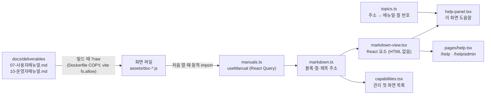

| 항목 | 내용 |
| --- | --- |
| 원문 하나 | 도움말이 보여 주는 글은 산출물 문서 `docs/deliverables/07-사용자매뉴얼.md`·`10-운영자매뉴얼.md` 그 자체입니다. 도움말용 문구를 따로 쓰지 않으므로 문서와 앱이 어긋나지 않고, 문서를 고치면 다음 빌드에서 도움말이 바뀝니다. 원본의 도움말 문구는 쓰지 않습니다(범위 밖) |
| 넣는 방식 | `manuals.ts`가 `import("…/docs/deliverables/07-사용자매뉴얼.md?raw")`처럼 Vite의 `?raw`로 문서를 문자열로 읽습니다. 동적 import라 매뉴얼마다 따로 나뉜 화면 파일이 되어 도움말이나 관리 첫 화면의 목록을 처음 열 때만 받고, React Query에 세션 동안 둡니다(`staleTime`·`gcTime` 무한). 파일 이름에 한글이 들어가지 않도록 `vite.config.ts`의 `chunkFileNames`가 ASCII가 아닌 이름의 묶음을 `assets/doc-[hash].js`로 바꿉니다(어떤 프록시 뒤에서도 안전). 개발 서버는 앱 폴더 밖을 읽도록 `server.fs.allow`에 `../docs/deliverables`를 더했고, 이미지는 `Dockerfile` 웹 단계가 `docs/deliverables/`를 복사합니다(4.3). 서버에는 문서를 내주는 API가 없습니다 |
| 해석 | `markdown.ts`는 매뉴얼이 쓰는 만큼의 Markdown(제목, 문단, 중첩 목록, 표(이스케이프한 칸 구분 문자와 인라인 코드 안의 칸 구분 문자 포함), 코드 블록, 인용, 구분선, 그림)을 블록 데이터로 읽습니다. 제목 주소는 GitHub 방식(소문자, 문장 부호를 빼고 공백은 `-`, 예: `#71-gantt`)이라 문서 안의 `#…` 링크와 그대로 맞습니다. 문서의 표지·개정 이력·목차는 빼고 첫 번째 번호 장부터 씁니다. 수준 2–3 제목이 절이 되고, 절마다 번호(`7.2`, `6`, `부록 A`)와 검색용 본문을 둡니다 |
| 그리기 | `markdown-view.tsx`가 블록을 React 요소로 만듭니다. 인라인은 코드·굵게·링크·그림만 알아봅니다. `#…` 링크는 같은 매뉴얼 안 이동(패널에서는 패널의 절을 바꿈), 다른 매뉴얼 파일(`10-운영자매뉴얼.md#…`)은 그 매뉴얼 화면 주소, `http(s)` 주소는 새 창(`rel="noreferrer"`)이고, 그 밖의 주소(다른 문서 파일, `javascript:` 등)는 링크로 만들지 않고 글자만 씁니다. 그림은 이미지 대신 "그림: {설명}"으로 씁니다(화면 캡처는 이미지에 넣지 않음). 가로로 넘치는 표·코드 블록은 `tabIndex=0`이라 키보드로 스크롤합니다 |
| 화면과 절 연결 | `topics.ts`는 화면 주소의 정규식을 (매뉴얼, 절 번호)로 바꿉니다(위에서부터 첫 일치). 사용자 화면은 07의 절, 관리 화면은 10의 9장 절입니다. 제목 글자가 아니라 번호로 잇기 때문에 제목을 고쳐도 연결이 유지되지만, 번호를 바꾸거나 지우면 패널이 "이 화면에 맞는 매뉴얼 절을 찾지 못했습니다…"를 보입니다. e2e F17-H3이 `ALL_TOPICS`의 번호가 모두 매뉴얼에 있는지 검사합니다(개발 서버에서만, `/src` 모듈을 읽음). 그래서 07·10의 새 내용은 새 번호로 끝에 붙입니다 |
| 화면 | 헤더 도움말 메뉴(`app/layout.tsx`): **이 화면 도움말**(연결된 절이 있을 때), **사용자 매뉴얼**, **운영자 매뉴얼**(`me.isAdmin`일 때). 패널은 Radix Dialog로 오른쪽에 열리고 Esc로 닫히며, 하던 화면은 그 밑에 그대로 있습니다. `/help`·`/help/admin`은 지연 로딩 청크(`router.tsx`)이고 로그인 사용자에게 열립니다(운영자 매뉴얼 메뉴만 관리자에게 보임). 검색은 띄어 쓴 말이 모두 든 절을 제목 일치 먼저, 본문 일치 다음으로 40개까지 보여 줍니다 |
| 보안 | 문서의 HTML은 페이지에 넣지 않습니다(`dangerouslySetInnerHTML`을 쓰지 않고 모든 글을 React의 글자 노드로 넣음). 그래서 문서에 무엇이 들어 있어도 스크립트로 돌지 않습니다. 매뉴얼 내용은 정적 화면 파일(`/assets/doc-*.js`)에 들어 있고, 정적 파일은 다른 화면 파일처럼 로그인 없이 받을 수 있습니다(`SecurityConfig`가 `/api/**` 밖을 열어 둠, `SpaConfig`). 07·10에는 비밀값이나 내부 접속 정보를 쓰지 않습니다(10-운영자매뉴얼 6.9·10.6) |
| 한계 | 그림이 보이지 않음(설명만). 문서를 고치면 이미지를 다시 빌드해야 함. 한국어뿐. 운영자 매뉴얼 화면은 관리자가 아니어도 주소로 열림 |

### 8.15 공동 담당자 (v2.1)

`replica/fixes.md` #6 "공동 담당자"에서 온 기능입니다. 원본 사용자 요청이 7건, 출처 2곳이었고(원본 포럼 19193에서 원본 직원도 그룹을 만들지 않는 여러 담당자가 투표가 가장 많은 요청 가운데 하나라고 답함), 작업 하나를 여러 사람이 맡고 사람마다 예상 시간을 따로 적습니다. 백엔드는 f494f76, 화면은 48f4a36입니다.

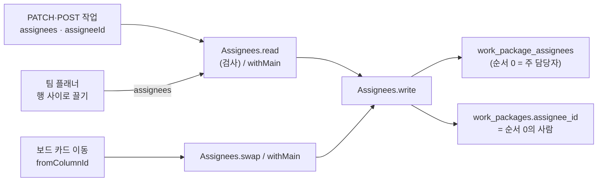

| 항목 | 내용 |
| --- | --- |
| 데이터 | `work_package_assignees`(V18): 작업을 맡은 모든 사람을 순서(`position` 0–19)와 함께 둡니다. 사람마다 예상 시간 `work_hours`(numeric(10,2), 0–9999, 비워 둘 수 있음). PK(work_package_id, user_id)라 같은 사람이 두 번 들어가지 않고, (work_package_id, position)은 유일(지연 검사). 작업·사용자를 지우면 CASCADE. 순서 0이 주 담당자입니다(05-데이터베이스설계서 4.5.7) |
| 불변식 | `work_packages.assignee_id`는 언제나 순서 0의 사람이고, 아무도 맡지 않으면 null입니다. DB 트리거·제약이 아니라 앱이 지킵니다: 목록을 바꾸는 길은 모두 `wp/Assignees.write`를 거치고, 이 메서드가 그 작업의 행을 지우고 순서대로 다시 넣은 뒤 같은 트랜잭션에서 `assignee_id`를 첫 사람으로 고칩니다. V18은 기존 `assignee_id`를 순서 0으로 옮겨 넣어 처음부터 둘이 같습니다 |
| 입력 | 작업 생성·수정의 `assignees: [{userId, workHours}]`(순서대로 전체를 바꿈, `[]`은 아무도 맡지 않음). `Assignees.read`가 20명까지, 같은 사람 두 번 금지, 프로젝트 멤버만, 예상 시간 0–9999(소수 둘째 자리로 반올림)를 검사하고, 어기면 422 `assignees`(04-인터페이스정의서 3.5) |
| 예전 방식 | `assigneeId`만 보내는 요청(상세·목록의 빠른 선택, 일괄 수정, 예전 연동)은 `Assignees.withMain`을 거칩니다: 이미 목록에 있는 사람은 예상 시간을 지닌 채 맨 앞으로, 새 사람은 주 담당자 자리(순서 0)를 넘겨받고(원래 주 담당자는 빠짐), null이면 목록을 비웁니다. 그래서 예전 클라이언트도 주 담당자를 바꿀 수 있고, 나머지 공동 담당자는 그대로 남습니다 |
| 담당자 전원을 보는 곳 | 담당자 필터(`eq`, 값 `me` = 내게 할당됨, `neq`, `none`, `any`)와 담당자 그룹(`assigneeGroup`)·담당자 역할(`assigneeRole`) 필터는 `QueryEngine.team`이 `work_package_assignees`의 `exists` 조건으로 거릅니다(보드 필터도 같음). 알림(`Journals`): 목록의 모든 사람이 "assigned" 이유로 받고, 주 담당자가 아니라 목록에 새로 들어간 사람에게는 "…님이 나를 공동 담당자로 지정했습니다". 워크플로: `Assembler.allowedStatusIds`가 목록 전체를 받아, `applies_to = assignee` 전환(화면·API로는 만들지 않고 DB에만 있을 수 있음)이 있으면 공동 담당자 모두에게 적용됩니다. 날짜 알림(`DateAlerts`: 시작·완료·기한 지남), 담당자 보드(사람마다 그 열에 카드), 팀 플래너(사람마다 그 행에 막대), 웹훅 본문 `workPackage.assignees`, 내보내기(Excel·CSV·PDF)의 담당자 칸(이름을 ", "로 이음) |
| 주 담당자만 보는 곳 | 정렬과 그룹화(`assignee_id` 컬럼), 기준선 비교의 지난 값(저널에서 되짚는 그때 값과 빠진 작업을 찾는 임시 테이블 `wp_then`은 `work_packages`의 사본이라 그때의 주 담당자로 판단), 응답의 `assignee`(= `assignees`의 첫 사람)와 그것만 읽는 예전 클라이언트 |
| 저널 | 주 담당자가 바뀌면 전처럼 `assigneeId` 항목을 남기고, 바꾸기 전이나 뒤의 목록이 주 담당자 한 사람을 넘을 때(두 번째 사람이나 예상 시간이 있을 때) `assignees` 항목도 남깁니다. 활동 탭의 이름은 "담당자 목록", 값은 순서대로 이름과 예상 시간(예: "박준호 6시간, 이하늘 4.5시간, 최민지") |
| 보드·팀 플래너 | 담당자 보드에서 A의 열에 있는 카드를 B의 열로 옮기면 화면이 `fromColumnId`(A의 열)를 보내고, `Assignees.swap`이 A의 자리(순서와 그 자리의 예상 시간)를 B에게 넘깁니다. 다른 사람은 그대로이고, B가 이미 목록에 있었으면 B의 원래 자리가 없어져 결국 A만 빠집니다. `fromColumnId`가 없는 예전 요청은 `withMain`(B가 주 담당자). 팀 플래너는 행 사이로 끌면 화면이 같은 규칙으로 `assignees`를 만들어 보내고, 빼기 영역은 그 행의 사람만 목록에서 뺍니다(마지막 한 사람이면 `assigneeId: null`) |
| 복사·이동·삭제 | 작업 복사(`WorkPackageTransfers`)와 프로젝트·템플릿 복사(`ProjectCopy`)는 대상 프로젝트의 멤버인 사람만 순서·예상 시간과 함께 가져갑니다. 다른 프로젝트로 옮기면 멤버가 아닌 사람이 빠지고 남은 첫 사람이 주 담당자가 됩니다(저널에 남김). 사용자를 지우면(익명화) `AdminController`가 그 사람을 모든 목록에서 빼고 다음 사람이 주 담당자가 됩니다. 사용자 행은 지우지 않으므로 FK의 CASCADE에 기대지 않습니다 |
| 화면 | `features/work-packages/assignees.tsx`: 상세 담당자 행 아래의 공동 담당자와 예상 시간(`CoAssignees`), 대화상자 **담당자와 예상 시간**(`AssigneesDialog`: 사람 추가, 사람별 예상 시간, 주 담당자로 올리기, 빼기, 합계와 작업량), 목록의 "+N"(`MoreAssignees`), 카드의 겹친 아바타(`AssigneeAvatars`). 상세의 빠른 선택은 주 담당자를 바꿉니다(`assigneeId`). 보드(`pages/boards/board.tsx`, 열마다 끌기 키를 따로 둠), 팀 플래너(`pages/planning/team-planner.tsx`, `features/planning/planner-grid.tsx`) |
| 성능 | 담당자 필터마다 `exists` 하위 쿼리 하나(인덱스: PK의 선두 `work_package_id`, `work_package_assignees_user_idx`), 목록·보드의 응답 조립은 페이지의 작업을 한 번에 읽음(`Assignees.of(ids)`). 성능 측정 데이터 `perf-1000.sql`도 담당자 목록을 채우고(다섯 건 중 한 건은 두 번째 사람, 예상 시간을 반씩), `PerfBudgetIT`는 그대로 통과합니다(JUnit 104/104) |
| 한계 | 사람별 예상 시간은 작업량(`work_hours`)과 따로이고 서로 맞추지 않습니다(대화상자가 합계를 작업량 옆에 보여 줄 뿐). 시간 기록·공수 보고서와 잇지 않습니다. 정렬·그룹화와 기준선의 지난 값은 주 담당자만 봅니다. 한 작업에 20명까지 |

---

### 8.16 서비스 데스크와 SLA (v2.4)

ITSM 1단계(f3e8999–76723c6, 설계 `docs/superpowers/specs/2026-10-14-itsm-design.md`)입니다. 사내 설계 합의에서 온 기능이라 `replica/fixes.md`에는 없습니다. 티켓은 작업 패키지이고, ITSM 값은 1:1 확장 테이블 `service_tickets`에 두어 작업 목록·저널·알림·웹훅·첨부를 그대로 씁니다.

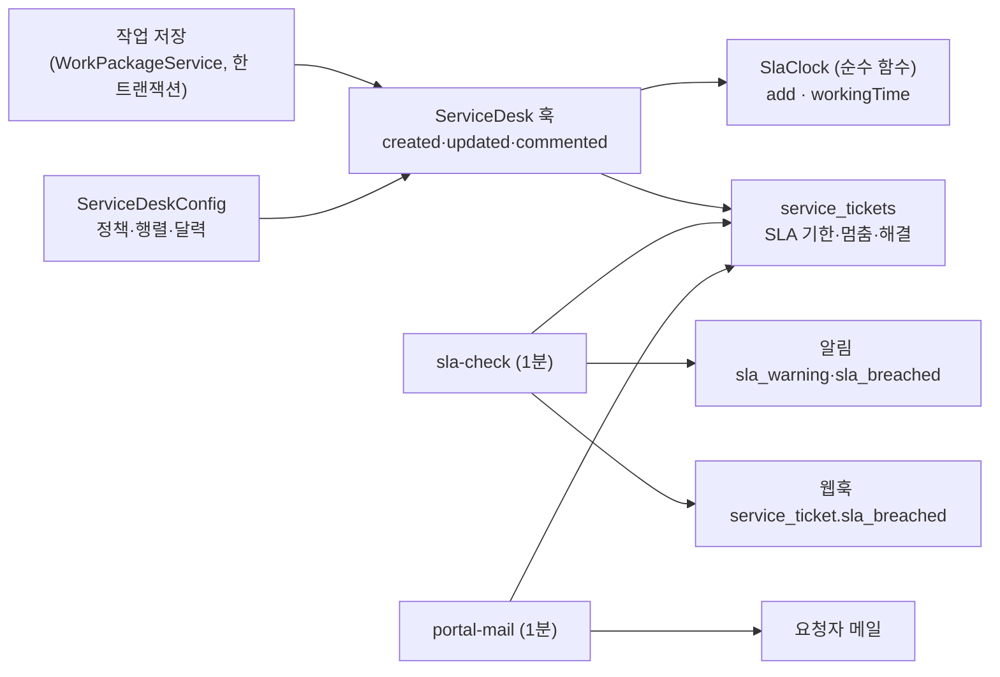

- **훅**: 서비스 데스크 프로젝트의 티켓 유형일 때만 `ServiceDesk`를 부릅니다(그 밖의 작업은 SQL이 늘지 않음). 접수 때 정책(프로젝트 + 유형 + 우선순위)을 고르고 두 기한을 저장하고, 처리자의 첫 공개 코멘트·상태 변경이 `first_responded_at`, **SLA 멈춤** 상태에 들어가면 `paused_since`, 나오면 멈춘 시간을 달력 기준으로 세어 해결 기한에 더하고, 우선순위·유형이 바뀌면 접수 시각 + 새 목표 + 누적 멈춤으로 기한을 다시 구하고, 종료 상태가 되면 `resolved_at`, 재오픈이면 지웁니다(위반 표시는 남음). 요청자가 직접 상태를 바꾸면 그 상태는 이미 아는 것으로 `requester_mailed_status_id`에 적습니다.
- **`SlaClock`**: `Calendar`(24시간 / 시간대 + 요일별 구간)와 휴무일 집합을 받아 `add(시작, 길이)`·`workingTime(시작, 끝)`을 계산하는 순수 함수입니다. 근무 시간 밖에 접수되면 다음 근무 시작부터 세고, 구간이 겹치면 달력을 만들 때 거절합니다. 둘이 서로 맞는지(`add` 뒤에 `workingTime`이 같은 길이) 단위 테스트로 고정합니다.
- **알림 한 번만(`SlaJobs`)**: 위반·임박 표시를 `update … where not *_breached`(읽은 기한이 그대로일 때만) 조건부로 쓰고 영향받은 행이 있을 때만 알림·웹훅을 만듭니다. 여러 번·여러 인스턴스가 돌거나 읽은 뒤 기한이 늦춰져도 알림은 한 번입니다. 멈춘 티켓과 해결된 티켓은 건너뜁니다. 티켓마다 따로 트랜잭션을 열어 한 티켓의 오류가 다른 티켓의 알림을 막지 않습니다.
- **요청자 메일(`PortalMail`)**: 요청자에게는 알림 센터가 없고 기존 메일 작업은 받는 사람이 `wp.view`를 가져야 하므로 따로 만든 작업입니다. 저널은 `updated_at`으로 판단하고(처리자의 연속 변경은 앞 저널에 합쳐지므로), 마지막으로 알린 상태(`requester_mailed_status_id`)와 다른 상태만 상태 줄로 보냅니다. `requester_mailed_at`을 읽은 값일 때만 옮기는 조건부 update를 메일을 넘기기 **전에** 해서, 두 인스턴스가 같은 메일을 두 번 보내지 않는 대신 릴레이가 거절하면 그 한 통은 사라집니다(`MailJobs`의 최소 한 번과 반대).
- **가상 스레드**: 새 코드에 `synchronized`를 쓰지 않고(`NoPinningTest`), `PerfBudgetIT`의 고정 검사가 포털 요청도 덮습니다. SLA 갱신은 작업 저장 트랜잭션 안에서만 DB를 기다립니다.
- **성능**: 서비스 데스크 목록 22·포털 내 요청 8·포털 요청 상세 18 SQL 예산(`PerfBudgetIT`, NFR-PERF-010). 포털 화면은 따로 불러오는 묶음이라 처음 열 때 약 300 ms를 더 쓰지만(빌드된 화면 포털 홈 중앙값 506 ms) 처음 화면 크기는 늘지 않습니다.

### 8.17 서비스 카탈로그와 승인 (v2.5)

ITSM 2단계(6d1a54c–f7d37b2, 설계 `docs/superpowers/specs/2026-10-14-itsm-phase2-catalog-design.md`, 구현 계획 `docs/superpowers/plans/2026-10-15-itsm-phase2.md`)입니다. 1단계와 같은 사내 설계 합의에서 온 기능이라 `replica/fixes.md`에는 없습니다. 카탈로그 항목을 요청한 티켓은 1단계의 티켓(작업 패키지 + `service_tickets`)이고, 승인은 요청마다 만든 `ticket_approvals` 행으로 진행합니다.

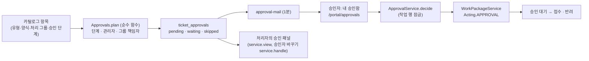

| 항목 | 내용 |
| --- | --- |
| 카탈로그 모델 | 프로젝트마다 분류(`catalog_categories`)와 항목(`catalog_items`: 유형은 장애·서비스 요청 중 데스크가 쓰는 것, 기본 우선순위, 처리 그룹, 사용 여부). 항목의 양식은 `catalog_item_fields`(그 프로젝트와 항목 유형에 켜진 사용자 정의 필드만, 필수는 `is_required`), 승인 단계는 `catalog_item_approval_steps`(단계 1–9, 승인자 종류 `requester_manager`·`group_lead`). 항목 설명은 저장할 때 HTML을 살균합니다. 분류를 지우면 항목은 분류 없음으로 옮겨지고(`ON DELETE SET NULL`) 포털에서는 가상 분류 **기타**(마지막)에 보입니다. 관리는 `service.manage`, 보기는 `service.view`입니다(`ServiceCatalogController`) |
| 포털의 카탈로그 | `GET /portal/desks`가 데스크마다 활성이고 요청할 수 있는 항목만 분류별로 내놓습니다. 여러 데스크의 분류·항목·필드·단계를 질의 하나씩으로 읽어(`ServiceCatalog.catalogs`) SQL 수가 데스크 수에 비례하지 않습니다(`PerfBudgetIT.portalCatalogSqlDoesNotGrowWithTheNumberOfDesks`). 항목에 나오는 승인 안내는 설정된 단계의 종류만 보이고(`PortalItem.approvalKinds`) 이름은 요청한 뒤에야 보입니다. 요청자에게 건너뛸 단계가 있어도 안내에는 나올 수 있고, 정확한 계획은 요청 뒤 상세의 **승인 진행**입니다 |
| 승인 계획(`Approvals.plan`) | 단계 순서대로 행을 만듭니다. 한 단계의 두 종류(관리자·그룹 책임자)는 둘 다 결정해야 하는 것이 아니라 **한 사람이라도 결정하면** 같은 단계의 나머지는 `skipped`(`step_done`)입니다. 승인자가 없으면(미지정, 잠김, 삭제) `skipped`(`no_approver`), 승인자가 요청자 본인이면 `skipped`(`requester`), 같은 단계에서 같은 사람이 이미 나왔으면 `skipped`(`duplicate`)입니다. 모든 행이 건너뛰어진 단계는 지나가고, 모든 단계가 건너뛰어지면 승인 대기 없이 바로 접수입니다. 건너뜀마다 저널 "{n}단계 {관리자\|그룹 책임자} 건너뜀: {승인자 없음\|요청자 본인\|같은 승인자}"가 남습니다. 계획은 요청 시점의 지정으로 굳어, 나중에 관리자·책임자를 바꿔도 기존 `pending` 행은 바뀌지 않습니다(처리자의 승인자 바꾸기만) |
| 상태와 SLA | **승인 대기**는 SLA 멈춤 상태(`sla_pause = true`, 진행 중)이고 **반려**는 닫힘·읽기 전용·합계 제외입니다. 승인 대기 동안 해결 시계가 멈추고 나오면 멈춘 시간만큼 해결 기한이 밀립니다(8.16). 승인 대기에서 나가는 상태 변경은 처리자의 **첫 응답**으로 치지 않습니다(승인 → 접수). 처리자·요청자 워크플로에는 승인 대기에서 **취소**로 가는 길만 있어 처리자가 승인을 건너뛸 수 없고, 나가면 남은 행은 `skipped`(`left_approval`)입니다 |
| `Acting.APPROVAL` | `WorkPackageService.apply`의 행위자 구분에 `APPROVAL`이 더해졌습니다. 가능한 상태 전환은 워크플로가 아니라 코드가 정합니다: 현재가 승인 대기이고 다음이 접수나 반려일 때만. 저널의 작성자는 결정한 승인자이고, 409에는 작업 패키지를 싣지 않습니다(승인자는 작업 패키지 응답을 받지 않음, 8.2.4). 반려 사유(필수)는 승인자 이름의 공개 코멘트로, 승인 의견(선택)은 `ticket_approvals.comment`에만 남습니다 |
| 동시 결정 | 8.3. 작업 행 잠금 → 조건부 update. 한 요청의 결정·승인자 바꾸기·취소가 서로 기다림 |
| 승인 메일(`ApprovalMail`) | 8.5.2. 승인자는 `wp.view`를 가질 필요가 없어 알림 센터 대신 메일로 알립니다(AD-43). 제목 "[openPMS] 승인 요청: #N 제목"(독촉은 "[openPMS] 승인 대기 중: #N 제목"), 본문에 요청자 이름·항목 이름·제목·`/portal/approvals/<id>` 링크이고 메일 주소는 담지 않습니다. 승인자 바꾸기는 `notified_at`·`reminded_at`을 비워 새 승인자가 다시 받습니다. 요청자는 결과(접수·반려)를 `portal-mail`로 받습니다. 처리자 목록의 필터 **승인 지연**(`approvalState = delayed`)은 독촉 메일까지 나간 `pending` 행이 있는 요청입니다 |
| 사람 지정 | 요청자의 관리자는 `users.manager_id`(자기 자신 금지 CHECK `users_manager_not_self`, 지워지면 비움), 그룹 책임자는 `user_groups.lead_user_id`입니다. 관리자(상사) 순환은 막지 않고 승인은 한 단계만 따라갑니다. 지정은 관리자만(AD-46), SSO 클레임으로도 맞출 수 있습니다(8.1.7) |
| 성능 | `PerfBudgetIT` 새 줄 둘(NFR-PERF-011): 포털 카탈로그(`GET /portal/desks`, 데스크 1·항목 3) SQL 15(측정 13)·p95 150 ms·응답 64 KB, 내 승인함(승인 50건) SQL 6(측정 4)·p95 150 ms·응답 20 KB. 화면은 `perf.spec.ts`의 내 승인함(예산 1000 ms). 포털 홈은 카탈로그가 더해진 뒤 개발 서버 예산 턱밑이라 빌드된 화면에서 다시 재야 합니다 |
| 가상 스레드 | 새 코드에 `synchronized`를 쓰지 않습니다(`NoPinningTest`). 승인 결정의 잠금은 DB 행 잠금이고 모니터가 아닙니다 |
| 한계 | 조건 분기 승인·위임·대리 승인·메일 답장으로 승인·장바구니(여러 항목 한 번에 요청)·하위 작업 자동 생성은 없습니다(REQ-OOS-026–030). 에이전트가 작업 패키지 API로 카탈로그 항목 티켓을 만드는 것은 지원하지 않습니다(AD-44). 승인 의견은 길이 제한 없는 평문입니다(화면은 텍스트로만 보임). `approvalState` 필터는 연산자 `eq`만 받습니다(`neq`는 422). 처리 그룹 지정이 접수 직후 별도 갱신이라 `work_package.created` 웹훅 본문에 처리 그룹이 비어 있습니다. V20 → V21 이미지 업그레이드와 실제 SMTP의 승인 메일, SSO 관리자 클레임은 확인하지 않았습니다(손으로 할 것) |

## 9. 품질 속성과 설계 결정

### 9.1 품질 속성 시나리오

| 품질 속성 | 요구·시나리오 | 설계 결정 | 근거·검증 |
| --- | --- | --- | --- |
| 보안(기밀성) | 다른 프로젝트 사용자가 작업·멤버·검색 결과를 볼 수 없어야 합니다. | 요청마다 `Ctx`로 권한 계산, 목록 쿼리에 볼 수 있는 프로젝트 조건 필수, 보이지 않는 리소스는 404 | `AccessIT`, `SharingIT` |
| 보안(인증) | 무차별 대입과 세션 탈취를 어렵게 합니다. | 실패 누적 잠금(관리 화면에 일시 잠김 표시), 주소별 요청 제한(믿는 프록시의 `X-Forwarded-For`), HttpOnly·SameSite·Secure 쿠키, 세션 ID 교체, CSRF 토큰, 비밀번호 정책, SSO 전용 계정의 비밀번호는 본인 메일 링크로만 | `AuthSettingsIT`, `AuthLinksIT`, `LockoutIT`, `ClientAddressIT`, `OidcIT` |
| 보안(입력) | XSS, 업로드 악용, 수식 주입을 막습니다. | HTML 허용 목록, Tika 형식 판별, 다운로드 sandbox CSP, 이미지 외 inline 금지, 내보내기 셀 이스케이프 | `ExportIT` |
| 보안(외부 연동) | 연동 시스템이 사람 권한을 넘지 않고, 토큰이 새도 피해가 좁아야 합니다. | 토큰 주인의 권한, 읽기 전용 범위, 로그인·비밀번호·토큰·연동 설정 경로 닫음(dfde416), 해시만 저장, 만료·폐기·전체 끄기, 토큰당 분당 300회 | `ApiTokensIT` |
| 보안(비밀번호 전달) | 메일 없이 사용자를 등록해도 임시 비밀번호가 오래 통하거나 새어 나가지 않아야 합니다. | 임시 비밀번호로는 세션 없이 10분짜리 일회용 변경 토큰만 받아 첫 로그인에서 새 비밀번호를 정함, 기한(기본 168시간)이 지난 뒤 다음 로그인 시도나 매일 03:30 정리 작업 때 행과 비밀번호 해시를 함께 지움, 평문은 한 테이블과 관리자 응답 셋에만, `no-store`·`idempotency_keys` 제외·API 토큰 거절, 로그에는 사용자 ID만(AD-34) | `TemporaryPasswordIT`, `OidcIT`, e2e F19 |
| 보안(기밀성) | 내부 코멘트가 권한 없는 사람과 외부 시스템에 새지 않아야 합니다. | `wp.view_internal_comments` 없는 사람에게 활동·검색·알림에서 숨김, 웹훅으로 보내지 않음 | `InternalCommentsIT`, `WebhooksIT` |
| 보안(승인자 격리) | 서비스 데스크의 멤버가 아닌 승인자가 자기 차례의 승인 말고는 아무것도 보거나 바꿀 수 없어야 합니다(NFR-SEC-021). | 승인 경로가 `approver_id = 호출자`, `decision = 'pending'`인 행으로만 좁히고 남의 행·차례가 아닌 행·결정이 끝난 행·꺼진 서비스 데스크는 모두 같은 404, 응답은 전용 모델(내부 코멘트·활동·메일 주소 없음), 상태 이동은 `Acting.APPROVAL`, 관리자(상사)·그룹 책임자 지정은 관리자만(AD-40·AD-41·AD-46) | `PortalApprovalSecurityIT`, `ApprovalsIT`, `ManagersIT` |
| 상호 운용성 | 다른 시스템이 변경을 받아 볼 수 있어야 합니다. | 서명된 JSON 웹훅, 트랜잭션 아웃박스 + 재시도, OpenAPI 3.1 설명, v1은 필드 추가만 | `WebhooksIT`, e2e F15 |
| 정확성(보고) | PDF에 한글이 깨지지 않고, 기준선이 그때 값을 정확히 보여야 합니다. | 서버 PDF에 Pretendard 부분 내장, 저널의 [이전, 이후]로 그때 값을 되짚음, 그때는 맞았지만 지금은 빠진 작업은 그때 값으로 목록 필터를 다시 적용(AD-21) | `ExportIT`(PDF 글자 층에 한글), `BaselineIT` |
| 무결성 | 동시 편집이 서로를 덮어쓰지 않아야 합니다. | `lock_version` 낙관적 잠금(409 + 현재 값), 일정 advisory lock, 일괄 처리 전부 또는 전무, 생성 POST는 `Idempotency-Key`로 재시도해도 한 번(AD-20) | `TransfersIT`, `ScheduleTest`, `IdempotencyIT` |
| 정확성 | 일정·진행률 계산이 규칙대로여야 합니다. | 순수 Java 모듈(`Schedule`, `Progress`)로 분리해 단위 테스트. 목록 합계의 완료 %도 작업의 ∑와 같은 진행률 규칙 | `ScheduleTest`, `ProgressTest`, `GroupingIT` |
| 가용성 | SMTP 장애가 서비스 중단으로 번지지 않아야 합니다. | 메일 실패는 로그만, 메일 헬스 끔, SMTP 시간 제한 10초, 알림 메일 재시도 | 배포 검증 기록(`replica/deploy.md`) |
| 가용성 | 재시작해도 로그인과 예약 작업 상태가 유지되어야 합니다. | Spring Session JDBC, db-scheduler 테이블 | 배포 검증 기록 |
| 운영성 | 사내 서버에서 명령 몇 개로 설치·업그레이드합니다. | 컨테이너 2개, 시작 시 Flyway 자동 적용, 첫 관리자 링크, 헬스 프로브(liveness, readiness) | `replica/deploy.md` |
| 운영성(업그레이드 안전) | 업그레이드가 실패해도 업그레이드 직전 데이터로 돌아갈 수 있어야 하고, 지금 무엇이 돌고 있는지 화면에서 보여야 합니다(`replica/fixes.md` #3). | 스키마가 바뀌는 업그레이드 전 자동 덤프, 실패하면 마이그레이션 없이 시작 중단(명시적으로만 끔), 종류별 최근 5개 보관, 관리 · 시스템 정보(버전·마이그레이션·백업)와 지금 백업(AD-27) | `BackupsTest`, `SystemIT`, e2e F11-H4, 5966874 이미지 스모크(`replica/deploy.md`) |
| 성능 | 사내 규모(작업 수천~수만 건)에서 목록과 화면이 빠르게 응답해야 하고(`replica/fixes.md` #4: 원본이 느리고 자원을 많이 쓴다는 불만), CPU 2개인 작은 서버에서도 여럿이 동시에 쓸 때 멈추지 않아야 합니다. | 기준 테이블 요청별 스냅샷, 필터는 SQL 조건, 페이지 단위 DTO 조립, 가상 스레드(모니터 안에서 기다리지 않음, AD-28), 보드 열마다 50장(AD-29), 응답 gzip 압축·해시 붙은 화면 파일 1년 캐시(AD-30) | (v1.9) `PerfBudgetIT`(작업 1,000건에서 요청별 p95·SQL 수·크기, JFR 고정 검사), `NoPinningTest`, e2e `perf.spec.ts`, 운영 이미지 부하 실측(8.13: 동시 100명 p99 236 ms, 오류 0건). 작업 1만 건 이상과 사내 프록시를 거친 시간은 재지 않음 |
| 이식성 | 저장소·IdP를 바꿀 수 있어야 합니다. | `FileStorage` 한 클래스로 저장소 격리, 표준 OIDC 발견 문서 사용 | |
| 변경 용이성 | 화면과 서버 계약이 어긋나지 않아야 합니다. | `Dto.java` ↔ `types.ts` 필드 일치, `Api` 인터페이스 + 가짜 구현으로 화면을 먼저 검증 | e2e 스위트(`frontend/e2e`) |
| 사용성(한국어) | 한국어 정렬·검색·글꼴이 자연스러워야 합니다. | 한국어 Collator, ILIKE 부분 일치 검색, Pretendard | |
| 사용성(입력 속도) | 한 주 공수를 한 화면에서 키보드만으로 빨리 입력해야 합니다(`replica/fixes.md` #1: 원본의 시간 기록이 클릭이 많다는 불만). | 주간 입력표: 칸 이동은 화살표·Enter, Ctrl+S 한 번에 바뀐 칸만 저장, "1:30"·"1,5" 입력, 하루 근무 시간 초과를 그 자리에서 표시, 저장은 전부 아니면 전무(AD-23) | e2e F16-H1, `TimeEntriesIT` |
| 정확성(공수) | 한 사람의 하루 기록이 말이 되어야 하고, 보고서가 볼 수 있는 기록만 정확히 합쳐야 합니다. | 하루 24시간 상한(422), 시간 0 초과 24 이하·소수 둘째 자리(DB CHECK + 앱), 보고서는 `time.view`/`time.log` 규칙으로 고른 기록만 DB에서 묶어 합침(6d816e4, 건수 한도 없음), 작업을 옮기면 기록의 프로젝트도 따라감(AD-24) | `TimeEntriesIT` |

### 9.2 주요 설계 결정

| 번호 | 결정 | 대안 | 선택 이유 | 감수한 점 |
| --- | --- | --- | --- | --- |
| AD-01 | 앱 하나 + DB 하나(모놀리스, 단일 컨테이너) | 프론트·백엔드 분리 배포, 마이크로서비스 | 사내 도구 규모에서 운영이 가장 단순하고, 같은 출처라 CORS·토큰 관리가 필요 없음 | 화면만 따로 배포할 수 없음 |
| AD-02 | jOOQ + Flyway(SQL 우선) | JPA | 동적 필터 조합, 재귀 계층 조회, jsonb를 SQL로 직접 다룸. 스키마에서 생성한 코드로 컬럼명 오류를 컴파일 단계에서 잡음 | 생성 코드를 스키마 변경마다 다시 만들어야 함 |
| AD-03 | 서버 세션(DB 저장) + CSRF 쿠키 | JWT | 즉시 무효화(잠금, 비밀번호 재설정)가 쉬움. 재시작에도 로그인 유지 | 세션 조회가 DB를 거침 |
| AD-04 | 요청별 `Snapshot` + `Ctx` 권한 계산 | 권한 캐시 서버, DB RLS | 기준 테이블이 작아 요청마다 읽어도 충분하고 정합성이 단순함. DB 계정이 하나라 RLS 대신 앱이 검사 | 기준 테이블이 매우 커지면 다시 검토 |
| AD-05 | 보이지 않는 리소스는 404 | 403 | 다른 프로젝트·작업의 존재를 드러내지 않음 | 권한 문제와 없음이 화면에서 구분되지 않음 |
| AD-06 | 일정·진행률을 순수 Java로 | DB 함수, 화면 계산 | 가장 위험한 로직을 단위 테스트로 집중 검증. 화면은 그리기만 | 그래프를 메모리에 올림(전체 작업 수에 비례) |
| AD-07 | 일정 변경을 전역 advisory lock으로 직렬화 | 행 단위 잠금 | 전파 범위를 미리 알 수 없어 행 잠금으로는 교착 위험. 사내 규모에서 대기 시간이 짧음 | 일정 변경이 동시에 몰리면 순차 처리 |
| AD-08 | db-scheduler(Postgres 테이블) | 별도 큐(Kafka, RabbitMQ), `@Scheduled` | 추가 인프라 없이 여러 인스턴스에서 한 번만 실행 | 정밀한 실시간 처리에는 맞지 않음 |
| AD-09 | 알림 fan-out을 저널 트랜잭션 안에서 동기 처리 | 일회성 작업 예약 | 저널과 알림이 함께 커밋되어 누락이 없음, 구조 단순 | 수신자가 많으면 요청 시간이 늘어남 |
| AD-10 | 첨부를 로컬 볼륨에 | DB BLOB, S3 | 셀프 호스팅에서 가장 단순, DB 백업 크기 억제 | 볼륨 백업을 따로 해야 함 |
| AD-11 | SSO 공급자를 DB에 등록(관리 화면) | 환경 변수 설정 | 재배포 없이 관리자가 추가·수정 | 클라이언트 시크릿이 DB에 평문 저장 |
| AD-12 | 화면 데이터 계층을 `Api` 인터페이스로 추상화하고 가짜 구현을 먼저 만듦 | 백엔드 완성 후 화면 개발 | 화면과 규칙을 먼저 검증하고, 서버는 같은 계약으로 구현 | 두 구현의 규칙을 함께 관리해야 함 |
| AD-13 | 운영 웹 빌드는 `VITE_API=http` 필수 | 기본값을 http로 | 가짜 데이터 계층이 운영에 실리는 사고(실제로 발생) 재발 방지 | 빌드 설정 파일 하나가 더 필요 |
| AD-14 | 템플릿 복사를 생성 요청 안에서 동기로 처리 | 202 + 예약 작업(`project-copy`, 계획) | 사내 템플릿은 작업 수십~수백 건이라 한 트랜잭션으로 충분하고, 실패하면 반쯤 만든 프로젝트가 남지 않음 | 작업이 매우 많은 템플릿은 요청이 길어짐(재 보지 않음) |
| AD-15 | 알림 이유·프로젝트 필터를 화면에서 거름(v1.3). v1.5(0ef1888)에서 서버로 옮김 | `GET /notifications`에 `reason`·`projectId`(계획) | v1.3: 알림함은 이미 최근 500건을 한 번에 받으므로 선택지별 읽지 않은 수도 함께 셀 수 있음. v1.5: 500건보다 오래된 알림이 필터에 나오지 않는 한계를 없애려고 `GET /notifications?reasons=&project=`, `GET /notifications/counts`, `POST /notifications/read {reasons, project}`를 둠(이름은 계획과 달리 `reasons`·`project`) | 건수 요청이 하나 늘어남. 필터 없는 목록은 여전히 최근 500건 |
| AD-16 | 외부 연동은 개인 API 토큰(Bearer)으로, 화면과 같은 `/api/v1` | OAuth2 인가 서버·클라이언트 등록, 연동 전용 API | 사내 연동 몇 개에는 사람이 만든 토큰으로 충분하고, 권한 규칙을 새로 만들지 않고 토큰 주인의 권한을 그대로 씀. 경로·응답이 화면과 같아 문서도 하나 | 토큰이 사람에 묶여 퇴사·잠금 때 연동도 멈춤(서비스 계정 개념 없음). 저널에 토큰 사용 여부가 남지 않음. 버킷이 인스턴스 메모리 |
| AD-17 | 웹훅을 전송 테이블(아웃박스) + db-scheduler 작업으로 | 요청 안에서 바로 보냄, 메시지 큐 | 업무 변경과 이벤트가 같이 커밋·롤백되고, 수신자가 느려도 요청이 기다리지 않음. 추가 인프라 없이 여러 인스턴스에서 한 번만 보냄 | 최대 15초 늦게 도착, 순서는 대략적(재시도 시 뒤바뀔 수 있음), 전송 행은 30일 동안만 남음(`token-cleanup`, dfde416) |
| AD-18 | PDF를 서버에서 PDFBox + 내장 글꼴(Pretendard, OFL)로 | 브라우저 인쇄, OpenPDF + Noto Sans KR(계획) | 어느 브라우저에서나 같은 파일, 한글이 깨지지 않음, Apache 2.0·OFL로 배포 문제 없음 | 글꼴 TTF 약 5MB가 이미지에 들어감, 한 번에 1,000건까지, 글꼴에 없는 문자는 `?` |
| AD-19 | 기준선을 저널에서 되짚음 | 시점별 스냅샷 테이블 | 저널이 필드별 [이전, 이후]를 이미 갖고 있어 새 테이블 없이 그때 값을 구함 | v1.4는 지금 조건으로 찾은 행만 비교해 빠진 작업이 보이지 않았음. v1.5에서 AD-21로 보완 |
| AD-20 | 생성 재시도를 `Idempotency-Key` + DB 테이블(V16)로 | 화면의 중복 클릭 방지만(BUG-001), 메모리 캐시 | 네트워크가 끊겨 응답만 못 받은 경우까지 서버가 한 번으로 묶음. DB에 두어 재시작·여러 인스턴스에서도 같음. 필터 하나라 컨트롤러를 바꾸지 않음 | 계획의 10분보다 긴 24시간 보관(응답 본문이 DB에 남음), 2xx만 보관, multipart·1MB 넘는 응답 제외, 업무 커밋 뒤 응답 저장 전 장애면 하루 동안 409 |
| AD-21 | 기준선의 빠진 작업은 그때 값을 임시 테이블에 넣고 목록 필터를 다시 돌려 찾음 | 필터마다 "그때" 판단 코드를 따로 작성, 시점별 스냅샷 | 같은 `QueryEngine.where`를 지금 목록과 그때 사본에 쓰므로 "그때 맞았다"의 뜻이 목록과 정확히 같음. 트랜잭션 안의 `on commit drop` 임시 테이블이라 남는 것이 없음 | 저널이 없는 조건(주시자·코멘트·관계)은 지금 상태, 지워진 작업과 그때 공유로만 보던 작업은 빠짐, 후보 5,000건·결과 200건까지 |
| AD-22 | 웹훅 사설·루프백 주소 막기를 운영 스위치로(기본 꺼짐) | 늘 막기, 허용 목록 | 사내 시스템은 대개 사설 주소라 늘 막으면 사내 연동이 안 됨. 공인·DMZ 수신자만 쓰는 곳은 켜서 SSRF를 줄임. 등록과 전송 때 둘 다 검사해 DNS가 나중에 바뀌어도 막음 | 기본 설정에서는 여전히 루프백·사설 주소로 보낼 수 있음(방화벽 egress가 방어선) |
| AD-23 | 주간 입력표의 칸 = 그날 그 작업의 내 시간 합. 칸 저장은 "0건이면 새로, 1건이면 고침(0은 지움), 여러 건이면 거절" | 칸마다 기록 하나만 허용(유일 제약), 칸 저장 때 여러 건을 하나로 합침 | 시간 탭에서는 같은 날 같은 작업에 활동·메모를 나눠 남길 수 있어야 하고, 입력표에서 그런 칸을 덮어쓰면 활동·메모가 사라짐. 그래서 DB는 여러 건을 허용하고 입력표는 그런 칸을 읽기 전용으로 둠 | 여러 건 칸은 시간 탭에서 고쳐야 함. 입력표로 만든 기록은 늘 기본 활동·빈 메모 |
| AD-24 | 시간 기록에 `project_id`를 복사해 두고, 작업을 옮기면 같이 바꿈(`TimeController.follow`) | 늘 작업을 조인해 프로젝트를 구함 | 보고서·권한 판단을 프로젝트 인덱스(project_id, spent_on)로 바로 거름. 옮긴 작업의 시간이 새 프로젝트 보고서에 들어가는 것이 사용자의 기대와 맞음 | 작업 이동 코드가 시간 기록을 알아야 함(한 줄). 옮기기 전 프로젝트의 지난 보고서 숫자가 바뀜 |
| AD-25 | 시간 기록은 저널·웹훅·알림을 만들지 않고, 프로젝트 복사·템플릿도 가져가지 않음 | 작업 저널에 "시간 기록" 항목, 웹훅 이벤트 추가 | 시간은 작업의 변경이 아니라 사람의 근무 기록이라 작업 활동을 어지럽히지 않음. 복사한 프로젝트에 남의 근무 시간이 따라가면 안 됨 | 누가 언제 시간을 고쳤는지 이력이 없음(`updated_at`만). 외부 시스템은 API 토큰으로 가져가야 함 |
| AD-26 | 새 시작일로 복사할 때 근무일 기준 작업은 시작일·완료일 모두 '앵커부터 센 근무일 순번'으로 옮기고, 근무일 무시 작업과 버전은 같은 달력일 수만큼 옮김(v1.7, `ProjectCopy.Shift`) | 모든 날짜를 같은 달력일 수만큼 옮김, 시작일만 옮기고 완료일은 저장된 기간(`duration`)으로 다시 계산, 복사 뒤 자동 일정 재계산·전파 | 달력일로만 옮기면 작업이 주말·휴무일에 걸려 근무일 기간이 바뀜. 완료일을 저장된 기간으로 다시 세던 첫 구현(2f7ffb9)은 전체 테스트에서 기간 값이 날짜와 맞지 않는 작업을 만나 근무일 길이가 달라졌고, b63eaa0에서 완료일도 같은 대응을 거치게 바꿔 기간 값과 상관없이 날짜 사이 근무일 수가 그대로임. 위치를 유지하므로 선후 간격(lag)도 다시 계산할 필요가 없음. 버전은 근무일 개념이 없는 마감 기준이라 달력일로 옮김 | 시작일 기준만(완료일 기준 맞추기 없음). 원본의 간격이 근무일이 아닌 날에서 시작·끝나면 다음 근무일로 붙음. 버전과 근무일 기준 작업의 상대 위치가 주말 수만큼 조금 달라질 수 있음. 보드·보기는 날짜 기반이 아니라 그대로 |
| AD-27 | 업그레이드 전 백업을 앱 안에서, Flyway 마이그레이션 직전에 `pg_dump`로 받고, 실패하면 마이그레이션하지 않고 시작을 멈춤(v1.8, `system/MigrateWithBackup`·`Backups`) | 운영자 절차나 호스트 cron에 맡김(1.7까지), 백업 사이드카 컨테이너, 실패해도 경고만 하고 마이그레이션 | 업그레이드 때 백업을 잊거나 순서를 틀리는 것이 원본 사용자 불만의 핵심이고, 마이그레이션을 아는 앱만이 "적용할 것이 있을 때 정확히 그 직전"을 압니다. 사이드카는 컨테이너가 하나 늘고 앱 시작과의 순서를 맞추기 어려움. 커스텀 형식은 압축되고 `pg_restore`로 골라 되돌릴 수 있음. 실패하면 멈추는(fail closed) 쪽이 되돌릴 수 없는 마이그레이션보다 안전하고, 덤프 없이 진행하려면 `OPENPMS_BACKUP_BEFORE_UPGRADE=false`를 일부러 정해야 함. 새 설치·대기 0은 지킬 데이터가 없거나 바뀌지 않으므로 건너뜀. 동시에 두 덤프는 DB와 디스크에 부담이라 한 번에 하나(지금 백업은 409), 멈춘 덤프가 시작을 끝없이 막지 않게 30분 제한. 종류별 최근 N개 보관으로 디스크가 끝없이 늘지 않음 | 이미지에 PostgreSQL 클라이언트가 들어가 커짐(배포판 클라이언트는 17 서버를 덤프하지 못해 apt.postgresql.org를 씀). 덤프가 DB와 같은 서버에 있어 서버 장애에는 쓸모없음(서버 밖 복사는 운영자 몫). 첨부는 덤프에 없음. 큰 DB는 업그레이드 시작이 덤프 시간만큼 늦고 디스크가 DB 크기 × 보관 수만큼 필요. 오래된 시점으로는 못 돌아감. 복원은 자동이 아님 |
| AD-28 | 우리 코드에서 `synchronized`를 쓰지 않고 `java.util.concurrent`의 잠금(`ReentrantLock`)만 쓰며, DB를 기다리는 일은 `ConcurrentHashMap.computeIfAbsent` 밖에서 함(v1.9, `NoPinningTest`가 지킴) | 가상 스레드를 끄고 플랫폼 스레드 풀로 돌림, 커넥션 풀을 키움 | Java 21의 가상 스레드는 모니터 안에서 막히면 캐리어 스레드를 붙잡아, CPU 2개 서버에서 둘만 묶여도 전체가 30초 멈췄음(BUG-012). 커넥션 풀을 키워도 캐리어가 묶이면 커넥션을 쥔 요청이 실행되지 못함. 잠금만 바꾸면 스레드 풀 튜닝 없이 가상 스레드를 그대로 씀 | 규칙을 테스트로 지켜야 함(코드 검사 `NoPinningTest`, JFR 검사 `PerfBudgetIT`). 라이브러리 안의 모니터는 바꿀 수 없어, JFR 검사는 우리 코드 프레임이 든 고정만 잡음 |
| AD-29 | 보드는 열마다 카드 50장을 먼저 그리고 나머지는 **N장 더 보기**로 100장씩(v1.9, `board.tsx`) | 모든 카드를 한 번에 그림(1.8까지), 서버에서 열별로 페이지를 나눔 | 카드·끌어 놓기·키보드 이동 코드를 그대로 두고 그리는 수만 줄여, 서버 계약(`GET /boards/{id}`)을 바꾸지 않음. 카드 1,000장 1,564 ms·JS 힙 246 MB → 505 ms·30–70 MB(BUG-013) | 서버 응답은 여전히 전체 카드(압축 전 2.3 MB, 서버 예산 3,000 KB). 숨은 카드 사이에 놓으려면 먼저 더 보기를 눌러야 함 |
| AD-30 | 응답 압축과 정적 파일 캐시를 앱에서 함(v1.9, `server.compression`, `SpaConfig`) | 사내 리버스 프록시에 맡김 | 설치마다 프록시 설정이 달라도 같은 결과가 나오고, 앱만으로 시험·측정할 수 있음. 해시 붙은 파일은 1년 캐시해도 새 버전이 새 이름이라 안전하고, `index.html`은 `no-cache`라 배포 직후 바로 바뀜(BUG-014) | 압축에 드는 CPU를 앱이 씀(부하 실측은 압축을 켠 상태). 프록시가 `Cache-Control`을 지우거나 바꾸지 않도록 운영 안내가 필요(10-운영자매뉴얼 3.4) |
| AD-31 | 도움말은 산출물 문서(07·10)를 빌드 때 그대로 넣어 보여 줌(v2.0, `features/help/manuals.ts`, `Dockerfile`) | 도움말 문구를 화면 코드·번역 파일에 따로 씀, 서버가 문서를 API로 내줌 | 원문이 하나라 문서와 앱이 어긋나지 않고, 서버·DB를 바꾸지 않으며, 화면 파일처럼 캐시됨 | 문서를 고치면 이미지를 다시 빌드해야 함. 매뉴얼이 정적 파일에 들어 로그인 없이 받을 수 있음. 빌드 컨텍스트에 `docs/deliverables`가 필요 |
| AD-32 | 매뉴얼은 직접 만든 작은 Markdown 해석기로 읽어 React 요소로만 그리고, 화면과 절은 절 번호로 이음(v2.0, `markdown.ts`·`markdown-view.tsx`·`topics.ts`) | Markdown 라이브러리로 HTML을 만들어 넣음, 제목 글자나 별도 ID로 연결 | 매뉴얼이 쓰는 문법만 다루면 되어 의존성이 늘지 않고, HTML을 거치지 않아 문서 내용이 스크립트로 돌 길이 없음. 번호는 문서의 제목 글자를 다듬어도 바뀌지 않음 | 매뉴얼이 새 문법을 쓰면 해석기를 고쳐야 함. 장·절 번호를 바꿀 수 없음(F17-H3이 지킴) |
| AD-33 | 공동 담당자를 별도 테이블 `work_package_assignees`(순서, 사람별 예상 시간)에 두고, `work_packages.assignee_id`는 없애지 않고 늘 목록의 첫 사람(주 담당자)으로 맞춤(v2.1, V18, `wp/Assignees`) | `assignee_id`를 없애고 목록만 둠, `work_packages`에 사용자 uuid 배열 컬럼, 그룹을 만들어 담당자로 지정 | 정렬·그룹화·기준선의 지난 값·응답의 `assignee`와 `assigneeId`만 아는 예전 클라이언트·연동이 고치지 않고 그대로 돌고(주 담당자), 모두를 봐야 하는 곳(필터·알림·워크플로·날짜 알림·보드·팀 플래너·웹훅·내보내기)만 목록을 읽도록 고치면 됨. 행마다 예상 시간과 FK·인덱스를 둘 수 있어 배열보다 검사·조회·사용자 삭제 처리가 쉬움. 원본 사용자가 원한 것도 그룹을 만들지 않는 여러 담당자 | 같은 사실이 두 곳에 있어 앱이 맞춰야 함(DB가 강제하지 않고, 모든 쓰기가 `Assignees.write`를 거쳐야 함). 기준선은 그때의 주 담당자만 앎. 담당자 필터에 하위 쿼리가 하나 늘어남 |
| AD-34 | 임시 비밀번호로는 세션을 만들지 않고 일회용 변경 토큰만 돌려줘 첫 로그인에서 새 비밀번호를 정하게 하며, 평문은 사용자가 바꿀 때까지(기한이 지나도 다음 로그인 시도나 매일 03:30 정리 작업 때까지) 별도 테이블 `temporary_passwords`에 두어 관리자만 기한 안에 다시 봄(v2.2, V19, `auth/TemporaryPasswords`) | 화면만 막고 세션은 만들어 줌(API를 직접 부르면 우회), 제한된 세션(범위·만료를 따로 관리), 관리자가 비밀번호를 직접 정함, 평문 없이 만들 때 한 번만 보여 줌 | 세션이 없으면 API를 직접 부르는 우회로가 없고 기존 세션·권한 코드를 건드리지 않음. 사내 SMTP가 없는 환경에서 메신저로 전달하다 놓쳐도 관리자가 바꾸기 전까지 다시 볼 수 있어야 쓸 수 있음(설계 합의). 앱이 정책을 통과하는 무작위 값을 만들므로 약한 비밀번호가 쓰이지 않음 | 평문이 DB(와 백업)에 사용자가 바꾸거나, 기한(기본 168시간)이 지난 뒤 다음 로그인 시도나 매일 03:30 정리 작업이 지울 때까지 남음 → 유효 시간을 짧게, 덤프 보호, `org.jooq` DEBUG 금지. 기한이 지난 임시 비밀번호는 그때 `password_hash`까지 지워져 재발급이나 재설정 전에는 비밀번호로 로그인하지 못함. 관리 화면의 목록은 저절로 갱신되지 않음 |
| AD-35 | 티켓은 작업 패키지 + 1:1 확장 테이블 `service_tickets`(v2.4, V20) | 별도 티켓 엔진·테이블 | 목록·필터·저널·알림·웹훅·첨부·워크플로를 다시 만들지 않고 처리자가 익숙한 작업 화면을 그대로 씀. 2~6단계(문제·변경 등)도 같은 틀(유형 + 확장)로 이어 감 | 티켓 규칙(요청자·SLA)이 작업 저장 경로에 훅으로 들어감. 서비스 데스크가 아니면 부르지 않아 영향 없음 |
| AD-36 | 요청자 포털을 작업 패키지 API와 별도 컨트롤러·응답 모델로, 모든 쿼리를 `requester_id`로 좁히고 남의 티켓은 404(v2.4, `itsm/PortalController`·`PortalService`) | 멤버가 아닌 사용자에게 작업 패키지 API와 `wp.view`를 열어 줌, 요청자를 모든 서비스 데스크의 멤버로 등록 | 멤버가 아닌 사람이 들어오는 첫 경로라 권한 누수의 영향이 큼. 별도 경로면 응답에 담을 것을 허용 목록으로 정하고, 내부 코멘트·처리 그룹·남의 정보가 구조적으로 못 나감 | 두 경로(처리자·요청자)의 규칙(첨부, 코멘트 정화, 상태 전환)을 함께 맞춰야 함. 그래서 작업 저장 코드는 `Acting.PORTAL`로 공유함 |
| AD-37 | 요청자의 상태 전환은 내장 역할 `requester`의 워크플로(`applies_to = 'always'`, 작성자 = 요청자는 포털이 검사)로 검사(v2.4) | 포털이 자기 규칙을 코드로 가짐, 요청자에게 멤버 역할 부여 | 요청자는 프로젝트 역할이 없어 기존 검사(`allowedStatusIds`)에 걸리지 않음. 워크플로 화면에서 관리자가 전환을 고칠 수 있어 규칙이 한 곳 | 역할 목록에 멤버로 지정할 수 없는 역할이 하나 더 있음(`builtin() == null` 필터) |
| AD-38 | 요청자 알림은 포털 **새 답변**(`requester_seen_at`)과 별도 메일 작업 `portal-mail`로, 처리자 알림은 기존 알림 센터(`sla_warning`·`sla_breached`)로(v2.4) | 요청자에게도 기존 알림·`MailJobs`를 씀 | 기존 알림은 받는 사람이 `wp.view`를 가져야 해 멤버가 아닌 요청자에게 쓸 수 없음 | 요청자 메일은 최대 한 번(릴레이가 거절하면 그 한 통은 사라짐). 처리자의 SLA 알림은 즉시 메일이 아니라 요약 메일 |
| AD-39 | SLA 계산을 DB에 접근하지 않는 순수 함수 `SlaClock`으로 분리하고, 기한 갱신은 작업 저장과 같은 트랜잭션, 알림 표시는 조건부 update(v2.4) | DB 함수·트리거, 화면 계산, 알림을 읽은 뒤 갱신 | 근무 시간 경계가 가장 틀리기 쉬워 단위 테스트로 집중 검증(AD-06과 같은 이유). 같은 트랜잭션이라 기한·저널이 어긋나지 않고, 조건부 update로 중복 실행에도 알림이 한 번 | 서비스 달력·정책을 고쳐도 이미 접수된 티켓의 기한은 일괄 다시 계산하지 않음(이벤트가 있을 때만) |
| AD-40 | 승인자는 서비스 데스크의 멤버가 아니다: 승인 경로 `/api/v1/portal/approvals`가 항상 `ticket_approvals.approver_id = 호출자`이고 `decision = 'pending'`인 행으로만 좁히고, 그 밖은 모두 같은 404(v2.5, `itsm/ApprovalController`·`ApprovalService`) | 승인자를 서비스 데스크의 멤버로 등록, 작업 패키지 API에 승인 권한을 더함 | 승인자(요청자의 관리자·그룹 책임자)는 서비스 데스크와 무관한 사람이라 멤버로 만들면 티켓 전체가 보이고, 작업 패키지 API는 규칙이 많아 승인자에게 열 수 없음. AD-36과 같은 이유로 별도 경로·허용 목록 응답으로 승인 상세에 요청 내용·항목 양식 필드·첨부·단계만 담음 | 멤버가 아닌 사람이 들어오는 두 번째 경로(요청자 포털에 이어)라 두 경로의 규칙을 함께 맞춰야 함. 승인 상세의 단계 목록에 다른 승인자의 이름이 보임(의견·건너뜀 사유는 아님) |
| AD-41 | 승인에 따른 상태 이동을 새 행위자 `Acting.APPROVAL`로 처리: 승인 대기에서 접수(마지막 승인)·반려로만, 저널의 작성자는 결정한 승인자(v2.5, `WorkPackageService.statusForApproval`) | 승인자에게 요청자·처리자 워크플로의 역할을 줌, 시스템 계정으로 상태를 바꿈, 워크플로 행으로 표현 | 승인자는 프로젝트 역할이 없고, 처리자의 워크플로는 승인 대기에서 취소로만 가야 처리자가 승인을 건너뛰지 못함. 이동을 한 저장 경로(`apply`)에 두면 저널·SLA 훅·웹훅이 다른 상태 변경과 같고, 활동에 승인자 이름이 남음 | 이 전환 규칙이 코드에 있어 관리 · 워크플로 화면에서 고칠 수 없음. 저장 경로의 행위자 구분이 셋(`MEMBER`·`PORTAL`·`APPROVAL`)으로 늘어 새 규칙을 넣을 때 각각 확인해야 함 |
| AD-42 | 승인 결정은 `work_packages` 행을 `select … for update`로 잠근 뒤 조건부 update(`where decision = 'pending'`)로 기록(잠금 순서 작업 → 승인 행, v2.5) | 승인 행만 잠금, 낙관적 잠금(`lock_version`)만, 데이터베이스 직렬화 수준 | 같은 단계의 두 승인자가 동시에 승인하거나 승인자의 결정과 처리자의 취소·승인자 바꾸기가 겹쳐도 한쪽만 이기고 접수 저널이 한 건이며, 순서가 같아 교착하지 않음. 요청 하나의 행 몇 개라 잠금 범위가 좁음 | 같은 요청의 승인 동작은 서로 기다림(사내 규모에서 대기가 짧음). 진 쪽은 409(이미 `skipped`면 404)를 보고 화면을 새로 고쳐야 함 |
| AD-43 | 승인자 알림은 알림 센터가 아니라 예약 작업 `approval-mail`의 메일로(1분 간격, 차례가 오면 한 번, 3근무일 뒤 한 번 더, 최대 한 번 방식, v2.5) | 승인자에게도 알림 센터·`MailJobs`를 씀, 요청 안에서 바로 메일 | 기존 알림은 받는 사람이 `wp.view`를 가져야 해(AD-38) 멤버가 아닌 승인자에게 쓸 수 없음. 메일은 승인 행의 `notified_at`·`reminded_at`을 조건부 update로 먼저 표시해 여러 인스턴스에서도 한 통이고, 요청 안에서 보내지 않으니 SMTP 장애가 결정을 막지 않음 | 릴레이가 거절하면 그 한 통은 사라짐(승인함에는 남음). 최대 1분 늦게 도착. 승인자는 앱 안의 알림 없이 메일과 헤더의 **내 승인함** 배지로만 앎 |
| AD-44 | 카탈로그 항목의 요청은 포털(`PortalService.submit`)에서만 받음: 에이전트의 작업 패키지 API로 카탈로그 항목 티켓을 만들지 않음(v2.5) | 작업 만들기 API에도 `catalogItemId`를 받음 | 항목 양식·필수 검사·기본 우선순위·처리 그룹·승인 행 만들기가 한 경로에서만 일어나 규칙이 한 곳이고, 처리자는 1단계의 직접 등록으로 대신 접수함 | 처리자가 대신 접수한 요청은 승인 없이 접수됨. 외부 연동이 카탈로그 요청을 만들 길이 없음 |
| AD-45 | `Approvals`(승인 행·저널)는 `WorkPackageService`에 의존하지 않고, 결정에 따른 상태 이동은 `ApprovalService`가 맡음(v2.5) | `Approvals`가 상태 이동까지 하고 `WorkPackageService`를 주입 | `WorkPackageService` → `ServiceDesk` → `Approvals`로 이미 이어져(처리자의 취소 때 `skipRemaining`) 거꾸로 `Approvals` → `WorkPackageService`를 두면 빈 순환이 생김. `ApprovalService`가 `WorkPackageService`와 `Approvals` 둘에 기대는 한 방향으로 정리 | 클래스가 하나 더 있고 "승인 행 갱신 + 상태 이동"이 두 클래스에 나뉘어, 둘을 같은 트랜잭션·잠금 안에서 불러야 함(`ApprovalService.decide`) |
| AD-46 | 승인자를 정하는 `users.manager_id`·`user_groups.lead_user_id`는 관리자(관리자 권한)만 바꿈, 사용자 관리자(`global.manage_users`)는 403(v2.5) | 사용자 관리자에게도 허용 | 사용자 관리자가 자기를 누군가의 관리자·책임자로 정하면 그 사람의 요청을 자기가 승인하게 되어 승인 흐름을 우회할 수 있음(관리자 계정은 관리자만 다룬다는 8.2.1과 같은 원칙) | 사용자 관리자는 사람을 만들 수는 있어도 승인 관계는 관리자에게 부탁해야 함. SSO 클레임(`OPENPMS_OIDC_MANAGER_CLAIM`)으로는 로그인 때 자동으로 맞춰짐 |

---

## 10. 부록 A. 계획 문서와 구현의 차이

`replica/architecture.md`(계획)와 소스 코드(구현)가 다른 부분입니다. 이 문서는 구현을 기준으로 썼습니다.

| 번호 | 항목 | 계획(architecture.md) | 구현(코드) |
| --- | --- | --- | --- |
| D-01 | 패키지 구조 | auth, user, permission, project, member, workpackage, journal, relation, scheduling, progress, query, board, notification, mail, search, attachment, admin, settings, jobs, common | admin, api, attachment, auth, board, common, core, customfield, itsm(v2.4. v2.5에 카탈로그·승인), jobs, misc, notification, project, query, system(v1.8), time(v1.6), webhook(v1.4), wp. 권한은 `core/Ctx`, 일정·진행률·저널·관계는 `wp`에 있음 |
| D-02 | 권한 클래스 | `PermissionService`, `VisibleProjects.condition(...)` | `Ctx.can/require/visibleProjects`, `QueryEngine.visible` |
| D-03 | 배포 파일 위치·포트 | `deploy/Dockerfile`, `deploy/compose.yaml`, 앱 포트 8080 | 저장소 최상위 `Dockerfile`, `compose.yaml`, 포트 8090 |
| D-04 | API 계약 도구 | springdoc-openapi → openapi-typescript로 타입 생성 | 사용하지 않음. `Dto.java`와 `types.ts`를 손으로 맞춤 |
| D-05 | 프론트 라이브러리 | TanStack Table·Virtual, React Hook Form + Zod | `package.json`에 없음. 표·폼은 직접 구현 |
| D-06 | 내보내기 | Commons CSV, POI SXSSF, OpenPDF(PDF), 500행 초과 시 작업 예약, `GET /exports/{jobId}` | CSV 직접 작성, POI(XSSF), 5,000건 초과는 422, 작업·조회 경로 없음, `POST /work-packages/export/count` 추가. PDF는 v1.4(6f7f18a)부터 OpenPDF가 아니라 PDFBox 3.0.4, 글꼴은 Noto Sans KR이 아니라 Pretendard(OFL) 부분 내장, `format: pdf` + `pdfType`(table·report·gantt), 1,000건까지 동기(AD-18) |
| D-07 | 다국어 | react-i18next(ko, en) + Spring MessageSource | 한국어만. 서버 문구는 코드에 직접 |
| D-08 | 관측 | Actuator health + Prometheus, JSON 로그 stdout | health(liveness·readiness)만 노출, 기본 텍스트 로그 |
| D-09 | 테스트 | Testcontainers, jqwik 속성 기반 테스트 | 의존성에 없음. 개발 DB 복사본에서 JUnit(`scripts/dev.sh test`) |
| D-10 | 메일 템플릿 | Thymeleaf | Thymeleaf 의존성은 있으나 미사용, 일반 텍스트 |
| D-11 | 요청 제한 | 로그인 IP·이메일당 분당 5회, 재설정 이메일당 시간당 3회 | 로그인 주소당 분당 20회(설정), 재설정 주소당 분당 5회, 비밀번호 변경 사용자당 분당 10회, 비밀번호 만들기 링크 사용자당 분당 3회. 주소는 믿는 프록시가 보낸 `X-Forwarded-For`(384a2f9) |
| D-12 | 예약 작업 | 13종(notification-fanout, mail-mention 일회성, reschedule-all, recalc-progress, export, project-copy, user-anonymize, attachment-orphans, exports-cleanup 등) | 6종(date-alerts, mail-mention 1분 주기, mail-digest, token-cleanup, file-sweep, v1.4의 webhook-delivery 15초 주기). fan-out·재계산·익명화·템플릿·프로젝트 복사·PDF 내보내기는 요청 안에서 동기 처리 |
| D-13 | 경로 수 | 134개(527323b 이후 '총 145개: 설계 134 + 사내 SSO 7 + 보드 카드 3 + 날짜 형식 1'로 기록) | 174개(컨트롤러 매핑 기준, dev 전용 1개 포함. v1.0의 149개에 보드 카드 3개·표시 형식 2개, v1.2에 `POST /me/password/setup` 1개, v1.3에 `PUT /admin/users/{id}/global-roles` 1개, v1.4에 17개(프로젝트 복사 1, API 토큰·OpenAPI 8, 웹훅 8) 추가). v1.5에 `GET /notifications/counts` 1개 추가로 174개. v1.6에 `TimeController` 12개 추가로 186개(운영 185개). v1.8에 `SystemController` 2개(`GET /admin/system`, `POST /admin/system/backup`) 추가로 188개(운영 187개). architecture.md는 '총 177개'(설계 134 + 구현 기록 43)로 기록. 상세 차이는 인터페이스 정의서 부록. 이후 v2.2에 191개, v2.4에 209개(컨트롤러 매핑 기준, 컨트롤러 밖 SSO 콜백 1개를 더하면 문서 전체 210개), v2.5에 222개(문서 전체 223개: `ServiceCatalogController` 7, `ApprovalController` 4, `ServiceTicketController` 2 추가, 04-인터페이스정의서 1.3) |
| D-14 | 없는 경로 | `POST /projects/{project}/invitations`, `GET /home`, `PATCH /relations/{id}`, `GET /queries/{id}`, `POST /notifications/unread`, `GET /exports/{jobId}`, `PUT /admin/types/{id}/projects`, `/admin/settings/{attachments,notifications,mail}`, `POST /attachments` | 구현되지 않음. 첨부 업로드는 `POST /work-packages/{number}/attachments` |
| D-15 | 응답 모양 | 멤버·알림 목록은 page, 알림 배지는 ETag/304, 관계 추가 201, 보드 열 변경은 column | 멤버·알림은 배열(알림 최대 500건, v1.5부터 필터는 500건 제한 전에 적용), ETag 없음, 관계 추가·주시자 추가 204, 보드 열·카드 변경은 보드 전체 |
| D-16 | 생성 멱등성 | `Idempotency-Key` 헤더(10분) | v1.5(93d1a74)에 구현. `common/IdempotencyFilter`, V16 `idempotency_keys`, 보관 24시간, 2xx만 보관, 재전송 응답에 `Idempotent-Replayed: true`, 다른 본문 422·처리 중 409(AD-20). 화면은 프로젝트 만들기·복사, 작업 만들기·복사, 코멘트에 키를 붙임. v1.4까지는 구현되지 않았음 |
| D-17 | 보관 프로젝트 권한 | `*.view` 계열만 | `.view`로 끝나는 권한 + `project.view_members` |
| D-18 | 꺼진 모듈 | 보드, 캘린더, 팀 플래너, Gantt 권한·화면 제외 | 서버 권한에서는 `board.*`와 v1.6의 `time.*`(시간 기록 모듈)만 제외. 캘린더·팀 플래너·Gantt는 화면(`RequireModule`)에서만 막음 |
| D-19 | 첨부 삭제 | 파일은 커밋 후 삭제 | 트랜잭션 안에서 행 삭제 직후 파일 삭제(롤백 시 파일만 사라질 수 있음, 확인 필요) |
| D-20 | 내부 코멘트 | `POST …/comments`에 `internal` 입력 | v1.4(4fb4ca5)부터 계획대로 `internal` 입력을 받음. 계획에 없던 프로젝트별 켜기(V11 `projects.internal_comments`, 프로젝트 설정 · 작업 설정)가 먼저 켜져 있어야 함. `_meta.allowedActions.commentInternal`로 화면이 체크박스를 그림. v1.3까지는 `bodyHtml`만 받았음 |
| D-21 | SSO | should 단계, `oauth2Login` 추가 예정 | 구현됨(V10, `auth/Oidc*`). 공급자는 DB에 등록 |
| D-22 | 마이그레이션 | V1~V3(+V4~V9 언급) | V1~V19 |
| D-23 | 그룹화·합계 | 쿼리 엔진 6·7단계 | 구현됨(2bb76a8). `QueryEngine`이 조건에 맞는 전체 작업으로 그룹(`Dto.QueryResult.groups`: key, label, color, count, sums)과 전체 합계(`sums`)를 계산하고 행마다 `groupKey`를 붙임. 그룹 기준은 type, status, priority, assignee, responsible, author, version, project와 목록·사용자·예/아니요 사용자 정의 필드. 합계 대상은 work, remainingWork, doneRatio, 정수·소수 사용자 정의 필드. doneRatio는 384a2f9부터 `progress.totals`(작업량 가중·단순 평균)를 따르고 `excluded_from_totals` 상태를 빼며, 가중일 때 남은 작업이 비면 작업량으로 셈(31e39bd, `Progress.totals`도 같음). 그룹화하면 계층 표시를 끔 |
| D-24 | 보드 종류 | 6종(basic, status, assignee, version, subproject, parent_child), 보드 필터 | 6종 모두 생성 가능(88153b7에서 basic, 388400b에서 subproject·parent_child 추가. 열 값은 V1부터 있던 `board_columns.subproject_id`·`parent_work_package_id`). 기본 보드의 카드 열은 `board_cards.column_id`, 보드 필터는 `boards.filters`에 저장(둘 다 V1부터 있던 컬럼, 마이그레이션 추가 없음). 카드 넣기·빼기·열에서 만들기 경로(`POST /boards/{id}/cards`, `DELETE /boards/{id}/cards/{number}`, `POST /boards/{id}/cards/new`)는 처음 설계에 없던 경로(architecture.md에는 527323b에서 구현 기록으로 추가됨) |
| D-25 | 날짜·시간 형식 | 처음 설계는 설정 키 `calendar.week_starts_on`만 정의(관리 API는 `/admin/settings/{section}`). 527323b에서 `calendar.date_format`·`calendar.time_format`와 `display` 섹션이 구현 기록으로 추가됨 | 키 `calendar.date_format`·`calendar.time_format` 추가, `calendar.week_starts_on` 사용 시작(84f6e6c). 경로는 `GET /settings/display`(로그인 사용자), `PUT /admin/settings/display`(관리자)이며 `MiscController`에 있음. 요약 메일 시각과 `this_week` 필터도 표시 형식을 따름(3f2161d) |
| D-26 | 템플릿에서 프로젝트 만들기 | `POST /projects`의 `templateId`, 크면 202 + `project-copy` 작업 | 구현됨(a3aee0b). `templateId`와 `copy`(members, versions, categories, workPackages, boards, queries)를 받아 `ProjectCopy`가 동기로 복사, 항상 201. 템플릿 표시는 `PATCH /projects/{id}`의 `isTemplate`(`projects.is_template`, V1부터 있던 컬럼), 목록은 `GET /projects?filter=templates`. 하위 프로젝트 보드·첨부는 복사하지 않음. 보기는 공개 보기와 만드는 사람 자신의 비공개 보기를 복사(화면 문구는 "공개 보기"). (v1.7) 계획에 없던 선택 입력 `startDate`(새 시작일, 2f7ffb9·b63eaa0)로 복사한 일정을 옮김(8.5.1, AD-26) |
| D-27 | 알림 필터 | `GET /notifications`의 `reason`, `projectId` | v1.5(0ef1888)부터 서버가 거름: `reasons`(쉼표로 여러 개)·`project`(식별자 또는 id), 읽지 않은 수 `GET /notifications/counts`(계획에 없던 경로), `POST /notifications/read {reasons, project}`. v1.3~v1.4는 서버가 `filter`만 받고 화면이 받은 목록(최근 500건)에서 거름(57722a9, AD-15) |
| D-28 | 전역 역할 배정 | 경로 없음(테이블 `global_role_assignments`만) | `PUT /admin/users/{id}/global-roles`(0af87f8). 관리자만, 전체 교체, 전역 역할만(422 `roleIds`). `AdminUser.globalRoles` 응답 필드. 상위 프로젝트 변경은 계획의 `PATCH /projects/{project}`(부모)대로 `parentId`로 구현(5d641d1) |
| D-29 | 외부 연동 API·웹훅 | §4.4 "나가는 웹훅: 없음. could 단계에서 추가", M4 "연동: REST API 토큰, 나가는 웹훅". API 계약은 springdoc-openapi로 생성 | 둘 다 구현(f835e1c, 86e58a9). 개인 API 토큰(V14 `api_tokens`, `ApiTokenFilter`, 8.1.8)과 손으로 쓴 OpenAPI 3.1(`/api/v1/openapi.json`, 주요 경로만), 웹훅(V15 `webhooks`·`webhook_deliveries`, 예약 작업 `webhook-delivery`, 8.5.3). 관리 화면 묶음 "연동"(`/admin/integrations`), 도움말 `/help/api` |
| D-30 | 기준선 비교 | M4 "목록: 기준선 비교" | 구현(1728c3c, 22ed5db). spec `baseline`, 응답 `QueryResult.baselineAt`, 행마다 `QueryRow.baseline {added, changed}`, 저널에서 되짚음(`query/Baselines`, AD-19). v1.5부터 그때는 조건에 맞았지만 지금은 빠진 작업을 `QueryResult.baselineRemoved`(번호 낮은 순 최대 200건)로 돌려주고 화면은 목록 아래 "기준선 이후 목록에서 빠진 작업"(AD-21) |
| D-31 | 시간 기록 | §2 "돈 컬럼은 없습니다. 시간·비용은 이번 범위 밖", features.csv "시간 추적·비용·예산" skip. 3f9d5c0에서 architecture.md에 구현 기록(§2 설계 결정, §4.2 "시간 기록", M5)이 더해짐 | v1.6(789bb9d·3f9d5c0)에 시간 기록만 구현: V17 `time_activities`·`time_entries`, 모듈 `time_tracking`, 권한 `time.*`, `TimeController` 12개 경로, 화면 내 공수·시간 탭·공수 보고서. `replica/fixes.md` #1 "주간 공수 입력표"에서 온 범위 변경. 비용·단가·예산은 여전히 없음(features.csv "비용·예산" skip) |
| D-32 | 백업·업그레이드 | §1 배포 구성 "호스트 cron: pg_dump -Fc 매일 + /data/files 백업", §4.4 "백업은 앱 작업이 아니라 호스트 cron이 맡습니다", §5 "업그레이드 전에 pg_dump를 받고"(운영자 절차) | v1.8(5966874)에 앱이 업그레이드 전 덤프를 받음: `MigrateWithBackup`이 적용할 마이그레이션이 있는 기존 DB를 먼저 `pg_dump`하고 실패하면 시작 중단, 관리 · 시스템 정보의 지금 백업, `backups` 볼륨·종류별 5개 보관, 이미지에 PostgreSQL 17 클라이언트. `replica/fixes.md` #3에서 온 변경. 매일 백업·첨부 백업·서버 밖 보관은 계획대로 호스트가 맡음 |
