# openPMS 데이터베이스 설계서

| 항목 | 내용 |
| --- | --- |
| 문서명 | openPMS 데이터베이스 설계서 |
| 시스템명 | openPMS (사내 프로젝트 관리 시스템) |
| 문서 번호 | 05 |
| 버전 | 2.5 |
| 작성일 | 2026-10-10 |
| 작성자 | openPMS 개발팀 |

## 개정 이력

| 버전 | 일자 | 작성자 | 내용 |
| --- | --- | --- | --- |
| 1.0 | 2026-10-10 | openPMS 개발팀 | 최초 작성 (Flyway V1~V10 기준) |
| 1.1 | 2026-10-11 | openPMS 개발팀 | 목록 그룹화·합계, 보드 개선, 날짜·시간 형식 설정 반영 |
| 1.2 | 2026-10-11 | openPMS 개발팀 | 문서 점검 후속(384a2f9, 31e39bd) 반영. 스키마 변경 없음. `users.locked_until`·`password_hash`, `user_tokens.purpose`(비밀번호 만들기), `statuses.excluded_from_totals`, 설정 키 `progress.totals`·`calendar.*`의 쓰임 설명 갱신 |
| 1.3 | 2026-10-11 | openPMS 개발팀 | 남은 should 기능(a3aee0b, 0af87f8, 388400b, d0023b1, 5d641d1) 반영. 스키마 변경 없음. V1부터 있던 `projects.is_template`·`parent_id`(템플릿, 상위 프로젝트 지정), `global_role_assignments`(전역 역할 배정), `board_columns.subproject_id`·`parent_work_package_id`(하위 프로젝트·상위-하위 보드)를 앱이 쓰기 시작함. 템플릿 복사가 쓰는 행, `boards.kind` 6종 모두 생성 |
| 1.4 | 2026-10-11 | openPMS 개발팀 | could 기능(4fb4ca5..86e58a9, 기준 커밋 86e58a9) 반영. 마이그레이션 V11~V15 추가: `projects.internal_comments`(V11), `users.theme`에 `high_contrast`(V12), `projects.overview_widgets`(V13), `api_tokens`(V14), `webhooks`·`webhook_deliveries`(V15). 애플리케이션 테이블 42개 + 라이브러리 3개 = 45개. 설정 키 `api.tokens_enabled`, 예약 작업 `webhook-delivery`. `journals.is_internal`을 앱이 쓰기 시작함. 리뷰 후속(dfde416, 스키마 변경 없음): `token-cleanup`이 폐기·만료 후 30일 지난 `api_tokens`와 `pending`이 아니고 30일 지난 `webhook_deliveries`도 삭제(보존 정책 8.2 갱신) |
| 1.5 | 2026-10-11 | openPMS 개발팀 | 기준선 마무리와 운영 보강(22ed5db..99e0287, 기준 커밋 99e0287) 반영. 마이그레이션 V16 추가: `idempotency_keys`(생성 POST의 `Idempotency-Key` 응답 보관, PK user_id+key, 인덱스 `idempotency_keys_created_idx`)와 1.4에서 남긴 웹훅 보완(`webhooks_created_by_idx` 인덱스, `webhooks_set_updated_at` 트리거). 애플리케이션 테이블 43개 + 라이브러리 3개 = 46개, updated_at 트리거 30개, 인덱스 없는 FK 다시 0개. `token-cleanup`이 하루 지난 `idempotency_keys`도 삭제(보존 정책 8.2). 기준선 빠진 작업은 트랜잭션 안의 임시 테이블(`wp_then`, `on commit drop`)만 쓰고, 알림 필터·건수는 V1의 `notifications.project_id`·`notifications_project_idx`를 씀(스키마 변경 없음). 부록 9장 갱신 |
| 1.6 | 2026-10-11 | openPMS 개발팀 | 시간 기록(789bb9d·3f9d5c0, 기준 커밋 3f9d5c0) 반영. 마이그레이션 V17 추가: `time_activities`(시간 기록 활동, 기본 활동 7개, 기본 하나를 부분 유일 인덱스 `time_activities_one_default`로)와 `time_entries`(시간 기록, 인덱스 4개), 두 테이블의 updated_at 트리거, 기본 역할에 권한 `time.*`, `projects_known_modules` 검사 제약에 `time_tracking` 추가(제약을 지우고 다시 만듦)와 모든 기존 프로젝트에서 켬. 애플리케이션 테이블 45개 + 라이브러리 3개 = 48개, updated_at 트리거 32개, 인덱스 없는 FK 0개 유지. ERD 2.10, 테이블 정의 4.11, 코드 값 6.13 추가, 6.4·6.5·7.1·8.2 갱신. 보존 정책: 시간 기록은 자동 삭제 없음. 부록 9장 갱신. 후속 6d816e4(공수 보고서가 `time_entries`를 DB에서 GROUP BY로 합침, 스키마 변경 없음)·39c8974(작업 삭제 확인이 CASCADE로 지워질 기록 시간을 경고) 반영 |
| 1.8 | 2026-10-11 | openPMS 개발팀 | 업그레이드 안전장치(5966874, 기준 커밋 5966874, `replica/fixes.md` #3) 반영. **스키마 변경 없음**(마이그레이션 V17 그대로, 테이블·인덱스·트리거 수 같음). 1.7(템플릿 복사 때 새 시작일, 스키마 변경 없음)은 이 문서를 고치지 않아 1.6 다음이 1.8. 앱이 적용할 마이그레이션이 있는 업그레이드 전에 DB 전체를 `pg_dump --format=custom`으로 받고(실패하면 마이그레이션하지 않고 시작 중단), 관리 · 시스템 정보에서 지금 백업. 1.6 적용 방식에 업그레이드 전 백업, 7장에 백업 설정은 `settings`가 아니라 `application.yml`이라는 안내, 8.2에 앱 백업 파일 보존, 8.3 유의 사항 갱신, 8.4 앱이 받는 백업(파일 이름·종류·보관·덤프에 든 것·복원·설정 `openpms.backup.*`) 신설 |
| 2.1 | 2026-10-11 | openPMS 개발팀 | 공동 담당자(f494f76·48f4a36, 기준 커밋 f494f76, `replica/fixes.md` #6) 반영. 1.9(성능 예산)·2.0(화면별 도움말)은 스키마 변경이 없어 이 문서를 고치지 않았고 1.8 다음이 2.1. 마이그레이션 V18 추가: `work_package_assignees`(작업을 맡은 모든 사람, 순서 `position` 0–19, 사람별 예상 시간 `work_hours`, PK(work_package_id, user_id), 지연 검사 유일 (work_package_id, position), 인덱스 `work_package_assignees_user_idx`)와 지금 `assignee_id`의 순서 0 채우기. `work_packages.assignee_id`는 순서 0의 사람과 같게 앱이 맞춤(DB 제약 아님). 애플리케이션 테이블 46개 + 라이브러리 3개 = 49개, 트리거 32개 그대로, 인덱스 없는 FK 0개 그대로. 개발 데이터 V1003(채우기, #4 결제 API 연동을 박준호 24시간·이하늘 16시간). 2.4 ERD, 3장 테이블 목록(46번, 라이브러리는 47~49), 4.5.1 `assignee_id` 설명, 4.5.7 신설, 1.6 업그레이드 확인(작업 1,000건 데이터의 V17 설치 → V18, 924행), 8.2 보존, 9장 21번 |
| 2.2 | 2026-10-12 | openPMS 개발팀 | 임시 비밀번호(092767a·28856f5·a127540, 기준 커밋 092767a, 설계 `docs/superpowers/specs/2026-10-12-temporary-password-design.md`) 반영. 마이그레이션 V19 추가: `temporary_passwords`(사용자마다 한 행: 임시 비밀번호 평문 `password`, `expires_at`, `issued_by`, `issued_at`, 인덱스 `temporary_passwords_issued_by_idx`·`temporary_passwords_expires_idx`)와 `user_tokens_purpose_check`에 `'password_change'`(임시 비밀번호로 로그인한 사람에게 주는 일회용 변경 토큰). 애플리케이션 테이블 47개 + 라이브러리 3개 = 50개, 트리거 32개 그대로(`temporary_passwords`에는 `updated_at`이 없음), 인덱스 없는 FK 0개 그대로. 개발 데이터는 바꾸지 않음. 2.1 ERD, 3장 테이블 목록(47번), 4.1.12 `temporary_passwords` 신설, 4.1.1 `users.password_hash`·4.1.3 `user_tokens.purpose` 갱신, 5장, 6.2 토큰 용도(`password_change`), 7.1 `auth.invitation_ttl_hours`, 8.1 `token-cleanup`, 8.2 보존 정책, 8.3 유의 사항(덤프에 임시 비밀번호 평문), 8.4, 9장 갱신 |
| 2.4 | 2026-10-14 | openPMS 개발팀 | ITSM 1단계(서비스 데스크·SLA·요청자 포털, f3e8999 스키마·51bd930·d2bc0e6·2084492 외, 기준 커밋 76723c6, 설계 `docs/superpowers/specs/2026-10-14-itsm-design.md`) 반영. 마이그레이션 V20 추가: 새 테이블 `service_calendars`(서비스 달력)·`sla_policies`(프로젝트 + 유형 + 우선순위별 SLA 정책)·`priority_matrix`(영향도 × 긴급도 → 우선순위)·`service_tickets`(작업과 1:1인 티켓 확장), `statuses.sla_pause`·`custom_fields.portal_visible` 컬럼, `projects_known_modules`에 `service_desk`, `roles_builtin_check`에 `requester`(내장 역할 **요청자**), `notifications_reason_check`에 `sla_warning`·`sla_breached`, `webhooks_known_events`에 `service_ticket.sla_breached`, 기본 데이터(유형 둘, 상태 다섯, 역할·워크플로, 달력 둘, 권한 `service.*`). 개발 데이터 V1004 추가. 애플리케이션 테이블 47 → 51개(라이브러리 3개 포함 50 → 54개), 트리거 32 → 35개, 마이그레이션 20개. 2.3은 이 문서가 바뀌지 않았고 2.2에서 바로 2.4가 됨 |
| 2.5 | 2026-10-15 | openPMS 개발팀 | ITSM 2단계(서비스 카탈로그와 승인, 6d1a54c 스키마·f7d37b2 외, 기준 커밋 f7d37b2, 설계 `docs/superpowers/specs/2026-10-14-itsm-phase2-catalog-design.md`) 반영. 마이그레이션 V21 추가: 새 테이블 `catalog_categories`(분류)·`catalog_items`(항목)·`catalog_item_fields`(항목 양식 필드)·`catalog_item_approval_steps`(항목의 승인 단계)·`ticket_approvals`(요청마다 만든 승인 행), 새 열 `users.manager_id`(자기 자신 금지 CHECK `users_manager_not_self`)·`user_groups.lead_user_id`·`service_tickets.catalog_item_id`, 기본 데이터(상태 **승인 대기**(`sla_pause`)·**반려**와 처리자·요청자 워크플로 6행, 같은 이름의 기존 상태는 ` (기존)`). 개발 데이터 V1005 추가. 애플리케이션 테이블 51 → 56개(라이브러리 3개 포함 54 → 59개), 트리거 35 → 38개, 마이그레이션 21개. 새 2.12(ERD)·4.13(테이블 정의)·6.15(코드 값), 1.1·1.6·1.7·3·4.1.1·4.1.4·4.3.3·4.12.4·5·7·8.1·8.2·8.4·9 갱신(8.1의 예약 작업 표에는 2.4가 빠뜨린 `sla-check`·`portal-mail`도 더함) |

## 목차

1. [개요](#1-개요)
   - 1.1 목적과 범위
   - 1.2 DBMS와 확장 모듈
   - 1.3 명명 규칙
   - 1.4 공통 컬럼과 updated_at 트리거
   - 1.5 updated_at 유지 장치(openpms.keep_updated_at)
   - 1.6 마이그레이션 전략
   - 1.7 접근 제어와 무결성 원칙
2. [ERD](#2-erd)
3. [테이블 목록](#3-테이블-목록)
4. [테이블 정의서](#4-테이블-정의서)
5. [시퀀스·함수·트리거](#5-시퀀스함수트리거)
6. [코드 값 정의](#6-코드-값-정의)
7. [설정 키](#7-설정-키)
8. [백업·보존](#8-백업보존)
9. [부록: 아키텍처 문서와 최종 스키마의 차이](#9-부록-아키텍처-문서와-최종-스키마의-차이)

---

## 1. 개요

### 1.1 목적과 범위

이 문서는 openPMS의 운영 데이터베이스 구조를 정의한다. openPMS는 OpenProject 17.9.1의 작업 패키지·계획 기능을 사내용으로 클린룸 재구현한 시스템이며, 백엔드는 Spring Boot 4 + jOOQ + PostgreSQL 17 + Flyway로 구성한다.

- **기준 자료(정본)**: `backend/src/main/resources/db/migration/V1__init.sql` ~ `V21__service_catalog.sql`. V1 위에 V2~V21의 변경을 순서대로 적용한 **최종 스키마**를 기술한다.
- **v1.1 기준**: 커밋 3f2161d. 목록 그룹화·합계(2bb76a8), 보드 개선(88153b7), 날짜·시간 형식(84f6e6c, 3f2161d)은 **마이그레이션을 추가하지 않았다**. 기존 컬럼 `queries.spec`(groupBy·sums), `boards.filters`, `board_cards.column_id`와 `settings` 키를 쓴다.
- **v1.2 기준**: 커밋 31e39bd. 로그인 실패 잠금 표시, SSO 사용자의 비밀번호 만들기, 표시 형식 다시 읽기, 목록 합계 완료 %(384a2f9, 31e39bd)도 **마이그레이션을 추가하지 않았다**. 기존 컬럼 `users.locked_until`·`users.password_hash`, `user_tokens`(purpose `password_reset`), `statuses.excluded_from_totals`, `user_identities`와 `settings` 키를 쓴다.
- **v1.3 기준**: 커밋 5d641d1. 프로젝트 템플릿(a3aee0b), 전역 역할 배정(0af87f8), 하위 프로젝트·상위-하위 보드(388400b), 일괄 복사(d0023b1), 상위 프로젝트 지정(5d641d1)도 **마이그레이션을 추가하지 않았다**. V1부터 있었지만 앱이 쓰지 않던 `projects.is_template`, `global_role_assignments`(쓰기), `board_columns.subproject_id`·`parent_work_package_id`를 이번에 쓰기 시작했고, `projects.parent_id`는 생성 때만 쓰다가 수정에서도 쓴다. 알림 필터(57722a9), 날짜 대화상자 탭(20646b9), Gantt 막대 그리기(f378a86)는 DB와 관계없다.
- **v1.4 기준**: 커밋 86e58a9. could 기능 13개 커밋(4fb4ca5..86e58a9) 중 다섯이 **마이그레이션을 추가했다**: V11 내부 코멘트(`projects.internal_comments`. 코멘트의 내부 표시는 V1부터 있던 `journals.is_internal`에 저장), V12 고대비 테마(`users.theme` CHECK 확장), V13 개요 위젯(`projects.overview_widgets`), V14 API 토큰(`api_tokens`), V15 웹훅(`webhooks`, `webhook_deliveries`). 기준선 비교는 V1의 `journals.changes`를 읽기만 하고, Gantt 라벨·강조 표시는 `queries.spec` 안의 값, 권한 보고서는 `roles.permissions`, 프로젝트 복사는 v1.3의 템플릿 복사와 같은 행을 쓴다. 키보드 단축키는 V1의 `user_preferences.keyboard_shortcuts`를 처음으로 화면에 연결했다. PDF 내보내기는 DB와 관계없다.
- **v1.5 기준**: 커밋 99e0287. 22ed5db..99e0287 중 93d1a74 하나가 **마이그레이션을 추가했다**: V16 `idempotency_keys`(생성 POST의 재시도를 한 번으로 묶는 응답 보관)와 웹훅 보완(`webhooks_created_by_idx`, `webhooks_set_updated_at`). 기준선의 빠진 작업(22ed5db)은 V1의 `journals.changes`를 읽고 요청 트랜잭션 안에서만 사는 임시 테이블 `wp_then`(`create temporary table … as select … from work_packages … on commit drop`)을 쓴다. 알림 필터·건수(0ef1888)는 V1의 `notifications.reason`·`project_id`(`notifications_project_idx`)를 쓴다. 웹훅 보강(06b48f5)은 `webhook_deliveries`에 행이 더 쌓일 뿐 스키마 변경이 없다.
- **v1.6 기준**: 커밋 3f9d5c0. 789bb9d가 **마이그레이션을 추가했다**: V17 시간 기록(`time_activities`, `time_entries`, 역할 권한, 모듈 검사 제약). 3f9d5c0은 화면만 바꿨다. 시간 기록은 `replica/fixes.md` #1 "주간 공수 입력표"를 만들면서 들여온 것이며, 비용·단가·예산 컬럼은 여전히 없다.
- **v2.1 기준**: 커밋 f494f76(백엔드)·48f4a36(화면). f494f76이 **마이그레이션을 추가했다**: V18 공동 담당자(`work_package_assignees`, `replica/fixes.md` #6). 1.8 뒤의 a81a4f6(성능 예산)·cab644c(화면별 도움말)는 스키마를 바꾸지 않았다. 48f4a36은 화면만 바꿨다.
- **v2.2 기준**: 커밋 092767a(스키마)·28856f5(백엔드)·a127540(화면). 092767a가 **마이그레이션을 추가했다**: V19 임시 비밀번호(`temporary_passwords`와 `user_tokens` 용도 제약). 그 뒤 커밋은 이 테이블을 읽고 쓰는 앱 코드, 화면, 테스트이고 스키마를 바꾸지 않았다. 개발 데이터(V1000번대)는 바꾸지 않았다.
- **v2.4 기준**: 커밋 76723c6(ITSM 1단계, 스키마는 f3e8999). f3e8999가 **마이그레이션을 추가했다**: V20 서비스 데스크(`service_calendars`·`sla_policies`·`priority_matrix`·`service_tickets`와 컬럼·제약·기본 데이터). V20은 구현 중 한 번 고쳤다(아직 어디에도 배포하지 않은 같은 브랜치 안에서 `service_tickets.requester_mailed_status_id`를 더함: 요청자 메일이 같은 상태를 두 번 알리지 않게 마지막으로 알린 상태를 둠). 그 뒤 커밋은 이 테이블을 읽고 쓰는 앱 코드, 화면, 테스트이고 스키마를 바꾸지 않았다. 개발 데이터 V1004를 더했다.
- **v2.5 기준**: 커밋 f7d37b2(ITSM 2단계, 스키마는 6d1a54c). 6d1a54c가 **마이그레이션을 추가했다**: V21 서비스 카탈로그와 승인(`catalog_categories`·`catalog_items`·`catalog_item_fields`·`catalog_item_approval_steps`·`ticket_approvals`와 `users.manager_id`·`user_groups.lead_user_id`·`service_tickets.catalog_item_id`, 상태 **승인 대기**·**반려**와 워크플로). 그 뒤 커밋은 이 테이블을 읽고 쓰는 앱 코드, 화면, 테스트이고 스키마를 바꾸지 않았다. 개발 데이터 V1005를 더했다.
- **교차 확인**: jOOQ 생성 코드 `backend/src/main/generated/com/openpms/db/tables/` (56개 테이블 클래스, 컬럼 구성 일치 확인. 789bb9d에서 `TimeActivities`·`TimeEntries`가 생기고 `Projects`·`Users`·`WorkPackages`에 연결 경로가 더해짐. f494f76에서 `WorkPackageAssignees`가 생기고 `Users`·`WorkPackages`에 연결 경로가 더해짐. 092767a에서 `TemporaryPasswords`가 생기고 `Users`에 연결 경로가 더해지고 `UserTokens`의 용도 제약 문구가 바뀜. f3e8999에서 `ServiceCalendars`·`SlaPolicies`·`PriorityMatrix`·`ServiceTickets`가 생기고 `Projects`·`Types`·`Priorities`·`Statuses`·`UserGroups`·`Users`·`WorkPackages`에 연결 경로가 더해지고 `Statuses`·`CustomFields`에 컬럼이 더해짐). 6d1a54c에서 `CatalogCategories`·`CatalogItems`·`CatalogItemFields`·`CatalogItemApprovalSteps`·`TicketApprovals`가 생기고 `Users`·`UserGroups`·`ServiceTickets`·`Projects`·`Types`·`Priorities`·`CustomFields`·`WorkPackages`에 연결 경로가 더해짐).
- **설계 의도 참고**: `replica/architecture.md` §2 스키마. 최종 스키마와 다른 점은 [9장](#9-부록-아키텍처-문서와-최종-스키마의-차이)에 정리했다.
- **범위**: 애플리케이션 테이블 56개, 라이브러리 테이블 3개(Spring Session JDBC 2개, db-scheduler 1개). Flyway가 자동으로 만드는 `flyway_schema_history`는 범위 밖이다.
- 개발용 데이터(`db/dev/V1000__dev_data.sql`, `V1001__dev_custom_fields.sql`, `V1002__dev_time_tracking.sql`, `V1003__dev_co_assignees.sql`, `V1004__dev_service_desk.sql`, `V1005__dev_service_catalog.sql`)는 존재만 언급하며 내용은 다루지 않는다(V1003만 1.6에서 짧게 적었다).

### 1.2 DBMS와 확장 모듈

| 항목 | 내용 |
| --- | --- |
| DBMS | PostgreSQL 17 (Docker 컨테이너 `db`, 데이터는 볼륨) |
| 스키마 | `public` 단일 스키마 |
| 문자 인코딩 | UTF-8 (한국어 데이터) |
| 시간 기준 | 순간 값은 모두 `timestamptz`(UTC 저장), 달력 날짜(시작·완료·휴무일)는 `date` |
| 확장 `pg_trgm` | 한국어 부분 일치 검색(ILIKE)용 트라이그램 GIN 인덱스. 사용자 이름, 프로젝트 이름, 작업 제목·설명, 첨부 파일명, 코멘트 본문에 사용 (V1) |
| 확장 `citext` | 대소문자를 구분하지 않는 이메일(`users.email`) (V1) |
| 확장 `pgcrypto` | **개발 프로필 전용**. `db/dev/V1000__dev_data.sql`이 개발 계정 비밀번호 해시 생성에 사용하며 운영 마이그레이션에는 없다 |
| 기본 키 생성 | `gen_random_uuid()` (PostgreSQL 13+ 내장). PostgreSQL 18 전환 시 시간순 `uuidv7()` 검토(V1 주석) |
| PostgreSQL 15+ 기능 | `unique nulls not distinct` (`notification_settings`) |

### 1.3 명명 규칙

| 대상 | 규칙 | 예 |
| --- | --- | --- |
| 테이블 | 영문 소문자 snake_case, 복수형 | `work_packages`, `user_tokens` |
| 조인 테이블 | `<주체>_<대상>` 복수형, 복합 PK | `member_roles`, `project_types` |
| 컬럼 | snake_case. FK는 `<참조 대상>_id` | `project_id`, `assignee_id` |
| 불리언 | `is_` 접두어 또는 동작 이름 | `is_closed`, `schedule_manually`, `enabled` |
| 시각 | `_at` 접미어 (`timestamptz`) | `read_at`, `expires_at` |
| 날짜 | `_date` 또는 `day` (`date`) | `start_date`, `due_date` |
| 시간량 | `_hours` (numeric) | `work_hours` |
| PK 제약 | `<테이블>_pkey` (PostgreSQL 기본) | `users_pkey` |
| UNIQUE 제약 | `<테이블>_<컬럼>_key` 또는 의미 이름 | `users_email_key`, `workflows_transition_key` |
| CHECK 제약 | 의미 이름(명시) 또는 `<테이블>_<컬럼>_check`(자동) | `wp_dates_ordered`, `users_status_check` |
| 인덱스 | `<테이블 약칭>_<컬럼>_idx`, 트라이그램은 `_trgm`, 부분/유일은 의미 이름 | `wp_assignee_idx`, `users_name_trgm`, `statuses_one_default` |
| 트리거 | `<테이블>_set_updated_at` | `users_set_updated_at` (예외: V10 `oidc_providers_updated_at`) |
| 설정 키 | 점으로 구분한 소문자 `영역.이름` (`^[a-z][a-z0-9_.]*$`) | `auth.lockout_minutes` |

### 1.4 공통 컬럼과 updated_at 트리거

V1 머리말의 규칙을 따른다.

| 컬럼 | 타입 | 기본값 | 적용 대상 |
| --- | --- | --- | --- |
| `id` | uuid | `gen_random_uuid()` | 모든 엔터티 테이블의 PK |
| `created_at` | timestamptz NOT NULL | `now()` | 모든 애플리케이션 테이블 |
| `updated_at` | timestamptz NOT NULL | `now()` | 엔터티 테이블과 1:1 테이블(`user_preferences`). 조인 테이블에는 없음 |

- 조인 테이블(`user_group_members`, `global_role_assignments`, `project_favorites`, `member_roles`, `project_types`, `custom_field_types`, `project_custom_fields`, `watchers`, `query_favorites`)은 복합 PK와 `created_at`만 둔다. `user_identities`(V10)도 `updated_at`이 없다.
- `board_cards`는 복합 PK이지만 순서(`position`)가 바뀌므로 `updated_at`이 있다.
- **`set_updated_at()` 트리거 함수**: `BEFORE UPDATE ... FOR EACH ROW`로 `new.updated_at := now()`를 넣는다. V1 마지막의 `DO` 블록이 `updated_at` 컬럼을 가진 모든 기본 테이블에 `<테이블>_set_updated_at` 트리거를 일괄 생성한다(27개). 이후 테이블은 마이그레이션에서 개별 생성한다: V6 `work_package_shares_set_updated_at`, V10 `oidc_providers_updated_at`. V14·V15는 트리거를 만들지 않았고, V16이 `webhooks_set_updated_at`을 더했다(`idempotency_keys`에는 `updated_at`이 없음). V17이 `time_activities_set_updated_at`, `time_entries_set_updated_at`을 더했다. (v2.4) V20이 서비스 달력·SLA 정책·서비스 티켓의 트리거 3개를, (v2.5) V21이 `catalog_categories_set_updated_at`·`catalog_items_set_updated_at`·`ticket_approvals_set_updated_at` 3개를 더했다. **최종 트리거 수는 38개**.
- 앱은 `updated_at`을 직접 쓰지 않는다. 낙관적 잠금은 `updated_at`이 아니라 `work_packages.lock_version`으로 한다. V15의 `webhooks.updated_at`은 트리거 없이 앱(`WebhookController.update`)이 넣었으나, V16부터 다른 테이블과 같은 트리거(`webhooks_set_updated_at`)가 있다(앱이 넣는 값은 트리거가 `now()`로 덮으므로 결과는 같다). `api_tokens`, `webhook_deliveries`, `idempotency_keys`에는 `updated_at`이 없다(대신 `last_used_at`·`revoked_at`, `delivered_at`·`next_attempt_at`, `status`·`created_at`).

### 1.5 updated_at 유지 장치(openpms.keep_updated_at)

V5(`V5__keep_updated_at.sql`)가 `set_updated_at()`을 다음과 같이 교체했다.

```sql
if coalesce(current_setting('openpms.keep_updated_at', true), '') = 'on' then
  return new;            -- updated_at을 그대로 둔다
end if;
new.updated_at := now();
```

- 목적: 관리 작업이 작업 패키지의 "최근 수정" 시각을 바꾸지 않게 한다.
- 사용법: 트랜잭션 안에서 `set local openpms.keep_updated_at = 'on'`. `set local`이므로 트랜잭션이 끝나면 자동으로 해제된다.
- 현재 사용처
  - `CustomFieldController` — 사용자 정의 필드 삭제, 선택지 정리 시 `work_packages.custom_values` 일괄 갱신
  - `AdminController` — 진행률 설정(`PUT /api/v1/admin/settings/progress`) 변경 후 전체 작업의 진행률 재계산

### 1.6 마이그레이션 전략

| 버전 | 파일 | 내용 |
| --- | --- | --- |
| V1 | `V1__init.sql` | 확장(pg_trgm, citext), `set_updated_at()`, 애플리케이션 테이블 36개, 시퀀스 `work_package_number_seq`, 인덱스, updated_at 트리거 27개 |
| V2 | `V2__libraries.sql` | 라이브러리 테이블: `spring_session`, `spring_session_attributes`(Spring Session JDBC), `scheduled_tasks`(db-scheduler) |
| V3 | `V3__seed.sql` | 기본 데이터: 역할 5, 유형 5, 상태 6, 우선순위 4, 기본 워크플로(관리자·멤버, 300행), 전역 설정 18개 키. 관리자 계정은 만들지 않음 |
| V4 | `V4__jobs.sql` | `user_preferences.last_digest_at` 추가, `notification_settings` 날짜 알림 기본값(1일·1일·기한 지남 켬) |
| V5 | `V5__keep_updated_at.sql` | `set_updated_at()`에 `openpms.keep_updated_at` 예외 추가 |
| V6 | `V6__work_package_shares.sql` | `work_package_shares` 테이블, 권한 `wp.share`를 '프로젝트 관리자' 역할에 추가 |
| V7 | `V7__overdue_alert_default.sql` | `notification_settings.overdue_alert` 기본값 false로 변경, 기존 행 false로 갱신 |
| V8 | `V8__my_page_widgets.sql` | `user_preferences.my_page_widgets` 추가 (기본 `{assigned,created}`) |
| V9 | `V9__type_forms_default.sql` | `types.attribute_groups`를 유형 양식으로 재정의, 모든 유형을 `'[]'`(기본 양식)로 초기화 |
| V10 | `V10__oidc.sql` | 사내 SSO: `oidc_providers`, `user_identities` |
| V11 | `V11__internal_comments.sql` | `projects.internal_comments` boolean NOT NULL 기본 false(프로젝트 설정 · 작업 설정의 내부 코멘트 켜기) |
| V12 | `V12__high_contrast_theme.sql` | `users_theme_check`를 지우고 다시 만들어 `high_contrast` 허용(고대비 테마) |
| V13 | `V13__overview_widgets.sql` | `projects.overview_widgets` text[] NOT NULL 기본 `{description,workSummary,status,members}`(개요 위젯과 순서) |
| V14 | `V14__api_tokens.sql` | `api_tokens` 테이블과 `api_tokens_user_idx`(외부 연동 API 토큰) |
| V15 | `V15__webhooks.sql` | `webhooks`, `webhook_deliveries` 테이블과 인덱스 2개(웹훅) |
| V16 | `V16__idempotency_keys.sql` | `idempotency_keys` 테이블과 `idempotency_keys_created_idx`(생성 POST의 `Idempotency-Key`). `webhooks_created_by_idx`(webhooks.created_by), 트리거 `webhooks_set_updated_at` |
| V17 | `V17__time_tracking.sql` | `time_activities`(기본 활동 7개 시드)·`time_entries` 테이블, 인덱스 5개(부분 유일 `time_activities_one_default`, `time_entries_*` 4개), 트리거 2개. 역할 '프로젝트 관리자'에 `time.log`·`time.view`·`time.manage`, '멤버'에 `time.log`·`time.view`(고정 uuid로 찾고 `time.log`가 없을 때만). `projects_known_modules`를 지우고 `time_tracking`을 넣어 다시 만든 뒤, 모든 프로젝트의 `enabled_modules`에 `time_tracking`을 더함 |
| V18 | `V18__co_assignees.sql` | 공동 담당자(v2.1): `work_package_assignees` 테이블(PK(work_package_id, user_id), `work_package_assignees_position_key` UNIQUE(work_package_id, position) DEFERRABLE INITIALLY DEFERRED)과 `work_package_assignees_user_idx`. 지금 담당자가 있는 모든 작업에 대해 (작업, `assignee_id`, 순서 0)을 넣음(4.5.7) |
| V19 | `V19__temporary_passwords.sql` | 임시 비밀번호(v2.2): `temporary_passwords` 테이블(PK `user_id`, 평문 `password`, `expires_at`, `issued_by`, `issued_at`)과 인덱스 `temporary_passwords_issued_by_idx`·`temporary_passwords_expires_idx`. `user_tokens_purpose_check`를 지우고 `'password_change'`를 넣어 다시 만듦(4.1.12) |
| V20 | `V20__service_desk.sql` | 서비스 데스크(v2.4): `service_calendars`(이름 고유, 방식 `24x7`·`business`, 시간대, 요일별 구간 jsonb)·`sla_policies`(PK id, UNIQUE(project_id, type_id, priority_id), 해결 ≥ 첫 응답 CHECK, 인덱스 3개)·`priority_matrix`(PK(project_id, impact, urgency), 인덱스 `priority_matrix_priority_idx`)·`service_tickets`(작업과 1:1, PK `work_package_id`, 인덱스 7개), 트리거 3개. `statuses.sla_pause`, `custom_fields.portal_visible`, `projects_known_modules`에 `service_desk`, `roles_builtin_check`에 `requester`, `notifications_reason_check`에 `sla_warning`·`sla_breached`, `webhooks_known_events`에 `service_ticket.sla_breached`. 기본 데이터: 유형 장애·서비스 요청, 상태 접수·처리 중·답변 대기(`sla_pause`)·해결(closed)·종료(closed, readonly), 내장 역할 요청자(`builtin = 'requester'`), 처리자(프로젝트 관리자·멤버) 워크플로와 요청자(작성자) 워크플로, 달력 둘, 역할 권한 `service.*`(고정 uuid로 찾음) |
| V21 | `V21__service_catalog.sql` | 서비스 카탈로그와 승인(v2.5): `catalog_categories`(UNIQUE(project_id, name))·`catalog_items`(UNIQUE(project_id, name), 인덱스 4개)·`catalog_item_fields`(PK(catalog_item_id, custom_field_id), 인덱스 1개)·`catalog_item_approval_steps`(PK(catalog_item_id, step_no, approver_kind))·`ticket_approvals`(UNIQUE(work_package_id, step_no, approver_kind), 부분 인덱스 `ticket_approvals_my_pending_idx`·`ticket_approvals_approver_idx`), 트리거 3개. `users.manager_id`(+ CHECK `users_manager_not_self`, 인덱스 `users_manager_idx`)·`user_groups.lead_user_id`(+ 인덱스 `user_groups_lead_idx`)·`service_tickets.catalog_item_id`(+ 인덱스 `service_tickets_catalog_item_idx`) 열. 기본 데이터: 상태 **승인 대기**(`sla_pause`)·**반려**(closed, readonly, 합계 제외, 같은 이름의 기존 상태는 먼저 ` (기존)`), 장애·서비스 요청 유형 × 프로젝트 관리자·멤버·요청자 역할의 **승인 대기 → 취소** 워크플로 6행(4.13) |

- **적용 방식**: 앱 시작 시 Flyway가 `classpath:db/migration`의 미적용 버전을 자동 적용한다. 실패하면 앱이 기동하지 않는다(`replica/deploy.md` 업그레이드 절). 2026-10-11 86e58a9 이미지 점검에서 V10까지 적용된 DB를 올려 V11~V15가 데이터를 지우지 않고 적용되는 것과, 빈 DB에 15개가 모두 적용되는 것을 확인했다(`replica/deploy.md` 재검증 4). 99e0287 이미지 점검에서 9252851 이미지로 만든 V15 DB에 V16이 적용되고 프로젝트·작업이 그대로인 것과, 빈 DB에 16개가 모두 적용되는 것을 확인했다(재검증 6). 3f9d5c0 이미지 점검에서 99e0287 이미지로 만든 V16 DB에 V17이 적용되고 데이터가 그대로이며 기존 프로젝트에 `time_tracking`이 켜지고 `time_activities`가 7행인 것과, 빈 DB에 17개가 모두 적용되는 것을 확인했다(재검증 7). V17 첫 초안(커밋하지 않음)은 `projects_known_modules`를 넓히지 않고 모듈 값을 넣으려 해서 프로젝트가 있는 DB에서는 실패했을 것이다. 검사 제약이 걸린 배열 컬럼에 새 값을 넣는 마이그레이션은 **제약을 먼저 바꿔야** 한다.
- **업그레이드 전 백업**(v1.8, 5966874): 마이그레이션은 Flyway 마이그레이션 전략 `system/MigrateWithBackup`을 거친다. `flyway_schema_history`에 현재 버전이 있고(기존 DB) 적용할 버전이 있으며 `openpms.backup.before-upgrade`가 켜져 있으면, 먼저 DB 전체를 덤프(`openpms-before-upgrade-v{현재}-to-v{목표}-….dump`)하고 나서 적용한다. 덤프가 실패하면 아무 버전도 적용하지 않고 앱이 기동하지 않는다. 새 설치(현재 버전 없음)와 적용할 것이 없는 기동은 덤프하지 않는다. 5966874 이미지 점검에서 V17을 되돌린 DB(테이블 2개와 이력 행 삭제)로 기동하면 덤프(170,430바이트) 뒤 V17이 적용되고, 덤프 폴더를 쓸 수 없게 하면 기동이 실패하고 스키마가 v16에 머무는 것을 확인했다(8.4). (v2.1) 2026-10-11 V18 업그레이드 점검: 작업 1,000건 성능 데이터(그중 담당자가 있는 작업 924건)를 넣은 V17 설치를 공동 담당자가 들어간 새 이미지로 올리자 업그레이드 전 덤프 `openpms-before-upgrade-v17-to-v18-….dump`를 받은 뒤 V18이 적용되고, `work_package_assignees`에 924행이 순서 0으로 채워졌으며 `assignee_id`와 순서 0의 사람이 다른 작업은 0건이었다.
- (v2.2) V19는 새 이미지로 V18 설치를 올려 보는 업그레이드 점검을 하지 않았다. 개발 DB를 새로 만들어 V1~V19가 모두 적용된 상태에서 jOOQ 코드를 만들고 JUnit·E2E를 돌렸다. V19가 하는 일은 테이블 하나를 더하고 `user_tokens`의 검사 제약 하나를 넓히는 것이라 기존 데이터를 옮기거나 바꾸지 않는다(제약을 먼저 바꾸고 새 값을 쓰는 순서는 V17과 같다).
- (v2.4) V20은 새 이미지로 V19 설치를 올려 보는 업그레이드 점검을 하지 않았다. 개발 DB를 새로 만들어 V1~V20이 모두 적용된 상태에서 jOOQ 코드를 만들고 JUnit 191건·E2E 전체를 돌렸다. V20은 테이블 넷을 더하고 컬럼 둘을 더하고(`statuses.sla_pause`, `custom_fields.portal_visible`, 둘 다 기본 false) 검사 제약 넷(`projects_known_modules`, `roles_builtin_check`, `notifications_reason_check`, `webhooks_known_events`)을 지우고 넓혀 다시 만들며(제약을 먼저 바꾸고 새 값을 쓰는 순서는 V17과 같다) 기본 데이터를 넣는다. 기존 데이터는 옮기거나 바꾸지 않는다. 기존 프로젝트의 모듈은 그대로이고 서비스 데스크는 프로젝트 관리자가 켠다. 개발 DB와 복원 지점(`snapshot-db`)은 V20 이후 상태로 다시 만들어야 한다(`reset-db` → `run` → `jooqCodegen` → 앱 정지 → `snapshot-db`).
- (v2.5) V21은 새 이미지로 V20 설치를 올려 보는 업그레이드 점검을 하지 않았다. 개발 DB를 새로 만들어 V1~V21이 모두 적용된 상태에서 jOOQ 코드를 만들고 JUnit 249건·E2E 전체(151 통과 + 5 건너뜀)를 돌렸다. V21은 테이블 다섯을 더하고 열 셋을 더하며(`users.manager_id`, `user_groups.lead_user_id`, `service_tickets.catalog_item_id`, 모두 null 허용이라 기존 행은 그대로) 상태 둘과 워크플로 6행을 넣는다. 검사 제약은 바꾸지 않는다. 같은 이름의 기존 상태(**승인 대기**, **반려**)는 시드 전에 이름 뒤에 ` (기존)`을 붙이는데(V20과 같은 이유) 이 경로는 자동 테스트하지 않았다. 새 열이 모두 null이라 기존 요청에는 승인 행이 없고, 관리자(상사)·그룹 책임자는 관리자가 정해야 승인 단계가 동작한다. 개발 DB와 복원 지점(`snapshot-db`)은 V21 이후 상태로 다시 만들어야 한다.
- **규칙**: 적용된 마이그레이션은 수정하지 않고 새 버전(V17…)을 추가한다. 시드 데이터 변경도 마이그레이션으로 한다(V6, V7, V9 사례).
- **개발 데이터**: `db/dev/V1000__dev_data.sql`(가상 팀·프로젝트·작업, `scripts/gen_dev_data.py` 생성), `V1001__dev_custom_fields.sql`(개발용 사용자 정의 필드), `V1002__dev_time_tracking.sql`(시간 기록), `V1003__dev_co_assignees.sql`(v2.1: 개발 데이터의 작업은 V18보다 늦게 들어오므로 지금 담당자를 순서 0으로 옮기고, web-platform #4 결제 API 연동을 박준호(24시간, 순서 0)·이하늘(16시간, 순서 1)이 함께 맡게 함). `dev` 프로필에서만 `spring.flyway.locations: classpath:db/migration,classpath:db/dev`로 포함되며, `out-of-order: true`를 켜서 V1000 적용 이후에 추가된 V4… 스키마 마이그레이션도 기존 개발 DB에 적용되게 한다. 운영 프로필에는 포함되지 않는다. (v2.4) `V1004__dev_service_desk.sql`: 비공개 프로젝트 `service-desk`(**IT 서비스 데스크**, 모듈 work_packages·boards·service_desk, 장애·서비스 요청 유형), 처리 그룹 **1선 지원**·**인프라**, 처리자 박준호·이하늘(멤버 역할), SLA 정책(장애 긴급은 24시간 달력 15분/2시간, 장애 높음·보통·낮음과 서비스 요청 보통은 평일 근무 시간), 우선순위 행렬, 요청자 최민지·한도윤(멤버 아님)의 티켓 6건(상태가 여러 가지, 위반이 하나). (v2.5) `V1005__dev_service_catalog.sql`: 최민지·한도윤의 관리자 alex.kim, 그룹 책임자(1선 지원 → 박준호, 인프라 → alex.kim), 분류 하드웨어·계정·권한, 사용자 정의 필드 **노트북 기종**(서비스 요청 유형, 서비스 데스크에만 켬, 포털 공개 아님), 항목 **노트북 신청**(관리자 → 그룹 책임자 두 단계, 양식에 노트북 기종 필수)·**VPN 계정**(관리자 한 단계)·**공유 폴더 권한**(승인 없음), 승인 대기 요청 1건(최민지의 노트북 신청: alex.kim `pending`·알림 표시됨, 박준호 `waiting`).
- **jOOQ 코드 생성**: 스키마에서 `com.openpms.db` 패키지를 생성한다. `flyway_schema_history`, `spring_session*`, `scheduled_tasks`, 확장 함수는 생성 대상에서 제외한다(`backend/build.gradle.kts`).

### 1.7 접근 제어와 무결성 원칙

- **RLS 미사용**: 앱이 DB 계정 하나로 접속하므로 권한은 데이터 계층(`PermissionService`, 목록 쿼리의 가시 프로젝트 조건)에서 검사한다.
- **상태성 컬럼은 CHECK 제약**으로 허용 값을 제한한다([6장](#6-코드-값-정의)).
- **ON DELETE 규칙은 FK마다 명시**한다. 원칙: 소유 관계는 `CASCADE`, 선택적 참조(작성자 표시 등)는 `SET NULL`, 이력 보존이 필요한 참조(작성자·저널 사용자·사용 중인 유형·상태·우선순위·역할)는 `RESTRICT`.
- **사용자는 삭제하지 않고 익명화**한다(`status='deleted'`, 비밀번호 해시 제거). 그래서 `work_packages.author_id`, `journals.user_id`, `attachments.author_id`는 `RESTRICT`이다.
- 모든 FK 컬럼에 인덱스가 있다(아키텍처 검증 시 "인덱스 없는 FK 0개" 확인, V6·V10·V14 추가분도 인덱스 또는 복합 UNIQUE 선두 컬럼으로 커버). V15의 `webhooks.created_by`(→ users, SET NULL)에는 인덱스가 없었으나 V16이 `webhooks_created_by_idx`를 더해 **인덱스 없는 FK가 다시 0개**다. `webhook_deliveries.webhook_id`는 `webhook_deliveries_webhook_idx`의 선두 컬럼, `idempotency_keys.user_id`는 PK(user_id, key)의 선두 컬럼으로 커버된다. V17의 `time_entries` FK 넷도 `time_entries_user_day_idx`(user_id, spent_on)·`time_entries_project_day_idx`(project_id, spent_on)의 선두 컬럼과 `time_entries_work_package_idx`·`time_entries_activity_idx`로 커버된다. V18의 `work_package_assignees.work_package_id`는 PK(work_package_id, user_id)의 선두 컬럼, `user_id`는 `work_package_assignees_user_idx`로 커버된다. V19의 `temporary_passwords.user_id`는 PK, `issued_by`는 `temporary_passwords_issued_by_idx`로 커버된다. (v2.5) V21의 `users.manager_id`는 `users_manager_idx`, `user_groups.lead_user_id`는 `user_groups_lead_idx`, `catalog_categories.project_id`·`catalog_items.project_id`는 UNIQUE(project_id, name)의 선두 컬럼, `catalog_items`의 나머지 FK 셋은 `catalog_items_category_idx`·`_type_idx`·`_priority_idx`·`_group_idx`, `catalog_item_fields.catalog_item_id`는 PK의 선두 컬럼과 `custom_field_id`는 `catalog_item_fields_field_idx`, `catalog_item_approval_steps.catalog_item_id`는 PK의 선두 컬럼, `ticket_approvals.work_package_id`는 UNIQUE의 선두 컬럼과 `approver_id`는 `ticket_approvals_approver_idx`, `service_tickets.catalog_item_id`는 `service_tickets_catalog_item_idx`로 커버된다.

---

## 2. ERD

표기: `PK` 기본 키, `FK` 외래 키, `UK` 유일. 도메인 밖 테이블은 연결 확인용으로 키 컬럼만 표시한다. 관계선의 라벨은 FK 컬럼명이다.

### 2.1 사용자·인증

```mermaid
erDiagram
    users {
        uuid id PK
        citext email UK
        text name
        text password_hash "null 가능"
        text status "invited/active/locked/deleted"
        boolean is_admin
        text locale
        text time_zone
        text theme "system/light/dark/high_contrast"
        int failed_login_count
        timestamptz locked_until
        timestamptz last_login_at
        uuid manager_id FK "관리자(상사), null 가능, V21"
    }
    user_preferences {
        uuid user_id PK, FK
        boolean digest_enabled
        time[] digest_times
        timestamptz last_digest_at
        text[] my_page_widgets
    }
    user_tokens {
        uuid id PK
        uuid user_id FK
        text purpose "invitation/password_reset/password_change"
        bytea token_hash UK
        timestamptz expires_at
        timestamptz used_at
        uuid created_by FK
    }
    user_groups {
        uuid id PK
        text name UK
        uuid lead_user_id FK "책임자, null 가능, V21"
    }
    user_group_members {
        uuid group_id PK, FK
        uuid user_id PK, FK
    }
    roles {
        uuid id PK
        text name UK
        text scope "project/global"
        text builtin "non_member"
        text[] permissions
    }
    global_role_assignments {
        uuid user_id PK, FK
        uuid role_id PK, FK
    }
    oidc_providers {
        uuid id PK
        text slug UK
        text display_name
        text issuer
        text client_id
        boolean auto_create
        boolean enabled
    }
    user_identities {
        uuid id PK
        uuid user_id FK
        uuid provider_id FK
        text subject
    }
    api_tokens {
        uuid id PK
        uuid user_id FK
        text name
        bytea token_hash UK
        text scope "read/write"
        timestamptz expires_at
        timestamptz revoked_at
    }
    users ||--o| user_preferences : "user_id"
    users ||--o{ user_tokens : "user_id"
    users |o--o{ user_tokens : "created_by"
    user_groups ||--o{ user_group_members : "group_id"
    users ||--o{ user_group_members : "user_id"
    users ||--o{ global_role_assignments : "user_id"
    roles ||--o{ global_role_assignments : "role_id"
    users ||--o{ user_identities : "user_id"
    oidc_providers ||--o{ user_identities : "provider_id"
    idempotency_keys {
        uuid user_id PK, FK
        text key PK
        text request_hash "SHA-256"
        int status "null=처리 중"
        bytea body
        timestamptz created_at
    }
    users ||--o{ api_tokens : "user_id"
    users ||--o{ idempotency_keys : "user_id"
    temporary_passwords {
        uuid user_id PK, FK
        text password "평문, 관리자 응답 셋에만"
        timestamptz expires_at
        uuid issued_by FK
        timestamptz issued_at
    }
    users ||--o| temporary_passwords : "user_id"
    users |o--o{ temporary_passwords : "issued_by"
    users |o--o{ users : "manager_id"
    users |o--o{ user_groups : "lead_user_id"
```

(v2.2) `temporary_passwords`(V19)는 관리자가 만든 임시 비밀번호의 평문과 기한을 사용자마다 한 행으로 둔다. 행이 있으면 그 사람의 `users.password_hash`는 임시 비밀번호의 해시이고, 로그인하면 세션 없이 `user_tokens`의 `password_change` 토큰만 받는다. 로그인 확인은 늘 해시로 하고 평문은 관리자가 전달하려고 다시 볼 때만 읽는다.

(v2.5) `users.manager_id`(V21)는 그 사람의 요청을 승인할 관리자(상사)이고(자기 자신은 CHECK로 막음, 관리자(상사) 순환은 막지 않음), `user_groups.lead_user_id`(V21)는 그룹의 책임자이다. 둘 다 사용자가 지워지면 비우는 규칙(SET NULL)이지만 사용자는 지우지 않고 익명화하므로, 승인 계획은 활성이 아닌 사람을 승인자 없음으로 본다(4.13).

### 2.2 프로젝트·멤버

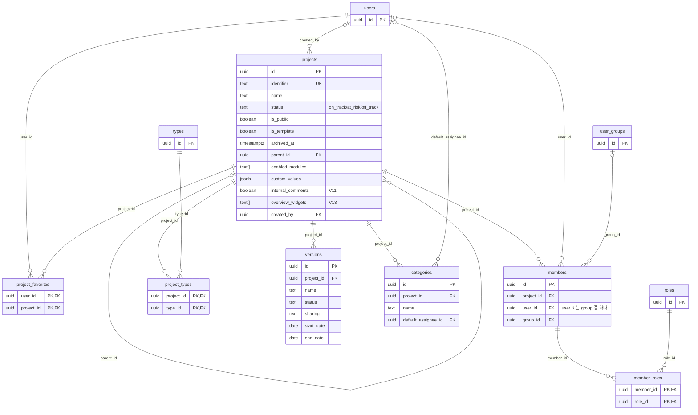

### 2.3 작업 설정(유형·상태·워크플로·우선순위)

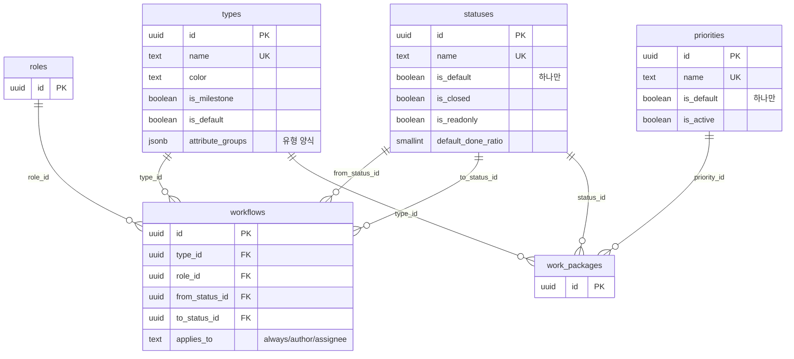

### 2.4 작업 패키지·관계·저널

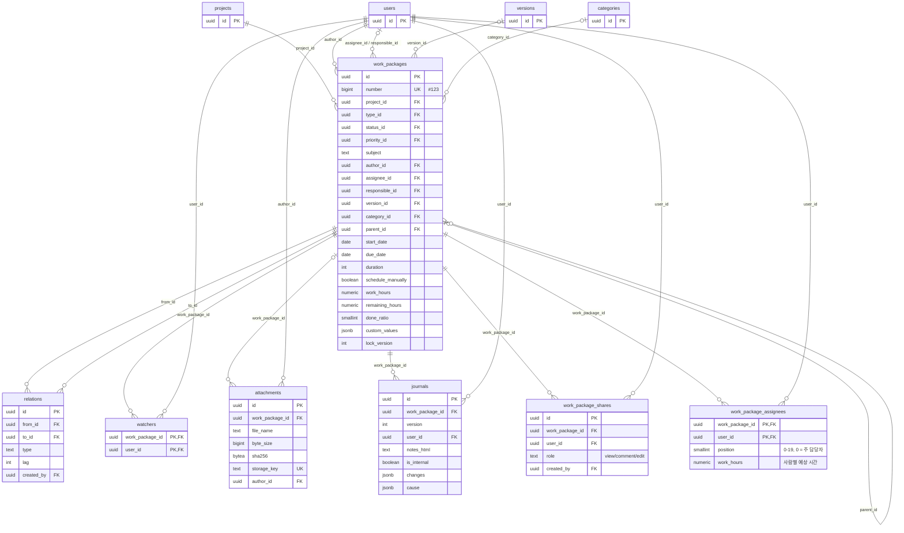

(v2.1) `work_package_assignees`(V18)는 작업을 맡은 모든 사람(공동 담당자)이다. `work_packages.assignee_id`는 그중 `position` 0인 사람(주 담당자)과 같고, 아무도 없으면 null이다. DB가 둘이 같음을 강제하지 않고 앱(`wp/Assignees.write`)이 목록을 쓸 때 같은 트랜잭션에서 맞춘다.

### 2.5 저장된 보기·보드

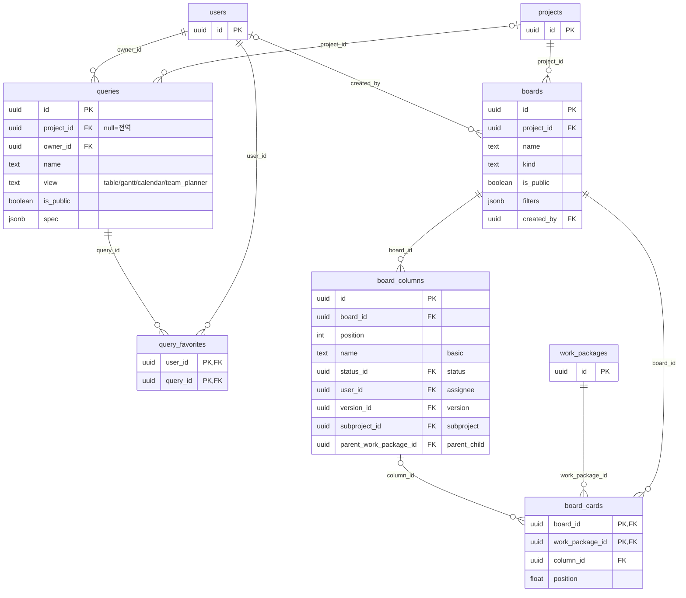

`board_columns`는 `statuses`, `users`, `versions`, `projects`(subproject), `work_packages`(parent)도 참조한다(모두 CASCADE). 그림을 단순하게 하려고 선은 생략했다.

### 2.6 알림

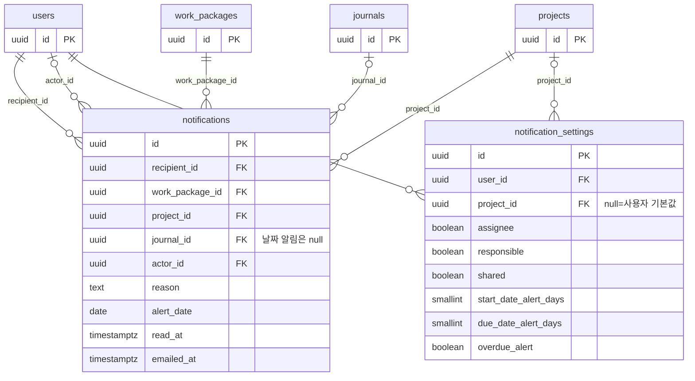

### 2.7 사용자 정의 필드

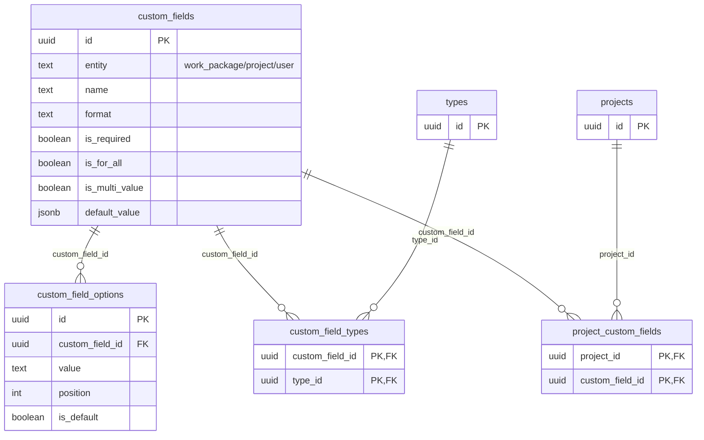

필드 값은 별도 테이블이 아니라 `work_packages.custom_values`, `projects.custom_values`(jsonb, 키 = `custom_field_id`)에 저장한다. 값과 선택지·사용자 참조 사이의 무결성은 앱이 검증한다.

### 2.8 설정·달력·작업(라이브러리)

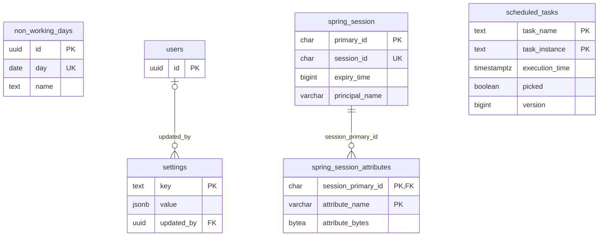

### 2.9 연동(웹훅)

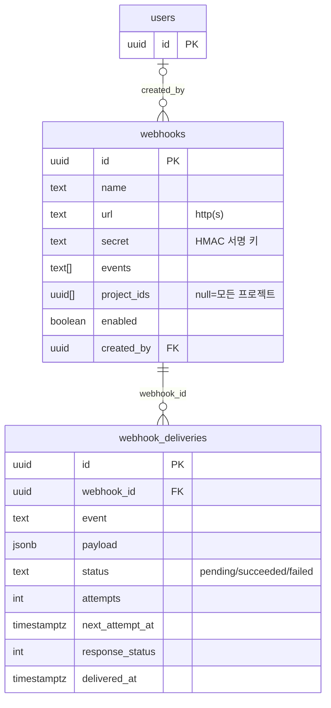

`webhooks.project_ids`는 uuid 배열이라 FK가 없다. 지운 프로젝트의 id가 남아 있어도 그 프로젝트의 이벤트가 생기지 않을 뿐 오류는 없다. API 토큰(`api_tokens`)과 `Idempotency-Key` 응답(`idempotency_keys`, V16)은 사용자 소유라 2.1에 두었다.

### 2.10 시간 기록 (V17)

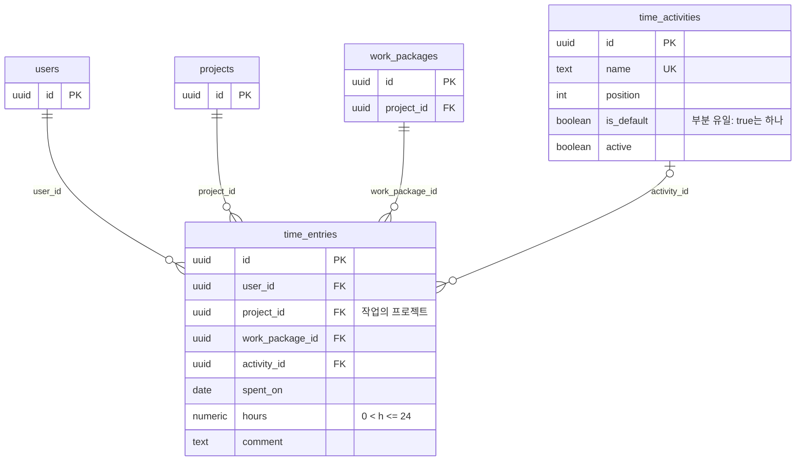

`time_entries.project_id`는 `work_packages.project_id`를 복사해 둔 값이다. DB가 둘이 같음을 강제하지 않고, 작업을 다른 프로젝트로 옮길 때 앱(`WorkPackageTransfers.move` → `TimeController.follow`)이 같은 트랜잭션에서 맞춘다.

### 2.11 서비스 데스크 (V20)

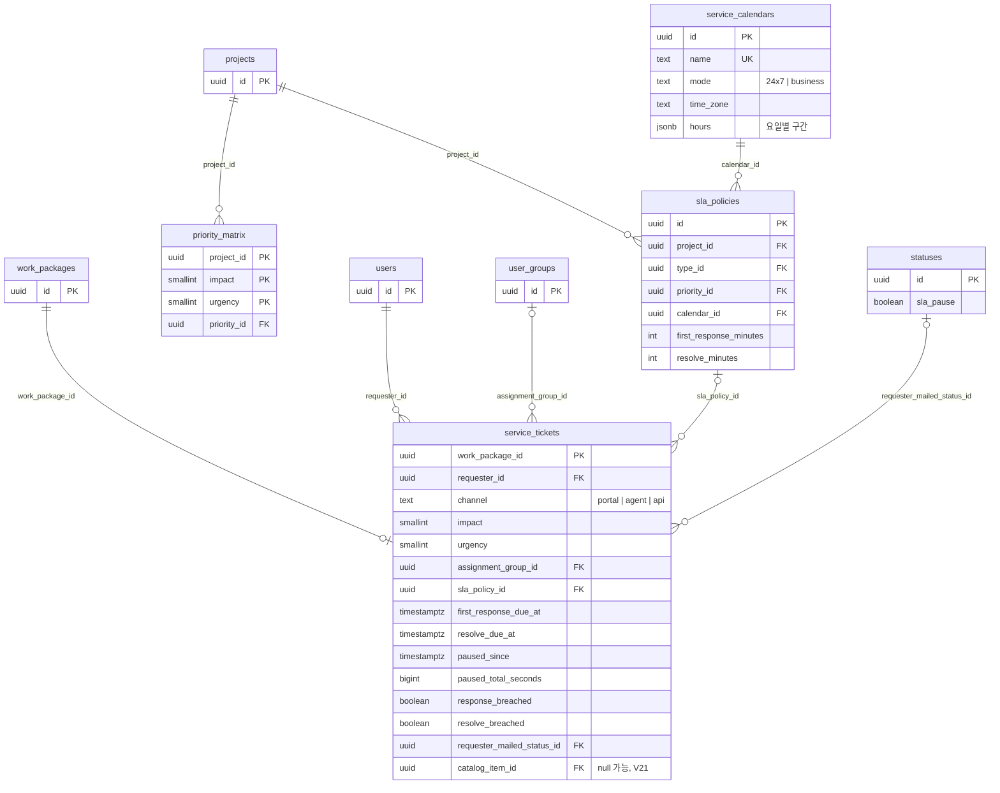

`sla_policies.type_id`·`priority_id`는 `types`·`priorities`를, `priority_matrix.priority_id`는 `priorities`를 가리킨다(그림에서 생략). 티켓은 작업 패키지와 1:1이고, 서비스 데스크 프로젝트의 장애·서비스 요청 유형 작업에만 행이 있다. `service_tickets.work_package_id`는 작업이 지워지면 함께 지워진다(CASCADE). `statuses.sla_pause`는 이 상태에 있는 동안 해결 시계를 멈추는 표시이고, `custom_fields.portal_visible`은 포털 접수 양식·상세에 보이는 사용자 정의 필드 표시다.

### 2.12 서비스 카탈로그와 승인 (V21)

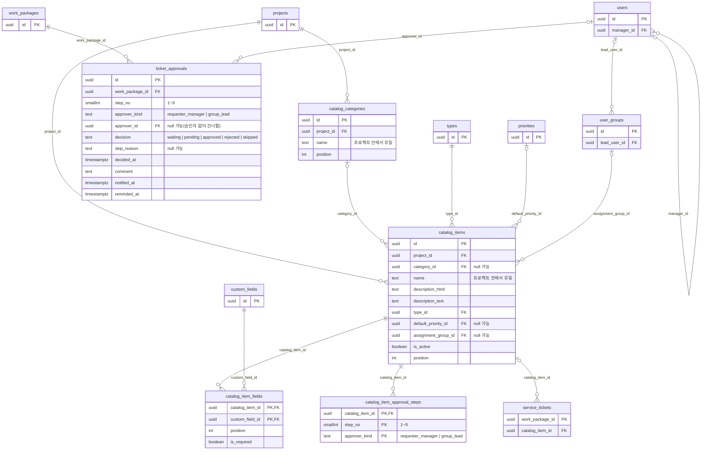

항목(`catalog_items`)은 서비스 데스크 프로젝트의 요청 메뉴 하나이고, 유형(`type_id`, 장애·서비스 요청 중 하나)·기본 우선순위·처리 그룹을 정한다. 양식은 `catalog_item_fields`가 가리키는 작업 사용자 정의 필드, 승인은 `catalog_item_approval_steps`의 (단계, 승인자 종류) 규칙이다. 항목으로 요청하면 `service_tickets.catalog_item_id`에 항목을 적고, 규칙을 읽어 `ticket_approvals`에 요청마다 행을 만든다(승인 대기 동안 단계 순서대로 `waiting` → `pending` → `approved`·`rejected`, 건너뛰는 행은 `skipped`). 작업이 지워지면 승인 행도 지워진다(CASCADE). 항목·분류를 지워도 이미 만든 티켓과 승인 행은 남는다(티켓의 `catalog_item_id`는 SET NULL, 승인 행은 항목을 가리키지 않는다).

---

## 3. 테이블 목록

| No | 도메인 | 테이블 | 한글명 | 용도 | 도입 |
| --- | --- | --- | --- | --- | --- |
| 1 | 사용자·인증 | users | 사용자 | 계정, 상태, 로그인 잠금, 개인 표시 설정, (v2.5) 승인자를 정하는 관리자(상사) | V1, V12, V21 |
| 2 | 사용자·인증 | user_preferences | 사용자 환경설정 | 사용자 1:1 환경설정(코멘트 순서, 요약 메일, 내 페이지 위젯) | V1, V4, V8 |
| 3 | 사용자·인증 | user_tokens | 사용자 토큰 | 초대·비밀번호 재설정 토큰(SHA-256 해시만 저장) | V1 |
| 4 | 사용자·인증 | user_groups | 그룹 | 사용자 그룹, (v2.5) 그룹 책임자 | V1, V21 |
| 5 | 사용자·인증 | user_group_members | 그룹 구성원 | 그룹-사용자 N:M | V1 |
| 6 | 사용자·인증 | roles | 역할 | 프로젝트·전역 역할과 권한 키 목록 | V1 |
| 7 | 사용자·인증 | global_role_assignments | 전역 역할 할당 | 사용자-전역 역할 N:M | V1 |
| 8 | 사용자·인증 | oidc_providers | SSO 공급자 | 사내 OpenID Connect 공급자 등록 정보 | V10 |
| 9 | 사용자·인증 | user_identities | SSO 연결 | 공급자 계정(sub)과 openPMS 사용자 연결 | V10 |
| 10 | 프로젝트·멤버 | projects | 프로젝트 | 프로젝트, 계층, 모듈, 프로젝트 특성 값, 내부 코멘트 사용, 개요 위젯 | V1, V11, V13 |
| 11 | 프로젝트·멤버 | project_favorites | 프로젝트 즐겨찾기 | 사용자별 즐겨찾기 프로젝트 | V1 |
| 12 | 프로젝트·멤버 | members | 멤버 | 프로젝트 멤버(사용자 또는 그룹) | V1 |
| 13 | 프로젝트·멤버 | member_roles | 멤버 역할 | 멤버-역할 N:M | V1 |
| 14 | 작업 설정 | types | 유형 | 작업 유형(작업·마일스톤 등)과 유형 양식 | V1, V9 |
| 15 | 작업 설정 | project_types | 프로젝트 유형 | 프로젝트별 활성 유형 | V1 |
| 16 | 작업 설정 | statuses | 상태 | 작업 상태 | V1 |
| 17 | 작업 설정 | workflows | 워크플로 | 유형·역할별 허용 상태 전환 | V1 |
| 18 | 작업 설정 | priorities | 우선순위 | 작업 우선순위 | V1 |
| 19 | 작업 설정 | versions | 버전 | 프로젝트 버전(릴리스·스프린트), 공유 범위 | V1 |
| 20 | 작업 설정 | categories | 카테고리 | 프로젝트별 카테고리와 기본 담당자 | V1 |
| 21 | 사용자 정의 필드 | custom_fields | 사용자 정의 필드 | 작업·프로젝트·사용자용 추가 필드 정의 | V1 |
| 22 | 사용자 정의 필드 | custom_field_options | 필드 선택지 | 목록형 필드의 선택지 | V1 |
| 23 | 사용자 정의 필드 | custom_field_types | 필드 적용 유형 | 작업 필드를 쓰는 유형 | V1 |
| 24 | 사용자 정의 필드 | project_custom_fields | 프로젝트 필드 활성 | is_for_all이 아닌 필드를 켠 프로젝트 | V1 |
| 25 | 작업 패키지 | work_packages | 작업 패키지 | 작업 본체: 일정, 진행률, 계층, 사용자 정의 값 | V1 |
| 26 | 작업 패키지 | relations | 관계 | 작업 간 관계(정방향 6종) | V1 |
| 27 | 작업 패키지 | watchers | 주시자 | 작업-주시 사용자 N:M | V1 |
| 28 | 작업 패키지 | attachments | 첨부 파일 | 첨부 메타데이터(파일 본문은 파일 저장소) | V1 |
| 29 | 작업 패키지 | journals | 활동 저널 | 생성·변경·코멘트 이력 | V1 |
| 30 | 작업 패키지 | work_package_shares | 작업 공유 | 멤버가 아닌 사용자에게 작업 단위 권한 부여 | V6 |
| 31 | 보기·보드 | queries | 저장된 보기 | 목록·Gantt·캘린더·팀 플래너 보기 설정 | V1 |
| 32 | 보기·보드 | query_favorites | 보기 즐겨찾기 | 사용자별 즐겨찾기 보기 | V1 |
| 33 | 보기·보드 | boards | 보드 | 칸반 보드 | V1 |
| 34 | 보기·보드 | board_columns | 보드 컬럼 | 보드 컬럼(종류별 값 하나) | V1 |
| 35 | 보기·보드 | board_cards | 보드 카드 | 보드 내 카드 순서와 소속 컬럼 | V1 |
| 36 | 알림 | notifications | 알림 | 사용자 알림함, 메일 발송 상태 | V1 |
| 37 | 알림 | notification_settings | 알림 설정 | 사용자 기본·프로젝트별 알림 설정 | V1, V4, V7 |
| 38 | 달력·설정 | non_working_days | 휴무일 | 인스턴스 휴무일(공휴일 등) | V1 |
| 39 | 달력·설정 | settings | 전역 설정 | 키-값(jsonb) 인스턴스 설정 | V1 |
| 40 | 사용자·인증 | api_tokens | API 토큰 | 사내 연동용 개인 API 토큰(SHA-256 해시만 저장) | V14 |
| 41 | 연동 | webhooks | 웹훅 | 작업 이벤트를 받을 외부 주소, 이벤트·프로젝트, 서명 키 | V15 |
| 42 | 연동 | webhook_deliveries | 웹훅 전송 | 보낼 이벤트(본문 포함)와 전송 결과·재시도 일정 | V15 |
| 43 | 사용자·인증 | idempotency_keys | 멱등 키 | 생성 POST의 `Idempotency-Key`와 처음 응답(하루 보관) | V16 |
| 44 | 시간 기록 | time_activities | 시간 기록 활동 | 시간을 기록할 때 고르는 활동(개발·회의 등), 기본 하나, 켜기·끄기 | V17 |
| 45 | 시간 기록 | time_entries | 시간 기록 | 사람이 어느 날 어떤 작업에 쓴 시간(공수)과 활동·메모 | V17 |
| 46 | 작업 패키지 | work_package_assignees | 작업 담당자 목록 | 작업을 맡은 모든 사람(공동 담당자)의 순서와 사람별 예상 시간, 순서 0 = 주 담당자 | V18 |
| 47 | 사용자·인증 | temporary_passwords | 임시 비밀번호 | 관리자가 만든 임시 비밀번호의 평문과 기한·발급한 관리자(사용자마다 한 행, 사람이 비밀번호를 정하면 지우고 기한이 지난 것은 다음 로그인 시도나 정리 작업 때 지움) | V19 |
| 48 | 서비스 데스크 | service_calendars | 서비스 달력 | SLA 기한을 셀 때 쓰는 24시간·근무 시간 달력(요일별 구간, 시간대), 인스턴스 전체에서 관리자가 관리 | V20 |
| 49 | 서비스 데스크 | sla_policies | SLA 정책 | 프로젝트 + 유형 + 우선순위마다 첫 응답·해결 목표(분)와 달력 | V20 |
| 50 | 서비스 데스크 | priority_matrix | 우선순위 행렬 | 프로젝트마다 영향도(1–3) × 긴급도(1–3) 칸의 우선순위 | V20 |
| 51 | 서비스 데스크 | service_tickets | 서비스 티켓 | 작업 패키지와 1:1인 확장: 요청자·접수 경로·영향도·긴급도·처리 그룹, SLA 기한·멈춤·위반·임박 표시, 요청자 알림 표시, (v2.5) 카탈로그 항목 | V20, V21 |
| 52 | 서비스 카탈로그 | catalog_categories | 카탈로그 분류 | 서비스 데스크 프로젝트의 카탈로그 분류(프로젝트 안에서 이름 유일, 순서) | V21 |
| 53 | 서비스 카탈로그 | catalog_items | 카탈로그 항목 | 요청 메뉴: 유형(장애·서비스 요청)·기본 우선순위·처리 그룹·사용 여부·설명 | V21 |
| 54 | 서비스 카탈로그 | catalog_item_fields | 항목 양식 필드 | 항목 요청 양식에 보일 작업 사용자 정의 필드와 필수 여부(항목 × 필드 N:M) | V21 |
| 55 | 서비스 카탈로그 | catalog_item_approval_steps | 항목 승인 단계 | 항목의 승인 규칙: 단계(1–9)와 승인자 종류(요청자의 관리자·그룹 책임자) | V21 |
| 56 | 서비스 카탈로그 | ticket_approvals | 승인 행 | 카탈로그 요청마다 만든 승인 행: 단계·승인자·결정·건너뜀 이유·승인 의견·승인 메일 표시 | V21 |
| 57 | 라이브러리 | spring_session | 세션 | Spring Session JDBC 세션 | V2 |
| 58 | 라이브러리 | spring_session_attributes | 세션 속성 | 세션 속성(직렬화 값) | V2 |
| 59 | 라이브러리 | scheduled_tasks | 예약 작업 | db-scheduler 작업 실행 상태 | V2 |

합계: 애플리케이션 테이블 56개 + 라이브러리 테이블 3개 = **59개** (Flyway의 `flyway_schema_history` 제외). 번호 40~42는 v1.4(V14·V15), 43은 v1.5(V16), 44~45는 v1.6(V17), 46은 v2.1(V18), 47은 v2.2(V19), 48~51은 v2.4(V20), 52~56은 v2.5(V21)에 더한 것이라 도메인 순서가 아니라 맨 뒤에 붙였다. 기준선 비교가 쓰는 임시 테이블 `wp_then`은 요청 트랜잭션 안에서만 있어 목록에 넣지 않았다. `projects`(10)와 `users`(1)는 V11~V13에서 컬럼이 늘었다. `projects.enabled_modules`의 허용 값은 V17에서 늘었다(`time_tracking`). `roles.permissions`(6)에는 V17이 값을 더했다. (v2.4) 라이브러리 테이블은 번호가 밀려 52~54가 됐고, (v2.5) 다시 밀려 57~59가 됐다.

---

## 4. 테이블 정의서

표기: NULL 여부 `N` = NOT NULL, `Y` = NULL 허용. 기본값 `-` = 없음. 설명의 따옴표 없는 문장은 마이그레이션 SQL 주석을 옮긴 것이고, 주석이 없는 컬럼은 용도를 보충해 적었다.

### 4.1 사용자·인증

#### 4.1.1 users (사용자)

| 컬럼명 | 타입 | NULL | 기본값 | 제약 | 설명 |
| --- | --- | --- | --- | --- | --- |
| id | uuid | N | gen_random_uuid() | PK | 사용자 ID |
| email | citext | N | - | UNIQUE (users_email_key) | 로그인 이메일, 대소문자 무시. 익명화 시 `deleted+<id>@invalid` |
| name | text | N | - | CHECK length 1~100 | 표시 이름. 한국어 이름은 성/이름 분리 없이 한 칸 |
| password_hash | text | Y | - | CHECK users_deleted_has_no_password | 비밀번호 해시(DelegatingPasswordEncoder, bcrypt). null: 초대 수락 전, 또는 이후 SSO 전용 계정. null이면 `GET /api/v1/auth/me`의 `hasPassword`가 false이고, 본인이 비밀번호 만들기 링크(`POST /api/v1/me/password/setup`)로 정할 수 있다(384a2f9). (v2.2) 임시 비밀번호가 기한을 넘긴 뒤 그 임시 비밀번호로 로그인을 시도할 때나 정리 작업 때 앱이 null로 만든다(4.1.12) |
| status | text | N | 'active' | CHECK in (invited, active, locked, deleted) | 계정 상태 |
| is_admin | boolean | N | false | | 시스템 관리자 여부 |
| locale | text | N | 'ko' | CHECK in (ko, en) | 화면 언어 |
| time_zone | text | N | 'Asia/Seoul' | | 사용자 시간대(IANA) |
| theme | text | N | 'system' | CHECK users_theme_check in (system, light, dark, high_contrast) | 화면 테마. `high_contrast`(고대비, 라이트 계열)는 V12에서 추가. 시스템이 다크여도 고대비가 이김(화면) |
| failed_login_count | int | N | 0 | CHECK >= 0 | 연속 로그인 실패 횟수 |
| locked_until | timestamptz | Y | - | | 로그인 실패 누적 시 일시 잠금(`status`는 그대로). 미래이고 `status`가 active이면 관리 · 사용자 응답 `AdminUser.lockedUntil`로 보이고 `status=locked` 필터에도 포함된다. 관리자가 `status=active`로 바꾸면 null, `failed_login_count`는 0(384a2f9) |
| last_login_at | timestamptz | Y | - | | 마지막 로그인 시각 |
| manager_id | uuid | Y | - | FK → users.id (SET NULL), CHECK users_manager_not_self | (V21) 이 사람의 요청을 승인할 관리자(상사). 카탈로그 항목의 **관리자** 승인 단계가 가리킴. 관리 · 사용자의 **관리자(상사)**(관리자만 바꿈)나 SSO 관리자 클레임(`openpms.oidc.manager-claim`)으로 정함. 자기 자신은 안 되고(CHECK), 관리자(상사) 순환은 막지 않음(승인은 한 단계만 따라감) |
| created_at | timestamptz | N | now() | | 생성 시각 |
| updated_at | timestamptz | N | now() | | 수정 시각(트리거) |

- 테이블 CHECK: `users_deleted_has_no_password` — `status <> 'deleted' or password_hash is null` (삭제 상태면 비밀번호 해시가 없어야 함), (V21) `users_manager_not_self` — `manager_id is null or manager_id <> id`
- 인덱스: `users_pkey`(id), `users_email_key` UNIQUE(email), `users_status_idx`(status), `users_name_trgm` GIN(name gin_trgm_ops) — 멘션·담당자 자동완성, (V21) `users_manager_idx`(manager_id)
- FK: (V21) manager_id → users **SET NULL**. 사용자는 지우지 않고 익명화하므로 이 규칙은 실제로 돌지 않고, 승인 계획이 활성(`status = 'active'`)이 아닌 관리자(상사)를 승인자 없음으로 본다(4.13)

#### 4.1.2 user_preferences (사용자 환경설정)

| 컬럼명 | 타입 | NULL | 기본값 | 제약 | 설명 |
| --- | --- | --- | --- | --- | --- |
| user_id | uuid | N | - | PK, FK → users.id | 사용자(1:1) |
| comments_newest_first | boolean | N | false | | 활동 탭 최신 코멘트 먼저 |
| warn_on_unsaved | boolean | N | true | | 저장하지 않고 떠날 때 경고 |
| keyboard_shortcuts | boolean | N | true | | 키보드 단축키 사용 |
| digest_enabled | boolean | N | true | | 요약 메일 사용 |
| digest_times | time[] | N | '{08:00}' | CHECK user_preferences_digest_times_count | 요약 메일 시각. 사용자 시간대 기준 |
| immediate_on_mention | boolean | N | true | | 멘션 시 즉시 메일 |
| reminders_paused_until | date | Y | - | | 알림 메일 일시 중지 종료일 |
| created_at | timestamptz | N | now() | | 생성 시각 |
| updated_at | timestamptz | N | now() | | 수정 시각(트리거) |
| last_digest_at | timestamptz | Y | - | | (V4) 요약 메일을 마지막으로 처리한 시각. 요약 시각이 지났고 이 값이 그 시각보다 이르면 보낸다(하루 1회 보장) |
| my_page_widgets | text[] | N | '{assigned,created}' | | (V8) 내 페이지(S21) 위젯: 보여 줄 위젯과 순서. 알려진 이름만 허용(AccountController가 검사) |

- 테이블 CHECK: `user_preferences_digest_times_count` — `cardinality(digest_times) between 1 and 4`
- 인덱스: `user_preferences_pkey`(user_id)
- FK 삭제 규칙: user_id → users **CASCADE**

#### 4.1.3 user_tokens (사용자 토큰)

초대·비밀번호 재설정 토큰. 비밀번호 만들기 링크(SSO 전용 계정, 384a2f9)도 재설정 토큰(`password_reset`)을 쓴다. (v2.2) 임시 비밀번호로 로그인한 사람에게 주는 변경 토큰(`password_change`)도 이 테이블에 있다. 원문 토큰은 메일(변경 토큰은 로그인 응답)에만 있고 DB에는 SHA-256 해시만 저장한다.

| 컬럼명 | 타입 | NULL | 기본값 | 제약 | 설명 |
| --- | --- | --- | --- | --- | --- |
| id | uuid | N | gen_random_uuid() | PK | 토큰 ID |
| user_id | uuid | N | - | FK → users.id | 대상 사용자 |
| purpose | text | N | - | CHECK user_tokens_purpose_check in (invitation, password_reset, password_change) | 토큰 용도. `password_change`(V19)는 임시 비밀번호로 로그인한 사람의 일회용 변경 토큰(10분, 6.2) |
| token_hash | bytea | N | - | UNIQUE | 토큰 원문의 SHA-256 해시 |
| expires_at | timestamptz | N | - | | 만료 시각(설정 `auth.invitation_ttl_hours`, `auth.password_reset_ttl_minutes`) |
| used_at | timestamptz | Y | - | | 사용 시각(일회용) |
| created_by | uuid | Y | - | FK → users.id | 발급한 관리자(재설정 요청은 null) |
| created_at | timestamptz | N | now() | | 생성 시각 |
| updated_at | timestamptz | N | now() | | 수정 시각(트리거) |

- 인덱스: `user_tokens_pkey`(id), `user_tokens_token_hash_key` UNIQUE(token_hash), `user_tokens_user_idx`(user_id), `user_tokens_created_by_idx`(created_by), `user_tokens_expires_idx`(expires_at)
- FK 삭제 규칙: user_id → users **CASCADE**, created_by → users **SET NULL**

#### 4.1.4 user_groups (그룹)

| 컬럼명 | 타입 | NULL | 기본값 | 제약 | 설명 |
| --- | --- | --- | --- | --- | --- |
| id | uuid | N | gen_random_uuid() | PK | 그룹 ID |
| name | text | N | - | UNIQUE, CHECK length 1~100 | 그룹 이름 |
| lead_user_id | uuid | Y | - | FK → users.id (SET NULL) | (V21) 그룹 책임자. 이 그룹이 처리 그룹인 카탈로그 항목의 **그룹 책임자** 승인 단계가 가리킴. 관리 · 그룹의 **책임자**(관리자만 바꿈) |
| created_at | timestamptz | N | now() | | 생성 시각 |
| updated_at | timestamptz | N | now() | | 수정 시각(트리거) |

- 인덱스: `user_groups_pkey`(id), `user_groups_name_key` UNIQUE(name), (V21) `user_groups_lead_idx`(lead_user_id)
- FK: (V21) lead_user_id → users **SET NULL**(사용자를 지우지 않으므로 실제로는 돌지 않음, 승인 계획이 활성이 아닌 책임자를 승인자 없음으로 봄)

#### 4.1.5 user_group_members (그룹 구성원)

| 컬럼명 | 타입 | NULL | 기본값 | 제약 | 설명 |
| --- | --- | --- | --- | --- | --- |
| group_id | uuid | N | - | PK, FK → user_groups.id | 그룹 |
| user_id | uuid | N | - | PK, FK → users.id | 사용자 |
| created_at | timestamptz | N | now() | | 가입 시각 |

- 인덱스: `user_group_members_pkey`(group_id, user_id), `user_group_members_user_idx`(user_id)
- FK 삭제 규칙: group_id → user_groups **CASCADE**, user_id → users **CASCADE**

#### 4.1.6 roles (역할)

permissions는 앱이 정의한 권한 키 목록이다([6.4](#64-권한-키-rolespermissions)).

| 컬럼명 | 타입 | NULL | 기본값 | 제약 | 설명 |
| --- | --- | --- | --- | --- | --- |
| id | uuid | N | gen_random_uuid() | PK | 역할 ID (시드 역할은 고정 uuid5) |
| name | text | N | - | UNIQUE, CHECK length 1~100 | 역할 이름 |
| scope | text | N | - | CHECK in (project, global) | 적용 범위 |
| builtin | text | Y | - | CHECK roles_builtin_check in (non_member, requester), CHECK roles_builtin_is_project | `non_member`: 공개 프로젝트를 멤버 아닌 사용자가 볼 때 쓰는 역할. (V20) `requester`: 서비스 데스크 포털에서 요청자의 상태 전환을 검사하는 역할(누구에게도 지정하지 않음) |
| permissions | text[] | N | '{}' | | 권한 키 목록 |
| position | int | N | 0 | | 표시 순서 |
| created_at | timestamptz | N | now() | | 생성 시각 |
| updated_at | timestamptz | N | now() | | 수정 시각(트리거) |

- 테이블 CHECK: `roles_builtin_is_project` — `builtin is null or scope = 'project'`
- 인덱스: `roles_pkey`(id), `roles_name_key` UNIQUE(name), `roles_one_per_builtin` UNIQUE(builtin) WHERE builtin is not null
- FK: 없음

#### 4.1.7 global_role_assignments (전역 역할 할당)

| 컬럼명 | 타입 | NULL | 기본값 | 제약 | 설명 |
| --- | --- | --- | --- | --- | --- |
| user_id | uuid | N | - | PK, FK → users.id | 사용자 |
| role_id | uuid | N | - | PK, FK → roles.id | 전역 역할 |
| created_at | timestamptz | N | now() | | 할당 시각 |

- 인덱스: `global_role_assignments_pkey`(user_id, role_id), `global_role_assignments_role_idx`(role_id)
- FK 삭제 규칙: user_id → users **CASCADE**, role_id → roles **CASCADE**
- 참고: `scope='global'` 역할만 넣는 것은 앱이 검사한다(DB 제약 없음).
- 쓰는 곳(v1.3, 0af87f8): 관리 · 사용자의 "전역 역할" 대화상자 → `PUT /api/v1/admin/users/{id}/global-roles`가 그 사용자의 행을 모두 지우고 고른 역할을 다시 넣는다(한 트랜잭션, 관리자만, 전역 역할이 아니면 422). 읽기는 요청마다 `Snapshot`이 이 테이블로 전역 권한을 계산하고, 관리 사용자 목록의 `globalRoles`도 여기서 만든다. 역할을 지우면 CASCADE로 할당도 사라진다. 사용자 익명화는 행을 지우지 않으므로 할당이 남지만, 삭제된 사용자는 로그인할 수 없다(확인 필요: 익명화 때 할당을 지울지).

#### 4.1.8 oidc_providers (SSO 공급자) — V10

사내 SSO(OpenID Connect). 관리자가 공급자를 등록하고, 사람은 공급자 계정(sub)으로 openPMS 사용자에 연결된다.

| 컬럼명 | 타입 | NULL | 기본값 | 제약 | 설명 |
| --- | --- | --- | --- | --- | --- |
| id | uuid | N | gen_random_uuid() | PK | 공급자 ID |
| slug | text | N | - | UNIQUE, CHECK `^[a-z0-9][a-z0-9-]{0,39}$` | 콜백 주소에 들어가는 식별자 |
| display_name | text | N | - | CHECK length 1~60 | 로그인 버튼 이름 |
| issuer | text | N | - | | 발견 문서(.well-known/openid-configuration)의 기준 주소 |
| client_id | text | N | - | | 클라이언트 ID |
| client_secret | text | N | - | | 클라이언트 시크릿. API로는 내보내지 않는다. **평문 저장**(8.3 참고) |
| scopes | text | N | 'openid email profile' | | 요청 범위(공백 구분) |
| claim_email | text | N | 'email' | | 이메일 클레임 이름 |
| claim_name | text | N | 'name' | | 이름 클레임 이름 |
| auto_create | boolean | N | false | | 없는 사람은 처음 로그인할 때 만든다 |
| enabled | boolean | N | true | | 사용 여부 |
| position | int | N | 0 | | 로그인 버튼 순서 |
| created_at | timestamptz | N | now() | | 생성 시각 |
| updated_at | timestamptz | N | now() | | 수정 시각(트리거 `oidc_providers_updated_at`) |

- 인덱스: `oidc_providers_pkey`(id), `oidc_providers_slug_key` UNIQUE(slug)
- FK: 없음

#### 4.1.9 user_identities (SSO 연결) — V10

| 컬럼명 | 타입 | NULL | 기본값 | 제약 | 설명 |
| --- | --- | --- | --- | --- | --- |
| id | uuid | N | gen_random_uuid() | PK | 연결 ID |
| user_id | uuid | N | - | FK → users.id, UNIQUE(provider_id, user_id) | openPMS 사용자 |
| provider_id | uuid | N | - | FK → oidc_providers.id, UNIQUE(provider_id, subject) | 공급자. 공급자를 지우면 연결만 사라진다 |
| subject | text | N | - | UNIQUE(provider_id, subject) | IdP의 사용자 식별자(sub) |
| last_login_at | timestamptz | Y | - | | 이 연결로 마지막 로그인한 시각 |
| created_at | timestamptz | N | now() | | 연결 시각 |

- 인덱스: `user_identities_pkey`(id), `user_identities_provider_id_subject_key` UNIQUE(provider_id, subject), `user_identities_provider_id_user_id_key` UNIQUE(provider_id, user_id), `user_identities_user_idx`(user_id)
- FK 삭제 규칙: user_id → users **CASCADE**, provider_id → oidc_providers **CASCADE**
- `updated_at` 컬럼과 트리거 없음

#### 4.1.10 api_tokens (API 토큰) — V14

외부 연동 API 토큰(계정 설정 · API 토큰). 사람마다 여러 개. 토큰 원문(`opms_` + 32바이트 난수의 Base64URL)은 만들 때 한 번만 보이고, DB에는 SHA-256만 둔다. 요청의 `Authorization: Bearer` 값을 해시해 이 테이블에서 찾는다(`auth/ApiTokens.resolve`).

| 컬럼명 | 타입 | NULL | 기본값 | 제약 | 설명 |
| --- | --- | --- | --- | --- | --- |
| id | uuid | N | gen_random_uuid() | PK | 토큰 ID |
| user_id | uuid | N | - | FK → users.id | 토큰 주인. 토큰은 이 사람의 권한으로 동작 |
| name | text | N | - | CHECK length 1~60 | 토큰 이름(어디에 쓰는지) |
| token_hash | bytea | N | - | UNIQUE | 토큰 원문의 SHA-256 해시 |
| scope | text | N | - | CHECK in (read, write) | read: 조회만(GET과 목록 조회·내보내기 POST), write: 주인 권한 안의 모든 요청 |
| created_at | timestamptz | N | now() | | 만든 시각 |
| last_used_at | timestamptz | Y | - | | 마지막 사용 시각. 쓰기를 줄이려고 최대 1분에 한 번만 갱신 |
| expires_at | timestamptz | Y | - | | 만료 시각(만들 때 30·90·365일 뒤). null: 만료 없음 |
| revoked_at | timestamptz | Y | - | | 폐기 시각(본인 또는 관리자). 폐기한 행은 바로 지우지 않고 30일 뒤 token-cleanup이 지운다 |

- 인덱스: `api_tokens_pkey`(id), `api_tokens_token_hash_key` UNIQUE(token_hash), `api_tokens_user_idx`(user_id)
- FK 삭제 규칙: user_id → users **CASCADE**
- `updated_at` 컬럼과 트리거 없음
- 앱 규칙(DB 제약 없음): 폐기하지 않은 토큰은 사람당 20개까지. 주인이 활성이 아니거나 로그인 실패 잠금 중이면 토큰도 거절(사용자 익명화는 행을 지우지 않지만 상태가 deleted라 거절). 설정 `api.tokens_enabled`가 false면 모든 토큰 거절(7.1)
- 폐기(`revoked_at`) 또는 만료(`expires_at`)가 30일보다 오래된 행은 token-cleanup이 지운다(dfde416, 8.1·8.2)

#### 4.1.11 idempotency_keys (멱등 키) — V16

생성 POST의 재시도를 한 번으로 묶는다(93d1a74, `common/IdempotencyFilter`). `/api/`로 오는 POST에 `Idempotency-Key` 헤더가 있으면 처음 요청이 이 테이블에 (사람, 키) 행을 먼저 넣어 자리를 잡고(`insert … on conflict do nothing`), 2xx로 끝나면 응답을 저장한다. 같은 키의 재전송에는 저장한 응답을 돌려준다.

| 컬럼명 | 타입 | NULL | 기본값 | 제약 | 설명 |
| --- | --- | --- | --- | --- | --- |
| user_id | uuid | N | - | PK(1), FK → users.id | 요청한 사람(세션 또는 API 토큰 주인). 키는 사람마다 따로 |
| key | text | N | - | PK(2), CHECK length 1~255 | `Idempotency-Key` 헤더 값(앞뒤 공백 제거) |
| method | text | N | - | | HTTP 메서드(지금은 POST만) |
| path | text | N | - | | 요청 경로와 쿼리 |
| request_hash | text | N | - | | `메서드 경로\n` + 본문의 SHA-256(16진수). 같은 키에 다른 값이 오면 422 |
| status | int | Y | - | | 처음 응답의 HTTP 상태. **null: 아직 처리 중**(같은 키가 오면 409) |
| content_type | text | Y | - | | 처음 응답의 Content-Type |
| body | bytea | Y | - | | 처음 응답 본문(1MB 이하인 2xx만) |
| created_at | timestamptz | N | now() | | 처음 받은 시각. 보관 기간(24시간)의 기준 |

- 인덱스: `idempotency_keys_pkey`(user_id, key), `idempotency_keys_created_idx`(created_at) — 정리 작업의 기간 조건
- FK 삭제 규칙: user_id → users **CASCADE**
- `updated_at` 컬럼과 트리거 없음
- 앱 규칙: 2xx가 아니거나 1MB 넘는 응답, 처리 중 예외가 나면 행을 지운다(실패한 요청은 같은 키로 다시 보낼 수 있음). 같은 키가 오면 24시간 지난 행을 먼저 지우고 새로 시작한다. multipart 요청과 로그인하지 않은 요청은 쓰지 않는다
- `created_at`이 24시간보다 오래된 행은 token-cleanup이 지운다(8.1·8.2)
- 업무 트랜잭션과는 따로 쓰므로, 업무가 커밋된 뒤 응답을 저장하기 전에 프로세스가 죽으면 `status`가 null인 행이 남아 하루 동안 같은 키가 409가 된다(다른 키로 보내면 됨)

#### 4.1.12 temporary_passwords (임시 비밀번호) — V19

관리자가 메일 없이 사용자를 등록하거나 다시 발급한 임시 비밀번호다(092767a, `auth/TemporaryPasswords`). 행이 있으면 그 사람의 지금 비밀번호(`users.password_hash`)는 임시라는 뜻이고, 임시 비밀번호로 로그인하면 세션 없이 변경 토큰만 받는다(03-아키텍처설계서 8.1.9). 로그인 확인은 늘 해시로 하며, 이 테이블의 평문은 관리자가 전달하려고 다시 볼 때만 읽는다.

| 컬럼명 | 타입 | NULL | 기본값 | 제약 | 설명 |
| --- | --- | --- | --- | --- | --- |
| user_id | uuid | N | - | PK, FK → users.id | 임시 비밀번호를 가진 사용자. 사용자마다 한 행이고 다시 발급하면 덮어쓴다 |
| password | text | N | - | | 임시 비밀번호 평문. API로는 관리자의 만들기·다시 발급·보기 응답에만 나가고 로그·웹훅·활동·메일에는 쓰지 않는다 |
| expires_at | timestamptz | N | - | | 쓸 수 있는 기한 = 발급 시각 + 설정 `auth.invitation_ttl_hours`(기본 168시간) |
| issued_by | uuid | Y | - | FK → users.id | 발급한 관리자. 그 사용자 행이 지워지면 null(앱은 사용자를 지우지 않고 익명화하므로 거의 없음) |
| issued_at | timestamptz | N | now() | | 발급 시각 |

- 인덱스: `temporary_passwords_pkey`(user_id), `temporary_passwords_issued_by_idx`(issued_by), `temporary_passwords_expires_idx`(expires_at) — 정리 작업의 기한 조건
- FK 삭제 규칙: user_id → users **CASCADE**, issued_by → users **SET NULL**
- `updated_at` 컬럼과 트리거 없음
- 앱 규칙: 다시 발급하면 같은 행을 upsert로 덮어쓰면서 `users.password_hash`도 새 값의 해시로 바꾼다. 사람이 자기 비밀번호를 정하는 모든 길(첫 로그인의 변경, 재설정 링크, 초대 수락, 계정 설정의 변경)과 사용자 삭제(익명화)가 이 행을 지운다
- 기한이 지난 행은 로그인할 때와 `token-cleanup`(매일 03:30)이 지우면서 `users.password_hash`도 null로 만든다(8.1·8.2). 지워지기 전까지는 기한이 지난 행도 남아 `AdminUser.temporaryPasswordUntil`로 보인다(평문은 아님)
- 읽기: `GET /admin/users/{id}/temporary-password`는 `expires_at`이 미래인 행만 돌려준다. 사용자 목록은 `expires_at`만 읽는다
- 평문이 백업 덤프에도 들어가므로 8.3 유의 사항을 따른다

### 4.2 프로젝트·멤버

#### 4.2.1 projects (프로젝트)

| 컬럼명 | 타입 | NULL | 기본값 | 제약 | 설명 |
| --- | --- | --- | --- | --- | --- |
| id | uuid | N | gen_random_uuid() | PK | 프로젝트 ID |
| identifier | text | N | - | UNIQUE, CHECK `^[a-z][a-z0-9-]{0,99}$` | URL용 slug |
| name | text | N | - | CHECK length 1~255 | 프로젝트 이름 |
| description_html | text | N | '' | | 서버에서 sanitize한 HTML |
| description_text | text | N | '' | | 검색용 평문 |
| status | text | Y | - | CHECK in (on_track, at_risk, off_track) | 프로젝트 상태(null = 미설정) |
| status_explanation | text | N | '' | | 상태 설명 |
| is_public | boolean | N | false | | 공개 프로젝트(비멤버 역할로 열람) |
| is_template | boolean | N | false | | 템플릿 프로젝트. 프로젝트 설정 "템플릿으로 쓰기"(`PATCH /projects/{id}`의 `isTemplate`)로 켜고, `GET /projects?filter=templates`와 새 프로젝트의 "템플릿에서 시작"이 읽음(v1.3) |
| archived_at | timestamptz | Y | - | | 보관 시각(null = 활성) |
| parent_id | uuid | Y | - | FK → projects.id, CHECK projects_not_own_parent | 상위 프로젝트. 하위 프로젝트가 있으면 삭제 불가. 생성과 프로젝트 설정(`PATCH`의 `parentId`, v1.3)에서 정함. 자기 자신은 CHECK가, 자기 하위 아래로 옮기는 순환은 앱이 조상 사슬을 따라가며 막음(422 `parent`) |
| enabled_modules | text[] | N | '{work_packages,gantt,boards}' | CHECK projects_known_modules(V20부터 `service_desk` 포함) | 활성 모듈. V17이 모든 기존 행에 `time_tracking`을 더함. DB 기본값은 그대로지만 앱(`ProjectController`)은 새 프로젝트를 `{work_packages,gantt,boards,time_tracking}`으로 만듦(템플릿·복사로 만들면 원본의 값). 꺼진 모듈의 권한은 앱이 뺌(`boards` → `board.*`, `time_tracking` → `time.*`) |
| custom_values | jsonb | N | '{}' | CHECK projects_custom_values_object | 프로젝트 특성: {"<custom_field_id>": 값} |
| internal_comments | boolean | N | false | | (V11) 내부 코멘트 사용. 켜면 `wp.add_internal_comments`가 있는 사람이 코멘트를 내부로 표시(`journals.is_internal = true`)할 수 있다. `PATCH /projects/{id}`의 `internalComments`(project.edit). 끄면 새 내부 코멘트만 막고 이미 쓴 내부 코멘트는 그대로 숨겨진다 |
| overview_widgets | text[] | N | '{description,workSummary,status,members}' | (앱 검사) | (V13) 개요(S05)에 보일 위젯과 순서. 알려진 값만(6.5), 중복 제거. `PATCH /projects/{id}`의 `overviewWidgets`(project.edit). 빈 배열이면 위젯 없음 |
| created_by | uuid | Y | - | FK → users.id | 생성자 |
| created_at | timestamptz | N | now() | | 생성 시각 |
| updated_at | timestamptz | N | now() | | 수정 시각(트리거) |

- 테이블 CHECK: `projects_not_own_parent` (`parent_id <> id`), `projects_known_modules` (`enabled_modules <@ {work_packages, gantt, boards, calendar, team_planner, time_tracking, service_desk}`. V17이 지우고 `time_tracking`을, V20이 `service_desk`를 넣어 다시 만듦. 서비스 데스크 모듈과 `is_public = true`를 함께 두는 것은 DB가 아니라 앱(`ProjectController`)이 422로 막는다: 공개 프로젝트는 비멤버 역할의 `wp.view`로 모든 티켓이 전 직원에게 보이기 때문), `projects_custom_values_object` (`jsonb_typeof(custom_values) = 'object'`)
- 인덱스: `projects_pkey`(id), `projects_identifier_key` UNIQUE(identifier), `projects_parent_idx`(parent_id), `projects_created_by_idx`(created_by), `projects_active_idx`(name) WHERE archived_at is null, `projects_name_trgm` GIN(name gin_trgm_ops)
- FK 삭제 규칙: parent_id → projects **RESTRICT**, created_by → users **SET NULL**
- 템플릿에서 만들 때와 프로젝트 복사(v1.4, `POST /projects/{id}/copy`) 때 쓰는 행(v1.3, `project/ProjectCopy`, 생성과 같은 트랜잭션): 새 `projects` 행에 원본의 `enabled_modules`·`custom_values`·`overview_widgets`·`internal_comments`(v1.4)와(설명을 비웠으면) `description_html`·`description_text`를 복사, `project_types`를 템플릿 것으로 교체, `project_custom_fields`를 복사. 고른 항목에 따라 `members`·`member_roles`, `versions`, `categories`, `work_packages`(새 번호, 상위는 사본끼리 다시 연결), `relations`(사본끼리만), `journals`(사본마다 "만듦" 1행), `boards`·`board_columns`·`board_cards`(kind `subproject` 보드는 제외), `queries`(공개 보기와 만드는 사람의 비공개 보기)를 새로 넣음. `notifications`·`attachments`·`watchers`는 만들지 않음. 보기 `spec`과 보드 `filters`(jsonb) 안의 버전·카테고리·작업 uuid는 문자열 치환으로 사본 uuid로 바꿈

#### 4.2.2 project_favorites (프로젝트 즐겨찾기)

| 컬럼명 | 타입 | NULL | 기본값 | 제약 | 설명 |
| --- | --- | --- | --- | --- | --- |
| user_id | uuid | N | - | PK, FK → users.id | 사용자 |
| project_id | uuid | N | - | PK, FK → projects.id | 프로젝트 |
| created_at | timestamptz | N | now() | | 등록 시각 |

- 인덱스: `project_favorites_pkey`(user_id, project_id), `project_favorites_project_idx`(project_id)
- FK 삭제 규칙: user_id → users **CASCADE**, project_id → projects **CASCADE**

#### 4.2.3 members (멤버)

멤버는 사용자 또는 그룹이다. 그룹 멤버십의 사용자 권한은 조회 시점에 합산한다(파생 행을 만들지 않음).

| 컬럼명 | 타입 | NULL | 기본값 | 제약 | 설명 |
| --- | --- | --- | --- | --- | --- |
| id | uuid | N | gen_random_uuid() | PK | 멤버 ID |
| project_id | uuid | N | - | FK → projects.id | 프로젝트 |
| user_id | uuid | Y | - | FK → users.id, CHECK members_one_principal | 사용자 멤버 |
| group_id | uuid | Y | - | FK → user_groups.id, CHECK members_one_principal | 그룹 멤버 |
| created_at | timestamptz | N | now() | | 생성 시각 |
| updated_at | timestamptz | N | now() | | 수정 시각(트리거) |

- 테이블 CHECK: `members_one_principal` — `num_nonnulls(user_id, group_id) = 1`
- 인덱스: `members_pkey`(id), `members_project_user_key` UNIQUE(project_id, user_id) WHERE user_id is not null, `members_project_group_key` UNIQUE(project_id, group_id) WHERE group_id is not null, `members_project_idx`(project_id), `members_user_idx`(user_id), `members_group_idx`(group_id)
- FK 삭제 규칙: project_id → projects **CASCADE**, user_id → users **CASCADE**, group_id → user_groups **CASCADE**

#### 4.2.4 member_roles (멤버 역할)

| 컬럼명 | 타입 | NULL | 기본값 | 제약 | 설명 |
| --- | --- | --- | --- | --- | --- |
| member_id | uuid | N | - | PK, FK → members.id | 멤버 |
| role_id | uuid | N | - | PK, FK → roles.id | 역할. 쓰고 있는 역할은 삭제 불가 |
| created_at | timestamptz | N | now() | | 할당 시각 |

- 인덱스: `member_roles_pkey`(member_id, role_id), `member_roles_role_idx`(role_id)
- FK 삭제 규칙: member_id → members **CASCADE**, role_id → roles **RESTRICT**

### 4.3 작업 설정

#### 4.3.1 types (유형)

| 컬럼명 | 타입 | NULL | 기본값 | 제약 | 설명 |
| --- | --- | --- | --- | --- | --- |
| id | uuid | N | gen_random_uuid() | PK | 유형 ID (시드 유형은 고정 uuid5) |
| name | text | N | - | UNIQUE, CHECK length 1~100 | 유형 이름 |
| color | text | N | '#1f5fc4' | CHECK `^#[0-9A-Fa-f]{6}$` | 표시 색 |
| position | int | N | 0 | | 표시 순서 |
| is_milestone | boolean | N | false | | 마일스톤(시작일=완료일) |
| is_default | boolean | N | false | | 새 프로젝트에서 자동 활성 |
| is_in_roadmap | boolean | N | true | | 로드맵 표시 |
| attribute_groups | jsonb | N | '[]' | CHECK types_attribute_groups_array | 유형 양식. V9 이후 `[{name, attributes}…, {hidden: […]}]`, `'[]'` = 기본 양식 |
| description_template_html | text | N | '' | | 새 작업 설명 템플릿 |
| created_at | timestamptz | N | now() | | 생성 시각 |
| updated_at | timestamptz | N | now() | | 수정 시각(트리거) |

- 테이블 CHECK: `types_attribute_groups_array` — `jsonb_typeof(attribute_groups) = 'array'`
- 인덱스: `types_pkey`(id), `types_name_key` UNIQUE(name)
- FK: 없음
- 비고: V1 주석의 형식(`[{"name": "...", "attributes": ["assignee", ...]}]`)과 V3 시드 값은 V9에서 폐기되고 모든 행이 `'[]'`로 초기화되었다.

#### 4.3.2 project_types (프로젝트 유형)

| 컬럼명 | 타입 | NULL | 기본값 | 제약 | 설명 |
| --- | --- | --- | --- | --- | --- |
| project_id | uuid | N | - | PK, FK → projects.id | 프로젝트 |
| type_id | uuid | N | - | PK, FK → types.id | 활성 유형 |
| created_at | timestamptz | N | now() | | 활성 시각 |

- 인덱스: `project_types_pkey`(project_id, type_id), `project_types_type_idx`(type_id)
- FK 삭제 규칙: project_id → projects **CASCADE**, type_id → types **CASCADE**

#### 4.3.3 statuses (상태)

| 컬럼명 | 타입 | NULL | 기본값 | 제약 | 설명 |
| --- | --- | --- | --- | --- | --- |
| id | uuid | N | gen_random_uuid() | PK | 상태 ID (시드는 고정 uuid5) |
| name | text | N | - | UNIQUE, CHECK length 1~100 | 상태 이름 |
| color | text | N | '#5f6873' | CHECK `^#[0-9A-Fa-f]{6}$` | 표시 색 |
| position | int | N | 0 | | 표시 순서 |
| is_default | boolean | N | false | 부분 UNIQUE(statuses_one_default) | 새 작업 기본 상태(하나만) |
| is_closed | boolean | N | false | | 완료 계열 상태 |
| is_readonly | boolean | N | false | | 이 상태에서는 상태 외 필드 편집 불가 |
| default_done_ratio | smallint | N | 0 | CHECK 0~100 | 상태 기반 진행률 모드의 진행률 |
| excluded_from_totals | boolean | N | false | | 합계 계산에서 제외. 작업의 ∑ 합계(P4·P5)와 목록 합계의 완료 %에서 뺀다(목록의 작업량·남은 작업 합계에는 들어감, 384a2f9) |
| sla_pause | boolean | N | false | | (V20) 이 상태에 있는 동안 서비스 데스크 티켓의 해결 SLA 시계가 멈춤(예: **답변 대기**). 시드: 답변 대기만 true((V21) **승인 대기**도 true). 관리 · 상태의 **SLA 멈춤** |
| created_at | timestamptz | N | now() | | 생성 시각 |
| updated_at | timestamptz | N | now() | | 수정 시각(트리거) |

- 인덱스: `statuses_pkey`(id), `statuses_name_key` UNIQUE(name), `statuses_one_default` UNIQUE(is_default) WHERE is_default, `statuses_closed_idx`(is_closed)
- FK: 없음

#### 4.3.4 workflows (워크플로)

허용된 상태 전환. applies_to: always(모두) | author(작성자일 때만) | assignee(담당자일 때만).

| 컬럼명 | 타입 | NULL | 기본값 | 제약 | 설명 |
| --- | --- | --- | --- | --- | --- |
| id | uuid | N | gen_random_uuid() | PK | 워크플로 ID |
| type_id | uuid | N | - | FK → types.id | 유형 |
| role_id | uuid | N | - | FK → roles.id | 역할 |
| from_status_id | uuid | N | - | FK → statuses.id | 이전 상태 |
| to_status_id | uuid | N | - | FK → statuses.id, CHECK workflows_real_transition | 다음 상태 |
| applies_to | text | N | 'always' | CHECK in (always, author, assignee) | 적용 조건 |
| created_at | timestamptz | N | now() | | 생성 시각 |
| updated_at | timestamptz | N | now() | | 수정 시각(트리거) |

- 테이블 제약: `workflows_transition_key` UNIQUE(type_id, role_id, from_status_id, to_status_id, applies_to), `workflows_real_transition` CHECK(from_status_id <> to_status_id)
- 인덱스: `workflows_pkey`(id), `workflows_transition_key`(위), `workflows_role_idx`(role_id), `workflows_from_status_idx`(from_status_id), `workflows_to_status_idx`(to_status_id)
- FK 삭제 규칙: type_id, role_id, from_status_id, to_status_id 모두 **CASCADE**

#### 4.3.5 priorities (우선순위)

| 컬럼명 | 타입 | NULL | 기본값 | 제약 | 설명 |
| --- | --- | --- | --- | --- | --- |
| id | uuid | N | gen_random_uuid() | PK | 우선순위 ID (시드는 고정 uuid5) |
| name | text | N | - | UNIQUE, CHECK length 1~100 | 이름 |
| color | text | N | '#5f6873' | CHECK `^#[0-9A-Fa-f]{6}$` | 표시 색 |
| position | int | N | 0 | | 표시 순서 |
| is_default | boolean | N | false | 부분 UNIQUE(priorities_one_default) | 기본 우선순위(하나만) |
| is_active | boolean | N | true | | 사용 여부 |
| created_at | timestamptz | N | now() | | 생성 시각 |
| updated_at | timestamptz | N | now() | | 수정 시각(트리거) |

- 인덱스: `priorities_pkey`(id), `priorities_name_key` UNIQUE(name), `priorities_one_default` UNIQUE(is_default) WHERE is_default
- FK: 없음

#### 4.3.6 versions (버전)

| 컬럼명 | 타입 | NULL | 기본값 | 제약 | 설명 |
| --- | --- | --- | --- | --- | --- |
| id | uuid | N | gen_random_uuid() | PK | 버전 ID |
| project_id | uuid | N | - | FK → projects.id, UNIQUE(project_id, name) | 소유 프로젝트 |
| name | text | N | - | CHECK length 1~100 | 버전 이름 |
| description | text | N | '' | | 설명 |
| status | text | N | 'open' | CHECK in (open, locked, closed) | 버전 상태 |
| sharing | text | N | 'none' | CHECK in (none, descendants, hierarchy, tree, system) | 다른 프로젝트와의 공유 범위 |
| start_date | date | Y | - | | 시작일 |
| end_date | date | Y | - | CHECK versions_dates_ordered | 완료일 |
| created_at | timestamptz | N | now() | | 생성 시각 |
| updated_at | timestamptz | N | now() | | 수정 시각(트리거) |

- 테이블 제약: `versions_project_name_key` UNIQUE(project_id, name), `versions_dates_ordered` CHECK(start_date is null or end_date is null or end_date >= start_date)
- 인덱스: `versions_pkey`(id), `versions_project_name_key`(project_id, name), `versions_status_idx`(status), `versions_sharing_idx`(sharing) WHERE sharing <> 'none'
- FK 삭제 규칙: project_id → projects **CASCADE**

#### 4.3.7 categories (카테고리)

| 컬럼명 | 타입 | NULL | 기본값 | 제약 | 설명 |
| --- | --- | --- | --- | --- | --- |
| id | uuid | N | gen_random_uuid() | PK | 카테고리 ID |
| project_id | uuid | N | - | FK → projects.id, UNIQUE(project_id, name) | 소유 프로젝트 |
| name | text | N | - | CHECK length 1~100 | 이름 |
| default_assignee_id | uuid | Y | - | FK → users.id | 이 카테고리 작업의 기본 담당자 |
| created_at | timestamptz | N | now() | | 생성 시각 |
| updated_at | timestamptz | N | now() | | 수정 시각(트리거) |

- 인덱스: `categories_pkey`(id), `categories_project_name_key` UNIQUE(project_id, name), `categories_default_assignee_idx`(default_assignee_id)
- FK 삭제 규칙: project_id → projects **CASCADE**, default_assignee_id → users **SET NULL**

### 4.4 사용자 정의 필드

#### 4.4.1 custom_fields (사용자 정의 필드)

| 컬럼명 | 타입 | NULL | 기본값 | 제약 | 설명 |
| --- | --- | --- | --- | --- | --- |
| id | uuid | N | gen_random_uuid() | PK | 필드 ID (custom_values의 키) |
| entity | text | N | - | CHECK in (work_package, project, user), UNIQUE(entity, name) | 적용 대상 |
| name | text | N | - | CHECK length 1~100 | 필드 이름 |
| format | text | N | - | CHECK in (string, text, integer, float, list, date, bool, user, version, link) | 값 형식 |
| is_required | boolean | N | false | | 필수 |
| is_for_all | boolean | N | false | | true면 모든 프로젝트에서 활성 |
| is_filterable | boolean | N | true | | 목록 필터에 노출 |
| is_searchable | boolean | N | false | | 검색 대상 |
| is_multi_value | boolean | N | false | CHECK custom_fields_multi_only_for_refs | 다중 값 |
| default_value | jsonb | Y | - | | 기본값 |
| min_length | int | Y | - | CHECK >= 0 | 최소 길이(문자열) |
| max_length | int | Y | - | CHECK > 0, CHECK custom_fields_length_ordered | 최대 길이(문자열) |
| regexp | text | Y | - | | 입력 형식 정규식 |
| position | int | N | 0 | | 표시 순서 |
| created_at | timestamptz | N | now() | | 생성 시각 |
| updated_at | timestamptz | N | now() | | 수정 시각(트리거) |
| portal_visible | boolean | N | false | | (V20) 서비스 데스크 포털의 접수 양식과 요청 상세에 보임. 관리 · 사용자 정의 필드의 **포털에 공개**. 값 형식이 사용자·버전인 필드는 켜도 포털이 내놓지 않음 |

- 테이블 제약: `custom_fields_entity_name_key` UNIQUE(entity, name), `custom_fields_multi_only_for_refs` CHECK(not is_multi_value or format in (list, user, version)), `custom_fields_length_ordered` CHECK(min_length is null or max_length is null or max_length >= min_length)
- 인덱스: `custom_fields_pkey`(id), `custom_fields_entity_name_key`(entity, name)
- FK: 없음

#### 4.4.2 custom_field_options (필드 선택지)

| 컬럼명 | 타입 | NULL | 기본값 | 제약 | 설명 |
| --- | --- | --- | --- | --- | --- |
| id | uuid | N | gen_random_uuid() | PK | 선택지 ID |
| custom_field_id | uuid | N | - | FK → custom_fields.id, UNIQUE(custom_field_id, value) | 소속 필드 |
| value | text | N | - | CHECK length 1~255 | 선택지 값 |
| position | int | N | 0 | | 표시 순서 |
| is_default | boolean | N | false | | 기본 선택 |
| created_at | timestamptz | N | now() | | 생성 시각 |
| updated_at | timestamptz | N | now() | | 수정 시각(트리거) |

- 인덱스: `custom_field_options_pkey`(id), `custom_field_options_value_key` UNIQUE(custom_field_id, value)
- FK 삭제 규칙: custom_field_id → custom_fields **CASCADE**

#### 4.4.3 custom_field_types (필드 적용 유형)

작업 패키지 사용자 정의 필드를 어떤 유형에서 쓰는지 정의한다.

| 컬럼명 | 타입 | NULL | 기본값 | 제약 | 설명 |
| --- | --- | --- | --- | --- | --- |
| custom_field_id | uuid | N | - | PK, FK → custom_fields.id | 필드 |
| type_id | uuid | N | - | PK, FK → types.id | 유형 |
| created_at | timestamptz | N | now() | | 등록 시각 |

- 인덱스: `custom_field_types_pkey`(custom_field_id, type_id), `custom_field_types_type_idx`(type_id)
- FK 삭제 규칙: custom_field_id → custom_fields **CASCADE**, type_id → types **CASCADE**

#### 4.4.4 project_custom_fields (프로젝트 필드 활성)

is_for_all이 아닌 필드를 켠 프로젝트.

| 컬럼명 | 타입 | NULL | 기본값 | 제약 | 설명 |
| --- | --- | --- | --- | --- | --- |
| project_id | uuid | N | - | PK, FK → projects.id | 프로젝트 |
| custom_field_id | uuid | N | - | PK, FK → custom_fields.id | 필드 |
| created_at | timestamptz | N | now() | | 활성 시각 |

- 인덱스: `project_custom_fields_pkey`(project_id, custom_field_id), `project_custom_fields_field_idx`(custom_field_id)
- FK 삭제 규칙: project_id → projects **CASCADE**, custom_field_id → custom_fields **CASCADE**

### 4.5 작업 패키지

#### 4.5.1 work_packages (작업 패키지)

| 컬럼명 | 타입 | NULL | 기본값 | 제약 | 설명 |
| --- | --- | --- | --- | --- | --- |
| id | uuid | N | gen_random_uuid() | PK | 작업 ID |
| number | bigint | N | nextval('work_package_number_seq') | UNIQUE | 화면에 보이는 "#123" 번호. 인스턴스 전체에서 하나의 순번(프로젝트를 옮겨도 번호 유지) |
| project_id | uuid | N | - | FK → projects.id | 소속 프로젝트 |
| type_id | uuid | N | - | FK → types.id | 유형 |
| status_id | uuid | N | - | FK → statuses.id | 상태 |
| priority_id | uuid | N | - | FK → priorities.id | 우선순위 |
| subject | text | N | - | CHECK length 1~255 | 제목 |
| description_html | text | N | '' | | 설명(sanitize한 HTML) |
| description_text | text | N | '' | | 설명 평문(검색용) |
| author_id | uuid | N | - | FK → users.id | 작성자. 사용자는 지우지 않고 익명화 |
| assignee_id | uuid | Y | - | FK → users.id | 담당자. (v2.1) 주 담당자: `work_package_assignees`에서 position 0인 사람과 늘 같게 앱이 맞춤(아무도 없으면 null). 정렬·그룹화·기준선은 이 컬럼을 봄(4.5.7) |
| responsible_id | uuid | Y | - | FK → users.id | 화면의 "담당(책임자)" |
| version_id | uuid | Y | - | FK → versions.id | 버전 |
| category_id | uuid | Y | - | FK → categories.id | 카테고리 |
| parent_id | uuid | Y | - | FK → work_packages.id, CHECK wp_not_own_parent | 부모 작업. 단건 삭제는 앱이 자식을 먼저 처리한다. NO ACTION이라 프로젝트 삭제 cascade 때 한 문장 안에서 같이 지워진다 |
| start_date | date | Y | - | | 시작일(달력 날짜, 시간대 없음) |
| due_date | date | Y | - | CHECK wp_dates_ordered | 완료일 |
| duration | int | Y | - | CHECK > 0 | 근무일 수(ignore_non_working_days면 달력일 수) |
| ignore_non_working_days | boolean | N | false | | 화면의 "근무일만" 체크 해제 |
| schedule_manually | boolean | N | true | | false = 자동(선행·자식에 따라 날짜 결정) |
| work_hours | numeric(10,2) | Y | - | CHECK >= 0 | 작업량(시간) |
| remaining_hours | numeric(10,2) | Y | - | CHECK >= 0, CHECK wp_remaining_le_work | 남은 작업량(시간) |
| done_ratio | smallint | Y | - | CHECK 0~100 | 진행률(%) |
| total_work_hours | numeric(12,2) | Y | - | | 자신 + 자손 합계(파생값, 앱이 갱신) |
| total_remaining_hours | numeric(12,2) | Y | - | | 남은 작업량 합계(파생값) |
| total_done_ratio | smallint | Y | - | CHECK 0~100 | 진행률 합계(파생값) |
| custom_values | jsonb | N | '{}' | CHECK wp_custom_values_object | {"<custom_field_id>": 값 \| [값...]} |
| lock_version | int | N | 0 | | 낙관적 잠금: UPDATE ... WHERE lock_version = ? |
| created_at | timestamptz | N | now() | | 생성 시각 |
| updated_at | timestamptz | N | now() | | 수정 시각(트리거, keep_updated_at 예외) |

- 테이블 CHECK: `wp_not_own_parent` (parent_id <> id), `wp_dates_ordered` (start_date is null or due_date is null or due_date >= start_date), `wp_remaining_le_work` (remaining_hours is null or work_hours is null or remaining_hours <= work_hours), `wp_custom_values_object` (jsonb_typeof(custom_values) = 'object')
- 인덱스
  - `work_packages_pkey`(id), `work_packages_number_key` UNIQUE(number)
  - `wp_project_status_idx`(project_id, status_id)
  - `wp_type_idx`, `wp_status_idx`, `wp_priority_idx`, `wp_author_idx`, `wp_assignee_idx`, `wp_responsible_idx`, `wp_version_idx`, `wp_category_idx`, `wp_parent_idx` (각 FK 컬럼 단일)
  - `wp_start_date_idx`(start_date), `wp_due_date_idx`(due_date), `wp_created_at_idx`(created_at), `wp_updated_at_idx`(updated_at)
  - `wp_subject_trgm` GIN(subject gin_trgm_ops), `wp_description_trgm` GIN(description_text gin_trgm_ops)
  - `wp_custom_values_gin` GIN(custom_values jsonb_path_ops) — 사용자 정의 필드 같음 조건
- FK 삭제 규칙: project_id → projects **CASCADE**, type_id → types **RESTRICT**, status_id → statuses **RESTRICT**, priority_id → priorities **RESTRICT**, author_id → users **RESTRICT**, assignee_id → users **SET NULL**, responsible_id → users **SET NULL**, version_id → versions **SET NULL**, category_id → categories **SET NULL**, parent_id → work_packages **NO ACTION**

#### 4.5.2 relations (관계)

관계는 정방향 6종만 저장한다. follows·duplicated·blocked·partof·required는 화면에서 보는 역방향 이름. 부모-자식은 관계가 아니라 work_packages.parent_id.

| 컬럼명 | 타입 | NULL | 기본값 | 제약 | 설명 |
| --- | --- | --- | --- | --- | --- |
| id | uuid | N | gen_random_uuid() | PK | 관계 ID |
| from_id | uuid | N | - | FK → work_packages.id, CHECK relations_not_self | 시작 작업 |
| to_id | uuid | N | - | FK → work_packages.id | 대상 작업 |
| type | text | N | - | CHECK in (relates, precedes, duplicates, blocks, includes, requires) | 관계 종류 |
| lag | int | N | 0 | CHECK >= 0, CHECK relations_lag_only_precedes | 근무일. precedes에만 의미 있음 |
| description | text | N | '' | | 관계 설명 |
| created_by | uuid | Y | - | FK → users.id | 생성자 |
| created_at | timestamptz | N | now() | | 생성 시각 |
| updated_at | timestamptz | N | now() | | 수정 시각(트리거) |

- 테이블 CHECK: `relations_not_self` (from_id <> to_id), `relations_lag_only_precedes` (lag = 0 or type = 'precedes')
- 인덱스: `relations_pkey`(id), `relations_one_per_pair` UNIQUE(least(from_id, to_id), greatest(from_id, to_id)) — 같은 두 작업 사이에는 관계를 하나만(방향 무관), `relations_from_idx`(from_id, type), `relations_to_idx`(to_id, type), `relations_created_by_idx`(created_by)
- FK 삭제 규칙: from_id → work_packages **CASCADE**, to_id → work_packages **CASCADE**, created_by → users **SET NULL**

#### 4.5.3 watchers (주시자)

| 컬럼명 | 타입 | NULL | 기본값 | 제약 | 설명 |
| --- | --- | --- | --- | --- | --- |
| work_package_id | uuid | N | - | PK, FK → work_packages.id | 작업 |
| user_id | uuid | N | - | PK, FK → users.id | 주시 사용자 |
| created_at | timestamptz | N | now() | | 등록 시각 |

- 인덱스: `watchers_pkey`(work_package_id, user_id), `watchers_user_idx`(user_id)
- FK 삭제 규칙: work_package_id → work_packages **CASCADE**, user_id → users **CASCADE**

#### 4.5.4 attachments (첨부 파일)

| 컬럼명 | 타입 | NULL | 기본값 | 제약 | 설명 |
| --- | --- | --- | --- | --- | --- |
| id | uuid | N | gen_random_uuid() | PK | 첨부 ID |
| work_package_id | uuid | Y | - | FK → work_packages.id | 소속 작업. null: 업로드는 됐지만 아직 작업 패키지에 연결되지 않음(생성 폼 작성 중). 정리 작업이 24시간 후 삭제(설계 의도, 9장 참고) |
| file_name | text | N | - | CHECK length 1~255 | 원본 파일명 |
| content_type | text | N | - | | MIME 형식(Apache Tika로 판별) |
| byte_size | bigint | N | - | CHECK > 0 | 크기(바이트). 상한은 설정 `attachments.max_bytes` |
| sha256 | bytea | N | - | | 내용 해시 |
| storage_key | text | N | - | UNIQUE | 파일 저장소의 키(경로). 원본 파일명은 경로에 쓰지 않음 |
| author_id | uuid | N | - | FK → users.id | 업로드한 사용자 |
| created_at | timestamptz | N | now() | | 업로드 시각 |
| updated_at | timestamptz | N | now() | | 수정 시각(트리거) |

- 인덱스: `attachments_pkey`(id), `attachments_storage_key_key` UNIQUE(storage_key), `attachments_wp_idx`(work_package_id), `attachments_author_idx`(author_id), `attachments_orphans_idx`(created_at) WHERE work_package_id is null, `attachments_file_name_trgm` GIN(file_name gin_trgm_ops)
- FK 삭제 규칙: work_package_id → work_packages **CASCADE**, author_id → users **RESTRICT**
- 비고: 작업 삭제로 행이 지워져도 파일은 남으므로 `file-sweep` 작업이 정리한다(8.1).

#### 4.5.5 journals (활동 저널)

생성·변경·코멘트를 한 줄씩 기록한다. 같은 사용자의 연속 변경은 집계 시간(기본 5분, 설정 `journals.aggregation_minutes`) 안이면 합친다.

| 컬럼명 | 타입 | NULL | 기본값 | 제약 | 설명 |
| --- | --- | --- | --- | --- | --- |
| id | uuid | N | gen_random_uuid() | PK | 저널 ID |
| work_package_id | uuid | N | - | FK → work_packages.id, UNIQUE(work_package_id, version) | 작업 |
| version | int | N | - | CHECK >= 1 | 작업별 저널 순번 |
| user_id | uuid | N | - | FK → users.id | 변경한 사용자 |
| notes_html | text | N | '' | | 코멘트(sanitize한 HTML) |
| notes_text | text | N | '' | | 코멘트 평문(검색용) |
| is_internal | boolean | N | false | | 내부 코멘트(권한 있는 역할만 열람). V1부터 있던 컬럼을 v1.4(4fb4ca5)부터 앱이 씀: 내부 코멘트를 켠 프로젝트(`projects.internal_comments`)에서 `POST /work-packages/{n}/comments {internal: true}`. `wp.view_internal_comments`가 없는 사람에게는 활동·검색·알림에서 빠지고, 웹훅으로 보내지 않는다 |
| changes | jsonb | N | '{}' | CHECK journals_changes_object | {"status_id": [이전, 이후], ...} |
| cause | jsonb | Y | - | | 자동 변경 원인 {"kind": "predecessor_moved", "work_package_number": 12} |
| created_at | timestamptz | N | now() | | 기록 시각 |
| updated_at | timestamptz | N | now() | | 코멘트 수정 시각 |

- 테이블 제약: `journals_version_key` UNIQUE(work_package_id, version), `journals_changes_object` CHECK(jsonb_typeof(changes) = 'object')
- 인덱스: `journals_pkey`(id), `journals_version_key`(work_package_id, version), `journals_user_idx`(user_id), `journals_wp_created_idx`(work_package_id, created_at), `journals_notes_trgm` GIN(notes_text gin_trgm_ops) — "코멘트" 필터
- FK 삭제 규칙: work_package_id → work_packages **CASCADE**, user_id → users **RESTRICT**

#### 4.5.6 work_package_shares (작업 공유) — V6

작업 공유(S07/S08 공유): 프로젝트 멤버가 아니어도 작업 하나를 보기·코멘트·편집 권한으로 받는다.

| 컬럼명 | 타입 | NULL | 기본값 | 제약 | 설명 |
| --- | --- | --- | --- | --- | --- |
| id | uuid | N | gen_random_uuid() | PK | 공유 ID |
| work_package_id | uuid | N | - | FK → work_packages.id, UNIQUE(work_package_id, user_id) | 공유한 작업 |
| user_id | uuid | N | - | FK → users.id | 공유받은 사용자 |
| role | text | N | - | CHECK in (view, comment, edit) | 공유 역할 |
| created_by | uuid | Y | - | FK → users.id | 공유한 사용자 |
| created_at | timestamptz | N | now() | | 생성 시각 |
| updated_at | timestamptz | N | now() | | 수정 시각(트리거) |

- 인덱스: `work_package_shares_pkey`(id), `work_package_shares_one_per_user` UNIQUE(work_package_id, user_id), `work_package_shares_user_idx`(user_id), `work_package_shares_created_by_idx`(created_by)
- FK 삭제 규칙: work_package_id → work_packages **CASCADE**, user_id → users **CASCADE**, created_by → users **SET NULL**

#### 4.5.7 work_package_assignees (작업 담당자 목록) — V18

공동 담당자(v2.1, `replica/fixes.md` #6): 작업 하나를 맡은 모든 사람을 순서대로 두고, 사람마다 예상 시간을 따로 적는다. position 0이 주 담당자다. 읽고 쓰는 곳은 `wp/Assignees`이고, 쓸 때마다 그 작업의 행을 지우고 순서대로 다시 넣은 뒤 같은 트랜잭션에서 `work_packages.assignee_id`를 첫 사람(없으면 null)으로 바꾼다.

| 컬럼명 | 타입 | NULL | 기본값 | 제약 | 설명 |
| --- | --- | --- | --- | --- | --- |
| work_package_id | uuid | N | - | PK, FK → work_packages.id | 작업 |
| user_id | uuid | N | - | PK, FK → users.id | 맡은 사람. 그 작업 프로젝트의 멤버만(앱 검사) |
| position | smallint | N | - | CHECK position between 0 and 19, UNIQUE(work_package_id, position) DEFERRABLE INITIALLY DEFERRED | 순서. 0 = 주 담당자. 한 작업에 20명까지 |
| work_hours | numeric(10,2) | Y | - | CHECK work_hours >= 0 and work_hours <= 9999 | 이 사람의 예상 시간, 비워 둘 수 있음. 작업의 `work_hours`(작업량)와 따로이며 둘을 맞추지 않음 |
| created_at | timestamptz | N | now() | | 생성 시각 |

- 인덱스: `work_package_assignees_pkey`(work_package_id, user_id) — 작업의 목록, 같은 사람 두 번 금지, `work_package_assignees_position_key` UNIQUE(work_package_id, position, 지연 검사), `work_package_assignees_user_idx`(user_id) — 담당자 필터(`exists` 조건)와 사용자 삭제
- 트리거: 없음(`updated_at` 컬럼 없음. 바꿀 때는 행을 지우고 다시 넣음)
- FK 삭제 규칙: work_package_id → work_packages **CASCADE**, user_id → users **CASCADE**. 사용자는 익명화만 하므로(1.7) user_id의 CASCADE는 실제로 일어나지 않고, 사용자를 지울 때(익명화) 앱(`AdminController`)이 그 사람을 모든 목록에서 빼고 다음 사람을 주 담당자로 만든다
- 앱 규칙(DB 제약 없음): `work_packages.assignee_id` = position 0의 `user_id`. position은 0부터 빈틈없이. 멤버만, 같은 사람 한 번, 20명까지, 예상 시간 0–9999(앱이 422 `assignees`로 먼저 거름, 04-인터페이스정의서 3.5). 다른 프로젝트로 옮기면 대상 멤버가 아닌 사람의 행을 지우고, 작업·프로젝트 복사는 대상 멤버인 사람의 행만 복사한다
- 채우기: V18이 지금 `assignee_id`가 있는 작업마다 (작업, 그 사람, position 0, work_hours null)을 넣는다. 개발 데이터는 V1003, 성능 측정 데이터 `perf-1000.sql`은 주 담당자를 position 0으로 넣고 다섯 건 중 한 건에 두 번째 사람(position 1)을 더해 작업량을 반씩 나눠 적는다

### 4.6 저장된 보기·보드

#### 4.6.1 queries (저장된 보기)

기본 보기(모두 열림, 내게 할당됨 등)는 앱 코드에 있고 행으로 저장하지 않는다.

| 컬럼명 | 타입 | NULL | 기본값 | 제약 | 설명 |
| --- | --- | --- | --- | --- | --- |
| id | uuid | N | gen_random_uuid() | PK | 보기 ID |
| project_id | uuid | Y | - | FK → projects.id | 프로젝트. null: 전역 보기 |
| owner_id | uuid | N | - | FK → users.id | 소유자 |
| name | text | N | - | CHECK length 1~255 | 보기 이름 |
| view | text | N | 'table' | CHECK in (table, gantt, calendar, team_planner) | 보기 종류 |
| is_public | boolean | N | false | | 공개 보기 |
| spec | jsonb | N | - | CHECK queries_spec_object | {"v":1, filters, columns, sort, groupBy, hierarchy, sums, includeSubprojects, timeline, ...} |
| created_at | timestamptz | N | now() | | 생성 시각 |
| updated_at | timestamptz | N | now() | | 수정 시각(트리거) |

- 테이블 CHECK: `queries_spec_object` — jsonb_typeof(spec) = 'object'
- 인덱스: `queries_pkey`(id), `queries_project_idx`(project_id, view), `queries_owner_idx`(owner_id)
- FK 삭제 규칙: project_id → projects **CASCADE**, owner_id → users **CASCADE**

#### 4.6.2 query_favorites (보기 즐겨찾기)

| 컬럼명 | 타입 | NULL | 기본값 | 제약 | 설명 |
| --- | --- | --- | --- | --- | --- |
| user_id | uuid | N | - | PK, FK → users.id | 사용자 |
| query_id | uuid | N | - | PK, FK → queries.id | 보기 |
| created_at | timestamptz | N | now() | | 등록 시각 |

- 인덱스: `query_favorites_pkey`(user_id, query_id), `query_favorites_query_idx`(query_id)
- FK 삭제 규칙: user_id → users **CASCADE**, query_id → queries **CASCADE**

#### 4.6.3 boards (보드)

| 컬럼명 | 타입 | NULL | 기본값 | 제약 | 설명 |
| --- | --- | --- | --- | --- | --- |
| id | uuid | N | gen_random_uuid() | PK | 보드 ID |
| project_id | uuid | N | - | FK → projects.id | 프로젝트 |
| name | text | N | - | CHECK length 1~255 | 보드 이름 |
| kind | text | N | - | CHECK in (basic, status, assignee, version, subproject, parent_child) | 보드 종류. 앱이 6종 모두 만듦(subproject·parent_child는 388400b부터) |
| is_public | boolean | N | true | | 공개 보드 |
| filters | jsonb | N | '[]' | CHECK boards_filters_array | 보드 전체에 걸리는 필터(쿼리 엔진 형식 `[{field, op, values}]`). `PATCH /api/v1/boards/{id}`의 `filters`로 저장(board.manage), 모든 열의 카드를 거름. 저장하지 않고 보기(`GET /boards/{id}?filters=`)는 이 컬럼을 바꾸지 않음 |
| created_by | uuid | Y | - | FK → users.id | 생성자 |
| created_at | timestamptz | N | now() | | 생성 시각 |
| updated_at | timestamptz | N | now() | | 수정 시각(트리거) |

- 테이블 CHECK: `boards_filters_array` — jsonb_typeof(filters) = 'array'
- 인덱스: `boards_pkey`(id), `boards_project_idx`(project_id), `boards_created_by_idx`(created_by)
- FK 삭제 규칙: project_id → projects **CASCADE**, created_by → users **SET NULL**

#### 4.6.4 board_columns (보드 컬럼)

컬럼은 보드 종류에 맞는 값 하나만 가진다. 값이 삭제되면 컬럼도 사라진다.

| 컬럼명 | 타입 | NULL | 기본값 | 제약 | 설명 |
| --- | --- | --- | --- | --- | --- |
| id | uuid | N | gen_random_uuid() | PK | 컬럼 ID |
| board_id | uuid | N | - | FK → boards.id | 보드 |
| position | int | N | - | UNIQUE(board_id, position) DEFERRABLE | 컬럼 순서 |
| name | text | Y | - | CHECK length 1~100 | 값 없는 컬럼의 이름: basic 보드의 목록(API는 1~60자, 보드당 30개까지), 다른 보드에서 값이 없을 때 만드는 '할 일' 컬럼 |
| status_id | uuid | Y | - | FK → statuses.id | status 보드 |
| user_id | uuid | Y | - | FK → users.id | assignee 보드 |
| version_id | uuid | Y | - | FK → versions.id | version 보드 |
| subproject_id | uuid | Y | - | FK → projects.id | subproject 보드: 보드 프로젝트의 바로 아래 하위 프로젝트(앱이 검사). 카드는 그 프로젝트의 작업, 카드를 옮기면 작업의 `project_id`가 바뀜(작업 옮기기와 같음) |
| parent_work_package_id | uuid | Y | - | FK → work_packages.id | parent_child 보드: 같은 프로젝트의 작업(앱이 검사). 카드는 그 작업의 하위, 카드를 옮기면 작업의 `parent_id`가 바뀜 |
| created_at | timestamptz | N | now() | | 생성 시각 |
| updated_at | timestamptz | N | now() | | 수정 시각(트리거) |

- 테이블 제약: `board_columns_one_value` CHECK(num_nonnulls(name, status_id, user_id, version_id, subproject_id, parent_work_package_id) = 1), `board_columns_position_key` UNIQUE(board_id, position) **DEFERRABLE INITIALLY DEFERRED**(순서 교환을 한 트랜잭션에서 하기 위함)
- 인덱스: `board_columns_pkey`(id), `board_columns_position_key`(board_id, position), `board_columns_status_idx`, `board_columns_user_idx`, `board_columns_version_idx`, `board_columns_subproject_idx`, `board_columns_parent_wp_idx`
- FK 삭제 규칙: board_id, status_id, user_id, version_id, subproject_id, parent_work_package_id 모두 **CASCADE**. 하위 프로젝트나 상위 작업을 지우면 그 열도 사라진다
- subproject·parent_child 보드의 카드 순서도 다른 값 보드처럼 `board_cards`(column_id null)에 둔다. 하위 프로젝트가 나중에 다른 상위로 옮겨 가도 열 행은 남는다. 다만 카드는 지금 바로 아래인(그리고 보는 사람이 볼 수 있는) 하위 프로젝트의 작업만 읽으므로 그 열은 비어 보인다(앱은 열 추가 때만 "바로 아래"를 검사)

#### 4.6.5 board_cards (보드 카드)

카드 순서. basic 보드는 column_id가 소속, 나머지 보드는 소속을 속성으로 계산하고 순서만 저장한다(column_id null).

- basic 보드: 카드 넣기(`POST /boards/{id}/cards`), 열에서 만들기(`POST /boards/{id}/cards/new`), 이동(`POST /boards/{id}/moves`)이 (board_id, work_package_id)로 upsert하며 column_id와 position을 쓴다. 카드 빼기(`DELETE /boards/{id}/cards/{number}`)는 행을 지운다. 작업 패키지 행은 바뀌지 않는다.
- basic 보드의 컬럼을 지우면 column_id FK CASCADE로 그 컬럼의 카드 행도 지워진다(카드가 보드에서 빠짐).

| 컬럼명 | 타입 | NULL | 기본값 | 제약 | 설명 |
| --- | --- | --- | --- | --- | --- |
| board_id | uuid | N | - | PK, FK → boards.id | 보드 |
| work_package_id | uuid | N | - | PK, FK → work_packages.id | 작업 |
| column_id | uuid | Y | - | FK → board_columns.id | 소속 컬럼(basic 보드) |
| position | double precision | N | - | | 사이에 끼워 넣기용 실수 순번 |
| created_at | timestamptz | N | now() | | 생성 시각 |
| updated_at | timestamptz | N | now() | | 수정 시각(트리거) |

- 인덱스: `board_cards_pkey`(board_id, work_package_id), `board_cards_wp_idx`(work_package_id), `board_cards_column_idx`(column_id, position)
- FK 삭제 규칙: board_id → boards **CASCADE**, work_package_id → work_packages **CASCADE**, column_id → board_columns **CASCADE**

### 4.7 알림

#### 4.7.1 notifications (알림)

| 컬럼명 | 타입 | NULL | 기본값 | 제약 | 설명 |
| --- | --- | --- | --- | --- | --- |
| id | uuid | N | gen_random_uuid() | PK | 알림 ID |
| recipient_id | uuid | N | - | FK → users.id | 받는 사람 |
| work_package_id | uuid | N | - | FK → work_packages.id | 대상 작업 |
| project_id | uuid | N | - | FK → projects.id | 프로젝트 필터용 비정규화 |
| journal_id | uuid | Y | - | FK → journals.id | 원인 저널. 날짜 알림은 null |
| actor_id | uuid | Y | - | FK → users.id | 행위자 |
| reason | text | N | - | CHECK in (6.9 참조 15종) | 알림 사유 |
| alert_date | date | Y | - | CHECK notifications_alert_date_iff_date_alert | 날짜 알림의 기준일(중복 방지 키) |
| read_at | timestamptz | Y | - | | 읽은 시각 |
| emailed_at | timestamptz | Y | - | | 이메일(즉시·요약)로 보낸 시각 |
| created_at | timestamptz | N | now() | | 생성 시각 |
| updated_at | timestamptz | N | now() | | 수정 시각(트리거) |

- 테이블 CHECK: `notifications_alert_date_iff_date_alert` — (reason like 'date_alert%') = (alert_date is not null)
- 인덱스
  - `notifications_pkey`(id)
  - `notifications_inbox_unread`(recipient_id, created_at desc) WHERE read_at is null
  - `notifications_inbox_all`(recipient_id, created_at desc)
  - `notifications_mail_pending`(recipient_id, created_at) WHERE emailed_at is null
  - `notifications_wp_idx`(work_package_id), `notifications_project_idx`(project_id), `notifications_journal_idx`(journal_id), `notifications_actor_idx`(actor_id)
  - `notifications_one_date_alert` UNIQUE(recipient_id, work_package_id, reason, alert_date) WHERE alert_date is not null — 날짜 알림 멱등
- FK 삭제 규칙: recipient_id → users **CASCADE**, work_package_id → work_packages **CASCADE**, project_id → projects **CASCADE**, journal_id → journals **CASCADE**, actor_id → users **SET NULL**

#### 4.7.2 notification_settings (알림 설정)

project_id null = 사용자 기본값. 멘션·주시 알림은 항상 켜져 있어 컬럼이 없다.

| 컬럼명 | 타입 | NULL | 기본값 | 제약 | 설명 |
| --- | --- | --- | --- | --- | --- |
| id | uuid | N | gen_random_uuid() | PK | 설정 ID |
| user_id | uuid | N | - | FK → users.id, UNIQUE NULLS NOT DISTINCT(user_id, project_id) | 사용자 |
| project_id | uuid | Y | - | FK → projects.id | 프로젝트(null = 사용자 기본값) |
| assignee | boolean | N | true | | 담당자로 지정됨 |
| responsible | boolean | N | true | | 책임자로 지정됨 |
| shared | boolean | N | true | | 작업 공유받음 |
| work_package_created | boolean | N | false | | 작업 생성 |
| commented | boolean | N | false | | 코멘트 |
| status_changed | boolean | N | false | | 상태 변경 |
| priority_changed | boolean | N | false | | 우선순위 변경 |
| dates_changed | boolean | N | false | | 날짜 변경 |
| start_date_alert_days | smallint | Y | 1 | CHECK in (0, 1, 3, 7) | 시작일 N일 전 알림. null = 끔 (V4에서 기본값 1) |
| due_date_alert_days | smallint | Y | 1 | CHECK in (0, 1, 3, 7) | 완료일 N일 전 알림. null = 끔 (V4에서 기본값 1) |
| overdue_alert | boolean | N | false | | 기한 지남 알림 (V4에서 true, V7에서 다시 false) |
| created_at | timestamptz | N | now() | | 생성 시각 |
| updated_at | timestamptz | N | now() | | 수정 시각(트리거) |

- 테이블 제약: `notification_settings_scope_key` UNIQUE NULLS NOT DISTINCT(user_id, project_id) — 사용자당 기본 설정 행 하나
- 인덱스: `notification_settings_pkey`(id), `notification_settings_scope_key`(user_id, project_id), `notification_settings_project_idx`(project_id)
- FK 삭제 규칙: user_id → users **CASCADE**, project_id → projects **CASCADE**
- 비고: 설정 행이 없는 사용자도 위 기본값을 쓴다(jobs/DateAlerts).

### 4.8 달력·설정

#### 4.8.1 non_working_days (휴무일)

| 컬럼명 | 타입 | NULL | 기본값 | 제약 | 설명 |
| --- | --- | --- | --- | --- | --- |
| id | uuid | N | gen_random_uuid() | PK | 휴무일 ID |
| day | date | N | - | UNIQUE | 휴무 날짜 |
| name | text | N | - | CHECK length 1~100 | 휴무일 이름(예: 공휴일명) |
| created_at | timestamptz | N | now() | | 생성 시각 |
| updated_at | timestamptz | N | now() | | 수정 시각(트리거) |

- 인덱스: `non_working_days_pkey`(id), `non_working_days_day_key` UNIQUE(day)
- FK: 없음

#### 4.8.2 settings (전역 설정)

키-값 설정. 키 목록과 값 형식은 [7장](#7-설정-키).

| 컬럼명 | 타입 | NULL | 기본값 | 제약 | 설명 |
| --- | --- | --- | --- | --- | --- |
| key | text | N | - | PK, CHECK `^[a-z][a-z0-9_.]*$` | 설정 키 |
| value | jsonb | N | - | | 설정 값(JSON: 숫자, 문자열, 불리언, 배열) |
| updated_by | uuid | Y | - | FK → users.id | 마지막으로 바꾼 관리자 |
| created_at | timestamptz | N | now() | | 생성 시각 |
| updated_at | timestamptz | N | now() | | 수정 시각(트리거) |

- 인덱스: `settings_pkey`(key), `settings_updated_by_idx`(updated_by)
- FK 삭제 규칙: updated_by → users **SET NULL**

### 4.9 라이브러리 테이블 (V2)

각 라이브러리가 제공하는 PostgreSQL 스키마를 그대로 쓴다. 앱 코드가 직접 읽거나 쓰지 않으며 jOOQ 생성 대상에서 제외된다.

#### 4.9.1 spring_session (세션) — Spring Session JDBC

| 컬럼명 | 타입 | NULL | 기본값 | 제약 | 설명 |
| --- | --- | --- | --- | --- | --- |
| primary_id | char(36) | N | - | PK (spring_session_pk) | 내부 기본 키 |
| session_id | char(36) | N | - | UNIQUE INDEX (spring_session_ix1) | 세션 ID(쿠키 `OPENPMS_SESSION` 값) |
| creation_time | bigint | N | - | | 생성 시각(epoch ms) |
| last_access_time | bigint | N | - | | 마지막 접근 시각(epoch ms) |
| max_inactive_interval | int | N | - | | 비활성 만료 간격(초). `OPENPMS_SESSION_TIMEOUT`, 기본 8h |
| expiry_time | bigint | N | - | | 만료 시각(epoch ms) |
| principal_name | varchar(100) | Y | - | | 로그인 사용자 식별자 |

- 인덱스: `spring_session_pk`(primary_id), `spring_session_ix1` UNIQUE(session_id), `spring_session_ix2`(expiry_time), `spring_session_ix3`(principal_name)

#### 4.9.2 spring_session_attributes (세션 속성)

| 컬럼명 | 타입 | NULL | 기본값 | 제약 | 설명 |
| --- | --- | --- | --- | --- | --- |
| session_primary_id | char(36) | N | - | PK, FK → spring_session.primary_id | 세션 |
| attribute_name | varchar(200) | N | - | PK | 속성 이름 |
| attribute_bytes | bytea | N | - | | 직렬화한 속성 값 |

- 인덱스: `spring_session_attributes_pk`(session_primary_id, attribute_name)
- FK 삭제 규칙: session_primary_id → spring_session **CASCADE** (spring_session_attributes_fk)

#### 4.9.3 scheduled_tasks (예약 작업) — db-scheduler

| 컬럼명 | 타입 | NULL | 기본값 | 제약 | 설명 |
| --- | --- | --- | --- | --- | --- |
| task_name | text | N | - | PK | 작업 이름(예: token-cleanup) |
| task_instance | text | N | - | PK | 작업 인스턴스(반복 작업은 고정값) |
| task_data | bytea | Y | - | | 작업 데이터(직렬화) |
| execution_time | timestamptz | N | - | | 다음 실행 시각 |
| picked | boolean | N | - | | 실행 중 여부(클러스터 잠금) |
| picked_by | text | Y | - | | 실행 중인 인스턴스 |
| last_success | timestamptz | Y | - | | 마지막 성공 |
| last_failure | timestamptz | Y | - | | 마지막 실패 |
| consecutive_failures | int | Y | - | | 연속 실패 횟수 |
| last_heartbeat | timestamptz | Y | - | | 마지막 하트비트 |
| version | bigint | N | - | | 낙관적 잠금 버전 |
| priority | smallint | Y | - | | 우선순위 |

- 인덱스: `scheduled_tasks_pkey`(task_name, task_instance), `scheduled_tasks_execution_time_idx`(execution_time), `scheduled_tasks_last_heartbeat_idx`(last_heartbeat), `scheduled_tasks_priority_execution_time_idx`(priority desc, execution_time asc)

### 4.10 연동 (V15)

#### 4.10.1 webhooks (웹훅)

관리 · API와 웹훅 · 웹훅. 작업 이벤트를 다른 시스템의 주소로 알린다. 관리자만 만들고 고친다.

| 컬럼명 | 타입 | NULL | 기본값 | 제약 | 설명 |
| --- | --- | --- | --- | --- | --- |
| id | uuid | N | gen_random_uuid() | PK | 웹훅 ID |
| name | text | N | - | CHECK length 1~100 | 이름 |
| url | text | N | - | CHECK `url ~ '^https?://'` | 받는 주소(앱은 호스트 필수·2000자 이하도 검사) |
| secret | text | N | - | | HMAC-SHA256 서명 키(`whsec_` + 24바이트 난수). 서명에 원문이 필요해 **평문 저장**. API로는 만들 때·새로 만들 때 한 번만 내보내고 목록에는 끝 4자만 |
| events | text[] | N | '{work_package.created,work_package.updated,work_package.deleted,work_package.commented}' | CHECK webhooks_known_events | 보낼 이벤트(V20부터 `service_ticket.sla_breached`도 고를 수 있음) |
| project_ids | uuid[] | Y | - | (FK 없음) | 이벤트를 보낼 프로젝트. null: 모든 프로젝트(앱은 빈 목록을 null로 저장) |
| enabled | boolean | N | true | | 켜기 |
| created_by | uuid | Y | - | FK → users.id | 만든 관리자 |
| created_at | timestamptz | N | now() | | 생성 시각 |
| updated_at | timestamptz | N | now() | | 수정 시각. V16부터 트리거 `webhooks_set_updated_at`(앱도 수정 때 넣지만 트리거가 덮음, 1.4) |

- 테이블 CHECK: `webhooks_known_events` — `events <@ array['work_package.created', 'work_package.updated', 'work_package.deleted', 'work_package.commented', 'service_ticket.sla_breached']`(V20이 넓힘)
- 인덱스: `webhooks_pkey`(id), `webhooks_created_by_idx`(created_by) — V16(1.7)
- 트리거: `webhooks_set_updated_at`(V16)
- 앱 규칙(DB 제약 없음): `url`의 호스트가 링크 로컬(169.254.x, fe80:, metadata.google.internal)이거나 그쪽으로 풀리면 거부. 환경 변수 `OPENPMS_WEBHOOK_BLOCK_PRIVATE=true`면 루프백·사설 주소도 거부하고, 보낼 때도 다시 검사한다(v1.5)
- FK 삭제 규칙: created_by → users **SET NULL**

#### 4.10.2 webhook_deliveries (웹훅 전송)

보낼 일. 작업 변경과 같은 트랜잭션에서 켜진 웹훅마다 한 행을 쌓고(본문까지), 예약 작업 `webhook-delivery`가 15초마다 보낸다(8.1). v1.5(06b48f5)부터 자동 일정 전파로 밀린 작업, 첨부 추가·삭제, 템플릿·프로젝트 복사로 생긴 작업도 행을 쌓으므로, 근무일 변경처럼 많은 작업을 한꺼번에 미는 경우 행이 그만큼 늘어난다.

| 컬럼명 | 타입 | NULL | 기본값 | 제약 | 설명 |
| --- | --- | --- | --- | --- | --- |
| id | uuid | N | gen_random_uuid() | PK | 전송 ID. 요청 헤더 `X-OpenPMS-Delivery`로 보냄 |
| webhook_id | uuid | N | - | FK → webhooks.id | 웹훅 |
| event | text | N | - | (앱 검사) | 이벤트 이름. 테스트 전송은 `ping` |
| payload | jsonb | N | - | | 보낼 JSON 본문. 작업이 지워져도 보낼 수 있게 쌓을 때 만든 값 그대로 |
| status | text | N | 'pending' | CHECK in (pending, succeeded, failed) | 상태 |
| attempts | int | N | 0 | | 시도 횟수 |
| next_attempt_at | timestamptz | N | now() | | 다음 시도 시각. 실패하면 1·5·30·120분 뒤 |
| response_status | int | Y | - | | 마지막 HTTP 응답 코드(연결 실패면 null) |
| error | text | Y | - | | 마지막 실패 이유(300자까지, `HTTP 500` 등). v1.5: 운영 설정으로 막힌 주소면 "보내지 않음: …" |
| created_at | timestamptz | N | now() | | 쌓은 시각 |
| delivered_at | timestamptz | Y | - | | 성공한 시각 |

- 인덱스: `webhook_deliveries_pkey`(id), `webhook_deliveries_due_idx`(next_attempt_at) WHERE status = 'pending' — 보낼 것 찾기, `webhook_deliveries_webhook_idx`(webhook_id, created_at desc) — 관리 화면의 최근 30건
- FK 삭제 규칙: webhook_id → webhooks **CASCADE**(웹훅을 지우면 보내지 못한 것과 기록도 사라짐)
- `updated_at` 컬럼과 트리거 없음
- 다섯 번째 시도도 실패하면 `failed`. 테스트 전송과 다시 보내기는 한 번만 시도하고 실패하면 바로 `failed`
- `pending`이 아니고 `created_at`이 30일보다 오래된 행은 token-cleanup이 지운다(dfde416, 8.1·8.2). 이 조건에 맞는 인덱스는 없어 순차 탐색한다(하루 한 번)

### 4.11 시간 기록 (V17)

#### 4.11.1 time_activities (시간 기록 활동)

관리 · 달력과 날짜 · 시간 기록 활동. 시간을 기록할 때 고르는 활동이다. 관리자만 만들고 고친다(`/api/v1/admin/time-activities`). 삭제 경로는 없고 끄기만 한다.

| 컬럼명 | 타입 | NULL | 기본값 | 제약 | 설명 |
| --- | --- | --- | --- | --- | --- |
| id | uuid | N | gen_random_uuid() | PK | 활동 ID |
| name | text | N | - | UNIQUE, CHECK length 1~60 | 활동 이름(앱이 앞뒤 공백을 지움) |
| position | int | N | 0 | | 표시 순서(작은 것 먼저, 같으면 이름순). 새 활동은 지금 최대값 + 1 |
| is_default | boolean | N | false | 부분 UNIQUE(true인 행 하나) | 기본 활동. 주간 입력표로 만든 기록과 활동을 고르지 않은 기록이 이것을 씀 |
| active | boolean | N | true | | 켜기. 끈 활동은 새 기록에 못 쓰고(목록 `GET /time-activities`에도 없음) 지난 기록에는 남음 |
| created_at | timestamptz | N | now() | | 생성 시각 |
| updated_at | timestamptz | N | now() | | 수정 시각(트리거) |

- 인덱스: `time_activities_pkey`(id), `time_activities_name_key` UNIQUE(name), `time_activities_one_default` UNIQUE(is_default) WHERE is_default
- 트리거: `time_activities_set_updated_at`(V17)
- FK: 없음(`time_entries.activity_id`가 이 테이블을 가리킴)
- 시드(V17, position 순): 개발(기본), 설계, 회의, 테스트, 문서, 관리, 기타(6.13)
- 앱 규칙(DB 제약 없음): 기본 활동은 끌 수 없고 꺼진 활동은 기본이 될 수 없다. 새 기본을 정하면 앞의 기본을 먼저 풀고(같은 트랜잭션) 새 것을 켠다. 기본 활동이 없거나 꺼져 있으면 활동 없이(null) 기록된다

#### 4.11.2 time_entries (시간 기록)

사람이 어느 날 어떤 작업에 쓴 시간 한 건. 내 공수(주간 입력표), 작업 상세의 시간 탭, 공수 보고서·Excel이 이 테이블을 읽고 쓴다(`time/TimeController`). 같은 사람·작업·날짜에 여러 행이 있을 수 있다(시간 탭에서 활동·메모를 나눠 남김). 주간 입력표의 칸 하나는 그 행들의 합이다.

| 컬럼명 | 타입 | NULL | 기본값 | 제약 | 설명 |
| --- | --- | --- | --- | --- | --- |
| id | uuid | N | gen_random_uuid() | PK | 기록 ID |
| user_id | uuid | N | - | FK → users.id | 시간을 쓴 사람. 보통 본인, `time.manage`가 있으면 다른 사람 몫으로도 기록 |
| project_id | uuid | N | - | FK → projects.id | 작업의 프로젝트(기록할 때 복사). 작업을 다른 프로젝트로 옮기면 앱이 같이 바꿈. 권한·보고서는 이 프로젝트 기준 |
| work_package_id | uuid | N | - | FK → work_packages.id | 작업 |
| activity_id | uuid | Y | - | FK → time_activities.id | 활동. null: 활동 없음(보고서의 "활동 없음") |
| spent_on | date | N | - | | 시간을 쓴 날(달력 날짜) |
| hours | numeric(5,2) | N | - | CHECK hours > 0 and hours <= 24 | 시간(소수 둘째 자리까지. 1:30 = 1.50) |
| comment | text | N | '' | CHECK length <= 1000 | 메모 |
| created_at | timestamptz | N | now() | | 생성 시각 |
| updated_at | timestamptz | N | now() | | 수정 시각(트리거) |

- 인덱스: `time_entries_pkey`(id), `time_entries_user_day_idx`(user_id, spent_on) — 내 주간 입력표·하루 합계, `time_entries_project_day_idx`(project_id, spent_on) — 공수 보고서(6d816e4부터 볼 수 있는 프로젝트·기간 조건으로 GROUP BY 합계)·기간 목록, `time_entries_work_package_idx`(work_package_id) — 작업의 시간 탭·작업 이동, `time_entries_activity_idx`(activity_id) — 활동 FK
- 트리거: `time_entries_set_updated_at`(V17)
- FK 삭제 규칙: user_id → users **CASCADE**, project_id → projects **CASCADE**, work_package_id → work_packages **CASCADE**, activity_id → time_activities **SET NULL**. 사용자는 익명화만 하므로(1.7) user_id의 CASCADE는 실제로 일어나지 않고 기록은 "삭제된 사용자" 이름으로 남는다. 작업·프로젝트를 지우면 그 기록도 지워진다. 작업 삭제 확인 화면은 39c8974부터 그 작업의 기록 시간(내가 볼 수 있는 것)을 경고하고, 프로젝트 삭제 확인은 시간 기록을 따로 말하지 않는다
- 앱 규칙(DB 제약 없음): 한 사람의 하루(`user_id`, `spent_on`) 합은 24시간까지(422). 인스턴스의 하루 근무 시간(`calendar.hours_per_day`)을 넘는 것은 허용하고 화면이 경고만 한다. `project_id`는 `work_packages.project_id`와 같게 유지(작업 이동 때 `TimeController.follow`). 주간 입력표 저장은 칸마다 0행이면 INSERT(기본 활동, 빈 메모), 1행이면 UPDATE(0이면 DELETE), 2행 이상이면 거절하고, 한 칸이라도 실패하면 전부 롤백
- 저널(`journals`)·알림·웹훅 행을 만들지 않는다. 템플릿·프로젝트 복사(`ProjectCopy`)는 이 테이블을 복사하지 않는다

### 4.12 서비스 데스크 (V20)

서비스 데스크의 SLA 설정과 티켓 확장입니다. 설정은 프로젝트 설정 · **서비스 데스크**(`service.manage`)와 관리 · **서비스 달력**(관리자)에서, 티켓 값은 작업 상세 **서비스** 탭과 포털에서 읽고 씁니다(`itsm/*`).

#### 4.12.1 service_calendars (서비스 달력)

| 컬럼명 | 타입 | NULL | 기본값 | 제약 | 설명 |
| --- | --- | --- | --- | --- | --- |
| id | uuid | N | gen_random_uuid() | PK | 달력 ID (시드는 고정 uuid5) |
| name | text | N | - | UNIQUE, CHECK length 1~100 | 달력 이름 |
| mode | text | N | - | CHECK in (24x7, business) | `24x7`: 모든 시간을 셈(`hours`는 쓰지 않음). `business`: `hours`의 구간만 세고 휴무일(`non_working_days`)은 뺌 |
| time_zone | text | N | 'Asia/Seoul' | | 구간의 시각을 읽는 시간대(IANA 이름, 앱이 검사) |
| hours | jsonb | N | '[]' | CHECK jsonb_typeof(hours) = 'array' | `[{"day": 1, "start": "09:00", "end": "18:00"}, …]`. `day`는 ISO 요일(1 월 ~ 7 일) |
| created_at | timestamptz | N | now() | | 생성 시각 |
| updated_at | timestamptz | N | now() | | 수정 시각(트리거) |

- 인덱스: `service_calendars_pkey`(id), `service_calendars_name_key` UNIQUE(name)
- 트리거: `service_calendars_set_updated_at`(V20)
- FK: 없음(`sla_policies.calendar_id`가 이 테이블을 가리킴)
- 시드(V20): **평일 근무 시간**(`27ee2635-…`, business, 월–금 09:00–18:00), **24시간**(`867264b7-…`, 24x7)
- 앱 규칙(DB 제약 없음): `business` 달력에는 구간이 하나 이상, 같은 요일의 구간은 겹치지 않고(맞닿는 것은 허용) 끝이 시작보다 늦다(422 `hours`). 정책이 쓰는 달력은 지울 수 없다(409, FK `RESTRICT`)

#### 4.12.2 sla_policies (SLA 정책)

| 컬럼명 | 타입 | NULL | 기본값 | 제약 | 설명 |
| --- | --- | --- | --- | --- | --- |
| id | uuid | N | gen_random_uuid() | PK | 정책 ID |
| project_id | uuid | N | - | FK → projects.id | 서비스 데스크 프로젝트 |
| type_id | uuid | N | - | FK → types.id | 티켓 유형(장애·서비스 요청, 앱이 검사) |
| priority_id | uuid | N | - | FK → priorities.id | 이 우선순위의 티켓에 적용 |
| calendar_id | uuid | N | - | FK → service_calendars.id | 기한을 세는 달력 |
| first_response_minutes | int | N | - | CHECK > 0 | 첫 응답 목표(분) |
| resolve_minutes | int | N | - | CHECK > 0 | 해결 목표(분) |
| created_at | timestamptz | N | now() | | 생성 시각 |
| updated_at | timestamptz | N | now() | | 수정 시각(트리거) |

- 테이블 제약: `sla_policies_key` UNIQUE(project_id, type_id, priority_id), `sla_policies_resolve_after_response` CHECK(resolve_minutes >= first_response_minutes)
- 인덱스: `sla_policies_pkey`(id), `sla_policies_key`, `sla_policies_type_idx`(type_id), `sla_policies_priority_idx`(priority_id), `sla_policies_calendar_idx`(calendar_id)
- 트리거: `sla_policies_set_updated_at`(V20)
- FK 삭제 규칙: project_id → projects **CASCADE**, type_id → types **CASCADE**, priority_id → priorities **CASCADE**, calendar_id → service_calendars **RESTRICT**
- 앱 규칙: 맞는 정책이 없는 티켓은 SLA 없이(기한 null) 접수된다. 설정 저장(`PUT …/service-desk/settings`)은 정책을 (유형, 우선순위)로 맞춰 남는 행을 그대로 두어, 티켓의 `sla_policy_id`가 이어진다

#### 4.12.3 priority_matrix (우선순위 행렬)

| 컬럼명 | 타입 | NULL | 기본값 | 제약 | 설명 |
| --- | --- | --- | --- | --- | --- |
| project_id | uuid | N | - | PK(project_id, impact, urgency), FK → projects.id | 서비스 데스크 프로젝트 |
| impact | smallint | N | - | CHECK 1~3 | 영향도(1 높음, 2 보통, 3 낮음) |
| urgency | smallint | N | - | CHECK 1~3 | 긴급도(같은 값 규칙) |
| priority_id | uuid | N | - | FK → priorities.id | 접수 때 이 칸의 우선순위를 씀 |

- 인덱스: `priority_matrix_pkey`(project_id, impact, urgency), `priority_matrix_priority_idx`(priority_id)
- FK 삭제 규칙: project_id → projects **CASCADE**, priority_id → priorities **CASCADE**
- 앱 규칙: 칸이 없으면 기본 우선순위를 그대로 쓴다. `updated_at`이 없어 트리거도 없다

#### 4.12.4 service_tickets (서비스 티켓)

작업 패키지와 1:1인 확장이다. 서비스 데스크 프로젝트의 장애·서비스 요청 유형 작업에만 행이 있고(`itsm/ServiceDesk`가 작업 저장과 같은 트랜잭션에서 만들고 갱신), 포털(`itsm/PortalService`)은 이 테이블과 조인해 요청자 본인의 티켓으로 좁힌다.

| 컬럼명 | 타입 | NULL | 기본값 | 제약 | 설명 |
| --- | --- | --- | --- | --- | --- |
| work_package_id | uuid | N | - | PK, FK → work_packages.id | 작업 |
| requester_id | uuid | N | - | FK → users.id | 요청자. 사용자는 지우지 않고 익명화하므로 `RESTRICT` |
| channel | text | N | - | CHECK in (portal, agent, api) | 접수 경로. 앱은 `portal`(포털)과 `agent`(처리자 등록, API로 만든 것 포함)만 쓰고 `api`는 지금 쓰지 않음 |
| impact | smallint | N | 2 | CHECK 1~3 | 영향도(1 높음, 2 보통, 3 낮음) |
| urgency | smallint | N | 2 | CHECK 1~3 | 긴급도 |
| assignment_group_id | uuid | Y | - | FK → user_groups.id | 처리 그룹(큐). 그룹을 지우면 비움(SET NULL) |
| catalog_item_id | uuid | Y | - | FK → catalog_items.id | (V21) 이 요청이 접수된 카탈로그 항목. 카탈로그 밖(항목 없는) 요청은 null. 항목을 지우면 비움(SET NULL). 포털의 항목 요청이 접수 직후 같은 트랜잭션에서 씀(`itsm/PortalService.submit`), 목록 필터·열 **카탈로그 항목**이 읽음 |
| sla_policy_id | uuid | Y | - | FK → sla_policies.id | 적용된 정책. 정책이 없거나 지워지면 null(SET NULL) |
| first_response_due_at | timestamptz | Y | - | | 첫 응답 기한. 정책이 없으면 null |
| first_responded_at | timestamptz | Y | - | | 처리자의 첫 공개 코멘트나 첫 상태 변경 시각(한 번만) |
| resolve_due_at | timestamptz | Y | - | | 해결 기한. 멈춘 시간만큼 늦춰짐 |
| resolved_at | timestamptz | Y | - | | 종료 상태가 된 시각. 재오픈하면 null |
| paused_since | timestamptz | Y | - | | SLA 멈춤 상태에 들어간 시각. 나오면 null |
| paused_total_seconds | bigint | N | 0 | CHECK >= 0 | 누적 멈춤(달력 기준 초) |
| response_breached | boolean | N | false | | 첫 응답 기한을 넘김(`sla-check`가 표시, 재오픈해도 남음) |
| resolve_breached | boolean | N | false | | 해결 기한을 넘김 |
| response_warned | boolean | N | false | | 첫 응답 임박 알림을 보냈음(알림을 한 번만 보내려는 표시) |
| resolve_warned | boolean | N | false | | 해결 임박 알림을 보냈음 |
| requester_seen_at | timestamptz | Y | - | | 요청자가 포털 상세를 마지막으로 연 시각(**새 답변** 표시) |
| requester_mailed_at | timestamptz | Y | - | | `portal-mail`이 요청자에게 마지막으로 보낸 시각 |
| requester_mailed_status_id | uuid | Y | - | FK → statuses.id | `portal-mail`이 요청자에게 마지막으로 알린 상태(같은 상태를 두 번 알리지 않음). 상태를 지우면 null(SET NULL) |
| created_at | timestamptz | N | now() | | 접수 시각 |
| updated_at | timestamptz | N | now() | | 수정 시각(트리거) |

- 인덱스: `service_tickets_pkey`(work_package_id), `service_tickets_requester_idx`(requester_id) — 포털 목록, `service_tickets_group_idx`(assignment_group_id), `service_tickets_policy_idx`(sla_policy_id), `service_tickets_mailed_status_idx`(requester_mailed_status_id), `service_tickets_open_resolve_due_idx`(resolve_due_at) WHERE resolved_at IS NULL — 해결 기한 정렬·`sla-check`, `service_tickets_open_response_due_idx`(first_response_due_at) WHERE first_responded_at IS NULL — `sla-check`, (V21) `service_tickets_catalog_item_idx`(catalog_item_id) — 목록 필터·SET NULL
- 트리거: `service_tickets_set_updated_at`(V20)
- FK 삭제 규칙: work_package_id → work_packages **CASCADE**(작업을 지우면 티켓 행도), requester_id → users **RESTRICT**, assignment_group_id → user_groups **SET NULL**, sla_policy_id → sla_policies **SET NULL**, requester_mailed_status_id → statuses **SET NULL**, (V21) catalog_item_id → catalog_items **SET NULL**
- 앱 규칙(DB 제약 없음): 요청자가 사내 활성 사용자여야 하고, 티켓 유형과 다른 유형 사이는 바꿀 수 없다(422). `*_breached`·`*_warned`는 `sla-check`가 `update … where not *_breached`(읽은 기한이 그대로일 때만)로 표시해 알림을 한 번만 보낸다. `requester_mailed_at`은 `portal-mail`이 읽은 값일 때만 옮긴다(여러 인스턴스가 같은 메일을 두 번 보내지 않게)

### 4.13 서비스 카탈로그와 승인 (V21)

서비스 데스크 프로젝트의 요청 메뉴(카탈로그)와 요청마다의 승인 행입니다. 카탈로그는 프로젝트 설정 · 서비스 데스크의 **카탈로그**(`service.manage`)에서 관리하고, 요청은 포털(`/portal`)에서, 승인은 포털의 **내 승인함**에서 합니다(`itsm/ServiceCatalog`·`PortalService`·`Approvals`·`ApprovalService`, 03-아키텍처설계서 8.17).

#### 4.13.1 catalog_categories (카탈로그 분류)

| 컬럼명 | 타입 | NULL | 기본값 | 제약 | 설명 |
| --- | --- | --- | --- | --- | --- |
| id | uuid | N | gen_random_uuid() | PK | 분류 ID |
| project_id | uuid | N | - | FK → projects.id | 서비스 데스크 프로젝트 |
| name | text | N | - | CHECK length 1~100 | 분류 이름. 프로젝트 안에서 유일 |
| position | int | N | 0 | | 표시 순서 |
| created_at | timestamptz | N | now() | | 생성 시각 |
| updated_at | timestamptz | N | now() | | 수정 시각(트리거) |

- 테이블 제약: `catalog_categories_name_key` UNIQUE(project_id, name)
- 인덱스: `catalog_categories_pkey`(id), `catalog_categories_name_key`(위, project_id가 선두)
- 트리거: `catalog_categories_set_updated_at`(V21)
- FK 삭제 규칙: project_id → projects **CASCADE**
- 앱 규칙: 분류를 지우면 그 분류의 항목은 분류 없음(`category_id` null)으로 옮겨져 포털에서 가상 분류 **기타**(마지막)에 보인다

#### 4.13.2 catalog_items (카탈로그 항목)

| 컬럼명 | 타입 | NULL | 기본값 | 제약 | 설명 |
| --- | --- | --- | --- | --- | --- |
| id | uuid | N | gen_random_uuid() | PK | 항목 ID (개발 데이터는 고정 uuid5) |
| project_id | uuid | N | - | FK → projects.id | 서비스 데스크 프로젝트 |
| category_id | uuid | Y | - | FK → catalog_categories.id | 분류. null이면 분류 없음 |
| name | text | N | - | CHECK length 1~100 | 항목 이름. 프로젝트 안에서 유일 |
| description_html | text | N | '' | | 설명(저장할 때 앱이 HTML을 살균) |
| description_text | text | N | '' | | 설명의 평문(HTML을 뺀 글) |
| type_id | uuid | N | - | FK → types.id | 이 항목으로 접수한 요청의 유형. 앱이 장애·서비스 요청 중 그 프로젝트에서 켠 것만 받음 |
| default_priority_id | uuid | Y | - | FK → priorities.id | 요청의 우선순위. null이면 일반 접수 규칙(영향도 × 긴급도 행렬) |
| assignment_group_id | uuid | Y | - | FK → user_groups.id | 요청의 처리 그룹이자 **그룹 책임자** 승인 단계가 책임자를 찾는 그룹 |
| is_active | boolean | N | true | | false면 포털에서 숨기고 요청할 수 없음(주소로 열어도 404) |
| position | int | N | 0 | | 표시 순서 |
| created_at | timestamptz | N | now() | | 생성 시각 |
| updated_at | timestamptz | N | now() | | 수정 시각(트리거) |

- 테이블 제약: `catalog_items_name_key` UNIQUE(project_id, name)
- 인덱스: `catalog_items_pkey`(id), `catalog_items_name_key`(위, project_id가 선두), `catalog_items_category_idx`(category_id), `catalog_items_type_idx`(type_id), `catalog_items_priority_idx`(default_priority_id), `catalog_items_group_idx`(assignment_group_id)
- 트리거: `catalog_items_set_updated_at`(V21)
- FK 삭제 규칙: project_id → projects **CASCADE**, category_id → catalog_categories **SET NULL**, type_id → types **RESTRICT**(항목이 쓰는 유형은 지울 수 없음), default_priority_id → priorities **SET NULL**, assignment_group_id → user_groups **SET NULL**

#### 4.13.3 catalog_item_fields (항목 양식 필드)

| 컬럼명 | 타입 | NULL | 기본값 | 제약 | 설명 |
| --- | --- | --- | --- | --- | --- |
| catalog_item_id | uuid | N | - | PK, FK → catalog_items.id | 항목 |
| custom_field_id | uuid | N | - | PK, FK → custom_fields.id | 항목 요청 양식에 보일 작업 사용자 정의 필드 |
| position | int | N | 0 | | 양식 안 순서 |
| is_required | boolean | N | false | | 이 항목 요청에서 필수 |

- 인덱스: `catalog_item_fields_pkey`(catalog_item_id, custom_field_id), `catalog_item_fields_field_idx`(custom_field_id)
- FK 삭제 규칙: catalog_item_id → catalog_items **CASCADE**, custom_field_id → custom_fields **CASCADE**
- 앱 규칙(DB 제약 없음): 필드는 작업용(`entity = 'work_package'`) 사용자 정의 필드로, 그 프로젝트에 켜져 있고(모든 프로젝트용이거나 `project_custom_fields`) 항목 유형에 쓰이는 것만 고를 수 있다(422). 필수 여부는 필드의 `is_required`가 아니라 이 열이 정한다. 포털은 항목 양식의 필드를 `custom_fields.portal_visible`과 상관없이 그 항목 요청에 보이지만, 값 형식이 사용자·버전인 필드는 내놓지 않는다

#### 4.13.4 catalog_item_approval_steps (항목 승인 단계)

| 컬럼명 | 타입 | NULL | 기본값 | 제약 | 설명 |
| --- | --- | --- | --- | --- | --- |
| catalog_item_id | uuid | N | - | PK, FK → catalog_items.id | 항목 |
| step_no | smallint | N | - | PK, CHECK 1~9 | 단계 번호. 작은 번호부터 차례로 |
| approver_kind | text | N | - | PK, CHECK in (requester_manager, group_lead) | `requester_manager`: 요청자의 관리자(`users.manager_id`), `group_lead`: 항목 처리 그룹의 책임자(`user_groups.lead_user_id`) |

- 인덱스: `catalog_item_approval_steps_pkey`(catalog_item_id, step_no, approver_kind)
- FK 삭제 규칙: catalog_item_id → catalog_items **CASCADE**
- 앱 규칙: 한 단계에 두 종류를 둘 수 있고, 그러면 둘 다 결정해야 하는 것이 아니라 한 사람이라도 결정하면 그 단계가 끝난다. 단계가 없는 항목은 승인 없이 바로 접수된다. 단계를 고쳐도 이미 만들어진 승인 행은 바뀌지 않는다(요청 시점의 계획이 굳음)

#### 4.13.5 ticket_approvals (승인 행)

요청마다 `Approvals.plan`이 만든 행이다(항목의 단계 규칙 × 요청자의 관리자 × 항목 그룹의 책임자). 한 요청에 단계·종류마다 한 행이 있다.

| 컬럼명 | 타입 | NULL | 기본값 | 제약 | 설명 |
| --- | --- | --- | --- | --- | --- |
| id | uuid | N | gen_random_uuid() | PK | 승인 행 ID. 포털의 승인 주소(`/portal/approvals/<id>`)와 작업 활동의 키 `approval:<id>`에 쓰임 |
| work_package_id | uuid | N | - | FK → work_packages.id | 요청(작업 패키지) |
| step_no | smallint | N | - | CHECK 1~9 | 단계 번호 |
| approver_kind | text | N | - | CHECK in (requester_manager, group_lead) | 승인자 종류 |
| approver_id | uuid | Y | - | FK → users.id (SET NULL) | 승인자. 승인자가 없어 건너뛴 행은 null |
| decision | text | N | - | CHECK in (waiting, pending, approved, rejected, skipped) | 상태(6.15) |
| skip_reason | text | Y | - | CHECK in (no_approver, requester, duplicate, step_done, left_approval) | `skipped`의 이유(6.15). 건너뛰지 않았으면 null |
| decided_at | timestamptz | Y | - | | 결정(승인·반려) 또는 건너뛴 시각 |
| comment | text | N | '' | | 승인 의견(선택, 승인할 때만). 요청자에게 보이지 않고 처리자의 승인 패널에서 보임. 반려 사유는 여기가 아니라 작업의 공개 코멘트 |
| notified_at | timestamptz | Y | - | | `approval-mail`이 차례가 온 승인자에게 첫 메일을 보낸(표시한) 시각 |
| reminded_at | timestamptz | Y | - | | 3근무일이 지나 다시 보낸(표시한) 시각. 처리자 목록의 **승인 지연** 필터가 이 값을 봄 |
| created_at | timestamptz | N | now() | | 생성 시각 |
| updated_at | timestamptz | N | now() | | 수정 시각(트리거) |

- 테이블 제약: `ticket_approvals_key` UNIQUE(work_package_id, step_no, approver_kind), `ticket_approvals_pending_has_approver` CHECK(`decision not in ('waiting', 'pending', 'approved', 'rejected') or approver_id is not null`) — 승인자 없이는 건너뛴 행만 가능
- 인덱스: `ticket_approvals_pkey`(id), `ticket_approvals_key`(위, work_package_id가 선두), `ticket_approvals_my_pending_idx`(approver_id) WHERE decision = 'pending' — 내 승인함, `ticket_approvals_approver_idx`(approver_id)
- 트리거: `ticket_approvals_set_updated_at`(V21)
- FK 삭제 규칙: work_package_id → work_packages **CASCADE**(요청을 지우면 승인 행도), approver_id → users **SET NULL**(사용자는 지우지 않고 익명화하므로 실제로는 돌지 않음)
- 앱 규칙(DB 제약 없음): 한 단계에서 한 사람이라도 결정하면 같은 단계의 나머지 `pending` 행은 `skipped`(`step_done`)이 되고 다음 단계의 `waiting`이 `pending`이 된다. 반려하면 남은 행이 모두 `skipped`(`left_approval`)이다. 승인 대기에서 다른 길(취소 등)로 나가도 같다. 읽기·쓰기는 승인자 본인의 `pending` 행으로 좁힌다(남의 행은 404, 03-아키텍처설계서 8.2.4). 결정·승인자 바꾸기는 `work_packages` 행을 먼저 잠근 뒤 이 테이블을 조건부 update 한다(잠금 순서: 작업 → 승인 행)

#### 4.13.6 V21이 넣는 기본 데이터

- 상태(`statuses`): **승인 대기**(`3705cad8-…`, 색 `#5f6a12`, position 12, closed 아님, `sla_pause = true`)와 **반려**(`4be1e617-…`, 색 `#c02c39`, position 13, `is_closed`·`is_readonly`·`excluded_from_totals` 모두 true). 둘 다 기본 상태가 아니고 기본 진행률 0이다. 같은 이름의 기존 상태는 시드 전에 이름 뒤에 ` (기존)`을 붙인다(`name` UNIQUE 때문에 업그레이드가 실패하지 않게).
- 워크플로(`workflows`): 장애·서비스 요청 유형 × 프로젝트 관리자·멤버·요청자(`a9137727-…`) 역할의 **승인 대기 → 취소** 6행(`applies_to = 'always'`, 이미 있으면 건너뜀). 처리자(프로젝트 관리자·멤버)가 승인을 건너뛰지 못하게 승인 대기에서는 취소로만 나갈 수 있고, 승인 대기에서 접수·반려로 가는 길은 워크플로가 아니라 앱 코드(`Acting.APPROVAL`)가 승인자의 결정에만 연다.
- 새 열의 기본값은 모두 null이라 기존 사용자·그룹·티켓은 그대로다.

---

## 5. 시퀀스·함수·트리거

| 종류 | 이름 | 정의 | 비고 |
| --- | --- | --- | --- |
| 시퀀스 | `work_package_number_seq` | 기본 옵션(1부터 1씩) | `work_packages.number` 기본값. 인스턴스 전체 단일 순번 |
| 함수 | `set_updated_at()` | plpgsql 트리거 함수. `openpms.keep_updated_at = 'on'`이면 그대로, 아니면 `new.updated_at := now()` | V1 정의, V5에서 교체 |
| 트리거 | `<테이블>_set_updated_at` (27개) | `BEFORE UPDATE FOR EACH ROW EXECUTE FUNCTION set_updated_at()` | V1 DO 블록이 updated_at이 있는 모든 테이블에 생성 |
| 트리거 | `work_package_shares_set_updated_at` | 위와 같음 | V6 |
| 트리거 | `oidc_providers_updated_at` | 위와 같음 | V10. 이름이 규칙(`_set_updated_at`)과 다름 |
| 트리거 | `webhooks_set_updated_at` | 위와 같음 | V16 |
| 트리거 | `time_activities_set_updated_at`, `time_entries_set_updated_at` | 위와 같음 | V17 |
| 트리거 | `service_calendars_set_updated_at`, `sla_policies_set_updated_at`, `service_tickets_set_updated_at` | 위와 같음 | V20. `priority_matrix`는 `updated_at`이 없어 트리거도 없음 |
| 트리거 | `catalog_categories_set_updated_at`, `catalog_items_set_updated_at`, `ticket_approvals_set_updated_at` | 위와 같음 | V21. `catalog_item_fields`·`catalog_item_approval_steps`는 `updated_at`이 없어 트리거도 없음 |

V11~V15는 시퀀스·함수·트리거를 더하지 않았다. V16이 `webhooks_set_updated_at`을, V17이 시간 기록 두 테이블의 트리거를 더해 트리거는 모두 32개다(1.4). V18의 `work_package_assignees`는 `updated_at`이 없어 트리거를 더하지 않았다. V19의 `temporary_passwords`도 `updated_at`이 없어 트리거는 그대로 32개다. (v2.4) V20이 서비스 달력·SLA 정책·서비스 티켓의 트리거 3개를 더해 트리거는 모두 35개다. (v2.5) V21이 카탈로그 분류·항목·승인 행의 트리거 3개를 더해 트리거는 모두 38개다.

V1 트리거 대상 27개: users, user_preferences, user_tokens, user_groups, roles, projects, members, types, statuses, workflows, priorities, versions, categories, custom_fields, custom_field_options, work_packages, relations, attachments, journals, queries, boards, board_columns, board_cards, notifications, notification_settings, non_working_days, settings.

---

## 6. 코드 값 정의

DB CHECK 제약으로 강제하는 값과, 앱이 검사하는 값(표에 "앱"으로 표시)을 함께 정리한다.

### 6.1 사용자

| 컬럼 | 값 | 의미 |
| --- | --- | --- |
| users.status | invited | 초대됨(비밀번호 설정 전) |
| | active | 활성(기본값) |
| | locked | 잠김(관리자 잠금. 잠그면 그 사람의 세션이 모두 끝남). 로그인 실패로 인한 일시 잠금은 이 값이 아니라 `locked_until`이다(관리 화면 "일시 잠김") |
| | deleted | 삭제(익명화). 비밀번호 해시가 반드시 null |
| users.locale | ko / en | 한국어(기본) / 영어 |
| users.theme | system / light / dark / high_contrast | 시스템(기본) / 밝게 / 어둡게 / 고대비(V12) |
| user_preferences.digest_times | time 1~4개 | 요약 메일 시각(사용자 시간대) |
| user_preferences.my_page_widgets (앱) | assigned, created, watched, responsible, dueSoon, recent | 내 페이지 위젯. 중복 불가, 순서 = 표시 순서 |

| api_tokens.scope | read / write | 읽기 전용(GET과 목록 조회·내보내기) / 읽기·쓰기(주인 권한 안의 모든 요청)(V14) |

### 6.2 토큰 용도

| user_tokens.purpose | 의미 | 수명(설정) |
| --- | --- | --- |
| invitation | 초대 수락·첫 비밀번호 설정. 첫 관리자 설정 링크(`FirstAdmin`)도 이 용도 | `auth.invitation_ttl_hours` (기본 168시간). 첫 관리자 링크는 24시간 고정 |
| password_reset | 비밀번호 재설정. 비밀번호가 없는 SSO 전용 계정의 비밀번호 만들기 링크(`POST /api/v1/me/password/setup`, `auth.password_reset_enabled`와 무관)도 이 용도 | `auth.password_reset_ttl_minutes` (기본 60분) |
| password_change | (v2.2, V19) 임시 비밀번호로 로그인한 사람이 새 비밀번호를 정하는 일회용 변경 토큰. 메일이 아니라 로그인 응답(403 문제 상세의 `current.changeToken`)으로 전달하고 화면의 메모리에만 둠. 같은 사람의 이전 변경 토큰은 새로 발급할 때 무효 | 10분 고정(설정 키 없음) |

### 6.3 역할

| 컬럼 | 값 | 의미 |
| --- | --- | --- |
| roles.scope | project | 프로젝트 멤버 역할 |
| | global | 전역 역할(global_role_assignments로 할당) |
| roles.builtin | non_member | 공개 프로젝트를 멤버 아닌 사용자가 볼 때 쓰는 역할(하나만, scope=project) |
| | requester | (V20) 서비스 데스크 포털에서 요청자의 상태 전환을 검사하는 역할(하나만, scope=project). 멤버로 지정하지 않으며 멤버 지정 화면에도 나오지 않음 |

기본 역할(V3 시드, 고정 uuid5): 프로젝트 관리자, 멤버, 참관자, 비멤버(builtin=non_member), 프로젝트 생성자(global). (v2.4) V20이 내장 역할 **요청자**(`a9137727-…`, 권한 없음, `builtin = 'requester'`)를 더한다.

### 6.4 권한 키 (roles.permissions)

앱이 정의한 키이며 DB 제약은 없다.

| 영역 | 키 |
| --- | --- |
| 프로젝트 | project.view, project.edit, project.archive, project.manage_modules, project.manage_members, project.view_members, project.manage_versions, project.manage_categories, project.manage_types, project.manage_custom_fields |
| 작업 패키지 | wp.view, wp.create, wp.edit, wp.delete, wp.move, wp.attach, wp.comment, wp.edit_own_comments, wp.edit_comments, wp.view_internal_comments, wp.add_internal_comments, wp.manage_relations, wp.manage_subtasks, wp.assign_versions, wp.view_watchers, wp.add_watchers, wp.delete_watchers, wp.export, wp.share(V6) |
| 보기·보드 | query.save, query.manage_public, board.view, board.manage |
| 시간 기록 | time.log(내 시간 기록), time.view(모든 사람의 시간 기록 보기), time.manage(다른 사람 것 고치기·대신 기록)(V17. 기본: 프로젝트 관리자 셋 다, 멤버 time.log·time.view. 모듈 `time_tracking`이 꺼지면 앱이 뺌) |
| 서비스 데스크 | service.view(서비스 데스크의 티켓·SLA·설정 보기), service.handle(배정·상태·영향도·긴급도·처리 그룹 변경, 내부 코멘트), service.manage(SLA 정책·우선순위 행렬 설정)(V20. 기본: 프로젝트 관리자 셋 다, 멤버 service.view·service.handle. 모듈 `service_desk`가 꺼지면 앱이 뺌. 서비스 달력은 권한이 아니라 관리자만 고침) |
| 전역 | global.create_projects, global.manage_users |

### 6.5 프로젝트

| 컬럼 | 값 | 의미 |
| --- | --- | --- |
| projects.status | on_track / at_risk / off_track / null | 순조로움 / 위험 / 지연 / 미설정 |
| projects.enabled_modules | work_packages, gantt, boards, calendar, team_planner, time_tracking, service_desk | 활성 모듈(DB 기본: work_packages, gantt, boards. 앱이 만드는 새 프로젝트는 time_tracking도 켬, V17) | (V20) `service_desk`는 새 프로젝트에 기본으로 켜지지 않고 비공개 프로젝트에서만 켤 수 있다
| projects.identifier | `^[a-z][a-z0-9-]{0,99}$` | 영문 소문자로 시작, 소문자·숫자·하이픈, 최대 100자 |
| projects.overview_widgets (앱) | description, workSummary, status, members, versions, dueSoon, recent, assignedToMe | 설명, 작업 현황, 프로젝트 상태, 멤버, 버전 진행, 곧 완료일(14일 안), 최근 바뀐 작업(7일), 내게 할당된 작업. 기본 앞의 4개. 순서 = 표시 순서(V13) |

### 6.6 버전

| 컬럼 | 값 | 의미 |
| --- | --- | --- |
| versions.status | open / locked / closed | 진행(기본) / 잠김(새 작업 지정 불가) / 종료 |
| versions.sharing | none | 공유 안 함(기본) |
| | descendants | 하위 프로젝트와 공유 |
| | hierarchy | 상위·하위 프로젝트와 공유 |
| | tree | 최상위 프로젝트 아래 전체 트리와 공유 |
| | system | 모든 프로젝트와 공유 |

### 6.7 워크플로·작업 공유

| 컬럼 | 값 | 의미 |
| --- | --- | --- |
| workflows.applies_to | always | 모두(기본) |
| | author | 작성자일 때만 |
| | assignee | 담당자일 때만 |
| work_package_shares.role | view | wp.view |
| | comment | view + wp.comment, wp.edit_own_comments |
| | edit | comment + wp.edit, wp.attach |

### 6.8 관계 종류 (relations.type)

정방향만 저장한다. 역방향 이름은 화면 표시용이다.

| 저장 값(정방향) | 역방향 이름 | 의미 | lag |
| --- | --- | --- | --- |
| relates | relates | 관련 | 0만 허용 |
| precedes | follows | 선행 / 후행 (일정 연동) | 0 이상 근무일 |
| duplicates | duplicated | 중복 / 중복됨 | 0만 허용 |
| blocks | blocked | 차단 / 차단됨 | 0만 허용 |
| includes | partof | 포함 / 일부 | 0만 허용 |
| requires | required | 필요 / 필요로 함 | 0만 허용 |

두 작업 사이에는 방향과 무관하게 관계가 하나만 존재한다(`relations_one_per_pair`). 부모-자식은 `work_packages.parent_id`로 표현한다.

### 6.9 알림 사유 (notifications.reason)

| 값 | 의미 | 관련 설정 |
| --- | --- | --- |
| mentioned | 멘션됨 | 항상 켬 |
| assigned | 담당자로 지정됨 | notification_settings.assignee |
| responsible | 책임자로 지정됨 | responsible |
| watched | 주시 중인 작업 변경 | 항상 켬 |
| shared | 작업을 공유받음 | shared |
| created | 작업 생성 | work_package_created |
| commented | 코멘트 | commented |
| status_changed | 상태 변경 | status_changed |
| priority_changed | 우선순위 변경 | priority_changed |
| dates_changed | 날짜 변경 | dates_changed |
| date_alert_start | 시작일 N일 전 | start_date_alert_days |
| date_alert_due | 완료일 N일 전 | due_date_alert_days |
| date_alert_overdue | 기한 지남 | overdue_alert |
| sla_warning | (V20) SLA 임박: 남은 시간이 목표의 20% 이하 | 설정 없음(서비스 데스크의 담당자·처리 그룹에게 항상) |
| sla_breached | (V20) SLA 위반: 기한을 넘김 | 설정 없음 |

`date_alert_*`는 `alert_date`가 반드시 있고, 그 밖의 사유는 `alert_date`가 반드시 null이다. `notification_settings.*_alert_days`의 허용 값은 0, 1, 3, 7(일), null(끔)이다.

### 6.10 작업 설정·사용자 정의 필드·보기·보드

| 컬럼 | 값 | 비고 |
| --- | --- | --- |
| custom_fields.entity | work_package, project, user | |
| custom_fields.format | string, text, integer, float, list, date, bool, user, version, link | is_multi_value는 list, user, version만 |
| queries.view | table, gantt, calendar, team_planner | 기본 table |
| boards.kind | basic, status, assignee, version, subproject, parent_child | DB와 앱(BoardController) 모두 6종(basic은 88153b7, subproject·parent_child는 388400b부터) |
| board_columns 값 컬럼 | basic→name, status→status_id, assignee→user_id, version→version_id, subproject→subproject_id, parent_child→parent_work_package_id | 정확히 하나만 non-null |
| types.color 등 색 | `^#[0-9A-Fa-f]{6}$` | types, statuses, priorities |
| journals.cause.kind (앱) | predecessor_moved, child_moved, calendar_changed | 자동 일정 변경 원인 |

### 6.12 연동 (V15)

| 컬럼 | 값 | 의미 |
| --- | --- | --- |
| webhooks.events | work_package.created / work_package.updated / work_package.deleted / work_package.commented / service_ticket.sla_breached | 작업 생성 / 변경(바뀐 항목 포함) / 삭제 / 코멘트(내부 코멘트 제외) / (V20) SLA 위반(예약 작업이 쌓는 시스템 이벤트, 행위자 없음). CHECK `webhooks_known_events` |
| webhook_deliveries.event (앱) | 위 5개, ping | `ping`은 테스트 전송 |
| webhook_deliveries.status | pending | 보낼 예정(처음, 또는 실패 뒤 `next_attempt_at`에 다시) |
| | succeeded | 2xx 응답을 받음 |
| | failed | 다섯 번 모두 실패, 또는 테스트 전송·다시 보내기가 한 번에 실패 |

### 6.13 시간 기록 (V17)

| 컬럼 | 값 | 의미 |
| --- | --- | --- |
| time_activities.name (V17 시드) | 개발, 설계, 회의, 테스트, 문서, 관리, 기타 | position 1~7. 개발이 기본(`is_default`). 관리자가 더하고 끄고 기본을 바꿀 수 있음 |
| time_entries.hours | 0 초과 24 이하, 소수 둘째 자리 | CHECK. 주간 입력표 API는 0을 "지우기"로 받음(행에는 0이 저장되지 않음) |
| 보고서 묶기(앱, `groupBy`) | user, workPackage, activity, project, day | DB 값이 아니라 API 입력. 화면의 공수 보고서는 project를 쓰지 않음 |

### 6.14 서비스 데스크 (V20)

| 컬럼 | 값 | 의미 |
| --- | --- | --- |
| service_calendars.mode | 24x7 | 모든 시간을 셈(`hours`는 쓰지 않음) |
| | business | `hours`의 요일별 구간만 셈, 휴무일(`non_working_days`) 제외 |
| service_tickets.channel | portal | 요청자가 포털에서 접수 |
| | agent | 처리자가 작업 화면(또는 API)에서 등록 |
| | api | 스키마가 허용하는 값. 지금 앱은 쓰지 않음 |
| service_tickets.impact·urgency, priority_matrix.impact·urgency | 1, 2, 3 | 1 높음, 2 보통, 3 낮음(ITIL 관례). 티켓의 기본 2 |
| statuses.sla_pause | true | 이 상태에 있는 동안 해결 시계가 멈춤(시드: **답변 대기**) |
| 시드 유형(V20) | 장애, 서비스 요청 | position 6·7. `types.id`는 고정 uuid5(`2dcd4691-…`, `a3af2ccf-…`) |
| 시드 상태(V20) | 접수, 처리 중, 답변 대기(sla_pause), 해결(closed), 종료(closed·readonly) | position 7~11. 기본 상태·합계 제외 아님 |
| 시드 워크플로(V20) | 처리자(프로젝트 관리자·멤버) | 두 유형에서 접수·처리 중·답변 대기·해결·종료·취소 사이의 모든 전환(`always`) |
| | 요청자(`applies_to = 'always'`, 포털이 요청자 본인의 요청에서만 검사) | 답변 대기 → 처리 중, 해결 → 처리 중(다시 열기), 해결 → 종료(해결 확인), 접수·처리 중·답변 대기 → 취소 |
| 시드 달력(V20) | 평일 근무 시간, 24시간 | 월–금 09:00–18:00(Asia/Seoul), 24x7 |
| 이름 충돌(V20) | 기존 유형·상태·역할 | 시드를 넣기 전에 같은 이름(장애·서비스 요청, 접수·처리 중·답변 대기·해결·종료, 요청자)의 다른 id 행 이름 뒤에 ` (기존)`을 붙임(이름 UNIQUE 때문에 업그레이드가 실패하지 않게) |

### 6.15 서비스 카탈로그와 승인 (V21)

| 컬럼 | 값 | 의미 |
| --- | --- | --- |
| catalog_item_approval_steps.approver_kind, ticket_approvals.approver_kind | requester_manager | 요청자의 관리자(상사, `users.manager_id`) |
| | group_lead | 항목 처리 그룹의 책임자(`user_groups.lead_user_id`) |
| catalog_item_approval_steps.step_no, ticket_approvals.step_no | 1~9 | 승인 단계. 작은 번호부터 차례로 |
| ticket_approvals.decision | waiting | 앞 단계가 끝나길 기다림(아직 차례가 아님). 승인자의 내 승인함에도 안 보임 |
| | pending | 지금 이 승인자가 결정할 차례(내 승인함에 보이고 승인 메일 대상) |
| | approved | 승인함 |
| | rejected | 반려함(요청이 **반려** 상태로 끝남) |
| | skipped | 건너뜀(`skip_reason`이 이유) |
| ticket_approvals.skip_reason | no_approver | 승인자가 없음: 관리자(상사)·그룹 책임자가 정해지지 않았거나 활성이 아님(잠김·삭제) |
| | requester | 승인자가 요청자 본인 |
| | duplicate | 같은 단계에서 같은 사람이 이미 나옴 |
| | step_done | 같은 단계의 다른 사람이 결정함 |
| | left_approval | 반려·취소·관리자의 직접 변경으로 승인 대기에서 나가 남은 행을 닫음 |
| 시드 상태(V21) | 승인 대기(sla_pause), 반려(closed·readonly·합계 제외) | position 12·13. `statuses.id`는 고정 uuid5(`3705cad8-…`, `4be1e617-…`) |
| 시드 워크플로(V21) | 처리자(프로젝트 관리자·멤버)와 요청자 | 두 유형에서 승인 대기 → 취소(`always`) 6행 |
| 이름 충돌(V21) | 기존 상태 | 시드 전에 같은 이름(승인 대기, 반려)의 다른 id 행 이름 뒤에 ` (기존)`을 붙임 |
| journals.changes 키 | `approval:<승인 행 id>` | 승인 흐름의 한 줄(`[null, "{n}단계 {이름} 승인"]` 등). 활동 항목 이름은 "승인". 건너뜀·승인자 변경·남은 승인 건너뜀도 같은 키 |
| 목록 필터 `approvalState`(앱) | pending, delayed, rejected, none | DB 값이 아니라 API 입력: 결정을 기다리는 행 있음 / 그중 독촉 메일이 나간 행 있음 / 반려된 행 있음 / 승인 행이 없음 |

### 6.11 기본 데이터 (V3 시드)

| 구분 | 값(position 순) |
| --- | --- |
| 유형 | 작업(기본), 마일스톤(기본, is_milestone), 요약(기본), 기능, 버그(로드맵 제외) |
| 상태 | 신규(기본, 0%), 진행 중(50%), 검토 중(80%), 보류(0%), 완료(closed, 100%), 취소(closed, readonly, 합계 제외) |
| 우선순위 | 낮음, 보통(기본), 높음, 긴급 |
| 워크플로 | 프로젝트 관리자·멤버: 모든 유형에서 서로 다른 모든 상태 간 전환(always). 참관자는 상태를 바꾸지 못함 |

---

## 7. 설정 키

`settings` 테이블은 `key`(text) → `value`(jsonb) 구조다. 앱은 `com.openpms.common.SettingsRepo`(`integer`, `bool`, `strings`, `text`, `put`)와 `com.openpms.core.Snapshot`(요청 단위 캐시)으로 읽는다. 행이 없거나 값을 읽을 수 없으면 **코드 기본값**을 쓴다. `put`은 upsert이며 `updated_by`에 관리자 ID를 남긴다.

(v1.8) 백업 설정(`openpms.backup.before-upgrade`·`dir`·`keep`)은 이 테이블의 키가 아니라 `application.yml`의 앱 설정이고 환경 변수로 정한다. 관리 화면에서 바꿀 수 없고 기동할 때 읽는다(8.4).

(v2.5) SSO의 관리자(상사) 클레임 이름도 `settings`의 키가 아니라 `application.yml`의 앱 설정 `openpms.oidc.manager-claim`(환경 변수 `OPENPMS_OIDC_MANAGER_CLAIM`, 기본 비어 있음)이다. 값을 주면 SSO 로그인 때 그 클레임의 이메일로 `users.manager_id`를 맞춘다(03-아키텍처설계서 8.1.7).

### 7.1 사용 중인 키

| 키 | 값 형식 | V3 시드 값 | 코드 기본값 | 읽는 곳 | 변경 경로(관리 API) | 허용 범위 |
| --- | --- | --- | --- | --- | --- | --- |
| calendar.working_days | 정수 배열(ISO 요일, 월=1…일=7) | [1, 2, 3, 4, 5] | [1,2,3,4,5] | Snapshot(일정 계산) | PUT /api/v1/admin/settings/calendar | 1~7, 하루 이상, 중복 제거 정렬 |
| calendar.hours_per_day | 정수 | 8 | 8 | Snapshot, 주간 입력표(`TimeController`의 `hoursPerDay`, V17 이후 하루 근무 시간 초과 경고) | PUT /api/v1/admin/settings/calendar | 1~24 |
| progress.mode | 문자열 | "work" | Progress.Settings.DEFAULT | Snapshot(진행률) | PUT /api/v1/admin/settings/progress | work, status |
| progress.totals | 문자열 | "weighted" | Progress.Settings.DEFAULT | Snapshot(작업의 ∑ 합계, 목록 합계의 완료 % — 384a2f9) | PUT /api/v1/admin/settings/progress | weighted, simple_average |
| progress.closed_sets_100 | 불리언 | false | false | Snapshot | PUT /api/v1/admin/settings/progress | true, false |
| journals.aggregation_minutes | 정수(분) | 5 | 5 | Snapshot(저널 합치기) | 없음(DB 직접) | |
| attachments.max_bytes | 정수(바이트) | 26214400 (25MB) | 26214400 | AttachmentController | 없음(DB 직접) | 리버스 프록시 `client_max_body_size 30m`과 맞출 것 |
| auth.password_min_length | 정수 | 10 | 10 | PasswordPolicy | PUT /api/v1/admin/settings/auth | 8~128 |
| auth.password_required_classes | 문자열 배열 | (없음) | [] | PasswordPolicy | PUT /api/v1/admin/settings/auth | lower, upper, digit, special |
| auth.password_min_classes | 정수 | (없음) | 0 | PasswordPolicy | PUT /api/v1/admin/settings/auth | 0~4, 필수 종류 수 이상 |
| auth.password_reset_enabled | 불리언 | (없음) | true | PasswordPolicy | PUT /api/v1/admin/settings/auth | "비밀번호를 잊으셨나요?" 사용 여부 |
| auth.lockout_attempts | 정수 | 5 | 5 | AuthController, PasswordPolicy | PUT /api/v1/admin/settings/auth | 0~50 (0 = 잠금 안 함) |
| auth.lockout_minutes | 정수(분) | 15 | 15 | AuthController, PasswordPolicy | PUT /api/v1/admin/settings/auth | 1~1440 |
| auth.invitation_ttl_hours | 정수(시간) | 168 | 168 | AdminController(초대), TemporaryPasswords(v2.2, 임시 비밀번호의 기한), PasswordPolicy | PUT /api/v1/admin/settings/auth | 1~720 |
| auth.password_reset_ttl_minutes | 정수(분) | 60 | 60 | AuthController(재설정, 비밀번호 만들기), PasswordPolicy | PUT /api/v1/admin/settings/auth | 10~1440 |
| calendar.date_format | JSON 문자열 | (없음) | "default" | DisplayFormats(시작·저장 때, 그 뒤 최대 30초마다 다시 읽음) → `Dates.format`·`Dates.formatDateTime`(활동 기록·사용자 정의 필드·날짜 알림·요약 메일 시각), `GET /api/v1/settings/display`(화면) | PUT /api/v1/admin/settings/display | default, YYYY.MM.DD, YYYY-MM-DD, YYYY/MM/DD, YYYY년 M월 D일, DD.MM.YYYY, MM/DD/YYYY. default = 2026.10.21 |
| calendar.time_format | JSON 문자열 | (없음) | "default" | DisplayFormats(위와 같음) → `Dates.formatDateTime`(요약 메일 시각), `GET /api/v1/settings/display`(화면) | PUT /api/v1/admin/settings/display | default(24시간), 24h, 12h |
| api.tokens_enabled | 불리언(JSON) | (없음) | true | ApiTokens.enabled(토큰을 쓰는 요청마다, 토큰 만들기) | PUT /api/v1/admin/settings/api | true, false. false면 새 토큰을 만들 수 없고(403) 모든 토큰 요청이 401(v1.4) |
| calendar.week_starts_on | 정수(ISO 요일) 또는 문자열 "default" | 7 | "default" | DisplayFormats(위와 같음) → `Dates.startOfWeek`(목록 필터 `this_week`), `GET /api/v1/settings/display`(화면: 캘린더·팀 플래너·날짜 선택 달력·Gantt 주 눈금) | PUT /api/v1/admin/settings/display | 1(월), 6(토), 7(일), "default"(일요일). 1·6·7은 숫자로, default는 문자열로 저장 |

- 대부분의 키는 요청마다 DB에서 읽으므로(`Snapshot`, `SettingsRepo`) 인스턴스가 여럿이어도 저장 직후부터 같다. 예외로 `calendar.date_format`·`calendar.time_format`·`calendar.week_starts_on`은 서버 메모리(`Dates`)에 두고 날짜를 쓸 때 최대 30초마다(`Dates.RELOAD_MS`) 다시 읽는다. 저장한 인스턴스에는 바로, 다른 인스턴스에는 30초 안에 반영된다(384a2f9).

- 웹훅 사설·루프백 주소 막기(v1.5)는 `settings` 키가 아니라 환경 변수 `OPENPMS_WEBHOOK_BLOCK_PRIVATE`(application.yml `openpms.webhooks.block-private-addresses`, 기본 false)다. `Idempotency-Key` 보관 시간(24시간)도 코드 값(`IdempotencyFilter.KEEP`)이라 DB에 키가 없다.

### 7.2 시드에만 있고 백엔드가 읽지 않는 키

V3가 넣지만 현재 백엔드 코드에서 읽는 곳이 없다. 값을 바꿔도 동작이 바뀌지 않는다.

| 키 | V3 시드 값 | 현재 실제 동작 |
| --- | --- | --- |
| calendar.duration_format | "days_and_hours" | 미사용 |
| notifications.poll_seconds | 60 | 미사용 |
| i18n.default_locale | "ko" | 미사용. 사용자 기본값은 `users.locale` 컬럼 기본값 'ko' |
| i18n.default_time_zone | "Asia/Seoul" | 미사용. 사용자 기본값은 `users.time_zone` 컬럼 기본값 |
| mail.from | "openPMS &lt;no-reply@example.com&gt;" | 미사용. 발신자는 환경 변수 `OPENPMS_MAIL_FROM`(application.yml `openpms.mail-from`) |

---

## 8. 백업·보존

### 8.1 정리(housekeeping) 작업

예약 작업은 db-scheduler 반복 작업으로 실행되며(`jobs/Jobs.java`), 작업마다 `scheduled_tasks`에 한 행이 있어 인스턴스가 여러 개여도 한 번만 실행된다. 스케줄 시간대는 Asia/Seoul(KST). `openpms.jobs.enabled=false`(환경 변수 `OPENPMS_JOBS_ENABLED`)이면 끈다. 개발 프로필에서는 기본으로 꺼져 있고 `POST /api/v1/dev/jobs/{name}`으로 하나씩 실행한다.

| 작업 | 일정(KST) | 하는 일 | 대상 테이블 |
| --- | --- | --- | --- |
| token-cleanup | 매일 03:30 | **만료 시각 또는 사용 시각이 7일보다 오래된** 초대·재설정 토큰 삭제. dfde416부터 **폐기 시각 또는 만료 시각이 30일보다 오래된** API 토큰과 **`pending`이 아니고 만든 지 30일 지난** 웹훅 전송도 삭제, v1.5부터 **만든 지 24시간 지난** `Idempotency-Key` 응답도 삭제, v2.2부터 **기한이 지난** 임시 비밀번호의 행 삭제와 `users.password_hash` 비우기(`Housekeeping.tokens` → `TemporaryPasswords.expireAll`) | user_tokens, api_tokens, webhook_deliveries, idempotency_keys, temporary_passwords (DELETE), users (UPDATE) |
| file-sweep | 매주 일요일 04:00 | 파일 저장소(`/data/files`)에서 어떤 `attachments.storage_key`도 가리키지 않고 **수정 시각이 1일보다 오래된** 파일 삭제(`Housekeeping.files` → `FileStorage.sweep`). 업로드 중인 파일은 건드리지 않음 | attachments (SELECT), 파일 볼륨 |
| date-alerts | 매시 05분 | 시작·완료 N일 전, 기한 지남 알림 생성(유니크 인덱스로 멱등) | notifications, notification_settings |
| mail-mention | 1분 간격 | 즉시 멘션 메일 발송, emailed_at 기록 | notifications |
| mail-digest | 15분마다 | 요약 메일 발송(하루 1회, last_digest_at) | notifications, user_preferences |
| webhook-delivery | 15초 간격(앞 실행이 끝난 뒤, v1.4) | 때가 된 `pending` 전송을 오래된 순으로 최대 50건 보내고 결과·다음 시도 시각 기록(`Webhooks.deliver`) | webhook_deliveries (SELECT·UPDATE), webhooks (SELECT) |
| sla-check | 1분 간격(앞 실행이 끝난 뒤, v2.4) | 열린(해결 안 됨·멈추지 않음) 티켓의 첫 응답·해결 기한을 보고 임박(남은 시간이 목표의 20% 이하)·위반 알림과 웹훅 `service_ticket.sla_breached`를 한 번씩 만들고 `*_warned`·`*_breached` 표시를 조건부로 갱신 | service_tickets (SELECT·UPDATE), notifications, webhook_deliveries |
| portal-mail | 1분 간격(앞 실행이 끝난 뒤, v2.4) | 요청자에게 접수 확인과 처리자의 공개 답변·상태 변경을 한 통으로 보내고 `requester_mailed_at`·`requester_mailed_status_id`를 보내기 전에 조건부로 갱신 | service_tickets (SELECT·UPDATE), journals (SELECT) |
| approval-mail | 1분 간격(앞 실행이 끝난 뒤, v2.5) | `pending` 승인 행의 승인자에게 첫 메일(`notified_at`), 알린 날의 다음 날부터 3근무일이 지나도 결정이 없으면 한 번 더(`reminded_at`)를 보내기 전에 조건부로 표시. 잠긴 승인자는 표시만 하고 보내지 않으며, 서비스 데스크가 꺼졌거나 보관된 프로젝트의 행은 표시하지 않고 건너뜀 | ticket_approvals (SELECT·UPDATE), work_packages·service_tickets·catalog_items·users (SELECT) |

`file-sweep`이 정리하는 파일: 삭제 후 파일 제거가 실패한 경우, 작업 패키지 삭제로 첨부 행이 CASCADE 삭제된 경우, 남겨진 임시 파일.

### 8.2 데이터 보존 정책

| 데이터 | 보존 |
| --- | --- |
| 사용자 | 삭제하지 않고 익명화(`status='deleted'`, 이름·이메일 치환, 비밀번호 해시 제거). 작성 이력 유지 |
| 작업·저널·관계·첨부 메타 | 자동 삭제 없음. 작업/프로젝트 삭제 시 FK 규칙에 따라 CASCADE |
| 작업 담당자 목록(work_package_assignees) | 자동 삭제 없음(v2.1). 작업을 지우면 CASCADE, 사용자를 지우면(익명화) 앱이 그 사람의 행을 모든 작업에서 지운다. 지난 목록은 저널(`journals.changes`의 `assignees`·`assigneeId`)에 남는다 |
| 알림(notifications) | 자동 삭제 없음(현재 정리 작업 없음). 작업·프로젝트·수신자 삭제 시 CASCADE |
| API 토큰(api_tokens) | 폐기(`revoked_at`)·만료(`expires_at`) 후 30일 지나면 token-cleanup이 삭제(dfde416). 그 전까지는 남는다. 사용자 삭제(익명화)는 행을 지우지 않음(상태 때문에 거절됨). 사람당 쓰는 토큰은 20개까지라 크게 늘지는 않는다(v1.4) |
| 웹훅 전송(webhook_deliveries) | `succeeded`·`failed` 행은 만든 지 30일 지나면 token-cleanup이 삭제(dfde416). `pending` 행은 끝날 때까지 남는다. 웹훅을 지우면 CASCADE로 함께 사라진다. v1.5부터 자동 일정·첨부·복사 이벤트도 쌓여 행 수가 늘 수 있다 |
| 시간 기록(time_entries) | **자동 삭제 없음**(v1.6). 정리 작업이 없고 기간 제한도 없다. 작업·프로젝트를 지우면 CASCADE로 함께 지워지고, 사용자를 익명화하면 행은 남는다(이름만 "삭제된 사용자"). 근무 시간은 인사·정산 근거가 될 수 있으므로 보존 기간이 정해지면 그에 맞춘 정리를 따로 만들어야 한다 |
| 시간 기록 활동(time_activities) | 자동 삭제 없음. 삭제 경로도 없고 끄기만 한다(지난 기록이 그 활동을 계속 가리킴) |
| 멱등 키(idempotency_keys) | 만든 지 24시간 지나면 token-cleanup이 삭제(v1.5). 같은 키가 다시 오면 그 자리에서 지난 행을 먼저 지운다. 사람이 만든 것(프로젝트·작업·코멘트·복사)마다 한 행이라 하루치만 남는다 |
| 초대·재설정·변경 토큰 | 만료 또는 사용 후 7일 경과 시 token-cleanup이 삭제(v2.2부터 임시 비밀번호의 변경 토큰 `password_change` 포함) |
| 임시 비밀번호(temporary_passwords) | 사람이 자기 비밀번호를 정하면(첫 로그인의 변경·재설정 링크·초대 수락·계정 설정) 앱이 지운다. 기한(최장 `auth.invitation_ttl_hours`, 기본 168시간)이 지난 것은 그 임시 비밀번호로 다음에 로그인을 시도할 때나 token-cleanup(매일 03:30, `OPENPMS_JOBS_ENABLED=true`인 인스턴스) 때 지우면서 `password_hash`도 비운다. 사용자 삭제(익명화)도 지운다. 행이 있는 동안 평문이 DB와 백업 파일에 남는다(v2.2) |
| 카탈로그(catalog_categories·catalog_items·catalog_item_fields·catalog_item_approval_steps) | 자동 삭제 없음(v2.5). 프로젝트를 지우면 CASCADE로 함께 지워진다. 항목·분류는 프로젝트 설정 · 서비스 데스크의 카탈로그에서 지우며, 항목을 지워도 이미 접수된 티켓과 승인 행은 남고 티켓의 `catalog_item_id`만 비워진다(SET NULL) |
| 승인 행(ticket_approvals) | 자동 삭제 없음(v2.5). 요청(작업)을 지우면 CASCADE로 함께 지워진다. 누가 언제 승인·반려했는지는 승인 행과 작업 활동(`approval:<id>`)에 남는다. 사용자를 익명화해도 행은 남고 이름만 "삭제된 사용자"가 된다. 승인 의견(`comment`)은 길이 제한 없는 평문으로 DB와 백업 파일에 남는다 |
| 세션(spring_session) | 만료 세션은 Spring Session JDBC가 자체 정리 |
| 예약 작업(scheduled_tasks) | 반복 작업당 1행 유지(라이브러리 관리) |
| 첨부 파일 본문 | DB 행이 없는 파일은 1일 유예 후 file-sweep이 삭제 |
| 앱 백업 파일(DB 밖, v1.8) | `backups` 볼륨(`/data/backups`)의 덤프. 종류(업그레이드 전·직접 백업)마다 최근 `openpms.backup.keep`개(기본 5)만 남고, 새 덤프를 쓸 때 더 오래된 것을 지운다(예약 작업이 아니라 덤프 직후). 이름 규칙에 맞지 않는 파일(손으로 넣은 파일 등)은 건드리지 않는다(8.4) |

### 8.3 백업과 복원 (replica/deploy.md)

백업 대상은 **DB 덤프**와 **`files` 볼륨(첨부 파일)** 두 가지이며, 둘을 같은 시각에 받는다. 매일 받도록 호스트 cron에 등록한다. 복원 연습은 월 1회 한다(architecture.md §1 배포 구성).

DB 백업 (저장소 최상위 폴더에서):

```bash
docker compose exec -T db pg_dump -U openpms -Fc openpms > openpms-$(date +%F).dump
```

- `-Fc`는 PostgreSQL 사용자 지정 형식(압축)이며 복원은 `pg_restore`로 한다.
- 파일로 받을 때는 `-T`(TTY 끄기)를 반드시 붙인다. TTY가 붙으면 바이너리 덤프가 깨질 수 있다.

첨부 파일 백업:

```bash
docker compose exec -T app tar czf - -C /data/files . > files-$(date +%F).tar.gz
```

DB 복원 (앱 중지 → DB 재생성 → 덤프 적재 → 앱 시작):

```bash
docker compose stop app
docker compose exec -T db dropdb -U openpms openpms
docker compose exec -T db createdb -U openpms -O openpms openpms
docker compose exec -T db pg_restore -U openpms -d openpms --no-owner < openpms-YYYY-MM-DD.dump
docker compose start app
```

복원 연습(운영 DB를 건드리지 않음): `restore_check` DB를 만들어 덤프를 넣고 `projects`, `work_packages` 건수를 확인한 뒤 삭제한다.

첨부 파일 복원:

```bash
docker compose exec -T app tar xzf - -C /data/files < files-YYYY-MM-DD.tar.gz
```

운영 시 유의 사항:

- **업그레이드 전에 반드시 백업**한다. 새 버전 기동 시 Flyway가 마이그레이션을 자동 적용하며, 실패하면 앱이 뜨지 않는다. 이때는 원인을 고치거나 이전 소스로 되돌리고 백업에서 DB를 복원한다. (v1.8) 적용할 마이그레이션이 있으면 앱이 그 직전에 스스로 덤프하므로(8.4) 손으로 받는 덤프는 필수가 아니다. 다만 그 덤프는 같은 서버에 있고 첨부는 들어 있지 않으므로, 이 절의 매일 백업(DB·`files`)과 서버 밖 보관은 그대로 한다.
- **덤프에는 시크릿이 포함된다.** `oidc_providers.client_secret`과 웹훅 서명 키 `webhooks.secret`(v1.4)이 평문으로 저장되므로 백업 파일은 `.env`처럼 다룬다(접근자 최소화, 암호화된 저장소 보관). API 토큰은 해시(`api_tokens.token_hash`)만 들어 있어 덤프로 토큰을 되살릴 수는 없다. 웹훅 전송 본문(`webhook_deliveries.payload`)에는 작업 제목·코멘트 평문이, `idempotency_keys.body`(v1.5)에는 하루 동안 만든 작업·코멘트의 응답 JSON이 들어 있다. `time_entries`(v1.6)에는 사람별·날짜별 근무 시간과 메모가 들어 있어 개인정보에 가깝다. 임시 비밀번호(`temporary_passwords.password`, v2.2)는 사용자가 바꾸거나, 기한(기본 168시간)이 지난 뒤 다음 로그인 시도나 정리 작업이 지우기 전까지 평문이라, 그 사이에 받은 덤프에는 임시 비밀번호가 그대로 있다. 같은 파일을 `.env`처럼 다루고 유효 시간(`auth.invitation_ttl_hours`)은 짧게 두는 편이 안전하다.
- 세션이 DB에 있으므로 복원 시점 이후의 세션은 무효가 된다. 재시작만으로는 로그인이 유지된다.

### 8.4 앱이 받는 백업 (v1.8)

5966874부터 앱이 DB를 스스로 덤프한다(`system/Backups`). 새 테이블이나 설정 행은 없고, 결과는 DB 밖 파일이다.

| 항목 | 내용 |
| --- | --- |
| 언제 | ① 기동할 때 적용할 마이그레이션이 있는 기존 DB(업그레이드 전, 1.6의 업그레이드 전 백업) ② 관리 · 시스템 정보의 **지금 백업**(`POST /api/v1/admin/system/backup`, 관리자). 매일 정해진 시각의 백업은 없다 |
| 어떻게 | `pg_dump --format=custom --no-owner`. 호스트·포트·DB 이름은 `spring.datasource.url`(JDBC URL)에서, 사용자는 `spring.datasource.username`, 비밀번호는 `PGPASSWORD` 환경 변수로 넘긴다. `<이름>.part`에 쓰고 끝나면 원자적으로 `.dump`로 이름을 바꾸므로 반쯤 쓴 파일은 목록에 나오지 않는다. 한 번에 하나(진행 중에 지금 백업은 409), 30분 시간 제한 |
| 파일 이름 | `openpms-{종류}-{라벨}-{yyyyMMdd-HHmmss-SSS}.dump`(UTC). 종류 `before-upgrade`(라벨 `v{현재}-to-v{목표}`, 예: `openpms-before-upgrade-v16-to-v17-20261011-093012-418.dump`) 또는 `manual`(라벨 `manual`) |
| 보관 | 종류마다 최근 `openpms.backup.keep`개(기본 5). 새 덤프 직후 같은 종류의 더 오래된 파일을 지운다. 업그레이드 전 덤프와 직접 백업은 서로를 밀어내지 않는다 |
| 덤프에 든 것 | `openpms` DB 전체: 애플리케이션 테이블 전부(V17 45개, V18 46개, V19 47개, V20 51개, V21부터 56개)와 라이브러리 테이블(`spring_session*`, `scheduled_tasks`), `flyway_schema_history`(덤프 시점의 스키마 버전), 시퀀스·함수·트리거. 5966874 이미지 스모크의 덤프는 `pg_restore --list`에 테이블 데이터 항목 47개(projects, work_packages 포함), 크기 약 170–178KB(시드 수준 데이터). **첨부 파일 본문(`files` 볼륨)은 들어 있지 않다**. 시크릿과 개인정보는 8.3 유의 사항과 같다 |
| 크기 | 덤프 하나가 대략 DB 크기(관리 · 시스템 정보의 데이터베이스 · 크기 = `pg_database_size`) 정도이거나 그보다 작다(압축). 디스크는 DB 크기 × 보관 수 × 2종류를 넉넉히 잡는다 |
| 복원 | 앱은 복원하지 않는다. 덤프를 볼륨 밖으로 꺼낸 뒤(`docker compose cp app:/data/backups/<파일> .`) 앱을 멈추고 `docker compose exec -T db pg_restore -U openpms --clean --if-exists --no-owner -d openpms < <파일>`, 그다음 **덤프의 스키마 버전(파일 이름의 v{현재})에 맞는 이미지**로 앱을 시작한다. 새 이미지로 시작하면 복원된 `flyway_schema_history`를 보고 업그레이드를 다시 시도한다(다시 덤프 후 마이그레이션). 절차 상세는 10-운영자매뉴얼 |
| 한계 | 같은 서버에 있어 서버·디스크를 잃으면 함께 잃는다(볼륨을 서버 밖으로 복사). 첨부 미포함. 오래된 시점은 보관 수만큼만. 복원은 손으로 |

설정(`application.yml`, 7장의 `settings` 키가 아님):

| 설정 | 환경 변수 | 기본값 | dev 프로필 | 뜻 |
| --- | --- | --- | --- | --- |
| `openpms.backup.before-upgrade` | `OPENPMS_BACKUP_BEFORE_UPGRADE` | `true` | `false` | 적용할 마이그레이션이 있는 기동에서 먼저 덤프, 실패하면 기동 중단. `false`는 따로 덤프를 받은 뒤에만 |
| `openpms.backup.dir` | `OPENPMS_BACKUP_DIR` | `/data/backups`(운영 이미지가 환경 변수로 정하고 볼륨으로 선언, compose의 볼륨 `backups`) | `/tmp/openpms-backups` | 덤프 폴더 |
| `openpms.backup.keep` | `OPENPMS_BACKUP_KEEP` | `5` | `5` | 종류마다 남길 개수(1보다 작으면 1) |
| `openpms.backup.pg-dump` | (없음) | `pg_dump` | `pg_dump` | 실행할 pg_dump(테스트가 대역 스크립트로 바꿈). 운영 이미지는 PostgreSQL 17 클라이언트(`pg_dump` 17.11)를 갖고 있고, 개발 빌드 컨테이너에는 없어 지금 백업이 503 |

---

## 9. 부록: 아키텍처 문서와 최종 스키마의 차이

`replica/architecture.md` §2(스키마), §4.4(작업)와 마이그레이션 V1~V21을 비교한 결과다. 이 문서는 마이그레이션을 따랐다.

| No | 항목 | architecture.md | 최종 스키마·코드(정본) |
| --- | --- | --- | --- |
| 1 | 테이블 수 | "테이블 36개(자체) + 라이브러리 3개". 같은 절의 테이블 목록에는 work_package_shares(V6)가 포함되어 37개로 본문 숫자와도 불일치 | 애플리케이션 56개 + 라이브러리 3개 = 59개 (V6 work_package_shares, V10 oidc_providers·user_identities, V14 api_tokens, V15 webhooks·webhook_deliveries, V16 idempotency_keys, V17 time_activities·time_entries, V18 work_package_assignees, V19 temporary_passwords, V20 서비스 데스크 4개, V21 카탈로그·승인 5개 추가) |
| 2 | SSO 테이블 | 언급 없음(변경 이력이 V4–V9까지만 기술). §1에는 "`oauth2Login` 추가, password_hash nullable이라 스키마 준비됨"으로만 기술 | V10에서 `oidc_providers`, `user_identities` 추가. client_secret 평문 저장 |
| 3 | updated_at 트리거 수 | 27개(V1 검증 시점) | 38개(V6, V10, V16, V17, V20, V21 추가). V10 트리거 이름은 `oidc_providers_updated_at`으로 명명 규칙과 다름. V15 `webhooks.updated_at`은 트리거 없이 앱이 썼고 V16에서 트리거를 더함 |
| 4 | types.attribute_groups | V1 주석·시드: `[{"name","attributes"}]` 속성 그룹 | V9에서 유형 양식(`[{name, attributes}…, {hidden: […]}]`, `'[]'` = 기본)으로 재정의, 모든 행 `'[]'` 초기화 |
| 5 | 알림 설정 기본값 | V1: 날짜 알림 null(끔), overdue_alert false | V4: 시작·완료 1일 전, 기한 지남 켬 → V7: 기한 지남 다시 끔. 최종 1 / 1 / false |
| 6 | 전역 설정 키 | §2 목록에 auth.* (비밀번호 길이, 잠금, 토큰 수명)만 기술 | 코드가 `auth.password_required_classes`, `auth.password_min_classes`, `auth.password_reset_enabled`도 사용(시드 없음, 코드 기본값) |
| 7 | 전역 설정 키 사용 여부 | `calendar.week_starts_on`, `calendar.duration_format`, `notifications.poll_seconds`, `i18n.*`, `mail.from`을 설정 키로 정의 | `calendar.duration_format`, `notifications.poll_seconds`, `i18n.*`, `mail.from`은 백엔드가 읽지 않음(7.2). 발신자는 환경 변수 `OPENPMS_MAIL_FROM`. `calendar.week_starts_on`은 84f6e6c부터 사용(7.1) |
| 8 | 정리 작업 | attachment-orphans(매일 03:00, 미연결 임시 첨부 24시간 후 삭제), token-cleanup(매일, "만료된" 토큰 삭제), exports-cleanup(매시간) 등 | 반복 작업은 9개(date-alerts, mail-mention, mail-digest, token-cleanup, file-sweep, v1.4의 webhook-delivery, v2.4의 sla-check·portal-mail, v2.5의 approval-mail). token-cleanup은 03:30, **만료·사용 후 7일 경과** 토큰 삭제(dfde416부터 30일 지난 폐기·만료 API 토큰과 끝난 웹훅 전송도, v1.5부터 하루 지난 `idempotency_keys`도). attachment-orphans·exports-cleanup 없음 |
| 9 | 미연결 첨부(work_package_id null) | V1 주석: "정리 작업이 24시간 후 삭제", 부분 인덱스 `attachments_orphans_idx` | 현재 업로드 API(`POST /work-packages/{number}/attachments`)는 항상 작업에 연결하므로 null 행이 생기지 않고, 이를 지우는 작업도 없음. 컬럼·인덱스는 향후용으로 남아 있음 |
| 10 | 보드 종류 | 6종(basic, status, assignee, version, subproject, parent_child) | DB CHECK와 앱 모두 6종(v1.3, 388400b) |
| 11 | 마이그레이션 구성 | 저장소 구조에 V1~V3만 기술 | V1~V21. 개발 데이터 V1000~V1005(`db/dev`, dev 프로필, out-of-order. V1002는 시간 기록 모듈과 기록 11건, V1003은 담당자 목록 채우기와 #4의 공동 담당자, V1004는 서비스 데스크, V1005는 서비스 카탈로그) 추가. 개발 데이터는 pgcrypto 확장 사용 |
| 12 | 템플릿 복사 | `projects.is_template`, 큰 복사는 `project-copy` 작업(§4.4) | 컬럼은 그대로 쓰고, 복사는 예약 작업 없이 생성 요청 안에서 동기(a3aee0b). `scheduled_tasks`에 project-copy 행 없음 |
| 13 | 나가는 웹훅 | §4.4 "나가는 웹훅: 없음. 작업 변경 웹훅은 could 단계에서 추가", 테이블 없음 | V15 `webhooks`, `webhook_deliveries`와 반복 작업 `webhook-delivery`(15초). 전송 대기열을 db-scheduler 작업이 아니라 별도 테이블로 둠 |
| 14 | API 토큰 | §1 인증은 세션 + CSRF만. §6 M4 "REST API 토큰"(could) | V14 `api_tokens`(SHA-256 해시, 범위 read·write, 만료·폐기), 설정 키 `api.tokens_enabled` |
| 15 | 테마 | §2에 테마 값 언급 없음. V1 `users.theme` CHECK(system, light, dark) | V12에서 `high_contrast` 추가 |
| 16 | 프로젝트 개요·내부 코멘트 | 개요 위젯은 고정, 내부 코멘트는 권한 키와 `journals.is_internal`만 | V13 `projects.overview_widgets`, V11 `projects.internal_comments`(프로젝트마다 켜기) |
| 17 | 생성 멱등성 | §5 "생성: `Idempotency-Key` 헤더(10분 보관)", 저장 위치 언급 없음 | V16 `idempotency_keys`(PK user_id+key, 요청 해시, 처음 응답). 보관은 24시간(token-cleanup), 2xx 응답만 |
| 18 | 인덱스 없는 FK | "0개"(V1 검증 시점) | V15 `webhooks.created_by`가 예외였다가 V16 `webhooks_created_by_idx`로 다시 0개 |
| 19 | 기준선 비교 | §3.5 쿼리 엔진, 저장 구조 언급 없음 | 시점별 스냅샷 테이블 없이 `journals.changes`로 되짚고, 빠진 작업은 요청 안의 임시 테이블 `wp_then`(on commit drop)에서 목록 필터를 다시 적용(22ed5db) |
| 20 | 시간 기록 | §2 "돈 컬럼은 없습니다. 시간·비용은 이번 범위 밖". 처음 설계에 시간 테이블 없음(3f9d5c0 문서 갱신에서 §2 설계 결정에 구현 기록으로 더해짐) | V17 `time_activities`·`time_entries`, 모듈 `time_tracking`(`projects_known_modules` 확장), 권한 `time.*`. `time_entries.project_id`는 작업의 프로젝트를 복사해 두고 앱이 맞춤(DB 제약 아님). 비용·단가·예산 컬럼은 여전히 없음 |
| 21 | 공동 담당자 | 작업의 담당자는 한 사람(`work_packages.assignee_id`) | V18 `work_package_assignees`(순서, 사람별 예상 시간, 20명까지). `assignee_id`는 없애지 않고 position 0의 사람(주 담당자)으로 앱이 맞춤(DB 제약 아님). 정렬·그룹화·기준선은 주 담당자, 필터·알림·보드 등은 목록 전체(03-아키텍처설계서 8.15, AD-33) |
| 22 | 임시 비밀번호 | 사용자를 만드는 길은 초대와 SSO뿐이고 비밀번호는 해시로만 있음 | V19 `temporary_passwords`(평문, 기한, 발급한 관리자)와 `user_tokens.purpose`의 `password_change`. 로그인 확인은 여전히 해시이고, 행이 있으면 지금 비밀번호가 임시라는 뜻. 기한이 지난 뒤 다음 로그인 시도나 정리 작업 때 행과 `password_hash`를 함께 지움(03-아키텍처설계서 8.1.9, AD-34). architecture.md에는 없고 `docs/superpowers/specs/2026-10-12-temporary-password-design.md`에서 온 추가 |
| 23 | 서비스 데스크(ITSM 1단계) | architecture.md에 ITSM·SLA·티켓 테이블 없음. 설계 `docs/superpowers/specs/2026-10-14-itsm-design.md` | V20 `service_calendars`·`sla_policies`·`priority_matrix`·`service_tickets`와 `statuses.sla_pause`·`custom_fields.portal_visible`·내장 역할 `requester`. 설계서와 달라진 점: 처리자 알림·SLA 임박·위반 이유와 `service.*` 권한 이름, 요청자 알림은 `requester_seen_at`·`requester_mailed_at`·`requester_mailed_status_id`(설계서 3절 테이블 정의에 없고 구현 조사 뒤 더함), 서비스 달력은 인스턴스 전체(프로젝트 컬럼 없음) |
| 24 | 서비스 카탈로그와 승인(ITSM 2단계) | architecture.md에 카탈로그·승인 테이블 없음. 설계 `docs/superpowers/specs/2026-10-14-itsm-phase2-catalog-design.md` | V21 `catalog_categories`·`catalog_items`·`catalog_item_fields`·`catalog_item_approval_steps`·`ticket_approvals`와 `users.manager_id`·`user_groups.lead_user_id`·`service_tickets.catalog_item_id`, 상태 **승인 대기**·**반려**. 설계서와 달라진 점(설계서 9절 "구현 계획에서 정한 것"): 승인 행의 `decision`에 `waiting`(뒷단계)이 더해짐, `ticket_approvals`의 유일 키는 `(work_package_id, step_no, approver_kind)`(승인자가 없어 건너뛴 행은 `approver_id`가 빔), `skip_reason`에 `step_done`·`left_approval`이 더해짐, 승인자 알림은 알림 센터가 아니라 `notified_at`·`reminded_at`을 쓰는 `approval-mail`(설계서 2절 테이블 정의에 없고 구현 계획에서 더함), 처리자 워크플로는 승인 대기 → 취소만 둠 |
