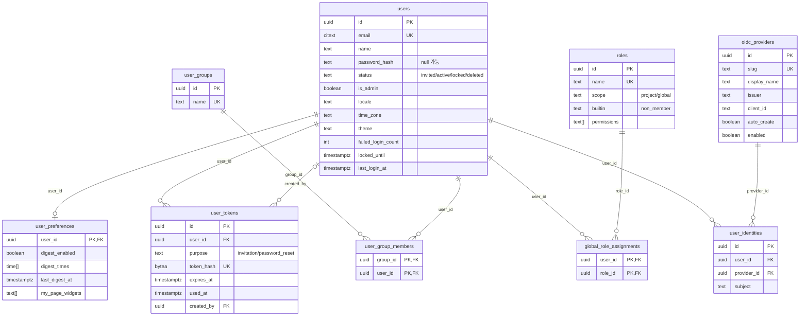
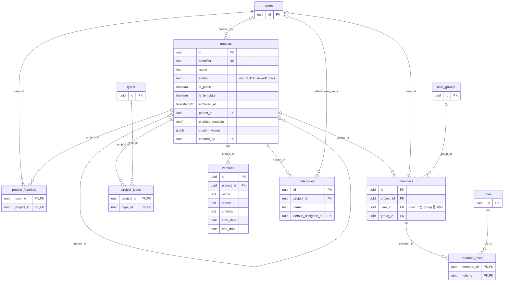
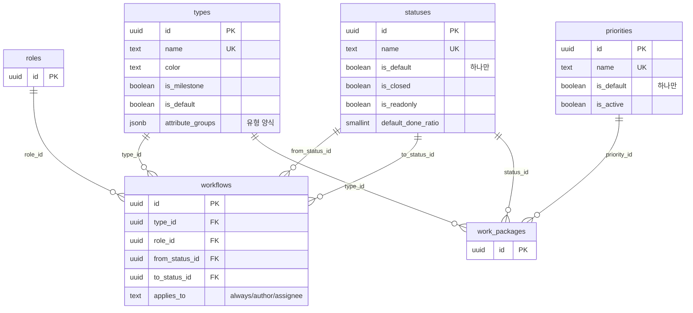
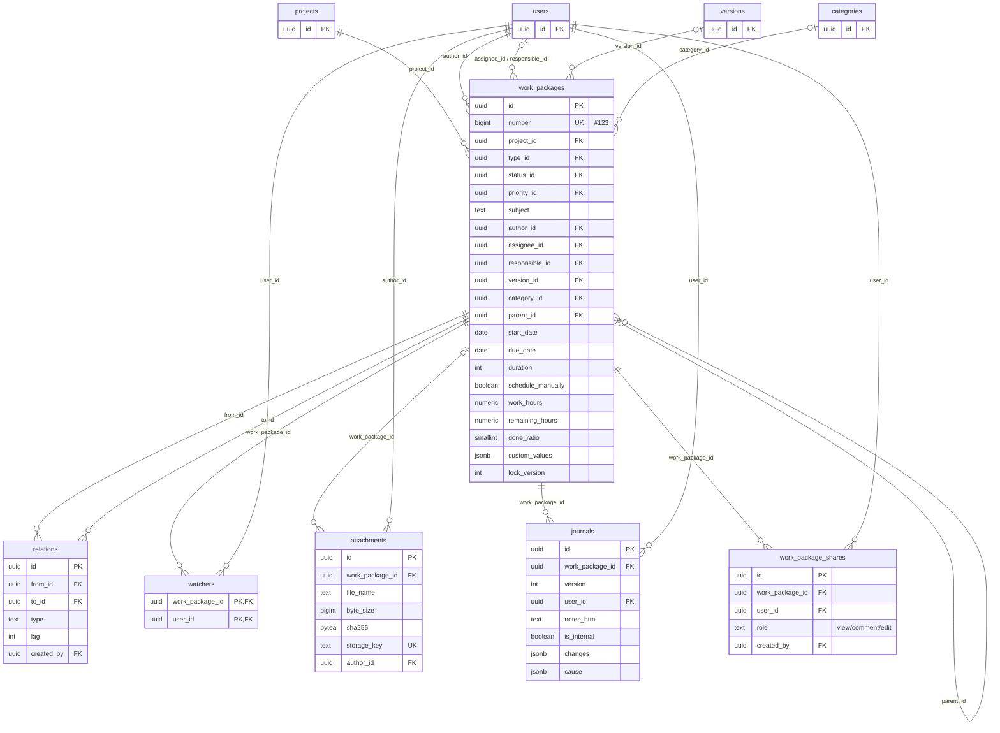
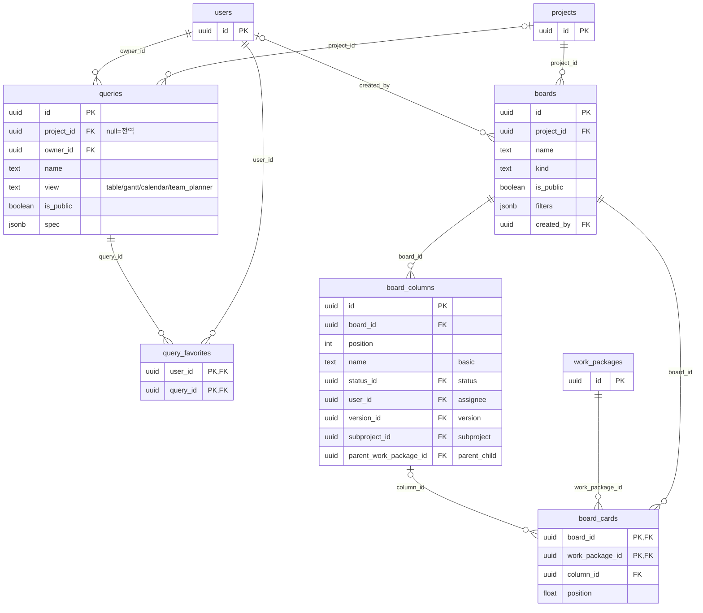
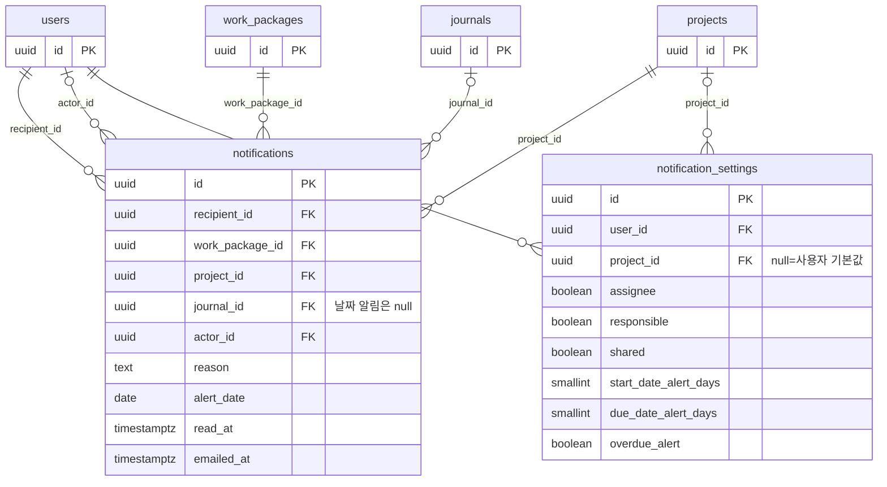
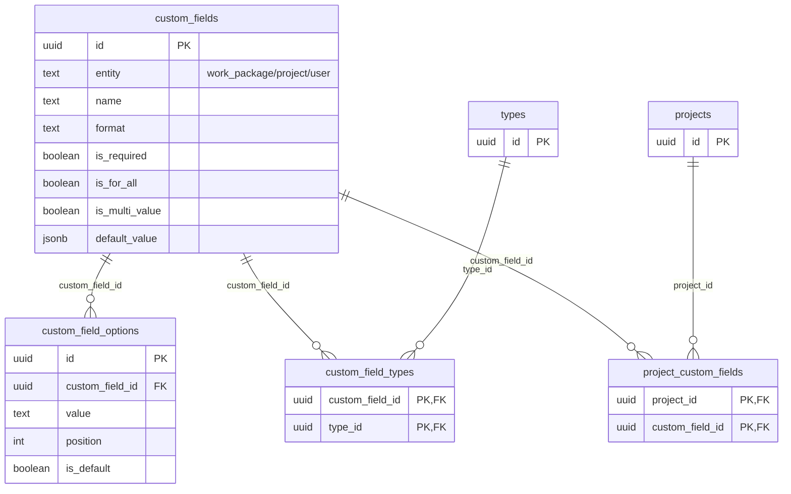
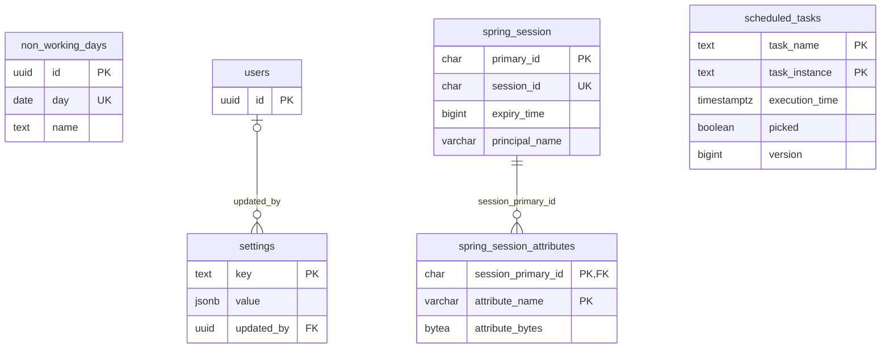

# openPMS 데이터베이스 설계서

| 항목 | 내용 |
| --- | --- |
| 문서명 | openPMS 데이터베이스 설계서 |
| 시스템명 | openPMS (사내 프로젝트 관리 시스템) |
| 문서 번호 | 05 |
| 버전 | 1.2 |
| 작성일 | 2026-10-10 |
| 작성자 | openPMS 개발팀 |

## 개정 이력

| 버전 | 일자 | 작성자 | 내용 |
| --- | --- | --- | --- |
| 1.0 | 2026-10-10 | openPMS 개발팀 | 최초 작성 (Flyway V1~V10 기준) |
| 1.1 | 2026-10-11 | openPMS 개발팀 | 목록 그룹화·합계, 보드 개선, 날짜·시간 형식 설정 반영 |
| 1.2 | 2026-10-11 | openPMS 개발팀 | 문서 점검 후속(384a2f9, 31e39bd) 반영. 스키마 변경 없음. `users.locked_until`·`password_hash`, `user_tokens.purpose`(비밀번호 만들기), `statuses.excluded_from_totals`, 설정 키 `progress.totals`·`calendar.*`의 쓰임 설명 갱신 |

## 목차

1. [개요](#1-개요)
   - 1.1 목적과 범위
   - 1.2 DBMS와 확장 모듈
   - 1.3 명명 규칙
   - 1.4 공통 컬럼과 updated_at 트리거
   - 1.5 updated_at 유지 장치(openpms.keep_updated_at)
   - 1.6 마이그레이션 전략
   - 1.7 접근 제어와 무결성 원칙
2. [ERD](#2-erd)
3. [테이블 목록](#3-테이블-목록)
4. [테이블 정의서](#4-테이블-정의서)
5. [시퀀스·함수·트리거](#5-시퀀스함수트리거)
6. [코드 값 정의](#6-코드-값-정의)
7. [설정 키](#7-설정-키)
8. [백업·보존](#8-백업보존)
9. [부록: 아키텍처 문서와 최종 스키마의 차이](#9-부록-아키텍처-문서와-최종-스키마의-차이)

---

## 1. 개요

### 1.1 목적과 범위

이 문서는 openPMS의 운영 데이터베이스 구조를 정의한다. openPMS는 OpenProject 17.9.1의 작업 패키지·계획 기능을 사내용으로 클린룸 재구현한 시스템이며, 백엔드는 Spring Boot 4 + jOOQ + PostgreSQL 17 + Flyway로 구성한다.

- **기준 자료(정본)**: `backend/src/main/resources/db/migration/V1__init.sql` ~ `V10__oidc.sql`. V1 위에 V2~V10의 변경을 순서대로 적용한 **최종 스키마**를 기술한다.
- **v1.1 기준**: 커밋 3f2161d. 목록 그룹화·합계(2bb76a8), 보드 개선(88153b7), 날짜·시간 형식(84f6e6c, 3f2161d)은 **마이그레이션을 추가하지 않았다**. 기존 컬럼 `queries.spec`(groupBy·sums), `boards.filters`, `board_cards.column_id`와 `settings` 키를 쓴다.
- **v1.2 기준**: 커밋 31e39bd. 로그인 실패 잠금 표시, SSO 사용자의 비밀번호 만들기, 표시 형식 다시 읽기, 목록 합계 완료 %(384a2f9, 31e39bd)도 **마이그레이션을 추가하지 않았다**. 기존 컬럼 `users.locked_until`·`users.password_hash`, `user_tokens`(purpose `password_reset`), `statuses.excluded_from_totals`, `user_identities`와 `settings` 키를 쓴다.
- **교차 확인**: jOOQ 생성 코드 `backend/src/main/generated/com/openpms/db/tables/` (39개 테이블 클래스, 컬럼 구성 일치 확인).
- **설계 의도 참고**: `replica/architecture.md` §2 스키마. 최종 스키마와 다른 점은 [9장](#9-부록-아키텍처-문서와-최종-스키마의-차이)에 정리했다.
- **범위**: 애플리케이션 테이블 39개, 라이브러리 테이블 3개(Spring Session JDBC 2개, db-scheduler 1개). Flyway가 자동으로 만드는 `flyway_schema_history`는 범위 밖이다.
- 개발용 데이터(`db/dev/V1000__dev_data.sql`, `V1001__dev_custom_fields.sql`)는 존재만 언급하며 내용은 다루지 않는다.

### 1.2 DBMS와 확장 모듈

| 항목 | 내용 |
| --- | --- |
| DBMS | PostgreSQL 17 (Docker 컨테이너 `db`, 데이터는 볼륨) |
| 스키마 | `public` 단일 스키마 |
| 문자 인코딩 | UTF-8 (한국어 데이터) |
| 시간 기준 | 순간 값은 모두 `timestamptz`(UTC 저장), 달력 날짜(시작·완료·휴무일)는 `date` |
| 확장 `pg_trgm` | 한국어 부분 일치 검색(ILIKE)용 트라이그램 GIN 인덱스. 사용자 이름, 프로젝트 이름, 작업 제목·설명, 첨부 파일명, 코멘트 본문에 사용 (V1) |
| 확장 `citext` | 대소문자를 구분하지 않는 이메일(`users.email`) (V1) |
| 확장 `pgcrypto` | **개발 프로필 전용**. `db/dev/V1000__dev_data.sql`이 개발 계정 비밀번호 해시 생성에 사용하며 운영 마이그레이션에는 없다 |
| 기본 키 생성 | `gen_random_uuid()` (PostgreSQL 13+ 내장). PostgreSQL 18 전환 시 시간순 `uuidv7()` 검토(V1 주석) |
| PostgreSQL 15+ 기능 | `unique nulls not distinct` (`notification_settings`) |

### 1.3 명명 규칙

| 대상 | 규칙 | 예 |
| --- | --- | --- |
| 테이블 | 영문 소문자 snake_case, 복수형 | `work_packages`, `user_tokens` |
| 조인 테이블 | `<주체>_<대상>` 복수형, 복합 PK | `member_roles`, `project_types` |
| 컬럼 | snake_case. FK는 `<참조 대상>_id` | `project_id`, `assignee_id` |
| 불리언 | `is_` 접두어 또는 동작 이름 | `is_closed`, `schedule_manually`, `enabled` |
| 시각 | `_at` 접미어 (`timestamptz`) | `read_at`, `expires_at` |
| 날짜 | `_date` 또는 `day` (`date`) | `start_date`, `due_date` |
| 시간량 | `_hours` (numeric) | `work_hours` |
| PK 제약 | `<테이블>_pkey` (PostgreSQL 기본) | `users_pkey` |
| UNIQUE 제약 | `<테이블>_<컬럼>_key` 또는 의미 이름 | `users_email_key`, `workflows_transition_key` |
| CHECK 제약 | 의미 이름(명시) 또는 `<테이블>_<컬럼>_check`(자동) | `wp_dates_ordered`, `users_status_check` |
| 인덱스 | `<테이블 약칭>_<컬럼>_idx`, 트라이그램은 `_trgm`, 부분/유일은 의미 이름 | `wp_assignee_idx`, `users_name_trgm`, `statuses_one_default` |
| 트리거 | `<테이블>_set_updated_at` | `users_set_updated_at` (예외: V10 `oidc_providers_updated_at`) |
| 설정 키 | 점으로 구분한 소문자 `영역.이름` (`^[a-z][a-z0-9_.]*$`) | `auth.lockout_minutes` |

### 1.4 공통 컬럼과 updated_at 트리거

V1 머리말의 규칙을 따른다.

| 컬럼 | 타입 | 기본값 | 적용 대상 |
| --- | --- | --- | --- |
| `id` | uuid | `gen_random_uuid()` | 모든 엔터티 테이블의 PK |
| `created_at` | timestamptz NOT NULL | `now()` | 모든 애플리케이션 테이블 |
| `updated_at` | timestamptz NOT NULL | `now()` | 엔터티 테이블과 1:1 테이블(`user_preferences`). 조인 테이블에는 없음 |

- 조인 테이블(`user_group_members`, `global_role_assignments`, `project_favorites`, `member_roles`, `project_types`, `custom_field_types`, `project_custom_fields`, `watchers`, `query_favorites`)은 복합 PK와 `created_at`만 둔다. `user_identities`(V10)도 `updated_at`이 없다.
- `board_cards`는 복합 PK이지만 순서(`position`)가 바뀌므로 `updated_at`이 있다.
- **`set_updated_at()` 트리거 함수**: `BEFORE UPDATE ... FOR EACH ROW`로 `new.updated_at := now()`를 넣는다. V1 마지막의 `DO` 블록이 `updated_at` 컬럼을 가진 모든 기본 테이블에 `<테이블>_set_updated_at` 트리거를 일괄 생성한다(27개). 이후 테이블은 마이그레이션에서 개별 생성한다: V6 `work_package_shares_set_updated_at`, V10 `oidc_providers_updated_at`. **최종 트리거 수는 29개**.
- 앱은 `updated_at`을 직접 쓰지 않는다. 낙관적 잠금은 `updated_at`이 아니라 `work_packages.lock_version`으로 한다.

### 1.5 updated_at 유지 장치(openpms.keep_updated_at)

V5(`V5__keep_updated_at.sql`)가 `set_updated_at()`을 다음과 같이 교체했다.

```sql
if coalesce(current_setting('openpms.keep_updated_at', true), '') = 'on' then
  return new;            -- updated_at을 그대로 둔다
end if;
new.updated_at := now();
```

- 목적: 관리 작업이 작업 패키지의 "최근 수정" 시각을 바꾸지 않게 한다.
- 사용법: 트랜잭션 안에서 `set local openpms.keep_updated_at = 'on'`. `set local`이므로 트랜잭션이 끝나면 자동으로 해제된다.
- 현재 사용처
  - `CustomFieldController` — 사용자 정의 필드 삭제, 선택지 정리 시 `work_packages.custom_values` 일괄 갱신
  - `AdminController` — 진행률 설정(`PUT /api/v1/admin/settings/progress`) 변경 후 전체 작업의 진행률 재계산

### 1.6 마이그레이션 전략

| 버전 | 파일 | 내용 |
| --- | --- | --- |
| V1 | `V1__init.sql` | 확장(pg_trgm, citext), `set_updated_at()`, 애플리케이션 테이블 36개, 시퀀스 `work_package_number_seq`, 인덱스, updated_at 트리거 27개 |
| V2 | `V2__libraries.sql` | 라이브러리 테이블: `spring_session`, `spring_session_attributes`(Spring Session JDBC), `scheduled_tasks`(db-scheduler) |
| V3 | `V3__seed.sql` | 기본 데이터: 역할 5, 유형 5, 상태 6, 우선순위 4, 기본 워크플로(관리자·멤버, 300행), 전역 설정 18개 키. 관리자 계정은 만들지 않음 |
| V4 | `V4__jobs.sql` | `user_preferences.last_digest_at` 추가, `notification_settings` 날짜 알림 기본값(1일·1일·기한 지남 켬) |
| V5 | `V5__keep_updated_at.sql` | `set_updated_at()`에 `openpms.keep_updated_at` 예외 추가 |
| V6 | `V6__work_package_shares.sql` | `work_package_shares` 테이블, 권한 `wp.share`를 '프로젝트 관리자' 역할에 추가 |
| V7 | `V7__overdue_alert_default.sql` | `notification_settings.overdue_alert` 기본값 false로 변경, 기존 행 false로 갱신 |
| V8 | `V8__my_page_widgets.sql` | `user_preferences.my_page_widgets` 추가 (기본 `{assigned,created}`) |
| V9 | `V9__type_forms_default.sql` | `types.attribute_groups`를 유형 양식으로 재정의, 모든 유형을 `'[]'`(기본 양식)로 초기화 |
| V10 | `V10__oidc.sql` | 사내 SSO: `oidc_providers`, `user_identities` |

- **적용 방식**: 앱 시작 시 Flyway가 `classpath:db/migration`의 미적용 버전을 자동 적용한다. 실패하면 앱이 기동하지 않는다(`replica/deploy.md` 업그레이드 절).
- **규칙**: 적용된 마이그레이션은 수정하지 않고 새 버전(V11…)을 추가한다. 시드 데이터 변경도 마이그레이션으로 한다(V6, V7, V9 사례).
- **개발 데이터**: `db/dev/V1000__dev_data.sql`(가상 팀·프로젝트·작업, `scripts/gen_dev_data.py` 생성), `V1001__dev_custom_fields.sql`(개발용 사용자 정의 필드). `dev` 프로필에서만 `spring.flyway.locations: classpath:db/migration,classpath:db/dev`로 포함되며, `out-of-order: true`를 켜서 V1000 적용 이후에 추가된 V4… 스키마 마이그레이션도 기존 개발 DB에 적용되게 한다. 운영 프로필에는 포함되지 않는다.
- **jOOQ 코드 생성**: 스키마에서 `com.openpms.db` 패키지를 생성한다. `flyway_schema_history`, `spring_session*`, `scheduled_tasks`, 확장 함수는 생성 대상에서 제외한다(`backend/build.gradle.kts`).

### 1.7 접근 제어와 무결성 원칙

- **RLS 미사용**: 앱이 DB 계정 하나로 접속하므로 권한은 데이터 계층(`PermissionService`, 목록 쿼리의 가시 프로젝트 조건)에서 검사한다.
- **상태성 컬럼은 CHECK 제약**으로 허용 값을 제한한다([6장](#6-코드-값-정의)).
- **ON DELETE 규칙은 FK마다 명시**한다. 원칙: 소유 관계는 `CASCADE`, 선택적 참조(작성자 표시 등)는 `SET NULL`, 이력 보존이 필요한 참조(작성자·저널 사용자·사용 중인 유형·상태·우선순위·역할)는 `RESTRICT`.
- **사용자는 삭제하지 않고 익명화**한다(`status='deleted'`, 비밀번호 해시 제거). 그래서 `work_packages.author_id`, `journals.user_id`, `attachments.author_id`는 `RESTRICT`이다.
- 모든 FK 컬럼에 인덱스가 있다(아키텍처 검증 시 "인덱스 없는 FK 0개" 확인, V6·V10 추가분도 인덱스 또는 복합 UNIQUE 선두 컬럼으로 커버).

---

## 2. ERD

표기: `PK` 기본 키, `FK` 외래 키, `UK` 유일. 도메인 밖 테이블은 연결 확인용으로 키 컬럼만 표시한다. 관계선의 라벨은 FK 컬럼명이다.

### 2.1 사용자·인증



### 2.2 프로젝트·멤버



### 2.3 작업 설정(유형·상태·워크플로·우선순위)



### 2.4 작업 패키지·관계·저널



### 2.5 저장된 보기·보드



`board_columns`는 `statuses`, `users`, `versions`, `projects`(subproject), `work_packages`(parent)도 참조한다(모두 CASCADE). 그림을 단순하게 하려고 선은 생략했다.

### 2.6 알림



### 2.7 사용자 정의 필드



필드 값은 별도 테이블이 아니라 `work_packages.custom_values`, `projects.custom_values`(jsonb, 키 = `custom_field_id`)에 저장한다. 값과 선택지·사용자 참조 사이의 무결성은 앱이 검증한다.

### 2.8 설정·달력·작업(라이브러리)



---

## 3. 테이블 목록

| No | 도메인 | 테이블 | 한글명 | 용도 | 도입 |
| --- | --- | --- | --- | --- | --- |
| 1 | 사용자·인증 | users | 사용자 | 계정, 상태, 로그인 잠금, 개인 표시 설정 | V1 |
| 2 | 사용자·인증 | user_preferences | 사용자 환경설정 | 사용자 1:1 환경설정(코멘트 순서, 요약 메일, 내 페이지 위젯) | V1, V4, V8 |
| 3 | 사용자·인증 | user_tokens | 사용자 토큰 | 초대·비밀번호 재설정 토큰(SHA-256 해시만 저장) | V1 |
| 4 | 사용자·인증 | user_groups | 그룹 | 사용자 그룹 | V1 |
| 5 | 사용자·인증 | user_group_members | 그룹 구성원 | 그룹-사용자 N:M | V1 |
| 6 | 사용자·인증 | roles | 역할 | 프로젝트·전역 역할과 권한 키 목록 | V1 |
| 7 | 사용자·인증 | global_role_assignments | 전역 역할 할당 | 사용자-전역 역할 N:M | V1 |
| 8 | 사용자·인증 | oidc_providers | SSO 공급자 | 사내 OpenID Connect 공급자 등록 정보 | V10 |
| 9 | 사용자·인증 | user_identities | SSO 연결 | 공급자 계정(sub)과 openPMS 사용자 연결 | V10 |
| 10 | 프로젝트·멤버 | projects | 프로젝트 | 프로젝트, 계층, 모듈, 프로젝트 특성 값 | V1 |
| 11 | 프로젝트·멤버 | project_favorites | 프로젝트 즐겨찾기 | 사용자별 즐겨찾기 프로젝트 | V1 |
| 12 | 프로젝트·멤버 | members | 멤버 | 프로젝트 멤버(사용자 또는 그룹) | V1 |
| 13 | 프로젝트·멤버 | member_roles | 멤버 역할 | 멤버-역할 N:M | V1 |
| 14 | 작업 설정 | types | 유형 | 작업 유형(작업·마일스톤 등)과 유형 양식 | V1, V9 |
| 15 | 작업 설정 | project_types | 프로젝트 유형 | 프로젝트별 활성 유형 | V1 |
| 16 | 작업 설정 | statuses | 상태 | 작업 상태 | V1 |
| 17 | 작업 설정 | workflows | 워크플로 | 유형·역할별 허용 상태 전환 | V1 |
| 18 | 작업 설정 | priorities | 우선순위 | 작업 우선순위 | V1 |
| 19 | 작업 설정 | versions | 버전 | 프로젝트 버전(릴리스·스프린트), 공유 범위 | V1 |
| 20 | 작업 설정 | categories | 카테고리 | 프로젝트별 카테고리와 기본 담당자 | V1 |
| 21 | 사용자 정의 필드 | custom_fields | 사용자 정의 필드 | 작업·프로젝트·사용자용 추가 필드 정의 | V1 |
| 22 | 사용자 정의 필드 | custom_field_options | 필드 선택지 | 목록형 필드의 선택지 | V1 |
| 23 | 사용자 정의 필드 | custom_field_types | 필드 적용 유형 | 작업 필드를 쓰는 유형 | V1 |
| 24 | 사용자 정의 필드 | project_custom_fields | 프로젝트 필드 활성 | is_for_all이 아닌 필드를 켠 프로젝트 | V1 |
| 25 | 작업 패키지 | work_packages | 작업 패키지 | 작업 본체: 일정, 진행률, 계층, 사용자 정의 값 | V1 |
| 26 | 작업 패키지 | relations | 관계 | 작업 간 관계(정방향 6종) | V1 |
| 27 | 작업 패키지 | watchers | 주시자 | 작업-주시 사용자 N:M | V1 |
| 28 | 작업 패키지 | attachments | 첨부 파일 | 첨부 메타데이터(파일 본문은 파일 저장소) | V1 |
| 29 | 작업 패키지 | journals | 활동 저널 | 생성·변경·코멘트 이력 | V1 |
| 30 | 작업 패키지 | work_package_shares | 작업 공유 | 멤버가 아닌 사용자에게 작업 단위 권한 부여 | V6 |
| 31 | 보기·보드 | queries | 저장된 보기 | 목록·Gantt·캘린더·팀 플래너 보기 설정 | V1 |
| 32 | 보기·보드 | query_favorites | 보기 즐겨찾기 | 사용자별 즐겨찾기 보기 | V1 |
| 33 | 보기·보드 | boards | 보드 | 칸반 보드 | V1 |
| 34 | 보기·보드 | board_columns | 보드 컬럼 | 보드 컬럼(종류별 값 하나) | V1 |
| 35 | 보기·보드 | board_cards | 보드 카드 | 보드 내 카드 순서와 소속 컬럼 | V1 |
| 36 | 알림 | notifications | 알림 | 사용자 알림함, 메일 발송 상태 | V1 |
| 37 | 알림 | notification_settings | 알림 설정 | 사용자 기본·프로젝트별 알림 설정 | V1, V4, V7 |
| 38 | 달력·설정 | non_working_days | 휴무일 | 인스턴스 휴무일(공휴일 등) | V1 |
| 39 | 달력·설정 | settings | 전역 설정 | 키-값(jsonb) 인스턴스 설정 | V1 |
| 40 | 라이브러리 | spring_session | 세션 | Spring Session JDBC 세션 | V2 |
| 41 | 라이브러리 | spring_session_attributes | 세션 속성 | 세션 속성(직렬화 값) | V2 |
| 42 | 라이브러리 | scheduled_tasks | 예약 작업 | db-scheduler 작업 실행 상태 | V2 |

합계: 애플리케이션 테이블 39개 + 라이브러리 테이블 3개 = **42개** (Flyway의 `flyway_schema_history` 제외).

---

## 4. 테이블 정의서

표기: NULL 여부 `N` = NOT NULL, `Y` = NULL 허용. 기본값 `-` = 없음. 설명의 따옴표 없는 문장은 마이그레이션 SQL 주석을 옮긴 것이고, 주석이 없는 컬럼은 용도를 보충해 적었다.

### 4.1 사용자·인증

#### 4.1.1 users (사용자)

| 컬럼명 | 타입 | NULL | 기본값 | 제약 | 설명 |
| --- | --- | --- | --- | --- | --- |
| id | uuid | N | gen_random_uuid() | PK | 사용자 ID |
| email | citext | N | - | UNIQUE (users_email_key) | 로그인 이메일, 대소문자 무시. 익명화 시 `deleted+<id>@invalid` |
| name | text | N | - | CHECK length 1~100 | 표시 이름. 한국어 이름은 성/이름 분리 없이 한 칸 |
| password_hash | text | Y | - | CHECK users_deleted_has_no_password | 비밀번호 해시(DelegatingPasswordEncoder, bcrypt). null: 초대 수락 전, 또는 이후 SSO 전용 계정. null이면 `GET /api/v1/auth/me`의 `hasPassword`가 false이고, 본인이 비밀번호 만들기 링크(`POST /api/v1/me/password/setup`)로 정할 수 있다(384a2f9) |
| status | text | N | 'active' | CHECK in (invited, active, locked, deleted) | 계정 상태 |
| is_admin | boolean | N | false | | 시스템 관리자 여부 |
| locale | text | N | 'ko' | CHECK in (ko, en) | 화면 언어 |
| time_zone | text | N | 'Asia/Seoul' | | 사용자 시간대(IANA) |
| theme | text | N | 'system' | CHECK in (system, light, dark) | 화면 테마 |
| failed_login_count | int | N | 0 | CHECK >= 0 | 연속 로그인 실패 횟수 |
| locked_until | timestamptz | Y | - | | 로그인 실패 누적 시 일시 잠금(`status`는 그대로). 미래이고 `status`가 active이면 관리 · 사용자 응답 `AdminUser.lockedUntil`로 보이고 `status=locked` 필터에도 포함된다. 관리자가 `status=active`로 바꾸면 null, `failed_login_count`는 0(384a2f9) |
| last_login_at | timestamptz | Y | - | | 마지막 로그인 시각 |
| created_at | timestamptz | N | now() | | 생성 시각 |
| updated_at | timestamptz | N | now() | | 수정 시각(트리거) |

- 테이블 CHECK: `users_deleted_has_no_password` — `status <> 'deleted' or password_hash is null` (삭제 상태면 비밀번호 해시가 없어야 함)
- 인덱스: `users_pkey`(id), `users_email_key` UNIQUE(email), `users_status_idx`(status), `users_name_trgm` GIN(name gin_trgm_ops) — 멘션·담당자 자동완성
- FK: 없음

#### 4.1.2 user_preferences (사용자 환경설정)

| 컬럼명 | 타입 | NULL | 기본값 | 제약 | 설명 |
| --- | --- | --- | --- | --- | --- |
| user_id | uuid | N | - | PK, FK → users.id | 사용자(1:1) |
| comments_newest_first | boolean | N | false | | 활동 탭 최신 코멘트 먼저 |
| warn_on_unsaved | boolean | N | true | | 저장하지 않고 떠날 때 경고 |
| keyboard_shortcuts | boolean | N | true | | 키보드 단축키 사용 |
| digest_enabled | boolean | N | true | | 요약 메일 사용 |
| digest_times | time[] | N | '{08:00}' | CHECK user_preferences_digest_times_count | 요약 메일 시각. 사용자 시간대 기준 |
| immediate_on_mention | boolean | N | true | | 멘션 시 즉시 메일 |
| reminders_paused_until | date | Y | - | | 알림 메일 일시 중지 종료일 |
| created_at | timestamptz | N | now() | | 생성 시각 |
| updated_at | timestamptz | N | now() | | 수정 시각(트리거) |
| last_digest_at | timestamptz | Y | - | | (V4) 요약 메일을 마지막으로 처리한 시각. 요약 시각이 지났고 이 값이 그 시각보다 이르면 보낸다(하루 1회 보장) |
| my_page_widgets | text[] | N | '{assigned,created}' | | (V8) 내 페이지(S21) 위젯: 보여 줄 위젯과 순서. 알려진 이름만 허용(AccountController가 검사) |

- 테이블 CHECK: `user_preferences_digest_times_count` — `cardinality(digest_times) between 1 and 4`
- 인덱스: `user_preferences_pkey`(user_id)
- FK 삭제 규칙: user_id → users **CASCADE**

#### 4.1.3 user_tokens (사용자 토큰)

초대·비밀번호 재설정 토큰. 비밀번호 만들기 링크(SSO 전용 계정, 384a2f9)도 재설정 토큰(`password_reset`)을 쓴다. 원문 토큰은 메일에만 있고 DB에는 SHA-256 해시만 저장한다.

| 컬럼명 | 타입 | NULL | 기본값 | 제약 | 설명 |
| --- | --- | --- | --- | --- | --- |
| id | uuid | N | gen_random_uuid() | PK | 토큰 ID |
| user_id | uuid | N | - | FK → users.id | 대상 사용자 |
| purpose | text | N | - | CHECK in (invitation, password_reset) | 토큰 용도 |
| token_hash | bytea | N | - | UNIQUE | 토큰 원문의 SHA-256 해시 |
| expires_at | timestamptz | N | - | | 만료 시각(설정 `auth.invitation_ttl_hours`, `auth.password_reset_ttl_minutes`) |
| used_at | timestamptz | Y | - | | 사용 시각(일회용) |
| created_by | uuid | Y | - | FK → users.id | 발급한 관리자(재설정 요청은 null) |
| created_at | timestamptz | N | now() | | 생성 시각 |
| updated_at | timestamptz | N | now() | | 수정 시각(트리거) |

- 인덱스: `user_tokens_pkey`(id), `user_tokens_token_hash_key` UNIQUE(token_hash), `user_tokens_user_idx`(user_id), `user_tokens_created_by_idx`(created_by), `user_tokens_expires_idx`(expires_at)
- FK 삭제 규칙: user_id → users **CASCADE**, created_by → users **SET NULL**

#### 4.1.4 user_groups (그룹)

| 컬럼명 | 타입 | NULL | 기본값 | 제약 | 설명 |
| --- | --- | --- | --- | --- | --- |
| id | uuid | N | gen_random_uuid() | PK | 그룹 ID |
| name | text | N | - | UNIQUE, CHECK length 1~100 | 그룹 이름 |
| created_at | timestamptz | N | now() | | 생성 시각 |
| updated_at | timestamptz | N | now() | | 수정 시각(트리거) |

- 인덱스: `user_groups_pkey`(id), `user_groups_name_key` UNIQUE(name)
- FK: 없음

#### 4.1.5 user_group_members (그룹 구성원)

| 컬럼명 | 타입 | NULL | 기본값 | 제약 | 설명 |
| --- | --- | --- | --- | --- | --- |
| group_id | uuid | N | - | PK, FK → user_groups.id | 그룹 |
| user_id | uuid | N | - | PK, FK → users.id | 사용자 |
| created_at | timestamptz | N | now() | | 가입 시각 |

- 인덱스: `user_group_members_pkey`(group_id, user_id), `user_group_members_user_idx`(user_id)
- FK 삭제 규칙: group_id → user_groups **CASCADE**, user_id → users **CASCADE**

#### 4.1.6 roles (역할)

permissions는 앱이 정의한 권한 키 목록이다([6.4](#64-권한-키-rolespermissions)).

| 컬럼명 | 타입 | NULL | 기본값 | 제약 | 설명 |
| --- | --- | --- | --- | --- | --- |
| id | uuid | N | gen_random_uuid() | PK | 역할 ID (시드 역할은 고정 uuid5) |
| name | text | N | - | UNIQUE, CHECK length 1~100 | 역할 이름 |
| scope | text | N | - | CHECK in (project, global) | 적용 범위 |
| builtin | text | Y | - | CHECK in (non_member), CHECK roles_builtin_is_project | 공개 프로젝트를 멤버 아닌 사용자가 볼 때 쓰는 역할 |
| permissions | text[] | N | '{}' | | 권한 키 목록 |
| position | int | N | 0 | | 표시 순서 |
| created_at | timestamptz | N | now() | | 생성 시각 |
| updated_at | timestamptz | N | now() | | 수정 시각(트리거) |

- 테이블 CHECK: `roles_builtin_is_project` — `builtin is null or scope = 'project'`
- 인덱스: `roles_pkey`(id), `roles_name_key` UNIQUE(name), `roles_one_per_builtin` UNIQUE(builtin) WHERE builtin is not null
- FK: 없음

#### 4.1.7 global_role_assignments (전역 역할 할당)

| 컬럼명 | 타입 | NULL | 기본값 | 제약 | 설명 |
| --- | --- | --- | --- | --- | --- |
| user_id | uuid | N | - | PK, FK → users.id | 사용자 |
| role_id | uuid | N | - | PK, FK → roles.id | 전역 역할 |
| created_at | timestamptz | N | now() | | 할당 시각 |

- 인덱스: `global_role_assignments_pkey`(user_id, role_id), `global_role_assignments_role_idx`(role_id)
- FK 삭제 규칙: user_id → users **CASCADE**, role_id → roles **CASCADE**
- 참고: `scope='global'` 역할만 넣는 것은 앱이 검사한다(DB 제약 없음).

#### 4.1.8 oidc_providers (SSO 공급자) — V10

사내 SSO(OpenID Connect). 관리자가 공급자를 등록하고, 사람은 공급자 계정(sub)으로 openPMS 사용자에 연결된다.

| 컬럼명 | 타입 | NULL | 기본값 | 제약 | 설명 |
| --- | --- | --- | --- | --- | --- |
| id | uuid | N | gen_random_uuid() | PK | 공급자 ID |
| slug | text | N | - | UNIQUE, CHECK `^[a-z0-9][a-z0-9-]{0,39}$` | 콜백 주소에 들어가는 식별자 |
| display_name | text | N | - | CHECK length 1~60 | 로그인 버튼 이름 |
| issuer | text | N | - | | 발견 문서(.well-known/openid-configuration)의 기준 주소 |
| client_id | text | N | - | | 클라이언트 ID |
| client_secret | text | N | - | | 클라이언트 시크릿. API로는 내보내지 않는다. **평문 저장**(8.3 참고) |
| scopes | text | N | 'openid email profile' | | 요청 범위(공백 구분) |
| claim_email | text | N | 'email' | | 이메일 클레임 이름 |
| claim_name | text | N | 'name' | | 이름 클레임 이름 |
| auto_create | boolean | N | false | | 없는 사람은 처음 로그인할 때 만든다 |
| enabled | boolean | N | true | | 사용 여부 |
| position | int | N | 0 | | 로그인 버튼 순서 |
| created_at | timestamptz | N | now() | | 생성 시각 |
| updated_at | timestamptz | N | now() | | 수정 시각(트리거 `oidc_providers_updated_at`) |

- 인덱스: `oidc_providers_pkey`(id), `oidc_providers_slug_key` UNIQUE(slug)
- FK: 없음

#### 4.1.9 user_identities (SSO 연결) — V10

| 컬럼명 | 타입 | NULL | 기본값 | 제약 | 설명 |
| --- | --- | --- | --- | --- | --- |
| id | uuid | N | gen_random_uuid() | PK | 연결 ID |
| user_id | uuid | N | - | FK → users.id, UNIQUE(provider_id, user_id) | openPMS 사용자 |
| provider_id | uuid | N | - | FK → oidc_providers.id, UNIQUE(provider_id, subject) | 공급자. 공급자를 지우면 연결만 사라진다 |
| subject | text | N | - | UNIQUE(provider_id, subject) | IdP의 사용자 식별자(sub) |
| last_login_at | timestamptz | Y | - | | 이 연결로 마지막 로그인한 시각 |
| created_at | timestamptz | N | now() | | 연결 시각 |

- 인덱스: `user_identities_pkey`(id), `user_identities_provider_id_subject_key` UNIQUE(provider_id, subject), `user_identities_provider_id_user_id_key` UNIQUE(provider_id, user_id), `user_identities_user_idx`(user_id)
- FK 삭제 규칙: user_id → users **CASCADE**, provider_id → oidc_providers **CASCADE**
- `updated_at` 컬럼과 트리거 없음

### 4.2 프로젝트·멤버

#### 4.2.1 projects (프로젝트)

| 컬럼명 | 타입 | NULL | 기본값 | 제약 | 설명 |
| --- | --- | --- | --- | --- | --- |
| id | uuid | N | gen_random_uuid() | PK | 프로젝트 ID |
| identifier | text | N | - | UNIQUE, CHECK `^[a-z][a-z0-9-]{0,99}$` | URL용 slug |
| name | text | N | - | CHECK length 1~255 | 프로젝트 이름 |
| description_html | text | N | '' | | 서버에서 sanitize한 HTML |
| description_text | text | N | '' | | 검색용 평문 |
| status | text | Y | - | CHECK in (on_track, at_risk, off_track) | 프로젝트 상태(null = 미설정) |
| status_explanation | text | N | '' | | 상태 설명 |
| is_public | boolean | N | false | | 공개 프로젝트(비멤버 역할로 열람) |
| is_template | boolean | N | false | | 템플릿 프로젝트 |
| archived_at | timestamptz | Y | - | | 보관 시각(null = 활성) |
| parent_id | uuid | Y | - | FK → projects.id, CHECK projects_not_own_parent | 상위 프로젝트. 하위 프로젝트가 있으면 삭제 불가 |
| enabled_modules | text[] | N | '{work_packages,gantt,boards}' | CHECK projects_known_modules | 활성 모듈 |
| custom_values | jsonb | N | '{}' | CHECK projects_custom_values_object | 프로젝트 특성: {"<custom_field_id>": 값} |
| created_by | uuid | Y | - | FK → users.id | 생성자 |
| created_at | timestamptz | N | now() | | 생성 시각 |
| updated_at | timestamptz | N | now() | | 수정 시각(트리거) |

- 테이블 CHECK: `projects_not_own_parent` (`parent_id <> id`), `projects_known_modules` (`enabled_modules <@ {work_packages, gantt, boards, calendar, team_planner}`), `projects_custom_values_object` (`jsonb_typeof(custom_values) = 'object'`)
- 인덱스: `projects_pkey`(id), `projects_identifier_key` UNIQUE(identifier), `projects_parent_idx`(parent_id), `projects_created_by_idx`(created_by), `projects_active_idx`(name) WHERE archived_at is null, `projects_name_trgm` GIN(name gin_trgm_ops)
- FK 삭제 규칙: parent_id → projects **RESTRICT**, created_by → users **SET NULL**

#### 4.2.2 project_favorites (프로젝트 즐겨찾기)

| 컬럼명 | 타입 | NULL | 기본값 | 제약 | 설명 |
| --- | --- | --- | --- | --- | --- |
| user_id | uuid | N | - | PK, FK → users.id | 사용자 |
| project_id | uuid | N | - | PK, FK → projects.id | 프로젝트 |
| created_at | timestamptz | N | now() | | 등록 시각 |

- 인덱스: `project_favorites_pkey`(user_id, project_id), `project_favorites_project_idx`(project_id)
- FK 삭제 규칙: user_id → users **CASCADE**, project_id → projects **CASCADE**

#### 4.2.3 members (멤버)

멤버는 사용자 또는 그룹이다. 그룹 멤버십의 사용자 권한은 조회 시점에 합산한다(파생 행을 만들지 않음).

| 컬럼명 | 타입 | NULL | 기본값 | 제약 | 설명 |
| --- | --- | --- | --- | --- | --- |
| id | uuid | N | gen_random_uuid() | PK | 멤버 ID |
| project_id | uuid | N | - | FK → projects.id | 프로젝트 |
| user_id | uuid | Y | - | FK → users.id, CHECK members_one_principal | 사용자 멤버 |
| group_id | uuid | Y | - | FK → user_groups.id, CHECK members_one_principal | 그룹 멤버 |
| created_at | timestamptz | N | now() | | 생성 시각 |
| updated_at | timestamptz | N | now() | | 수정 시각(트리거) |

- 테이블 CHECK: `members_one_principal` — `num_nonnulls(user_id, group_id) = 1`
- 인덱스: `members_pkey`(id), `members_project_user_key` UNIQUE(project_id, user_id) WHERE user_id is not null, `members_project_group_key` UNIQUE(project_id, group_id) WHERE group_id is not null, `members_project_idx`(project_id), `members_user_idx`(user_id), `members_group_idx`(group_id)
- FK 삭제 규칙: project_id → projects **CASCADE**, user_id → users **CASCADE**, group_id → user_groups **CASCADE**

#### 4.2.4 member_roles (멤버 역할)

| 컬럼명 | 타입 | NULL | 기본값 | 제약 | 설명 |
| --- | --- | --- | --- | --- | --- |
| member_id | uuid | N | - | PK, FK → members.id | 멤버 |
| role_id | uuid | N | - | PK, FK → roles.id | 역할. 쓰고 있는 역할은 삭제 불가 |
| created_at | timestamptz | N | now() | | 할당 시각 |

- 인덱스: `member_roles_pkey`(member_id, role_id), `member_roles_role_idx`(role_id)
- FK 삭제 규칙: member_id → members **CASCADE**, role_id → roles **RESTRICT**

### 4.3 작업 설정

#### 4.3.1 types (유형)

| 컬럼명 | 타입 | NULL | 기본값 | 제약 | 설명 |
| --- | --- | --- | --- | --- | --- |
| id | uuid | N | gen_random_uuid() | PK | 유형 ID (시드 유형은 고정 uuid5) |
| name | text | N | - | UNIQUE, CHECK length 1~100 | 유형 이름 |
| color | text | N | '#1f5fc4' | CHECK `^#[0-9A-Fa-f]{6}$` | 표시 색 |
| position | int | N | 0 | | 표시 순서 |
| is_milestone | boolean | N | false | | 마일스톤(시작일=완료일) |
| is_default | boolean | N | false | | 새 프로젝트에서 자동 활성 |
| is_in_roadmap | boolean | N | true | | 로드맵 표시 |
| attribute_groups | jsonb | N | '[]' | CHECK types_attribute_groups_array | 유형 양식. V9 이후 `[{name, attributes}…, {hidden: […]}]`, `'[]'` = 기본 양식 |
| description_template_html | text | N | '' | | 새 작업 설명 템플릿 |
| created_at | timestamptz | N | now() | | 생성 시각 |
| updated_at | timestamptz | N | now() | | 수정 시각(트리거) |

- 테이블 CHECK: `types_attribute_groups_array` — `jsonb_typeof(attribute_groups) = 'array'`
- 인덱스: `types_pkey`(id), `types_name_key` UNIQUE(name)
- FK: 없음
- 비고: V1 주석의 형식(`[{"name": "...", "attributes": ["assignee", ...]}]`)과 V3 시드 값은 V9에서 폐기되고 모든 행이 `'[]'`로 초기화되었다.

#### 4.3.2 project_types (프로젝트 유형)

| 컬럼명 | 타입 | NULL | 기본값 | 제약 | 설명 |
| --- | --- | --- | --- | --- | --- |
| project_id | uuid | N | - | PK, FK → projects.id | 프로젝트 |
| type_id | uuid | N | - | PK, FK → types.id | 활성 유형 |
| created_at | timestamptz | N | now() | | 활성 시각 |

- 인덱스: `project_types_pkey`(project_id, type_id), `project_types_type_idx`(type_id)
- FK 삭제 규칙: project_id → projects **CASCADE**, type_id → types **CASCADE**

#### 4.3.3 statuses (상태)

| 컬럼명 | 타입 | NULL | 기본값 | 제약 | 설명 |
| --- | --- | --- | --- | --- | --- |
| id | uuid | N | gen_random_uuid() | PK | 상태 ID (시드는 고정 uuid5) |
| name | text | N | - | UNIQUE, CHECK length 1~100 | 상태 이름 |
| color | text | N | '#5f6873' | CHECK `^#[0-9A-Fa-f]{6}$` | 표시 색 |
| position | int | N | 0 | | 표시 순서 |
| is_default | boolean | N | false | 부분 UNIQUE(statuses_one_default) | 새 작업 기본 상태(하나만) |
| is_closed | boolean | N | false | | 완료 계열 상태 |
| is_readonly | boolean | N | false | | 이 상태에서는 상태 외 필드 편집 불가 |
| default_done_ratio | smallint | N | 0 | CHECK 0~100 | 상태 기반 진행률 모드의 진행률 |
| excluded_from_totals | boolean | N | false | | 합계 계산에서 제외. 작업의 ∑ 합계(P4·P5)와 목록 합계의 완료 %에서 뺀다(목록의 작업량·남은 작업 합계에는 들어감, 384a2f9) |
| created_at | timestamptz | N | now() | | 생성 시각 |
| updated_at | timestamptz | N | now() | | 수정 시각(트리거) |

- 인덱스: `statuses_pkey`(id), `statuses_name_key` UNIQUE(name), `statuses_one_default` UNIQUE(is_default) WHERE is_default, `statuses_closed_idx`(is_closed)
- FK: 없음

#### 4.3.4 workflows (워크플로)

허용된 상태 전환. applies_to: always(모두) | author(작성자일 때만) | assignee(담당자일 때만).

| 컬럼명 | 타입 | NULL | 기본값 | 제약 | 설명 |
| --- | --- | --- | --- | --- | --- |
| id | uuid | N | gen_random_uuid() | PK | 워크플로 ID |
| type_id | uuid | N | - | FK → types.id | 유형 |
| role_id | uuid | N | - | FK → roles.id | 역할 |
| from_status_id | uuid | N | - | FK → statuses.id | 이전 상태 |
| to_status_id | uuid | N | - | FK → statuses.id, CHECK workflows_real_transition | 다음 상태 |
| applies_to | text | N | 'always' | CHECK in (always, author, assignee) | 적용 조건 |
| created_at | timestamptz | N | now() | | 생성 시각 |
| updated_at | timestamptz | N | now() | | 수정 시각(트리거) |

- 테이블 제약: `workflows_transition_key` UNIQUE(type_id, role_id, from_status_id, to_status_id, applies_to), `workflows_real_transition` CHECK(from_status_id <> to_status_id)
- 인덱스: `workflows_pkey`(id), `workflows_transition_key`(위), `workflows_role_idx`(role_id), `workflows_from_status_idx`(from_status_id), `workflows_to_status_idx`(to_status_id)
- FK 삭제 규칙: type_id, role_id, from_status_id, to_status_id 모두 **CASCADE**

#### 4.3.5 priorities (우선순위)

| 컬럼명 | 타입 | NULL | 기본값 | 제약 | 설명 |
| --- | --- | --- | --- | --- | --- |
| id | uuid | N | gen_random_uuid() | PK | 우선순위 ID (시드는 고정 uuid5) |
| name | text | N | - | UNIQUE, CHECK length 1~100 | 이름 |
| color | text | N | '#5f6873' | CHECK `^#[0-9A-Fa-f]{6}$` | 표시 색 |
| position | int | N | 0 | | 표시 순서 |
| is_default | boolean | N | false | 부분 UNIQUE(priorities_one_default) | 기본 우선순위(하나만) |
| is_active | boolean | N | true | | 사용 여부 |
| created_at | timestamptz | N | now() | | 생성 시각 |
| updated_at | timestamptz | N | now() | | 수정 시각(트리거) |

- 인덱스: `priorities_pkey`(id), `priorities_name_key` UNIQUE(name), `priorities_one_default` UNIQUE(is_default) WHERE is_default
- FK: 없음

#### 4.3.6 versions (버전)

| 컬럼명 | 타입 | NULL | 기본값 | 제약 | 설명 |
| --- | --- | --- | --- | --- | --- |
| id | uuid | N | gen_random_uuid() | PK | 버전 ID |
| project_id | uuid | N | - | FK → projects.id, UNIQUE(project_id, name) | 소유 프로젝트 |
| name | text | N | - | CHECK length 1~100 | 버전 이름 |
| description | text | N | '' | | 설명 |
| status | text | N | 'open' | CHECK in (open, locked, closed) | 버전 상태 |
| sharing | text | N | 'none' | CHECK in (none, descendants, hierarchy, tree, system) | 다른 프로젝트와의 공유 범위 |
| start_date | date | Y | - | | 시작일 |
| end_date | date | Y | - | CHECK versions_dates_ordered | 완료일 |
| created_at | timestamptz | N | now() | | 생성 시각 |
| updated_at | timestamptz | N | now() | | 수정 시각(트리거) |

- 테이블 제약: `versions_project_name_key` UNIQUE(project_id, name), `versions_dates_ordered` CHECK(start_date is null or end_date is null or end_date >= start_date)
- 인덱스: `versions_pkey`(id), `versions_project_name_key`(project_id, name), `versions_status_idx`(status), `versions_sharing_idx`(sharing) WHERE sharing <> 'none'
- FK 삭제 규칙: project_id → projects **CASCADE**

#### 4.3.7 categories (카테고리)

| 컬럼명 | 타입 | NULL | 기본값 | 제약 | 설명 |
| --- | --- | --- | --- | --- | --- |
| id | uuid | N | gen_random_uuid() | PK | 카테고리 ID |
| project_id | uuid | N | - | FK → projects.id, UNIQUE(project_id, name) | 소유 프로젝트 |
| name | text | N | - | CHECK length 1~100 | 이름 |
| default_assignee_id | uuid | Y | - | FK → users.id | 이 카테고리 작업의 기본 담당자 |
| created_at | timestamptz | N | now() | | 생성 시각 |
| updated_at | timestamptz | N | now() | | 수정 시각(트리거) |

- 인덱스: `categories_pkey`(id), `categories_project_name_key` UNIQUE(project_id, name), `categories_default_assignee_idx`(default_assignee_id)
- FK 삭제 규칙: project_id → projects **CASCADE**, default_assignee_id → users **SET NULL**

### 4.4 사용자 정의 필드

#### 4.4.1 custom_fields (사용자 정의 필드)

| 컬럼명 | 타입 | NULL | 기본값 | 제약 | 설명 |
| --- | --- | --- | --- | --- | --- |
| id | uuid | N | gen_random_uuid() | PK | 필드 ID (custom_values의 키) |
| entity | text | N | - | CHECK in (work_package, project, user), UNIQUE(entity, name) | 적용 대상 |
| name | text | N | - | CHECK length 1~100 | 필드 이름 |
| format | text | N | - | CHECK in (string, text, integer, float, list, date, bool, user, version, link) | 값 형식 |
| is_required | boolean | N | false | | 필수 |
| is_for_all | boolean | N | false | | true면 모든 프로젝트에서 활성 |
| is_filterable | boolean | N | true | | 목록 필터에 노출 |
| is_searchable | boolean | N | false | | 검색 대상 |
| is_multi_value | boolean | N | false | CHECK custom_fields_multi_only_for_refs | 다중 값 |
| default_value | jsonb | Y | - | | 기본값 |
| min_length | int | Y | - | CHECK >= 0 | 최소 길이(문자열) |
| max_length | int | Y | - | CHECK > 0, CHECK custom_fields_length_ordered | 최대 길이(문자열) |
| regexp | text | Y | - | | 입력 형식 정규식 |
| position | int | N | 0 | | 표시 순서 |
| created_at | timestamptz | N | now() | | 생성 시각 |
| updated_at | timestamptz | N | now() | | 수정 시각(트리거) |

- 테이블 제약: `custom_fields_entity_name_key` UNIQUE(entity, name), `custom_fields_multi_only_for_refs` CHECK(not is_multi_value or format in (list, user, version)), `custom_fields_length_ordered` CHECK(min_length is null or max_length is null or max_length >= min_length)
- 인덱스: `custom_fields_pkey`(id), `custom_fields_entity_name_key`(entity, name)
- FK: 없음

#### 4.4.2 custom_field_options (필드 선택지)

| 컬럼명 | 타입 | NULL | 기본값 | 제약 | 설명 |
| --- | --- | --- | --- | --- | --- |
| id | uuid | N | gen_random_uuid() | PK | 선택지 ID |
| custom_field_id | uuid | N | - | FK → custom_fields.id, UNIQUE(custom_field_id, value) | 소속 필드 |
| value | text | N | - | CHECK length 1~255 | 선택지 값 |
| position | int | N | 0 | | 표시 순서 |
| is_default | boolean | N | false | | 기본 선택 |
| created_at | timestamptz | N | now() | | 생성 시각 |
| updated_at | timestamptz | N | now() | | 수정 시각(트리거) |

- 인덱스: `custom_field_options_pkey`(id), `custom_field_options_value_key` UNIQUE(custom_field_id, value)
- FK 삭제 규칙: custom_field_id → custom_fields **CASCADE**

#### 4.4.3 custom_field_types (필드 적용 유형)

작업 패키지 사용자 정의 필드를 어떤 유형에서 쓰는지 정의한다.

| 컬럼명 | 타입 | NULL | 기본값 | 제약 | 설명 |
| --- | --- | --- | --- | --- | --- |
| custom_field_id | uuid | N | - | PK, FK → custom_fields.id | 필드 |
| type_id | uuid | N | - | PK, FK → types.id | 유형 |
| created_at | timestamptz | N | now() | | 등록 시각 |

- 인덱스: `custom_field_types_pkey`(custom_field_id, type_id), `custom_field_types_type_idx`(type_id)
- FK 삭제 규칙: custom_field_id → custom_fields **CASCADE**, type_id → types **CASCADE**

#### 4.4.4 project_custom_fields (프로젝트 필드 활성)

is_for_all이 아닌 필드를 켠 프로젝트.

| 컬럼명 | 타입 | NULL | 기본값 | 제약 | 설명 |
| --- | --- | --- | --- | --- | --- |
| project_id | uuid | N | - | PK, FK → projects.id | 프로젝트 |
| custom_field_id | uuid | N | - | PK, FK → custom_fields.id | 필드 |
| created_at | timestamptz | N | now() | | 활성 시각 |

- 인덱스: `project_custom_fields_pkey`(project_id, custom_field_id), `project_custom_fields_field_idx`(custom_field_id)
- FK 삭제 규칙: project_id → projects **CASCADE**, custom_field_id → custom_fields **CASCADE**

### 4.5 작업 패키지

#### 4.5.1 work_packages (작업 패키지)

| 컬럼명 | 타입 | NULL | 기본값 | 제약 | 설명 |
| --- | --- | --- | --- | --- | --- |
| id | uuid | N | gen_random_uuid() | PK | 작업 ID |
| number | bigint | N | nextval('work_package_number_seq') | UNIQUE | 화면에 보이는 "#123" 번호. 인스턴스 전체에서 하나의 순번(프로젝트를 옮겨도 번호 유지) |
| project_id | uuid | N | - | FK → projects.id | 소속 프로젝트 |
| type_id | uuid | N | - | FK → types.id | 유형 |
| status_id | uuid | N | - | FK → statuses.id | 상태 |
| priority_id | uuid | N | - | FK → priorities.id | 우선순위 |
| subject | text | N | - | CHECK length 1~255 | 제목 |
| description_html | text | N | '' | | 설명(sanitize한 HTML) |
| description_text | text | N | '' | | 설명 평문(검색용) |
| author_id | uuid | N | - | FK → users.id | 작성자. 사용자는 지우지 않고 익명화 |
| assignee_id | uuid | Y | - | FK → users.id | 담당자 |
| responsible_id | uuid | Y | - | FK → users.id | 화면의 "담당(책임자)" |
| version_id | uuid | Y | - | FK → versions.id | 버전 |
| category_id | uuid | Y | - | FK → categories.id | 카테고리 |
| parent_id | uuid | Y | - | FK → work_packages.id, CHECK wp_not_own_parent | 부모 작업. 단건 삭제는 앱이 자식을 먼저 처리한다. NO ACTION이라 프로젝트 삭제 cascade 때 한 문장 안에서 같이 지워진다 |
| start_date | date | Y | - | | 시작일(달력 날짜, 시간대 없음) |
| due_date | date | Y | - | CHECK wp_dates_ordered | 완료일 |
| duration | int | Y | - | CHECK > 0 | 근무일 수(ignore_non_working_days면 달력일 수) |
| ignore_non_working_days | boolean | N | false | | 화면의 "근무일만" 체크 해제 |
| schedule_manually | boolean | N | true | | false = 자동(선행·자식에 따라 날짜 결정) |
| work_hours | numeric(10,2) | Y | - | CHECK >= 0 | 작업량(시간) |
| remaining_hours | numeric(10,2) | Y | - | CHECK >= 0, CHECK wp_remaining_le_work | 남은 작업량(시간) |
| done_ratio | smallint | Y | - | CHECK 0~100 | 진행률(%) |
| total_work_hours | numeric(12,2) | Y | - | | 자신 + 자손 합계(파생값, 앱이 갱신) |
| total_remaining_hours | numeric(12,2) | Y | - | | 남은 작업량 합계(파생값) |
| total_done_ratio | smallint | Y | - | CHECK 0~100 | 진행률 합계(파생값) |
| custom_values | jsonb | N | '{}' | CHECK wp_custom_values_object | {"<custom_field_id>": 값 \| [값...]} |
| lock_version | int | N | 0 | | 낙관적 잠금: UPDATE ... WHERE lock_version = ? |
| created_at | timestamptz | N | now() | | 생성 시각 |
| updated_at | timestamptz | N | now() | | 수정 시각(트리거, keep_updated_at 예외) |

- 테이블 CHECK: `wp_not_own_parent` (parent_id <> id), `wp_dates_ordered` (start_date is null or due_date is null or due_date >= start_date), `wp_remaining_le_work` (remaining_hours is null or work_hours is null or remaining_hours <= work_hours), `wp_custom_values_object` (jsonb_typeof(custom_values) = 'object')
- 인덱스
  - `work_packages_pkey`(id), `work_packages_number_key` UNIQUE(number)
  - `wp_project_status_idx`(project_id, status_id)
  - `wp_type_idx`, `wp_status_idx`, `wp_priority_idx`, `wp_author_idx`, `wp_assignee_idx`, `wp_responsible_idx`, `wp_version_idx`, `wp_category_idx`, `wp_parent_idx` (각 FK 컬럼 단일)
  - `wp_start_date_idx`(start_date), `wp_due_date_idx`(due_date), `wp_created_at_idx`(created_at), `wp_updated_at_idx`(updated_at)
  - `wp_subject_trgm` GIN(subject gin_trgm_ops), `wp_description_trgm` GIN(description_text gin_trgm_ops)
  - `wp_custom_values_gin` GIN(custom_values jsonb_path_ops) — 사용자 정의 필드 같음 조건
- FK 삭제 규칙: project_id → projects **CASCADE**, type_id → types **RESTRICT**, status_id → statuses **RESTRICT**, priority_id → priorities **RESTRICT**, author_id → users **RESTRICT**, assignee_id → users **SET NULL**, responsible_id → users **SET NULL**, version_id → versions **SET NULL**, category_id → categories **SET NULL**, parent_id → work_packages **NO ACTION**

#### 4.5.2 relations (관계)

관계는 정방향 6종만 저장한다. follows·duplicated·blocked·partof·required는 화면에서 보는 역방향 이름. 부모-자식은 관계가 아니라 work_packages.parent_id.

| 컬럼명 | 타입 | NULL | 기본값 | 제약 | 설명 |
| --- | --- | --- | --- | --- | --- |
| id | uuid | N | gen_random_uuid() | PK | 관계 ID |
| from_id | uuid | N | - | FK → work_packages.id, CHECK relations_not_self | 시작 작업 |
| to_id | uuid | N | - | FK → work_packages.id | 대상 작업 |
| type | text | N | - | CHECK in (relates, precedes, duplicates, blocks, includes, requires) | 관계 종류 |
| lag | int | N | 0 | CHECK >= 0, CHECK relations_lag_only_precedes | 근무일. precedes에만 의미 있음 |
| description | text | N | '' | | 관계 설명 |
| created_by | uuid | Y | - | FK → users.id | 생성자 |
| created_at | timestamptz | N | now() | | 생성 시각 |
| updated_at | timestamptz | N | now() | | 수정 시각(트리거) |

- 테이블 CHECK: `relations_not_self` (from_id <> to_id), `relations_lag_only_precedes` (lag = 0 or type = 'precedes')
- 인덱스: `relations_pkey`(id), `relations_one_per_pair` UNIQUE(least(from_id, to_id), greatest(from_id, to_id)) — 같은 두 작업 사이에는 관계를 하나만(방향 무관), `relations_from_idx`(from_id, type), `relations_to_idx`(to_id, type), `relations_created_by_idx`(created_by)
- FK 삭제 규칙: from_id → work_packages **CASCADE**, to_id → work_packages **CASCADE**, created_by → users **SET NULL**

#### 4.5.3 watchers (주시자)

| 컬럼명 | 타입 | NULL | 기본값 | 제약 | 설명 |
| --- | --- | --- | --- | --- | --- |
| work_package_id | uuid | N | - | PK, FK → work_packages.id | 작업 |
| user_id | uuid | N | - | PK, FK → users.id | 주시 사용자 |
| created_at | timestamptz | N | now() | | 등록 시각 |

- 인덱스: `watchers_pkey`(work_package_id, user_id), `watchers_user_idx`(user_id)
- FK 삭제 규칙: work_package_id → work_packages **CASCADE**, user_id → users **CASCADE**

#### 4.5.4 attachments (첨부 파일)

| 컬럼명 | 타입 | NULL | 기본값 | 제약 | 설명 |
| --- | --- | --- | --- | --- | --- |
| id | uuid | N | gen_random_uuid() | PK | 첨부 ID |
| work_package_id | uuid | Y | - | FK → work_packages.id | 소속 작업. null: 업로드는 됐지만 아직 작업 패키지에 연결되지 않음(생성 폼 작성 중). 정리 작업이 24시간 후 삭제(설계 의도, 9장 참고) |
| file_name | text | N | - | CHECK length 1~255 | 원본 파일명 |
| content_type | text | N | - | | MIME 형식(Apache Tika로 판별) |
| byte_size | bigint | N | - | CHECK > 0 | 크기(바이트). 상한은 설정 `attachments.max_bytes` |
| sha256 | bytea | N | - | | 내용 해시 |
| storage_key | text | N | - | UNIQUE | 파일 저장소의 키(경로). 원본 파일명은 경로에 쓰지 않음 |
| author_id | uuid | N | - | FK → users.id | 업로드한 사용자 |
| created_at | timestamptz | N | now() | | 업로드 시각 |
| updated_at | timestamptz | N | now() | | 수정 시각(트리거) |

- 인덱스: `attachments_pkey`(id), `attachments_storage_key_key` UNIQUE(storage_key), `attachments_wp_idx`(work_package_id), `attachments_author_idx`(author_id), `attachments_orphans_idx`(created_at) WHERE work_package_id is null, `attachments_file_name_trgm` GIN(file_name gin_trgm_ops)
- FK 삭제 규칙: work_package_id → work_packages **CASCADE**, author_id → users **RESTRICT**
- 비고: 작업 삭제로 행이 지워져도 파일은 남으므로 `file-sweep` 작업이 정리한다(8.1).

#### 4.5.5 journals (활동 저널)

생성·변경·코멘트를 한 줄씩 기록한다. 같은 사용자의 연속 변경은 집계 시간(기본 5분, 설정 `journals.aggregation_minutes`) 안이면 합친다.

| 컬럼명 | 타입 | NULL | 기본값 | 제약 | 설명 |
| --- | --- | --- | --- | --- | --- |
| id | uuid | N | gen_random_uuid() | PK | 저널 ID |
| work_package_id | uuid | N | - | FK → work_packages.id, UNIQUE(work_package_id, version) | 작업 |
| version | int | N | - | CHECK >= 1 | 작업별 저널 순번 |
| user_id | uuid | N | - | FK → users.id | 변경한 사용자 |
| notes_html | text | N | '' | | 코멘트(sanitize한 HTML) |
| notes_text | text | N | '' | | 코멘트 평문(검색용) |
| is_internal | boolean | N | false | | 내부 코멘트(권한 있는 역할만 열람) |
| changes | jsonb | N | '{}' | CHECK journals_changes_object | {"status_id": [이전, 이후], ...} |
| cause | jsonb | Y | - | | 자동 변경 원인 {"kind": "predecessor_moved", "work_package_number": 12} |
| created_at | timestamptz | N | now() | | 기록 시각 |
| updated_at | timestamptz | N | now() | | 코멘트 수정 시각 |

- 테이블 제약: `journals_version_key` UNIQUE(work_package_id, version), `journals_changes_object` CHECK(jsonb_typeof(changes) = 'object')
- 인덱스: `journals_pkey`(id), `journals_version_key`(work_package_id, version), `journals_user_idx`(user_id), `journals_wp_created_idx`(work_package_id, created_at), `journals_notes_trgm` GIN(notes_text gin_trgm_ops) — "코멘트" 필터
- FK 삭제 규칙: work_package_id → work_packages **CASCADE**, user_id → users **RESTRICT**

#### 4.5.6 work_package_shares (작업 공유) — V6

작업 공유(S07/S08 공유): 프로젝트 멤버가 아니어도 작업 하나를 보기·코멘트·편집 권한으로 받는다.

| 컬럼명 | 타입 | NULL | 기본값 | 제약 | 설명 |
| --- | --- | --- | --- | --- | --- |
| id | uuid | N | gen_random_uuid() | PK | 공유 ID |
| work_package_id | uuid | N | - | FK → work_packages.id, UNIQUE(work_package_id, user_id) | 공유한 작업 |
| user_id | uuid | N | - | FK → users.id | 공유받은 사용자 |
| role | text | N | - | CHECK in (view, comment, edit) | 공유 역할 |
| created_by | uuid | Y | - | FK → users.id | 공유한 사용자 |
| created_at | timestamptz | N | now() | | 생성 시각 |
| updated_at | timestamptz | N | now() | | 수정 시각(트리거) |

- 인덱스: `work_package_shares_pkey`(id), `work_package_shares_one_per_user` UNIQUE(work_package_id, user_id), `work_package_shares_user_idx`(user_id), `work_package_shares_created_by_idx`(created_by)
- FK 삭제 규칙: work_package_id → work_packages **CASCADE**, user_id → users **CASCADE**, created_by → users **SET NULL**

### 4.6 저장된 보기·보드

#### 4.6.1 queries (저장된 보기)

기본 보기(모두 열림, 내게 할당됨 등)는 앱 코드에 있고 행으로 저장하지 않는다.

| 컬럼명 | 타입 | NULL | 기본값 | 제약 | 설명 |
| --- | --- | --- | --- | --- | --- |
| id | uuid | N | gen_random_uuid() | PK | 보기 ID |
| project_id | uuid | Y | - | FK → projects.id | 프로젝트. null: 전역 보기 |
| owner_id | uuid | N | - | FK → users.id | 소유자 |
| name | text | N | - | CHECK length 1~255 | 보기 이름 |
| view | text | N | 'table' | CHECK in (table, gantt, calendar, team_planner) | 보기 종류 |
| is_public | boolean | N | false | | 공개 보기 |
| spec | jsonb | N | - | CHECK queries_spec_object | {"v":1, filters, columns, sort, groupBy, hierarchy, sums, includeSubprojects, timeline, ...} |
| created_at | timestamptz | N | now() | | 생성 시각 |
| updated_at | timestamptz | N | now() | | 수정 시각(트리거) |

- 테이블 CHECK: `queries_spec_object` — jsonb_typeof(spec) = 'object'
- 인덱스: `queries_pkey`(id), `queries_project_idx`(project_id, view), `queries_owner_idx`(owner_id)
- FK 삭제 규칙: project_id → projects **CASCADE**, owner_id → users **CASCADE**

#### 4.6.2 query_favorites (보기 즐겨찾기)

| 컬럼명 | 타입 | NULL | 기본값 | 제약 | 설명 |
| --- | --- | --- | --- | --- | --- |
| user_id | uuid | N | - | PK, FK → users.id | 사용자 |
| query_id | uuid | N | - | PK, FK → queries.id | 보기 |
| created_at | timestamptz | N | now() | | 등록 시각 |

- 인덱스: `query_favorites_pkey`(user_id, query_id), `query_favorites_query_idx`(query_id)
- FK 삭제 규칙: user_id → users **CASCADE**, query_id → queries **CASCADE**

#### 4.6.3 boards (보드)

| 컬럼명 | 타입 | NULL | 기본값 | 제약 | 설명 |
| --- | --- | --- | --- | --- | --- |
| id | uuid | N | gen_random_uuid() | PK | 보드 ID |
| project_id | uuid | N | - | FK → projects.id | 프로젝트 |
| name | text | N | - | CHECK length 1~255 | 보드 이름 |
| kind | text | N | - | CHECK in (basic, status, assignee, version, subproject, parent_child) | 보드 종류. 앱이 만드는 것은 basic, status, assignee, version |
| is_public | boolean | N | true | | 공개 보드 |
| filters | jsonb | N | '[]' | CHECK boards_filters_array | 보드 전체에 걸리는 필터(쿼리 엔진 형식 `[{field, op, values}]`). `PATCH /api/v1/boards/{id}`의 `filters`로 저장(board.manage), 모든 열의 카드를 거름. 저장하지 않고 보기(`GET /boards/{id}?filters=`)는 이 컬럼을 바꾸지 않음 |
| created_by | uuid | Y | - | FK → users.id | 생성자 |
| created_at | timestamptz | N | now() | | 생성 시각 |
| updated_at | timestamptz | N | now() | | 수정 시각(트리거) |

- 테이블 CHECK: `boards_filters_array` — jsonb_typeof(filters) = 'array'
- 인덱스: `boards_pkey`(id), `boards_project_idx`(project_id), `boards_created_by_idx`(created_by)
- FK 삭제 규칙: project_id → projects **CASCADE**, created_by → users **SET NULL**

#### 4.6.4 board_columns (보드 컬럼)

컬럼은 보드 종류에 맞는 값 하나만 가진다. 값이 삭제되면 컬럼도 사라진다.

| 컬럼명 | 타입 | NULL | 기본값 | 제약 | 설명 |
| --- | --- | --- | --- | --- | --- |
| id | uuid | N | gen_random_uuid() | PK | 컬럼 ID |
| board_id | uuid | N | - | FK → boards.id | 보드 |
| position | int | N | - | UNIQUE(board_id, position) DEFERRABLE | 컬럼 순서 |
| name | text | Y | - | CHECK length 1~100 | 값 없는 컬럼의 이름: basic 보드의 목록(API는 1~60자, 보드당 30개까지), 다른 보드에서 값이 없을 때 만드는 '할 일' 컬럼 |
| status_id | uuid | Y | - | FK → statuses.id | status 보드 |
| user_id | uuid | Y | - | FK → users.id | assignee 보드 |
| version_id | uuid | Y | - | FK → versions.id | version 보드 |
| subproject_id | uuid | Y | - | FK → projects.id | subproject 보드 |
| parent_work_package_id | uuid | Y | - | FK → work_packages.id | parent_child 보드 |
| created_at | timestamptz | N | now() | | 생성 시각 |
| updated_at | timestamptz | N | now() | | 수정 시각(트리거) |

- 테이블 제약: `board_columns_one_value` CHECK(num_nonnulls(name, status_id, user_id, version_id, subproject_id, parent_work_package_id) = 1), `board_columns_position_key` UNIQUE(board_id, position) **DEFERRABLE INITIALLY DEFERRED**(순서 교환을 한 트랜잭션에서 하기 위함)
- 인덱스: `board_columns_pkey`(id), `board_columns_position_key`(board_id, position), `board_columns_status_idx`, `board_columns_user_idx`, `board_columns_version_idx`, `board_columns_subproject_idx`, `board_columns_parent_wp_idx`
- FK 삭제 규칙: board_id, status_id, user_id, version_id, subproject_id, parent_work_package_id 모두 **CASCADE**

#### 4.6.5 board_cards (보드 카드)

카드 순서. basic 보드는 column_id가 소속, 나머지 보드는 소속을 속성으로 계산하고 순서만 저장한다(column_id null).

- basic 보드: 카드 넣기(`POST /boards/{id}/cards`), 열에서 만들기(`POST /boards/{id}/cards/new`), 이동(`POST /boards/{id}/moves`)이 (board_id, work_package_id)로 upsert하며 column_id와 position을 쓴다. 카드 빼기(`DELETE /boards/{id}/cards/{number}`)는 행을 지운다. 작업 패키지 행은 바뀌지 않는다.
- basic 보드의 컬럼을 지우면 column_id FK CASCADE로 그 컬럼의 카드 행도 지워진다(카드가 보드에서 빠짐).

| 컬럼명 | 타입 | NULL | 기본값 | 제약 | 설명 |
| --- | --- | --- | --- | --- | --- |
| board_id | uuid | N | - | PK, FK → boards.id | 보드 |
| work_package_id | uuid | N | - | PK, FK → work_packages.id | 작업 |
| column_id | uuid | Y | - | FK → board_columns.id | 소속 컬럼(basic 보드) |
| position | double precision | N | - | | 사이에 끼워 넣기용 실수 순번 |
| created_at | timestamptz | N | now() | | 생성 시각 |
| updated_at | timestamptz | N | now() | | 수정 시각(트리거) |

- 인덱스: `board_cards_pkey`(board_id, work_package_id), `board_cards_wp_idx`(work_package_id), `board_cards_column_idx`(column_id, position)
- FK 삭제 규칙: board_id → boards **CASCADE**, work_package_id → work_packages **CASCADE**, column_id → board_columns **CASCADE**

### 4.7 알림

#### 4.7.1 notifications (알림)

| 컬럼명 | 타입 | NULL | 기본값 | 제약 | 설명 |
| --- | --- | --- | --- | --- | --- |
| id | uuid | N | gen_random_uuid() | PK | 알림 ID |
| recipient_id | uuid | N | - | FK → users.id | 받는 사람 |
| work_package_id | uuid | N | - | FK → work_packages.id | 대상 작업 |
| project_id | uuid | N | - | FK → projects.id | 프로젝트 필터용 비정규화 |
| journal_id | uuid | Y | - | FK → journals.id | 원인 저널. 날짜 알림은 null |
| actor_id | uuid | Y | - | FK → users.id | 행위자 |
| reason | text | N | - | CHECK in (6.9 참조 13종) | 알림 사유 |
| alert_date | date | Y | - | CHECK notifications_alert_date_iff_date_alert | 날짜 알림의 기준일(중복 방지 키) |
| read_at | timestamptz | Y | - | | 읽은 시각 |
| emailed_at | timestamptz | Y | - | | 이메일(즉시·요약)로 보낸 시각 |
| created_at | timestamptz | N | now() | | 생성 시각 |
| updated_at | timestamptz | N | now() | | 수정 시각(트리거) |

- 테이블 CHECK: `notifications_alert_date_iff_date_alert` — (reason like 'date_alert%') = (alert_date is not null)
- 인덱스
  - `notifications_pkey`(id)
  - `notifications_inbox_unread`(recipient_id, created_at desc) WHERE read_at is null
  - `notifications_inbox_all`(recipient_id, created_at desc)
  - `notifications_mail_pending`(recipient_id, created_at) WHERE emailed_at is null
  - `notifications_wp_idx`(work_package_id), `notifications_project_idx`(project_id), `notifications_journal_idx`(journal_id), `notifications_actor_idx`(actor_id)
  - `notifications_one_date_alert` UNIQUE(recipient_id, work_package_id, reason, alert_date) WHERE alert_date is not null — 날짜 알림 멱등
- FK 삭제 규칙: recipient_id → users **CASCADE**, work_package_id → work_packages **CASCADE**, project_id → projects **CASCADE**, journal_id → journals **CASCADE**, actor_id → users **SET NULL**

#### 4.7.2 notification_settings (알림 설정)

project_id null = 사용자 기본값. 멘션·주시 알림은 항상 켜져 있어 컬럼이 없다.

| 컬럼명 | 타입 | NULL | 기본값 | 제약 | 설명 |
| --- | --- | --- | --- | --- | --- |
| id | uuid | N | gen_random_uuid() | PK | 설정 ID |
| user_id | uuid | N | - | FK → users.id, UNIQUE NULLS NOT DISTINCT(user_id, project_id) | 사용자 |
| project_id | uuid | Y | - | FK → projects.id | 프로젝트(null = 사용자 기본값) |
| assignee | boolean | N | true | | 담당자로 지정됨 |
| responsible | boolean | N | true | | 책임자로 지정됨 |
| shared | boolean | N | true | | 작업 공유받음 |
| work_package_created | boolean | N | false | | 작업 생성 |
| commented | boolean | N | false | | 코멘트 |
| status_changed | boolean | N | false | | 상태 변경 |
| priority_changed | boolean | N | false | | 우선순위 변경 |
| dates_changed | boolean | N | false | | 날짜 변경 |
| start_date_alert_days | smallint | Y | 1 | CHECK in (0, 1, 3, 7) | 시작일 N일 전 알림. null = 끔 (V4에서 기본값 1) |
| due_date_alert_days | smallint | Y | 1 | CHECK in (0, 1, 3, 7) | 완료일 N일 전 알림. null = 끔 (V4에서 기본값 1) |
| overdue_alert | boolean | N | false | | 기한 지남 알림 (V4에서 true, V7에서 다시 false) |
| created_at | timestamptz | N | now() | | 생성 시각 |
| updated_at | timestamptz | N | now() | | 수정 시각(트리거) |

- 테이블 제약: `notification_settings_scope_key` UNIQUE NULLS NOT DISTINCT(user_id, project_id) — 사용자당 기본 설정 행 하나
- 인덱스: `notification_settings_pkey`(id), `notification_settings_scope_key`(user_id, project_id), `notification_settings_project_idx`(project_id)
- FK 삭제 규칙: user_id → users **CASCADE**, project_id → projects **CASCADE**
- 비고: 설정 행이 없는 사용자도 위 기본값을 쓴다(jobs/DateAlerts).

### 4.8 달력·설정

#### 4.8.1 non_working_days (휴무일)

| 컬럼명 | 타입 | NULL | 기본값 | 제약 | 설명 |
| --- | --- | --- | --- | --- | --- |
| id | uuid | N | gen_random_uuid() | PK | 휴무일 ID |
| day | date | N | - | UNIQUE | 휴무 날짜 |
| name | text | N | - | CHECK length 1~100 | 휴무일 이름(예: 공휴일명) |
| created_at | timestamptz | N | now() | | 생성 시각 |
| updated_at | timestamptz | N | now() | | 수정 시각(트리거) |

- 인덱스: `non_working_days_pkey`(id), `non_working_days_day_key` UNIQUE(day)
- FK: 없음

#### 4.8.2 settings (전역 설정)

키-값 설정. 키 목록과 값 형식은 [7장](#7-설정-키).

| 컬럼명 | 타입 | NULL | 기본값 | 제약 | 설명 |
| --- | --- | --- | --- | --- | --- |
| key | text | N | - | PK, CHECK `^[a-z][a-z0-9_.]*$` | 설정 키 |
| value | jsonb | N | - | | 설정 값(JSON: 숫자, 문자열, 불리언, 배열) |
| updated_by | uuid | Y | - | FK → users.id | 마지막으로 바꾼 관리자 |
| created_at | timestamptz | N | now() | | 생성 시각 |
| updated_at | timestamptz | N | now() | | 수정 시각(트리거) |

- 인덱스: `settings_pkey`(key), `settings_updated_by_idx`(updated_by)
- FK 삭제 규칙: updated_by → users **SET NULL**

### 4.9 라이브러리 테이블 (V2)

각 라이브러리가 제공하는 PostgreSQL 스키마를 그대로 쓴다. 앱 코드가 직접 읽거나 쓰지 않으며 jOOQ 생성 대상에서 제외된다.

#### 4.9.1 spring_session (세션) — Spring Session JDBC

| 컬럼명 | 타입 | NULL | 기본값 | 제약 | 설명 |
| --- | --- | --- | --- | --- | --- |
| primary_id | char(36) | N | - | PK (spring_session_pk) | 내부 기본 키 |
| session_id | char(36) | N | - | UNIQUE INDEX (spring_session_ix1) | 세션 ID(쿠키 `OPENPMS_SESSION` 값) |
| creation_time | bigint | N | - | | 생성 시각(epoch ms) |
| last_access_time | bigint | N | - | | 마지막 접근 시각(epoch ms) |
| max_inactive_interval | int | N | - | | 비활성 만료 간격(초). `OPENPMS_SESSION_TIMEOUT`, 기본 8h |
| expiry_time | bigint | N | - | | 만료 시각(epoch ms) |
| principal_name | varchar(100) | Y | - | | 로그인 사용자 식별자 |

- 인덱스: `spring_session_pk`(primary_id), `spring_session_ix1` UNIQUE(session_id), `spring_session_ix2`(expiry_time), `spring_session_ix3`(principal_name)

#### 4.9.2 spring_session_attributes (세션 속성)

| 컬럼명 | 타입 | NULL | 기본값 | 제약 | 설명 |
| --- | --- | --- | --- | --- | --- |
| session_primary_id | char(36) | N | - | PK, FK → spring_session.primary_id | 세션 |
| attribute_name | varchar(200) | N | - | PK | 속성 이름 |
| attribute_bytes | bytea | N | - | | 직렬화한 속성 값 |

- 인덱스: `spring_session_attributes_pk`(session_primary_id, attribute_name)
- FK 삭제 규칙: session_primary_id → spring_session **CASCADE** (spring_session_attributes_fk)

#### 4.9.3 scheduled_tasks (예약 작업) — db-scheduler

| 컬럼명 | 타입 | NULL | 기본값 | 제약 | 설명 |
| --- | --- | --- | --- | --- | --- |
| task_name | text | N | - | PK | 작업 이름(예: token-cleanup) |
| task_instance | text | N | - | PK | 작업 인스턴스(반복 작업은 고정값) |
| task_data | bytea | Y | - | | 작업 데이터(직렬화) |
| execution_time | timestamptz | N | - | | 다음 실행 시각 |
| picked | boolean | N | - | | 실행 중 여부(클러스터 잠금) |
| picked_by | text | Y | - | | 실행 중인 인스턴스 |
| last_success | timestamptz | Y | - | | 마지막 성공 |
| last_failure | timestamptz | Y | - | | 마지막 실패 |
| consecutive_failures | int | Y | - | | 연속 실패 횟수 |
| last_heartbeat | timestamptz | Y | - | | 마지막 하트비트 |
| version | bigint | N | - | | 낙관적 잠금 버전 |
| priority | smallint | Y | - | | 우선순위 |

- 인덱스: `scheduled_tasks_pkey`(task_name, task_instance), `scheduled_tasks_execution_time_idx`(execution_time), `scheduled_tasks_last_heartbeat_idx`(last_heartbeat), `scheduled_tasks_priority_execution_time_idx`(priority desc, execution_time asc)

---

## 5. 시퀀스·함수·트리거

| 종류 | 이름 | 정의 | 비고 |
| --- | --- | --- | --- |
| 시퀀스 | `work_package_number_seq` | 기본 옵션(1부터 1씩) | `work_packages.number` 기본값. 인스턴스 전체 단일 순번 |
| 함수 | `set_updated_at()` | plpgsql 트리거 함수. `openpms.keep_updated_at = 'on'`이면 그대로, 아니면 `new.updated_at := now()` | V1 정의, V5에서 교체 |
| 트리거 | `<테이블>_set_updated_at` (27개) | `BEFORE UPDATE FOR EACH ROW EXECUTE FUNCTION set_updated_at()` | V1 DO 블록이 updated_at이 있는 모든 테이블에 생성 |
| 트리거 | `work_package_shares_set_updated_at` | 위와 같음 | V6 |
| 트리거 | `oidc_providers_updated_at` | 위와 같음 | V10. 이름이 규칙(`_set_updated_at`)과 다름 |

V1 트리거 대상 27개: users, user_preferences, user_tokens, user_groups, roles, projects, members, types, statuses, workflows, priorities, versions, categories, custom_fields, custom_field_options, work_packages, relations, attachments, journals, queries, boards, board_columns, board_cards, notifications, notification_settings, non_working_days, settings.

---

## 6. 코드 값 정의

DB CHECK 제약으로 강제하는 값과, 앱이 검사하는 값(표에 "앱"으로 표시)을 함께 정리한다.

### 6.1 사용자

| 컬럼 | 값 | 의미 |
| --- | --- | --- |
| users.status | invited | 초대됨(비밀번호 설정 전) |
| | active | 활성(기본값) |
| | locked | 잠김(관리자 잠금. 잠그면 그 사람의 세션이 모두 끝남). 로그인 실패로 인한 일시 잠금은 이 값이 아니라 `locked_until`이다(관리 화면 "일시 잠김") |
| | deleted | 삭제(익명화). 비밀번호 해시가 반드시 null |
| users.locale | ko / en | 한국어(기본) / 영어 |
| users.theme | system / light / dark | 시스템(기본) / 밝게 / 어둡게 |
| user_preferences.digest_times | time 1~4개 | 요약 메일 시각(사용자 시간대) |
| user_preferences.my_page_widgets (앱) | assigned, created, watched, responsible, dueSoon, recent | 내 페이지 위젯. 중복 불가, 순서 = 표시 순서 |

### 6.2 토큰 용도

| user_tokens.purpose | 의미 | 수명(설정) |
| --- | --- | --- |
| invitation | 초대 수락·첫 비밀번호 설정. 첫 관리자 설정 링크(`FirstAdmin`)도 이 용도 | `auth.invitation_ttl_hours` (기본 168시간). 첫 관리자 링크는 24시간 고정 |
| password_reset | 비밀번호 재설정. 비밀번호가 없는 SSO 전용 계정의 비밀번호 만들기 링크(`POST /api/v1/me/password/setup`, `auth.password_reset_enabled`와 무관)도 이 용도 | `auth.password_reset_ttl_minutes` (기본 60분) |

### 6.3 역할

| 컬럼 | 값 | 의미 |
| --- | --- | --- |
| roles.scope | project | 프로젝트 멤버 역할 |
| | global | 전역 역할(global_role_assignments로 할당) |
| roles.builtin | non_member | 공개 프로젝트를 멤버 아닌 사용자가 볼 때 쓰는 역할(하나만, scope=project) |

기본 역할(V3 시드, 고정 uuid5): 프로젝트 관리자, 멤버, 참관자, 비멤버(builtin=non_member), 프로젝트 생성자(global).

### 6.4 권한 키 (roles.permissions)

앱이 정의한 키이며 DB 제약은 없다.

| 영역 | 키 |
| --- | --- |
| 프로젝트 | project.view, project.edit, project.archive, project.manage_modules, project.manage_members, project.view_members, project.manage_versions, project.manage_categories, project.manage_types, project.manage_custom_fields |
| 작업 패키지 | wp.view, wp.create, wp.edit, wp.delete, wp.move, wp.attach, wp.comment, wp.edit_own_comments, wp.edit_comments, wp.view_internal_comments, wp.add_internal_comments, wp.manage_relations, wp.manage_subtasks, wp.assign_versions, wp.view_watchers, wp.add_watchers, wp.delete_watchers, wp.export, wp.share(V6) |
| 보기·보드 | query.save, query.manage_public, board.view, board.manage |
| 전역 | global.create_projects, global.manage_users |

### 6.5 프로젝트

| 컬럼 | 값 | 의미 |
| --- | --- | --- |
| projects.status | on_track / at_risk / off_track / null | 순조로움 / 위험 / 지연 / 미설정 |
| projects.enabled_modules | work_packages, gantt, boards, calendar, team_planner | 활성 모듈(기본: work_packages, gantt, boards) |
| projects.identifier | `^[a-z][a-z0-9-]{0,99}$` | 영문 소문자로 시작, 소문자·숫자·하이픈, 최대 100자 |

### 6.6 버전

| 컬럼 | 값 | 의미 |
| --- | --- | --- |
| versions.status | open / locked / closed | 진행(기본) / 잠김(새 작업 지정 불가) / 종료 |
| versions.sharing | none | 공유 안 함(기본) |
| | descendants | 하위 프로젝트와 공유 |
| | hierarchy | 상위·하위 프로젝트와 공유 |
| | tree | 최상위 프로젝트 아래 전체 트리와 공유 |
| | system | 모든 프로젝트와 공유 |

### 6.7 워크플로·작업 공유

| 컬럼 | 값 | 의미 |
| --- | --- | --- |
| workflows.applies_to | always | 모두(기본) |
| | author | 작성자일 때만 |
| | assignee | 담당자일 때만 |
| work_package_shares.role | view | wp.view |
| | comment | view + wp.comment, wp.edit_own_comments |
| | edit | comment + wp.edit, wp.attach |

### 6.8 관계 종류 (relations.type)

정방향만 저장한다. 역방향 이름은 화면 표시용이다.

| 저장 값(정방향) | 역방향 이름 | 의미 | lag |
| --- | --- | --- | --- |
| relates | relates | 관련 | 0만 허용 |
| precedes | follows | 선행 / 후행 (일정 연동) | 0 이상 근무일 |
| duplicates | duplicated | 중복 / 중복됨 | 0만 허용 |
| blocks | blocked | 차단 / 차단됨 | 0만 허용 |
| includes | partof | 포함 / 일부 | 0만 허용 |
| requires | required | 필요 / 필요로 함 | 0만 허용 |

두 작업 사이에는 방향과 무관하게 관계가 하나만 존재한다(`relations_one_per_pair`). 부모-자식은 `work_packages.parent_id`로 표현한다.

### 6.9 알림 사유 (notifications.reason)

| 값 | 의미 | 관련 설정 |
| --- | --- | --- |
| mentioned | 멘션됨 | 항상 켬 |
| assigned | 담당자로 지정됨 | notification_settings.assignee |
| responsible | 책임자로 지정됨 | responsible |
| watched | 주시 중인 작업 변경 | 항상 켬 |
| shared | 작업을 공유받음 | shared |
| created | 작업 생성 | work_package_created |
| commented | 코멘트 | commented |
| status_changed | 상태 변경 | status_changed |
| priority_changed | 우선순위 변경 | priority_changed |
| dates_changed | 날짜 변경 | dates_changed |
| date_alert_start | 시작일 N일 전 | start_date_alert_days |
| date_alert_due | 완료일 N일 전 | due_date_alert_days |
| date_alert_overdue | 기한 지남 | overdue_alert |

`date_alert_*`는 `alert_date`가 반드시 있고, 그 밖의 사유는 `alert_date`가 반드시 null이다. `notification_settings.*_alert_days`의 허용 값은 0, 1, 3, 7(일), null(끔)이다.

### 6.10 작업 설정·사용자 정의 필드·보기·보드

| 컬럼 | 값 | 비고 |
| --- | --- | --- |
| custom_fields.entity | work_package, project, user | |
| custom_fields.format | string, text, integer, float, list, date, bool, user, version, link | is_multi_value는 list, user, version만 |
| queries.view | table, gantt, calendar, team_planner | 기본 table |
| boards.kind | basic, status, assignee, version, subproject, parent_child | DB는 6종 허용. 현재 앱(BoardController)은 basic, status, assignee, version 4종만 생성 허용(basic은 88153b7부터) |
| board_columns 값 컬럼 | basic→name, status→status_id, assignee→user_id, version→version_id, subproject→subproject_id, parent_child→parent_work_package_id | 정확히 하나만 non-null |
| types.color 등 색 | `^#[0-9A-Fa-f]{6}$` | types, statuses, priorities |
| journals.cause.kind (앱) | predecessor_moved, child_moved, calendar_changed | 자동 일정 변경 원인 |

### 6.11 기본 데이터 (V3 시드)

| 구분 | 값(position 순) |
| --- | --- |
| 유형 | 작업(기본), 마일스톤(기본, is_milestone), 요약(기본), 기능, 버그(로드맵 제외) |
| 상태 | 신규(기본, 0%), 진행 중(50%), 검토 중(80%), 보류(0%), 완료(closed, 100%), 취소(closed, readonly, 합계 제외) |
| 우선순위 | 낮음, 보통(기본), 높음, 긴급 |
| 워크플로 | 프로젝트 관리자·멤버: 모든 유형에서 서로 다른 모든 상태 간 전환(always). 참관자는 상태를 바꾸지 못함 |

---

## 7. 설정 키

`settings` 테이블은 `key`(text) → `value`(jsonb) 구조다. 앱은 `com.openpms.common.SettingsRepo`(`integer`, `bool`, `strings`, `text`, `put`)와 `com.openpms.core.Snapshot`(요청 단위 캐시)으로 읽는다. 행이 없거나 값을 읽을 수 없으면 **코드 기본값**을 쓴다. `put`은 upsert이며 `updated_by`에 관리자 ID를 남긴다.

### 7.1 사용 중인 키

| 키 | 값 형식 | V3 시드 값 | 코드 기본값 | 읽는 곳 | 변경 경로(관리 API) | 허용 범위 |
| --- | --- | --- | --- | --- | --- | --- |
| calendar.working_days | 정수 배열(ISO 요일, 월=1…일=7) | [1, 2, 3, 4, 5] | [1,2,3,4,5] | Snapshot(일정 계산) | PUT /api/v1/admin/settings/calendar | 1~7, 하루 이상, 중복 제거 정렬 |
| calendar.hours_per_day | 정수 | 8 | 8 | Snapshot | PUT /api/v1/admin/settings/calendar | 1~24 |
| progress.mode | 문자열 | "work" | Progress.Settings.DEFAULT | Snapshot(진행률) | PUT /api/v1/admin/settings/progress | work, status |
| progress.totals | 문자열 | "weighted" | Progress.Settings.DEFAULT | Snapshot(작업의 ∑ 합계, 목록 합계의 완료 % — 384a2f9) | PUT /api/v1/admin/settings/progress | weighted, simple_average |
| progress.closed_sets_100 | 불리언 | false | false | Snapshot | PUT /api/v1/admin/settings/progress | true, false |
| journals.aggregation_minutes | 정수(분) | 5 | 5 | Snapshot(저널 합치기) | 없음(DB 직접) | |
| attachments.max_bytes | 정수(바이트) | 26214400 (25MB) | 26214400 | AttachmentController | 없음(DB 직접) | 리버스 프록시 `client_max_body_size 30m`과 맞출 것 |
| auth.password_min_length | 정수 | 10 | 10 | PasswordPolicy | PUT /api/v1/admin/settings/auth | 8~128 |
| auth.password_required_classes | 문자열 배열 | (없음) | [] | PasswordPolicy | PUT /api/v1/admin/settings/auth | lower, upper, digit, special |
| auth.password_min_classes | 정수 | (없음) | 0 | PasswordPolicy | PUT /api/v1/admin/settings/auth | 0~4, 필수 종류 수 이상 |
| auth.password_reset_enabled | 불리언 | (없음) | true | PasswordPolicy | PUT /api/v1/admin/settings/auth | "비밀번호를 잊으셨나요?" 사용 여부 |
| auth.lockout_attempts | 정수 | 5 | 5 | AuthController, PasswordPolicy | PUT /api/v1/admin/settings/auth | 0~50 (0 = 잠금 안 함) |
| auth.lockout_minutes | 정수(분) | 15 | 15 | AuthController, PasswordPolicy | PUT /api/v1/admin/settings/auth | 1~1440 |
| auth.invitation_ttl_hours | 정수(시간) | 168 | 168 | AdminController(초대), PasswordPolicy | PUT /api/v1/admin/settings/auth | 1~720 |
| auth.password_reset_ttl_minutes | 정수(분) | 60 | 60 | AuthController(재설정, 비밀번호 만들기), PasswordPolicy | PUT /api/v1/admin/settings/auth | 10~1440 |
| calendar.date_format | JSON 문자열 | (없음) | "default" | DisplayFormats(시작·저장 때, 그 뒤 최대 30초마다 다시 읽음) → `Dates.format`·`Dates.formatDateTime`(활동 기록·사용자 정의 필드·날짜 알림·요약 메일 시각), `GET /api/v1/settings/display`(화면) | PUT /api/v1/admin/settings/display | default, YYYY.MM.DD, YYYY-MM-DD, YYYY/MM/DD, YYYY년 M월 D일, DD.MM.YYYY, MM/DD/YYYY. default = 2026.10.21 |
| calendar.time_format | JSON 문자열 | (없음) | "default" | DisplayFormats(위와 같음) → `Dates.formatDateTime`(요약 메일 시각), `GET /api/v1/settings/display`(화면) | PUT /api/v1/admin/settings/display | default(24시간), 24h, 12h |
| calendar.week_starts_on | 정수(ISO 요일) 또는 문자열 "default" | 7 | "default" | DisplayFormats(위와 같음) → `Dates.startOfWeek`(목록 필터 `this_week`), `GET /api/v1/settings/display`(화면: 캘린더·팀 플래너·날짜 선택 달력·Gantt 주 눈금) | PUT /api/v1/admin/settings/display | 1(월), 6(토), 7(일), "default"(일요일). 1·6·7은 숫자로, default는 문자열로 저장 |

- 대부분의 키는 요청마다 DB에서 읽으므로(`Snapshot`, `SettingsRepo`) 인스턴스가 여럿이어도 저장 직후부터 같다. 예외로 `calendar.date_format`·`calendar.time_format`·`calendar.week_starts_on`은 서버 메모리(`Dates`)에 두고 날짜를 쓸 때 최대 30초마다(`Dates.RELOAD_MS`) 다시 읽는다. 저장한 인스턴스에는 바로, 다른 인스턴스에는 30초 안에 반영된다(384a2f9).

### 7.2 시드에만 있고 백엔드가 읽지 않는 키

V3가 넣지만 현재 백엔드 코드에서 읽는 곳이 없다. 값을 바꿔도 동작이 바뀌지 않는다.

| 키 | V3 시드 값 | 현재 실제 동작 |
| --- | --- | --- |
| calendar.duration_format | "days_and_hours" | 미사용 |
| notifications.poll_seconds | 60 | 미사용 |
| i18n.default_locale | "ko" | 미사용. 사용자 기본값은 `users.locale` 컬럼 기본값 'ko' |
| i18n.default_time_zone | "Asia/Seoul" | 미사용. 사용자 기본값은 `users.time_zone` 컬럼 기본값 |
| mail.from | "openPMS &lt;no-reply@example.com&gt;" | 미사용. 발신자는 환경 변수 `OPENPMS_MAIL_FROM`(application.yml `openpms.mail-from`) |

---

## 8. 백업·보존

### 8.1 정리(housekeeping) 작업

예약 작업은 db-scheduler 반복 작업으로 실행되며(`jobs/Jobs.java`), 작업마다 `scheduled_tasks`에 한 행이 있어 인스턴스가 여러 개여도 한 번만 실행된다. 스케줄 시간대는 Asia/Seoul(KST). `openpms.jobs.enabled=false`(환경 변수 `OPENPMS_JOBS_ENABLED`)이면 끈다. 개발 프로필에서는 기본으로 꺼져 있고 `POST /api/v1/dev/jobs/{name}`으로 하나씩 실행한다.

| 작업 | 일정(KST) | 하는 일 | 대상 테이블 |
| --- | --- | --- | --- |
| token-cleanup | 매일 03:30 | **만료 시각 또는 사용 시각이 7일보다 오래된** 초대·재설정 토큰 삭제(`Housekeeping.tokens`) | user_tokens (DELETE) |
| file-sweep | 매주 일요일 04:00 | 파일 저장소(`/data/files`)에서 어떤 `attachments.storage_key`도 가리키지 않고 **수정 시각이 1일보다 오래된** 파일 삭제(`Housekeeping.files` → `FileStorage.sweep`). 업로드 중인 파일은 건드리지 않음 | attachments (SELECT), 파일 볼륨 |
| date-alerts | 매시 05분 | 시작·완료 N일 전, 기한 지남 알림 생성(유니크 인덱스로 멱등) | notifications, notification_settings |
| mail-mention | 1분 간격 | 즉시 멘션 메일 발송, emailed_at 기록 | notifications |
| mail-digest | 15분마다 | 요약 메일 발송(하루 1회, last_digest_at) | notifications, user_preferences |

`file-sweep`이 정리하는 파일: 삭제 후 파일 제거가 실패한 경우, 작업 패키지 삭제로 첨부 행이 CASCADE 삭제된 경우, 남겨진 임시 파일.

### 8.2 데이터 보존 정책

| 데이터 | 보존 |
| --- | --- |
| 사용자 | 삭제하지 않고 익명화(`status='deleted'`, 이름·이메일 치환, 비밀번호 해시 제거). 작성 이력 유지 |
| 작업·저널·관계·첨부 메타 | 자동 삭제 없음. 작업/프로젝트 삭제 시 FK 규칙에 따라 CASCADE |
| 알림(notifications) | 자동 삭제 없음(현재 정리 작업 없음). 작업·프로젝트·수신자 삭제 시 CASCADE |
| 초대·재설정 토큰 | 만료 또는 사용 후 7일 경과 시 token-cleanup이 삭제 |
| 세션(spring_session) | 만료 세션은 Spring Session JDBC가 자체 정리 |
| 예약 작업(scheduled_tasks) | 반복 작업당 1행 유지(라이브러리 관리) |
| 첨부 파일 본문 | DB 행이 없는 파일은 1일 유예 후 file-sweep이 삭제 |

### 8.3 백업과 복원 (replica/deploy.md)

백업 대상은 **DB 덤프**와 **`files` 볼륨(첨부 파일)** 두 가지이며, 둘을 같은 시각에 받는다. 매일 받도록 호스트 cron에 등록한다. 복원 연습은 월 1회 한다(architecture.md §1 배포 구성).

DB 백업 (저장소 최상위 폴더에서):

```bash
docker compose exec -T db pg_dump -U openpms -Fc openpms > openpms-$(date +%F).dump
```

- `-Fc`는 PostgreSQL 사용자 지정 형식(압축)이며 복원은 `pg_restore`로 한다.
- 파일로 받을 때는 `-T`(TTY 끄기)를 반드시 붙인다. TTY가 붙으면 바이너리 덤프가 깨질 수 있다.

첨부 파일 백업:

```bash
docker compose exec -T app tar czf - -C /data/files . > files-$(date +%F).tar.gz
```

DB 복원 (앱 중지 → DB 재생성 → 덤프 적재 → 앱 시작):

```bash
docker compose stop app
docker compose exec -T db dropdb -U openpms openpms
docker compose exec -T db createdb -U openpms -O openpms openpms
docker compose exec -T db pg_restore -U openpms -d openpms --no-owner < openpms-YYYY-MM-DD.dump
docker compose start app
```

복원 연습(운영 DB를 건드리지 않음): `restore_check` DB를 만들어 덤프를 넣고 `projects`, `work_packages` 건수를 확인한 뒤 삭제한다.

첨부 파일 복원:

```bash
docker compose exec -T app tar xzf - -C /data/files < files-YYYY-MM-DD.tar.gz
```

운영 시 유의 사항:

- **업그레이드 전에 반드시 백업**한다. 새 버전 기동 시 Flyway가 마이그레이션을 자동 적용하며, 실패하면 앱이 뜨지 않는다. 이때는 원인을 고치거나 이전 소스로 되돌리고 백업에서 DB를 복원한다.
- **덤프에는 시크릿이 포함된다.** `oidc_providers.client_secret`이 평문으로 저장되므로 백업 파일은 `.env`처럼 다룬다(접근자 최소화, 암호화된 저장소 보관).
- 세션이 DB에 있으므로 복원 시점 이후의 세션은 무효가 된다. 재시작만으로는 로그인이 유지된다.

---

## 9. 부록: 아키텍처 문서와 최종 스키마의 차이

`replica/architecture.md` §2(스키마), §4.4(작업)와 마이그레이션 V1~V10을 비교한 결과다. 이 문서는 마이그레이션을 따랐다.

| No | 항목 | architecture.md | 최종 스키마·코드(정본) |
| --- | --- | --- | --- |
| 1 | 테이블 수 | "테이블 36개(자체) + 라이브러리 3개". 같은 절의 테이블 목록에는 work_package_shares(V6)가 포함되어 37개로 본문 숫자와도 불일치 | 애플리케이션 39개 + 라이브러리 3개 = 42개 (V6 work_package_shares, V10 oidc_providers·user_identities 추가) |
| 2 | SSO 테이블 | 언급 없음(변경 이력이 V4–V9까지만 기술). §1에는 "`oauth2Login` 추가, password_hash nullable이라 스키마 준비됨"으로만 기술 | V10에서 `oidc_providers`, `user_identities` 추가. client_secret 평문 저장 |
| 3 | updated_at 트리거 수 | 27개(V1 검증 시점) | 29개(V6, V10 추가). V10 트리거 이름은 `oidc_providers_updated_at`으로 명명 규칙과 다름 |
| 4 | types.attribute_groups | V1 주석·시드: `[{"name","attributes"}]` 속성 그룹 | V9에서 유형 양식(`[{name, attributes}…, {hidden: […]}]`, `'[]'` = 기본)으로 재정의, 모든 행 `'[]'` 초기화 |
| 5 | 알림 설정 기본값 | V1: 날짜 알림 null(끔), overdue_alert false | V4: 시작·완료 1일 전, 기한 지남 켬 → V7: 기한 지남 다시 끔. 최종 1 / 1 / false |
| 6 | 전역 설정 키 | §2 목록에 auth.* (비밀번호 길이, 잠금, 토큰 수명)만 기술 | 코드가 `auth.password_required_classes`, `auth.password_min_classes`, `auth.password_reset_enabled`도 사용(시드 없음, 코드 기본값) |
| 7 | 전역 설정 키 사용 여부 | `calendar.week_starts_on`, `calendar.duration_format`, `notifications.poll_seconds`, `i18n.*`, `mail.from`을 설정 키로 정의 | `calendar.duration_format`, `notifications.poll_seconds`, `i18n.*`, `mail.from`은 백엔드가 읽지 않음(7.2). 발신자는 환경 변수 `OPENPMS_MAIL_FROM`. `calendar.week_starts_on`은 84f6e6c부터 사용(7.1) |
| 8 | 정리 작업 | attachment-orphans(매일 03:00, 미연결 임시 첨부 24시간 후 삭제), token-cleanup(매일, "만료된" 토큰 삭제), exports-cleanup(매시간) 등 | 반복 작업은 5개뿐(date-alerts, mail-mention, mail-digest, token-cleanup, file-sweep). token-cleanup은 03:30, **만료·사용 후 7일 경과** 토큰 삭제. attachment-orphans·exports-cleanup 없음 |
| 9 | 미연결 첨부(work_package_id null) | V1 주석: "정리 작업이 24시간 후 삭제", 부분 인덱스 `attachments_orphans_idx` | 현재 업로드 API(`POST /work-packages/{number}/attachments`)는 항상 작업에 연결하므로 null 행이 생기지 않고, 이를 지우는 작업도 없음. 컬럼·인덱스는 향후용으로 남아 있음 |
| 10 | 보드 종류 | 6종(basic, status, assignee, version, subproject, parent_child) | DB CHECK는 6종 허용, 앱은 basic·status·assignee·version만 생성 허용 |
| 11 | 마이그레이션 구성 | 저장소 구조에 V1~V3만 기술 | V1~V10. 개발 데이터 V1000·V1001(`db/dev`, dev 프로필, out-of-order) 추가. 개발 데이터는 pgcrypto 확장 사용 |
