# openPMS 화면설계서

| 항목 | 내용 |
| --- | --- |
| 문서명 | openPMS 화면설계서 |
| 문서 번호 | 06 |
| 버전 | 2.2 |
| 작성일 | 2026-10-10 |
| 작성자 | openPMS 개발팀 |
| 대상 시스템 | openPMS (사내 프로젝트 관리 시스템, 기준 커밋 a127540(2.2, 화면·자동 테스트 실행, 백엔드 28856f5). 2.1은 48f4a36(화면·자동 테스트 실행·캡처, 백엔드 f494f76). 2.0은 cab644c(코드·캡처). 1.9는 a81a4f6(코드·캡처). 1.8은 5966874(코드·캡처·배포 이미지). 1.7은 b63eaa0(기능 2f7ffb9·보완 b63eaa0). 1.6은 3f9d5c0, 후속 6f46d4c·6d816e4·39c8974. 1.5는 99e0287, 1.4는 86e58a9, 후속 dfde416, 캡처 e0b78bf) |
| 문서 상태 | 확정 |

## 개정 이력

| 버전 | 일자 | 작성자 | 변경 내용 |
| --- | --- | --- | --- |
| 1.0 | 2026-10-10 | openPMS 개발팀 | 최초 작성. 커밋 a677079(사내 SSO 추가) 기준 화면 44개(S01–S37, X01–X07) 정리 |
| 1.1 | 2026-10-11 | openPMS 개발팀 | 목록 그룹화·합계, 보드 개선, 날짜·시간 형식 설정 반영, 최신 이미지 재검증 |
| 1.2 | 2026-10-11 | openPMS 개발팀 | 산출물 점검 후속 보완(384a2f9, 31e39bd) 반영: S35 일시 잠김 표시, S37 SSO 사용자의 비밀번호 만들기, S06·S32 합계 완료 % 규칙(1.1 '확인 필요' 해소), S33 다른 인스턴스 반영, X07 로그인 필요, 보기 메뉴 연속 변경. 새 캡처(S06 그룹·합계, S15 빈 보드·보드 필터, S33 날짜 형식)를 참고 화면에 연결 |
| 1.3 | 2026-10-11 | openPMS 개발팀 | 권장 기능 8건(f378a86–5d641d1) 반영: S04 템플릿에서 시작·상위 프로젝트, S24 템플릿으로 쓰기·상위 프로젝트, S06 행 우클릭 메뉴·일괄 복사, S10 선행·후속·하위 탭, S13 날짜 없는 행에 막대 그리기, S14·S15·S16 하위 프로젝트별·상위-하위 보드, S19 이유별·프로젝트별 필터, S31·S35 전역 역할 배정. 화면 목록의 S04·S06·S16·S19·S31을 done으로. 새 캡처(f4ff7a3: S19-filters, S10-tabs, S04-template, S15-parent-child, S06-row-menu, S35 다시 찍음)를 참고 화면에 연결. 5.5 추가. 후속 21a23fb(하위 프로젝트 보드는 볼 수 있는 바로 아래 하위 프로젝트 열만, 사용자 삭제 때 전역 역할 정리, 템플릿 보기 항목 이름 '저장된 보기(공개 보기와 내 보기)', e2e F06-B4·B5 → F06-B7·B8 이름 변경) 반영 |
| 1.4 | 2026-10-11 | openPMS 개발팀 | 선택(could) 기능 반영(4fb4ca5–86e58a9): S07·S08 활동 필터·정렬 버튼·내부 코멘트, S25 내부 코멘트 켜기, S31 권한 보고서(`/admin/roles/report`), S13·X04 라벨, 공통 셸 키보드 단축키와 도움말 메뉴, S06 강조 표시·기준선, S24 프로젝트 복사, S37 고대비 테마·키보드 단축키·API 토큰, S05 위젯 편집, S12 PDF, 새 화면 X08(관리 · API와 웹훅, 웹훅 포함)·X09(API 문서). 화면 수 44 → 46, 화면 목록의 S05·S12·S13을 done으로. 새 캡처(e0b78bf: S08-activity-filter, S13-labels, S06-highlight, S31-report, S05-widgets, admin-integrations, S37-high-contrast 각 `-mobile` 포함, S12-pdf, S24-copy)를 참고 화면에 연결. 5.6 추가. 후속 dfde416(X08: 링크 로컬 웹훅 주소 거부, 작업 이동 이벤트, 오래된 전송 기록·토큰 정리. X09·S37: 토큰으로 연동 설정 API 차단) 반영 |
| 1.5 | 2026-10-11 | openPMS 개발팀 | 22ed5db–99e0287 반영: S06 기준선의 **기준선 이후 목록에서 빠진 작업**(22ed5db, 기준선 부분 → 완료, S11·5.1의 '부분' 표기 정리), S19 이유·프로젝트 필터와 선택지별 수·필터 중 **모두 읽음**을 서버에서 모든 알림 기준으로(0ef1888, 1.3의 '확인 필요' 해소), X08 웹훅 이벤트 범위(자동 일정·첨부·프로젝트 복사)와 사내망 주소 막기 옵션(06b48f5), 화면이 만드는 요청의 `Idempotency-Key`(93d1a74, 2.4), S35 관리자가 아닌 사용자 관리자의 전역 역할 메뉴(e2e F11-N2). 새 캡처 `S06-baseline-removed`(`-mobile` 포함)를 S06 참고 화면에 연결. 5.7 추가 |
| 1.6 | 2026-10-11 | openPMS 개발팀 | 시간 추적(789bb9d·3f9d5c0) 반영: 새 화면 X10 내 공수(`/my/timesheet`, 전역 메뉴 **내 공수**: 내 작업 × 7일 입력표, 키보드 입력·Ctrl+S, `1:30` 입력, 하루 근무 시간 초과 경고, 휴무일 표시, 읽기 전용 칸, 저장 바)와 X11 공수 보고서(`/projects/:p/time`, 프로젝트 메뉴: 기간·묶기·비율·합계·Excel), S07·S08 **시간** 탭과 **시간 기록** 대화상자, S33 **시간 기록 활동** 절, S24 모듈 **시간 기록**, S31 권한 묶음 **시간 기록**, 공통 셸 메뉴(2.2), 권한 표기(2.5). 화면 수 46 → 48. 새 캡처 `X10-timesheet`, `S08-time`, `X11-time-report`(각 `-mobile` 포함)를 참고 화면에 연결. 5.3에 F16, 5.8 추가. 후속 6f46d4c(X11 기간 오류를 화면이 바로 안내), 6d816e4(X11 표의 합계를 DB에서 세어 건수 한도 없음), 39c8974(X11 기간이 잘못되면 표를 숨기고 서버에 묻지 않음, S07·S08 작업 삭제 확인에 기록된 시간 경고 배너) 반영 |
| 1.7 | 2026-10-11 | openPMS 개발팀 | 템플릿 복사 때 새 시작일(2f7ffb9, 보완 b63eaa0, `replica/fixes.md` #2, REQ-PRJ-012) 반영: S04 템플릿 상자와 S24 프로젝트 복사 대화상자에 날짜 칸 **새 시작일**(비워 두면 날짜 그대로, 정하면 가장 이른 날짜가 그날(휴무일이면 그 뒤 첫 근무일)이 되도록 작업은 근무일 기준·버전은 같은 날 수만큼 옮김, 날짜가 아니면 422 startDate). 주요 동작의 요청 본문에 `startDate`. `S24-copy.png`을 새 칸이 보이게 다시 찍음. 5.3 F10 이름, 5.9 추가. 화면 수 48 그대로 |
| 1.8 | 2026-10-11 | openPMS 개발팀 | 업그레이드 안전장치(5966874, `replica/fixes.md` #3, REQ-ADM-013) 반영: 새 화면 X12 관리 · 시스템 정보(`/admin/system`, 관리자만): 애플리케이션(버전·빌드 시각·시작 시각·Java·예약 작업), 데이터베이스(PostgreSQL 버전·크기·현재 버전·적용한 마이그레이션·적용 대기), 데이터(활성 사용자·프로젝트·작업·첨부 파일), 백업(업그레이드 전 자동 백업 켜짐/꺼짐·백업 폴더·보관 개수·pg_dump), 백업 파일 표, 최근 적용 표, 머리글 버튼 **지금 백업**(pg_dump를 실행할 수 없으면 비활성과 빨간 안내). 관리 메뉴에 묶음 **시스템**, 관리 홈(X05) 카드 **시스템 정보**(2.2.2, 4.6). 화면 목록·1.4·5.1·5.3 갱신, 5.10 추가. 새 캡처 `X12-system.png`(데스크톱만). 화면 수 48 → 49 |
| 1.9 | 2026-10-11 | openPMS 개발팀 | 성능 예산(a81a4f6, `replica/fixes.md` #4, NFR-PERF-008, BUG-013) 반영: S15 보드에서 카드가 많은 열은 50장만 먼저 그리고 열 아래 **N장 더 보기**(접근 이름 **{{column}} 열에서 카드 {{count}}장 더 보기 (남은 카드 {{total}}장)**)로 100장씩 더 그림, 열 머리의 수는 전체 장수, 열 자체에 놓은 카드는 보이는 마지막 자리로. 새 캡처 S15-board-long.png를 참고 화면에 연결. 응답 압축·화면 파일 캐시(BUG-014)는 화면 모양을 바꾸지 않음. 새 화면 없음(49개 그대로). 5.11 추가 |
| 2.0 | 2026-10-11 | openPMS 개발팀 | 화면별 도움말(cab644c, `replica/fixes.md` #5, REQ-COM-009) 반영: 공통 셸 헤더 **도움말** 메뉴에 **이 화면 도움말**(연결된 절이 있는 화면에서만)·**사용자 매뉴얼**·**운영자 매뉴얼**(시스템 관리자에게만)과 구분선(2.2.1), 새 2.2.5 **이 화면 도움말** 패널(오른쪽, 매뉴얼 이름과 절 제목, 패널 안 링크로 절 바꾸기, **전체 매뉴얼에서 보기**, 로딩 스켈레톤, 절을 찾지 못한 안내), 새 화면 X13 도움말(`/help` 사용자 매뉴얼, `/help/admin` 운영자 매뉴얼: 목차, **매뉴얼 검색**과 **{{count}}개 절** / **찾는 말이 들어간 절이 없습니다.**, `#…` 주소로 절 강조, 그림은 **그림: {{alt}}**), X05 관리 홈 아래 **openPMS로 할 수 있는 일**. 화면 수 49 → 50. 새 캡처 X13-help-menu·X13-help-panel·X13-help·X13-capabilities를 참고 화면에 연결. 5.3에 F17, 5.12 추가 |
| 2.1 | 2026-10-11 | openPMS 개발팀 | 공동 담당자(백엔드 f494f76, 화면 48f4a36, `replica/fixes.md` #6, REQ-WP-025) 반영: S07·S08 **담당자** 항목 아래 공동 담당자 목록(**주 담당자 예상 {{hours}}시간**, 다른 사람의 이름과 예상 시간)과 **공동 담당자 추가** / **공동 담당자 편집** 버튼, 새 대화상자 **담당자와 예상 시간**(사람마다 예상 시간, **{{name}}을(를) 주 담당자로**, **{{name}} 빼기**, **담당자로 추가할 사람** + **추가**, **{{count}}명 · 예상 합계 {{hours}}시간** **(작업량 {{work}}시간)**). 담당자 빠른 선택은 주 담당자만 바꿈. 활동의 **담당자 목록**. S06 담당자 열의 **+N**(접근 이름 **외 {{count}}명: {{names}}**)과 담당자 필터·**내게 할당됨**이 모든 담당자를 봄(정렬·그룹화는 주 담당자). S15 카드의 겹친 아바타(접근 이름 **담당자: {{names}}**)와 담당자별 보드에서 사람마다 카드, 옮기면 그 사람의 자리를 넘김(카드 이동 요청에 `fromColumnId`). S18 팀 플래너에서 사람마다 막대, 줄 사이로 끌면 그 자리를 넘기고 담당 해제 영역은 그 사람만 뺌. S19 공동 담당자 알림 문구. 새 캡처 S08-co-assignees·S08-co-assignees-dialog·S15-co-assignees. 5.3 F18, 5.13 추가. 새 화면 없음(50개 그대로) |
| 2.2 | 2026-10-12 | openPMS 개발팀 | 임시 비밀번호(백엔드 092767a–28856f5, 화면 7636cef 외, REQ-AUTH-005, 설계 `docs/superpowers/specs/2026-10-12-temporary-password-design.md`) 반영: S35 위쪽 버튼 **사용자 초대** → **사용자 추가**(대화상자 **사용자 추가**에 **등록 방법**: **초대 메일 보내기**(기본, 확인 **초대 보내기**) / **임시 비밀번호 만들기**(확인 **만들기**)), 결과 대화상자 **{{name}}님의 임시 비밀번호**(이메일, **임시 비밀번호**와 **{{time}}까지 유효**, **비밀번호 복사**·**전달용 문구 복사**, **확인**), 행 메뉴 **임시 비밀번호 발급**(확인 **임시 비밀번호를 발급할까요?**)·**임시 비밀번호 보기**, 상태 칸의 **임시 비밀번호 · {{time}}까지**·**임시 비밀번호 만료**. S01 로그인은 임시 비밀번호로 로그인하면 같은 화면이 **새 비밀번호 정하기**(**새 비밀번호**·**새 비밀번호 확인**·**비밀번호 저장**)로 바뀌고, 저장하면 로그인됨. 5.3 F19, 5.14 추가. 새 화면 없음(50개 그대로). 새 캡처는 찍지 않음 |

## 목차

1. [개요](#1-개요)
2. [공통 사항](#2-공통-사항)
   - 2.1 화면 크기와 반응형 기준
   - 2.2 공통 레이아웃
   - 2.3 공통 상태 표시
   - 2.4 공통 메시지
   - 2.5 권한 표기
   - 2.6 공통 접근성 기준
3. [화면 목록](#3-화면-목록)
4. [화면 상세](#4-화면-상세)
   - 4.1 인증: [S01](#s01) 로그인, [X01](#x01) 비밀번호 재설정, [X02](#x02) 초대 수락
   - 4.2 개인: [S02](#s02) 홈, [S21](#s21) 내 페이지, [X10](#x10) 내 공수(1.6), [S19](#s19) 알림, [S20](#s20) 알림 설정, [S22](#s22) 검색 결과, [S37](#s37) 계정 설정
   - 4.3 프로젝트: [S03](#s03) 프로젝트 목록, [S04](#s04) 새 프로젝트, [S05](#s05) 프로젝트 개요, [S23](#s23) 멤버, [S24](#s24) 정보·모듈, [S25](#s25) 작업 설정, [S26](#s26) 버전, [X11](#x11) 공수 보고서(1.6)
   - 4.4 작업: [S06](#s06) 작업 목록, [S07](#s07) 분할 상세, [S08](#s08) 전체 화면 상세, [S09](#s09) 새 작업, [S10](#s10) 날짜 대화상자, [S11](#s11) 보기 구성, [S12](#s12) 내보내기
   - 4.5 계획: [S13](#s13) Gantt, [X04](#x04) 전역 Gantt, [S14](#s14) 보드 목록, [S15](#s15) 보드, [S16](#s16) 새 보드, [S17](#s17) 캘린더, [S18](#s18) 팀 플래너
   - 4.6 관리: [X05](#x05) 관리 홈, [S27](#s27) 유형, [S28](#s28) 유형 양식 구성, [S29](#s29) 워크플로, [S30](#s30) 상태, [S36](#s36) 우선순위, [S34](#s34) 사용자 정의 필드, [S32](#s32) 진행률 추적, [S35](#s35) 사용자·그룹, [S31](#s31) 역할 및 권한(권한 보고서 포함), [X03](#x03) 로그인·비밀번호(SSO), [S33](#s33) 달력과 날짜, [X08](#x08) API와 웹훅, [X12](#x12) 시스템 정보(1.8)
   - 4.7 기타: [X06](#x06) 공통 오류·안내 화면, [X07](#x07) 디자인 시스템, [X09](#x09) API 문서, [X13](#x13) 도움말(2.0)
5. [부록](#5-부록)
   - 5.1 화면 정의(recon.md) 대비 구현 경로 차이
   - 5.2 개선 진행 중 항목(1.1에서 모두 해소)
   - 5.3 화면-흐름(F-ID) 대응표
   - 5.4 1.2 보완 항목
   - 5.5 1.3 권장 기능 반영 항목
   - 5.6 1.4 선택 기능 반영 항목
   - 5.7 1.5 반영 항목
   - 5.8 1.6 반영 항목
   - 5.9 1.7 반영 항목
   - 5.10 1.8 반영 항목
   - 5.11 1.9 반영 항목
   - 5.12 2.0 반영 항목
   - 5.13 2.1 반영 항목
   - 5.14 2.2 반영 항목

---

## 1. 개요

### 1.1 목적

이 문서는 openPMS의 모든 화면에 대해 화면 구성, 입력·표시 항목, 상태별 표시, 사용자 동작과 그에 따른 서버 API 호출, 검증 메시지, 접근성 기준을 정의합니다. 개발·검수·운영 담당자가 같은 기준으로 화면을 확인하는 데 씁니다.

### 1.2 범위

- 포함: 로그인부터 관리 화면까지 사용자가 볼 수 있는 화면 전체(라우터 `frontend/src/app/router.tsx`에 등록된 경로)와 대화상자형 화면(날짜, 내보내기, 공유, 복사·이동 등).
- 제외: 서버 내부 처리, 배치 작업(알림 메일, 날짜 알림), 배포 구성. 이는 별도 산출물에서 다룹니다.

### 1.3 참조 문서

| 문서 | 위치 | 쓰임 |
| --- | --- | --- |
| 화면 정의(recon) | `replica/recon.md` | 화면 ID(S01–S37), 사용자 흐름(F01–F11) |
| 아키텍처 | `replica/architecture.md` | API 경로, 데이터 모델 |
| 빌드 로그 | `replica/build-log.md` | 화면별 구현 상태(done·partial) |
| 테스트 계획 | `replica/test-plan.md` | 흐름 F00(로그인·SSO) 포함 테스트 케이스 |
| 화면 문구 | `frontend/src/i18n/ko.ts` | 화면에 표시되는 한국어 문구 원문 |
| API 계약 | `frontend/src/api/api.ts` | 화면이 호출하는 API(메서드 주석에 경로 표기) |

### 1.4 표기 규칙

- 화면 ID: `S01`–`S37`은 화면 정의서(recon.md)의 ID를 그대로 씁니다. 화면 정의서에 없지만 구현된 화면은 `X01`–`X12`로 새로 붙였습니다(1.4에서 X08 관리 · API와 웹훅, X09 API 문서, 1.6에서 X10 내 공수, X11 공수 보고서, 1.8에서 X12 관리 · 시스템 정보 추가).
- 문구: 큰따옴표 없이 굵게 또는 그대로 적은 문구는 실제 화면 문구(ko.ts)와 같습니다. `{{name}}`처럼 중괄호로 감싼 부분은 실행 시 값이 들어갑니다.
- API: 모든 경로 앞에는 `/api/v1`이 붙습니다. 표에서는 생략합니다. 예: `GET /projects` = `GET /api/v1/projects`.
- 경로: `:p`는 프로젝트 식별자(예: `web-platform`), `:number`는 작업 번호, `:tab?`은 생략 가능한 탭 이름입니다.
- 스크린샷: 클론 화면 캡처 `replica/clone-screens/`만 참조합니다. 데스크톱 1424×865, 모바일 390×844로 찍었습니다. 캡처가 없는 화면은 "캡처 없음"으로 적었습니다.
- "개선 진행 중": 1.0에서 기준 커밋 이후 바뀌고 있던 기능에 붙인 표시입니다. 1.1에서 해당 기능(목록 그룹화·합계, 보드 개선, 날짜 형식 설정)을 모두 반영해, 본문에는 더 이상 쓰지 않습니다(5.2 참고).
- 스크린샷: 1.1에서 바뀐 부분 가운데 S06 그룹 머리글·합계 행(`S06-grouped.png`), S15 빈 보드(`S15-basic.png`)·보드 필터(`S15-filters.png`), S33 날짜 형식 절(`S33.png`을 다시 찍음, 같은 화면 `S33-display.png`)은 1.2에서 캡처했습니다(2026-10-11, 각각 `-mobile` 포함). S16 새 보드 캡처만 아직 빈 보드가 비활성이던 1.0 때 화면입니다. 1.3에서 바뀐 상태는 f4ff7a3에서 캡처했습니다(2026-10-11): S19 이유·프로젝트 필터(`S19-filters.png`), S10 선행 탭(`S10-tabs.png`), S04 템플릿에서 시작(`S04-template.png`), S15 상위-하위 보드(`S15-parent-child.png`), S35 전역 역할 열(`S35.png`을 다시 찍음), 각각 `-mobile` 포함, S06 행 우클릭 메뉴(`S06-row-menu.png`, 데스크톱만). S13 막대 그리기, S16의 새 보드 종류, S24의 새 항목, 하위 프로젝트별 보드는 캡처가 없습니다. 그 밖의 화면은 1.0 때 캡처(2026-10-10)를 그대로 가리킵니다.
- 스크린샷(1.4): e0b78bf에서 찍었습니다(2026-10-11). 활동 필터(`S08-activity-filter.png`), Gantt 라벨(`S13-labels.png`), 목록 행 강조(`S06-highlight.png`), 권한 보고서(`S31-report.png`), 개요 위젯 편집(`S05-widgets.png`), 관리 · API와 웹훅(`admin-integrations.png`), 고대비 테마(`S37-high-contrast.png`)는 각각 `-mobile` 포함, PDF 내보내기 대화상자(`S12-pdf.png`)와 프로젝트 복사 대화상자(`S24-copy.png`)는 데스크톱만입니다. 기준선, 내부 코멘트 켜기(S25), 웹훅 추가·서명 키 대화상자, API 토큰 만들기(S37), API 문서(X09), 키보드 단축키 대화상자는 캡처가 없습니다.
- 스크린샷(1.5): 99e0287 코드로 기준선의 빠진 작업 목록(`S06-baseline-removed.png`, `-mobile` 포함)을 찍었습니다(2026-10-11). S19 서버 필터와 X08의 새 웹훅 옵션은 화면 모양이 바뀌지 않아 새로 찍지 않았습니다.
- 스크린샷(1.6): 3f9d5c0에서 내 공수(`X10-timesheet.png`, 2026.10.04–10.10 주, 바뀐 칸과 하루 초과 경고가 보이는 상태), 작업 #3의 시간 탭(`S08-time.png`), 공수 보고서(`X11-time-report.png`, 이번 달·사람별)를 찍었습니다(2026-10-11, 각각 `-mobile` 포함). S33 **시간 기록 활동** 절, **시간 기록** 대화상자, S24 모듈 목록의 **시간 기록**은 캡처 없음입니다.
- 스크린샷(1.7): 2f7ffb9에서 프로젝트 복사 대화상자(`S24-copy.png`)를 **새 시작일** 칸이 보이게 다시 찍었습니다(2026-10-11, 데스크톱만). S04 템플릿 상자의 **새 시작일**은 캡처 없음입니다(`S04-template.png`은 1.3 때 화면).
- 스크린샷(1.8): 5966874 이미지(운영 이미지, pg_dump 있음)를 새로 설치한 뒤 **지금 백업**을 한 번 누른 상태로 관리 · 시스템 정보(`X12-system.png`, 백업 파일 1개와 성공 토스트가 보임)를 찍었습니다(2026-10-11, 데스크톱만). 개발 환경의 pg_dump 없음 상태(비활성 버튼)와 적용 대기 배너는 캡처 없음입니다.
- 스크린샷(2.1): 48f4a36 코드(개발 데이터: #4 결제 API 연동을 박준호 24시간·이하늘 16시간이 함께 맡음)로 작업 목록의 분할 상세 담당자 항목(`S08-co-assignees.png`), 그 위에 연 **담당자와 예상 시간** 대화상자(`S08-co-assignees-dialog.png`), 담당자별 보드(`S15-co-assignees.png`, #4 카드가 박준호·이하늘 두 열에 있음)를 찍었습니다(2026-10-11, 데스크톱만). 파일 이름은 S08이지만 화면은 S07 분할 상세입니다(내용은 S08과 같음). 목록의 **+N**, 팀 플래너, 모바일은 캡처 없음입니다.
- 스크린샷(2.2): 새로 찍지 않았습니다. S35의 **사용자 추가** 대화상자·임시 비밀번호 대화상자·행 메뉴와 S01의 **새 비밀번호 정하기** 상태는 캡처 없음이고, 참고 화면은 이전 캡처 그대로입니다. 화면은 e2e F19-T1에서 axe로 검사했습니다.
- "확인 필요": 코드와 문서로 확정하지 못한 부분입니다.

---

## 2. 공통 사항

### 2.1 화면 크기와 반응형 기준

| 구간 | 폭 | 동작 |
| --- | --- | --- |
| 모바일 | 768px 미만(md 미만) | 작업 목록·프로젝트 목록 표가 카드 목록으로 바뀜. 분할 패널(상세)이 화면 전체를 덮음 |
| 태블릿 | 768px 이상 1024px 미만 | 표 표시. 왼쪽 사이드바는 숨기고 헤더의 메뉴 버튼으로 서랍(drawer)을 엶 |
| 데스크톱 | 1024px 이상(lg) | 왼쪽 사이드바 고정 표시(폭 280px), **메뉴 접기**로 48px 레일로 줄일 수 있음(브라우저에 기억) |
| 넓은 화면 | 1280px 이상(xl) | 작업 목록 툴바 버튼에 글자(하위 프로젝트 포함, 계층 표시)가 함께 보임 |

- 헤더 높이 56px, 분할 패널 폭 440px(최소 360px)입니다.
- 모든 화면은 390px 폭에서 가로 스크롤이 생기지 않아야 합니다(빌드 로그 점검 기준).

### 2.2 공통 레이아웃

로그인 전 화면(S01, X01, X02)은 가운데 카드 하나로 된 **인증 프레임**을 씁니다. 로그인 후 화면은 아래 **앱 셸**을 씁니다.

```
┌───────────────────────────────────────────────────────────────────────┐
│ [≡] [⊞ 모듈 메뉴] P openPMS  [ 전체 검색 ............ ]  [+] [🔔n] [?] [아바타] │  ← 헤더(56px)
├───────────────┬───────────────────────────────────────┬───────────────┤
│ 사이드바       │ 브레드크럼                              │ 분할 패널       │
│ (전역/프로젝트/ │ 화면 제목              [화면 동작 버튼들]   │ (작업 상세·      │
│  관리 메뉴)    │ ───────────────────────────────────── │  새 작업)       │
│               │ 본문                                   │               │
│ [메뉴 접기]    │                                        │               │
└───────────────┴───────────────────────────────────────┴───────────────┘
```

#### 2.2.1 헤더

| 항목 | 유형 | 설명 | 규칙 |
| --- | --- | --- | --- |
| 본문으로 건너뛰기 | 링크(숨김) | 키보드 Tab 첫 정지점 | 포커스를 받으면 보임 |
| 메뉴 열기 | 아이콘 버튼 | 사이드바 서랍을 엶 | lg 미만에서만 보임 |
| 모듈 메뉴 | 메뉴 버튼 | 홈, 내 페이지, 내 공수(1.6), 프로젝트, 작업, Gantt, 알림, (관리자) 관리 | 관리 항목은 관리자에게만 |
| openPMS | 로고 링크 | 홈으로 이동 | sm 미만에서는 글자 숨김 |
| 전체 검색 | 콤보박스 | 자리표시자 **작업, 프로젝트 검색 (#번호)**. 입력 0.25초 뒤 제안 목록, 마지막 줄 **'{{q}}' 전체 결과 보기** | ↑↓로 이동, Enter로 열기, Esc로 닫기·지우기. `GET /search/suggest`. md(768px) 미만에서는 헤더에 보이지 않음(모바일은 S22 화면을 직접 엶) |
| 새로 만들기(+) | 메뉴 버튼 | **새 작업**(현재 프로젝트에서 wp.create), **새 프로젝트**(global.create_projects) | 넣을 항목이 하나도 없으면 버튼 자체가 보이지 않음 |
| 알림 | 아이콘 링크 | /notifications로 이동, 읽지 않은 수 배지 | 접근 이름 **알림 {{count}}건 읽지 않음**. `GET /notifications/unread-count`(60초마다) |
| 도움말 | 메뉴 버튼(물음표 아이콘, 접근 이름 **도움말**) | (2.0) **이 화면 도움말**(2.2.5 패널), **사용자 매뉴얼**(X13 `/help`), **운영자 매뉴얼**(X13 `/help/admin`), 구분선, **키보드 단축키**(단축키 `?`, 목록 대화상자), **API 문서**(X09), **디자인 시스템**(X07) | **이 화면 도움말**은 지금 주소에 연결된 매뉴얼 절이 있을 때만, **운영자 매뉴얼**은 시스템 관리자에게만. 1.3까지는 디자인 시스템만, 1.4–1.9는 단축키·API 문서·디자인 시스템 |
| 계정 메뉴 | 메뉴 버튼 | **내 계정**, **알림 설정**, **로그아웃** | 접근 이름 **{{name}} 계정 메뉴**. 로그아웃: `POST /auth/logout` |

#### 2.2.2 사이드바

| 종류 | 표시 조건 | 항목 |
| --- | --- | --- |
| 전역 메뉴(주 메뉴) | 프로젝트·관리 밖 화면 | 홈, 내 페이지, 내 공수(1.6, X10), 프로젝트, 작업, Gantt, 알림(읽지 않은 수), 관리(관리자) |
| 프로젝트 메뉴 | `/projects/:p/*` | 상단 프로젝트 전환 메뉴(즐겨찾기 먼저, 맨 아래 **모든 프로젝트**), 개요, 작업, Gantt(모듈 켬), 보드(모듈 켬 + board.view), 캘린더(모듈 켬), 팀 플래너(모듈 켬), 공수 보고서(1.6, 모듈 켬 + time.view, X11), 멤버(project.view_members), 프로젝트 설정(project.edit) |
| 저장된 보기 메뉴 | 작업 목록·Gantt 화면 | **프로젝트 메뉴로** 링크, **보기 이름으로 찾기** 입력, 묶음 **기본 보기**·**즐겨찾기**·**공개 보기**·**내 보기** |
| 관리 메뉴 | `/admin/*` | **관리 나가기**, 관리, 묶음 **작업 설정**(유형, 상태, 워크플로, 우선순위, 사용자 정의 필드, 진행률 추적), **사람과 권한**(사용자, 그룹, 역할 및 권한, 로그인·비밀번호), **달력**(달력과 날짜), **연동**(API와 웹훅, 1.4), **시스템**(시스템 정보, 1.8, X12) |

- 기본 보기는 다음 6개이며 서버 코드에 정의되어 있습니다: **모두 열림**(기본), **내게 할당됨**, **내가 만듦**, **최근 업데이트**, **기한 지남**, **모든 작업**.
- 관리 메뉴에서 사용자 관리 권한(global.manage_users)만 있는 사람에게는 사용자·그룹만 보입니다.

#### 2.2.3 분할 패널

- 작업 목록(S06), Gantt(S13), 보드(S15), 캘린더(S17), 팀 플래너(S18), 알림(S19)에서 작업을 열면 오른쪽에 상세(S07)가, 새 작업을 만들면 생성 폼(S09)이 열립니다.
- 패널이 열려도 왼쪽 화면의 상태(보기, 필터, 페이지, 기간)는 URL에 남아 유지됩니다.
- 패널을 열면 포커스가 패널 안 작업으로 옮겨집니다. 화면(경로)이 바뀌면 포커스가 본문(`<main>`)으로 옮겨집니다.

#### 2.2.4 키보드 단축키(1.4)

로그인 후 모든 화면에서 쓰는 단축키입니다(956e130). 입력 칸·편집기에 글을 쓰는 중, 대화상자나 메뉴가 열려 있을 때, Ctrl·Alt·⌘를 누른 채일 때, 한글 조합 중에는 동작하지 않습니다. S37 **키보드 단축키**를 끄면 모두 꺼집니다(새 사용자는 켜짐).

| 키 | 동작 | 조건 |
| --- | --- | --- |
| `?` | **키보드 단축키** 대화상자(이 표의 목록). 꺼져 있으면 대화상자 설명이 **지금은 꺼져 있습니다. 계정 설정 · 화면에서 켤 수 있습니다.** | 헤더 도움말 › **키보드 단축키**로도 열림(꺼져 있어도 열 수 있음) |
| `/` 또는 `s` | 헤더 **전체 검색**으로 포커스 | 검색창이 보일 때(md 이상) |
| `n` | 이 프로젝트에 새 작업(S09) | 프로젝트 안, wp.create |
| `g` 다음 `h`·`m`·`p`·`w`·`g`·`n` | 홈 · 내 페이지 · 프로젝트 목록 · 작업 목록 · Gantt · 알림으로 | `g`를 누르고 1.5초 안에. 프로젝트 안에서는 작업 목록·Gantt가 그 프로젝트의 것 |
| `g` 다음 `b`·`o` | 보드 · 프로젝트 개요로 | 프로젝트 안 |
| `g` 다음 `a` | 관리로 | 관리자 |

- 대화상자는 표(키는 `kbd`, 설명)와 **닫기** 버튼, 설명 **입력 칸에 글을 쓰는 동안과 대화상자·메뉴가 열려 있을 때는 동작하지 않습니다. 계정 설정에서 끌 수 있습니다.** 대화상자는 axe 검사(F13-H1 "단축키 도움말")를 통과합니다.

#### 2.2.5 이 화면 도움말 패널(2.0)

헤더 도움말 › **이 화면 도움말**을 누르면 지금 화면을 설명하는 매뉴얼 절이 오른쪽 패널로 열립니다(cab644c, REQ-COM-009). 패널은 화면 위에 덮어 열리므로 하던 화면(양식, 필터, 분할 상세)은 그 밑에 그대로 있습니다.

```
┌──────────── (어두운 덮개) ────────────┬ 패널 (최대 36rem, 전체 높이) ──────┐
│ 하던 화면 (그대로)                     │ 📖 사용자 매뉴얼                [✕] │
│                                      │ 7.2 보드                             │
│                                      │ ──────────────────────────────── │
│                                      │ 보드 열기 / 카드 옮기기 … (절 본문)    │
│                                      │ ──────────────────────────────── │
│                                      │                [전체 매뉴얼에서 보기] │
└──────────────────────────────────────┴──────────────────────────────────┘
```

| 항목 | 유형 | 설명 | 규칙 |
| --- | --- | --- | --- |
| 매뉴얼 이름 | 텍스트(책 아이콘) | **사용자 매뉴얼** 또는 **운영자 매뉴얼** | 관리 화면(`/admin…`)은 운영자 매뉴얼 9장, 그 밖은 사용자 매뉴얼 |
| 제목 | 대화상자 제목 | 절 제목 그대로(예: **7.2 보드**, **9.2 사용자 (/admin/users)**). 절을 읽는 중이거나 찾지 못했으면 **이 화면 도움말** | 대화상자의 접근 이름이 됨 |
| 닫기 | 아이콘 버튼(✕) | 접근 이름 **닫기** | Esc, 덮개 누르기로도 닫힘. 닫으면 하던 화면, 주소 그대로 |
| 본문 | 스크롤 영역 | 그 절의 본문(하위 절 포함). 표기 규칙은 X13 본문과 같음(그림은 **그림: {{alt}}**) | 절이 바뀌면 맨 위로 스크롤 |
| 본문 안 링크 | 링크 | 같은 매뉴얼의 `#…` 링크는 패널의 절을 바꿈(주소는 그대로). 다른 매뉴얼 링크는 그 매뉴얼 화면(X13)으로 이동 | - |
| 전체 매뉴얼에서 보기 | 버튼(보조) | X13의 그 절(`/help#{{절 주소}}` 또는 `/help/admin#…`)로 이동하고 패널을 닫음 | 절을 찾지 못했으면 매뉴얼 첫머리로 |

| 상태 | 표시 |
| --- | --- |
| 로딩 | 본문 자리에 스켈레톤(높이 16rem). 매뉴얼은 처음 열 때 한 번 받음 |
| 절을 찾지 못함 | **이 화면에 맞는 매뉴얼 절을 찾지 못했습니다. 전체 매뉴얼에서 찾아보세요.** (연결한 절 번호가 매뉴얼에 없을 때. F17-H3이 막음) |
| 정상 | 절 제목과 본문 |
| 모바일 | 패널이 화면 폭 전체 |

- 화면과 절은 절 번호로 이어집니다(`features/help/topics.ts`). 예: 작업 목록 → 6, 작업 상세(분할·전체) → 5.2, 새 작업 → 5.1, Gantt → 7.1, 보드 → 7.2, 캘린더 → 7.3, 팀 플래너 → 7.4, 공수 보고서 → 15.3, 내 공수 → 15.1, 홈 → 3.1, 내 페이지 → 3.2, 프로젝트 목록 → 4.1, 프로젝트 개요 → 4.3, 새 프로젝트 → 11.1, 멤버 → 11.2, 프로젝트 설정 → 11.3(모듈 11.4, 작업 설정 11.6, 버전 11.7), 알림 → 8.1, 알림 설정 → 8.3, 계정 → 10, 검색 → 9, API 문서 → 14.4, 관리 첫 화면 → 운영자 9.1, 관리 화면 → 운영자 9.2–9.12·9.15·9.17. 도움말 화면(X13)과 디자인 시스템(X07)에는 연결이 없어 메뉴 항목이 보이지 않습니다.
- 접근성: Radix 대화상자(포커스 가둠, 열 때 패널로 포커스), 숨긴 설명 **지금 화면에 대한 매뉴얼의 설명입니다. 닫으면 하던 화면으로 돌아갑니다.** axe 검사(F17-H1 "도움말 패널") 통과.
- **참고 화면**: 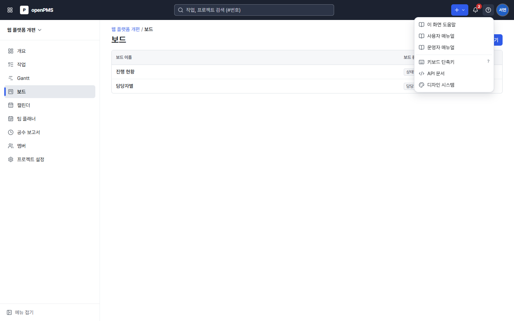 · 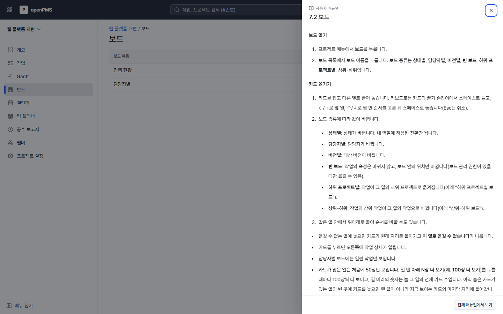 (cab644c, 웹 플랫폼 개편의 보드 목록에서 관리자로 연 메뉴와 7.2 보드 패널. 모바일은 캡처 없음)

### 2.3 공통 상태 표시

| 상태 | 표시 | 비고 |
| --- | --- | --- |
| 로딩 | 회색 스켈레톤 막대(목록·카드 자리), 전체 화면은 가운데 스피너(접근 이름 **불러오는 중**) | 다시 불러오는 동안 기존 목록은 흐리게(불투명도 60%) 유지 |
| 빈 상태 | 아이콘 + 제목 + 설명 + (가능하면) 다음 동작 버튼 | 화면별 문구는 각 절 참고 |
| 오류(일반) | **문제가 생겼습니다** / **잠시 후 다시 시도하세요. 계속되면 관리자에게 알려 주세요.** + **다시 시도** 버튼 | 서버 5xx·네트워크 오류 |
| 없음(404) | **페이지를 찾을 수 없습니다** / **주소가 바뀌었거나 볼 권한이 없는 페이지입니다.** + **홈으로** | 볼 수 없는 프로젝트도 404로 표시(존재 노출 방지) |
| 권한 없음(403) | 자물쇠 아이콘 + **볼 수 없는 화면입니다** + 서버 사유 | 관리 화면은 **관리자만 볼 수 있는 화면입니다.** |
| 모듈 꺼짐 | **이 프로젝트에서 꺼진 기능입니다** / **프로젝트 설정의 모듈에서 켤 수 있습니다.** | Gantt·보드·캘린더·팀 플래너·작업, (1.6) 공수 보고서 |
| 저장 성공 | 화면 오른쪽 아래 토스트(성공) | 예: **저장했습니다** |
| 저장 실패 | 토스트(위험) 제목 = 서버 오류 제목, 설명 = 서버 사유 | 입력 칸 오류(422 필드 오류)는 칸 아래에 표시하고 토스트는 띄우지 않음 |
| 동시 수정 충돌(409) | 토스트 **다른 사람이 먼저 수정했습니다** / **최신 내용으로 바꿨습니다. 확인한 뒤 다시 수정하세요.** | 화면 값은 서버 최신 값으로 바뀜 |
| 저장하지 않은 내용 | 탭 닫기·새로 고침 시 브라우저 확인 창 | 계정 설정 **저장하지 않은 내용이 있으면 떠나기 전에 묻기**가 켜져 있을 때 |

### 2.4 공통 메시지

여러 화면에서 같은 문구를 쓰는 서버 검증 메시지입니다.

| 상황 | 메시지 |
| --- | --- |
| 필수 이름 누락 | 이름을 입력하세요. |
| 이름 길이 초과 | 이름은 100자 이하로 입력하세요. |
| 이름 중복 | 같은 이름이 이미 있습니다. |
| 색 형식 | 색은 #RRGGBB 형식으로 입력하세요. |
| 숫자가 아님 | 숫자를 입력하세요. |
| 날짜 형식 | 날짜 형식이 올바르지 않습니다. |
| 알 수 없는 값 | 알 수 없는 값입니다. |
| 관리자 전용 | 관리자만 할 수 있습니다. |
| 같은 키를 다른 요청에 씀(1.5) | 같은 Idempotency-Key를 다른 요청에 썼습니다. 요청마다 새 키를 쓰세요. (422) |
| 같은 요청을 처리 중(1.5) | 같은 요청을 아직 처리하고 있습니다. 잠시 뒤 다시 시도하세요. (409) |

- 만들기 요청의 중복 방지(1.5, 93d1a74): 화면은 프로젝트 만들기(S04)·프로젝트 복사(S24)·작업 만들기(S06 인라인 행, S09)·코멘트(S07)·작업 복사(S07, 일괄 복사 제외)를 보낼 때 요청마다 새 `Idempotency-Key`를 붙입니다. 응답을 받기 전에 연결이 끊기면 0.8초 뒤 같은 키로 한 번 다시 보내고, 서버는 처음 요청이 이미 처리됐으면 그 응답을 그대로 돌려줍니다. 그래서 같은 작업이 두 번 생기지 않습니다. 위 두 메시지는 화면이 정상적으로 쓰면 나오지 않고, 키를 직접 다루는 연동 프로그램에서 볼 수 있습니다(사용자 매뉴얼 14.4). 저장 버튼 더블 클릭은 이전처럼 화면이 막습니다.

### 2.5 권한 표기

화면별 권한 열에는 아래 권한 키를 씁니다. 키와 한국어 이름은 관리 › 역할 및 권한 화면(S31)과 같습니다.

| 묶음 | 권한 키 (화면 이름) |
| --- | --- |
| 프로젝트 | project.view(프로젝트 보기), project.edit(프로젝트 정보·상태 수정), project.archive(프로젝트 보관), project.manage_modules(모듈 켜기·끄기), project.manage_members(멤버 관리), project.view_members(멤버 보기), project.manage_versions(버전 관리), project.manage_categories(카테고리 관리), project.manage_types(사용 유형 관리), project.manage_custom_fields(사용자 정의 필드 켜기) |
| 작업 | wp.view(작업 보기), wp.create(작업 만들기), wp.edit(작업 수정), wp.delete(작업 삭제), wp.move(작업 이동), wp.attach(첨부 추가·삭제), wp.comment(코멘트 쓰기), wp.edit_own_comments(내 코멘트 수정), wp.edit_comments(모든 코멘트 수정), wp.view_internal_comments(내부 코멘트 보기), wp.add_internal_comments(내부 코멘트 쓰기), wp.manage_relations(관계 관리), wp.manage_subtasks(상위·하위 작업 관리), wp.assign_versions(버전 지정), wp.view_watchers(주시자 보기), wp.add_watchers(주시자 추가), wp.delete_watchers(주시자 삭제), wp.share(작업 공유), wp.export(내보내기) |
| 보기 | query.save(내 보기 저장), query.manage_public(공개 보기 관리) |
| 보드 | board.view(보드 보기), board.manage(보드 관리) |
| 시간 기록(1.6) | time.log(내 시간 기록), time.view(시간 기록 보기), time.manage(시간 기록 관리(다른 사람 것 포함)). 프로젝트에서 **시간 기록** 모듈이 꺼지면 셋 다 없음. 기본 역할: 프로젝트 관리자 셋 모두, 멤버 time.log·time.view, 참관자 없음 |
| 전역 | global.create_projects(프로젝트 만들기), global.manage_users(사용자·그룹 관리) |

- "로그인 사용자"는 로그인한 모든 사용자, "관리자"는 시스템 관리자(isAdmin) 계정입니다.
- 프로젝트 권한은 그 프로젝트의 멤버십(직접 또는 그룹) 역할에서 나옵니다. 공개 프로젝트는 멤버가 아니어도 내장 역할로 볼 수 있습니다.

### 2.6 공통 접근성 기준

- 목표 기준: WCAG 2.1 A/AA. 흐름 테스트와 화면별 접근성 테스트가 axe로 검사합니다(`replica/test-plan.md` "화면별 접근성").
- 아이콘만 있는 버튼은 모두 접근 이름(aria-label)이 있고, 툴팁도 같은 문구를 씁니다.
- 오류는 색만으로 알리지 않고 문구를 함께 표시하며, 입력 칸과 연결합니다(aria-invalid, aria-describedby). 제출 시 첫 오류 칸으로 포커스를 옮깁니다.
- 대화상자는 포커스를 가두고 Esc로 닫히며, 닫히면 연 버튼으로 포커스가 돌아갑니다.
- 정렬된 열은 `aria-sort`, 눌림 상태 버튼(필터 토글 등)은 `aria-pressed`, 펼침 버튼은 `aria-expanded`를 씁니다.
- 기한이 지난 날짜는 빨간 굵은 글씨에 더해 화면 낭독기용 **(기한 지남)** 문구를 붙입니다.
- 끌어 놓기(보드, 팀 플래너)는 키보드 대안(스페이스로 들고 화살표로 옮기기)과 낭독 안내를 제공합니다. Gantt·캘린더는 Enter로 날짜 대화상자나 상세를 엽니다.
- 테마(시스템·라이트·다크·고대비) 모두 글자 대비 4.5:1 이상을 맞춥니다. 고대비(1.4)는 본문 검정, 더 진한 테두리, 검정 포커스 링을 쓰는 밝은 테마이며 운영체제가 다크여도 고대비가 이깁니다. 상태 pill 글자색은 배경색에서 자동으로 고릅니다.
- 키보드 단축키(2.2.4)는 입력 중에는 동작하지 않아 화면 낭독기·입력 사용자의 타이핑을 가로채지 않습니다.

---

## 3. 화면 목록

| 화면 ID | 화면명 | 경로 | 메뉴 위치 | 권한 | 구현 상태 |
| --- | --- | --- | --- | --- | --- |
| S01 | 로그인 | `/login` (`?next=`, `?sso_error=`) | 로그인하지 않으면 모든 경로가 이동 | 비로그인 | done |
| X01 | 비밀번호 재설정 | `/password-reset`, `/password-reset?token=` | S01 **비밀번호를 잊으셨나요?**, 메일 링크 | 비로그인 | done |
| X02 | 초대 수락 | `/invitations/:token` | 초대 메일 링크 | 비로그인(초대 토큰) | done |
| S02 | 홈 | `/` | 전역 메뉴 › 홈, 로고 | 로그인 사용자 | done |
| S03 | 프로젝트 목록 | `/projects` (`?filter=&status=&q=&page=&size=`) | 전역 메뉴 › 프로젝트 | 로그인 사용자 (복원·삭제는 관리자) | done |
| S04 | 새 프로젝트 | `/projects/new` (`?parent=`) | S03 **프로젝트 만들기**, 헤더 + › **새 프로젝트** | global.create_projects | done |
| S05 | 프로젝트 개요 | `/projects/:p` | 프로젝트 메뉴 › 개요 | project.view (위젯 편집은 project.edit) | done |
| S06 | 작업 목록 | `/projects/:p/work-packages`, 전역 `/work-packages` (`?view=&q=&page=&size=`) | 프로젝트 메뉴 › 작업, 전역 메뉴 › 작업 | wp.view, 모듈 work_packages | done |
| S07 | 작업 분할 상세 | `…/work-packages/details/:number/:tab?` | S06·S13·S15·S17·S18·S19에서 작업 선택 | wp.view | done |
| S08 | 작업 전체 화면 상세 | `/projects/:p/work-packages/:number/:tab?` | S07 **전체 화면으로 열기**, 링크 | wp.view | done |
| S09 | 새 작업 | `/projects/:p/work-packages/new?type=` (`&parent=&startDate=&dueDate=&assignee=`) | S06 **만들기**, 헤더 + › **새 작업** | wp.create | done |
| S10 | 날짜 대화상자 | (대화상자, 탭 날짜·선행·후속·하위 작업) | 상세의 **날짜** 항목, Gantt 막대, Gantt 날짜 없는 행의 **#n 날짜 정하기** | wp.edit | partial |
| S11 | 보기 구성 | (대화상자 없음: 보기 메뉴·열 헤더 메뉴) | S06 **보기 메뉴**(⋯), 열 제목 | wp.view (저장은 query.save) | partial |
| S12 | 내보내기 | (대화상자, 형식 Excel·CSV·PDF) | S06 보기 메뉴 › **내보내기** | wp.export | done |
| S13 | Gantt | `/projects/:p/gantt` (`/details/:number/:tab?`) | 프로젝트 메뉴 › Gantt | wp.view, 모듈 gantt | done |
| X04 | 전역 Gantt | `/gantt` | 전역 메뉴 › Gantt | 로그인 사용자(볼 수 있는 프로젝트만) | done |
| S14 | 보드 목록 | `/projects/:p/boards` | 프로젝트 메뉴 › 보드 | board.view, 모듈 boards | done |
| S15 | 보드 | `/projects/:p/boards/:id` (`/details/:number/:tab?`) | S14에서 보드 선택 | board.view (구성 변경은 board.manage) | partial |
| S16 | 새 보드 | `/projects/:p/boards/new` | S14 **보드 만들기** | board.manage | done |
| S17 | 캘린더 | `/projects/:p/calendar`, `/projects/:p/calendar/:id` (`/details/…`, `/new`) | 프로젝트 메뉴 › 캘린더 | wp.view, 모듈 calendar (만들기는 query.save) | done |
| S18 | 팀 플래너 | `/projects/:p/team-planner`, `/projects/:p/team-planner/:id` (`/details/…`, `/new`) | 프로젝트 메뉴 › 팀 플래너 | wp.view, 모듈 team_planner (만들기는 query.save) | done |
| S19 | 알림 | `/notifications` (`?filter=all&reason=&project=`), `/notifications/details/:number/:tab?` | 전역 메뉴 › 알림, 헤더 알림 아이콘 | 로그인 사용자 | done |
| S20 | 알림 설정 | `/my/notifications` (`?tab=email`) | 계정 메뉴 › 알림 설정, S19 설정 아이콘 | 로그인 사용자 | done |
| S21 | 내 페이지 | `/my/page` | 전역 메뉴 › 내 페이지 | 로그인 사용자 | done |
| S22 | 검색 결과 | `/search?q=&scope=&page=` | 헤더 검색 Enter, **전체 결과 보기** | 로그인 사용자 | done |
| S23 | 멤버 | `/projects/:p/members` | 프로젝트 메뉴 › 멤버 | project.view_members (변경은 project.manage_members) | done |
| S24 | 프로젝트 설정: 정보·모듈 | `/projects/:p/settings/general`, `/projects/:p/settings/modules` | 프로젝트 메뉴 › 프로젝트 설정 | project.edit / project.manage_modules / project.archive | done |
| S25 | 프로젝트 설정: 작업 설정 | `/projects/:p/settings/work-packages` | 프로젝트 설정 › 작업 설정 | project.manage_types / project.manage_categories / project.manage_custom_fields | done |
| S26 | 프로젝트 설정: 버전 | `/projects/:p/settings/versions` | 프로젝트 설정 › 버전 | project.manage_versions | done |
| X05 | 관리 홈 | `/admin` | 전역 메뉴 › 관리, 모듈 메뉴 › 관리 | 관리자 | done |
| S27 | 관리: 유형 | `/admin/types` | 관리 › 작업 설정 › 유형 | 관리자 | done |
| S28 | 관리: 유형 양식 구성 | `/admin/types/:id/form` | S27 유형 이름 또는 ⋯ › **양식 구성** | 관리자 | done |
| S29 | 관리: 워크플로 | `/admin/workflows` (`?type=&role=`) | 관리 › 작업 설정 › 워크플로 | 관리자 | done |
| S30 | 관리: 상태 | `/admin/statuses` | 관리 › 작업 설정 › 상태 | 관리자 | done |
| S31 | 관리: 역할 및 권한 | `/admin/roles`, `/admin/roles/:id`, `/admin/roles/report`(권한 보고서, 1.4) | 관리 › 사람과 권한 › 역할 및 권한 | 관리자 | done |
| S32 | 관리: 진행률 추적 | `/admin/progress` | 관리 › 작업 설정 › 진행률 추적 | 관리자 | done |
| S33 | 관리: 달력과 날짜 | `/admin/calendar` | 관리 › 달력 › 달력과 날짜 | 관리자 | done |
| S34 | 관리: 사용자 정의 필드 | `/admin/custom-fields` | 관리 › 작업 설정 › 사용자 정의 필드 | 관리자 | done |
| S35 | 관리: 사용자·그룹 | `/admin/users`, `/admin/groups` | 관리 › 사람과 권한 › 사용자 / 그룹 | 관리자 또는 global.manage_users(전역 역할 배정은 관리자만) | done |
| S36 | 관리: 우선순위 | `/admin/priorities` | 관리 › 작업 설정 › 우선순위 | 관리자 | done |
| S37 | 계정 설정 | `/my/account` | 계정 메뉴 › 내 계정 | 로그인 사용자(API 토큰은 관리자가 토큰을 켜 두었을 때 만들 수 있음) | done |
| X03 | 관리: 로그인·비밀번호(SSO) | `/admin/authentication` | 관리 › 사람과 권한 › 로그인·비밀번호 | 관리자 | done |
| X06 | 공통 오류·안내 화면 | 없는 경로, `/admin/:section/*` | (자동 표시) | - | done |
| X07 | 디자인 시스템 | `/design` | 헤더 도움말 › **디자인 시스템** | 로그인 사용자(개발·검수용, 1.2부터 로그인 필요) | done |
| X08 | 관리: API와 웹훅 | `/admin/integrations` | 관리 › 연동 › API와 웹훅 | 관리자 | done |
| X09 | API 문서 | `/help/api` | 헤더 도움말 › **API 문서**, S37 **API 문서 보기** | 로그인 사용자 | done |
| X10 | 내 공수(1.6) | `/my/timesheet` (`?week=YYYY-MM-DD`) | 전역 메뉴 › 내 공수, 모듈 메뉴 › 내 공수 | 로그인 사용자(칸 저장은 그 작업 프로젝트의 time.log) | done |
| X11 | 공수 보고서(1.6) | `/projects/:p/time` | 프로젝트 메뉴 › 공수 보고서 | time.view, 모듈 time_tracking | done |
| X12 | 관리: 시스템 정보(1.8) | `/admin/system` | 관리 › 시스템 › 시스템 정보 | 관리자 | done |
| X13 | 도움말(2.0) | `/help`(사용자 매뉴얼), `/help/admin`(운영자 매뉴얼), `#{{절 주소}}` | 헤더 도움말 › **사용자 매뉴얼** / **운영자 매뉴얼**, 패널의 **전체 매뉴얼에서 보기**, X05 **openPMS로 할 수 있는 일** | 로그인 사용자(**운영자 매뉴얼** 메뉴는 관리자에게만) | done |

- 화면 수: 50개(S01–S37 37개 + X01–X13 13개. 1.9까지 49개, 1.7까지 48개, 1.5까지 46개). 이 중 S10·S12는 대화상자, S11은 독립 화면 없이 메뉴로 대신합니다. 1.4의 권한 보고서는 S31 안의 화면(`/admin/roles/report`)으로, 키보드 단축키 목록은 공통 셸의 대화상자(2.2.4)로 다룹니다. (2.2) 임시 비밀번호는 S01의 **새 비밀번호 정하기** 상태와 S35의 대화상자·행 메뉴라 화면 수는 50개 그대로입니다.
- 모바일 상태 M1(작업 목록 카드)과 M2(작업 상세 단일 컬럼)는 S06·S07 절의 모바일 상태에 포함했습니다.
- (1.3) S04·S06·S16·S19·S31은 빌드 로그에 남아 있던 항목(템플릿·상위 프로젝트, 우클릭 메뉴, 하위 프로젝트·상위-하위 보드, 이유별·프로젝트별 필터, 전역 역할 배정)이 모두 끝나 done으로 바꿨습니다. S10은 원본의 '선행 작업 종료일 이전 점선' 표시가 없어 partial, S13은 라벨 위치 설정이 없어 partial입니다.
- (1.4) S05(위젯 편집), S12(PDF), S13(라벨 위치)은 빌드 로그에 남아 있던 항목이 끝나 done으로 바꿨습니다. S05의 '개요에서 프로젝트 상태 바로 고치기'는 만들지 않았고 상태는 S24에서 고칩니다. S10(선행 작업 종료일 이전 점선)·S11(탭형 대화상자 대신 메뉴, 기준선은 부분)·S15(열 끌어다 놓기를 메뉴로 대신)는 partial 그대로입니다.
- (1.5) S06의 기준선이 완료되어(22ed5db) S11의 비고에서 '기준선은 부분'을 뺐습니다. S11은 원본의 탭형 대화상자 대신 메뉴로 하는 구성이라 여전히 partial입니다. 화면 수는 46개 그대로입니다.
- (1.6) 시간 추적을 들여오며 새 화면 X10 내 공수와 X11 공수 보고서를 더했습니다(화면 수 48). 작업 상세의 **시간** 탭은 S07·S08 안의 탭(`:tab` = `time`), **시간 기록 활동**은 S33 안의 절, 모듈 **시간 기록**은 S24, 권한 묶음 **시간 기록**은 S31에서 다룹니다. 원본에 같은 이름의 화면이 있는지는 보지 않았고(범위 밖이던 기능), X-ID로 붙였습니다.
- (1.8) 업그레이드 안전장치(`replica/fixes.md` #3)를 만들며 새 화면 X12 관리 · 시스템 정보를 더했습니다(화면 수 49). 원본 기능 행이 아니라 개선 행(REQ-ADM-013)에서 온 화면이라 X-ID로 붙였습니다.
- (2.0) 화면별 도움말(`replica/fixes.md` #5)을 만들며 새 화면 X13 도움말을 더했습니다(화면 수 50). 사용자 매뉴얼(`/help`)과 운영자 매뉴얼(`/help/admin`)은 같은 화면에 다른 문서를 담아 한 ID로 둡니다. **이 화면 도움말** 패널은 공통 셸의 대화상자(2.2.5), **openPMS로 할 수 있는 일**은 X05 안의 절로 다룹니다. 개선 행(REQ-COM-009)에서 온 화면이라 X-ID로 붙였습니다.
- (2.1) 공동 담당자(`replica/fixes.md` #6, REQ-WP-025)는 새 화면 없이 S07·S08(담당자 항목과 **담당자와 예상 시간** 대화상자), S06(담당자 열 **+N**), S15(카드 아바타, 담당자별 보드), S18(사람마다 막대)을 바꿨습니다. 화면 수는 50개 그대로입니다.

---

## 4. 화면 상세

각 화면은 다음 순서로 적습니다: 목적 → 레이아웃 → UI 요소 → 상태 → 주요 동작과 API → 검증 메시지 → 관련 흐름 → 접근성 → 참고 화면.

### 4.1 인증

<a id="s01"></a>
#### S01 로그인

- **목적**: 회사 이메일과 비밀번호, 또는 사내 SSO(OpenID Connect) 계정으로 로그인합니다.
- **경로**: `/login`. 로그인하지 않은 상태에서 다른 주소로 들어오면 `/login?next=<원래 주소>`로 이동하고, 로그인 후 원래 주소로 돌아갑니다. 이미 로그인한 사용자가 열면 `next` 또는 홈으로 바로 이동합니다.

**레이아웃**

```
            [P] openPMS
┌──────────────────────────────┐
│ openPMS에 로그인               │
│ 회사 이메일과 비밀번호를 입력하세요. │
│ [오류 배너]                     │
│ 이메일*   [              ]    │
│ 비밀번호* [              ]    │
│ [        로그인        ]       │
│      비밀번호를 잊으셨나요?       │
│ ───────── 또는 ─────────       │
│ [ 🔑 사내 계정(으)로 로그인 ]     │  ← SSO 공급자마다 1개
└──────────────────────────────┘
```

**UI 요소**

| 항목 | 유형 | 설명 | 규칙 |
| --- | --- | --- | --- |
| 제목 | 텍스트 | **openPMS에 로그인** / **회사 이메일과 비밀번호를 입력하세요.** | - |
| 오류 배너 | 배너(위험) | 로그인 실패 또는 SSO 실패 사유 | 오류가 있을 때만 |
| 이메일 | 입력(email) | 로그인 이메일 | 필수, 화면 진입 시 포커스 |
| 비밀번호 | 입력(password) | 비밀번호 | 필수 |
| 로그인 | 버튼(주) | 로그인 요청 | 요청 중에는 로딩 표시 |
| 비밀번호를 잊으셨나요? | 링크 | X01로 이동 | 관리자가 **비밀번호 재설정 허용**을 끄면 숨김 |
| 또는 | 구분선 | SSO 영역 구분 | 사용 중인 SSO 공급자가 있을 때만 |
| {{name}}(으)로 로그인 | 버튼(링크) | 공급자 로그인 페이지로 전체 이동 | 공급자마다 1개. 이름은 X03 **버튼 이름** |
| 보낸 메일·예시 계정 | 카드 | 개발용 가짜 데이터 모드에서만 표시 | 운영(실제 API)에서는 표시하지 않음 |

**상태**

| 상태 | 표시 |
| --- | --- |
| 로딩 | 로그인 여부 확인 중 전체 화면 스피너 |
| 기본 | 빈 폼, 이메일 칸 포커스 |
| 오류 | 오류 배너 + 해당 칸 오류 문구 |
| SSO 실패 복귀 | `/login?sso_error=<코드>`로 돌아오면 코드별 안내 배너 |
| 모바일 | 카드가 화면 폭에 맞게 줄어듦(390px에서 가로 스크롤 없음) |
| 권한 없음 | 해당 없음 |

**주요 동작과 API**

| 동작 | API | 결과 |
| --- | --- | --- |
| 화면 진입 | `GET /auth/me`, `GET /auth/password-policy`, `GET /auth/sso-providers` | 로그인 상태, 재설정 허용 여부, SSO 버튼 목록 |
| 로그인 | `POST /auth/login` | 성공: `next`(같은 사이트 경로만 허용) 또는 홈. 실패: 오류 배너. (2.2) 관리자가 만든 임시 비밀번호가 맞으면 403 → 아래 **새 비밀번호 정하기 상태**, 임시 비밀번호의 기한이 지났으면 401 → 오류 배너 **임시 비밀번호가 만료되었습니다. 관리자에게 다시 발급을 요청하세요.** |
| SSO 로그인 | `GET /auth/oidc/start/{slug}?next=` (전체 페이지 이동) | 공급자 로그인 → 콜백 → 성공 시 `next` 또는 홈, 실패 시 `/login?sso_error=` |

**검증 메시지**

| 조건 | 메시지 | 위치 |
| --- | --- | --- |
| 이메일 또는 비밀번호 빈 칸 | 이메일과 비밀번호를 모두 입력하세요. | 빈 칸 아래, 첫 빈 칸에 포커스 |
| 이메일·비밀번호 불일치 | 이메일 또는 비밀번호가 올바르지 않습니다. | 배너 |
| 잠긴 계정(423) | 잠긴 계정입니다. 관리자에게 잠금 해제를 요청하세요. | 배너 |
| 임시 비밀번호의 기한이 지남(401, 2.2) | 임시 비밀번호가 만료되었습니다. 관리자에게 다시 발급을 요청하세요. | 배너 |
| 새 비밀번호를 정하는 중 시간이 지남(410, 2.2) | 시간이 지났습니다. 임시 비밀번호로 다시 로그인하세요. | 로그인 폼으로 돌아가 배너 |
| SSO `no_account` | openPMS 계정이 없습니다. 관리자에게 초대를 요청하세요. | 배너 |
| SSO `locked` | 잠긴 계정입니다. 관리자에게 잠금 해제를 요청하세요. | 배너 |
| SSO `unverified` | 로그인 공급자가 이메일 주소를 확인되지 않은 주소로 알려 왔습니다. 공급자의 계정 설정을 확인하세요. | 배너 |
| SSO `no_email` | 로그인 공급자가 이메일 주소를 보내지 않았습니다. 관리자에게 문의하세요. | 배너 |
| SSO `cancelled` | 로그인을 취소했거나 공급자가 허용하지 않았습니다. | 배너 |
| SSO `unavailable` | 지금은 이 방법으로 로그인할 수 없습니다. 잠시 뒤 다시 시도하거나 관리자에게 문의하세요. | 배너 |
| SSO `failed`·알 수 없는 코드 | 로그인 공급자와 확인하지 못했습니다. 다시 시도하세요. | 배너 |

- 로그인 실패 횟수가 X03 **잠그기 전 실패 횟수**에 이르면 **잠금 시간(분)** 동안 계정이 잠깁니다. 이 일시 잠김에도 화면 문구는 관리자가 잠근 경우와 같은 **잠긴 계정입니다. 관리자에게 잠금 해제를 요청하세요.**입니다(서버 응답 423의 설명만 **잠시 뒤 다시 시도하세요.**로 다름). 일시 잠김은 잠금 시간이 지나거나, X01로 비밀번호를 다시 정하거나, 관리자가 S35에서 **잠금 해제**하면 풀립니다. 관리자는 S35에서 **일시 잠김**과 끝나는 시각으로 봅니다(1.2).
- 로그인 요청 제한(429)은 접속한 사람의 주소마다 셉니다. 사내 리버스 프록시 뒤에서는 신뢰하는 프록시가 보낸 `X-Forwarded-For`의 주소를 쓰므로, 같은 프록시를 거치는 다른 사람의 로그인이 함께 막히지 않습니다(1.2).

**새 비밀번호 정하기 상태(2.2)**

관리자가 만든 임시 비밀번호(S35)로 로그인하면 같은 화면(S01, 같은 인증 프레임)이 로그인 폼 대신 새 비밀번호 폼으로 바뀝니다. 이때는 세션을 만들지 않고, 서버가 준 일회용 변경 토큰(10분)으로 새 비밀번호를 저장해야 로그인됩니다. 별도 주소는 없고(`/login` 그대로) 변경 토큰은 화면의 메모리에만 있어, 새로 고치면 처음부터 다시 로그인합니다. 사내 SSO로 로그인하는 사람에게는 이 상태가 없습니다.

```
            [P] openPMS
┌──────────────────────────────┐
│ 새 비밀번호 정하기              │
│ 임시 비밀번호로 로그인했습니다.    │
│ 계속하려면 나만 아는 새 비밀번호를 정하세요. │
│ [오류 배너]                     │
│ 새 비밀번호*      [          ]  │
│   (비밀번호 규칙 안내)           │
│ 새 비밀번호 확인* [          ]  │
│ [    🔑 비밀번호 저장    ]       │
└──────────────────────────────┘
```

| 항목 | 유형 | 설명 | 규칙 |
| --- | --- | --- | --- |
| 제목 | 텍스트(제목) | **새 비밀번호 정하기** | 이 폼으로 바뀔 때 제목에 포커스가 가서 화면 읽기 프로그램이 바뀐 것을 알림 |
| 안내 | 텍스트 | **임시 비밀번호로 로그인했습니다. 계속하려면 나만 아는 새 비밀번호를 정하세요.** | - |
| 오류 배너 | 배너(위험) | 칸에 속하지 않는 서버 오류(**잠시 후 다시 시도하세요. 계속되면 관리자에게 알려 주세요.**) | 오류가 있을 때만 |
| 새 비밀번호 | 입력(password) | 라벨 **새 비밀번호**(필수), 아래에 X03의 규칙을 한 줄로 안내(예: **10자 이상 · 숫자 포함**) | 최대 128자, `autocomplete="new-password"` |
| 새 비밀번호 확인 | 입력(password) | 라벨 **새 비밀번호 확인**(필수) | 두 값이 다르면 **두 비밀번호가 다릅니다.** |
| 비밀번호 저장 | 버튼(주, 열쇠 아이콘) | 변경 토큰과 새 비밀번호를 보냄 | 요청 중에는 로딩 표시. 성공하면 로그인되어 `next`(같은 사이트 경로만) 또는 홈으로 이동하고, 다른 기기의 로그인은 끝남 |

| 상태 | 표시 |
| --- | --- |
| 기본 | 두 칸이 비어 있고 제목에 포커스 |
| 규칙 위반·두 칸이 다름 | 먼저 화면에서 검사해 칸 아래에 문구, 첫 오류 칸에 포커스(서버를 부르지 않음) |
| 임시 비밀번호와 같은 값 | 서버 422 → 새 비밀번호 칸 아래 **임시 비밀번호와 다른 비밀번호를 정하세요.** 변경 토큰은 그대로 쓸 수 있음 |
| 시간이 지남(410) | 변경 토큰이 10분이 지났거나, 이미 쓰였거나, 그 사이 임시 비밀번호가 바뀌었거나 기한이 지난 경우. 로그인 폼으로 돌아가 배너 **시간이 지났습니다. 임시 비밀번호로 다시 로그인하세요.** (이메일은 남고 비밀번호 칸은 빔) |
| 그 밖의 오류 | 오류 배너 |

**주요 동작과 API(새 비밀번호 정하기)**

| 동작 | API | 결과 |
| --- | --- | --- |
| 임시 비밀번호로 로그인 | `POST /auth/login` | 403 **새 비밀번호를 정해야 합니다.** 문제 상세의 `current` = `{code: "password_change_required", changeToken}` → 이 폼으로 바뀜 |
| 저장 | `POST /auth/password-change` {token, newPassword} | 200 로그인됨(응답 `Me`). 410 → 로그인 폼으로 복귀. 422 `newPassword` → 칸 오류 |

**관련 흐름**: F00(로그인, 사내 SSO), F19(임시 비밀번호로 처음 로그인, 2.2)

**접근성**: 오류는 배너와 칸 문구로 함께 알림. 빈 칸 제출 시 첫 빈 칸으로 포커스. 입력에 `autocomplete`(username, current-password) 지정. SSO 버튼은 일반 링크라 키보드 Enter로 동작. (2.2) **새 비밀번호 정하기** 상태는 제목이 포커스를 받고, 두 칸에 `autocomplete="new-password"`를 지정하며, 오류가 있으면 첫 오류 칸으로 포커스가 갑니다. 이 상태도 axe 검사(F19-T1 "S01 새 비밀번호 정하기")를 통과합니다.

**참고 화면**: 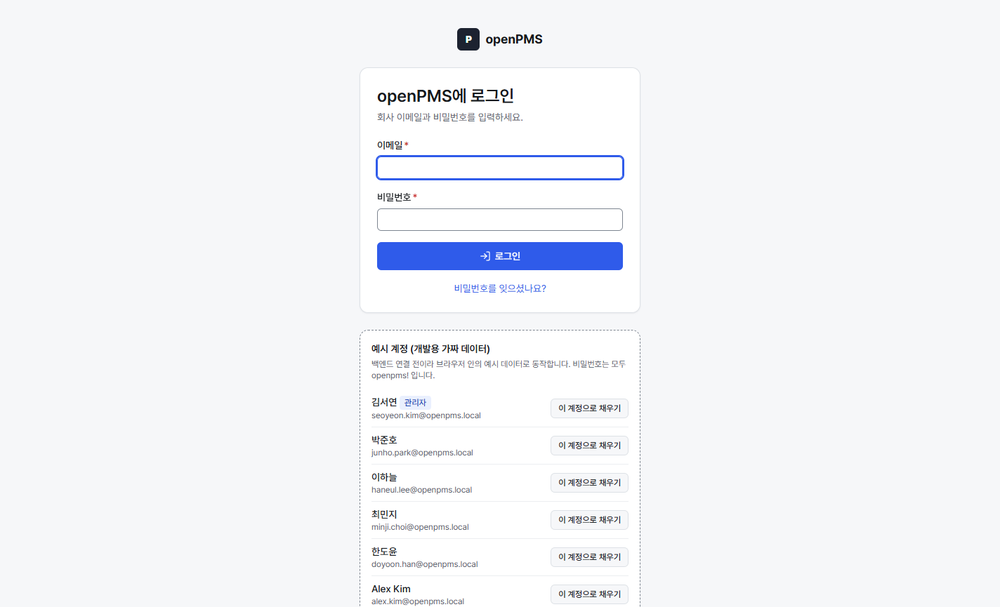 · 모바일 `../../replica/clone-screens/S01-mobile.png` (2.2의 새 비밀번호 정하기 상태는 캡처 없음)

<a id="x01"></a>
#### X01 비밀번호 재설정

- **목적**: 비밀번호를 잊은 사용자가 메일 링크로 새 비밀번호를 정합니다. 사내 SSO로만 로그인해 비밀번호가 없는 사용자가 S37에서 받은 **비밀번호 만들기** 링크도 이 화면의 새 비밀번호 단계로 엽니다(1.2).
- **경로**: 요청 단계 `/password-reset`, 새 비밀번호 단계 `/password-reset?token=<토큰>`(메일 링크).
- 새 비밀번호 단계(`POST /auth/password-reset/confirm`)는 관리자의 **비밀번호 재설정 허용** 설정과 관계없이 유효한 링크면 동작합니다. 저장하면 로그인 실패 횟수와 일시 잠김도 풀립니다.

**레이아웃**: S01과 같은 인증 프레임 안에 단계별 카드 1개.

**UI 요소**

| 단계 | 항목 | 유형 | 설명 | 규칙 |
| --- | --- | --- | --- | --- |
| 요청 | 비밀번호 재설정 / 가입한 이메일을 입력하면 새 비밀번호를 정할 수 있는 링크를 보내 드립니다. | 제목·설명 | - | - |
| 요청 | 이메일 | 입력 | 가입 이메일 | 필수, 이메일 형식 |
| 요청 | 재설정 링크 보내기 | 버튼(주) | 링크 메일 요청 | - |
| 요청 | 로그인으로 돌아가기 | 링크 | S01 | - |
| 발송 완료 | 메일을 확인하세요 | 제목 | 성공 배너 **{{email}} 주소로 가입된 계정이 있으면 재설정 링크를 보냈습니다.** | 계정 유무와 관계없이 같은 문구 |
| 발송 완료 | 안내 | 텍스트 | 링크는 한 번만 쓸 수 있고 60분 뒤 만료됩니다. 메일이 오지 않으면 주소를 확인하고 다시 보내거나 관리자에게 문의하세요. | 문구의 '60분'은 고정 문구이고, 실제 유효 시간은 X03 **재설정 링크 유효 시간(분)**(기본 60분)을 따름 |
| 발송 완료 | 다른 주소로 다시 보내기 | 버튼 | 요청 단계로 | - |
| 새 비밀번호 | 새 비밀번호 정하기 / 저장하면 모든 기기에서 로그아웃되고, 새 비밀번호로 다시 로그인합니다. | 제목·설명 | - | - |
| 새 비밀번호 | 새 비밀번호 | 입력(password) | 도움말에 규칙 요약(예: **10자 이상**) | 필수, 최대 128자 |
| 새 비밀번호 | 새 비밀번호 확인 | 입력(password) | - | 필수, 위와 같아야 함 |
| 새 비밀번호 | 비밀번호 저장 | 버튼(주) | - | - |
| 완료 | 비밀번호를 바꿨습니다 / 새 비밀번호로 로그인하세요. | 제목·배너 | **로그인** 버튼(S01) | - |
| 만료 | 쓸 수 없는 링크입니다 | 제목·경고 배너 | **새 링크 받기**(요청 단계), **로그인으로 돌아가기** | 410 응답 시 |

**상태**: 로딩(버튼 로딩), 오류(배너·칸 문구), 만료(경고 카드), 모바일(카드 폭 축소). 빈 상태·권한 없음은 해당 없음.

**주요 동작과 API**

| 동작 | API | 결과 |
| --- | --- | --- |
| 비밀번호 규칙 읽기 | `GET /auth/password-policy` | 도움말·사전 검사에 사용 |
| 재설정 링크 보내기 | `POST /auth/password-reset` | 발송 완료 화면. 429면 오류 배너 |
| 비밀번호 저장 | `POST /auth/password-reset/confirm` | 완료 화면, 모든 세션 종료. 410이면 만료 화면 |

**검증 메시지**

| 조건 | 메시지 |
| --- | --- |
| 이메일 형식 아님 | 이메일 주소를 확인하세요. |
| 요청 과다(429) | 요청이 너무 많습니다. 잠시 뒤 다시 시도하세요. |
| 최소 길이 미달 | 비밀번호는 {{minLength}}자 이상이어야 합니다. |
| 128자 초과 | 비밀번호는 128자 이하로 정하세요. |
| 필수 문자 종류 누락 | 비밀번호에 {{종류}}을(를) 넣으세요. |
| 섞어야 하는 종류 수 미달 | 영문 소문자·대문자·숫자·특수 문자 중 {{n}}가지 이상을 섞으세요. |
| 두 칸 불일치 | 두 비밀번호가 다릅니다. |
| 링크 만료·사용됨 | 링크가 만료됐거나 이미 사용됐습니다. 재설정 링크를 새로 받으세요. |
| 재설정 꺼짐(403) | 비밀번호 재설정을 쓰지 않습니다. 관리자에게 문의하세요. |

**관련 흐름**: F00

**접근성**: 제출 시 첫 오류 칸(`aria-invalid`)으로 포커스. 새 비밀번호 칸은 `autocomplete="new-password"`.

**참고 화면**: 캡처 없음

<a id="x02"></a>
#### X02 초대 수락

- **목적**: 관리자가 초대한 사용자가 이름과 비밀번호를 정해 계정을 활성화합니다.
- **경로**: `/invitations/:token`(초대 메일 링크). 성공하면 바로 로그인되어 홈으로 이동합니다.

**UI 요소**

| 항목 | 유형 | 설명 | 규칙 |
| --- | --- | --- | --- |
| 초대 수락 | 제목 | 설명 **{{name}}님이 openPMS에 초대했습니다. 이름과 비밀번호를 정하면 바로 시작합니다.** (초대자가 없으면 **openPMS 관리자 계정을 설정합니다. …**) | - |
| 로그인 중 안내 | 배너(정보) | **지금 {{name}} 계정으로 로그인되어 있습니다. 수락하면 새 계정으로 바뀝니다.** | 다른 계정으로 로그인 중일 때만 |
| 이메일 | 입력(읽기 전용) | 초대받은 주소. 도움말 **초대받은 주소입니다. 바꾸려면 관리자에게 요청하세요.** | 수정 불가 |
| 이름 | 입력 | 초대 시 이름이 미리 채워짐 | 필수, 최대 100자, 진입 시 포커스 |
| 새 비밀번호 / 새 비밀번호 확인 | 입력(password) | X01과 같음 | 필수 |
| 수락하고 시작하기 | 버튼(주) | 계정 활성화 + 로그인 | - |

**상태**: 로딩(초대 정보 확인 중 스피너), 만료(경고 카드 **쓸 수 없는 링크입니다**), 오류(**문제가 생겼습니다** 계열 배너 + **다시 시도**), 모바일(카드 폭 축소).

**주요 동작과 API**

| 동작 | API | 결과 |
| --- | --- | --- |
| 화면 진입 | `GET /auth/invitations/{token}`, `GET /auth/me` | 초대 이메일·이름·초대자. 410이면 만료 화면 |
| 수락하고 시작하기 | `POST /auth/invitations/{token}/accept` | 성공 토스트 **{{name}}님, 환영합니다**, 홈으로 이동 |

**검증 메시지**: 이름 빈 칸 **이름을 입력하세요.**, 서버 **이름을 1~100자로 입력하세요.**, 비밀번호 규칙·불일치는 X01과 같음, 만료 **초대 링크가 만료됐거나 이미 사용됐습니다. 관리자에게 초대를 다시 보내 달라고 요청하세요. 이미 수락했다면 로그인하면 됩니다.**

**관련 흐름**: F10(없는 사용자를 초대), F00

**접근성**: X01과 같음. 이메일 칸은 읽기 전용으로 표시되어 낭독기에서도 수정 불가로 읽힘.

**참고 화면**: 캡처 없음


### 4.2 개인 화면

<a id="s02"></a>
#### S02 홈

- **목적**: 로그인 직후 첫 화면. 내게 할당된 열린 작업, 읽지 않은 알림 수, 즐겨찾는 프로젝트를 한눈에 봅니다.
- **경로**: `/`

**레이아웃**

```
{{name}}님, 안녕하세요
┌──────────────────────────────┬────────────────────┐
│ ✓ 내게 할당된 작업      모두 보기 │ 🔔 읽지 않은 알림    알림 │
│ [상태] #번호 유형 제목 프로젝트 날짜 │  (n) 알림 n건 읽지 않음  │
│ ... (최대 8건)                 ├────────────────────┤
│                              │ ★ 즐겨찾는 프로젝트      │
│                              │ 프로젝트명      [상태]   │
└──────────────────────────────┴────────────────────┘
```

**UI 요소**

| 항목 | 유형 | 설명 | 규칙 |
| --- | --- | --- | --- |
| 인사 | 제목 | **{{name}}님, 안녕하세요** | - |
| 내게 할당된 작업 | 카드(목록) | 담당자가 나이고 열린 작업, 완료일 오름차순 최대 8건. 행: 상태 pill, #번호, 유형, 제목(링크), 프로젝트, 완료일 | 하위 프로젝트 포함. 제목 클릭 → S08 활동 탭 |
| 모두 보기 | 링크 | 전역 작업 목록의 **내게 할당됨** 보기 | `/work-packages?view=default:assigned` |
| 읽지 않은 알림 | 카드 | 읽지 않은 수 배지와 **알림 {{count}}건 읽지 않음** 또는 **새 알림이 없습니다** | **알림** 링크 → S19 |
| 즐겨찾는 프로젝트 | 카드(목록) | 즐겨찾기한 프로젝트 최대 12개와 상태 배지(순조로움·주의·지연) | 이름 클릭 → S05 |

**상태**

| 상태 | 표시 |
| --- | --- |
| 로딩 | 카드마다 스켈레톤 막대 |
| 빈 상태 | 작업 **할당된 열린 작업이 없습니다** / 즐겨찾기 **즐겨찾는 프로젝트가 없습니다**, **프로젝트 목록에서 별표를 누르면 여기에 모입니다.** |
| 오류 | 카드 안에 공통 오류 + **다시 시도** |
| 모바일 | xl(1280px) 미만에서는 카드가 세로로 쌓임 |
| 권한 없음 | 해당 없음(볼 수 있는 데이터만 표시) |

**주요 동작과 API**

| 동작 | API |
| --- | --- |
| 화면 진입 | `GET /projects?filter=favorite`, `POST /work-packages/query`(담당자=나, 상태=열림, 8건), `GET /notifications/unread-count` |

**검증 메시지**: 없음(입력 없음)

**관련 흐름**: F09(알림 진입)

**접근성**: 카드마다 영역 이름(section aria-label). 기한 지난 날짜는 빨간 굵은 글씨와 낭독용 **(기한 지남)**.

**참고 화면**: 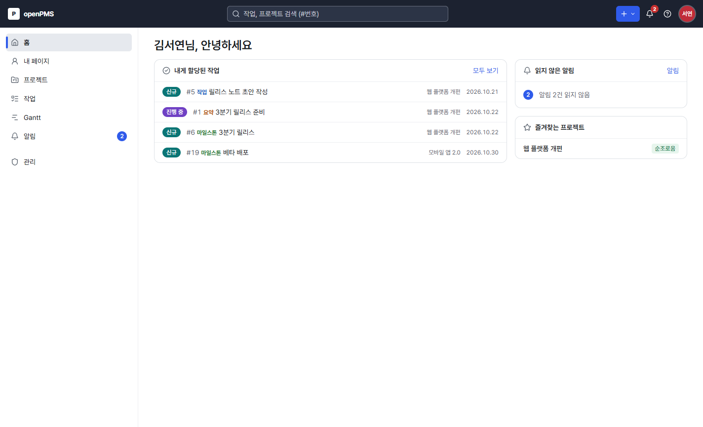 · 모바일 `../../replica/clone-screens/S02-mobile.png`

<a id="s21"></a>
#### S21 내 페이지

- **목적**: 나와 관련된 작업 위젯을 골라 개인 대시보드로 씁니다.
- **경로**: `/my/page`

**레이아웃**: 제목 **내 페이지**와 오른쪽 **위젯 편집** 버튼. 편집 중에는 위젯 고르기 패널이 위에 열리고, 아래에 위젯이 2열(xl 이상)로 배치됩니다.

**UI 요소**

| 항목 | 유형 | 설명 | 규칙 |
| --- | --- | --- | --- |
| 위젯 편집 / 편집 끝내기 | 토글 버튼 | 위젯 편집 패널 열기·닫기 | `aria-pressed` |
| 편집 안내 | 텍스트 | **보여 줄 위젯을 고르고 순서를 바꿉니다. 바꾸면 바로 저장됩니다.** | 저장 상태 **저장 중…** / **저장됨** |
| 위젯 체크박스 | 체크박스 6개 | **내게 할당된 작업**, **내가 만든 작업**, **주시 중인 작업**, **내가 책임자인 작업**, **2주 안에 끝내야 할 작업**, **최근 1주일 동안 바뀐 작업** | 체크하면 맨 뒤에 추가 |
| {{name}} 위로 / {{name}} 아래로 | 아이콘 버튼 | 위젯 순서 이동 | 맨 위·맨 아래에서는 비활성 |
| 위젯 | 표 | 열: 번호, 프로젝트, 유형, 제목, 상태, 완료일. 최대 10건 | 번호·제목 클릭 → S08 |
| 모두 보기 ({{count}}) | 링크 | 위젯 조건을 적용한 전역 작업 목록 | 결과가 1건 이상일 때만 |

- 위젯 조건: 할당(담당자=나·열림·완료일순), 내가 만든(작성자=나·열림·최근 수정순), 주시(주시자=나·열림), 책임(책임자=나·열림), 2주 안(담당자=나·열림·완료일 14일 안), 최근 1주일(최근 수정 7일 안). 새 사용자의 기본 위젯은 **내게 할당된 작업**·**내가 만든 작업** 2개입니다.

**상태**

| 상태 | 표시 |
| --- | --- |
| 로딩 | 위젯마다 스켈레톤 |
| 빈 상태 | 위젯별 **할당된 열린 작업이 없습니다** 등. 위젯을 모두 끄면 **보이는 위젯이 없습니다** / **'위젯 편집'에서 보여 줄 위젯을 고르세요.** |
| 오류 | 위젯 안 공통 오류, 저장 실패 시 위험 토스트 |
| 모바일 | 위젯 1열, 표는 가로 스크롤 |

**주요 동작과 API**

| 동작 | API |
| --- | --- |
| 위젯 표시 | `POST /work-packages/query` (위젯마다 10건) |
| 위젯 켜기·끄기·순서 | `PUT /me/preferences` (`myPageWidgets`), 변경마다 차례로 저장 |

**검증 메시지**: 서버 **알 수 없는 위젯이 있습니다.**(정상 사용 중에는 나오지 않음)

**관련 흐름**: 해당 없음(개인 설정)

**접근성**: 저장 상태는 `aria-live`로 낭독. 위·아래 버튼은 위젯 이름을 포함한 접근 이름.

**참고 화면**: 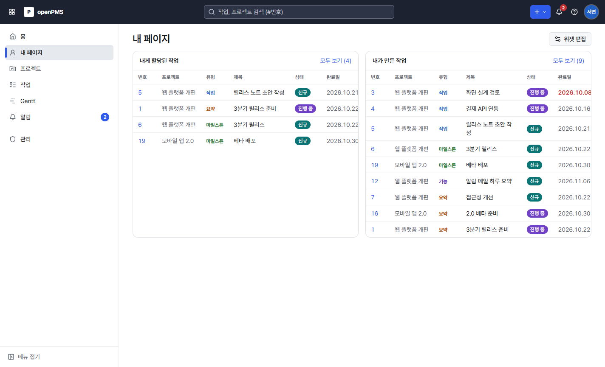

<a id="x10"></a>
#### X10 내 공수 (1.6)

- **목적**: 이번 주에 작업별로 쓴 시간을 한 화면에서 키보드로 입력하고 한 번에 저장합니다. 매일 공수를 보고해야 하는 사람이 클릭과 페이지 이동 없이 한 주를 채우게 하는 화면입니다(`replica/fixes.md` #1, 3f9d5c0).
- **경로**: `/my/timesheet`. `?week=YYYY-MM-DD`(그 날이 든 주, 없으면 오늘이 든 주). 주는 관리 · 날짜 형식(S33)의 **주 시작 요일**부터 7일입니다.
- **권한**: 로그인 사용자. 칸을 저장하려면 그 작업 프로젝트에서 time.log가 있어야 하고 시간 기록 모듈이 켜져 있어야 합니다.

**레이아웃**

```
┌ 내 공수 ──────────────────────────────────────────────────────────────┐
│ [<][>] [이번 주]  2026.10.04 ~ 2026.10.10                                 │
│ 이번 주에 작업별로 쓴 시간을 입력하고 저장합니다. … 1:30처럼 시:분으로 적어도 됩니다.      │
│ ┌ 작업 ──────────────┬ 일 ─┬ 월 ─┬ 화 ─┬ 수 ─┬ 목 ─┬ 금 ──┬ 토 ─┬ 합계 ┐ │
│ │                    │10.04│10.05│10.06│10.07│10.08│10.09 │10.10│      │ │
│ │                    │(음영)│     │     │     │     │한글날 │(음영)│      │ │
│ │ 요약 #1 3분기 릴리스 준비│ [ ] │ [3] │ [ ] │ [ ] │ [2] │ [  ] │ [ ] │  5   │ │
│ │ 작업 #3 화면 설계 검토  │ [ ] │[1.5]│ [4] │[2:30]│[8] │ [  ] │ [ ] │  16  │ │
│ │ 합계                │  0  │ 4.5 │  4  │ 8.5⚠│ 10⚠ │  0   │  0  │  27  │ │
│ └────────────────────┴─────┴─────┴─────┴─────┴─────┴──────┴─────┴──────┘ │
│ [번호나 제목으로 찾기 🔍] [내게 할당된 작업 불러오기]                           │
│ (오류 배너: 저장하지 못한 칸의 사유 목록)                                      │
│ 저장하지 않은 변경이 있습니다                          [되돌리기] [저장]        │ ← 아래에 붙는 저장 바
└────────────────────────────────────────────────────────────────────────┘
```

**UI 요소**

| 항목 | 유형 | 설명 | 규칙 |
| --- | --- | --- | --- |
| 지난주 / 다음 주 | 아이콘 버튼 | 7일 앞·뒤 주로. 주소 `?week=`가 바뀜 | 저장하지 않은 변경이 있으면 확인 **저장하지 않은 공수가 있습니다. 이 페이지를 떠날까요?** |
| 이번 주 | 버튼 | 오늘이 든 주로 | 이미 이번 주면 비활성 |
| 주 제목 | 제목(h2) | **{{시작}} ~ {{끝}}** | `aria-live="polite"`로 바뀐 주를 읽어 줌 |
| 안내 | 텍스트 | **이번 주에 작업별로 쓴 시간을 입력하고 저장합니다. 칸 사이는 화살표 키로 움직이고, Ctrl+S로 저장합니다. 1:30처럼 시:분으로 적어도 됩니다.** | - |
| 날짜 머리글 | 열 제목 | 요일(짧게), 월.일, 휴무일이면 그 이름(빨간 작은 글씨, 툴팁) | 근무일이 아닌 날(비근무 요일·휴무일)은 열 음영 |
| 작업 행 머리 | 행 제목 | 유형 라벨, **#번호** 링크(작업 활동 화면 S08로), 제목(넘치면 말줄임·툴팁), 아래 작은 글씨로 프로젝트 이름 | 행 순서: 이번 주에 기록이 있는 작업(프로젝트 이름순 → 번호순), 그 뒤에 이번에 추가한 작업 |
| 시간 칸 | 입력(숫자 키패드) | 그날 그 작업에 쓴 내 시간의 합. `1.5`, `1,5`, `1:30`(= 1.5)으로 입력, 비우면 0. 칸에 들어가면 값 전체 선택 | 바뀐 칸은 강조색 테두리. 0–24가 아니거나 숫자가 아니면 빨간 테두리·`aria-invalid`·툴팁 **0에서 24 사이의 숫자로 입력하세요**, **저장** 비활성 |
| 읽기 전용 칸 | 입력(읽기 전용) | 회색 바탕. 툴팁: 기록이 여러 건이면 **{{count}}건으로 기록된 칸입니다. 작업의 시간 탭에서 고치세요.**, 더 기록할 수 없는 작업이면 **이 작업에는 더 기록할 수 없습니다(권한이나 모듈이 바뀜).** | 서버 응답의 칸별 건수와 행의 `canLog` |
| 행 합계 | 텍스트 | 그 작업의 이번 주 합 | 잘못된 칸은 빼고 셈 |
| 합계 행 | 표 바닥 | 날짜별 합과 주 합계 | 날짜 합이 하루 근무 시간(S33)을 넘으면 빨간 글씨 + 경고 아이콘, 툴팁·화면 낭독 문구 **하루 근무 시간({{hours}}시간)을 넘었습니다**. 서버가 날짜 오류(24시간 초과)를 돌려준 날도 같은 표시에 그 사유 |
| 작업 추가 | 검색 입력 | 자리표시자 **번호나 제목으로 찾기**. 입력 0.2초 뒤 후보 최대 8개(#번호, 제목, 프로젝트), 이미 표에 있는 작업은 빠짐 | 후보를 누르거나 Enter(첫 후보)로 행 추가 |
| 내게 할당된 작업 불러오기 | 버튼 | 내게 할당된 열린 작업(최근 수정순, 최대 50개) 중 표에 없는 것을 행으로 추가 | 추가한 행은 저장 전까지 이 화면에만 있음(시간을 넣고 저장해야 남음) |
| 오류 배너 | 배너(위험) | 저장하지 못한 사유를 목록으로(칸·날짜마다 서버 문구) | 서버 422가 왔을 때만 |
| 저장 바 | 아래에 붙는 영역 | **저장하지 않은 변경이 있습니다** + **되돌리기**(입력 전 값으로, 오류 표시도 지움) + **저장**(주) | 바뀐 칸이 있을 때만 보임. 저장 중에는 **저장** 로딩. 성공하면 토스트 **이번 주 공수를 저장했습니다** |

**키보드**

| 키 | 동작 |
| --- | --- |
| ↑ / ↓ | 위·아래 행의 같은 날 칸 |
| Enter | 아래 행의 같은 날 칸(저장하지 않음) |
| ← / → | 글자 맨 앞에서 ←는 앞 날, 글자 맨 끝에서 →는 다음 날 칸(그 밖에는 칸 안에서 글자 이동) |
| Ctrl+S (⌘+S) | 저장(브라우저 저장 대화상자 대신). 잘못된 칸이 있거나 바뀐 것이 없으면 아무 일도 없음 |
| Tab / Shift+Tab | 보통 순서대로 다음·앞 요소 |

**상태**

| 상태 | 표시 |
| --- | --- |
| 로딩 | 표 자리에 스켈레톤 막대 6개 |
| 빈 상태 | 표 안 **이번 주에 기록한 시간이 없습니다. 작업을 추가해 입력하세요.** |
| 바뀐 내용 있음 | 바뀐 칸 테두리, 저장 바 표시. 다른 주로 가거나 화면을 떠나면 확인(탭 닫기·새로 고침은 브라우저 확인, S37 설정을 따름) |
| 저장 실패(422) | 토스트(위험) **저장하지 않았습니다.** / **{{n}}칸에서 문제가 있어 이 주의 변경을 모두 되돌렸습니다.**, 문제 칸 빨간 테두리와 툴팁, 날짜 오류는 합계 행, 오류 배너에 사유 목록. 입력한 값은 그대로 남아 고쳐서 다시 저장 |
| 오류 | 공통 오류 + **다시 시도** |
| 모바일 | 표는 가로 스크롤(최소 폭 720px), 저장 바는 화면 아래에 붙음 |

**주요 동작과 API**

| 동작 | API |
| --- | --- |
| 주 열기 | `GET /time-entries/week?start=YYYY-MM-DD`(주의 아무 날) → {start, days: [{date, working, holiday}], hoursPerDay, rows: [{workPackage, canLog, cells: [{date, hours, entries}]}]} |
| 저장 | `PUT /time-entries/week` {start, cells: [{workPackageNumber, date, hours}]} — 바뀐 칸만 보냄. 칸 하나 = 그날 그 작업의 내 시간 합: 기록이 없으면 기본 활동으로 새 기록, 한 건이면 시간을 고침(0이면 지움), 여러 건이면 값이 그대로일 때만 통과. 한 트랜잭션이라 하나라도 문제면 모두 되돌리고 422 |
| 작업 추가 검색 | `POST /work-packages/query`(빠른 검색어, 8건) |
| 내게 할당된 작업 불러오기 | `POST /work-packages/query`(담당자 = 나, 열림, 최근 수정순, 50건) |

**검증 메시지**: 화면 **0에서 24 사이의 숫자로 입력하세요**. 서버(칸별, 필드 이름 `#번호 날짜`) **여러 건으로 기록된 칸입니다. 작업의 시간 탭에서 고치세요.**, **이 작업에 시간을 기록할 권한이 없습니다.**, **이 주의 날짜가 아닙니다.**, **0에서 24 사이로 입력하세요.**, **소수 둘째 자리까지 입력하세요.**, (날짜별) **하루에 24시간을 넘게 기록할 수 없습니다.** 하루 근무 시간을 넘는 것은 오류가 아니라 경고입니다.

**관련 흐름**: F16(시간 기록)

**접근성**: 표 `caption`(화면 낭독용 주 제목), 열 제목·행 제목 `scope`. 칸마다 접근 이름 **#{{번호}} {{제목}}, {{요일}} {{날짜}}**(예: **#3 화면 설계 검토, 수 2026.10.07**). 하루 초과 경고는 색과 아이콘에 더해 화면 낭독용 문구가 있음. 합계 칸 접근 이름 **{{요일}} {{날짜}} 합계 {{값}}**. 저장 바가 숨겨져 있을 때는 `aria-hidden`. 바뀐 칸이 있는 상태로 axe 검사(F16-H1 "X10 내 공수")를 통과합니다.

**참고 화면**: 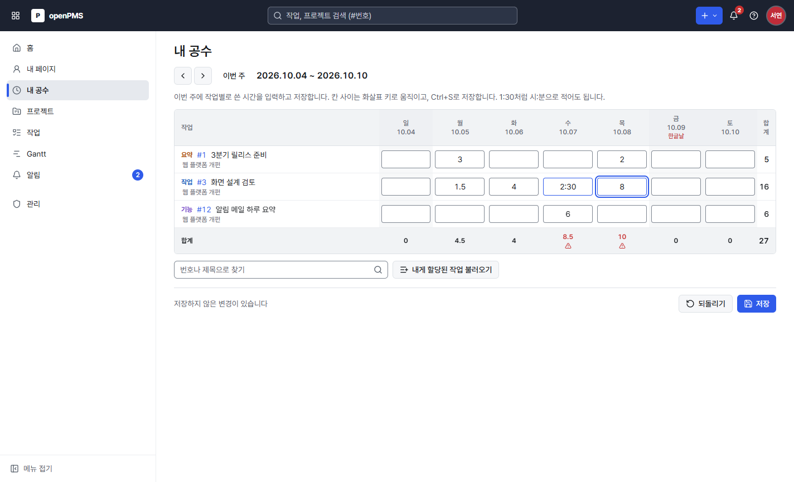 · 모바일 `../../replica/clone-screens/X10-timesheet-mobile.png`(2026-10-11)

<a id="s19"></a>
#### S19 알림

- **목적**: 내가 담당·주시·언급된 작업의 변경 알림을 확인하고, 해당 작업을 같은 화면에서 엽니다.
- **경로**: `/notifications`(읽지 않음), `/notifications?filter=all`(모두), `/notifications/details/:number/:tab?`(작업 열림). 필터는 `?reason=`(이유)·`?project=`(프로젝트 식별자)로 주소에 담기며, 작업을 열고 닫아도 유지됩니다(1.3).

**레이아웃**: 위쪽 줄에 **읽지 않음 / 모두** 토글, **이유로 거르기**·**프로젝트로 거르기** 선택, (필터를 걸었을 때) **필터 지우기**. 그 아래 왼쪽 알림 목록(작업 단위로 묶은 카드), 오른쪽 분할 패널(작업 상세, 기본 탭 **활동**). 아무것도 고르지 않으면 lg 이상에서 오른쪽에 **왼쪽에서 알림을 고르면 작업 내용이 여기에 열립니다.** 안내가 보입니다.

```
알림                                  [✓✓ 모두 읽음으로 표시] [⚙]
[읽지 않음|모두] [담당 (1) ▾] [모든 프로젝트 (1) ▾] [필터 지우기]
┌ 웹 플랫폼 개편 · #5 [신규]                       (1) ┐
│ 작업 릴리스 노트 초안 작성                            │
│ (준) 박준호님이 나를 담당자로 지정했습니다   [담당] 4일 전 │
└──────────────────────────────────────────┘
```

**UI 요소**

| 항목 | 유형 | 설명 | 규칙 |
| --- | --- | --- | --- |
| 모두 읽음으로 표시 | 버튼 | 필터가 없으면 모든 알림, 이유·프로젝트 필터를 걸었으면 **그 필터에 맞는 읽지 않은 알림 전부**(목록에 보이지 않는 오래된 것 포함, 1.5. 1.3·1.4에서는 보이는 알림만) 읽음 처리 | 보이는 알림 중 읽지 않은 것이 없으면 비활성 |
| 알림 설정 | 아이콘 링크 | S20으로 이동 | - |
| 읽지 않음 / 모두 | 토글 버튼 묶음 | 목록 범위 | `aria-pressed` |
| 이유로 거르기 | 선택(1.3) | **모든 이유**, **언급**, **담당**, **책임**, **주시**, **공유**, **날짜 알림**(시작일 알림·완료일 알림·기한 지남), **그 밖의 변경**(새 작업·코멘트·상태·우선순위·날짜 변경). 선택지마다 읽지 않은 수 **(n)**(0이면 숫자 없음) | URL `reason`. 수는 고른 프로젝트 안에서, (1.5) 서버가 모든 읽지 않은 알림을 셈 |
| 프로젝트로 거르기 | 선택(1.3) | **모든 프로젝트**와 (1.5) 고른 이유 안에서 읽지 않은 알림이 있는 프로젝트들(이름순, 지금 고른 프로젝트는 0건이어도 남음), 각각 읽지 않은 수 **(n)** | URL `project`(식별자). 수는 고른 이유 안에서 셈 |
| 필터 지우기 | 버튼(1.3) | 이유·프로젝트 필터를 모두 풂(읽지 않음/모두는 그대로) | 필터가 있을 때만 |
| 알림 카드 | 링크 카드 | 프로젝트명 · #번호 · 상태 pill · 읽지 않은 수 / 유형 + 제목 / 최근 알림의 행위자 아바타 · 요약 · 이유 배지 · 상대 시각 | 읽지 않은 작업은 굵게 + 파란 점. 선택된 카드 강조 |
| 이유 배지 | 배지 | 언급, 담당, 책임, 주시, 공유, 새 작업, 코멘트, 상태, 우선순위, 날짜, 시작일 알림, 완료일 알림, 기한 지남 | - |
| 분할 패널 | 패널 | S07과 같은 작업 상세 | 열면 그 작업의 알림이 모두 읽음 처리 |

**상태**

| 상태 | 표시 |
| --- | --- |
| 로딩 | 카드 자리 스켈레톤 4개 |
| 빈 상태 | **새 알림이 없습니다** / **담당하거나 주시하는 작업에 변화가 생기면 여기에 표시됩니다.** + **알림 설정** 버튼 |
| 필터 결과 없음(1.3) | **조건에 맞는 알림이 없습니다**(필터 아이콘) |
| 오류 | 공통 오류 + **다시 시도** |
| 모바일 | 작업을 열면 목록을 숨기고 상세가 화면 전체를 씀. 닫으면 목록으로 돌아감. 필터 줄은 줄바꿈되어 두 줄이 될 수 있음 |
| 권한 없음 | 해당 없음 |

**주요 동작과 API**

| 동작 | API |
| --- | --- |
| 목록 | `GET /notifications?filter=unread` 또는 `filter=all`, (1.5) 필터가 있으면 `&reasons=<이유,…>&project=<식별자>`. 서버가 먼저 거른 뒤 최근 500건까지 |
| 이유·프로젝트로 거르기 | (1.5) 목록 요청에 `reasons`·`project`를 붙여 다시 받음. 선택지의 수는 `GET /notifications/counts?reasons=&project=`({all, byReason, projects, allProjects}) |
| 작업 열기 | `POST /notifications/read` (`workPackageNumber`) + 상세 API(S07) |
| 모두 읽음으로 표시 | 필터 없음: `POST /notifications/read` (`all: true`) / 필터 있음: (1.5) `POST /notifications/read` (`reasons`, `project`: 필터에 맞는 읽지 않은 알림 전부) |
| 헤더 배지 | `GET /notifications/unread-count` |

- (1.3) 이유·프로젝트 필터와 그 읽지 않은 수는 받아 온 알림(최근 500건) 안에서 셉니다. 헤더 배지는 서버가 전체를 세므로, 읽지 않은 알림이 500건을 넘으면 두 수가 다를 수 있습니다(확인 필요, 01 6장 #15). → (1.5, 0ef1888) 해소: 거르기·선택지의 수·필터 중 **모두 읽음**을 서버가 모든 알림 기준으로 처리합니다. 헤더 배지와 **모든 이유**·**모든 프로젝트**의 수가 같은 기준(볼 수 있는 프로젝트의 읽지 않은 알림)입니다. 목록 자체는 필터에 맞는 최근 500건까지 보입니다(NotificationFiltersIT).
- 1.2까지 없던 이유별·프로젝트별 필터는 57722a9에서 넣었습니다.
- (2.1, f494f76) 작업을 여러 사람이 함께 맡으면(공동 담당자) 담당자 목록의 모든 사람이 **담당** 알림을 받습니다(각자 S20 **내가 담당자인 작업** 설정을 따름). 주 담당자가 아닌 자리로 새로 들어간 사람의 요약은 **{{actor}}님이 나를 공동 담당자로 지정했습니다**, 주 담당자가 된 사람은 전처럼 **{{actor}}님이 나를 담당자로 지정했습니다**입니다. 시작일·완료일·기한 지남 날짜 알림도 담당자 목록의 모든 사람에게 갑니다.

**검증 메시지**: 없음

**관련 흐름**: F09(알림 처리), F08(멘션 알림 수신)

**접근성**: 선택된 카드에 `aria-current`. 읽지 않은 수 옆에 낭독용 **읽지 않음**. 목록은 `aria-label` **알림**. 두 필터 선택의 접근 이름은 **이유로 거르기**·**프로젝트로 거르기**. 필터를 건 화면도 axe 검사(F09-H2 "S19 알림 (필터)")를 통과합니다.

**참고 화면**: 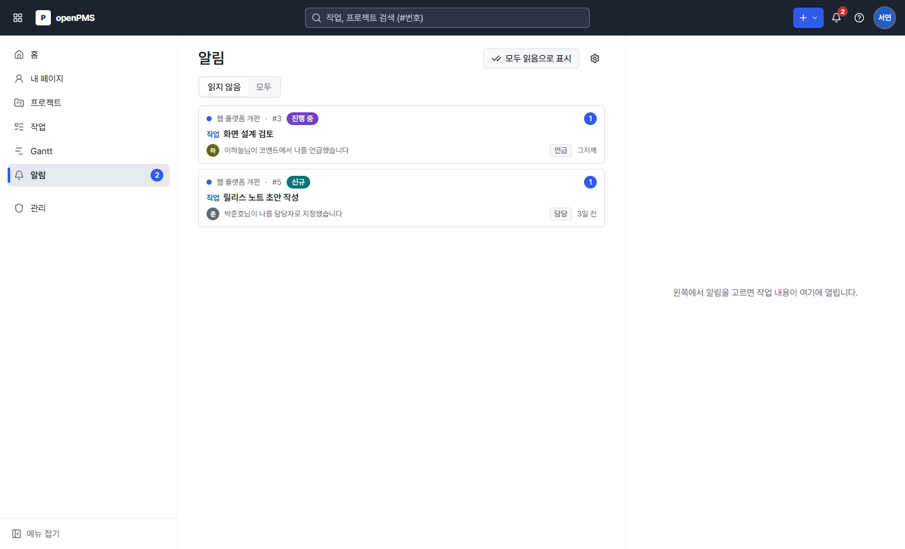 · 필터(모두 · **담당** · 모든 프로젝트) 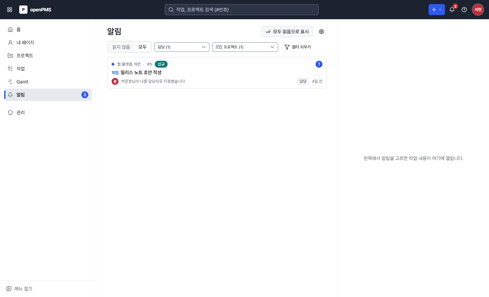 · 상세 열림 `../../replica/clone-screens/S19-open.png` · 모바일 `../../replica/clone-screens/S19-mobile.png`, `../../replica/clone-screens/S19-filters-mobile.png`, `../../replica/clone-screens/S19-open-mobile.png` (필터는 1.3, 2026-10-11 캡처)

<a id="s20"></a>
#### S20 알림 설정

- **목적**: 어떤 일에 알림을 받을지, 이메일은 어떻게 받을지 정합니다.
- **경로**: `/my/notifications`(알림 탭), `/my/notifications?tab=email`(이메일 탭)

**레이아웃**: 제목 **알림 설정**, 탭 **알림** / **이메일**. 알림 탭은 **기본 설정** 카드와 **프로젝트별 설정** 영역, 이메일 탭은 3개 묶음과 저장 버튼으로 이뤄집니다.

**UI 요소(알림 탭: 기본 설정 카드와 프로젝트별 카드에 같은 항목)**

| 묶음 | 항목 | 유형 | 규칙 |
| --- | --- | --- | --- |
| 참여한 작업 | 나를 언급할 때, 주시 중인 작업 | 체크박스(고정) | 항상 켜짐, 설명 **항상** |
| 참여한 작업 | 내가 담당자인 작업, 내가 책임자인 작업, 나에게 공유된 작업 | 체크박스 | 켜고 끔 |
| 날짜 알림 | 시작일, 완료일 | 체크박스 + 선택(당일·1일 전·3일 전·7일 전) | 체크를 끄면 선택 비활성. 처음 켜면 1일 전 |
| 날짜 알림 | 기한이 지나면 | 체크박스 | - |
| 참여하지 않은 작업 | 새 작업, 모든 코멘트, 상태 변경, 우선순위 변경, 날짜 변경 | 체크박스 | 설명 **볼 수 있는 모든 작업에서 일어나는 일도 받아 봅니다. 알림이 많아질 수 있습니다.** |
| 기본 설정 | 기본 설정 저장 | 버튼(주) | 바꾼 내용이 있으면 **저장하지 않은 변경이 있습니다** 표시 |
| 프로젝트별 설정 | 설정을 추가할 프로젝트 + 추가 | 선택 + 버튼 | 추가하면 기본 설정을 복사해 카드 생성 |
| 프로젝트별 카드 | 저장({{name}} 설정 저장), {{name}} 설정 삭제 | 버튼 | 삭제하면 그 프로젝트는 기본 설정을 씀 |

**UI 요소(이메일 탭)**

| 묶음 | 항목 | 유형 | 규칙 |
| --- | --- | --- | --- |
| 멘션 메일 | 나를 언급하면 바로 메일 받기 | 체크박스 | 끄면 언급 알림도 하루 요약 메일에 포함 |
| 하루 요약 메일 | 읽지 않은 알림을 모아 메일로 받기 | 체크박스 | 시각은 내 시간대 기준(설명에 시간대 표시) |
| 하루 요약 메일 | 요약 시각 {{n}} | 시각 입력 + 삭제 버튼 | 1~4개, **시각 추가**(기본 17:00) |
| 날짜 알림 일시 중지 | 이 날짜까지 멈추기 | 날짜 입력 + **일시 중지 해제** | 설정되어 있으면 정보 배너 **{{date}}까지 날짜 알림을 멈춥니다** |
| - | 이메일 설정 저장 | 버튼(주) | 변경이 있으면 **저장하지 않은 변경이 있습니다** |

**상태**: 로딩(스켈레톤), 빈 상태(프로젝트별 **프로젝트별 설정이 없습니다** / **모든 프로젝트에 기본 설정을 씁니다.**), 오류(공통 오류·위험 토스트), 모바일(lg 미만에서 3개 묶음이 세로로 쌓임), 권한 없음(해당 없음).

**주요 동작과 API**

| 동작 | API |
| --- | --- |
| 화면 진입 | `GET /me/notification-settings`, `GET /auth/me` |
| 기본 설정 저장 | `PUT /me/notification-settings/default` |
| 프로젝트 설정 추가·저장 | `PUT /me/notification-settings/projects/{project}` |
| 프로젝트 설정 삭제 | `DELETE /me/notification-settings/projects/{project}` |
| 이메일 설정 저장 | `PUT /me/preferences` (`immediateOnMention`, `digestEnabled`, `digestTimes`, `remindersPausedUntil`) |

**검증 메시지**

| 조건 | 메시지 |
| --- | --- |
| 요약 시각 개수 | 요약 메일 시각을 1~4개 정하세요. |
| 시각 형식 | 시각은 HH:MM 형식으로 입력하세요. |
| 같은 시각 | 같은 시각이 두 번 있습니다. |
| 일시 중지 날짜 형식 | 날짜를 YYYY-MM-DD 형식으로 입력하세요. |
| 알림 시점 값 | 알림 시점은 당일, 1일·3일·7일 전 중에서 고르세요. |

성공 토스트: **저장했습니다**, 프로젝트 추가 **{{name}} 프로젝트 설정을 추가했습니다**, 삭제 **{{name}} 프로젝트는 이제 기본 설정을 씁니다**.

**관련 흐름**: F09

**접근성**: 묶음마다 fieldset/legend. 날짜 알림 시점 선택의 접근 이름 **{{field}} 알림 시점**.

**참고 화면**: 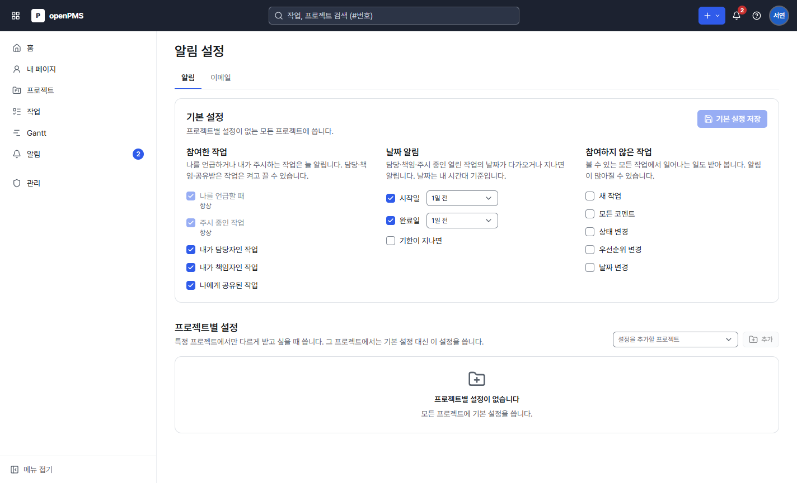

<a id="s22"></a>
#### S22 검색 결과

- **목적**: 작업(번호·제목·설명·코멘트)과 프로젝트(이름·설명)를 찾습니다.
- **경로**: `/search?q=<검색어>&scope=all|work_packages|projects&page=<n>`

**레이아웃**: 제목 **검색 결과**, 검색 입력과 **검색** 버튼, 범위 탭(**모두**·**작업**·**프로젝트**), 결과 요약, 결과 목록, 페이지 이동.

**UI 요소**

| 항목 | 유형 | 설명 | 규칙 |
| --- | --- | --- | --- |
| 검색어 | 입력(search) | 자리표시자 **작업, 프로젝트 검색 (#번호)** | 빈 값은 검색하지 않음 |
| 검색 | 버튼 | 첫 페이지부터 검색 | - |
| 범위 탭 | 탭 링크 | 모두 / 작업 / 프로젝트 | 현재 탭 `aria-current="page"` |
| 결과 요약 | 텍스트 | **'{{q}}' 검색 결과 {{total}}건** | - |
| 작업 결과 | 목록 행 | #번호·유형·제목·상태·프로젝트, 찾은 위치 **{{where}}에서 찾음**(번호·제목·설명·코멘트), 일치 부분 강조 | 클릭 → 작업 상세 |
| 프로젝트 결과 | 목록 행 | 프로젝트명, **프로젝트 · {{identifier}}** | 클릭 → S05 |
| 페이지 이동 | 페이지네이션 | 이전 페이지 / 다음 페이지 | 페이지 크기 고정 |

**상태**

| 상태 | 표시 |
| --- | --- |
| 검색 전 | **찾을 낱말이나 #번호를 입력하세요** |
| 로딩 | 결과 자리 스켈레톤(다음 페이지를 불러오는 동안 이전 결과를 흐리게 유지) |
| 빈 결과 | **'{{q}}'에 맞는 결과가 없습니다** / **다른 낱말이나 #번호로 찾아보세요. 볼 수 있는 작업과 프로젝트만 찾습니다.** |
| 오류 | 공통 오류 + **다시 시도** |
| 모바일 | 범위 탭이 가로 스크롤 |
| 권한 없음 | 해당 없음(볼 수 있는 결과만 표시) |

**주요 동작과 API**: 검색·탭·페이지 이동 → `GET /search?q&scope&page`

- 원본의 뉴스·위키·포럼 등 범주는 범위 밖이라 없습니다. 내부 코멘트는 볼 권한이 있을 때만 검색됩니다.

**검증 메시지**: 없음

**관련 흐름**: 해당 없음

**접근성**: 범위 탭은 `nav`와 `aria-current`. 결과 목록 `aria-label` **검색 결과 목록**. 강조는 `mark` 요소.

**참고 화면**: 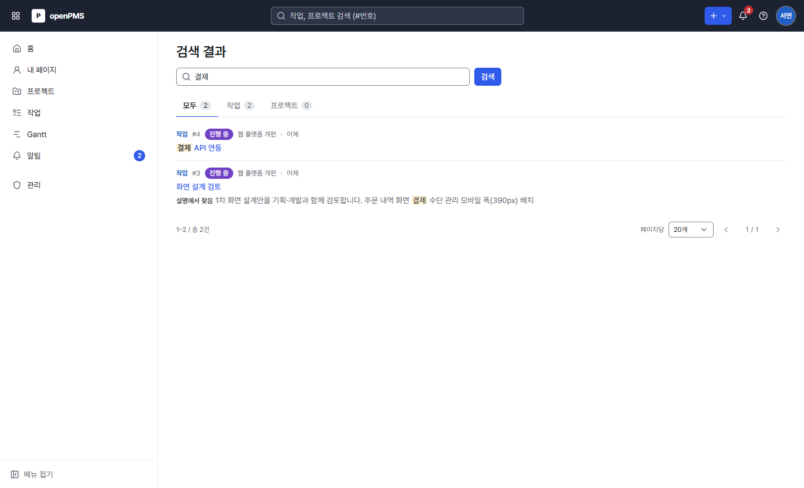

<a id="s37"></a>
#### S37 계정 설정

- **목적**: 내 이름·시간대, 화면 테마, 활동 표시 순서, 키보드 단축키, 비밀번호, 로그인 세션, 사내 연동용 API 토큰(1.4)을 관리합니다.
- **경로**: `/my/account`

**레이아웃**: 제목 **내 계정** 아래 5개 묶음(프로필 → 화면 → 비밀번호 변경 → 로그인 세션 → API 토큰(1.4))이 세로로 배치됩니다. 비밀번호가 없는 계정(사내 SSO로만 로그인, `GET /auth/me`의 `hasPassword=false`)은 세 번째 묶음이 **비밀번호 변경** 대신 **비밀번호**(비밀번호 만들기 링크 받기)로 바뀝니다(1.2).

**UI 요소**

| 묶음 | 항목 | 유형 | 설명·규칙 |
| --- | --- | --- | --- |
| 프로필 | 이름 | 입력 | 필수, 100자 이하 |
| 프로필 | 이메일 | 입력(읽기 전용) | 도움말 **이메일 주소는 관리자가 바꿉니다.** |
| 프로필 | 시간대 | 검색 가능한 선택 | `지역명 (UTC±hh:mm)` 형식. 도움말 **날짜 알림, 요약 메일, '오늘'과 기한 지남은 이 시간대를 기준으로 계산합니다.** |
| 프로필 | 프로필 저장 | 버튼(주) | 바뀐 값이 있을 때 활성 |
| 화면 | 테마 | 라디오 카드(2열) | **시스템 설정**(운영체제 설정을 따릅니다) / **라이트**(밝은 배경) / **다크**(어두운 배경) / **고대비**(더 진한 글자와 테두리, 1.4). 고르면 바로 저장·적용. 고대비는 운영체제가 다크여도 밝은 고대비로 보임 |
| 화면 | 최신 활동을 맨 위에 | 체크박스 | 작업 활동 탭을 최신순으로, 코멘트 입력란을 위에. 바로 저장 |
| 화면 | 저장하지 않은 내용이 있으면 떠나기 전에 묻기 | 체크박스 | 코멘트·설명 작성 중 이탈 확인. 바로 저장 |
| 화면 | 키보드 단축키 | 체크박스(1.4) | 설명 **? 로 목록을 봅니다. 입력 칸에 글을 쓰는 동안에는 동작하지 않습니다.** 끄면 2.2.4의 단축키가 모두 꺼짐. 바로 저장 |
| 비밀번호 변경 | 현재 비밀번호 / 새 비밀번호 / 새 비밀번호 확인 | 입력(password) | 모두 필수. 설명에 규칙 요약과 **바꾸면 다른 기기의 로그인은 끝납니다.** 사내 SSO 연결도 있는 계정(`signInWith`가 비어 있지 않음)은 설명 끝에 **사내 계정({{providers}})으로도 로그인할 수 있습니다.**({{providers}}는 연결된 공급자의 버튼 이름, 여럿이면 쉼표로) |
| 비밀번호 변경 | 비밀번호 바꾸기 | 버튼(주) | - |
| 비밀번호(비밀번호 없는 계정만) | 설명 | 텍스트 | **{{providers}}(으)로 로그인하고 있어 비밀번호가 없습니다. 비밀번호를 만들면 로그인 화면에서 이메일과 비밀번호로도 로그인할 수 있습니다. 내 메일로 받은 링크에서 정합니다.** 연결된 공급자 이름을 모르면 {{providers}} 자리에 **사내 계정(SSO)** |
| 비밀번호(비밀번호 없는 계정만) | 비밀번호 만들기 링크 받기 | 버튼(메일 아이콘) | 누르면 내 이메일 주소로 일회용 링크를 보냄. 요청 중 로딩 표시. 링크는 X01 새 비밀번호 단계로 열리고 유효 시간은 X03 **재설정 링크 유효 시간(분)**을 따름. 다시 누르면 이전 링크는 무효 |
| 로그인 세션 | 다른 기기에서 모두 로그아웃 | 버튼 + 확인 대화상자 | 확인 문구 **다른 기기의 로그인을 모두 끝낼까요?** |
| API 토큰(1.4) | 설명 | 텍스트 | **사내 시스템이 openPMS API를 부를 때 쓰는 토큰입니다. 토큰은 내 권한으로 동작하니 비밀번호처럼 다루세요.** + **API 문서 보기**(X09) |
| API 토큰 | 토큰 목록 | 목록 | 토큰마다 이름, 권한 범위 배지(**읽기 전용** / **읽기·쓰기**), **{{date}} 만듦** · **{{when}} 사용**(없으면 **아직 쓰지 않음**) · **{{date}}까지**(없으면 **만료 없음**), **폐기** 버튼(접근 이름 **{{name}} 토큰 폐기**). 없으면 **만든 토큰이 없습니다.**. 폐기 확인 **'{{name}}' 토큰을 폐기할까요?** / **이 토큰을 쓰는 연동은 바로 401 오류를 받습니다. 되돌릴 수 없습니다.** |
| API 토큰 | 토큰 만들기 | 버튼 → 대화상자 | 제목 **토큰 만들기**: **토큰 이름**(필수, 60자, 도움말 **어디에 쓰는지 알아볼 수 있게(예: 배포 알림 봇)**), **권한 범위** 라디오 카드(**읽기 전용**(기본) — 조회만 합니다(목록 조회·내보내기 포함). 바꾸는 요청은 거절됩니다. / **읽기·쓰기** — 내 권한 안에서 만들고 고칠 수 있습니다.), **만료**(30일 뒤·90일 뒤(기본)·365일 뒤·만료 없음), **취소**·**만들기**. 관리자가 X08에서 토큰을 끄면 만들기가 403으로 거부됨 |
| API 토큰 | 토큰을 만들었습니다 | 대화상자 | 경고 **이 값은 지금 한 번만 보입니다. 안전한 곳에 복사해 두세요. 잃어버리면 새로 만들어야 합니다.**, **토큰 값**(`opms_…`, 고정폭 글자) + **복사**(토스트 **토큰을 복사했습니다**), 안내 **요청 헤더에 Authorization: Bearer <토큰> 을 붙입니다. 로그인·비밀번호·토큰 관리 API에는 쓸 수 없습니다.**, **확인**. 닫으면 다시 볼 수 없음(DB에는 해시만). 안내 문구는 1.4 그대로이지만 서버는 dfde416부터 연동 설정 API(토큰 사용 설정·웹훅)도 토큰으로는 막음(X09) |

- 날짜·시간 표시 형식과 주 시작 요일은 개인 설정이 아닙니다. 관리자가 S33 **날짜 형식** 절에서 모든 사람에게 같은 값으로 정하며, 계정 설정에는 해당 항목이 없습니다.
- 화면 언어 전환은 없습니다(한국어 고정).
- (1.2) 1.1까지는 비밀번호 변경 묶음을 항상 표시해, SSO로 자동 생성되어 비밀번호가 없는 계정은 **현재 비밀번호가 맞지 않습니다.**로 거부됐습니다. 지금은 비밀번호가 없으면 위 **비밀번호** 묶음을 보여 줍니다. 링크가 본인 메일로만 가므로, 남의 세션을 빌린 사람이 비밀번호 로그인 수단을 더할 수는 없습니다. 관리자가 **비밀번호 재설정 허용**을 꺼 두어도 이 링크는 보낼 수 있습니다.

**상태**: 로딩(전체 스켈레톤), 오류(칸 오류·위험 토스트), 모바일(묶음 1열). 빈 상태·권한 없음은 해당 없음.

**주요 동작과 API**

| 동작 | API |
| --- | --- |
| 프로필 저장 | `PATCH /me` (이름, 시간대) |
| 테마 | `PATCH /me` (theme: system·light·dark·high_contrast) |
| 최신 활동·이탈 경고·키보드 단축키 | `PUT /me/preferences` (commentsNewestFirst, warnOnUnsaved, keyboardShortcuts) |
| 비밀번호 바꾸기 | `PUT /me/password` → 다른 세션 종료 |
| 비밀번호 만들기 링크 받기(비밀번호 없는 계정) | `POST /me/password/setup` → 202, 메일 발송(제목 **[openPMS] 비밀번호 만들기**). 비밀번호가 이미 있으면 422 |
| 묶음 고르기 | `GET /auth/me`의 `hasPassword`(비밀번호 유무), `signInWith`(연결된 SSO 공급자 이름 목록) |
| 다른 기기에서 모두 로그아웃 | `POST /me/sessions/end-others` |
| API 토큰 목록 / 만들기 / 폐기(1.4) | `GET /me/api-tokens` / `POST /me/api-tokens` {name, scope: read·write, expiresInDays: 30·90·365·null} → 201(응답에만 토큰 원문) / `DELETE /me/api-tokens/{id}` → 204 |

**검증 메시지**

| 조건 | 메시지 |
| --- | --- |
| 이름 빈 칸 / 초과 | 이름을 입력하세요. / 이름은 100자 이하로 입력하세요. |
| 시간대 | 알 수 없는 시간대입니다. |
| 현재 비밀번호 틀림 | 현재 비밀번호가 맞지 않습니다. |
| 새 비밀번호가 현재와 같음 | 지금 비밀번호와 다른 비밀번호를 정하세요. |
| 새 비밀번호 확인 불일치 | 새 비밀번호가 서로 다릅니다. |
| 비밀번호 규칙 | X01 표와 같음 |
| 비밀번호가 이미 있는데 링크 요청(422) | 이미 비밀번호가 있습니다. (설명 **비밀번호 바꾸기를 쓰세요.**) — 위험 토스트 |
| 링크 요청 과다(분당 3회 초과, 429) | 요청이 너무 많습니다. (설명 **잠시 뒤 다시 시도하세요.**) — 위험 토스트 |

| 토큰 이름 빈 칸·60자 초과(1.4) | 칸 오류(서버 422 name) |
| 토큰 사용이 꺼져 있음(1.4) | 위험 토스트(서버 403) |

성공 토스트: **저장했습니다**, **비밀번호를 바꿨습니다**, **{{email}}(으)로 링크를 보냈습니다**, **다른 기기의 로그인을 끝냈습니다**, (1.4) **토큰을 폐기했습니다**.

**관련 흐름**: F00(세션, 사내 SSO로 만들어진 계정의 비밀번호 만들기), F13(키보드 단축키 끄기, 1.4), F15(API 토큰, 1.4)

**접근성**: 테마 라디오 카드는 화살표 키로 이동. 비밀번호 칸에 `autocomplete` 지정. 비밀번호 없는 계정의 화면도 axe 검사(F00-S4 "S37 계정 설정 (SSO)")를 통과합니다. (1.4) 고대비 테마를 고른 이 화면(a11y "S37 계정 설정 (high contrast)")과 토큰 만들기 대화상자(F15-H1 "S37 API 토큰 만들기")도 axe를 통과합니다. 토큰 값은 접근 이름 **토큰 값**인 `code` 요소라 낭독기로 읽을 수 있습니다.

**참고 화면**: 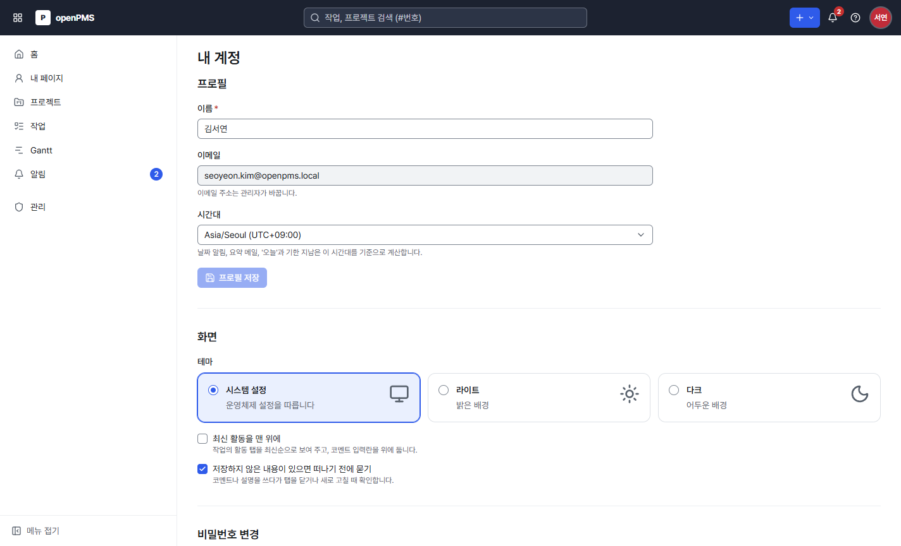 (비밀번호가 있는 계정. 비밀번호 없는 계정의 **비밀번호** 묶음은 캡처 없음) · 고대비 테마 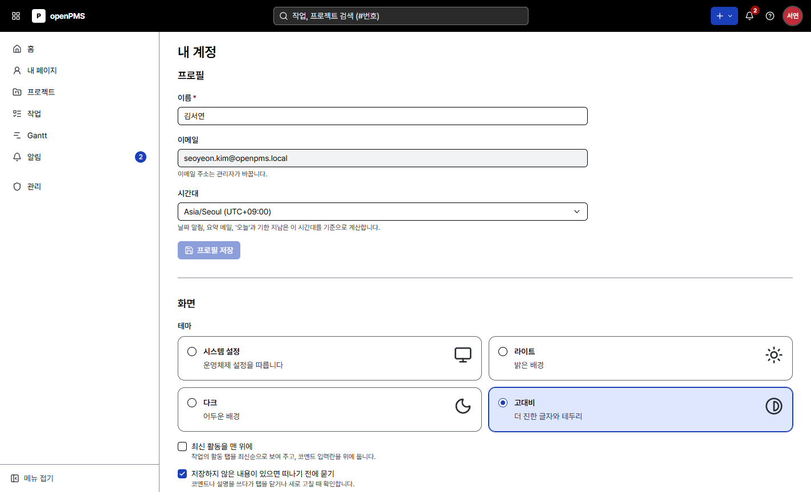, 모바일 `../../replica/clone-screens/S37-high-contrast-mobile.png` (1.4, 2026-10-11. API 토큰 묶음·대화상자는 캡처 없음)

### 4.3 프로젝트 화면

<a id="s03"></a>
#### S03 프로젝트 목록

- **목적**: 볼 수 있는 프로젝트를 찾고, 즐겨찾기하고, (관리자는) 보관된 프로젝트를 복원하거나 삭제합니다.
- **경로**: `/projects?filter=active|mine|favorite|archived&status=&q=&page=&size=`

**레이아웃**

```
프로젝트                                        [+ 프로젝트 만들기]
[진행 중|내 프로젝트|즐겨찾기|보관됨] [모든 상태 ▾]     [🔍 프로젝트 이름으로 찾기]
┌───┬──────────────────┬──────┬────────┬────────┬───┐
│ ☆ │ 이름                │ 상태  │ 공개 범위 │ 최근 활동 │ ⋯ │
└───┴──────────────────┴──────┴────────┴────────┴───┘
1–20 / 총 n건     페이지당 [20개 ▾]    [<] [>]
```

**UI 요소**

| 항목 | 유형 | 설명 | 규칙 |
| --- | --- | --- | --- |
| 프로젝트 만들기 | 버튼(주) | S04로 이동 | global.create_projects 보유자에게만 |
| 진행 중 / 내 프로젝트 / 즐겨찾기 / 보관됨 | 토글 버튼 묶음 | 목록 범위(기본 진행 중) | `aria-pressed`, URL `filter` |
| 상태 | 선택 | **모든 상태**, 순조로움, 주의, 지연 | URL `status` |
| 프로젝트 이름으로 찾기 | 검색 입력 | 이름 검색 | 0.25초 뒤 반영, URL `q` |
| 즐겨찾기 | 별 아이콘 버튼 | 즐겨찾기 추가·빼기 | 접근 이름 **{{name}} 즐겨찾기에 추가** / **{{name}} 즐겨찾기에서 빼기** |
| 이름 | 링크 | 프로젝트명, 하위 프로젝트면 **{{parent}}의 하위 프로젝트** | 클릭 → S05 |
| 상태 | 배지 | 순조로움(초록)·주의(노랑)·지연(빨강)·**상태 없음**, 보관된 프로젝트는 **보관됨** | - |
| 공개 범위 | 아이콘 + 글자 | **공개** / **비공개** | - |
| 최근 활동 | 상대 시각 | 예: 3시간 전 | 마우스를 올리면 원래 시각 |
| ⋯ ({{name}} 메뉴) | 메뉴 | **복원**(보관된 프로젝트), **삭제** | 관리자에게만 |
| 페이지 이동 | 페이지네이션 | **{{from}}–{{to}} / 총 {{total}}건**, **페이지당** 20개·100개, 이전·다음 페이지 | URL `page`, `size` |
| 삭제 확인 대화상자 | 대화상자 | 제목 **'{{name}}' 프로젝트를 삭제할까요?**, 위험 배너(삭제 범위 설명. 1.6: 프로젝트의 시간 기록도 함께 지워지지만 이 대화상자는 따로 말하지 않음, 미결), 입력 **확인을 위해 식별자 {{identifier}}을(를) 입력하세요**, 버튼 **영구 삭제** | 식별자가 정확히 같을 때만 **영구 삭제** 활성 |

**상태**

| 상태 | 표시 |
| --- | --- |
| 로딩 | 표 자리 스켈레톤 5줄 |
| 빈 상태 | **조건에 맞는 프로젝트가 없습니다** / **다른 필터를 고르거나 새 프로젝트를 만드세요.** |
| 오류 | 공통 오류 + **다시 시도** |
| 모바일 | md 미만에서 카드 목록(별·이름·상태·공개 범위·최근 활동·⋯) |
| 권한 없음 | 볼 수 없는 프로젝트는 목록에 나오지 않음 |

**주요 동작과 API**

| 동작 | API |
| --- | --- |
| 목록 | `GET /projects` (filter, status, q, page, pageSize) |
| 즐겨찾기 | `PUT` / `DELETE /projects/{project}/favorite` |
| 복원 | `POST /projects/{project}/unarchive` (상위 프로젝트가 보관 중이면 409) |
| 삭제 | `DELETE /projects/{project}` {confirmIdentifier} (하위 프로젝트가 있으면 409) |

**검증 메시지**: 식별자 불일치 **식별자 '{{identifier}}'를 그대로 입력하세요.**, 권한 **관리자만 프로젝트를 복원할 수 있습니다.** / **관리자만 프로젝트를 삭제할 수 있습니다.**. 성공 토스트 **'{{name}}' 프로젝트를 복원했습니다**, **'{{name}}' 프로젝트를 삭제했습니다**.

**관련 흐름**: F10(프로젝트를 만들고 팀 꾸리기)

**접근성**: 즐겨찾기 버튼 `aria-pressed`. 첫 열(즐겨찾기)과 마지막 열(메뉴)은 화면 낭독기용 열 제목이 있음.

**참고 화면**: 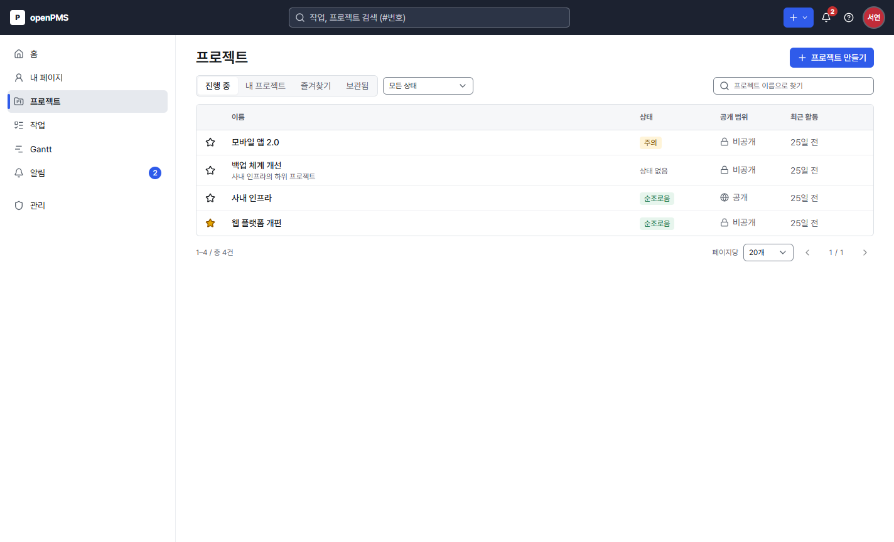 · 모바일 `../../replica/clone-screens/S03-mobile.png`

<a id="s04"></a>
#### S04 새 프로젝트

- **목적**: 빈 프로젝트를 만들거나, 템플릿으로 표시한 프로젝트의 구성과 작업을 복사해 새 프로젝트를 만듭니다. 상위 프로젝트를 고르면 그 아래 하위 프로젝트로 만듭니다(1.3).
- **경로**: `/projects/new`. `?parent=<프로젝트 ID>`로 열면 **상위 프로젝트**가 미리 골라집니다.

**레이아웃**: 브레드크럼(프로젝트 › 새 프로젝트), 제목 **새 프로젝트**, 시작 방식 라디오 카드 2개, (템플릿에서 시작을 고르면) 템플릿 상자, 입력 폼, **만들기**·**취소** 버튼.

```
새 프로젝트
[○ 빈 프로젝트          ] [● 템플릿에서 시작            ]
┌ 템플릿 상자 ─────────────────────────────────┐
│ 템플릿* [웹 플랫폼 개편 ▾]                         │
│ 함께 복사할 것                                    │
│ 모듈, 작업 유형, 사용자 정의 필드와 프로젝트 특성 값은 항상… │
│ ☑ 멤버와 역할   ☑ 버전   ☑ 카테고리                  │
│ ☑ 작업(계층·관계 포함)   ☑ 보드   ☑ 저장된 보기(공개 보기와 내 보기) │
│ 새 시작일 [연도-월-일]  비워 두면 템플릿의 날짜 그대로…      │
└──────────────────────────────────────────┘
프로젝트 이름*  식별자*  상위 프로젝트 [없음(최상위 프로젝트) ▾]  설명  ☐ 회사 전체에 공개
```

**UI 요소**

| 항목 | 유형 | 설명 | 규칙 |
| --- | --- | --- | --- |
| 빈 프로젝트 | 라디오 카드 | **멤버와 모듈을 직접 정해서 시작합니다.** | 기본 선택 |
| 템플릿에서 시작 | 라디오 카드 | **템플릿 프로젝트의 모듈·유형과 고른 항목(멤버, 작업, 보드 등)을 복사해 시작합니다.** | 볼 수 있는 템플릿이 없으면 비활성이고 설명이 **아직 템플릿이 없습니다. 프로젝트 설정에서 '템플릿으로 쓰기'를 켜면 여기에 나옵니다.**로 바뀜(1.3) |
| 템플릿 | 선택(필수) | 템플릿으로 표시된 프로젝트(보관되지 않은 것, 내가 볼 수 있는 것) | 템플릿에서 시작일 때만. 첫 템플릿이 미리 골라짐 |
| 함께 복사할 것 | 체크박스 묶음 | 안내 **모듈, 작업 유형, 사용자 정의 필드와 프로젝트 특성 값은 항상 복사합니다. 복사한 작업에는 알림이 가지 않습니다.** 체크박스 **멤버와 역할**, **버전**, **카테고리**, **작업(계층·관계 포함)**, **보드**, **저장된 보기(공개 보기와 내 보기)**(5d641d1의 캡처에서는 **공개 보기**, 21a23fb에서 이름 변경) | 모두 켠 채로 시작. 템플릿에서 시작일 때만 |
| 새 시작일 | 날짜 입력(1.7) | 도움말 **비워 두면 템플릿의 날짜 그대로 복사합니다. 정하면 가장 이른 작업이 이 날 시작하도록 모든 작업을 근무일 기준으로 옮깁니다(기간과 선후 간격 유지). 버전 날짜도 같은 날 수만큼 옮깁니다.** | 선택. 기본 빈 칸. 템플릿에서 시작일 때만(**함께 복사할 것** 아래). 서버 칸 오류는 이 칸 아래 |
| 프로젝트 이름 | 입력 | 프로젝트명 | 필수, 255자 이하 |
| 식별자 | 입력 | 도움말 **주소에 쓰입니다. 영문 소문자, 숫자, 하이픈만 쓸 수 있습니다.** | 필수, 100자 이하. 이름이 영문이면 자동 제안(직접 고치면 자동 제안 중단). 한글 이름은 자동 제안 없음 |
| 상위 프로젝트 | 선택(1.3) | **없음(최상위 프로젝트)**(기본) + 고를 수 있는 프로젝트. 도움말 **고르면 이 프로젝트가 그 아래 하위 프로젝트가 됩니다. 내가 수정할 수 있는 프로젝트만 고를 수 있습니다.** | 진행 중(보관되지 않은) 프로젝트 중 project.edit가 있는 것만 |
| 설명 | 여러 줄 입력 | 프로젝트 설명. 템플릿에서 시작이면 도움말 **비워 두면 템플릿의 설명을 씁니다.** | 선택 |
| 회사 전체에 공개 | 체크박스 | **멤버가 아니어도 작업을 볼 수 있습니다.** | 기본 꺼짐. 템플릿을 써도 이 값을 따름 |
| 만들기 / 취소 | 버튼 | 생성 / S03으로 | - |

- 템플릿에서 가져가는 것(1.3, a3aee0b): 항상 모듈, 작업 유형, 사용자 정의 필드(켜진 것), 프로젝트 특성 값, 설명(비워 둔 경우). 고르면 멤버와 역할, 버전, 카테고리, 작업(상위-하위 계층과 작업끼리의 관계, 작업마다 '만듦' 활동 기록, 알림 없음), 보드, 보기. 복사한 보기·보드의 필터에 들어 있던 버전·카테고리는 새 프로젝트의 사본으로 바뀝니다. 새 프로젝트의 멤버가 아닌 사람은 담당자·책임자·보드 열에서 빠집니다. 첨부 파일과 코멘트는 복사하지 않습니다. 만드는 사람은 늘 새 프로젝트의 관리자로 들어갑니다.
- 보기는 템플릿의 공개 보기와 만드는 사람 본인의 비공개 보기를 함께 가져갑니다. 5d641d1까지 체크박스 이름이 **공개 보기**였던 것을 21a23fb에서 동작대로 **저장된 보기(공개 보기와 내 보기)**로 바꿨습니다(01 6장 #16). 하위 프로젝트별 보드는 가져가지 않습니다.
- 새 시작일(1.7, 2f7ffb9·b63eaa0): 비워 두면 템플릿의 날짜를 그대로 복사합니다. 정하면 복사하는 것 가운데 가장 이른 날짜(작업의 시작일, 시작일이 없으면 완료일. 작업을 복사하지 않으면 버전의 가장 이른 날짜)가 그날이 되도록 일정 전체를 옮깁니다. 그날이 휴무일이면 그 뒤 첫 근무일부터입니다. 근무일 기준 작업은 시작일과 완료일 모두 가장 이른 날짜로부터 몇 번째 근무일이었는지를 그대로 지켜, 근무일로 센 기간과 선후 작업 사이의 간격이 주말·휴무일을 지나도 같습니다. **근무일 무시** 작업과 버전의 시작일·완료일은 같은 달력 일수만큼 옮깁니다. 관계의 lag는 다시 계산하지 않습니다(위치를 지키므로 간격이 유지됨). 보드와 보기에는 날짜가 없어 바뀌지 않고, 완료일 기준으로 맞추는 기능은 없습니다. 날짜 있는 작업이나 버전을 복사하지 않으면 아무것도 옮기지 않습니다.
- 1.2까지는 **템플릿에서 시작**이 비활성(준비 중)이었고 상위 프로젝트를 고를 수 없었습니다.

**상태**: 기본(빈 폼), 템플릿 없음(템플릿 카드 비활성), 저장 중(버튼 로딩), 오류(칸 오류 또는 위험 배너), 모바일(폼 1열, 템플릿 체크박스 1열), 권한 없음(저장 시 서버 403 배너 **프로젝트를 만들 권한이 없습니다.**). 화면 진입 자체는 막지 않습니다.

**주요 동작과 API**

| 동작 | API |
| --- | --- |
| 화면 진입 | `GET /projects?filter=templates`(템플릿 목록), `GET /projects?filter=active`(상위 프로젝트 후보) |
| 만들기(빈 프로젝트) | `POST /projects` {name, identifier, descriptionHtml, isPublic, parentId} |
| 만들기(템플릿) | `POST /projects` {…, templateId, copy: [members, versions, categories, workPackages, boards, queries] 중 고른 것, startDate(1.7, `YYYY-MM-DD`, 비우면 null)} |
| 결과 | 성공 토스트 **프로젝트를 만들었습니다**(설명에 프로젝트명) → S05로 이동. 실패하면 첫 오류 칸으로 포커스 |

**검증 메시지**

| 조건 | 메시지 |
| --- | --- |
| 이름 빈 칸 | 프로젝트 이름을 입력하세요. |
| 이름 초과 | 프로젝트 이름은 255자 이하로 입력하세요. |
| 식별자 형식 | 영문 소문자로 시작하고 영문 소문자, 숫자, 하이픈만 쓸 수 있습니다. |
| 식별자 중복 | 이미 사용 중인 식별자입니다. |
| 볼 수 없거나 템플릿이 아닌 프로젝트(1.3) | 템플릿을 찾을 수 없습니다. (template 칸) |
| 알 수 없는 복사 항목(1.3) | 복사할 수 없는 항목이 있습니다. |
| 수정할 수 없는 상위 프로젝트(1.3) | 상위 프로젝트를 찾을 수 없습니다. (상위 프로젝트 칸) |
| 날짜가 아닌 새 시작일(1.7) | 422, startDate 칸 오류(**새 시작일** 칸 아래). 날짜 입력 칸이라 화면에서는 보통 생기지 않음 |

**관련 흐름**: F10

**접근성**: 라디오 카드 묶음 접근 이름 **새 프로젝트**. 비활성 카드는 선택 불가로 낭독. 복사 항목은 fieldset과 범례 **함께 복사할 것**. 템플릿 상자를 연 화면도 axe 검사(F10-H2 "S04 새 프로젝트 (템플릿)")를 통과합니다.

**참고 화면**: 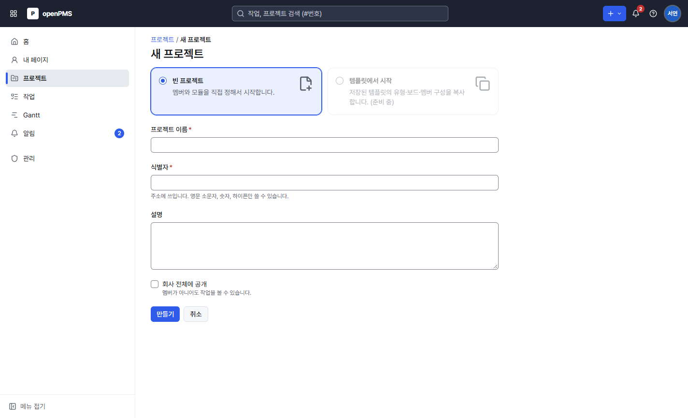 · 템플릿에서 시작 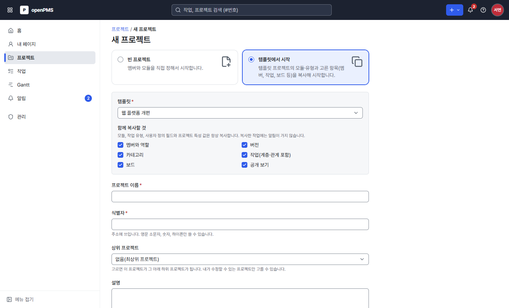 · 모바일 `../../replica/clone-screens/S04-mobile.png`, `../../replica/clone-screens/S04-template-mobile.png` (템플릿은 1.3, 2026-10-11 캡처. `S04.png`은 상위 프로젝트 칸이 없던 1.0 때 화면)

<a id="s05"></a>
#### S05 프로젝트 개요

- **목적**: 프로젝트의 설명·작업 현황·상태·멤버·버전 진행·곧 완료일·최근 바뀐 작업·내게 할당된 작업을 위젯으로 한 화면에서 봅니다. 프로젝트를 고칠 수 있는 사람은 보일 위젯과 순서를 정합니다(1.4).
- **경로**: `/projects/:p`

**레이아웃**

```
프로젝트 › (상위 프로젝트) › 개요
{프로젝트명}                    [⚙ 위젯 편집] [☆ 즐겨찾기] [작업]
[보관됨]  ← 보관된 경우
┌ 위젯 편집(편집 중에만) ─────────────────────────────────┐
│ 보일 위젯을 고르고 순서를 정합니다. …               저장됨 │
│ ☑ 설명 [↑][↓]  ☑ 작업 현황 [↑][↓]  ☐ 버전 진행  …        │
└──────────────────────────────────────────────┘
┌──────────────────────┬──────────────────────┐
│ 설명                    │ 작업 현황               │
├──────────────────────┼──────────────────────┤
│ 프로젝트 상태             │ 멤버                   │  ← 고른 순서대로 2열(lg 이상)
└──────────────────────┴──────────────────────┘
```

**UI 요소**

| 항목 | 유형 | 설명 | 규칙 |
| --- | --- | --- | --- |
| 위젯 편집 / 편집 끝내기 | 토글 버튼(1.4) | 위젯 편집 묶음 열기·닫기 | project.edit가 있을 때만. `aria-pressed` |
| 위젯 편집 묶음 | 영역(1.4) | 안내 **보일 위젯을 고르고 순서를 정합니다. 이 프로젝트를 보는 모든 사람에게 같은 개요가 보입니다. 바꾸면 바로 저장됩니다.**, 저장 상태 **저장 중…** / **저장됨**, 위젯 체크박스 8개와 보이는 위젯마다 **{{name}} 위로**·**{{name}} 아래로** | 체크하면 맨 뒤에 추가. 바꿀 때마다 바로 저장 |
| 즐겨찾기 | 토글 버튼 | 프로젝트 즐겨찾기 | `aria-pressed` |
| 작업 | 버튼(주) | S06으로 | - |
| 설명 | 위젯 | 서식 있는 설명 | 없으면 **설명이 없습니다.** |
| 작업 현황 | 위젯 | **열린 작업** 수(링크 → 모두 열림 보기), **기한 지남** 수(링크 → 기한 지남 보기, 1건 이상이면 빨강·경고 아이콘), **상태별** 막대 | 상태 색 막대 |
| 프로젝트 상태 | 위젯 | 상태 배지(순조로움·주의·지연 또는 **상태 없음**)와 **상태 설명** | 수정은 S24 정보에서 |
| 멤버 | 위젯 | 멤버 최대 8명(아바타·이름·역할) | **멤버 모두 보기**는 project.view_members일 때만 |
| 버전 진행 | 위젯(1.4) | 진행 중인 버전마다 이름, 기간, **{{total}}개 중 {{closed}}개 완료**, 진행 막대 | 없으면 **진행 중인 버전이 없습니다.** |
| 곧 완료일(14일 안) | 위젯(1.4) | 14일 안에 완료일이 오는 열린 작업 최대 8건, **모두 보기 ({{count}})** | 없으면 **14일 안에 완료일이 오는 열린 작업이 없습니다.** |
| 최근 바뀐 작업(7일) | 위젯(1.4) | 지난 7일 동안 바뀐 작업 최대 8건, **모두 보기 ({{count}})** | 없으면 **지난 7일 동안 바뀐 작업이 없습니다.** |
| 내게 할당된 작업 | 위젯(1.4) | 이 프로젝트에서 내가 담당자인 열린 작업 최대 8건, **모두 보기 ({{count}})** | 없으면 **이 프로젝트에서 내게 할당된 열린 작업이 없습니다.** |

- 새 프로젝트의 기본 위젯은 **설명**, **작업 현황**, **프로젝트 상태**, **멤버**(1.3까지의 고정 개요와 같음)입니다. 구성은 프로젝트마다 하나이고(`projects.overview_widgets`, V13) 개인별 구성은 없습니다. 프로젝트 복사·템플릿은 개요 구성도 가져갑니다.
- 개요 화면에서 프로젝트 상태를 바로 고치는 기능은 없습니다(S24 정보에서). 1.3까지의 '위젯 편집 없음'(빌드 로그 partial)은 3a5a544에서 끝났습니다.

**상태**: 로딩(위젯 스켈레톤), 오류(위젯 안 공통 오류, 저장 실패는 위험 토스트), 위젯 없음(**보이는 위젯이 없습니다** + 편집 권한자에게만 **위젯 편집에서 보일 위젯을 고르세요.**), 없음·권한 없음(볼 수 없는 프로젝트는 404 **페이지를 찾을 수 없습니다**, project.edit가 없으면 **위젯 편집** 버튼 없음), 모바일(lg 미만에서 1열), 보관됨(배지 **보관됨**).

**주요 동작과 API**

| 동작 | API |
| --- | --- |
| 진입 | `GET /projects/{project}`(응답의 `overviewWidgets`), `GET /projects/{project}/overview`(작업 현황) |
| 버전 진행 위젯 | `GET /projects/{project}/versions` |
| 곧 완료일·최근 바뀐 작업·내게 할당된 작업 위젯 | `POST /work-packages/query`(위젯마다 8건) |
| 위젯 켜기·끄기·순서(1.4) | `PATCH /projects/{project}` {overviewWidgets: [위젯 키…]}(바꿀 때마다 차례로) |
| 즐겨찾기 | `PUT\|DELETE /projects/{project}/favorite` |

**검증 메시지**: 서버 **알 수 없는 위젯이 있습니다.**(overviewWidgets, 정상 사용 중에는 나오지 않음), 권한이 없으면 403

**관련 흐름**: F10

**접근성**: 위젯마다 영역 이름(위젯 제목). 상태별 막대와 버전 진행 막대는 숫자를 글자로 함께 표시(진행 막대는 `role="progressbar"`). 저장 상태는 `aria-live`. 위·아래 버튼 접근 이름에 위젯 이름. 위젯 편집을 연 화면은 axe 검사(F10-H5 "S05 개요 위젯 편집")를 통과합니다.

**참고 화면**: 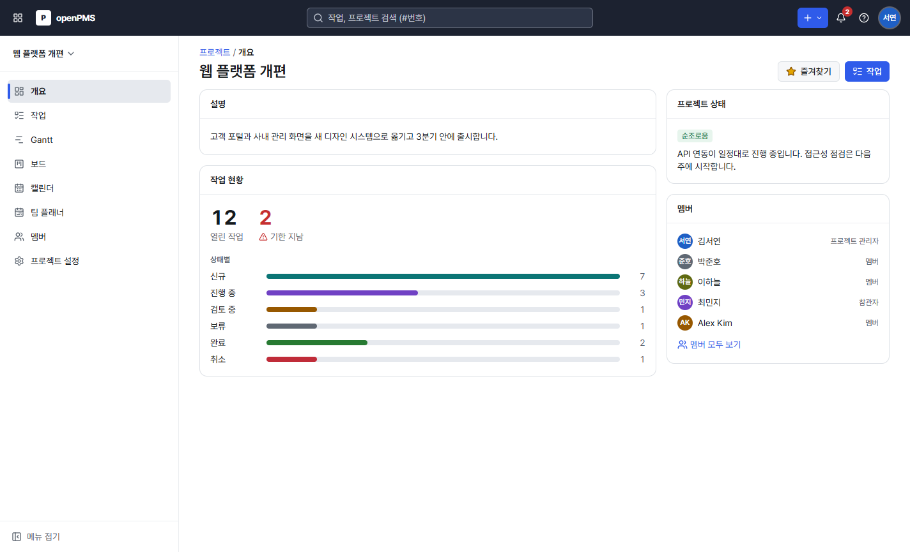 · 위젯 편집 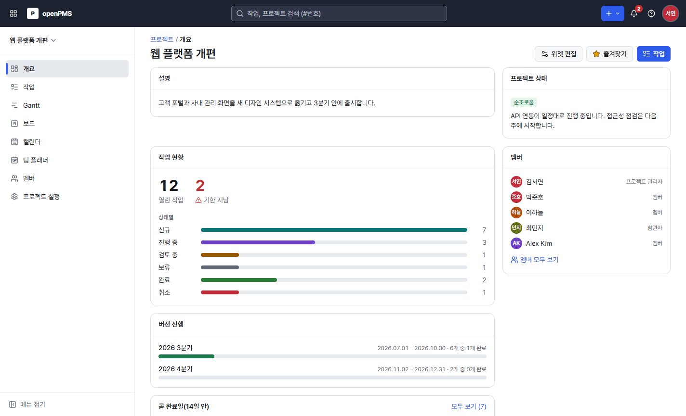 · 모바일 `../../replica/clone-screens/S05-mobile.png`, `../../replica/clone-screens/S05-widgets-mobile.png` (위젯 편집은 1.4, 2026-10-11 캡처)

<a id="s23"></a>
#### S23 멤버

- **목적**: 프로젝트 멤버(사람·그룹)와 역할을 관리합니다.
- **경로**: `/projects/:p/members`

**레이아웃**: 브레드크럼, 제목 **멤버**와 **멤버 추가** 버튼, 멤버 표.

**UI 요소**

| 항목 | 유형 | 설명 | 규칙 |
| --- | --- | --- | --- |
| 멤버 추가 | 버튼(주) | 추가 대화상자 열기 | project.manage_members |
| 이름 | 셀 | 사람은 아바타+이름, 그룹은 그룹 표시+이름 | - |
| 이메일 | 셀 | 사람의 이메일, 그룹은 **그룹** | - |
| 역할 | 인라인 선택 | 현재 역할, 클릭하면 역할 목록 | 관리 권한이 없으면 글자만 |
| 참여일 | 셀 | 멤버가 된 날짜 | - |
| {{name}} 멤버에서 빼기 | 아이콘 버튼 | 확인 대화상자 **멤버에서 뺄까요?** | 관리 권한이 있을 때만 |
| 추가 대화상자 | 대화상자 | 제목 **멤버 추가**. **이름·이메일·그룹으로 찾기**(예: 김서연, 인프라), 후보 체크박스 목록(그룹 먼저), **역할** 선택, 버튼 **추가 ({{count}})** | 1명 이상 고르면 활성. 기본 역할은 작업을 수정할 수 있고 멤버 관리는 못 하는 역할(예: 멤버) |

- 빼기 확인 문구: 사람 **{{name}}님은 이 프로젝트의 작업을 더 이상 볼 수 없습니다. 담당 중인 작업은 그대로 남습니다.**, 그룹 **{{name}} 그룹 구성원은 이 그룹을 통해 받은 권한을 잃습니다. 따로 멤버로 추가된 사람은 그대로 남습니다.**

**상태**: 로딩(스켈레톤), 빈 상태(**멤버가 없습니다**, 후보 없음 **추가할 수 있는 사람이나 그룹이 없습니다**), 오류(공통 오류·토스트), 권한 없음(메뉴에 멤버가 보이지 않음, 변경 버튼 숨김), 모바일(표 가로 스크롤).

**주요 동작과 API**

| 동작 | API |
| --- | --- |
| 목록 | `GET /projects/{project}/members`, 역할 목록 `GET /admin/roles`(프로젝트 역할) |
| 후보 검색 | `GET /principals?q&includeGroups` |
| 추가 | `POST /projects/{project}/members` |
| 역할 변경 | `PATCH /members/{id}` |
| 빼기 | `DELETE /members/{id}` |

**검증 메시지**: **역할을 하나 이상 고르세요.**, **마지막 프로젝트 관리자입니다.**(역할 변경), **마지막 프로젝트 관리자는 뺄 수 없습니다.**, **역할 목록을 볼 권한이 없습니다.**. 성공 **멤버로 추가했습니다 ({{count}})**.

**관련 흐름**: F10

**접근성**: 역할 선택의 접근 이름 **{{name}} 역할: {{역할}}**. 후보 목록은 fieldset(낭독용 범례 **추가할 사람과 그룹**).

**참고 화면**: 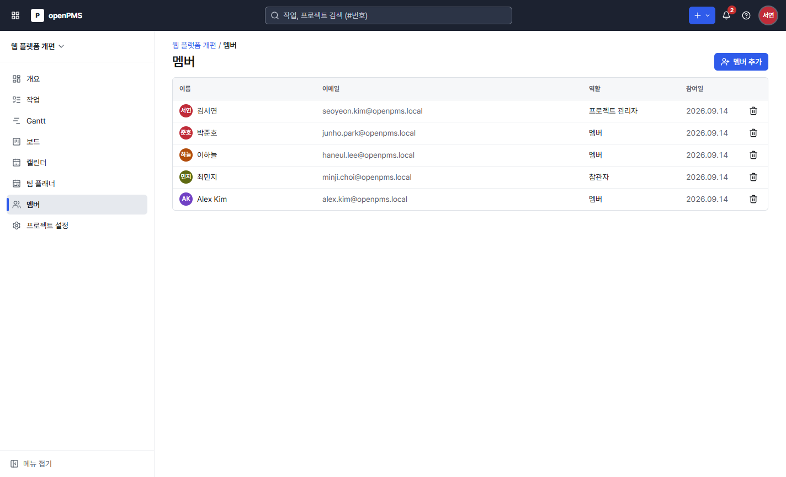 · 그룹 포함 `../../replica/clone-screens/S23-groups.png` · 모바일 `../../replica/clone-screens/S23-mobile.png`

<a id="s24"></a>
#### S24 프로젝트 설정: 정보·모듈

- **목적**: 프로젝트 이름·설명·상태·공개 범위·상위 프로젝트를 바꾸고, 템플릿으로 쓸지 정하고, 프로젝트를 복사하고(1.4), 보관하고, 모듈을 켜고 끕니다.
- **경로**: `/projects/:p/settings/general`(정보), `/projects/:p/settings/modules`(모듈). `/projects/:p/settings`나 알 수 없는 구역은 정보로 이동합니다.

**레이아웃**: 제목 **프로젝트 설정**, 구역 탭(**정보**·**모듈**·**작업 설정**·**버전**), 구역 내용.

**UI 요소(정보)**

| 항목 | 유형 | 설명 | 규칙 |
| --- | --- | --- | --- |
| 프로젝트 이름 | 입력 | - | 필수, 255자 |
| 설명 | 여러 줄 입력 | - | - |
| 프로젝트 상태 | 선택 | 상태 없음, 순조로움, 주의, 지연 | - |
| 상태 설명 | 입력 | 상태에 대한 한 줄 설명 | 500자 |
| 회사 전체에 공개 | 체크박스 | **멤버가 아니어도 작업을 볼 수 있습니다.** | - |
| 상위 프로젝트 | 선택(1.3) | **없음(최상위 프로젝트)** + 고를 수 있는 프로젝트. 도움말은 S04와 같음 | 내가 project.edit를 가진 진행 중 프로젝트 중 이 프로젝트 자신과 그 아래(하위의 하위 포함)를 뺀 것. 지금 상위가 후보에 없으면(내가 고칠 수 없는 상위) 그 이름도 선택지에 남김. 바꿨을 때만 저장 요청에 담김 |
| 템플릿으로 쓰기 | 체크박스(1.3) | **새 프로젝트를 만들 때 이 프로젝트를 골라 구성과 작업을 복사할 수 있습니다.** | 켜면 S04 **템플릿에서 시작**의 템플릿 목록에 나옴 |
| 저장 | 버튼(주) | - | - |
| 프로젝트 복사 | 영역(1.4) | 설명 **이 프로젝트의 모듈·유형·사용자 정의 필드와 고른 항목(멤버, 작업 등)으로 새 프로젝트를 만듭니다. 복사한 작업에는 알림이 가지 않습니다.** + **프로젝트 복사** 버튼 | project.edit와 프로젝트 만들기 권한(global.create_projects)이 모두 있을 때만 |
| 복사 대화상자 | 대화상자(1.4) | 제목 **{{name}} 복사**, **프로젝트 이름**(기본 **{{name}} (사본)**), **식별자**(기본 **{{identifier}}-copy**), **함께 복사할 것**(S04 템플릿과 같은 체크박스 6개), (1.7) **새 시작일**(날짜 입력, 도움말은 S04와 같음), **취소**·**복사해서 만들기** | 상위 프로젝트는 원본과 같게 만듦. 새 시작일은 선택이고 규칙은 S04와 같음(비우면 날짜 그대로). 성공하면 토스트 **프로젝트를 복사했습니다**와 새 프로젝트 개요(S05)로 이동 |
| 프로젝트 보관 | 영역 | **보관하면 모든 멤버에게 읽기 전용이 되고 목록에서 '보관됨'으로 옮겨집니다. 복원은 관리자가 합니다.** + **보관하기** | project.archive, 보관되지 않은 프로젝트만. 확인 **'{{name}}' 프로젝트를 보관할까요?** |

**UI 요소(모듈)**

| 항목 | 유형 | 설명 | 규칙 |
| --- | --- | --- | --- |
| 안내 | 텍스트 | **끈 모듈은 메뉴에서 사라지고, 주소로 들어오면 꺼진 기능이라고 안내합니다. 데이터는 지워지지 않습니다.** | - |
| 작업 | 체크박스(고정) | **프로젝트의 기본 기능이라 끌 수 없습니다.** | 항상 켜짐 |
| Gantt / 보드 / 캘린더 / 팀 플래너 | 체크박스 | 각 설명(일정과 선후행 관계를 타임라인으로 봅니다 등) | project.manage_modules |
| 시간 기록(1.6) | 체크박스 | **작업에 쓴 시간을 기록하고 공수 보고서로 모아 봅니다.** | project.manage_modules. 새 프로젝트와 V17 이전에 있던 프로젝트는 켜진 채로 시작. 끄면 프로젝트 메뉴 **공수 보고서**, 작업의 **시간** 탭이 사라지고 그 프로젝트 작업은 내 공수에서 읽기 전용(기록은 지우지 않음) |
| 저장 | 버튼(주) | - | 권한이 있을 때만 |

**상태**: 권한 없음(아래 권한이 하나도 없으면 경고 배너 **이 프로젝트의 설정을 바꿀 권한이 없습니다.**), 오류(칸 오류·토스트), 모바일(탭 가로 스크롤).

**주요 동작과 API**: 저장(정보·모듈) `PATCH /projects/{project}`(정보에는 1.3부터 `isTemplate`, 바꿨을 때만 `parentId`. `parentId: null`이면 최상위로) / 상위 프로젝트 후보 `GET /projects?filter=active` / 복사(1.4) `POST /projects/{project}/copy` {name, identifier, parentId, copy: [members, versions, categories, workPackages, boards, queries] 중 고른 것, startDate(1.7, 선택)} → 201, 새 프로젝트(템플릿 아님). 새 시작일을 정하면 S04와 같은 규칙으로 일정 전체를 옮김(`ProjectCopy.Shift`) / 보관 `POST /projects/{project}/archive` → 토스트 **프로젝트를 보관했습니다**, S03 보관됨 목록으로 이동.

**검증 메시지**: **프로젝트 이름을 입력하세요.**, **알 수 없는 상태입니다.**, **알 수 없는 모듈입니다.**, (1.3, 상위 프로젝트 칸) **상위 프로젝트를 찾을 수 없습니다.**(없거나 내가 고칠 수 없는 프로젝트), **자기 자신이나 하위 프로젝트를 상위로 정할 수 없습니다.** (1.4, 복사 대화상자) 이름·식별자 검증은 S04와 같음(**이미 사용 중인 식별자입니다.** 등), 원본을 고칠 권한이 없으면 403, (1.7) 날짜가 아닌 새 시작일은 422(startDate 칸)

**관련 흐름**: F10, F11

**접근성**: 구역 탭은 `nav`(이름 **프로젝트 설정 구역**). 모듈 목록은 fieldset. 복사 대화상자를 연 화면은 axe 검사(F10-H4 "S24 프로젝트 복사")를 통과합니다. (1.7) **새 시작일**은 레이블로 찾는 날짜 칸이고 도움말이 칸 설명으로 붙습니다(e2e F10-H6이 레이블로 찾아 입력).

**참고 화면**: 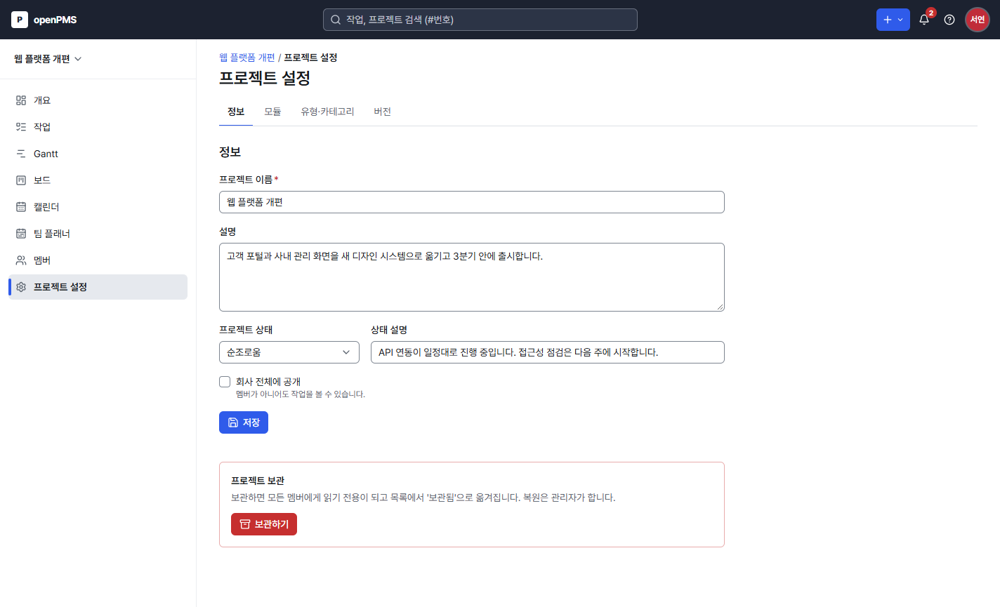 · 프로젝트 복사 대화상자 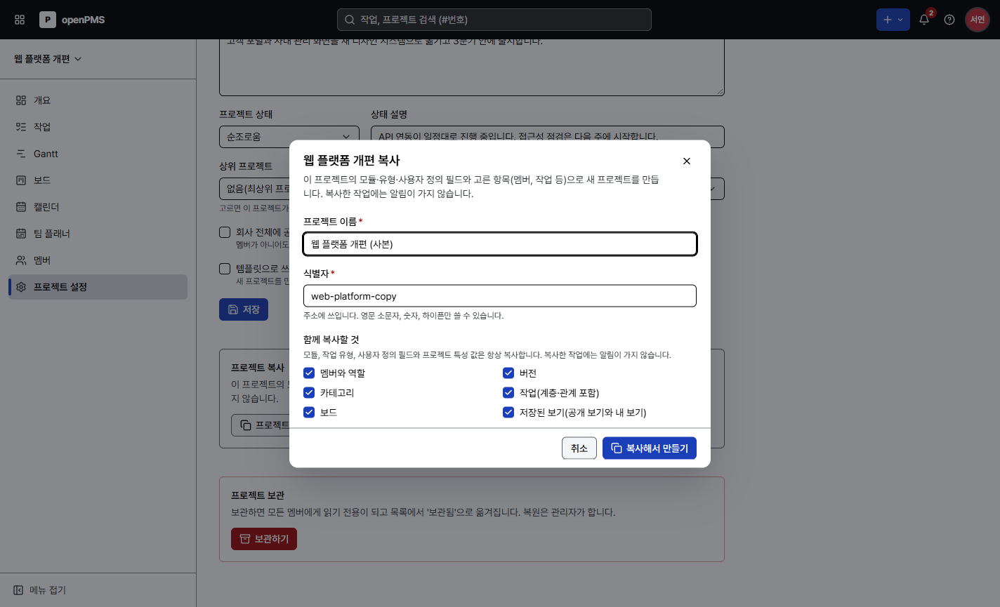(1.4, 2026-10-11, 데스크톱만. 1.7에서 **새 시작일** 칸이 보이게 다시 찍음) · 모듈 `../../replica/clone-screens/S24-modules.png` · 모바일 `../../replica/clone-screens/S24-mobile.png`, `../../replica/clone-screens/S24-modules-mobile.png` (`S24.png`은 1.0 캡처. 1.3의 **상위 프로젝트**·**템플릿으로 쓰기**는 `S24-copy.png`의 대화상자 뒤 배경에만 보임)

<a id="s25"></a>
#### S25 프로젝트 설정: 작업 설정

- **목적**: 이 프로젝트에서 쓸 유형, 카테고리, 사용자 정의 필드와 내부 코멘트 사용 여부(1.4)를 정합니다.
- **경로**: `/projects/:p/settings/work-packages`

**UI 요소**

| 묶음 | 항목 | 유형 | 설명·규칙 |
| --- | --- | --- | --- |
| 사용할 유형 | 유형 체크박스 | 체크박스 | **이 프로젝트에서 만들 수 있는 작업 유형입니다. 작업이 있는 유형은 끌 수 없습니다.** project.manage_types. 바꾼 뒤 **저장** |
| 카테고리 | 카테고리 추가 | 버튼 | 대화상자 **카테고리 추가**(이름*, 기본 담당자) |
| 카테고리 | 표 | 표 | 열: 이름, 기본 담당자, ⋯(수정·삭제). project.manage_categories |
| 사용자 정의 필드 | 필드 체크박스 | 체크박스 | **이 프로젝트의 작업에서 쓸 필드를 켭니다. …** '모든 프로젝트' 필드는 항상 켜짐(배지 **모든 프로젝트**). 설명 **{{형식}} · 유형: {{유형}}**. project.manage_custom_fields |
| 내부 코멘트(1.4) | 이 프로젝트에서 내부 코멘트 쓰기 | 체크박스 + 저장 | 설명 **켜면 '내부 코멘트 쓰기' 권한이 있는 사람이 코멘트를 내부로 표시할 수 있고, '내부 코멘트 보기' 권한이 있는 역할만 그 코멘트와 알림을 받습니다.** project.edit. 끄면 새 내부 코멘트를 쓸 수 없고, 이미 쓴 내부 코멘트는 계속 권한 있는 역할에게만 보임 |

**상태**: 빈 상태(**카테고리가 없습니다**, **관리자가 만든 사용자 정의 필드가 없습니다**), 로딩(스켈레톤), 오류(토스트), 권한 없음(묶음별로 체크박스 비활성·버튼 숨김. 사용자 정의 필드 묶음은 권한이 없으면 숨김).

**주요 동작과 API**

| 동작 | API |
| --- | --- |
| 유형 저장 | `PUT /projects/{project}/types` |
| 카테고리 목록·추가·수정·삭제 | `GET\|POST /projects/{project}/categories`, `PATCH\|DELETE /categories/{id}` |
| 사용자 정의 필드 | `GET\|PUT /projects/{project}/custom-fields` |
| 내부 코멘트 켜기·끄기(1.4) | `PATCH /projects/{project}` {internalComments} |

**검증 메시지**: **유형을 하나 이상 고르세요.**, **쓰고 있는 유형은 끌 수 없습니다.**(설명에 해당 유형), 카테고리 **이름을 입력하세요.** / **같은 이름이 이미 있습니다.** / **프로젝트 멤버만 지정할 수 있습니다.**(기본 담당자). 삭제 확인 **'{{name}}' 카테고리를 삭제합니다. 작업의 카테고리는 비워집니다.**

**관련 흐름**: F11, F08(내부 코멘트, 1.4)

**접근성**: 묶음마다 fieldset과 낭독용 범례.

**참고 화면**: 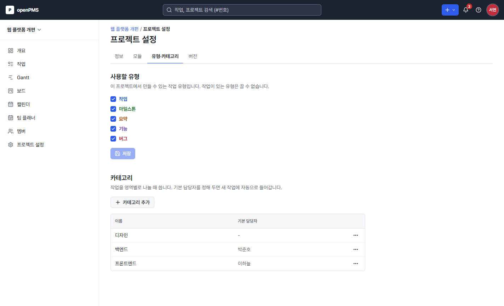 · 모바일 `../../replica/clone-screens/S25-mobile.png` (1.0 캡처. 1.4의 **내부 코멘트** 묶음은 캡처 없음)

<a id="s26"></a>
#### S26 프로젝트 설정: 버전

- **목적**: 릴리스·분기 같은 단위(버전)를 관리합니다.
- **경로**: `/projects/:p/settings/versions`

**UI 요소**

| 항목 | 유형 | 설명 | 규칙 |
| --- | --- | --- | --- |
| 안내 | 텍스트 | **릴리스나 분기 같은 단위로 작업을 묶습니다.** | - |
| 버전 추가 | 버튼 | 대화상자 **버전 추가** | project.manage_versions |
| 버전 표 | 표 | 열: 이름, 상태(진행 중·잠김·닫힘), 기간, 완료 / 전체(**{{closed}} / {{total}}**), ⋯(수정·삭제) | - |
| 버전 대화상자 | 대화상자 | 이름*, 설명(255자), 상태, 시작일, 종료일 | 종료일은 시작일 이후 |

**상태**: 빈 상태(**버전이 없습니다**), 로딩·오류(공통), 권한 없음(추가·메뉴 숨김), 모바일(표 가로 스크롤).

**주요 동작과 API**: 목록 `GET /projects/{project}/versions` / 추가 `POST /projects/{project}/versions` / 수정 `PATCH /versions/{id}` / 삭제 `DELETE /versions/{id}`

**검증 메시지**: **이름을 입력하세요.**, **같은 이름이 이미 있습니다.**, **종료일은 시작일 이후여야 합니다.**, **알 수 없는 상태입니다.**. 삭제 확인 **'{{name}}' 버전을 삭제합니다. 이 버전에 묶인 작업 {{count}}개의 버전은 비워집니다.**

**관련 흐름**: F11

**접근성**: 행 메뉴 접근 이름 **{{name}} 메뉴**.

**참고 화면**: 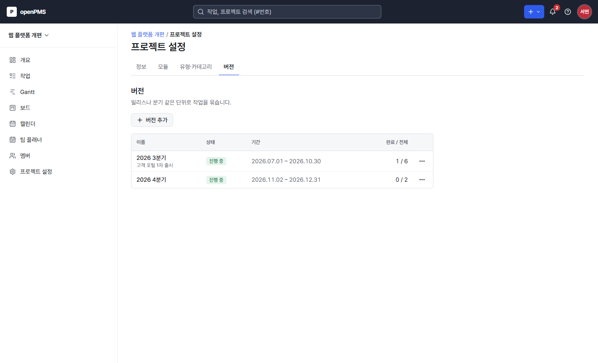 · 모바일 `../../replica/clone-screens/S26-mobile.png`

<a id="x11"></a>
#### X11 공수 보고서 (1.6)

- **목적**: 프로젝트에서 기간 안에 기록된 시간을 사람·작업·활동·날짜별로 모아 보고, 기록을 Excel로 내려받아 공수 보고에 씁니다(3f9d5c0).
- **경로**: `/projects/:p/time`. 프로젝트 메뉴 **공수 보고서**.
- **권한**: time.view, 모듈 time_tracking. 모듈이 꺼져 있으면 공통 **이 프로젝트에서 꺼진 기능입니다**. 권한이 없으면 메뉴가 없고, 주소로 들어오면 내가 볼 수 있는 기록(내 기록)만 셉니다.

**레이아웃**: 브레드크럼(프로젝트 › 공수 보고서), 제목 **공수 보고서**와 오른쪽 **Excel로 내려받기**, 안내, 조건 줄(시작·끝·묶기), 결과 표.

**UI 요소**

| 항목 | 유형 | 설명 | 규칙 |
| --- | --- | --- | --- |
| 안내 | 텍스트 | **기간 안에 기록된 시간을 묶어서 봅니다. 내가 볼 수 있는 기록만 셉니다.** | - |
| 시작 / 끝 | 날짜 입력 | 기본 이번 달 1일 ~ 말일 | 끝 칸 아래에, 끝이 시작보다 빠르면 **끝 날짜가 시작 날짜보다 빠릅니다**, 366일 이상이면 **한 번에 1년까지만 볼 수 있습니다**(후속 6f46d4c: 서버에 묻지 않고 화면이 바로 안내). 그동안 **Excel로 내려받기**는 비활성이고, 서버에 묻지 않고 표를 숨김(후속 39c8974. 그 전에는 기간 없이 요청해 서버 기본값인 이번 달 표를 보여 줌) |
| 묶기 | 세그먼트(라디오) | **사람별**(기본), **작업별**, **활동별**, **날짜별** | API의 **프로젝트별**은 이 화면에 없음(프로젝트 안이라) |
| 결과 표 | 표 | 열: 묶음 이름(사람 이름, `#번호 제목`, 활동 이름(없으면 **활동 없음**), 날짜), **시간**, **비율**(막대 + %) | 사람·작업·활동별은 시간 많은 순(같으면 이름 한글순), 날짜별은 날짜순. 비율 막대는 최소 2% 폭 |
| 합계 | 표 바닥 | **합계** 행, 기간 전체 시간 | - |
| Excel로 내려받기 | 버튼 | 같은 기간·프로젝트의 기록을 xlsx로 내려받음(시트 '공수': 날짜, 사람, 프로젝트, 번호, 작업, 활동, 시간, 메모 + 맨 아래 합계 행). 파일 이름 `공수 {{시작}}~{{끝}}.xlsx` | 기간이 잘못되면 비활성, 받는 동안 로딩. 데모(가짜 데이터) 모드는 같은 열의 CSV(UTF-8 BOM) |

**상태**

| 상태 | 표시 |
| --- | --- |
| 로딩 | 표 자리 스켈레톤. 조건을 바꾸는 동안은 이전 표를 흐리게(불투명도 60%) |
| 빈 상태 | **이 기간에 기록된 시간이 없습니다.** |
| 기간 오류 | 끝 칸 아래 안내만 보이고 표·스켈레톤은 없음(39c8974) |
| 오류 | 공통 오류 + **다시 시도**, 내려받기 실패는 위험 토스트 |
| 모바일 | 조건 칸이 줄바꿈, 표는 가로 스크롤(최소 폭 480px) |

**주요 동작과 API**

| 동작 | API |
| --- | --- |
| 표 | `GET /time-entries/report?project={p}&from=&to=&groupBy=user\|workPackage\|activity\|day` → {from, to, groupBy, rows: [{key, label, hours}], total} |
| Excel로 내려받기 | `GET /time-entries/export?project={p}&from=&to=` → xlsx(`Content-Disposition`의 `filename*`가 한글 파일 이름) |

- 기간을 비워 부르면 이번 달, 1년 이상이면 422 **한 번에 1년까지만 볼 수 있습니다.**, 끝이 시작보다 빠르면 422 **끝 날짜가 시작 날짜보다 빠릅니다.**, 알 수 없는 묶기는 422 **묶는 기준을 확인하세요.** 표의 합계는 볼 수 있는 기록 전부를 DB에서 묶어(GROUP BY) 세어 건수 한도가 없습니다(6d816e4). Excel 내보내기는 기간 안 기록을 최대 5만 건까지 읽습니다(넘으면 알림 없이 잘림, 01 NFR-PERF-007).

**관련 흐름**: F16(시간 기록)

**접근성**: 표 `caption`(**공수 보고서 · {{묶기}}**), 묶음 이름은 행 제목. 비율 막대는 장식(`aria-hidden`)이고 %를 글자로 함께 보임. 묶기는 라디오 묶음(이름 **묶기**). 작업별로 바꾼 상태로 axe 검사(F16-H3 "X11 공수 보고서")를 통과합니다. F16-H3은 끝을 시작보다 앞으로 바꿨을 때 안내 **끝 날짜가 시작 날짜보다 빠릅니다**가 보이고 표가 없는 것도 확인합니다(39c8974).

**참고 화면**: 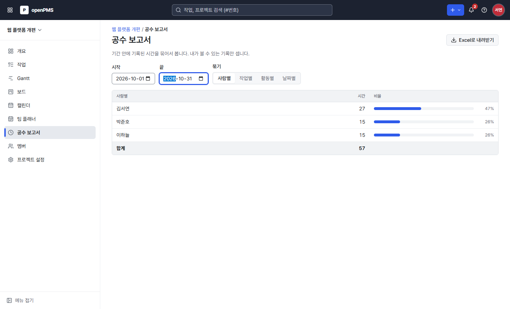 · 모바일 `../../replica/clone-screens/X11-time-report-mobile.png`(2026-10-11)

### 4.4 작업 화면

<a id="s06"></a>
#### S06 작업 목록

- **목적**: 시스템의 핵심 목록. 작업을 찾고(필터·정렬·저장된 보기), 표에서 바로 고치고, 여러 건을 한꺼번에 바꾸고, 새 작업을 만듭니다.
- **경로**: 프로젝트 `/projects/:p/work-packages`, 전역 `/work-packages`. 보기 상태는 URL에 담깁니다: `?view=<보기 ID>`(기본 `default:open`), `?q=<저장하지 않은 변경>`, `?page=`, `?size=20|100`.

**레이아웃**

```
웹 플랫폼 개편 › 작업
모두 열림 [저장하지 않은 변경]  [+ 만들기▾] [필터 n] [기준선] [하위 프로젝트 포함] [계층 표시] [⋯ 보기 메뉴]
[정보: 기준선 2026.10.10 0:00 이후의 변경을 표시합니다. ⟲ 바뀐 값(…) [새로 생김] [기준선 끄기]]  ← 기준선을 켰을 때(1.4)
┌ 필터 패널(열었을 때) ───────────────────────────────────────────┐
│ [🔍 제목이나 #번호로 찾기]                                         │
│ 상태   [열림 ▾]        [값]                         [x]           │
│ [필터 추가 ▾]  필터 초기화                                          │
└────────────────────────────────────────────────────────────┘
┌ 일괄 편집 바(행을 체크했을 때) ─────────────────────────────────────┐
│ n건 선택 [상태▾][담당자▾][우선순위▾][복사][다른 프로젝트로 이동][삭제] 선택 해제 │
└────────────────────────────────────────────────────────────┘
┌──┬────┬───────────────┬────┬──────┬─────┬──────┬──────┐
│☐ │번호 │ 제목              │유형 │ 상태   │우선순위│ 담당자  │ 완료일  │
│☐ │ 12 │ ▾ 로그인 개편       │작업 │[진행 중▾]│● 보통 │ 박준호  │10-20  │
│☐ │ 13 │    └ 화면 설계     │작업 │ ...   │      │       │       │
├──┴────┴───────────────┴────┴──────┴─────┴──────┴──────┤
│ + 새 작업 추가                                                  │
└────────────────────────────────────────────────────────────┘
1–20 / 총 n건    페이지당 [20개▾]   [<][>]                        │ 분할 패널(S07/S09)
┌ 기준선 이후 목록에서 빠진 작업 2건 ──────────────────────────────┐  ← 기준선을 켰고 빠진 작업이 있을 때(1.5)
│ 그때는 이 목록의 조건에 맞았지만 지금은 맞지 않는 작업입니다. …        │
│ #5  ~~릴리스 노트 초안 작성~~        우선순위 보통 → 긴급             │
│ #12 ~~알림 메일 하루 요약~~          우선순위 보통 → 긴급             │
└────────────────────────────────────────────────────────────┘
```

그룹화(예: 담당자)와 합계 표시를 켰을 때의 표(값은 예시):

```
┌──┬────┬───────────────┬──────┬──────┬────────┬────────┐
│☐ │번호 │ 제목              │ 상태   │ 담당자  │ 작업량    │ 남은 작업  │
├──┴────┴───────────────┴──────┴──────┴────────┴────────┤
│ ▾ 김서연  [3건]                                          │ ← 그룹 머리글(접기 버튼)
│☐ │ 21 │ …                │ 신규   │ 김서연  │ 8시간    │ 8시간    │
│  │    │ 김서연 합계        │       │       │ 20시간   │ 10시간   │ ← 그룹 합계 행
│ ▸ 박준호  [2건]                                          │ ← 접힌 그룹(행·합계 행 숨김)
│ ▾ (값 없음)  [1건]                                       │ ← 값이 없는 그룹은 맨 뒤
│  …                                                     │
├────────────────────────────────────────────────────────┤
│  │    │ 전체 합계          │       │       │ 30시간   │ 12시간   │ ← 표 바닥글
└────────────────────────────────────────────────────────┘
```

유형·상태·우선순위로 묶으면 그룹 이름 앞에 그 값의 색 점이 붙습니다.

**UI 요소(머리와 툴바)**

| 항목 | 유형 | 설명 | 규칙 |
| --- | --- | --- | --- |
| 제목 | 텍스트 | 현재 보기 이름 | 저장 안 한 변경이 있으면 배지 **저장하지 않은 변경** |
| 만들기 | 메뉴 버튼(주) | 이 프로젝트에서 쓰는 유형 목록 → S09 | 프로젝트 목록에서만, wp.create |
| 필터 | 토글 버튼 | 필터 패널 열기·닫기, 적용 중인 필터 수 배지 | `aria-expanded` |
| 기준선(1.4) | 메뉴 버튼 | **끄기**, **어제**, **1주 전**, **한 달 전**, **날짜 지정…**(대화상자 **기준선 날짜**: 안내 **그날 0시와 비교해 바뀐 값과 새로 생긴 작업을 표시합니다. 그때 목록에 있었지만 지금은 조건에서 빠진 작업은 목록 아래에 따로 모읍니다.**(1.5 문구), **날짜**(오늘까지), **취소**·**적용**) | 켜져 있으면 `aria-pressed`. xl 미만은 아이콘만 |
| 하위 프로젝트 포함 | 토글 버튼 | 하위 프로젝트 작업까지 표시 | 프로젝트 목록에서만, `aria-pressed`. xl 미만은 아이콘만 |
| 계층 표시 | 토글 버튼 | 상위-하위 들여쓰기와 펼침 버튼 | `aria-pressed`. 켜면 그룹화가 풀림. 그룹화 중에는 툴팁 **그룹화하는 동안은 계층 표시를 쓰지 않습니다** |
| 보기 메뉴(⋯) | 메뉴 | **보기 저장**(바뀐 내용이 있고 내가 고칠 수 있는 보기), **다른 이름으로 저장**(query.save), **변경 취소**(바뀐 내용이 있을 때), **내보내기**(wp.export), **표시할 열**(하위 메뉴, 열 체크), **그룹화**(하위 메뉴, 아래 표), **합계 표시**(체크 항목), **강조 표시**(하위 메뉴, 1.4: 아래 표), 사용자 보기에서는 **즐겨찾기에 추가/즐겨찾기에서 빼기**, **보기 이름 바꾸기**·**보기 삭제**(편집 권한) | 기본 보기에는 즐겨찾기·이름 바꾸기·삭제 없음 |

**UI 요소(그룹화와 합계)**

| 항목 | 유형 | 설명 | 규칙 |
| --- | --- | --- | --- |
| 그룹화 | 하위 메뉴(체크 항목) | **그룹화 안 함**(기본), **유형**, **상태**, **우선순위**, **담당자**, **책임자**, **작성자**, **버전**, **프로젝트**, 그리고 이 범위에서 켜진 목록·사용자·예/아니요 형식의 사용자 정의 필드(필드 이름으로 표시) | 하나만 고름. 고르면 계층 표시가 꺼짐(그룹화한 목록은 평평한 목록) |
| 그룹 머리글 | 행(접기 버튼) | 접기/펼치기 화살표, 색 점(유형·상태·우선순위로 묶을 때 그 값의 색), 그룹 이름, 건수 배지 **{{count}}건** | 값이 없는 작업은 **(값 없음)** 그룹으로 묶여 맨 뒤에 옴. 그룹 순서는 그 값 자체의 순서(예: 상태 순서, 이름) |
| 그룹 접기 | 버튼 | 누르면 그 그룹의 행과 그룹 합계 행을 숨김. 다시 누르면 펼침 | 접힘 상태는 화면에서만 유지(보기에 저장되지 않음) |
| 합계 표시 | 체크 항목 | 켜면 그룹마다 **{{label}} 합계** 행, 표 맨 아래에 **전체 합계** 행 | 그룹화하지 않아도 **전체 합계** 행은 나옴 |
| 합계 행 | 행 | 합계를 낼 수 있는 열 아래에 값: **작업량**·**남은 작업**(시간 합), **완료 %**(아래 규칙), 정수·소수 형식 사용자 정의 필드(숫자 합). 행 이름은 제목 열(없으면 합계가 없는 첫 열)에 표시 | 표시 중인 열만 합계. 값을 낼 수 없으면 `-` |

- 그룹 건수와 합계는 현재 페이지가 아니라 필터에 맞는 작업 전체를 기준으로 서버가 계산합니다. 한 페이지에 그룹의 일부만 보여도 머리글의 건수와 합계 행은 전체 값입니다.
- 합계 규칙(1.2): **작업량**·**남은 작업** 합계는 그 그룹(또는 목록)에 든 모든 작업의 값을 더합니다. **완료 %** 합계는 작업 상세의 **합계 완료 %**(S07)와 같은 규칙을 따릅니다.
  - S30에서 **합계 제외**로 표시한 상태(예: 취소)의 작업은 완료 % 합계에서 뺍니다.
  - S32 **상위 작업의 합계 완료 %**가 **작업량 가중**이면 (작업량 합 − 남은 작업 합) ÷ 작업량 합. 이때 작업량은 있는데 남은 작업이 비어 있는 작업은 아직 시작하지 않은 것으로 봅니다(남은 작업 = 작업량). 작업량 합이 없거나 0이면 `-`.
  - **단순 평균**이면 완료 % 값이 있는 작업들의 평균(반올림). 값이 있는 작업이 없으면 `-`.
  - 예(작업량 가중): 신규 그룹에 작업량 8시간·남은 작업 없음인 작업 하나만 작업량이 있으면 완료 % 합계는 0%입니다(1.1에서는 100%로 보였음). 진행 중 그룹이 작업량 56시간·남은 작업 34시간이면 (56 − 34) ÷ 56 = 39%입니다(`S06-grouped.png`).
- 보기 메뉴(표시할 열·그룹화·합계 표시)와 툴바(하위 프로젝트 포함·계층 표시)의 변경은 늘 가장 최근의 보기 상태 위에 쌓입니다. 주소(`?q=`)가 바뀌기 전에 두 번째 변경을 해도 첫 변경이 사라지지 않습니다(1.2).
- 그룹화와 합계 표시는 보기 설정이라 URL(`?q=`)에 담기고, **보기 저장**·**다른 이름으로 저장**으로 남길 수 있습니다.
- 내보내기(S12) 파일에는 그룹 머리글과 합계 행이 들어가지 않습니다.

**UI 요소(강조 표시와 기준선, 1.4)**

| 항목 | 유형 | 설명 | 규칙 |
| --- | --- | --- | --- |
| 강조 표시 | 하위 메뉴(체크 항목) | **없음**(기본), **셀 강조(우선순위, 완료일 지남·임박)**, **행 색: 상태**, **행 색: 우선순위**, **행 색: 유형** | 하나만 고름. 보기 설정이라 URL(`?q=`)에 담기고 보기에 저장됨(e3eeb60) |
| 셀 강조 | 셀 표시 | 우선순위 칸에 그 우선순위 색, 완료일 칸은 기한이 지났으면 위험 색·3일 안이면 경고 색 | 글자 대비 AA 유지. 기한 지남의 낭독 문구 **(기한 지남)**은 그대로 |
| 행 색 | 행 표시 | 그 값(상태·우선순위·유형)의 색으로 행 왼쪽에 색 막대와 옅은 배경 | 배경을 옅게 섞어 글자 대비 AA 유지. 맥락 행·그룹 머리글에는 없음 |
| 기준선 안내 | 배너(정보) | **기준선 {{at}} 이후의 변경을 표시합니다.**(기준 시각은 사용자 시간대의 그날 0시), 범례 **바뀐 값(누르거나 올려 두면 그때 값)**, 배지 **새로 생김**, **기준선 끄기** | 기준선을 켰고 서버가 기준 시각을 돌려줬을 때 |
| 바뀐 셀 | 셀 표시 | 기준선 뒤 값이 바뀐 셀에 표시(아이콘)와 툴팁·낭독 문구 **기준선 때: {{value}}**(그때 비어 있었으면 **비어 있음**) | 비교하는 열: 제목·유형·상태·우선순위·담당자·책임자·버전·시작일·완료일·기간·완료 %·작업량·남은 작업·프로젝트·사용자 정의 필드 |
| 새로 생긴 작업 | 행 표시 | 기준선 뒤에 만든 작업은 배지 **새로 생김** | - |
| 기준선 이후 목록에서 빠진 작업(1.5) | 영역(목록 아래) | 제목 **기준선 이후 목록에서 빠진 작업 {{count}}건**, 안내 **그때는 이 목록의 조건에 맞았지만 지금은 맞지 않는 작업입니다. 바뀐 값을 그때 → 지금 순서로 보여 줍니다.** 항목마다 **#{{number}}** 링크(작업 전체 화면 S08의 활동 탭), 줄 그은 제목(전체 제목은 툴팁), 바뀐 열마다 **{{열 이름}} {{그때}} → {{지금}}**(비었으면 **비어 있음**). 200건이면 **많아서 번호가 낮은 {{count}}건만 보여 줍니다.** | 기준선을 켰고 빠진 작업이 1건 이상일 때만. 번호가 낮은 순 최대 200건. 그때 값으로 목록의 필터·빠른 검색·프로젝트 범위(하위 프로젝트 포함 여부)를 다시 적용해 맞았던 작업만. 지워진 작업, 그때 공유로만 볼 수 있던 작업은 나오지 않고, 주시자·코멘트·관계 조건은 지금 상태로 판단. 휴대폰 폭에서는 번호·제목 줄 아래에 바뀐 값이 줄바꿈되어 나옴 |

- 기준선은 보기 설정(spec `baseline`)이라 **보기 저장**으로 남길 수 있습니다. 미래 날짜를 고를 수 없고, API에 미래 날짜를 주면 기준선 없이 평소 목록이 옵니다.
- (1.5, 22ed5db) 그때는 조건에 맞았지만 지금은 빠진 작업(예: 그 뒤 닫혀 **모두 열림**에서 빠진 작업, 우선순위가 바뀌어 우선순위 필터에서 빠진 작업)은 표 아래 **기준선 이후 목록에서 빠진 작업**에 모읍니다. 1.4까지는 보이지 않아 부분 구현이었고(01 6장 #17), 이제 features.csv도 yes입니다. 남은 한계는 위 표의 규칙과 01 6장 #21에 있습니다.

**UI 요소(필터 패널)**

| 항목 | 유형 | 설명 | 규칙 |
| --- | --- | --- | --- |
| 제목이나 #번호로 찾기 | 검색 입력 | 제목·번호 텍스트 검색 | 0.3초 뒤 반영 |
| 필터 행 | 필드명 + 조건 선택 + 값 입력 + 삭제(x) | 필드마다 한 행 | 같은 필드는 한 번만 |
| 필터 추가 | 선택 | 아직 쓰지 않은 필드(가나다순) | 고르면 첫 조건으로 행 추가 |
| 필터 초기화 | 링크 버튼 | 패널에 보이는 필터와 텍스트 검색 모두 제거 | 필터가 있을 때만 |

필터 필드와 조건은 다음과 같습니다. 날짜 필드의 **이번 주**는 S33 **주 시작 요일**에서 시작하는 7일입니다(기본 일요일~토요일).

| 필드 | 조건 | 값 입력 |
| --- | --- | --- |
| 번호 | 다음과 같음, 다음이 아님 | 텍스트(예: 12, 15) |
| 제목, 설명, 코멘트 | 포함, 포함하지 않음 | 텍스트 |
| 상태 | 열림, 닫힘, 다음과 같음, 다음이 아님 | 여러 값 선택 |
| 유형, 우선순위, 프로젝트, 담당자의 그룹, 담당자의 역할 | 다음과 같음, 다음이 아님 | 여러 값 선택 |
| 담당자 | 다음과 같음, 다음이 아님, 담당자 없음, 담당자 있음 | 여러 값(**나** 포함). (2.1) 담당자 목록의 누구든 맞으면 해당(주 담당자만이 아님). **담당자의 그룹**·**담당자의 역할**도 같음. 기준선의 그때 값은 주 담당자만 기록되어 있어 그때 기준 비교는 주 담당자로 |
| 책임자, 버전, 카테고리 | 다음과 같음, 다음이 아님, 값 있음, 값 없음 | 여러 값 |
| 작성자, 주시자 | 다음과 같음, 다음이 아님 | 여러 값(**나** 포함) |
| 상위 작업 | 다음과 같음(#번호), 상위 작업 있음, 상위 작업 없음 | 번호 |
| 시작일 | 오늘, 이번 주, 앞으로 며칠 안, 지난 며칠 안, 날짜, 기간, 값 있음, 값 없음 | 일수(기본 7) / 날짜 / 기간 |
| 완료일 | 위 조건 + 기한 지남 | 같음 |
| 일정 기간 | 기간과 겹침, 값 있음, 값 없음 | 기간 |
| 만든 날, 최근 수정 | 오늘, 이번 주, 지난 며칠 안, 날짜, 기간, 값 있음, 값 없음 | 같음 |
| 기간(일), 완료 %, 작업량(시간), 남은 작업(시간) | 이상, 이하, 다음과 같음, 값 있음, 값 없음 | 숫자 |
| 일정 방식 | 다음과 같음 | 수동 / 자동 |
| 마일스톤, 다른 작업에 막힘 | 다음과 같음 | 예 / 아니요 |
| 사용자 정의 필드 | 형식별(목록·사용자: 참조 조건, 숫자: 비교, 날짜: 날짜 조건, 예/아니요, 텍스트: 포함 + 값 있음·없음) | 관리자가 **작업 목록 필터에 표시**를 켠 필드만 |

**UI 요소(표)**

| 항목 | 유형 | 설명 | 규칙 |
| --- | --- | --- | --- |
| 선택 체크박스 | 체크박스 | 행 선택(머리글은 **이 페이지의 작업 모두 선택**) | 맥락 행에는 없음 |
| 열 제목 | 메뉴 버튼 | **오름차순 정렬**, **내림차순 정렬**, **정렬 기준에 추가**(최대 3개), **정렬 기준에서 빼기**, **왼쪽으로 이동**, **오른쪽으로 이동**, **열 숨기기**(번호·제목 제외) | 정렬 열은 화살표, 다중 정렬은 순번 표시 |
| 번호 | 링크 | 상세 열기 | - |
| 제목 | 링크 | 상세 열기. 계층 표시 중에는 들여쓰기와 **하위 작업 펼치기/접기** 버튼 | 필터에 맞지 않는 상위 항목은 흐린 **맥락 행** |
| 상태 | 상태 pill 메뉴 | 내 역할로 바꿀 수 있는 상태만 표시 | wp.edit, 읽기 전용 상태 규칙 적용 |
| 담당자, 우선순위 | 인라인 선택 | 바로 바꿈. (2.1) 담당자 칸의 선택은 주 담당자만 바꿈(이미 담당자 목록에 있는 사람이면 맨 앞으로, 새 사람이면 주 담당자 자리를 넘겨받음, **담당자 없음**이면 모두 빠짐) | 편집 가능한 필드만 |
| +N(2.1) | 배지 | 담당자가 여럿이면 주 담당자 옆에 **+{{count}}**(나머지 사람 수). 마우스를 올리면 나머지 이름, 접근 이름 **외 {{count}}명: {{names}}** | 담당자가 한 명 이하면 없음 |
| 유형, 책임자, 작성자, 버전, 시작일, 완료일, 기간, 작업량, 남은 작업, 완료 %, 최근 수정, 프로젝트, 사용자 정의 필드 | 표시 셀 | 작업량·남은 작업은 **{{value}}시간** 형식 | 기한 지난 완료일은 빨강. 값이 없으면 `-` |
| 새 작업 추가 | 행 버튼 → 입력 | **제목을 입력하고 Enter**, Esc로 취소. 이 프로젝트의 첫 유형으로 생성 | 프로젝트 목록 + wp.create |
| 행 클릭 | - | 분할 패널(S07) 열기. 다른 프로젝트 작업은 S08로 이동 | 버튼·링크 클릭은 제외 |
| 행 우클릭(1.3) | 컨텍스트 메뉴 | 아래 "UI 요소(행 우클릭 메뉴)" | 마우스 오른쪽 버튼 또는 키보드의 메뉴 키. 맥락 행에는 없음 |
| 페이지 이동 | 페이지네이션 | **{{from}}–{{to}} / 총 {{total}}건**, 페이지당 20개·100개 | - |

선택할 수 있는 열: 번호, 제목, 유형, 상태, 우선순위, 담당자, 책임자, 작성자, 버전, 시작일, 완료일, 기간, 작업량, 남은 작업, 완료 %, 최근 수정, 프로젝트, 그리고 이 범위에서 켜진 사용자 정의 필드.

정렬할 수 있는 열: 번호, 제목, 유형, 상태, 우선순위, 담당자, 책임자, 작성자, 버전, 시작일, 완료일, 작업량, 남은 작업, 최근 수정, 프로젝트, 사용자 정의 필드. 기간·완료 %는 정렬할 수 없습니다. 그룹화 중에는 그룹 순서가 먼저이고, 그 안에서 정렬 기준을 따릅니다. (2.1) **담당자**로 정렬하거나 그룹화하면 주 담당자(담당자 목록의 첫 사람) 기준입니다. 내보내기(S12)의 **담당자** 열에는 담당자 목록의 모든 이름이 쉼표로 들어갑니다.

**UI 요소(일괄 편집 바와 대화상자)**

| 항목 | 유형 | 설명 | 규칙 |
| --- | --- | --- | --- |
| {{count}}건 선택 | 텍스트 | 선택 수 | `aria-live` |
| 상태 / 담당자 / 우선순위 | 메뉴 버튼 | 고른 값으로 선택한 작업 모두 변경 | 한 건이라도 안 되면 아무것도 바꾸지 않음 |
| 복사(1.3) | 버튼 → 대화상자 | 제목 **작업 {{count}}건 복사**, **대상 프로젝트**(같은 프로젝트가 미리 골라짐), 안내 **고른 작업끼리의 상위-하위 관계는 사본에도 그대로 둡니다. 한 건이라도 복사할 수 없으면 아무것도 만들지 않습니다.**, 버튼 **복사하기** | 작업을 만들 수 있는 프로젝트가 없으면 비활성. 복사 규칙은 S07 **#{{number}} 복사**와 같음(코멘트·첨부·관계는 복사하지 않음). 하위 작업은 고른 것만 복사(**하위 작업도 복사** 선택은 없음) |
| 다른 프로젝트로 이동 | 버튼 → 대화상자 | 제목 **작업 {{count}}건 이동**, **대상 프로젝트**, 안내 **하위 작업도 함께 옮겨집니다. 한 건이라도 옮길 수 없으면 아무것도 옮기지 않습니다.** | 옮길 프로젝트가 없으면 비활성 |
| 삭제 | 버튼(위험) → 대화상자 | 제목 **작업 {{count}}건을 삭제할까요?**, **코멘트와 첨부 파일도 지워지며 되돌릴 수 없습니다. 선택하지 않은 하위 작업은 한 단계 위로 올라갑니다.** | - |
| 선택 해제 | 버튼 | 선택 비우기 | 보기·페이지가 바뀌어도 선택이 비워짐 |
| 거부 사유 | 배너(위험) | 서버가 거부한 항목별 사유 목록 | 일괄 변경 실패 시 |

- 그룹화와 합계 행은 위 "UI 요소(그룹화와 합계)"를 따릅니다.

**UI 요소(행 우클릭 메뉴, 1.3)**

행을 마우스 오른쪽 버튼으로 누르면(키보드는 행 안에서 메뉴 키) 그 자리에 메뉴가 열립니다. 우클릭한 행이 체크한 행 중 하나면 체크한 행 전체가, 아니면 그 행 하나가 대상입니다. 일괄 편집 바와 같은 동작을 같은 구현으로 씁니다.

| 항목 | 유형 | 설명 | 규칙 |
| --- | --- | --- | --- |
| 상세 패널에서 열기 | 메뉴 항목 | 그 작업을 분할 패널(S07, 요약 탭)로 엶. 다른 프로젝트 작업이면 S08 | 대상이 한 건일 때만 |
| 전체 화면으로 열기 | 메뉴 항목 | S08(활동 탭) | 대상이 한 건일 때만 |
| {{count}}건 선택 | 메뉴 제목 | 대상이 여러 건이면 위 두 항목 대신 표시 | - |
| 상태 / 담당자 / 우선순위 | 하위 메뉴 | 일괄 편집 바의 같은 메뉴와 같음 | → 또는 마우스로 펼침 |
| 복사 / 다른 프로젝트로 이동 | 메뉴 항목 → 대화상자 | 일괄 편집 바와 같은 대화상자 | 대상 프로젝트가 없으면 비활성 |
| 삭제 | 메뉴 항목(위험) → 대화상자 | 일괄 편집 바와 같음 | - |

**UI 요소(보기 저장·이름 바꾸기 대화상자)**: 제목 **다른 이름으로 저장** 또는 **보기 이름 바꾸기**, **보기 이름**(필수, 255자), **프로젝트 멤버 모두에게 공개**(query.manage_public일 때만), **취소**·**저장**.

**상태**

| 상태 | 표시 |
| --- | --- |
| 로딩 | 표 자리 스켈레톤 8줄(`aria-busy`) |
| 빈 상태 | **조건에 맞는 작업이 없습니다** / **필터를 바꾸거나 새 작업을 만드세요.** + 필터가 있으면 **필터 초기화**, 없으면 **만들기** |
| 오류 | 공통 오류 + **다시 시도** |
| 권한 없음 | 만들기·새 작업 추가·보기 저장·내보내기가 권한에 따라 숨겨짐. 모듈이 꺼져 있으면 **이 프로젝트에서 꺼진 기능입니다** |
| 모바일(M1) | md 미만에서 카드 목록: 상태 pill, #번호, 프로젝트, 유형+제목, 담당자 아바타(없으면 **담당자 없음**. 2.1부터 담당자가 여럿이면 S15 카드처럼 겹친 아바타), 기간, 자동 일정 아이콘. 체크박스·일괄 편집·행 우클릭 메뉴·인라인 생성 없음. 그룹화하면 그룹이 바뀌는 자리에 그룹 제목(색 점·이름·**{{count}}건**)이 들어감(접기·합계 행 없음) |
| 전역 목록 | 저장된 보기 사이드바·만들기·다른 이름으로 저장 없음(프로젝트 안에서만). 내보내기는 가능 |

**주요 동작과 API**

| 동작 | API |
| --- | --- |
| 목록 | `POST /work-packages/query` (spec, projectId, page, pageSize). spec의 `groupBy`·`sums`를 주면 응답에 `groups`(그룹별 키·이름·색·건수·합계)와 `sums`(전체 합계)가 함께 옴. (1.4) spec `highlight`는 화면이 색을 입히는 데만 쓰고, spec `baseline` {kind: yesterday·lastWeek·lastMonth·date, date}을 주면 응답에 `baselineAt`과 행마다 `baseline` {added, changed}가 옴. (1.5) 같은 응답의 `baselineRemoved`[{id, number, subject, project, then, now}]가 **기준선 이후 목록에서 빠진 작업**(기준선이 없으면 `null`) |
| 보기 목록·필터 선택지 | `GET /queries`, `GET /work-packages/filters` |
| 생성 폼 정보(유형 목록) | `GET /projects/{project}/work-packages/form` |
| 인라인 수정(상태·담당자·우선순위) | `GET /work-packages/{number}/allowed-statuses`, `PATCH /work-packages/{number}` (lockVersion 포함) |
| 새 작업 추가(행) | `POST /projects/{project}/work-packages` |
| 보기 저장 / 다른 이름으로 저장 / 이름 바꾸기 / 삭제 | `PATCH /queries/{id}` / `POST /queries` / `PATCH /queries/{id}` / `DELETE /queries/{id}` |
| 보기 즐겨찾기 | `PUT\|DELETE /queries/{id}/favorite` |
| 일괄 변경·복사·이동·삭제(바와 행 우클릭 메뉴) | `POST /work-packages/bulk` {numbers, action: update·copy·move·delete, changes, targetProject}. `copy`는 targetProject가 없으면 같은 프로젝트로, 고른 상위 작업을 먼저 복사하고 고른 하위 작업의 사본을 그 아래에 둠(1.3) |
| 내보내기 | S12 참고 |

**검증 메시지**

| 조건 | 메시지 |
| --- | --- |
| 인라인 생성 제목 빈 칸 | 제목을 입력하세요. |
| 제목 255자 초과(서버) | 제목은 255자 이하로 입력하세요. |
| 보기 이름 빈 칸 / 초과 | 보기 이름을 입력하세요. / 보기 이름은 255자 이하로 입력하세요. |
| 허용되지 않은 상태 전환 | 허용되지 않는 상태 전환입니다. (내 역할로는 '{{현재}}'에서 '{{새}}'(으)로 바꿀 수 없습니다.) |
| 일괄 변경 200건 초과 | 한 번에 200건까지 바꿀 수 있습니다. |
| 동시 수정 | 다른 사람이 먼저 수정했습니다 |
| 필터 조합 오류 | 필터를 확인하세요. |

성공 토스트: **#{{number}} 작업을 만들었습니다**, **보기를 저장했습니다**, **보기 이름을 바꿨습니다**, **{{count}}건을 바꿨습니다**, **{{count}}건을 복사했습니다**, **{{count}}건을 옮겼습니다**, **{{count}}건을 삭제했습니다**. 일괄 복사가 거부되면 위험 배너에 전체를 되돌렸다는 안내와 항목별 사유(**#12: …**)가 나옵니다(예: 대상 프로젝트가 그 유형을 쓰지 않음).

**관련 흐름**: F01(만들기), F02(상태 진행), F03(보기 저장·공유, 그룹화와 합계, 1.4 강조 표시·기준선), F07(계층 보기), F12(일괄 편집·우클릭 메뉴, 1.3), F14(PDF 내보내기, 1.4), F18(공동 담당자의 **내게 할당됨**과 **+N**, 2.1)

**접근성**: 정렬 열 `aria-sort`. 열 제목 메뉴 접근 이름 **{{column}} 열 메뉴**. 행 체크박스 **#{{number}} {{subject}} 선택**. 인라인 선택 접근 이름 예 **담당자: 박준호**. (2.1) **+N** 배지의 접근 이름 예 **외 1명: 이하늘**. 맥락 행에 낭독용 **상위 항목 (필터에 맞지 않음)**. 필터 행은 fieldset, 조건·값 선택에 **{{필드}} 조건**, **{{필드}} 값** 이름. 인라인 생성 오류는 `aria-describedby`로 연결. 그룹 머리글은 `th scope="colgroup"` 안의 버튼으로, 접근 이름은 낭독용 **{{label}} 그룹:** + 그룹 이름 + 건수, 펼침 상태는 `aria-expanded`. **그룹화** 하위 메뉴 항목과 **합계 표시**는 체크 상태를 가진 메뉴 항목(menuitemcheckbox). 행 우클릭 메뉴는 메뉴(role menu)이고 하위 메뉴는 →·←로 펼치고 닫음. 메뉴를 연 화면도 axe 검사(F12-H1 "S06 우클릭 메뉴")를 통과합니다. (1.4) **강조 표시** 하위 메뉴 항목과 **기준선** 메뉴 항목은 menuitemcheckbox이고, 행 강조·셀 강조·기준선을 켠 화면도 axe 검사(F03-G7 "S06 행 강조"·"S06 셀 강조", F03-B1 "S06 기준선")와 고대비 테마 검사(a11y "S06 목록 (high contrast)")를 통과합니다. (1.5) **기준선 이후 목록에서 빠진 작업**은 제목(h2)으로 이름 붙인 영역(region)이고 항목은 목록(list)입니다. 이 영역이 있는 화면도 axe 검사(F03-B3 "S06 기준선 빠진 작업")를 통과합니다.

**참고 화면**: 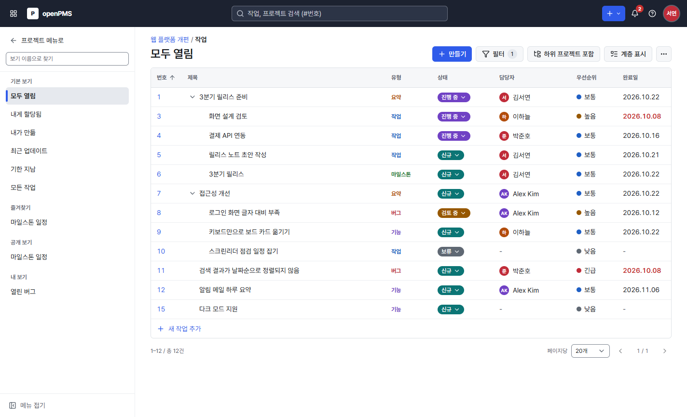 · 행 색: 상태 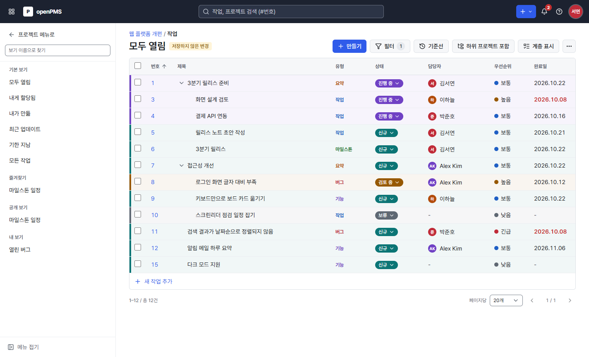, 모바일 `../../replica/clone-screens/S06-highlight-mobile.png`(1.4, 2026-10-11) · 기준선(어제)과 **기준선 이후 목록에서 빠진 작업 2건** 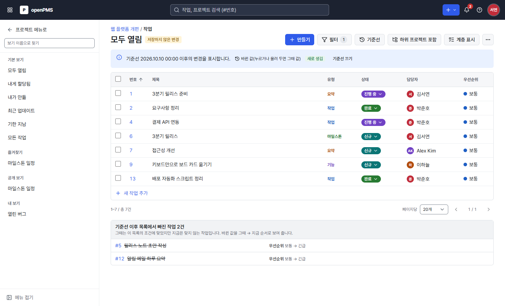, 모바일 `../../replica/clone-screens/S06-baseline-removed-mobile.png`(1.5, 2026-10-11, 99e0287) · 행 우클릭 메뉴(#3 행) 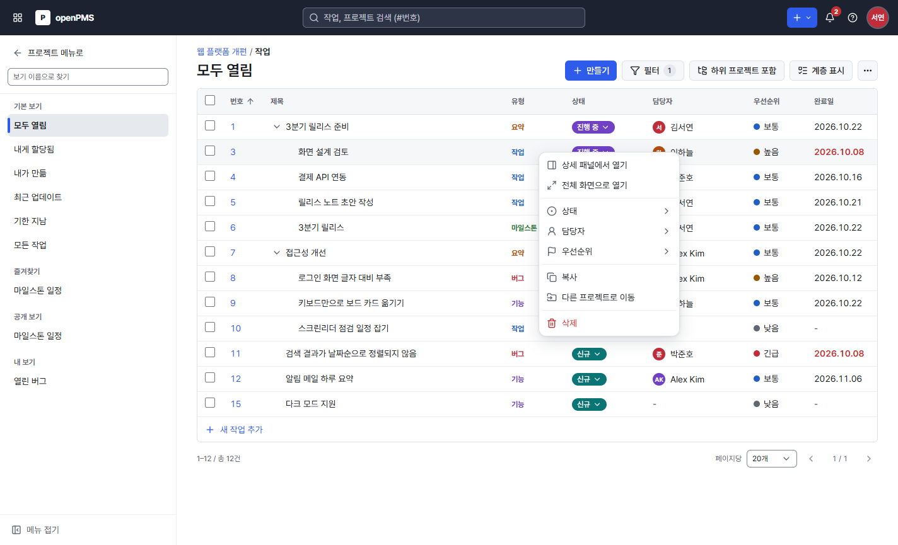(1.3, 2026-10-11, 데스크톱만) · 그룹화(상태)와 합계 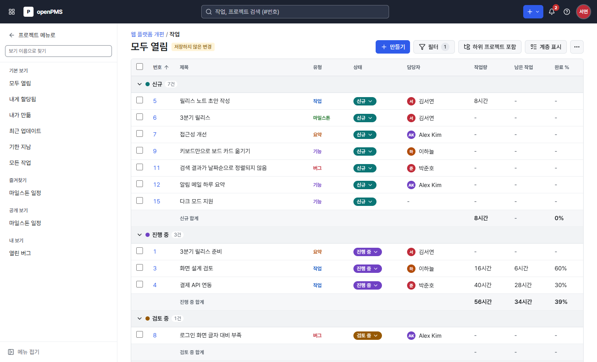, 모바일 `../../replica/clone-screens/S06-grouped-mobile.png`(1.2, 2026-10-11) · 필터 `../../replica/clone-screens/S06-filters.png`, 필터 여러 개 `../../replica/clone-screens/S06-filters-many.png`, 열 메뉴 `../../replica/clone-screens/S06-header-menu.png`, 빈 결과 `../../replica/clone-screens/S06-empty.png` · 모바일 `../../replica/clone-screens/S06-mobile.png`, `../../replica/clone-screens/S06-filters-mobile.png`, `../../replica/clone-screens/S06-empty-mobile.png`

<a id="s07"></a>
#### S07 작업 분할 상세

- **목적**: 목록을 유지한 채 오른쪽 패널에서 작업 하나를 보고 고칩니다.
- **경로**: `/projects/:p/work-packages/details/:number/:tab?` (탭: `overview`(기본)·`activity`·`files`·`relations`·`watchers`·`time`(1.6)). Gantt·보드·캘린더·팀 플래너·알림에서도 같은 패널을 씁니다.

**레이아웃**

```
┌ 분할 패널 ─────────────────────────────────┐
│ 상위 작업: #12 로그인 개편   [공유][👁][⋯][⤢][x] │
│ [작업] 제목 (클릭해 수정)                       │
│ [진행 중 ▾]  #13 · 김서연님이 …에 만듦 · 최근 수정 … │
│ [읽기 전용 상태 경고]                           │
│ 요약 | 활동 | 파일 n | 관계 n | 주시자 n          │
│ ─────────────────────────────────────── │
│ (탭 내용)                                    │
└──────────────────────────────────────────┘
```

**UI 요소(머리)**

| 항목 | 유형 | 설명 | 규칙 |
| --- | --- | --- | --- |
| 상위 작업 | 링크 | **상위 작업: #{{n}} {{제목}}** → 상위 작업 S08 | 상위가 있을 때 |
| 나와 공유됨 | 배지 | **나와 공유됨 · {{보기/코멘트/편집}}** | 공유로 볼 때 |
| 작업 공유 | 아이콘 버튼 | 공유 대화상자 | wp.share |
| 주시하기 / 주시 해제 | 아이콘 토글 | 이 작업 주시 | `aria-pressed` |
| 더 보기(⋯) | 메뉴 | **링크 복사**, **작업 복사**, **다른 프로젝트로 이동**(wp.move), **삭제**(wp.delete) | - |
| 전체 화면으로 열기 | 아이콘 링크 | S08로 이동(요약 탭이면 활동 탭으로) | 패널에서만 |
| 상세 패널 닫기 | 아이콘 링크 | 목록으로 돌아감 | 패널에서만 |
| 유형 + 제목 | 인라인 텍스트 | 클릭하면 입력, Enter 또는 포커스 이동으로 저장, Esc로 취소 | 필수, 255자. 편집 권한 없으면 글자만 |
| 상태 pill | 메뉴 | **상태 바꾸기** 제목, 현재 상태(체크), 허용된 상태 목록 | 허용 상태가 없으면 **내 역할로 바꿀 수 있는 상태가 없습니다** |
| 작성 정보 | 텍스트 | **#{{number}} · {{author}}님이 {{date}}에 만듦 · 최근 수정 {{updated}}** | - |
| 읽기 전용 경고 | 배너(경고) | **'{{status}}' 상태에서는 상태만 바꿀 수 있습니다** | 상태가 읽기 전용일 때 |

**UI 요소(요약 탭)**

| 항목 | 유형 | 설명 | 규칙 |
| --- | --- | --- | --- |
| 설명 | 서식 있는 글 / 편집기 | 비어 있으면 **클릭해서 설명을 입력하세요**. 마우스를 올리면 **설명 수정** 버튼. 편집 중 **취소**·**저장**(Ctrl+Enter 저장, Esc 취소) | 편집기 도구: 굵게(Ctrl+B), 기울임(Ctrl+I), 밑줄(Ctrl+U), 취소선, 코드, 글머리 기호 목록, 번호 목록, 인용, 코드 블록, 링크 |
| 속성 그룹 | 정의 목록 | 기본 그룹 **사람**(담당자, 책임자), **일정**(날짜, 기간), **진행률**(작업량, 남은 작업, 완료 %), **세부 정보**(유형, 우선순위, 버전, 카테고리, 상위 작업). 유형별 양식 구성(S28)을 따름 | 숨긴 항목은 표시 안 함 |
| 담당자 / 책임자 | 인라인 선택 | 프로젝트 멤버 목록 + **담당자 없음** / **없음** | (2.1) 담당자 선택은 주 담당자만 바꿈(목록에 있던 사람은 맨 앞으로 오고 예상 시간을 지님, 새 사람은 주 담당자 자리를 넘겨받음, **담당자 없음**이면 모두 빠짐) |
| 공동 담당자(2.1) | 목록(이름 **공동 담당자**) | 담당자 아래 작은 글씨로 주 담당자의 예상 시간 **주 담당자 예상 {{hours}}시간**(적었을 때), 그 아래 다른 담당자마다 아바타·이름과 예상 시간 **{{value}}시간**(적었을 때) | 다른 담당자가 없고 주 담당자의 예상 시간도 없으면 목록 없음 |
| 공동 담당자 추가 / 공동 담당자 편집(2.1) | 텍스트 버튼(사람들 아이콘) | 담당자가 한 명 이하면 **공동 담당자 추가**, 둘 이상이면 **공동 담당자 편집**. 누르면 **담당자와 예상 시간** 대화상자 | 담당자를 고칠 수 있을 때만 |
| 날짜 | 버튼 | 날짜 범위(없으면 **날짜 없음**), 수동은 핀 아이콘, 자동은 달력 시계 아이콘 → S10 | 기한 지남은 빨강 |
| 기간 | 표시 | **{{n}}일** | 날짜에서 계산 |
| 작업량 / 남은 작업 / 완료 % | 인라인 숫자 | **{{n}}시간**, **{{n}}%** | 완료 %는 0~100으로 맞춤. 진행률 설정이 상태 기준이면 직접 수정 불가 |
| 합계 상자 | 표시 | **합계 작업량**, **합계 남은 작업**, **합계 완료 %**(자신과 하위 작업, 합계에서 빼는 상태 제외. S32 합계 방식이 작업량 가중이면 작업량만 있고 남은 작업이 비어 있는 작업은 시작 전으로 셈(1.2)) | 하위 작업이 있을 때, 마지막 진행률 항목 뒤 |
| 유형 / 우선순위 / 버전 / 카테고리 | 인라인 선택 | - | - |
| 상위 작업 | 링크 | 상위 작업 | 지정·변경은 관계 탭에서 |
| 추가 정보 | 속성 그룹 | 어느 그룹에도 넣지 않은 사용자 정의 필드. 필수 필드는 이름 뒤 `*` | - |

**UI 요소(활동 탭)**

| 항목 | 유형 | 설명 | 규칙 |
| --- | --- | --- | --- |
| 활동 거르기(1.4) | 라디오 묶음 | **모두** / **코멘트만** / **변경만** | 고른 값은 이 브라우저에 기억. 맞는 활동이 없으면 **이 조건에 맞는 활동이 없습니다** |
| 정렬 바꾸기(1.4) | 버튼 | 접근 이름 **정렬 바꾸기 (지금: {{order}})**(최신 순·오래된 순). 누르면 S37 **최신 활동을 맨 위에**를 바로 바꿈 | - |
| 활동 항목 | 목록 | 아바타, 이름, 상대 시각, 변경 내역(**{{label}}: {{from}} → {{to}}**, **{{label}}: {{to}}**, **{{label}}을(를) 비움**, **설명을 수정했습니다**, **파일 첨부: {{name}}**, **파일 삭제: {{name}}**, **작업을 만들었습니다**. 2.1부터 담당자 목록이 바뀌면 **담당자 목록: {{from}} → {{to}}**, 값은 순서대로 이름과 예상 시간 예 **박준호 6시간, 이하늘 4.5시간, 최민지**. 두 번째 사람이나 예상 시간이 걸린 변경만 이 줄이 남고, 주 담당자 한 명만 바뀌면 **담당자** 줄만), 자동 조정 사유(**선행 작업 #{{n}}의 일정이 바뀌어 자동으로 조정됨** 등), 코멘트 본문 | 수정된 코멘트는 **· 수정됨** |
| 코멘트 수정 | 아이콘 버튼 | 편집기로 바꿔 **취소**·**저장** | 본인 코멘트(wp.edit_own_comments) 또는 모든 코멘트(wp.edit_comments) |
| 코멘트 입력 | 서식 편집기 | 자리표시자 **코멘트를 입력하세요. @이름으로 사람을 언급할 수 있습니다.** `@` 입력 시 **언급할 사람** 목록 | Ctrl+Enter로 전송. wp.comment가 없으면 **코멘트를 쓸 권한이 없습니다.** |
| 내부 코멘트(1.4) | 체크박스 | 입력란 아래 **내부 코멘트**, 설명 **내부 코멘트를 볼 수 있는 역할만 읽습니다.** | 프로젝트에서 내부 코멘트를 켰고(S25) wp.add_internal_comments가 있을 때만 |
| 내부 배지(1.4) | 배지 + 배경 | 내부 코멘트에는 배지 **내부**와 다른 배경 | wp.view_internal_comments가 있는 사람에게만 그 코멘트가 보임 |
| 코멘트 남기기 | 버튼(주) | 코멘트 등록 | - |

- 기본은 오래된 순이며 입력란이 아래에 있습니다. 계정 설정 **최신 활동을 맨 위에**를 켜거나 활동 탭의 **정렬 바꾸기**를 누르면 최신순, 입력란이 위로 갑니다(1.4부터 탭에서 바로 바꿈).
- (1.4, 4fb4ca5) 내부 코멘트는 볼 권한이 없는 사람에게 활동·검색(S22)·알림(S19) 어디에도 나오지 않고, 웹훅(X08)으로도 보내지 않습니다.

**UI 요소(파일 탭)**

| 항목 | 유형 | 설명 | 규칙 |
| --- | --- | --- | --- |
| 끌어 놓기 영역 | 드롭 영역 | **파일을 여기에 끌어다 놓거나** + **파일 선택**, 안내 **파일 하나에 25MB까지 올릴 수 있습니다.** | wp.attach. 여러 파일은 하나씩 차례로 업로드 |
| 업로드 중 목록 | 목록 | 파일명 + 스피너, 실패하면 빨간 행과 사유, **{{name}} 오류 닫기** | - |
| 첨부 목록 | 목록 | 이미지(png·jpeg·gif·webp)는 썸네일과 새 탭 열기, 그 밖은 내려받기. 크기 · 올린 사람 · 상대 시각 | - |
| {{name}} 삭제 | 아이콘 버튼 → 확인 | **파일을 삭제할까요?** / **{{name}}을(를) 삭제합니다. 되돌릴 수 없습니다.** | 삭제 권한이 있을 때 |

**UI 요소(관계 탭)**

| 항목 | 유형 | 설명 | 규칙 |
| --- | --- | --- | --- |
| 관계 추가 | 버튼 → 추가 영역 | 관계 종류 선택 + **연결할 작업 (#번호나 제목)** 검색 + **취소**·**관계 추가** | wp.manage_relations |
| 새 하위 작업 만들기 | 버튼 | 상위가 미리 채워진 S09 | wp.manage_subtasks |
| 관계 종류 | 선택 | **선행 작업**, **후행 작업**, **관련 항목**, **차단 중**, **차단됨**, **중복 원본**, **중복 항목**, **포함**, **포함됨**, **필요**, **필요로 함**, (wp.manage_subtasks) **기존 작업을 하위로 연결**, **기존 작업을 상위로 지정** | 종류별 도움말(선행 작업: **이 작업은 선택한 작업이 끝난 뒤에 시작합니다.** 등) |
| 관계 묶음 | 카드 목록 | **상위 작업**, **하위 작업**, 종류별 묶음(개수 배지). 카드: 유형·#번호·상태·제목(링크)·날짜 | **관계 삭제: #{{n}}** 버튼(관리 권한) |

**UI 요소(주시자 탭)**

| 항목 | 유형 | 설명 | 규칙 |
| --- | --- | --- | --- |
| 주시자로 추가할 사람 | 선택 + **추가** | 아직 주시하지 않는 프로젝트 멤버 | wp.add_watchers. 모두 주시 중이면 **추가할 수 있는 멤버가 모두 주시 중입니다** |
| 주시자 목록 | 목록 | 아바타·이름, **{{name}} 주시자에서 빼기** | 본인은 항상, 다른 사람은 wp.delete_watchers |

- 주시자 탭은 wp.view_watchers가 있을 때만 보입니다.
- (1.6) **시간** 탭은 작업의 프로젝트에서 **시간 기록** 모듈이 켜져 있고 time.log나 time.view가 있을 때만 맨 끝에 보입니다. 내용·대화상자·API는 S08 'UI 요소(시간 탭, 1.6)'와 같습니다. 탭이 없을 때 `…/time` 주소로 들어오면 첫 탭이 열립니다.

**UI 요소(대화상자)**

| 대화상자 | 항목 | 규칙 |
| --- | --- | --- |
| 작업 공유 | 설명 **프로젝트 멤버가 아니어도 이 작업 하나를 볼 수 있게 합니다. …**, **사람 찾기**(이름 또는 이메일), **공유할 사람**, **권한**(보기 — 작업을 볼 수 있습니다 / 코멘트 — 보기 + 코멘트 / 편집 — 코멘트 + 속성·파일 수정), **공유** 버튼, **공유받은 사람** 목록(권한 변경 선택, **{{name}} 공유 해제**) | 활성 사용자만, 자기 자신 제외 |
| #{{number}} 복사 | **대상 프로젝트**, **제목**(필수), **하위 작업도 복사**, 안내(설명·상태·우선순위·날짜·작업량·사용자 정의 값을 가져가고 코멘트·첨부·관계는 복사하지 않음), **복사** | 대상이 유형을 안 쓰면 경고 **이 프로젝트는 '{{type}}' 유형을 쓰지 않아 복사할 수 없습니다.** |
| #{{number}} 다른 프로젝트로 이동 | **대상 프로젝트**(필수), 필요 시 **새 유형**, 안내 **번호는 그대로이고 하위 작업도 함께 옮겨집니다. …**, **이동** | 옮길 곳이 없으면 **작업을 만들 수 있는 다른 프로젝트가 없습니다.** |
| 작업을 삭제할까요? | **#{{number}} {{subject}}와 활동 기록이 모두 지워집니다. 되돌릴 수 없습니다.** 하위 작업이 있으면 **하위 작업 {{count}}개도 함께 삭제** 체크(끄면 **하위 작업은 남기고 한 단계 위로 올리기**). 기록된 시간이 있으면(1.6, 39c8974: 시간 탭과 같은 목록으로 센, 내가 볼 수 있는 기록의 합) 경고 배너 **이 작업에 기록된 시간 {{hours}}시간도 함께 지워지고 공수 보고서에서 빠집니다.** | 포커스는 **취소**에서 시작 |

**UI 요소(담당자와 예상 시간 대화상자, 2.1)**

작업을 여러 사람이 함께 맡을 때 사람과 각자의 예상 시간을 한 번에 고칩니다(f494f76·48f4a36, REQ-WP-025). 요약 탭(S08은 왼쪽 열)의 **공동 담당자 추가** / **공동 담당자 편집**으로 엽니다.

```
┌ 담당자와 예상 시간 ─────────────────────────────────── [✕] ┐
│ 작업을 함께 맡은 사람과 각자의 예상 시간입니다. 맨 위 사람이 주 담당자로, │
│ 목록 정렬·묶기에 쓰입니다. 담당자 필터와 알림, 보드·팀 플래너는 모두를 봅니다. │
│ (준) 박준호 [주 담당자]                      [   24] 시간     [🗑] │
│ (하) 이하늘                                  [   16] 시간 [↑] [🗑] │
│ [사람 고르기                                  ▾]   [+ 추가]       │
│ 👥 2명 · 예상 합계 40시간 (작업량 40시간)                          │
│                                               [취소] [저장]     │
└──────────────────────────────────────────────────────┘
```

| 항목 | 유형 | 설명 | 규칙 |
| --- | --- | --- | --- |
| 제목·설명 | 대화상자 제목 | **담당자와 예상 시간**, 설명 **작업을 함께 맡은 사람과 각자의 예상 시간입니다. 맨 위 사람이 주 담당자로, 목록 정렬·묶기에 쓰입니다. 담당자 필터와 알림, 보드·팀 플래너는 모두를 봅니다.** | 열 때 지금 담당자 목록과 예상 시간으로 채움 |
| 담당자 행 | 순서 있는 목록(이름 **담당자와 예상 시간**) | 행마다 아바타·이름. 첫 행에 배지 **주 담당자** | 순서가 곧 저장 순서(첫 사람 = 주 담당자) |
| 예상 시간 | 숫자 칸 + **시간** | 자리표시자 **예상**, 접근 이름 **{{name}}의 예상 시간(시간)**. 0–9999, 0.5 단위 화살표, 소수 입력 가능 | 비워 두면 예상 시간 없음. 서버는 소수 둘째 자리로 맞춤 |
| {{name}}을(를) 주 담당자로 | 아이콘 버튼(↑) | 그 사람을 맨 위로 올림 | 둘째 행부터 |
| {{name}} 빼기 | 아이콘 버튼(휴지통) | 그 행을 뺌 | 주 담당자도 뺄 수 있음(다음 사람이 주 담당자) |
| 담당자로 추가할 사람 | 선택 | 자리표시자 **사람 고르기**. 아직 목록에 없는 프로젝트 멤버 | 모두 들어 있으면 **더 추가할 멤버가 없습니다**(비활성) |
| 추가 | 버튼(보조, +) | 고른 사람을 맨 아래 행으로(예상 시간 빈 칸) | 사람을 골랐을 때만 활성 |
| 합계 | 텍스트(`aria-live`) | **{{count}}명 · 예상 합계 {{hours}}시간**, 작업량이 있으면 뒤에 **(작업량 {{work}}시간)** | 합계와 작업량은 견주어 보여 주기만 하고 맞추지 않음 |
| 취소 / 저장 | 버튼 | **취소**는 바꾼 내용을 버리고 닫음. **저장**은 목록 전체를 보냄 | 저장 중에는 버튼에 진행 표시 |

| 상태 | 표시 |
| --- | --- |
| 아무도 없음 | 행 자리에 **담당자 없음**. 이 상태로 저장하면 담당자가 모두 빠짐 |
| 추가할 사람 없음 | 선택이 **더 추가할 멤버가 없습니다**로 비활성 |
| 예상 시간 잘못 | 저장을 누르면 보내지 않고 대화상자 안에 **{{name}}의 예상 시간은 0–9999 사이 숫자로 적으세요.**(`role="alert"`), 그 칸에 `aria-invalid` |
| 저장 중 | **저장** 버튼에 진행 표시 |
| 서버 거부(422) | 대화상자는 열린 채로, 빨간 토스트에 서버 사유(아래 검증 메시지) |
| 동시 수정(409) | 대화상자는 열린 채로, 토스트 **다른 사람이 먼저 수정했습니다**와 상세가 최신 내용으로 바뀜 |
| 저장됨 | 대화상자가 닫히고 담당자 항목·공동 담당자 목록이 바뀜. 활동에 **담당자 목록** 줄 |

- 저장은 `PATCH /work-packages/{number}` {lockVersion, assignees: [{userId, workHours}]}이고, 보낸 목록이 담당자 전체를 대신합니다(빈 목록이면 아무도 맡지 않음). 서버는 첫 사람을 주 담당자(`assignee`)로 맞춥니다.
- 목록의 모든 사람이 담당자로 취급됩니다: 목록 S06의 담당자 필터·**내게 할당됨**, 알림(S19), 날짜 알림, 담당자별 보드(S15), 팀 플래너(S18), 내보내기(S12)의 **담당자** 열. 목록 정렬·그룹화는 주 담당자 기준입니다.
- 작업을 복사하거나 다른 프로젝트로 옮기면 대상 프로젝트의 멤버인 사람만 남습니다(예상 시간 포함). 사람이 삭제되면 모든 목록에서 빠지고, 그 사람이 주 담당자였으면 다음 사람이 주 담당자가 됩니다.

**상태**

| 상태 | 표시 |
| --- | --- |
| 로딩 | 패널 안 스켈레톤 |
| 오류 / 없음 | 공통 오류, 404면 **페이지를 찾을 수 없습니다** |
| 권한 없음 | 편집할 수 없는 항목은 글자로만 표시. 403이면 **볼 수 없는 화면입니다** |
| 빈 상태 | 활동 **아직 활동이 없습니다**, 파일 **아직 첨부한 파일이 없습니다**, 관계 **연결된 작업이 없습니다** / **선행·후행 작업이나 관련 작업을 연결하면 일정과 맥락을 함께 볼 수 있습니다.**, 주시자 **아직 주시하는 사람이 없습니다** / **주시자는 이 작업이 바뀔 때마다 알림을 받습니다.**, 공유 **아직 공유한 사람이 없습니다** |
| 모바일(M2) | md 미만에서 패널이 헤더 아래 화면 전체를 덮음, 단일 컬럼 |
| 읽기 전용 상태 | 경고 배너, 상태 외 항목 편집 불가 |

**주요 동작과 API**

| 동작 | API |
| --- | --- |
| 열기 | `GET /work-packages/{number}`, `GET /work-packages/filters`(선택지) |
| 속성·제목·설명 수정 | `PATCH /work-packages/{number}` (lockVersion) |
| 담당자와 예상 시간 저장(2.1) | `PATCH /work-packages/{number}` {lockVersion, assignees: [{userId, workHours}]}(목록 전체를 바꿈). 담당자 빠른 선택은 전처럼 {assigneeId} |
| 상태 목록 | `GET /work-packages/{number}/allowed-statuses` |
| 주시하기/해제 | `POST\|DELETE /work-packages/{number}/watchers` |
| 활동 / 코멘트 / 코멘트 수정 | `GET /work-packages/{number}/activities` / `POST /work-packages/{number}/comments`({bodyHtml, internal}, 1.4부터 `internal`) / `PATCH /comments/{journalId}` |
| 정렬 바꾸기(1.4) | `PUT /me/preferences` {commentsNewestFirst} |
| 파일 목록·올리기·삭제 | `GET /work-packages/{number}/attachments` / `POST …/attachments`(multipart, 너무 크면 413) / `DELETE /attachments/{id}` |
| 관계 | `GET /work-packages/{number}/relations`, `POST …/relations`, `DELETE /relations/{id}`, 후보 `GET /work-packages/autocomplete` |
| 하위 연결·상위 지정 | `PATCH /work-packages/{number}` (parentNumber) |
| 주시자 | `GET\|POST /work-packages/{number}/watchers`, `DELETE …/watchers/{userId}` |
| 시간 탭(1.6) | 목록 `GET /time-entries?workPackage={number}`, 활동 `GET /time-activities`, 기록 `POST /time-entries`, 고치기 `PATCH /time-entries/{id}`, 지우기 `DELETE /time-entries/{id}`, 탭 표시 판단 `GET /projects/{project}`(`enabledModules`, `myPermissions`) |
| 공유 | `GET\|POST /work-packages/{number}/shares`, `PATCH\|DELETE /shares/{id}`, 사람 검색 `GET /principals` |
| 복사 / 이동 | `POST /work-packages/{number}/copy` / `POST /work-packages/{number}/move` |
| 삭제 | `DELETE /work-packages/{number}` (children=delete 또는 reparent) |

**검증 메시지**

| 조건 | 메시지 |
| --- | --- |
| 제목 빈 칸 | 제목을 입력하세요. |
| 읽기 전용 상태에서 수정 | 읽기 전용 상태입니다. ('{{status}}' 상태에서는 상태만 바꿀 수 있습니다.) |
| 자동 일정 상위 작업의 날짜 수정 | 날짜는 하위 작업에서 정해집니다. |
| 작업량·남은 작업 음수 | 0 이상으로 입력하세요. |
| 남은 작업 > 작업량 | 남은 작업은 작업량보다 클 수 없습니다. |
| 완료 % 범위 | 0에서 100 사이로 입력하세요. |
| 상태 기준 진행률에서 완료 % 수정 | 완료 %는 상태를 따릅니다. |
| 담당자·책임자 | 프로젝트 멤버만 지정할 수 있습니다. |
| 담당자 목록(2.1, 서버 422 `assignees`) | 프로젝트 멤버만 지정할 수 있습니다. / 같은 사람을 두 번 지정할 수 없습니다. / 담당자는 20명까지 지정할 수 있습니다. / 예상 시간은 0–9999시간입니다. |
| 예상 시간 잘못(2.1, 화면) | {{name}}의 예상 시간은 0–9999 사이 숫자로 적으세요. |
| 상위 작업 | 상위 작업을 찾을 수 없습니다. / 자기 자신이나 하위 작업을 상위 작업으로 지정할 수 없습니다. |
| 코멘트 빈 칸 | 코멘트를 입력하세요. |
| 내부 코멘트를 켜지 않은 프로젝트에서 내부 코멘트(1.4, API) | 422 |
| 내부 코멘트 쓰기 권한 없음(1.4, API) | 403 |
| 관계 대상 없음 | 연결할 작업 (#번호나 제목) |
| 자기 자신과 관계 | 자기 자신과는 관계를 맺을 수 없습니다. |
| 순환 | 순환 관계가 됩니다. |
| 주시자 추가 대상 미선택 / 볼 수 없는 사람 | 추가할 사람을 고르세요. / 이 작업을 볼 수 없는 사람은 주시자로 추가할 수 없습니다. |
| 공유 | 공유할 사람을 고르세요. / 자기 자신에게는 공유할 수 없습니다. / 활성 사용자에게만 공유할 수 있습니다. |
| 빈 파일 | 빈 파일은 올릴 수 없습니다. |
| 이동 대상 | 옮길 프로젝트를 고르세요. / 대상 프로젝트에서 쓰는 유형을 고르세요. |
| 링크 주소(편집기) | http://, https:// 또는 mailto:로 시작하는 주소를 입력하세요. |

성공 메시지: **링크를 복사했습니다**, **관계를 추가했습니다**, **{{name}}을(를) 올렸습니다**, **파일을 삭제했습니다**, **{{name}}님에게 공유했습니다**, **#{{number}}(으)로 복사했습니다**, **#{{number}}을(를) {{project}}(으)로 옮겼습니다**, **작업을 삭제했습니다**.

**관련 흐름**: F02(상태), F04(날짜), F05(선후행), F07(계층), F08(코멘트·멘션, 1.4 활동 필터·내부 코멘트), F18(공동 담당자, 2.1)

**접근성**: 패널을 열면 포커스가 작업(article)으로 이동. 탭은 화살표 키로 이동하며 개수를 함께 낭독. 상태 pill 접근 이름 **상태: {{name}}. 상태 바꾸기**, 상태 목록은 pill에 포커스·hover 시 미리 불러와 바로 키보드로 고를 수 있음. 인라인 텍스트는 **{{label}}: {{값}}. 수정**. `@` 언급 목록은 ↑↓·Enter·Tab·Esc. 업로드 결과는 `aria-live`로 낭독. (1.4) 활동 거르기는 라디오 묶음(접근 이름 **활동 거르기**). 내부 코멘트를 남긴 활동 탭은 axe 검사(F08-H2 "S07 활동 (내부 코멘트)")를, 고대비 테마의 상세 패널은 a11y "S07 상세 패널 (high contrast)"을 통과합니다. (2.1) 공동 담당자 목록은 이름 **공동 담당자**의 목록, 대화상자는 공통 대화상자 규칙(포커스 가둠, Esc)이고 예상 시간 칸마다 숨긴 이름 **{{name}}의 예상 시간(시간)**, 아이콘 버튼은 **{{name}}을(를) 주 담당자로**·**{{name}} 빼기**. 대화상자는 axe 검사(F18-H1 "공동 담당자 대화상자")를 통과합니다.

**참고 화면**: 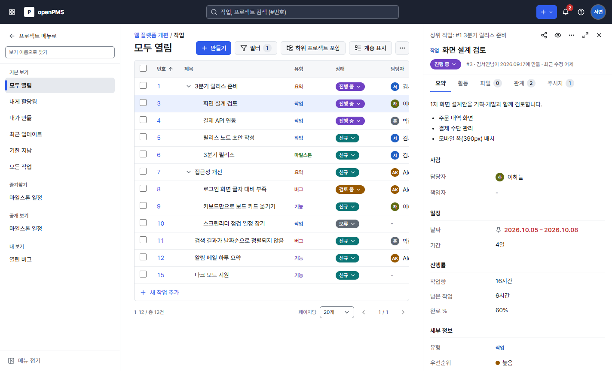 · 공동 담당자(2.1, #4 결제 API 연동: 박준호 **주 담당자 예상 24시간**, 이하늘 16시간, **공동 담당자 편집**) 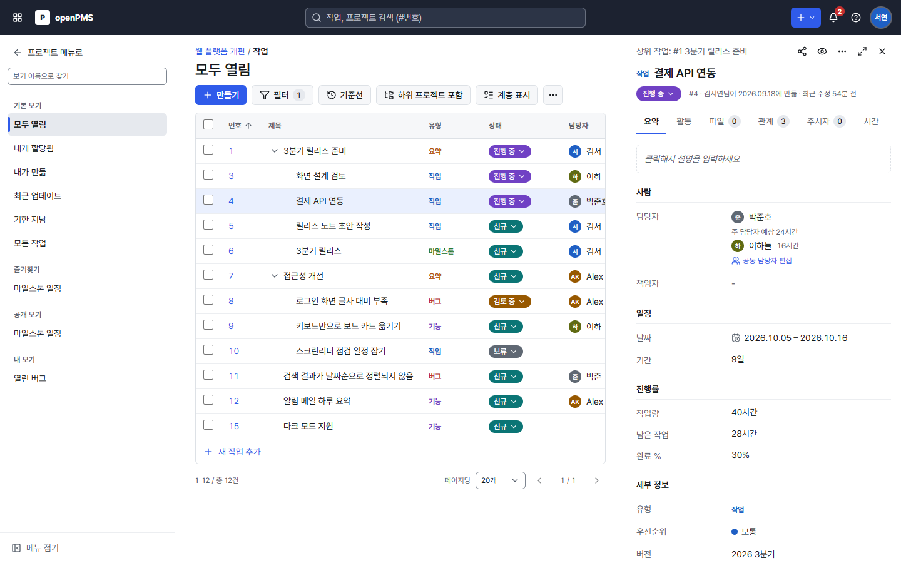 · 담당자와 예상 시간 대화상자(2.1, **2명 · 예상 합계 40시간 (작업량 40시간)**) 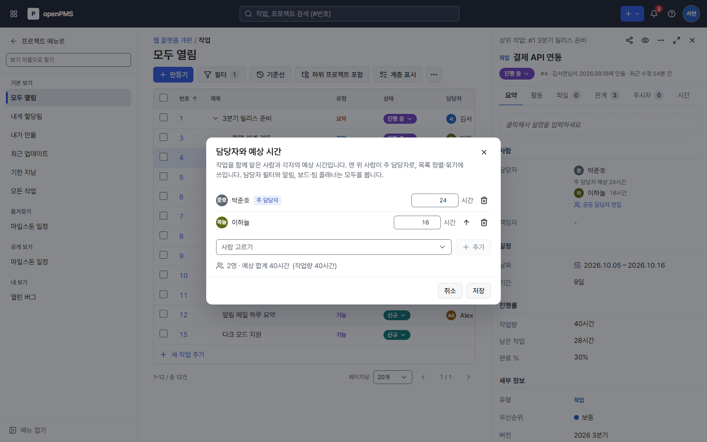 (48f4a36, 데스크톱만) · 활동 `../../replica/clone-screens/S07-activity.png` · 활동 거르기·정렬 버튼(전체 화면 상세) 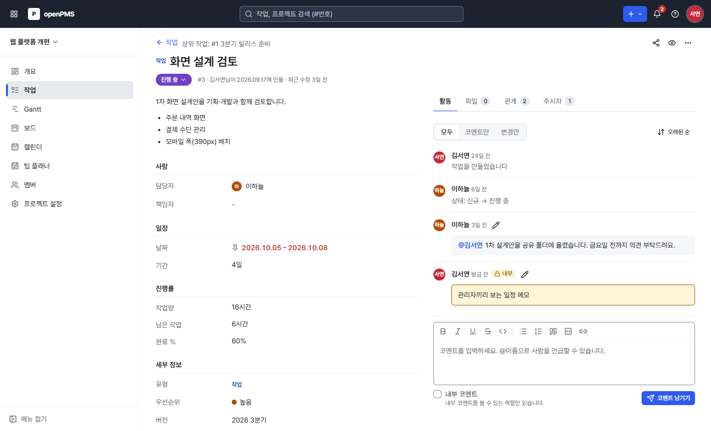, 모바일 `../../replica/clone-screens/S08-activity-filter-mobile.png`(1.4, 2026-10-11. 내부 코멘트는 캡처 없음) · 모바일 `../../replica/clone-screens/S07-mobile.png`, `../../replica/clone-screens/S07-activity-mobile.png`

<a id="s08"></a>
#### S08 작업 전체 화면 상세

- **목적**: 작업 하나를 넓은 화면에서 보고 고칩니다(속성과 활동을 나란히).
- **경로**: `/projects/:p/work-packages/:number/:tab?` (탭: `activity`(기본)·`files`·`relations`·`watchers`·`time`(1.6)). 다른 프로젝트로 옮겨진 작업은 실제 프로젝트 주소로 자동 이동합니다.

**레이아웃**: 왼쪽 **← 작업**(목록으로) 링크와 머리(S07과 같음, 전체 화면·닫기 버튼 없음). lg 이상에서 왼쪽 열은 설명과 속성(요약 탭 내용), 오른쪽 열은 탭(활동·파일·관계·주시자·시간(1.6)). lg 미만은 1열.

**UI 요소**: S07과 같습니다. 차이점은 다음과 같습니다.

| 항목 | 차이 |
| --- | --- |
| 작업(뒤로) | 프로젝트 작업 목록으로 가는 링크 |
| 요약 탭 | 없음(왼쪽 열에 항상 표시) |
| 전체 화면으로 열기 / 상세 패널 닫기 | 없음 |

**상태·동작·API·검증 메시지**: S07과 같습니다. (2.1) 담당자 항목의 공동 담당자 목록과 **담당자와 예상 시간** 대화상자도 S07과 같고 왼쪽 열의 속성에 있습니다.

**UI 요소(시간 탭, 1.6)**

작업에 쓴 시간을 보고 기록하는 탭입니다(3f9d5c0). S07 분할 상세에서도 같은 내용입니다. 작업의 프로젝트에서 **시간 기록** 모듈이 켜져 있고 time.log나 time.view가 있을 때만 보입니다.

```
┌ 시간 ─────────────────────────────────────────────┐
│ 모두 16시간                               [+ 시간 기록] │
│ ┌──────────────────────────────────────────────┐ │
│ │ 2026.10.08  김서연 개발                8시간 [✎][🗑] │ │
│ │ 2026.10.05  김서연 회의              1.5시간 [✎][🗑] │ │
│ │             화면 설계 검토 회의                     │ │
│ └──────────────────────────────────────────────┘ │
└──────────────────────────────────────────────────┘
```

| 항목 | 유형 | 설명 | 규칙 |
| --- | --- | --- | --- |
| 합계 | 텍스트 | **모두 {{hours}}시간**(목록에 보이는 기록의 합, 소수 둘째 자리) | 내가 볼 수 있는 기록만 셈(time.view면 모든 사람, time.log만 있으면 내 기록) |
| 시간 기록 | 버튼 | **시간 기록** 대화상자를 엶 | time.log가 있을 때만 |
| 기록 목록 | 목록 | 행마다 날짜, 사람 이름, 활동(작은 글씨), 메모(한 줄, 넘치면 말줄임·툴팁), **{{hours}}시간** | 최근 날짜 먼저(같은 날은 최근에 만든 것 먼저), 최대 2,000건 |
| 고치기 / 지우기 | 아이콘 버튼 | 접근 이름 **고치기: {{날짜}} {{이름}}** / **지우기: {{날짜}} {{이름}}**. 지우기는 확인 **이 시간 기록을 지울까요?** | 내 기록은 time.log, 남의 기록은 time.manage가 있을 때만 보임(`canEdit`) |
| 시간 기록 대화상자 | 대화상자 | 제목 **시간 기록**(고칠 때 **고치기**). **날짜**(필수, 기본 오늘), **시간**(필수, 도움말 **1.5 또는 1:30**), **활동**(선택, 켜진 활동, 새 기록은 기본 활동이 선택됨), **메모**(1000자) + **취소**·**저장** | 시간이 0보다 크고 24 이하가 아니면 **저장** 비활성. `1:30`은 1.5, 소수 둘째 자리로 반올림해 보냄. 저장하면 토스트 **시간을 기록했습니다** |

- 상태: 로딩(스켈레톤), 빈 상태 **기록한 시간이 없습니다.**, 오류(공통 오류 + **다시 시도**), 모바일(한 열, 목록 행이 줄바꿈).
- 동작과 API: 목록 `GET /time-entries?workPackage={number}`, 활동 `GET /time-activities`(켜진 것만), 저장 `POST /time-entries` {workPackageNumber, spentOn, hours, activityId, comment} → 201, 고치기 `PATCH /time-entries/{id}`(바꾼 값만), 지우기 `DELETE /time-entries/{id}` → 204 + 토스트 **시간 기록을 지웠습니다**. 다른 사람 이름으로 기록하는 `userId`(time.manage)는 API에만 있고 화면에는 없습니다.
- 검증 메시지(서버, 칸 아래): **날짜를 입력하세요.**, **시간을 입력하세요.**, **0보다 크고 24 이하로 입력하세요.**, **소수 둘째 자리까지 입력하세요.**, **하루에 24시간을 넘게 기록할 수 없습니다.**(그날 내 기록의 합), **쓸 수 있는 활동을 고르세요.**(끈 활동), **메모는 1000자 이하로 입력하세요.** 권한: **이 작업에 시간을 기록할 권한이 없습니다.**, **이 시간 기록을 바꿀 권한이 없습니다.**(403), 볼 수 없는 기록 **시간 기록을 찾을 수 없습니다.**(404).
- 작업을 다른 프로젝트로 옮기면 그 작업의 기록도 새 프로젝트로 따라갑니다(공수 보고서에서도 새 프로젝트로 셈). 시간 기록은 활동 탭(작업 기록)에 남지 않습니다.
- 작업을 삭제하면 그 기록도 함께 지워집니다. 삭제 확인 대화상자(S07 **작업을 삭제할까요?**)는 이 탭에 보이는 기록의 합이 0보다 크면 경고 배너 **이 작업에 기록된 시간 {{hours}}시간도 함께 지워지고 공수 보고서에서 빠집니다.**를 보입니다(39c8974). 프로젝트 삭제 확인은 시간 기록을 따로 말하지 않습니다.
- 접근성: 탭 영역 이름 **시간 기록**. 대화상자는 공통 대화상자 규칙(포커스 가둠, Esc). 시간 칸에 처음 포커스. 대화상자와 기록이 더해진 탭은 axe 검사(F16-H2 "S08 시간 기록 대화상자", "S08 시간 탭")를 통과합니다. F16-H2는 이어서 작업 삭제 확인의 시간 경고(7.25시간)를 확인하고 **취소**합니다.

**관련 흐름**: F05(관계 탭에서 선후행), F07(하위 연결·새 하위 작업), F08(활동 탭 코멘트, 1.4 활동 거르기·정렬·내부 코멘트), F16(시간 탭, 1.6), F18(공동 담당자, 2.1)

**접근성**: S07과 같음. 페이지가 바뀌면 포커스가 본문으로 이동.

**참고 화면**: 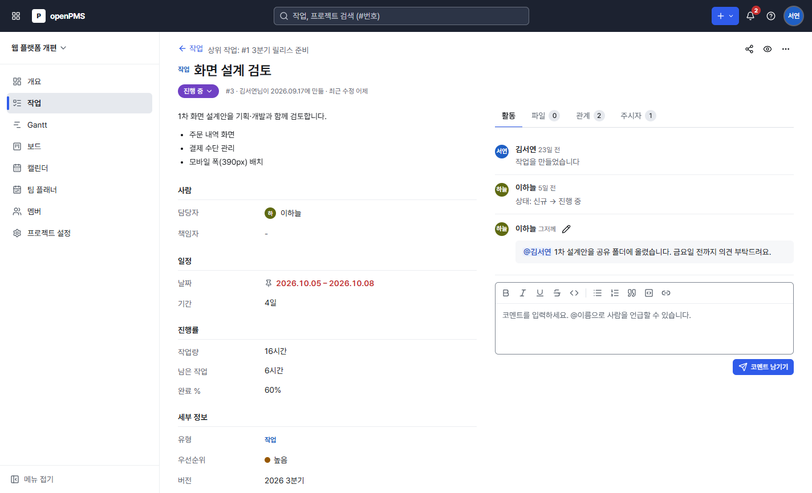 · 시간 탭(1.6) 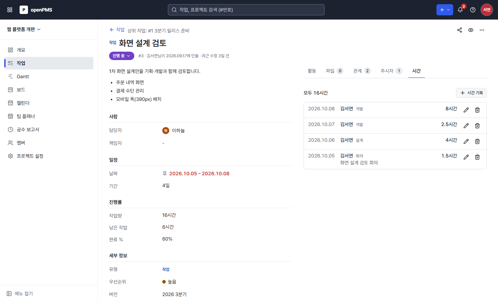, 모바일 `../../replica/clone-screens/S08-time-mobile.png`(2026-10-11) · 활동 거르기·정렬 버튼 `../../replica/clone-screens/S08-activity-filter.png`(1.4) · 관계 `../../replica/clone-screens/S08-relations.png`, 관계 추가 `../../replica/clone-screens/S08-relations-add.png` · 모바일 `../../replica/clone-screens/S08-mobile.png`, `../../replica/clone-screens/S08-relations-mobile.png`, `../../replica/clone-screens/S08-relations-add-mobile.png`

<a id="s09"></a>
#### S09 새 작업

- **목적**: 분할 패널에서 새 작업을 만듭니다.
- **경로**: `/projects/:p/work-packages/new?type=<유형 ID>`. 미리 채우는 값: `parent`(새 하위 작업), `startDate`·`dueDate`(캘린더), `assignee`(팀 플래너). 캘린더·팀 플래너 안에서는 `/calendar/:id/new`, `/team-planner/:id/new`.

**레이아웃**: 머리 **만들기 [유형]** + 닫기(x), 스크롤 영역의 폼, 아래 고정 **취소**·**저장**.

**UI 요소**

| 항목 | 유형 | 설명 | 규칙 |
| --- | --- | --- | --- |
| 유형 | 선택 | 이 프로젝트에서 쓰는 유형 | 바꾸면 폼이 그 유형으로 다시 구성(설명 템플릿 포함) |
| 제목 | 입력 | - | 필수, 255자, 진입 시 포커스 |
| 설명 | 서식 편집기 | 유형의 **기본 설명**(S28)이 미리 채워짐 | - |
| 상태 | 선택 | 기본 상태가 미리 선택 | - |
| 우선순위 | 선택 | 기본 우선순위가 미리 선택 | 숨긴 우선순위는 없음 |
| 담당자 | 선택 | **담당자 없음** + 프로젝트 멤버 | - |
| 버전 | 선택 | **없음** + 버전 | 버전이 있을 때만 |
| 카테고리 | 선택 | **없음** + 카테고리. 도움말 **담당자를 비워 두면 카테고리의 기본 담당자가 들어갑니다.** | 카테고리가 있을 때만 |
| 시작일 / 완료일 | 날짜 입력 | 마일스톤 유형은 **날짜** 하나 | 완료일은 시작일 이후만 고를 수 있음 |
| 상위 작업 | 입력 | 자리표시자 `#12`, 도움말 **상위 작업의 #번호를 입력하세요.** | - |
| 추가 정보 | 사용자 정의 필드 | 이 유형·프로젝트에 켜진 필드, 기본값 미리 채움 | 필수 필드 표시 |
| 취소 / 저장 | 버튼 | 목록으로 / 생성 | 두 번 눌러도 1건만 생성 |

**상태**: 로딩(폼 스켈레톤), 오류(폼 정보 실패 시 공통 오류, 저장 실패 시 칸 오류 또는 위험 배너), 권한 없음(목록에 **만들기**가 보이지 않음, 직접 접근 시 서버 403), 모바일(패널 전체 화면, 2열 항목이 1열로), 이탈 경고(제목이나 설명을 쓰다 떠나면 확인).

**주요 동작과 API**: 진입·유형 변경 `GET /projects/{project}/work-packages/form?typeId` / **저장** `POST /projects/{project}/work-packages` → 토스트 **#{{number}} 작업을 만들었습니다** → 같은 패널에 S07(요약 탭).

**검증 메시지**

| 조건 | 메시지 |
| --- | --- |
| 제목 빈 칸 / 초과 | 제목을 입력하세요. / 제목은 255자 이하로 입력하세요. |
| 프로젝트에서 안 쓰는 유형 | 이 프로젝트에서 쓰지 않는 유형입니다. |
| 쓸 수 있는 유형 없음 | 쓸 수 있는 유형이 없습니다. (프로젝트 설정에서 유형을 하나 이상 켜세요.) |
| 담당자 | 프로젝트 멤버만 지정할 수 있습니다. |
| 상위 작업 | 상위 작업을 찾을 수 없습니다. |
| 버전·카테고리 | 이 프로젝트의 버전이 아닙니다. / 이 프로젝트의 카테고리가 아닙니다. |
| 사용자 정의 필드 | {{필드명}}: {{사유}} 형식(필수·형식·길이·정규식 위반) |

**관련 흐름**: F01(작업 만들기), F07(새 하위 작업)

**접근성**: 저장 실패 시 첫 오류 칸(없으면 제목)으로 포커스. 폼 이름은 머리 제목과 연결(aria-labelledby).

**참고 화면**: 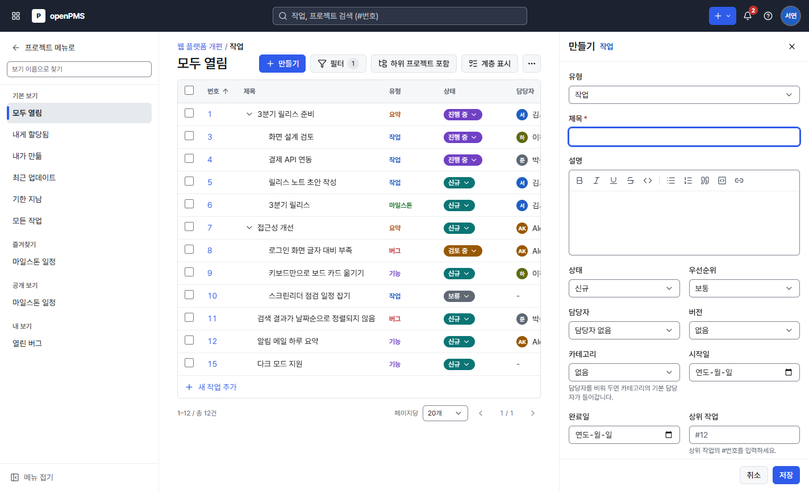 · 모바일 `../../replica/clone-screens/S09-mobile.png`

<a id="s10"></a>
#### S10 날짜 대화상자

- **목적**: 작업의 일정 방식(수동·자동), 근무일 계산 여부, 시작일·완료일·기간을 정합니다. 이 작업의 일정에 영향을 주거나 받는 선행·후속·하위 작업을 탭으로 봅니다(1.3).
- **진입**: 상세 속성 **날짜** 버튼, Gantt 막대 클릭 또는 막대에서 Enter, Gantt 날짜 없는 행의 **#{{number}} 날짜 정하기** 버튼(1.3). 열 때마다 **날짜** 탭으로 시작합니다.

**레이아웃**

```
┌ 날짜 ─────────────────────────────────────────┐
│ 날짜 | 선행 (1) | 후속 (1) | 하위 작업 (0)   ← 탭(1.3)   │
│ ─────────────────────────────────────────── │
│ [정보: 날짜는 하위 작업에서 정해집니다]  ← 파생일 때      │
│ [정보: 자동 일정: #4 결제 API 연동(완료 …)이 끝난 뒤에    │
│        시작합니다. 선행 작업 보기]  ← 자동·선행 있을 때     │
│ [📌 수동 | 🕘 자동]                  ☑ 근무일만 계산   │
│ (방식 설명)                                     │
│ 시작일 [    ]  완료일 [    ]  기간(근무일) [  ]       │
│ 오늘           오늘                              │
│ 달력에서 고르는 날짜가 시작일이 됩니다                    │
│ ┌ 10월 ─────────┐┌ 11월 ─────────┐             │
│ │ 2개월 달력       ││               │             │
│ └──────────────┘└───────────────┘             │
│ [이 변경으로 작업 n개의 일정이 함께 바뀝니다 …]          │
│                                  [취소] [저장]   │
└───────────────────────────────────────────────┘
```

**UI 요소**

| 항목 | 유형 | 설명 | 규칙 |
| --- | --- | --- | --- |
| 일정 방식 | 세그먼트 | **수동**(입력한 날짜를 그대로 씁니다. 선행 작업이 바뀌어도 움직이지 않습니다.) / **자동**(선행 작업이 끝난 다음 근무일에 시작하고, 하위 작업이 있으면 그 기간을 따릅니다.) | - |
| 근무일만 계산 | 체크박스 | 주말·휴무일을 기간 계산에서 뺌 | 끄면 달력의 쉬는 날도 고를 수 있음 |
| 시작일 (마일스톤은 날짜) | 날짜 입력 + **오늘** | 다음 달력 클릭 대상이면 파란 테두리 | 파생이면 비활성 |
| 완료일 | 날짜 입력 + **오늘** | - | 시작일 이전 불가, 마일스톤은 없음 |
| 기간(근무일) | 숫자 입력 | 1 이상 | 마일스톤은 없음 |
| 다음 클릭 안내 | 텍스트 | **달력에서 고르는 날짜가 시작일이 됩니다** / **…완료일이 됩니다** | `aria-live` |
| 2개월 달력 | 달력 그리드 | 첫 클릭 시작일, 다음 클릭 완료일. 시작일보다 앞을 누르면 새 시작일. **이전 달**·**이번 달**·**다음 달**. 첫 열(요일)은 S33 **주 시작 요일**을 따름(기본 일요일) | 근무일만 계산이면 쉬는 날은 고를 수 없음 |
| 영향 미리 보기 | 상자 | **이 변경으로 작업 {{count}}개의 일정이 함께 바뀝니다**와 최대 6건의 새 날짜 | 서버 미리 계산 결과 |
| 취소 / 저장 | 버튼 | - | 편집 권한이 없으면 저장 비활성. 어느 탭에서든 보임 |
| 탭(1.3) | 탭 목록 | **날짜**(위 항목들), **선행**, **후속**, **하위 작업**. 탭마다 개수 배지 | 접근 이름 **날짜와 관련 작업** |
| 대기 안내(1.3) | 배너(정보) | **자동 일정: #{{number}} {{subject}}(완료 {{date}})이 끝난 뒤에 시작합니다.** + 링크 버튼 **선행 작업 보기**(선행 탭으로) | 자동 일정이고 날짜가 하위에서 파생되지 않으며, 완료일이 있는 선행 작업이 있을 때. 그중 가장 늦게 끝나는 작업을 보임 |
| 관련 작업 목록(1.3) | 목록 | 행마다 #번호, 유형, 제목(링크), 상태 pill, 기간(없으면 **날짜 없음**). 선행·후속은 lag가 있으면 **· 간격 {{count}}일** | 제목을 누르면 대화상자가 닫히고 그 작업의 전체 화면(S08 활동 탭)으로 이동. 비면 선행 **이 작업보다 먼저 끝나야 하는 작업이 없습니다**, 후속 **이 작업이 끝난 뒤에 시작하는 작업이 없습니다**, 하위 **하위 작업이 없습니다** |

- 세 값(시작·완료·기간) 중 마지막에 직접 고친 두 값으로 나머지 하나를 서버가 계산해 채웁니다.
- 자동 일정이면서 하위 작업이 있는 작업은 정보 배너 **날짜는 하위 작업에서 정해집니다**를 보이고 날짜 입력·달력을 잠급니다(방식·근무일 설정만 바꿀 수 있음).
- (1.3, 20646b9) 선행 탭은 이 작업이 '후행'인 관계(이 작업보다 먼저 끝나야 하는 작업), 후속 탭은 이 작업이 '선행'인 관계, 하위 작업 탭은 하위 작업입니다. 탭은 보기 전용이며 관계를 추가·삭제하려면 S08 관계 탭을 씁니다.
- 원본의 '선행 작업 종료일 이전 날짜를 점선으로 표시'는 없습니다(이 때문에 화면 목록의 상태는 partial).

**상태**: 기본, 파생(잠김), 자동 일정 대기 안내, 마일스톤(날짜 1개), 미리 계산 중, 관련 작업 없음(탭별 빈 문구), 저장 실패(토스트, 대화상자 유지), 모바일(입력 3칸이 1열로, 관련 작업 행의 기간이 아래 줄로).

**주요 동작과 API**: 대화상자를 열 때 관련 작업 `GET /work-packages/{number}/relations`(1.3) / 값 변경 시 `POST /work-packages/{number}/schedule-preview` / **저장** `PATCH /work-packages/{number}` (scheduleManually, ignoreNonWorkingDays, startDate, dueDate, duration, touched, lockVersion) / 쉬는 날 표시 `GET /calendar/non-working-days`

**검증 메시지**: **기간은 1일 이상이어야 합니다.**, **날짜는 하위 작업에서 정해집니다.**, 충돌 **다른 사람이 먼저 수정했습니다**

**관련 흐름**: F04(일정 잡기·옮기기)

**접근성**: 2개월 달력은 탭 정지점 하나로, 화살표(하루·한 주), PageUp/PageDown(한 달), Home/End(주 시작·끝), Enter/스페이스(선택). 날짜 칸 접근 이름 **{{year}}년 {{month}}월 {{day}}일 {{weekday}}**와 **근무일**/**쉬는 날**. **오늘** 링크 접근 이름 **시작일을 오늘로** / **완료일을 오늘로**. 탭은 화살표 키로 이동하며 개수를 함께 낭독. 선행 탭을 연 화면도 axe 검사(F04-H3 "S10 날짜 대화상자 · 선행")를 통과합니다.

**참고 화면**: 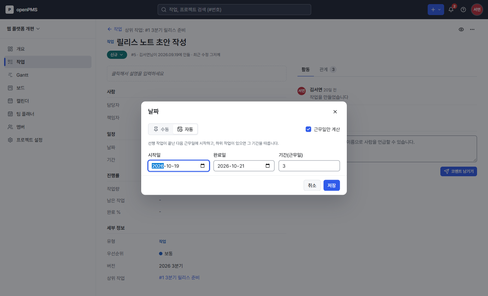 · 선행 탭(#5의 선행 #4) 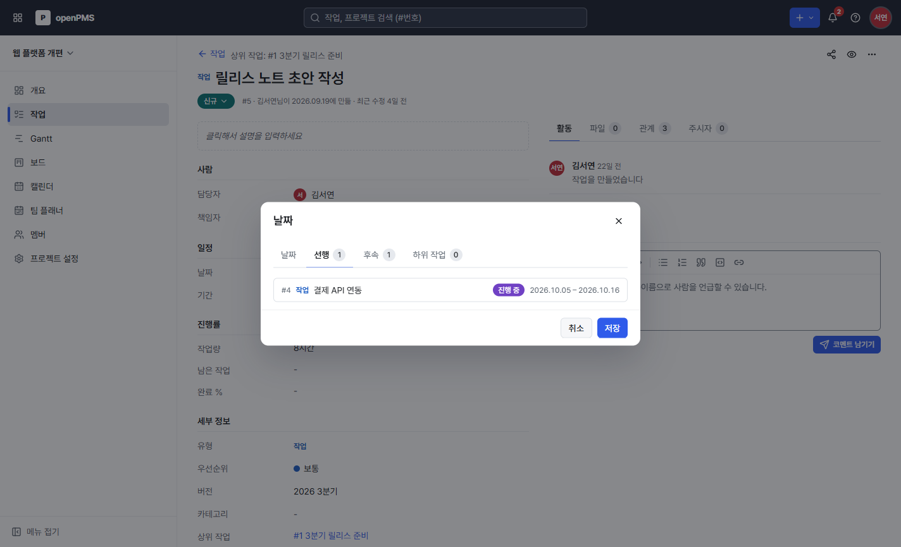 · 모바일 `../../replica/clone-screens/S10-mobile.png`, `../../replica/clone-screens/S10-tabs-mobile.png` (탭은 1.3, 2026-10-11 캡처. `S10.png`은 탭이 없던 1.0 때 화면)

<a id="s11"></a>
#### S11 보기 구성

- **목적**: 목록의 열·정렬·그룹화·합계를 바꿉니다.
- **구현 방식**: 원본의 탭형 "보기 구성" 대화상자는 만들지 않았고, 다음 두 곳으로 대신합니다.

| 위치 | 기능 |
| --- | --- |
| S06 보기 메뉴(⋯) › **표시할 열** | 열 켜기·끄기(제목 열 제외) |
| S06 보기 메뉴(⋯) › **그룹화** | 그룹 기준 고르기(**그룹화 안 함**, 유형, 상태, 우선순위, 담당자, 책임자, 작성자, 버전, 프로젝트, 목록·사용자·예/아니요 사용자 정의 필드) |
| S06 보기 메뉴(⋯) › **합계 표시** | 그룹 합계 행과 **전체 합계** 행 켜기·끄기 |
| S06 보기 메뉴(⋯) › **강조 표시**(1.4) | 없음·셀 강조·행 색(상태·우선순위·유형) |
| S06 툴바 **기준선**(1.4) | 어제·1주 전·한 달 전·날짜 지정. (1.5) 빠진 작업은 목록 아래 영역에 |
| S06 열 제목 메뉴 | 오름차순·내림차순 정렬, 정렬 기준에 추가(최대 3개)·빼기, 왼쪽·오른쪽으로 이동, 열 숨기기 |
| S06 툴바 | 필터, 하위 프로젝트 포함, 계층 표시 |

- 그룹화와 합계의 세부 규칙은 S06 "UI 요소(그룹화와 합계)"를, 강조 표시와 기준선(1.4)은 S06 "UI 요소(강조 표시와 기준선, 1.4)"를 따릅니다. 원본의 탭형 대화상자는 여전히 없어 화면 목록의 상태는 partial입니다.
- 바꾼 내용은 URL(`?q=`)에 저장되고, 제목 옆 **저장하지 않은 변경** 배지가 나타납니다. 보기 메뉴의 **보기 저장** 또는 **다른 이름으로 저장**으로 남깁니다.

**상태·API·검증**: S06과 같습니다.

**관련 흐름**: F03

**접근성**: S06 열 제목 메뉴 참고. **표시할 열**·**그룹화**·**강조 표시** 하위 메뉴 항목과 **합계 표시**는 체크 상태를 가진 메뉴 항목(menuitemcheckbox).

**참고 화면**: 열 메뉴 `../../replica/clone-screens/S06-header-menu.png`, 강조 표시 결과 `../../replica/clone-screens/S06-highlight.png` (S11 전용 캡처 없음)

<a id="s12"></a>
#### S12 내보내기

- **목적**: 현재 목록(필터·정렬 적용, 모든 페이지)을 Excel·CSV 파일 또는 PDF(표·보고서·Gantt, 1.4)로 내려받습니다.
- **진입**: S06 보기 메뉴 › **내보내기**

**UI 요소**

| 항목 | 유형 | 설명 | 규칙 |
| --- | --- | --- | --- |
| 제목 | 텍스트 | **내보내기**, 부제목은 현재 보기 이름 | - |
| 건수 안내 | 텍스트/배너 | **작업 {{count}}건을 내보냅니다. 페이지와 상관없이 필터에 맞는 전부입니다.**, 빠지는 작업이 있으면 정보 배너 **필터에 맞지만 빠지는 작업이 {{count}}건 있습니다. …** | 화면을 열 때 서버가 계산 |
| 파일 형식 | 라디오 카드 | **Excel (.xlsx)**(Excel·한셀·Google 스프레드시트에서 바로 열기, 기본) / **CSV**(어느 프로그램에서나 열리는 텍스트 표) / **PDF**(인쇄하거나 그대로 공유(한 번에 1,000건까지), 1.4) | - |
| PDF 종류(1.4) | 라디오 카드 | **표**(고른 열로 만든 표(가로 A4)) / **보고서**(작업마다 속성과 설명(세로 A4)) / **Gantt**(기간 막대와 오늘 선(가로 A4)) | PDF를 골랐을 때만. 기본 **표** |
| 내보낼 열 | 순서 목록 | 목록의 열로 시작. 열마다 **{{name}} 위로**, **{{name}} 아래로**, **{{name}} 빼기** | 1개 이상. PDF는 **표**일 때만 보임 |
| 추가할 열 + 열 추가 | 선택 + 버튼 | 목록에 없는 열 추가 | - |
| 설명도 넣기 (마지막 열, 서식 없는 글) | 체크박스 | - | Excel·CSV와 PDF **표**일 때만 |
| 취소 / 내보내기 | 버튼 | 파일 내려받기 | 건수 계산 전, 한도 초과, 내보낼 것이 없으면 비활성 |

**상태**: 계산 중(스켈레톤), 한도 초과(경고 **{{count}}건은 너무 많습니다. 한 번에 5,000건까지 내보낼 수 있으니 필터로 나눠 주세요.** PDF는 1,000건을 넘으면 서버가 422 **PDF로 내보내기에는 작업이 너무 많습니다.** / **PDF는 한 번에 1,000건까지입니다. 필터로 줄이거나 CSV·Excel을 쓰세요.**로 거부, 1.4), 내보낼 것 없음(경고 **내보낼 수 있는 작업이 없습니다** + 사유), 오류(위험 배너), 모바일(대화상자 폭 축소).

**주요 동작과 API**: 열기 `POST /work-packages/export/count` / **내보내기** `POST /work-packages/export` {format: xlsx·csv·pdf, pdfType(PDF만): table·report·gantt, columns, includeDescription, title} → 브라우저 내려받기, 토스트 **{{name}} 파일을 만들었습니다**

**검증 메시지**: **열을 하나 이상 고르세요.**, 서버 **내보낼 작업이 너무 많습니다.**, **형식을 고르세요.**(CSV, Excel, PDF만 내보낼 수 있습니다.), (1.4) **PDF 종류를 고르세요.**(pdfType), **PDF로 내보내기에는 작업이 너무 많습니다.**

- CSV는 수식으로 실행될 수 있는 값(=, +, -, @로 시작)을 막아 저장합니다.
- 목록을 그룹화하거나 합계를 켜 두었어도 파일은 평평한 목록으로 나가며, 그룹 머리글·합계 행은 들어가지 않습니다. **작업량**·**남은 작업** 열은 시간 단위 숫자로 나갑니다(머리글 작업량(시간)·남은 작업(시간)). 처음에는 서버가 이 두 열을 거부했으나 2026-10-11 고쳤습니다.
- 파일의 날짜는 S33 날짜 형식과 관계없이 `YYYY-MM-DD`, **최근 수정** 시각은 `YYYY-MM-DD HH:mm`(24시간)로 고정입니다.
- (1.4, 6f7f18a) PDF는 서버가 Apache PDFBox로 만듭니다. 표는 고른 열로 가로 A4에 머리글을 쪽마다 반복하고 쪽 번호를 붙이며, 보고서는 작업마다 속성과 설명을 세로 A4에, Gantt는 기간 막대·마일스톤·오늘 선을 가로 A4에 그립니다. 제목은 보기 이름, 부제는 **{{n}}건 · {{만든 시각}} · {{만든 사람}}**입니다. 한글 글꼴 Pretendard(SIL OFL 1.1)를 부분 내장해 한글이 그대로 보이고, 글꼴에 없는 문자(일부 이모지 등)는 '?'로 바뀝니다. 개발용 가짜 데이터 모드에서는 PDF를 만들 수 없다는 안내만 나옵니다.

**관련 흐름**: F03(보기 공유의 확장), F14(PDF 내보내기, 1.4)

**접근성**: 열 목록은 순서 목록(ol, 접근 이름 **내보낼 열**), 이동 버튼에 열 이름 포함. PDF 종류는 라디오 묶음(접근 이름 **PDF 종류**). PDF·보고서를 고른 대화상자는 axe 검사(F14-H1 "S12 내보내기 (PDF)")를 통과합니다.

**참고 화면**: 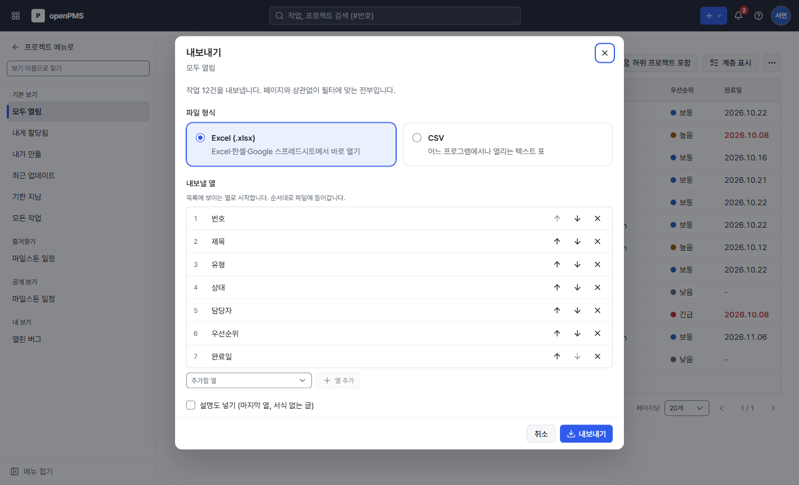 · PDF 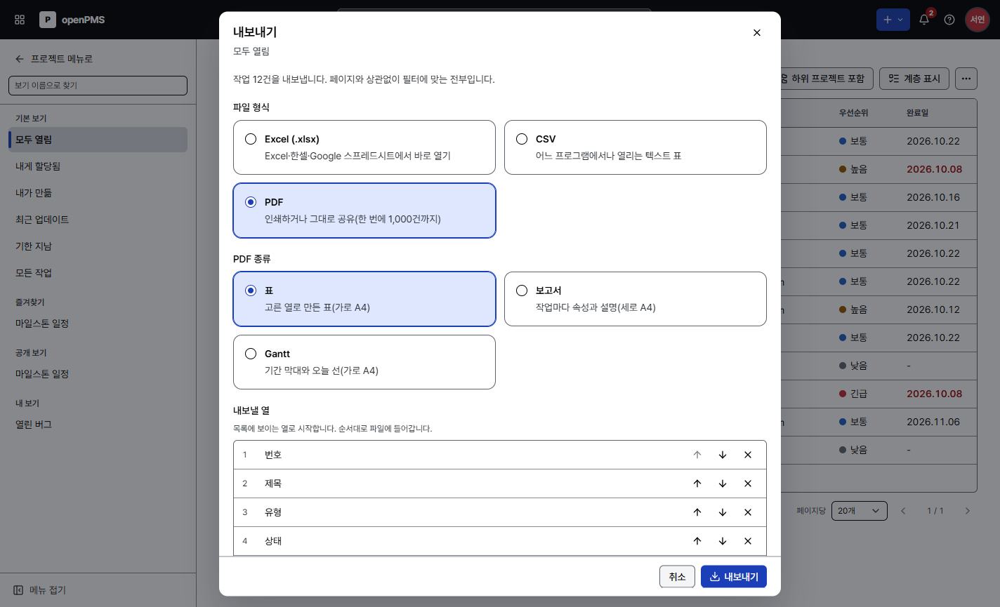(1.4, 2026-10-11, 데스크톱만)

### 4.5 계획 화면

<a id="s13"></a>
#### S13 Gantt

- **목적**: 작업 일정을 타임라인으로 보고, 막대를 끌어 일정을 바꿉니다.
- **경로**: `/projects/:p/gantt`(`?view=&q=`는 작업 목록과 같은 보기 상태), 상세 패널 `/projects/:p/gantt/details/:number/:tab?`
- **사이드바**: 작업 목록과 같은 저장된 보기 메뉴(기본 보기·즐겨찾기·공개 보기·내 보기)를 씁니다.

**레이아웃**

```
웹 플랫폼 개편 › Gantt
모두 열림 [저장하지 않은 변경]   [자동|일|주|월] [오늘로 이동] [라벨▾] [필터 n]
[필터 패널]
┌ 목록 열(320px) ──────────┬ 타임라인 ─────────────────────────┐
│ 제목                     │ 월/주/일 눈금, 오늘 점선, 쉬는 날 음영       │
│ ▾ #12 [요약] 로그인 개편    │   ┌───────────┐ (요약: 괄호형 막대)     │
│   #13 [작업] 화면 설계     │ 이하늘 ███████ 화면 설계        진행 중 │  ← 라벨: 왼쪽·오른쪽·먼 오른쪽(1.4)
│   #14 [마일스톤] 오픈       │            ◆  11-01 오픈             │
└────────────────────────┴───────────────────────────────────┘
막대를 끌어 옮기고 양 끝을 끌어 기간을 바꿉니다. …
```

**UI 요소**

| 항목 | 유형 | 설명 | 규칙 |
| --- | --- | --- | --- |
| 제목 | 텍스트 | 현재 보기 이름(없으면 **Gantt**) | 바뀐 내용이 있으면 **저장하지 않은 변경** |
| 확대 단계 | 세그먼트 | **자동**(기본, 기간 길이로 일·주·월 자동 선택), **일**, **주**, **월** | - |
| 오늘로 이동 | 버튼 | 타임라인을 오늘 위치로 가로 스크롤 | - |
| 라벨(1.4) | 메뉴 버튼 | 하위 메뉴 **왼쪽: {{값}}**, **오른쪽: {{값}}**, **먼 오른쪽: {{값}}**. 각각 **없음**·**제목**·**담당자**·**상태**·**기간**·**유형**·**우선순위**·**완료 %** 중 하나(체크 항목) | 기본: 왼쪽 없음·오른쪽 제목·먼 오른쪽 없음. 보기 설정(`timeline.labels`)이라 URL(`?q=`)에 담기고 보기에 저장됨 |
| 필터 | 토글 버튼 | S06과 같은 필터 패널 | 필터 수 배지 |
| 목록 열 | 트리 | 펼침 버튼, #번호, 유형, 제목(링크 → 상세 패널) | 휴대폰 폭은 168px |
| 막대 | 버튼 | 유형 색 막대. 끌어서 이동, 양 끝(마우스를 올리면 보임)을 끌어 기간 변경, 클릭·Enter로 S10 | 편집 권한 없으면 비활성. 날짜가 둘 다 있는 작업만 막대 표시 |
| 막대 그리기(1.3) | 행 영역 | 시작일이나 완료일이 없는 행에서 마우스 포인터가 십자로 바뀌고, 툴팁 **날짜가 없습니다. 끌어서 막대를 그리면 그 기간이 시작일·완료일이 됩니다(누르기만 하면 하루)**. 누른 날부터 놓은 날까지(왼쪽으로 끌어도 됨) 반투명 막대가 그려지고, 놓으면 저장 | 편집 권한이 있는 작업만. 누르기만 하면 그날 하루. 마일스톤은 끌어도 놓은 날 하루 |
| #{{number}} 날짜 정하기(1.3) | 버튼(포커스 때만 보임) | 막대를 그릴 수 있는 행마다 하나. Tab으로 오면 행 왼쪽 위에 나타나고 Enter로 S10을 엶 | 키보드 대안 |
| 요약 막대 | 버튼 | 하위 작업에서 날짜가 정해지는 상위 작업은 괄호형 막대, 끌 수 없음. 클릭하면 S10(잠김) | - |
| 마일스톤 | 버튼 | 마름모. 끌어서 이동 | - |
| 막대 라벨 | 텍스트 | 막대 왼쪽·오른쪽에는 **라벨**에서 고른 값(기본: 오른쪽에 제목), 먼 오른쪽 값은 차트 오른쪽 끝에 붙여 줄을 맞춤. 끄는 동안은 새 날짜 범위 | 기한 지남은 빨강 |
| 선후행 화살표 | 선 | 선후행 관계 | - |
| 도움말 | 텍스트 | **막대를 끌어 옮기고 양 끝을 끌어 기간을 바꿉니다. 키보드로는 막대에서 Enter를 눌러 날짜를 고칩니다. 화살표는 선후행 관계입니다.** | - |

- 보기 저장 메뉴는 Gantt 화면에 없습니다. 사이드바의 저장된 보기를 고르거나 필터·라벨을 바꿀 수 있고, 저장은 작업 목록(S06)에서 합니다. Gantt 전용 열 설정은 없습니다.
- (1.3, f378a86) 날짜 없는 작업(시작일·완료일 중 하나라도 없음)은 행을 끌어 막대를 그려 날짜를 정합니다. 저장은 막대 이동과 같은 경로이며, 그린 뒤에는 일반 막대가 되어 끌어 옮길 수 있습니다. 1.2까지는 날짜 대화상자로만 정할 수 있었습니다.
- (1.4, c94f95f) 라벨 위치(왼쪽·오른쪽·먼 오른쪽) 설정을 넣어 화면 목록의 상태를 done으로 바꿨습니다. 1.3까지는 오른쪽 라벨(완료일과 제목)만 있었습니다.
- **주** 단계의 눈금은 S33 **주 시작 요일**(기본 일요일)에서 한 주를 시작합니다. 1.0 때는 월요일 고정이었습니다. 막대 라벨 등 날짜 표기는 S33 **날짜** 형식을 따릅니다.

**상태**: 로딩(큰 스켈레톤), 빈 상태(**조건에 맞는 작업이 없습니다** / **필터를 바꾸거나 새 작업을 만드세요.**), 오류(공통 오류), 모듈 꺼짐(**이 프로젝트에서 꺼진 기능입니다**), 모바일(목록 열 168px, 타임라인 가로 스크롤, 상세 패널 전체 화면).

**주요 동작과 API**

| 동작 | API |
| --- | --- |
| 표시 | `POST /work-packages/query` (timeline.visible·zoom·labels, 최대 200건, 결과에 선후행 관계 포함), `GET /calendar/non-working-days` |
| 막대 이동·기간 변경 | `PATCH /work-packages/{number}` → 후행·상위 작업 자동 조정 |
| 막대 그리기(1.3) | `PATCH /work-packages/{number}` {startDate, dueDate, touched: [startDate, dueDate], lockVersion} → 후행·상위 작업 자동 조정 |
| 날짜 대화상자 | S10 |

**검증 메시지**: S10과 같음. 저장이 거부되면 막대가 원래 자리로 돌아가고 위험 토스트.

**관련 흐름**: F04(일정 잡기·옮기기, 1.4 라벨), F05(선후행 표시)

**접근성**: **라벨** 메뉴는 키보드로 위치 항목에서 →로 하위 메뉴를 열고 Enter로 고름(F04-H4, 라벨을 바꾼 화면 axe "S13 Gantt 라벨" 통과). 타임라인 영역 이름 **Gantt 차트**, 행 목록 **작업 일정**. 막대 접근 이름 **#{{n}} {{제목}}, {{날짜 범위}}, {{n}}일**(요약 막대는 뒤에 **날짜는 하위 작업에서 정해집니다**). 키보드 사용자는 Enter로 S10을 열어 날짜를 바꿈. 날짜 없는 작업은 그 행의 **#{{number}} 날짜 정하기**(Tab으로 나타남) → Enter → S10(1.3, F04-H2가 키보드로 확인, 대화상자 axe "S13 Gantt 날짜 대화상자" 통과).

**참고 화면**: 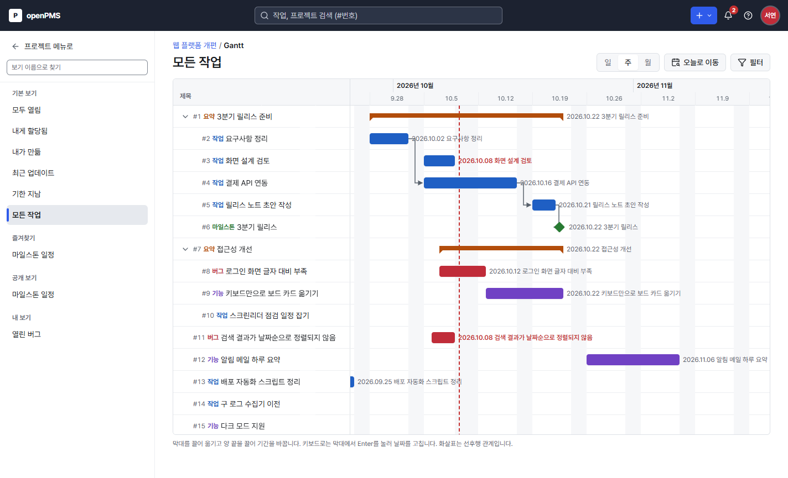 · 라벨 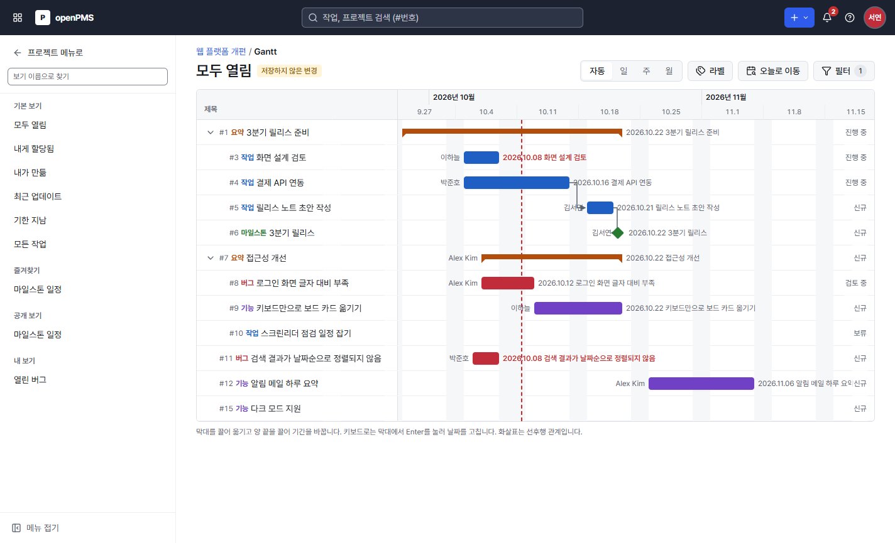, 모바일 `../../replica/clone-screens/S13-labels-mobile.png`(1.4, 2026-10-11) · 끈 뒤 `../../replica/clone-screens/S13-after-drag.png` · 모바일 `../../replica/clone-screens/S13-mobile.png` (막대 그리기는 캡처 없음)

<a id="x04"></a>
#### X04 전역 Gantt

- **목적**: 볼 수 있는 모든 프로젝트의 작업 일정을 한 타임라인에서 봅니다.
- **경로**: `/gantt`

**구성**: S13과 같습니다. 차이점은 다음과 같습니다.

| 항목 | 차이 |
| --- | --- |
| 사이드바 | 전역 메뉴(저장된 보기 메뉴 없음) |
| 막대·제목 클릭 | 해당 프로젝트의 작업 전체 화면(S08)으로 이동(분할 패널 없음) |
| 브레드크럼 | **Gantt** |
| 권한 | 로그인 사용자. 볼 수 있는 프로젝트의 작업만 표시 |
| 라벨(1.4) | S13과 같은 **라벨** 메뉴 |

**API**: `POST /work-packages/query`(프로젝트 없이), `PATCH /work-packages/{number}`

**관련 흐름**: F04

**참고 화면**: 캡처 없음

<a id="s14"></a>
#### S14 보드 목록

- **목적**: 프로젝트의 보드를 고르거나 새로 만듭니다.
- **경로**: `/projects/:p/boards`

**UI 요소**

| 항목 | 유형 | 설명 | 규칙 |
| --- | --- | --- | --- |
| 보드 만들기 | 버튼(주) | S16으로 | board.manage |
| 보드 표 | 표 | 열: **보드 이름**(링크 → S15), **보드 종류**(상태별·담당자별·버전별·빈 보드·하위 프로젝트별·상위-하위 배지), **만든 날** | - |

**상태**: 로딩(스켈레톤), 빈 상태(**아직 보드가 없습니다** / **상태별 보드를 만들면 카드를 옮겨서 작업을 진행시킬 수 있습니다.** + **보드 만들기**), 오류(공통), 모듈 꺼짐, 모바일(표 가로 스크롤).

**API**: `GET /projects/{project}/boards`

**관련 흐름**: F06

**접근성**: 일반 데이터 표(열 제목 scope).

**참고 화면**: 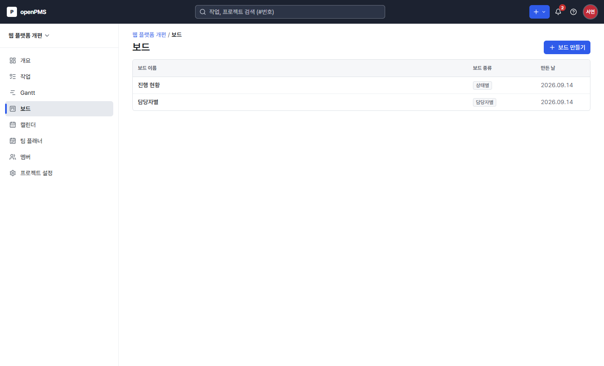 · 모바일 `../../replica/clone-screens/S14-mobile.png`

<a id="s15"></a>
#### S15 보드

- **목적**: 카드를 다른 열로 끌어 작업의 상태·담당자·버전을 바꾸거나(상태별·담당자별·버전별 보드), 작업을 다른 하위 프로젝트로 옮기거나(하위 프로젝트별 보드, 1.3), 상위 작업을 바꾸거나(상위-하위 보드, 1.3), 팀이 직접 만든 목록에 작업을 골라 넣고 순서를 정합니다(빈 보드). 필터로 모든 열의 카드를 좁혀 봅니다.
- **경로**: `/projects/:p/boards/:id`, 상세 패널 `/projects/:p/boards/:id/details/:number/:tab?`

**레이아웃**

```
웹 플랫폼 개편 › 보드 › 개발 칸반
개발 칸반                          [필터 n] [열 추가▾] [⋯]
카드를 다른 열로 옮기면 상태가 바뀝니다. 내 역할에 허용된 전환만 됩니다.
┌ 필터 패널(열었을 때, S06과 같음) ─────────────────────────────┐
│ [🔍 제목이나 #번호로 찾기]  상태 [열림 ▾] …  [필터 추가 ▾]         │
└──────────────────────────────────────────────────────┘
[저장하지 않은 필터로 보고 있습니다] [필터 저장] [저장된 필터로 되돌리기]   ← 필터를 바꿨을 때
┌ ● 신규 (3) [+][⋯] ┐┌ ● 진행 중 (2) ┐┌ ● 완료 (0) ──┐
│ ┌ 카드 ───────[≡]┐ ││ ...          ││ 카드 없음      │
│ │#12 프로젝트     │ ││              ││ 여기로 끌어다    │
│ │[작업] 제목      │ ││              ││ 놓으세요.      │
│ │(아바타) 날짜    │ ││              ││              │
│ └──────────────┘ ││              ││              │
│ [제목을 입력하고 Enter] ← + 를 눌렀을 때                           │
└──────────────────┘└──────────────┘└──────────────┘
```

빈 보드는 오른쪽 위 **열 추가**가 이름을 묻는 버튼이고, 카드마다 끌기 손잡이 옆에 **X**(보드에서 빼기)가 붙으며, 열의 **+**는 메뉴(**새 작업 만들기** / **기존 작업 넣기**)입니다.

하위 프로젝트별 보드(1.3)는 열 제목이 하위 프로젝트 이름이고 카드는 그 프로젝트의 작업입니다. 상위-하위 보드(1.3)는 열 제목이 **#번호 제목**(상위 작업)이고 카드는 그 하위 작업이며, 오른쪽 위 **열 추가**가 작업 검색 대화상자를 엽니다.

```
웹 플랫폼 개편 › 보드 › 상위와 하위                     [필터] [열 추가] [⋯]
열마다 상위 작업 하나, 카드는 그 하위 작업입니다. 카드를 다른 열로 옮기면 상위 작업이 바뀝니다.
┌ #1 3분기 릴리스 준비 (5) [+][⋯] ┐┌ #7 접근성 개선 (3) [+][⋯] ┐
│ #2 요구사항 정리 …             ││ #8 로그인 화면 글자 대비 부족 … │
└───────────────────────────┘└──────────────────────────┘
```

**UI 요소**

| 항목 | 유형 | 설명 | 규칙 |
| --- | --- | --- | --- |
| 보드 종류 설명 | 텍스트 | 상태별 **카드를 다른 열로 옮기면 상태가 바뀝니다. 내 역할에 허용된 전환만 됩니다.** / 담당자별 **카드를 다른 사람의 열로 옮기면 담당자가 바뀝니다.** / 버전별 **카드를 옮기면 대상 버전이 바뀝니다.** / 빈 보드 **열을 직접 만들고, 작업을 골라 넣고 순서를 정합니다. 카드를 옮겨도 작업의 속성은 바뀌지 않습니다.** / 하위 프로젝트별(1.3) **열마다 하위 프로젝트 하나, 카드는 그 프로젝트의 작업입니다. 카드를 다른 열로 옮기면 작업이 그 하위 프로젝트로 이동합니다(하위 작업도 함께).** / 상위-하위(1.3) **열마다 상위 작업 하나, 카드는 그 하위 작업입니다. 카드를 다른 열로 옮기면 상위 작업이 바뀝니다.** | - |
| 필터 | 토글 버튼 | 필터 패널 열기·닫기. 적용 중인 필터 수 배지(텍스트 검색 포함) | 모든 사용자(board.view) |
| 필터 패널 | 패널 | S06과 같은 필터 패널(**제목이나 #번호로 찾기** 텍스트 검색, 필터 행, **필터 추가**, **필터 초기화**). 바꾸면 모든 열의 카드가 바로 좁혀짐 | 바꾼 필터는 저장하기 전까지 나에게만 보임 |
| 필터 안내 줄 | 상태 줄 | **저장하지 않은 필터로 보고 있습니다** + **필터 저장**(board.manage) + **저장된 필터로 되돌리기**(모든 사용자) | 저장된 필터와 다를 때만 표시 |
| 열 추가(상태별·담당자별·버전별·하위 프로젝트별) | 메뉴 버튼 | 아직 보드에 없는 상태·멤버·버전·바로 아래 하위 프로젝트(보관되지 않은 것) | board.manage. 더 넣을 값이 없으면 비활성(툴팁 **더 넣을 수 있는 값이 없습니다**) |
| 열 추가(빈 보드) | 버튼 → 대화상자 | 제목 **열 추가**, **열 이름**(필수), **취소**·**저장** | board.manage |
| 열 추가(상위-하위, 1.3) | 버튼 → 대화상자 | 제목 **상위 작업을 열로 추가**, 설명 **고른 작업이 열이 되고, 그 하위 작업이 카드로 나옵니다.**, 검색 **제목이나 #번호로 찾기**, 결과(번호순 20건)마다 #번호·제목·**하위 {{count}}개**와 **열로 추가** 버튼(접근 이름 **#{{number}} {{제목}}을(를) 열로 추가**), 이미 열인 작업은 배지 **보드에 있음**, **닫기** | board.manage. 이 프로젝트의 작업만. 하위 작업이 없는 작업도 열이 될 수 있음 |
| 보드 메뉴(⋯) | 메뉴 | **보드 이름 바꾸기**, **보드 삭제** | board.manage |
| 열 머리 | 텍스트 | 색 점(상태별), 열 이름, 카드 수(1.9부터 그린 장수가 아니라 그 열의 전체 장수) | - |
| {{column}}에 작업 추가(+), 상태별·담당자별·버전별·하위 프로젝트별·상위-하위 | 아이콘 버튼 → 입력 | 열 아래에 제목 입력(자리표시자 **제목을 입력하고 Enter**, 접근 이름 **{{column}}에 새 작업**)이 열림. Enter로 만들고 입력은 이어서 열려 있음, Esc나 빈 채로 포커스를 옮기면 닫힘 | wp.create. 새 작업은 그 열의 값(상태·담당자·버전)을 받고, 유형은 프로젝트의 기본 유형(없으면 프로젝트의 첫 유형). (1.3) 하위 프로젝트별 열에서 만들면 그 하위 프로젝트에 만들어지고(그 프로젝트가 기본 유형을 쓰지 않으면 그 프로젝트의 기본 유형), 상위-하위 열에서 만들면 그 열 작업의 하위가 됨 |
| {{column}}에 작업 추가(+), 빈 보드 | 메뉴 | **새 작업 만들기**(위와 같은 제목 입력. 만든 작업은 그 목록에 들어감), **기존 작업 넣기**(대화상자) | board.manage. **새 작업 만들기**는 wp.create도 필요 |
| 기존 작업 넣기 대화상자 | 대화상자 | 제목 **'{{column}}'에 작업 넣기**, 검색 **제목이나 #번호로 찾기**, 결과(최근 수정순 20건)마다 #번호·제목과 **넣기** 버튼, 이미 그 목록에 있는 작업은 배지 **보드에 있음**, **닫기** | 이 프로젝트의 작업만. 다른 목록에 있던 작업을 넣으면 이 목록으로 옮겨짐. 결과 없음 **맞는 작업이 없습니다** |
| {{column}} 열 메뉴(⋯) | 메뉴 | **왼쪽으로 옮기기**, **오른쪽으로 옮기기**, (값 없는 열만) **열 이름 바꾸기**, **열 빼기** | board.manage |
| 카드 | 끌 수 있는 링크 카드 | 유형 색 띠, #번호, 프로젝트, 유형+제목, 담당자 아바타(없으면 **담당자 없음**. 2.1부터 담당자가 여럿이면 겹친 아바타 최대 3개와 **+{{n}}**, 접근 이름 **담당자: {{names}}**), 날짜(기한 지남 빨강), 자동 일정 아이콘. 끌기 손잡이 | 클릭 → 상세 패널. 상태별·담당자별·버전별은 작업 편집 권한 없으면 끌 수 없음. 빈 보드는 board.manage가 있어야 끌 수 있음 |
| N장 더 보기(1.9) | 버튼(열 맨 아래, 열 너비) | 그 열의 카드가 그린 장수보다 많을 때만 보임. 문구 **{{count}}장 더 보기**(count는 남은 장수와 100 중 작은 값), 접근 이름 **{{column}} 열에서 카드 {{count}}장 더 보기 (남은 카드 {{total}}장)**. 누르면 그 열에 카드를 100장 더 그림 | 모든 사용자(board.view). 처음에는 열마다 50장. 더 그린 장수는 카드를 옮긴 뒤 보드를 다시 읽어도 유지되고, 화면을 새로 열면 다시 50장 |
| 보드에서 빼기(X) | 아이콘 버튼 | 빈 보드의 카드에만. 접근 이름 **#{{number}} 보드에서 빼기** | board.manage. 작업 자체는 바뀌지 않음 |

- 상태별·담당자별·버전별 보드에서 카드를 다른 열로 옮기면 작업의 상태·담당자·버전이 바뀝니다. 빈 보드에서 카드를 옮기거나 빼면 보드의 배치만 바뀌고 작업의 속성은 그대로입니다.
- (1.3, 388400b) 하위 프로젝트별 보드: 처음에는 볼 수 있는 바로 아래 하위 프로젝트(보관되지 않은 것)마다 열 하나로 만들어집니다. 카드를 다른 열로 옮기면 S07 **다른 프로젝트로 이동**과 같은 규칙으로 작업이 그 하위 프로젝트로 옮겨집니다(번호 그대로, 하위 작업도 함께, 대상이 안 쓰는 유형·버전·카테고리·비멤버 담당자 처리 규칙도 같음). 바로 아래가 아닌 프로젝트는 열이 될 수 없습니다. 열이었던 하위 프로젝트가 다른 상위로 옮겨지거나 보관되거나 보는 사람이 볼 수 없으면 그 열은 보드에서 빠집니다(21a23fb. 열 자체는 지우지 않아 다시 바로 아래로 돌아오면 다시 보임). 템플릿 복사(S04)에서는 이 종류의 보드를 가져가지 않습니다.
- (1.3) 상위-하위 보드: 처음에는 이 프로젝트에서 하위 작업이 있는 작업 중 번호가 작은 6개가 열이 됩니다. 카드를 다른 열로 옮기면 작업의 상위 작업이 그 열의 작업으로 바뀝니다(상위·하위 순환 금지 등 일반 계층 규칙이 그대로 적용). 다른 프로젝트의 작업은 열이 될 수 없습니다.
- 빈 보드는 **할 일** 목록 하나로 시작합니다. 목록은 이름을 붙여 더하고(**열 이름 바꾸기**로 이름 변경), 순서를 바꾸고, 뺄 수 있습니다.
- 담당자별 보드의 열에는 열린 작업만 보입니다.
- (2.1, f494f76·48f4a36) 담당자별 보드에서 작업을 여러 사람이 함께 맡으면 그 카드가 담당자 목록의 사람마다 그 사람의 열에 하나씩 보입니다(열 머리의 수도 각 열에서 셈). 카드를 A의 열에서 B의 열로 옮기면 A의 자리를 B가 넘겨받습니다: 다른 담당자와 순서·예상 시간은 그대로이고, B가 이미 담당자였으면 A만 빠집니다. 주 담당자의 열에서 옮기면 B가 주 담당자가 됩니다. 이 넘겨주기를 위해 화면은 카드가 떠난 열을 `fromColumnId`로 보냅니다(없으면 전처럼 B가 주 담당자가 됨). 열의 +로 만든 새 작업은 전처럼 그 열의 사람이 담당자입니다. 보드 필터의 **담당자** 조건도 담당자 목록의 누구든 맞으면 카드를 보입니다.
- 저장한 보드 필터는 그 보드를 보는 모든 사람에게 적용됩니다. 저장하지 않은 필터는 새로 고치면 저장된 필터로 돌아갑니다.
- (1.9, a81a4f6) 카드가 많은 열은 처음에 50장만 그리고, 열 맨 아래 **N장 더 보기**를 누를 때마다 100장씩 더 그립니다. 열 머리의 수는 늘 그 열의 전체 장수입니다. 카드를 다른 카드 위가 아니라 열 자체(빈 곳)에 놓으면, 남은 카드가 숨어 있는 열에서는 숨은 카드 뒤가 아니라 보이는 마지막 자리에 들어갑니다. 끌어 놓기와 키보드 이동은 그려진 카드 사이에서만 됩니다. 서버 응답(`GET /boards/{id}`)은 그대로 전체 카드입니다. 카드 1,000장 상태 보드가 다 그려지기까지 1,564 ms·JS 힙 246 MB에서 505 ms·30–70 MB로 줄었습니다(빌드된 화면, BUG-013, 목표 1,500 ms는 NFR-PERF-008).

**상태**: 로딩(스켈레톤), 빈 열(**카드 없음** / **여기로 끌어다 놓으세요.**), 오류(공통), 이동 거부(카드 원위치 + 토스트 **이 열로 옮길 수 없습니다**), 충돌(**다른 사람이 먼저 수정했습니다**), 모듈 꺼짐, 권한 없음(board.manage 없으면 열 추가·보드 메뉴·열 메뉴·필터 저장·빈 보드의 + 와 X 숨김, wp.create 없으면 상태별·담당자별·버전별의 + 숨김), 모바일(열 가로 스크롤, 상세 패널 전체 화면).

**주요 동작과 API**

| 동작 | API |
| --- | --- |
| 표시 | `GET /boards/{id}`, `GET /work-packages/filters` |
| 저장하지 않은 필터로 보기 | `GET /boards/{id}?filters=<JSON>` (저장하지 않음) |
| 필터 저장 | `PATCH /boards/{id}` {filters} |
| 카드 이동 | `POST /boards/{id}/moves` {number, toColumnId, beforeNumber, lockVersion, (2.1) fromColumnId}. 담당자별 보드는 `fromColumnId` 열의 사람 자리를 `toColumnId` 열의 사람에게 넘김. 하위 프로젝트별은 서버가 작업 옮기기를, 상위-하위는 `parentNumber` 변경을 함께 처리(1.3) |
| 상위 작업 찾기(상위-하위, 1.3) | `POST /work-packages/query` (텍스트 검색, 번호순 20건) → 열 추가 `POST /boards/{id}/columns` {valueId: 작업 ID} |
| 열에서 새 작업 만들기 | `POST /boards/{id}/cards/new` {columnId, subject} → 201 |
| 기존 작업 넣기 / 보드에서 빼기(빈 보드) | `POST /boards/{id}/cards` {columnId, number} / `DELETE /boards/{id}/cards/{number}` |
| 기존 작업 찾기 | `POST /work-packages/query` (텍스트 검색, 20건) |
| 열 추가 / 이동·이름 / 빼기 | `POST /boards/{id}/columns` / `PATCH /board-columns/{id}` / `DELETE /board-columns/{id}` |
| 보드 이름 바꾸기 / 삭제 | `PATCH /boards/{id}` / `DELETE /boards/{id}` |

**검증 메시지**: **보드 이름을 입력하세요.**, **보드 이름은 100자까지 입력할 수 있습니다.**, **이름을 입력하세요.**(이름 대화상자), **이미 있는 열입니다.**, **열은 30개까지 만들 수 있습니다.**, **이 보드에 넣을 수 없는 값입니다.**, **열 이름을 1~60자로 입력하세요.**, **값이 있는 열의 이름은 그 값의 이름을 따릅니다.**(1.3에서 문구 변경, 1.2까지 "상태·담당자·버전 열의 이름은…"), **제목을 입력하세요.**(새 작업 제목 빈 칸), **이 프로젝트의 작업만 넣을 수 있습니다.**, **보드를 바꿀 권한이 없습니다.**, **필터를 확인하세요.**. 성공 **'{{column}}' 열을 추가했습니다**, **'{{column}}' 열을 뺐습니다. 작업은 그대로입니다.**, **#{{number}}을(를) 만들었습니다**, **#{{number}}을(를) '{{column}}'에 넣었습니다**, **#{{number}}을(를) 보드에서 뺐습니다. 작업은 그대로입니다.**, **보드 필터를 저장했습니다**, **저장했습니다**.

**관련 흐름**: F02(드래그로 상태 진행), F06(칸반 보드로 흐름 관리), F18(담당자별 보드의 공동 담당자, 2.1)

**접근성**: 카드는 역할 설명 **옮길 수 있는 카드**, 접근 이름 **#{{n}} {{제목}} 옮기기**. 키보드: 스페이스로 들고 화살표로 옮긴 뒤 스페이스로 놓기(←/→는 옆 열, ↑/↓는 열 안 순서), Esc 취소(안내 **스페이스로 카드를 들고, 화살표 키로 옮긴 뒤 스페이스로 놓으세요. Esc로 취소합니다.**). 빈 보드에서도 같은 키로 옮깁니다. 낭독: **#{{n}} 카드를 들었습니다.**, **{{column}} 열 위에 있습니다.**, **{{column}} 열에 놓았습니다.**, **옮기기를 취소했습니다. 카드가 원래 자리로 돌아갔습니다.** 카드 링크와 끌기 손잡이를 분리해 Enter는 링크로 동작. 필터 버튼은 `aria-expanded`·`aria-controls`, 필터 안내 줄은 `role="status"`. 새 작업 제목 입력의 오류는 `aria-describedby`로 연결. 기존 작업 넣기의 **넣기** 버튼 접근 이름은 **#{{number}} {{제목}} 넣기**. (1.9) **N장 더 보기** 버튼의 접근 이름은 열 이름과 남은 장수를 담습니다(예: **신규 열에서 카드 100장 더 보기 (남은 카드 356장)**). (2.1) 겹친 아바타는 이미지 역할(`role="img"`)에 접근 이름 **담당자: {{names}}**. 같은 작업의 카드가 여러 열에 있어도 끌기는 열마다 따로 됩니다(e2e F18-H3은 키보드로 옮김).

**참고 화면**: 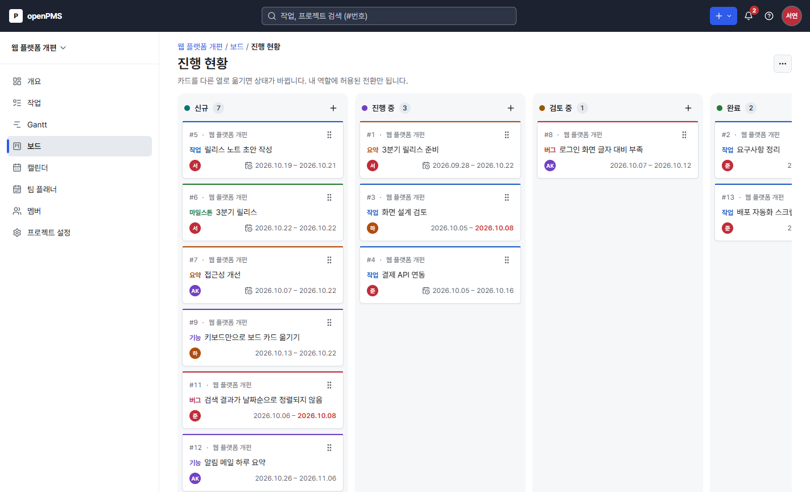 · 빈 보드("이번 주 할 일", 열 **할 일**·**진행**, 카드마다 **X**) 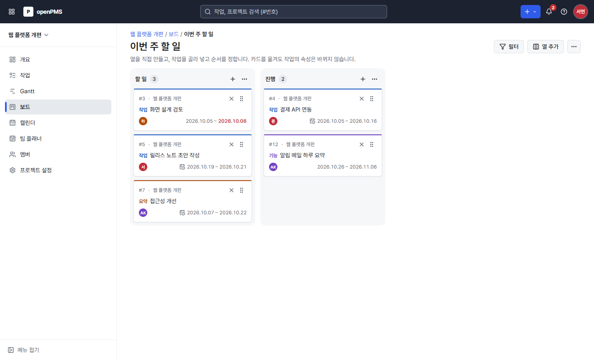 · 보드 필터(상태별 보드 "진행 현황"에서 필터 패널을 연 상태) 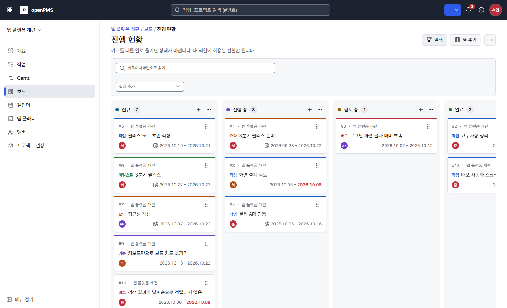 · 상위-하위 보드("상위와 하위", 열 **#1 3분기 릴리스 준비**·**#7 접근성 개선**) 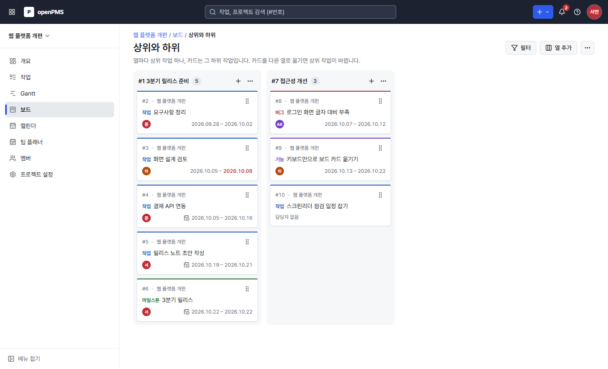 · 담당자별 `../../replica/clone-screens/S15-people.png` · 담당자별 보드의 공동 담당자(2.1, #4 결제 API 연동 카드가 **박준호**·**이하늘** 두 열에 겹친 아바타로) 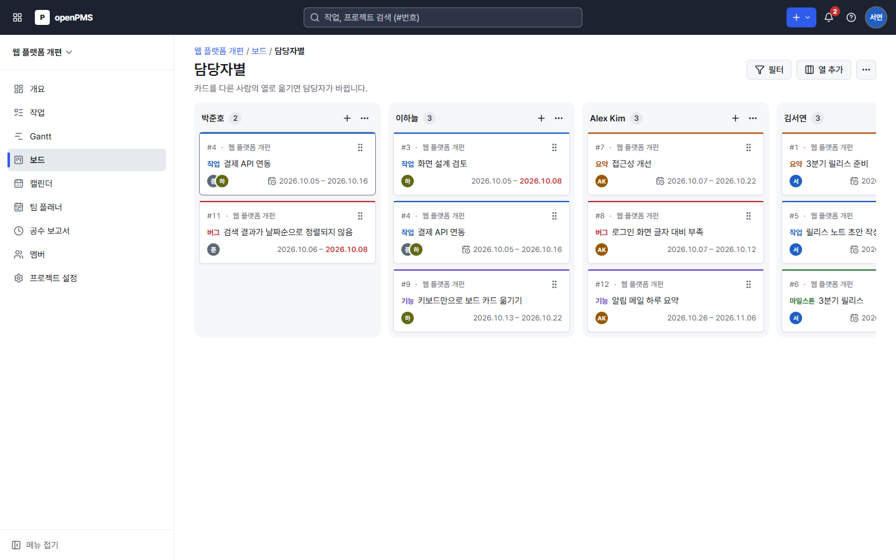 (48f4a36, 데스크톱만) · 모바일 `../../replica/clone-screens/S15-mobile.png`, `../../replica/clone-screens/S15-basic-mobile.png`, `../../replica/clone-screens/S15-filters-mobile.png`, `../../replica/clone-screens/S15-parent-child-mobile.png`, `../../replica/clone-screens/S15-people-mobile.png` (빈 보드·보드 필터는 1.2, 상위-하위는 1.3, 2026-10-11 캡처. 하위 프로젝트별 보드는 캡처 없음) · 긴 열(1.9, 성능 측정 프로젝트 "성능 측정 (작업 1,000건)"의 상태 보드를 열 끝까지 내린 상태, 열마다 **100장 더 보기**·**65장 더 보기** 등. 데스크톱만, a81a4f6) 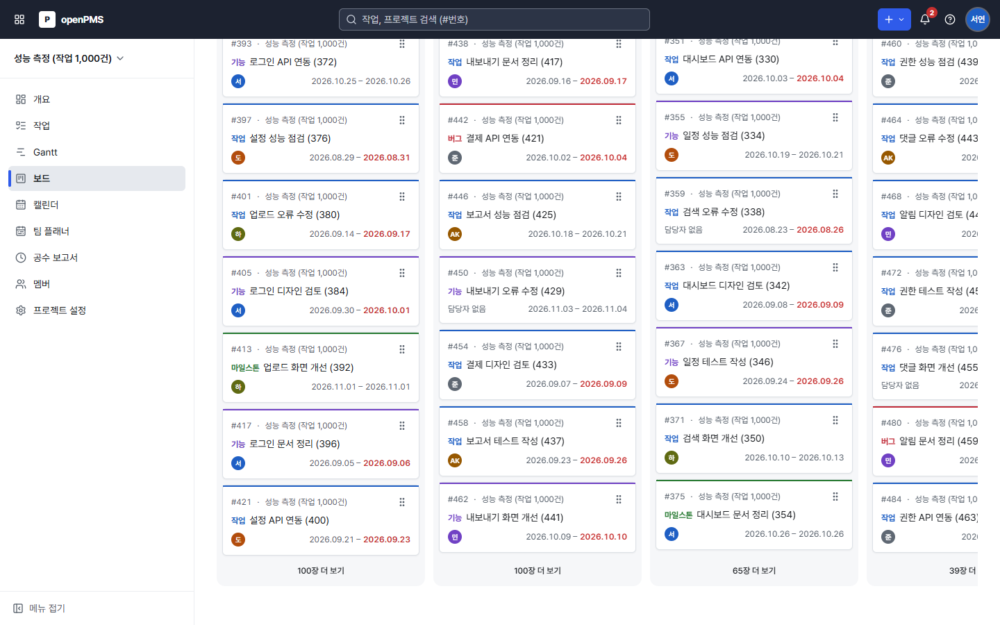

<a id="s16"></a>
#### S16 새 보드

- **목적**: 보드 이름과 종류를 정해 새 보드를 만듭니다.
- **경로**: `/projects/:p/boards/new`

**UI 요소**

| 항목 | 유형 | 설명 | 규칙 |
| --- | --- | --- | --- |
| 보드 이름 | 입력 | - | 필수, 진입 시 포커스 |
| 보드 종류 | 라디오 카드 | **상태별**(기본), **담당자별**, **버전별**, **빈 보드**(열을 직접 만들고, 작업을 골라 넣고 순서를 정합니다. 카드를 옮겨도 작업의 속성은 바뀌지 않습니다.), **상위-하위**(열마다 상위 작업 하나, 카드는 그 하위 작업입니다. 카드를 다른 열로 옮기면 상위 작업이 바뀝니다.), **하위 프로젝트별**(열마다 하위 프로젝트 하나, 카드는 그 프로젝트의 작업입니다. 카드를 다른 열로 옮기면 작업이 그 하위 프로젝트로 이동합니다(하위 작업도 함께).) | 모두 선택 가능(1.3. 1.2까지는 상위-하위가 비활성, 하위 프로젝트별은 선택지 없음) |
| 만들기 / 취소 | 버튼 | 생성 후 S15로 / S14로 | - |

- 빈 보드는 **할 일** 목록 하나를 가진 채로 만들어집니다.
- (1.3) 하위 프로젝트별 보드는 바로 아래 하위 프로젝트마다, 상위-하위 보드는 하위 작업이 있는 작업(번호순 최대 6개)마다 열 하나로 만들어집니다. 하위 프로젝트가 없는 프로젝트에서도 만들 수는 있고, 그때는 열이 없는 보드가 됩니다.

**상태**: 기본, 저장 중, 오류(칸 오류), 권한 없음(S14에 버튼이 보이지 않음, 직접 접근 시 서버 거부 **보드를 만들 권한이 없습니다.**), 모바일(카드 1열).

**API**: **만들기** → `POST /projects/{project}/boards` {name, kind: status·assignee·version·basic·parent_child·subproject} → 토스트 **보드를 만들었습니다**

**검증 메시지**: **보드 이름을 입력하세요.**, **이 종류의 보드는 아직 만들 수 없습니다.**(알 수 없는 종류. 1.3부터 화면의 선택지는 모두 만들 수 있어 정상 사용 중에는 나오지 않음)

**관련 흐름**: F06

**접근성**: 라디오 카드 묶음 이름 **보드 종류**. 새 종류로 만든 보드도 axe 검사(F06-B7 "S15 상위-하위 보드", F06-B8 "S15 하위 프로젝트 보드")를 통과합니다.

**참고 화면**: 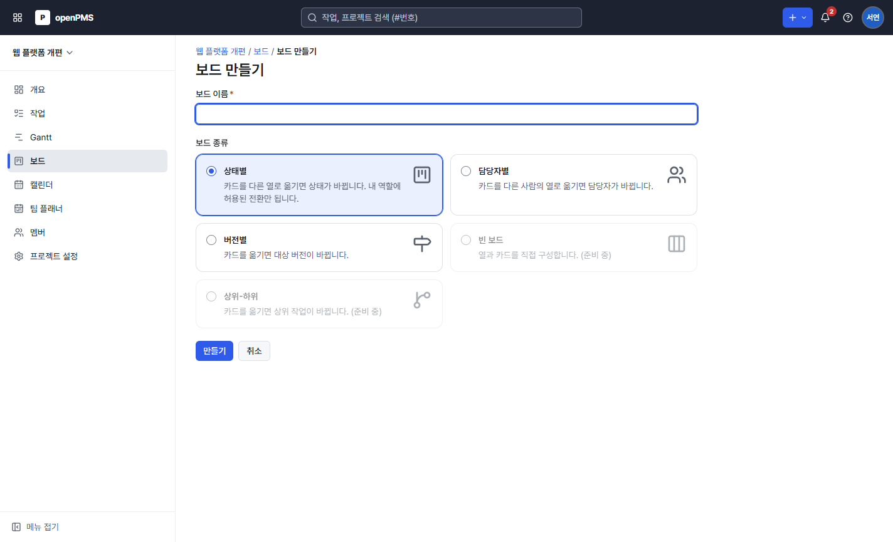 · 모바일 `../../replica/clone-screens/S16-mobile.png` (캡처는 빈 보드가 비활성이던 1.0 때 화면. 1.3의 선택지 6개는 캡처 없음)

<a id="s17"></a>
#### S17 캘린더

- **목적**: 저장된 캘린더 보기로 작업 일정을 월·주 단위로 보고, 끌어서 날짜를 바꾸거나 빈 날짜에서 새 작업을 만듭니다.
- **경로**: 목록 `/projects/:p/calendar`, 보기 `/projects/:p/calendar/:id` (`?date=YYYY-MM-DD&mode=month|week&q=`), 상세 `/calendar/:id/details/:number/:tab?`, 새 작업 `/calendar/:id/new`

**레이아웃(목록)**: 제목 **캘린더**, **캘린더 만들기** 버튼, 표(이름, 공개 범위 배지 **공개**/**나만 보기**).

**레이아웃(보기)**

```
웹 플랫폼 개편 › 캘린더 › 10월 일정
10월 일정 [저장하지 않은 변경]       [+ 작업 만들기] [필터 n] [변경 저장] [변경 취소] [⋯]
[<] [오늘] [>]  2026년 10월                               [월|주]
┌ 일 ┬ 월 ┬ 화 ┬ 수 ┬ 목 ┬ 금 ┬ 토 ┐   (휴무일 칸에 이름 표시)
│    │ ▭ #12 로그인 개편 ───────── │
└────┴────┴────┴────┴────┴────┴────┘
작업을 끌어 날짜를 옮기고 끝을 끌어 기간을 바꿉니다. …
```

**UI 요소**

| 항목 | 유형 | 설명 | 규칙 |
| --- | --- | --- | --- |
| 캘린더 만들기 | 버튼 → 대화상자 | **이름**(필수), **공개**(프로젝트 멤버 모두가 볼 수 있습니다, 기본 켬) | query.save, 공개는 query.manage_public |
| 작업 만들기 | 버튼(주) | 분할 패널 새 작업(S09) | wp.create |
| 필터 | 토글 버튼 | S06과 같은 필터 패널(기본 조건: 상태 열림) | - |
| 변경 저장 / 변경 취소 | 버튼 | 바꾼 필터를 보기에 저장 / 되돌림 | 바뀐 내용이 있을 때. 저장은 보기 편집 권한 |
| 보기 메뉴(⋯) | 메뉴 | **이름 바꾸기**, **삭제**(확인 **{{name}}을(를) 삭제할까요?** / **보기만 지워지고 작업은 그대로 남습니다.**) | 보기 편집 권한 |
| 기간 이동 | 버튼 | **이전**, **오늘**, **다음**, 기간 제목(**{{year}}년 {{month}}월** / **{{from}} – {{to}}**) | - |
| 보기 단위 | 세그먼트 | **월** / **주** | - |
| 달력 | 그리드 | 주는 S33 **주 시작 요일**에서 시작(기본 일요일). 쉬는 날 음영, 휴무일 칸에 **휴무일: {{name}}** | - |
| 작업 막대 | 이벤트 | 유형 색 테두리, 제목. 끌어서 이동, 끝을 끌어 기간 변경, 클릭·Enter로 상세 패널 | 날짜가 하나라도 있는 작업. 편집 권한 없으면 고정 |
| 빈 날짜 끌기 | 선택 | 고른 기간으로 새 작업 폼(시작일·완료일 미리 채움) | wp.create |
| 도움말 | 텍스트 | **작업을 끌어 날짜를 옮기고 끝을 끌어 기간을 바꿉니다. 빈 날짜를 끌어 고르면 그 기간으로 새 작업을 만듭니다. 키보드로는 작업에서 Enter를 눌러 상세를 엽니다.** | - |

**상태**: 목록 빈 상태(**아직 캘린더가 없습니다** / **캘린더를 만들면 작업 일정을 월·주 단위로 보고 끌어서 날짜를 바꿀 수 있습니다.**), 보기 없음(**보기를 찾을 수 없습니다**), 로딩(스켈레톤), 오류(공통), 모듈 꺼짐, 저장 실패(막대 원위치 + 토스트), 모바일(달력 폭 축소, 상세 패널 전체 화면).

**주요 동작과 API**

| 동작 | API |
| --- | --- |
| 목록 / 만들기 | `GET /queries?view=calendar` / `POST /queries` (view: calendar) |
| 표시 | `POST /work-packages/query` (보이는 기간과 겹치는 작업), `GET /calendar/non-working-days` |
| 끌기·기간 변경 | `PATCH /work-packages/{number}` |
| 변경 저장 / 이름 바꾸기 / 삭제 | `PATCH /queries/{id}` / `PATCH /queries/{id}` / `DELETE /queries/{id}` |

**검증 메시지**: **보기 이름을 입력하세요.**, **프로젝트가 필요합니다.**(캘린더는 프로젝트 안에서만), 성공 **만들었습니다**, **저장했습니다**, **이름을 바꿨습니다**, **삭제했습니다**.

**관련 흐름**: F04(일정 옮기기)

**접근성**: 영역 이름 **작업 캘린더**. 작업 막대 접근 이름 **#{{n}} {{제목}}, {{날짜}}**, 고칠 수 없으면 뒤에 **날짜를 바꿀 권한이 없습니다**. 기간 제목은 `aria-live`로 낭독. 키보드는 막대에서 Enter로 상세를 열어 날짜를 고침.

**참고 화면**: 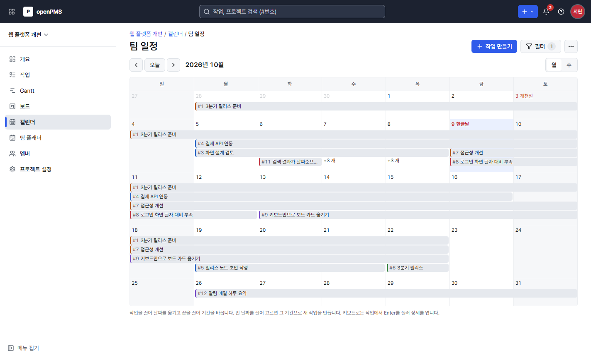 · 목록 `../../replica/clone-screens/S17-list.png` · 주 `../../replica/clone-screens/S17-week.png` · 모듈 꺼짐 `../../replica/clone-screens/S17-off.png` · 모바일 `../../replica/clone-screens/S17-mobile.png`, `../../replica/clone-screens/S17-list-mobile.png`, `../../replica/clone-screens/S17-week-mobile.png`, `../../replica/clone-screens/S17-off-mobile.png`

<a id="s18"></a>
#### S18 팀 플래너

- **목적**: 사람별로 1~2주의 작업 배정을 보고, 끌어서 담당자와 날짜를 바꿉니다.
- **경로**: 목록 `/projects/:p/team-planner`, 보기 `/projects/:p/team-planner/:id` (`?date=&span=1`), 상세 `/team-planner/:id/details/:number/:tab?`, 새 작업 `/team-planner/:id/new`

**레이아웃(보기)**

```
웹 플랫폼 개편 › 팀 플래너 › 개발팀 주간
개발팀 주간 [저장하지 않은 변경]     [+ 작업 만들기] [기존 작업 추가] [변경 취소] [⋯]
[<] [오늘] [>]  2026-10-04 – 2026-10-17           [1주|2주] [담당자 추가▾]
┌ 담당자 ──┬ 일 ┬ 월 ┬ 화 ┬ ... ┐
│ 김서연 ⋯ │    ▭ #12 ───── │      │
│ 박준호 ⋯ │ (이 기간에 배정된 작업이 없습니다) │
└─────────┴────┴────┴────┴─────┘
[여기에 놓으면 담당 해제]  ← 끄는 중에만
```

**UI 요소**

| 항목 | 유형 | 설명 | 규칙 |
| --- | --- | --- | --- |
| 팀 플래너 만들기 | 버튼 → 대화상자 | 캘린더와 같은 대화상자. 새 플래너는 만든 사람 1명으로 시작 | query.save |
| 작업 만들기 | 버튼(주) | 새 작업 패널 | wp.create |
| 기존 작업 추가 | 토글 버튼 → 패널 | **작업 찾기 (#번호나 제목)**, 안내 **작업을 사람과 날짜 칸으로 끌어다 놓거나, 메뉴에서 담당자를 고르세요.**, 결과마다 **#{{n}} 배정** 메뉴(**{{name}}에게 배정**) | 결과 없음 **찾는 작업이 없습니다** |
| 변경 취소 | 버튼 | 저장하지 않은 변경 되돌림 | 바뀐 내용이 있을 때 |
| 보기 메뉴(⋯) | 메뉴 | 이름 바꾸기, 삭제 | 보기 편집 권한 |
| 기간 이동 | 버튼 | 이전·오늘·다음, **{{from}} – {{to}}** | - |
| 보기 단위 | 세그먼트 | **1주** / **2주**(기본) | - |
| 담당자 추가 | 메뉴 버튼 | 아직 없는 프로젝트 멤버 | 보기 편집 권한. 바로 보기에 저장. 후보가 없으면 **더 추가할 프로젝트 멤버가 없습니다** |
| 사람 행 | 행 | 이름, **{{name}} 메뉴**(**{{name}}을(를) 플래너에서 빼기**) | - |
| 작업 막대 | 끌 수 있는 막대 | 날짜·사람 칸으로 끌어 날짜·담당자 변경, 양 끝을 끌어 기간 변경, Enter로 상세. (2.1) 여러 사람이 맡은 작업은 담당자 목록의 사람마다 그 줄에 막대가 하나씩 | 칸이 겹치면 **+{{count}}** |
| 빈 칸 | 칸 | 클릭하면 그 사람·그날로 새 작업 폼 | wp.create |
| 담당 해제 영역 | 드롭 영역 | **여기에 놓으면 담당 해제** | 끄는 중에만. (2.1) 여러 사람이 맡은 작업은 끌어 온 줄의 사람만 빠짐(한 명뿐이면 담당자가 비워짐) |
| 도움말 | 텍스트 | **작업을 끌어 날짜와 담당자를 바꾸고 양 끝을 끌어 기간을 바꿉니다. 키보드로는 작업에서 스페이스를 눌러 들고 화살표로 옮긴 뒤 스페이스로 놓습니다. Enter는 상세를 엽니다.** | - |

- 팀 플래너에는 필터 버튼과 **변경 저장** 버튼이 없습니다. 사람 추가·빼기는 바로 보기에 저장됩니다.
- 1주·2주 기간은 S33 **주 시작 요일**(기본 일요일)부터 셉니다.
- (2.1, 48f4a36) 막대를 한 사람의 줄에서 다른 사람의 줄로 끌면 그 사람의 자리를 넘겨받습니다(다른 담당자·예상 시간은 그대로, 받는 사람이 이미 담당자였으면 끌어 온 사람만 빠짐). **기존 작업 추가** 패널에서 끌어 놓거나 **{{name}}에게 배정**을 고르면 그 사람이 주 담당자가 됩니다(이미 담당자였으면 맨 앞으로).

**상태**: 목록 빈 상태(**아직 팀 플래너가 없습니다** / **팀 플래너를 만들면 사람별로 한두 주의 일을 나눠 보고, 끌어서 담당자와 날짜를 바꿀 수 있습니다.**), 사람 없음(**아직 담당자가 없습니다** / **담당자를 추가하면 그 사람에게 배정된 작업이 날짜별로 보입니다.** + **담당자 추가**), 보기 없음(**보기를 찾을 수 없습니다**), 로딩·오류(공통), 모듈 꺼짐, 읽기 전용(편집 권한이 없는 막대는 고정, 접근 이름 끝에 **날짜를 바꿀 권한이 없습니다**), 모바일(가로 스크롤, 담당자 열 축소).

**주요 동작과 API**

| 동작 | API |
| --- | --- |
| 목록 / 만들기 | `GET /queries?view=team_planner` / `POST /queries` (view: team_planner) |
| 표시 | `POST /work-packages/query` (사람·기간 조건, 최대 500건), `GET /work-packages/filters`, `GET /calendar/non-working-days` |
| 끌기·배정·담당 해제·기간 변경 | `PATCH /work-packages/{number}` (assigneeId, 날짜). (2.1) 줄 사이로 넘기거나 여럿 중 한 사람만 뺄 때는 assignees(담당자 목록 전체) |
| 기존 작업 찾기 | `POST /work-packages/query` (열린 작업, 텍스트 검색, 최근 수정순 30건) |
| 사람 추가·빼기, 이름 바꾸기, 삭제 | `PATCH /queries/{id}`, `DELETE /queries/{id}` |

**검증 메시지**: 담당자 **프로젝트 멤버만 지정할 수 있습니다.**, 성공 **#{{n}}을(를) {{name}}에게 배정했습니다**, **#{{n}}의 담당을 해제했습니다**.

**관련 흐름**: F04, F18(사람마다 막대, 2.1)

**접근성**: 그리드 이름 **팀 플래너**. 막대 접근 이름 **#{{n}} {{제목}}, {{담당자}}, {{날짜}}**(2.1부터 {{담당자}}는 그 줄의 사람이라, 함께 맡은 작업은 줄마다 다른 이름으로 낭독). 키보드 안내 **스페이스로 작업을 들고, 왼쪽·오른쪽 화살표로 날짜를, 위·아래 화살표로 담당자를 바꾼 뒤 스페이스로 놓으세요. Esc로 취소합니다.** 낭독 **#{{n}} 작업을 들었습니다.**, **{{name}}, {{date}}**, **담당 해제 영역 위에 있습니다.**, **{{name}}의 {{date}}에 놓았습니다.**, **담당을 해제했습니다.**, **옮기기를 취소했습니다.**

**참고 화면**:  · 목록 `../../replica/clone-screens/S18-list.png` · 기존 작업 추가 `../../replica/clone-screens/S18-add.png` · 모바일 `../../replica/clone-screens/S18-mobile.png`, `../../replica/clone-screens/S18-list-mobile.png`, `../../replica/clone-screens/S18-add-mobile.png`

### 4.6 관리 화면

관리 화면 공통 사항:

- 사이드바는 관리 메뉴(2.2.2)로 바뀌고, 브레드크럼은 **관리 › {{화면}}**입니다.
- 관리자가 아니면 본문 대신 **볼 수 없는 화면입니다** / **관리자만 볼 수 있는 화면입니다.**를 보이고, 서버도 403(**관리자만 할 수 있습니다.**)으로 거부합니다. 사용자·그룹 화면만 global.manage_users 보유자에게도 열립니다.
- 목록의 순서 열은 **{{name}} 순서 바꾸기** 메뉴(**맨 위로**·**위로**·**아래로**·**맨 아래로**)를 씁니다(유형, 상태, 우선순위, 사용자 정의 필드).
- 행 메뉴(⋯)의 접근 이름은 **{{name}} 메뉴**입니다. 삭제는 확인 대화상자를 거칩니다.
- 예/아니요 셀은 아이콘과 글자(**예**)를 함께 쓰고, 아니요는 대시 아이콘과 낭독용 **아니요**를 씁니다.
- 색 입력은 색 선택기와 `#RRGGBB` 입력을 함께 두고 **흰 배경 대비 {{ratio}}:1**을 보입니다. 유형 색처럼 글자색으로 쓰는 경우 4.5:1 미만이면 **흰 배경에서 글자로 읽기 어려운 색입니다(4.5:1 미만). 더 진한 색을 고르세요.**를 보입니다.

<a id="x05"></a>
#### X05 관리 홈

- **목적**: 관리 기능으로 들어가는 첫 화면.
- **경로**: `/admin`
- **UI 요소**: 제목 **관리**, 카드 13개(아이콘·이름·설명, 1.4에서 **API와 웹훅**, 1.8에서 **시스템 정보** 추가): 유형(작업 유형과 색, 마일스톤 여부), 상태(상태 이름과 닫힘·읽기 전용 규칙), 워크플로(역할별로 허용하는 상태 전환), 우선순위(우선순위 목록과 기본값), 사용자 정의 필드(작업에 더하는 회사 고유 항목), 진행률 추적(완료 %를 계산하는 방식과 상위 작업의 합계), 사용자(초대, 잠금, 관리자 지정), 그룹(사람을 묶어 멤버십을 한 번에), 역할 및 권한(역할마다 할 수 있는 일), 로그인·비밀번호(비밀번호 규칙, 로그인 실패 잠금, 재설정·초대 링크, 사내 SSO), 달력과 날짜(근무 요일과 공휴일, 날짜·시간 형식과 주 시작 요일), API와 웹훅(사내 연동용 API 토큰과 다른 시스템에 변경을 알리는 웹훅, X08), 시스템 정보(버전, 데이터베이스와 마이그레이션, 업그레이드 전 자동 백업, 서버 아이콘, X12, 1.8).
- **openPMS로 할 수 있는 일**(2.0): 카드 아래 절(제목 h2). 제목 옆에 링크 **사용자 매뉴얼**(`/help`)·**운영자 매뉴얼**(`/help/admin`), 안내 **사용자 매뉴얼의 장과 절입니다. 누르면 그 기능의 설명으로 갑니다. 관리 화면의 설정은 운영자 매뉴얼 9장에 있습니다.** 그 아래 사용자 매뉴얼의 기능 장(2–11장, 15장. 1장 안내·12장 키보드 팁·13장 자주 묻는 질문·14장 부록은 뺌)마다 장 이름(굵게)과 그 절 이름들을 링크로(번호는 떼고). 누르면 X13의 그 절(`/help#{{절 주소}}`)로 감. 목록은 매뉴얼 원문에서 만들므로 매뉴얼에 절이 생기면 같이 늘어남. 1열, sm 2열, xl 3열
- **상태**: 권한 없음(공통 안내), 모바일(카드 1열, sm 2열, xl 4열). (2.0) **openPMS로 할 수 있는 일**은 매뉴얼을 읽는 동안 스켈레톤(높이 10rem), 읽지 못하면 그 절을 숨김.
- **API**: 없음(로그인 사용자 정보만 사용. 2.0의 목록은 빌드된 화면 파일의 사용자 매뉴얼)
- **관련 흐름**: F11, F17(2.0)
- **접근성**: 카드 전체가 링크. (2.0) **openPMS로 할 수 있는 일**은 제목으로 이름 붙인 영역(region)이고 axe 검사(F17-H4 "관리 · 할 수 있는 일")를 통과합니다.
- **참고 화면**:  · 모바일 `../../replica/clone-screens/admin-mobile.png` (1.0 캡처라 **API와 웹훅**·**시스템 정보** 카드가 없음) ·  (2.0, cab644c, 관리 홈을 아래로 내린 상태)

<a id="s27"></a>
#### S27 관리: 유형

- **목적**: 작업 유형(작업·마일스톤·요약·기능·버그 등)을 정의합니다.
- **경로**: `/admin/types`

**UI 요소**

| 항목 | 유형 | 설명 | 규칙 |
| --- | --- | --- | --- |
| 유형 추가 | 버튼(주) | 유형 대화상자 | - |
| 유형 표 | 표 | 열: 순서, 이름(유형 색 글자, 링크 → S28), 마일스톤, 새 프로젝트 기본, 로드맵에 표시, 작업 수, 프로젝트 수, ⋯ | - |
| 행 메뉴 | 메뉴 | **수정**, **양식 구성**(S28), **워크플로**(S29, 해당 유형 선택), **삭제** | - |
| 유형 대화상자 | 대화상자 | 제목 **유형 추가**/**유형 수정**. **이름**(필수), **색**, **마일스톤**(날짜가 하루뿐인 일정 표시입니다. 작업이 있으면 바꿀 수 없습니다.), **새 프로젝트에서 기본으로 사용**(이미 있는 프로젝트에는 영향이 없습니다.), **로드맵에 표시**, **미리 보기** | 작업이 있는 유형은 마일스톤 체크 비활성 |
| 새 유형 안내 | 배너(경고) | 저장 직후 **아직 상태를 바꿀 수 없는 유형입니다** / **'{{name}}' 유형에는 워크플로가 없어서 …** + **워크플로 설정하기**(S29), **닫기** | 새로 만든 경우 |

**상태**: 로딩·오류(공통), 권한 없음(공통 안내), 모바일(표 가로 스크롤).

**API**: 목록 `GET /admin/types` / 추가 `POST /admin/types` / 수정 `PATCH /admin/types/{id}` / 삭제 `DELETE /admin/types/{id}`(작업이 있으면 409) / 순서 `PUT /admin/types/order`

**검증 메시지**: 이름 공통(2.4), **색은 #RRGGBB 형식으로 입력하세요.**, **쓰고 있는 유형은 마일스톤 여부를 바꿀 수 없습니다.**, **순서 목록이 맞지 않습니다.**. 삭제 확인 **'{{name}}' 유형과 그 워크플로가 지워집니다. 이 유형을 쓰는 작업이 있으면 삭제할 수 없습니다.** 성공 **유형을 만들었습니다**, **저장했습니다**, **삭제했습니다**.

**관련 흐름**: F11

**접근성**: 이름 링크 접근 이름 **{{name}} 양식 구성**.

**참고 화면**:  · 모바일 `../../replica/clone-screens/S27-mobile.png`

<a id="s28"></a>
#### S28 관리: 유형 양식 구성

- **목적**: 유형별로 작업 상세에 보일 속성 그룹·순서·숨김 항목과 새 작업의 기본 설명을 정합니다.
- **경로**: `/admin/types/:id/form`

**UI 요소**

| 묶음 | 항목 | 유형 | 설명·규칙 |
| --- | --- | --- | --- |
| 속성 그룹 | 기본값으로 / 그룹 추가 | 버튼 | 기본 그룹(사람·일정·진행률·세부 정보)으로 되돌림 / **새 그룹 {{n}}** 추가 |
| 속성 그룹 | 그룹 카드 | 카드 | **그룹 이름** 입력(60자), **{{name}} 그룹을 위로/아래로**, **{{name}} 그룹 삭제 (항목은 숨김으로)** |
| 속성 그룹 | 항목 행 | 행 | 항목 이름(사용자 정의 필드는 **사용자 정의** 표시), **{{name}} 위로/아래로**, **{{name}} 옮기기** 메뉴(**'{{group}}' 그룹으로**, **숨기기**) |
| 자동 배치 | 목록 | 목록 | 어느 그룹에도 넣지 않은 사용자 정의 필드(작업에 쓰이면 상세 맨 아래 **추가 정보**에 나옴) |
| 숨긴 항목 | 목록 | 목록 | 상세에 보이지 않는 항목. 없으면 **숨긴 항목이 없습니다.** |
| 기본 설명 | 서식 편집기 | 편집기 | 새 작업의 설명에 미리 채울 내용 |
| - | 저장 / 변경 취소 | 버튼 | - |

- 끌어 놓기 배치와 하위 작업 표(쿼리 그룹)는 없습니다(빌드 로그).

**상태**: 그룹 없음(**그룹이 없습니다. 모든 항목이 숨겨지고, 사용자 정의 필드는 '추가 정보'에만 나옵니다.**), 빈 그룹(**항목이 없습니다. 비어 있는 그룹은 상세에 보이지 않습니다.**), 로딩·오류·권한 없음(공통), 모바일(카드 1열).

**API**: `GET /admin/types`, `PATCH /admin/types/{id}` (양식 구성·기본 설명), 사용자 정의 필드 목록 `GET /admin/custom-fields`

**검증 메시지**: **그룹은 20개까지 만들 수 있습니다.**, **그룹 이름을 입력하세요.**, **그룹 이름은 60자까지 입력할 수 있습니다.**, **같은 이름의 그룹이 있습니다: {{name}}**, **같은 항목이 두 번 있습니다.**

**관련 흐름**: F11

**접근성**: 그룹마다 영역 이름 **그룹: {{name}}**. 끌어 놓기 대신 버튼·메뉴로 모든 배치를 키보드로 할 수 있음.

**참고 화면**: 

<a id="s29"></a>
#### S29 관리: 워크플로

- **목적**: 유형 × 역할마다 허용할 상태 전환(현재 상태 → 바꿀 상태)을 정합니다.
- **경로**: `/admin/workflows?type=<유형 ID>&role=<역할 ID>` (기본: 첫 유형, **멤버** 역할)

**UI 요소**

| 항목 | 유형 | 설명 | 규칙 |
| --- | --- | --- | --- |
| 안내 | 텍스트 | **역할마다 어떤 상태에서 어떤 상태로 바꿀 수 있는지 정합니다. …보드에서 카드를 옮길 때도 같은 규칙이 적용됩니다.** | - |
| 다른 유형·역할에 복사 | 버튼 → 대화상자 | **워크플로 복사**: **지금 저장된 전환을 고른 유형과 역할에 그대로 덮어씁니다.**, **대상 유형**·**대상 역할** 체크박스 | - |
| 되돌리기 / 저장 | 버튼 | 저장하지 않은 체크를 되돌림 / 저장 | - |
| 유형 / 역할 | 선택 | 편집 대상 | 바꾼 내용이 있으면 확인 **저장하지 않은 변경을 버릴까요?** / **다른 유형이나 역할로 바꾸면 지금 체크한 내용이 사라집니다.** + **버리고 이동** |
| 전환 매트릭스 | 체크박스 표 | 행 = 현재 상태, 열 = 바꿀 상태(머리 **현재 상태 → 바꿀 상태**). 행·열마다 **모두**/**해제** 버튼 | 같은 상태끼리는 체크박스 없이 "—" 표시 |
| 빈 워크플로 경고 | 배너(경고) | **허용된 전환이 없습니다** / **{{role}} 역할은 {{type}} 작업의 상태를 바꿀 수 없습니다. …** | 체크가 하나도 없을 때 |

**상태**: 로딩·오류·권한 없음(공통), 모바일(표 가로 스크롤).

**API**: 조회 `GET /admin/workflows?typeId&roleId` / 저장 `PUT /admin/workflows` / 복사 `POST /admin/workflows/copy` / 선택지 `GET /admin/types`, `GET /admin/statuses`, `GET /admin/roles`

**검증 메시지**: 성공 **저장했습니다**, **워크플로를 복사했습니다**

**관련 흐름**: F11, F02(전환 규칙)

**접근성**: 표 캡션 **{{type}} 유형, {{role}} 역할의 상태 전환**. 칸 접근 이름 **{{from}}에서 {{to}}(으)로 전환 허용**. 행·열 버튼 접근 이름 **{{status}}에서 가는 전환 모두 허용/해제**, **{{status}}(으)로 오는 전환 모두 허용/해제**.

**참고 화면**:  · 모바일 `../../replica/clone-screens/S29-mobile.png`

<a id="s30"></a>
#### S30 관리: 상태

- **목적**: 작업 상태와 그 규칙(기본·닫힘·읽기 전용·합계 제외·완료 %)을 정의합니다.
- **경로**: `/admin/statuses`

**UI 요소**

| 항목 | 유형 | 설명 | 규칙 |
| --- | --- | --- | --- |
| 상태 추가 | 버튼(주) | 상태 대화상자 | - |
| 상태 표 | 표 | 열: 순서, 이름(상태 pill), 기본, 닫힘, 읽기 전용, 완료 %, 합계 제외, 작업 수, ⋯(수정·삭제) | - |
| 상태 대화상자 | 대화상자 | **이름**, **색**, **완료 % (상태 기반 진행률)**(진행률을 상태로 계산할 때 이 상태의 완료 비율입니다.), **새 작업의 기본 상태**, **닫힘**(이 상태의 작업은 '열린 작업' 목록과 기한 지남에서 빠집니다.), **읽기 전용**(이 상태에서는 상태 말고는 아무것도 바꿀 수 없습니다.), **진행률 합계에서 제외**(상위 작업의 작업량·진행률 합계에 넣지 않습니다(예: 취소).), **미리 보기** | 이미 기본인 상태는 기본 체크 해제 불가 |

**상태**: 로딩·오류·권한 없음(공통), 모바일(표 가로 스크롤).

**API**: `GET|POST /admin/statuses`, `PATCH|DELETE /admin/statuses/{id}`, `PUT /admin/statuses/order`

**검증 메시지**: 이름·색 공통, **0에서 100 사이로 입력하세요.**(완료 %), **기본 상태는 하나 있어야 합니다.**, 사용 중인 상태 삭제 거부(서버 사유 표시). 삭제 확인 **'{{name}}' 상태와 이 상태가 들어간 워크플로 전환이 지워집니다.**

**관련 흐름**: F11

**접근성**: 기본 열은 배지 **기본** 또는 낭독용 **아니요**.

**참고 화면**:  · 모바일 `../../replica/clone-screens/S30-mobile.png`

<a id="s36"></a>
#### S36 관리: 우선순위

- **목적**: 우선순위 목록과 기본값을 관리합니다.
- **경로**: `/admin/priorities`

**UI 요소**

| 항목 | 유형 | 설명 | 규칙 |
| --- | --- | --- | --- |
| 우선순위 추가 | 버튼(주) | 대화상자 | - |
| 우선순위 표 | 표 | 열: 순서, 이름(색 점), 기본, 사용(숨긴 항목은 배지 **숨김**), 작업 수, ⋯(수정·삭제) | - |
| 우선순위 대화상자 | 대화상자 | **이름**, **색**, **새 작업의 기본 우선순위**, **새 작업에서 고를 수 있음**(끄면 기존 작업은 그대로 두고 새로 고를 때만 목록에서 빠집니다.) | 기본 우선순위는 체크 해제 불가 |

**상태**: 로딩·오류·권한 없음(공통), 모바일(표 가로 스크롤).

**API**: `GET|POST /admin/priorities`, `PATCH|DELETE /admin/priorities/{id}`, `PUT /admin/priorities/order`

**검증 메시지**: 이름·색 공통, **기본 우선순위는 하나 있어야 합니다.**, **기본 우선순위는 숨길 수 없습니다.**. 삭제 확인 **'{{name}}' 우선순위를 삭제합니다. 쓰고 있다면 숨기기를 쓰세요.**

**관련 흐름**: F11

**참고 화면**:  · 모바일 `../../replica/clone-screens/S36-mobile.png`

<a id="s34"></a>
#### S34 관리: 사용자 정의 필드

- **목적**: 작업에 회사 고유 항목(고객사, 검토자, 참고 링크 등)을 더합니다.
- **경로**: `/admin/custom-fields`

**UI 요소**

| 항목 | 유형 | 설명 | 규칙 |
| --- | --- | --- | --- |
| 안내 | 텍스트 | **작업에 회사에 필요한 항목을 더합니다. 필드는 고른 유형의 작업에만 보이고, '모든 프로젝트'가 아니면 프로젝트 설정에서 켜야 합니다.** | - |
| 새 필드 | 버튼(주) | 필드 대화상자 | - |
| 필드 표 | 표 | 열: 순서, 이름(필수면 **필수** 표시), 형식(여러 개 선택 표시), 유형, 사용 범위(**모든 프로젝트** / **프로젝트 {{count}}개**), ⋯(수정·삭제) | - |
| 필드 대화상자 | 대화상자 | 제목 **새 사용자 정의 필드** / **'{{name}}' 편집**. **이름**(100자), **형식**(한 줄 텍스트·여러 줄 텍스트·정수·소수·목록·날짜·예/아니요·사용자·링크(URL), 만든 뒤 변경 불가), **보여 줄 유형**(체크박스), **모든 프로젝트에서 사용**, **필수 입력**, **작업 목록 필터에 표시**, **여러 개 선택**(목록·사용자), **선택지**(목록: **선택지 추가**, 위로, 삭제), **최소 글자 수**·**최대 글자 수**·**형식(정규식)**(텍스트 형식), **기본값** | - |

**상태**: 빈 상태(**아직 만든 사용자 정의 필드가 없습니다** / **고객사, 검토자, 참고 링크처럼 팀이 함께 기록할 항목을 만들어 보세요.**), 로딩·오류·권한 없음(공통), 모바일(대화상자 1열).

**API**: `GET|POST /admin/custom-fields`, `PATCH|DELETE /admin/custom-fields/{id}`, `PUT /admin/custom-fields/order`

**검증 메시지**: **이름을 입력하세요.**, **같은 이름의 필드가 이미 있습니다.**, **형식을 고르세요.**, **만든 뒤에는 형식을 바꿀 수 없습니다.**, **이 필드를 쓸 유형을 하나 이상 고르세요.**, **여러 값은 목록과 사용자 형식에서만 고를 수 있습니다.**, **선택지를 하나 이상 입력하세요(빈 칸 없이).**, **같은 선택지가 두 번 있습니다.**, **최대 길이는 최소 길이보다 작을 수 없습니다.**, **정규식이 올바르지 않습니다.**, **기본값이 이 필드의 형식·조건에 맞지 않습니다.**. 삭제 확인 **'{{name}}' 필드와 모든 작업에 입력된 값이 지워지고, 저장된 보기에서도 빠집니다. 되돌릴 수 없습니다.**

**관련 흐름**: F11

**접근성**: 선택지 입력마다 **선택지 {{n}}** 이름과 위로·삭제 버튼 이름.

**참고 화면**: 캡처 없음

<a id="s32"></a>
#### S32 관리: 진행률 추적

- **목적**: 완료 %를 계산하는 방식과 상위 작업 합계 방식을 정합니다.
- **경로**: `/admin/progress`

**UI 요소**

| 묶음 | 항목 | 유형 | 설명 |
| --- | --- | --- | --- |
| 계산 방식 | 작업량 기준 / 상태 기준 | 라디오 카드 | 작업량 기준: **완료 %를 직접 입력하거나, 작업량과 남은 작업 중 하나를 바꾸면 나머지를 계산합니다.** / 상태 기준: **완료 %는 상태마다 정한 값(관리 › 상태)을 따르고 직접 바꿀 수 없습니다. …** |
| 계산 방식 | 닫힌 상태가 되면 완료 100%, 남은 작업 0으로 | 체크박스 | **완료·취소처럼 닫힌 상태의 작업은 진행률을 끝난 것으로 봅니다.** |
| 상위 작업의 합계 완료 % | 작업량 가중 / 단순 평균 | 라디오 카드 | 가중: **(합계 작업량 − 합계 남은 작업) ÷ 합계 작업량. …** / 평균: **자신과 하위 작업의 완료 %를 평균합니다. …** |
| - | 안내 | 배너(정보) | **저장하면 모든 작업의 완료 %와 남은 작업을 새 규칙으로 다시 계산합니다. 활동 기록은 남기지 않습니다.** |
| - | 저장 | 버튼(주) | 바뀐 내용이 있을 때 |

- 이 화면의 합계 방식은 작업 상세(S07)의 **합계 완료 %**와 작업 목록(S06) 합계 행의 **완료 %**에 함께 적용됩니다(1.2). 두 곳 모두 합계 제외 상태(S30)의 작업은 빼고, 작업량 가중일 때는 작업량만 있고 남은 작업이 비어 있는 작업을 시작 전(남은 작업 = 작업량)으로 셉니다. 1.1에서 '확인 필요'로 둔 차이(목록 합계 행은 합계 방식과 관계없이 작업량 가중, 합계 제외 상태 미적용)는 384a2f9·31e39bd에서 이 규칙으로 맞춰 해소했습니다.

**API**: `GET /admin/settings/progress`, `PUT /admin/settings/progress` → 토스트 **저장했습니다. 작업 {{count}}개를 다시 계산했습니다.**

**검증 메시지**: **계산 방식을 고르세요.**, **합계 방식을 고르세요.**

**관련 흐름**: F11

**참고 화면**: 

<a id="s35"></a>
#### S35 관리: 사용자·그룹

- **목적**: 사용자를 초대하거나 임시 비밀번호로 추가하고(2.2) 잠금·삭제하며, 관리자를 지정하고, 전역 역할을 배정하고(1.3), 그룹과 그룹 구성원을 관리합니다.
- **경로**: 사용자 `/admin/users`, 그룹 `/admin/groups`
- **권한**: 관리자 또는 global.manage_users(관리자 지정·해제와 전역 역할 배정은 관리자만)

**UI 요소(사용자)**

| 항목 | 유형 | 설명 | 규칙 |
| --- | --- | --- | --- |
| 사용자 추가 | 버튼(주) → 대화상자 | (2.2, 이전 이름 **사용자 초대**) 대화상자 **사용자 추가**. **등록 방법**(라디오 카드): **초대 메일 보내기**(기본) / **임시 비밀번호 만들기**. 방법에 따라 설명이 **초대 메일의 링크로 비밀번호를 정하면 계정이 활성화됩니다.** / **메일 없이 바로 계정을 만듭니다. 임시 비밀번호를 전달하면 사용자가 처음 로그인할 때 새 비밀번호를 정합니다.**로 바뀜. **이름**, **이메일**, **관리자로 지정**(관리자에게만), 확인 버튼 **초대 보내기** / **만들기** | **초대 보내기**는 전처럼 초대 상태로 만들고 메일을 보냄(성공 **{{email}}로 초대를 보냈습니다**). **만들기**는 메일 없이 활성 계정을 만들고 결과 대화상자(아래)를 엶 |
| 임시 비밀번호 대화상자(2.2) | 대화상자 | 제목 **{{name}}님의 임시 비밀번호**, 설명 **사용자가 처음 로그인할 때 새 비밀번호를 정합니다. 새 비밀번호를 정하면 이 비밀번호는 더 볼 수 없습니다.** **이메일**(읽기 전용), **임시 비밀번호**(읽기 전용, 고정폭 글꼴, 아래 안내 **{{time}}까지 유효**), 보기로 연 경우 작은 글씨 **{{name}}님이 {{time}}에 발급**, 버튼 **비밀번호 복사**·**전달용 문구 복사**, 복사 결과 안내(**비밀번호를 복사했습니다** / **전달용 문구를 복사했습니다**), **확인** | 열릴 때 **비밀번호 복사**에 포커스. 비밀번호는 토스트·표·주소창에 나오지 않고, 대화상자를 닫으면 화면에서 지워 다시 볼 때는 **임시 비밀번호 보기**를 씀. 복사에 실패하면(클립보드를 쓸 수 없는 일반 http 연결 등) 토스트 **복사하지 못했습니다. 직접 선택해 복사하세요.** |
| 전달용 문구(2.2) | 클립보드 텍스트 | **전달용 문구 복사**가 넣는 여섯 줄: **[openPMS] 계정이 준비되었습니다.** / **접속 주소: {{origin}}/login** / **이메일: {{email}}** / **임시 비밀번호: {{password}}** / **유효 기한: {{time}}까지** / **처음 로그인하면 새 비밀번호를 정합니다.** | 접속 주소는 지금 주소창의 출처(origin)에 `/login`을 붙인 것. 시각은 S33 날짜·시간 형식 |
| 상태로 거르기 | 토글 묶음 | **전체**, **활성**, **초대됨**, **잠김** | **잠김**은 관리자가 잠근 계정과 로그인 실패로 일시 잠긴 계정을 함께 보여 줌. 일시 잠긴 계정은 상태가 활성이라 **활성**에도 나옴 |
| 이름이나 이메일로 찾기 | 검색 입력 | - | - |
| 사용자 표 | 표 | 열: 이름(관리자 배지, 본인은 **(나)**), 이메일, 상태(활성·초대됨·잠김·삭제됨, 또는 일시 잠김), **전역 역할**(1.3, 가진 전역 역할마다 배지, 없으면 `-`), 프로젝트 수, 최근 로그인, ⋯ | 전역 역할 열은 이 화면을 볼 수 있는 사람 모두에게 보임 |
| 상태 칸(임시 비밀번호, 2.2) | 배지 아래 작은 글씨 | 임시 비밀번호가 있는 사용자는 상태 배지 아래에 **임시 비밀번호 · {{time}}까지**. 기한이 지났으면 경고색 배지 **임시 비밀번호 만료** | 일시 잠긴 행은 아래 **일시 잠김** 표시만 보임. 사용자가 새 비밀번호를 정하면 다음 조회부터 사라짐 |
| 임시 비밀번호 발급 확인(2.2) | 확인 대화상자 | 제목 **임시 비밀번호를 발급할까요?**, 본문 **{{name}}님의 비밀번호를 임시 비밀번호로 바꿉니다. 로그인된 곳에서 모두 로그아웃됩니다.**, **취소**·**발급** | **발급**을 누르면 결과 대화상자가 열림. 초대됨 사용자는 활성이 되고 초대 링크가 쓸 수 없게 되며, 잠금이 풀림 |
| 상태 칸(일시 잠김) | 배지 + 보조 문구 | 로그인 실패가 X03 **잠그기 전 실패 횟수**에 이르러 잠금 시간 중인 활성 계정은 상태 배지 대신 경고색 배지 **일시 잠김**과 그 아래 작은 글씨 **로그인 실패가 많아 {{time}}까지**({{time}}은 잠김이 끝나는 시각, S33 날짜·시간 형식) | 잠금 시간이 지나면 다음 조회부터 다시 **활성**으로 보임(1.2) |
| 행 메뉴 | 메뉴 | **초대 다시 보내기**(초대됨), (2.2) **임시 비밀번호 발급**(활성·초대됨, 본인 제외, 관리자 행은 관리자에게만), **임시 비밀번호 보기**(같은 조건에 더해 임시 비밀번호가 기한 안일 때만), **잠그기**(활성, 본인 제외), **잠금 해제**(잠김 또는 일시 잠김), **관리자로 지정**/**관리자 해제**(관리자에게만), **전역 역할**(1.3, 관리자에게만, 삭제된 사용자 제외), **삭제**(본인 제외) | 일시 잠김에서 **잠금 해제**하면 실패 횟수와 잠금 시각을 지워 바로 로그인할 수 있음 |
| 전역 역할 대화상자(1.3) | 대화상자 | 제목 **{{name}}님의 전역 역할**, 설명 **프로젝트와 상관없이 쓰는 권한입니다(프로젝트 만들기, 사용자 관리 등). 전역 역할은 관리 · 역할 및 권한에서 만듭니다.** 범위가 전역인 역할마다 체크박스(설명에 그 역할의 권한 이름), **취소**·**저장** | 지금 가진 역할이 체크된 채로 열림. 전역 역할이 하나도 없으면 **아직 전역 역할이 없습니다. 관리 · 역할 및 권한에서 범위를 '전역'으로 정해 만드세요.** 저장하면 체크한 역할로 통째로 바뀌고 바로 적용됨 |

- 일시 잠김(1.2): 로그인 실패 누적에 따른 자동 잠금은 계정 상태를 바꾸지 않고 정해진 시각까지 로그인만 막습니다(서버 423). 1.1까지는 이 상태가 사용자 표에 보이지 않아, 관리자에게 잠금 해제를 요청받아도 목록에서 찾을 수 없었습니다. 응답 `AdminUser.lockedUntil`(잠김이 끝나는 시각, 잠금 중이 아니면 null)로 표시합니다.
- 전역 역할(1.3): 전역 역할은 S31에서 범위 **전역 역할**로 만든 역할입니다(예: 프로젝트 만들기 권한을 가진 **프로젝트 생성자**). 배정은 관리자만 할 수 있습니다. 사용자 관리 권한(global.manage_users)만 가진 사람은 열은 보지만 메뉴가 없고, API로 요청해도 403입니다(자기 자신에게도 줄 수 없음. 1.5에서 e2e F11-N2가 화면 메뉴와 API 403을 확인). 회수하면 그 권한(예: 새 프로젝트 만들기)도 바로 사라집니다. 사용자를 삭제(익명화)하면 그 사람의 전역 역할도 지워집니다(21a23fb).

**UI 요소(그룹)**

| 항목 | 유형 | 설명 | 규칙 |
| --- | --- | --- | --- |
| 그룹 만들기 | 버튼(주) → 대화상자 | **이름** | - |
| 그룹 표 | 표 | 열: 이름, 멤버(이름 나열 + **{{count}}명**, 없으면 **멤버 없음**), ⋯ | - |
| 행 메뉴 | 메뉴 | **멤버 관리**(대화상자 **{{name}} 멤버**, 사용자 체크박스), **이름 바꾸기**, **삭제** | - |

**상태**: 빈 상태(사용자 **조건에 맞는 사용자가 없습니다**, 그룹 **그룹이 없습니다** / **팀 단위로 사람을 묶어 두면 프로젝트 멤버를 한 번에 추가할 수 있습니다.**), 로딩·오류(공통), 권한 없음(공통 안내), 모바일(표 가로 스크롤).

**API**: 사용자 `GET /admin/users?q&status`(`status=locked`는 일시 잠김 포함, 응답마다 `lockedUntil`, 2.2부터 `temporaryPasswordUntil`), `POST /admin/users`(2.2부터 `method`: `invite`·`temporaryPassword`, 임시 비밀번호로 만들면 응답에 `temporaryPassword`·`expiresAt`), (2.2) `POST /admin/users/{id}/temporary-password`(발급)·`GET /admin/users/{id}/temporary-password`(보기), `PATCH /admin/users/{id}`(잠금 해제는 `{status: "active"}`, 일시 잠김도 풂), `DELETE /admin/users/{id}`(익명화), `POST /admin/users/{id}/resend-invitation`, 전역 역할(1.3) `GET /admin/roles`(범위 global인 역할) → `PUT /admin/users/{id}/global-roles` {roleIds}(응답마다 `globalRoles`) / 그룹 `GET|POST /admin/groups`, `PATCH|DELETE /admin/groups/{id}`, `PUT /admin/groups/{id}/members`

**검증 메시지**: **이메일 형식이 아닙니다.**, **이미 등록된 이메일입니다.**, **관리자만 관리자를 지정할 수 있습니다.**, **내 관리자 권한은 내가 해제할 수 없습니다.**, **마지막 관리자입니다.**, **내 계정은 잠글 수 없습니다.**, **내 계정은 삭제할 수 없습니다.**, **초대를 수락하기 전에는 활성화할 수 없습니다.**, **초대 대기 중인 사용자만 다시 보낼 수 있습니다.**, **사용자를 관리할 권한이 없습니다.**, (1.3) **관리자만 전역 역할을 줄 수 있습니다.**(403), **전역 역할만 줄 수 있습니다.**(roleIds, 프로젝트 역할을 넣었을 때). (2.2) **알 수 없는 등록 방법입니다.**(`method`), **관리자 계정은 관리자만 다룰 수 있습니다.**(403), **내 비밀번호는 계정 설정에서 바꾸세요.**, **잠긴 계정입니다. 먼저 잠금을 푸세요.**, **유효한 임시 비밀번호가 없습니다.**(보기, 404). 삭제 확인(사용자) **{{name}}님의 계정은 '삭제된 사용자'로 익명화됩니다. 활동 기록은 남고, 멤버십·주시·담당은 모두 풀립니다. 되돌릴 수 없습니다.**, (그룹) **'{{name}}' 그룹을 삭제합니다. 사람 계정은 그대로 남습니다.** 성공 **{{email}}로 초대를 보냈습니다**, **초대를 다시 보냈습니다**, **{{name}}님의 계정을 잠갔습니다**, **{{name}}님의 잠금을 풀었습니다**, **사용자를 삭제했습니다**.

**관련 흐름**: F10(초대), F11, F19(임시 비밀번호로 만들기·다시 발급·보기, 2.2)

**접근성**: 상태 필터 묶음 이름 **상태로 거르기**, `aria-pressed`. 일시 잠김 행을 **잠김** 필터로 거른 화면도 axe 검사(F11-E2 "S35 사용자 (일시 잠김)")를 통과합니다. 전역 역할 대화상자의 체크박스는 접근 이름 **전역 역할** 묶음(role group) 안에 있고, 대화상자를 연 화면도 axe 검사(F11-H2 "S35 전역 역할")를 통과합니다. (2.2) **등록 방법** 라디오 카드 묶음의 접근 이름은 **등록 방법**입니다. 임시 비밀번호 칸은 읽기 전용 입력(라벨 **임시 비밀번호**)이고, 복사 결과 안내는 `role="status"`(`aria-live="polite"`)로 읽힙니다. **사용자 추가** 대화상자(F19-T1 "S35 사용자 추가")와 임시 비밀번호 대화상자(F19-T1 "S35 임시 비밀번호")를 연 화면도 axe 검사를 통과합니다.

**참고 화면**: (1.3에서 다시 찍음: **전역 역할** 열, 이하늘의 **프로젝트 생성자**) · 그룹 `../../replica/clone-screens/S35-groups.png` · 모바일 `../../replica/clone-screens/S35-mobile.png`(1.3 다시 찍음), `../../replica/clone-screens/S35-groups-mobile.png` (일시 잠김 상태와 전역 역할 대화상자는 캡처 없음. 2.2의 사용자 추가 대화상자·임시 비밀번호 대화상자·행 메뉴도 캡처 없음)

<a id="s31"></a>
#### S31 관리: 역할 및 권한

- **목적**: 역할(프로젝트 역할·전역 역할)과 역할별 권한을 정하고, 모든 역할의 권한을 한 표(권한 보고서, 1.4)에서 보고 고칩니다.
- **경로**: 목록 `/admin/roles`, 권한 편집 `/admin/roles/:id`, 권한 보고서 `/admin/roles/report`(1.4)

**UI 요소**

| 항목 | 유형 | 설명 | 규칙 |
| --- | --- | --- | --- |
| 권한 보고서(1.4) | 링크 버튼 | 목록 화면 오른쪽 위, **역할 추가** 옆. 권한 보고서 화면으로 | - |
| 역할 추가 | 버튼(주) → 대화상자 | **이름**, **범위**(라디오 카드: **프로젝트 역할** — 프로젝트 멤버에게 붙는 역할입니다. / **전역 역할** — 프로젝트와 상관없이 사람에게 붙는 역할입니다(프로젝트 만들기 등).) | 새 프로젝트 역할은 프로젝트 보기·작업 보기 권한으로 시작 |
| 역할 표 | 표 | 열: 이름(내장 역할은 배지 **내장**), 범위, 권한 수, 멤버십 수, ⋯(**권한 편집**, 내장이 아니면 **삭제**) | - |
| 권한 편집 화면 | 폼 | **이름**, 권한 묶음(프로젝트·작업·보기·보드·시간 기록(1.6)·전역)마다 **이 묶음 모두** 체크박스와 권한 체크박스(설명에 권한 키), **저장** | 내장 역할은 정보 배너 **공개 프로젝트를 멤버가 아닌 사람이 볼 때 쓰는 내장 역할입니다. 이름은 바꿀 수 없고 권한만 고칠 수 있습니다.** |

- (1.6) 권한 묶음 **시간 기록**: **내 시간 기록**(time.log), **시간 기록 보기**(time.view), **시간 기록 관리(다른 사람 것 포함)**(time.manage). 권한 보고서에도 같은 묶음이 행으로 나옵니다.
- 전역 역할을 사람에게 배정·회수하는 일은 S35 사용자 표의 행 메뉴 **전역 역할**에서 합니다(1.3, 0af87f8. 관리자만). 1.2까지는 배정하는 화면이 없었습니다.

**UI 요소(권한 보고서, 1.4)**

| 항목 | 유형 | 설명 | 규칙 |
| --- | --- | --- | --- |
| 제목·브레드크럼 | 텍스트 | **권한 보고서**, 관리 › 역할 및 권한 › 권한 보고서. 안내 **모든 역할의 권한을 한 표에서 보고 고칩니다. 바꾼 역할만 저장됩니다.** | - |
| 범위별 표 | 표 2개 | **프로젝트 역할**, **전역 역할** 묶음마다 행 = 권한(묶음 제목 행 아래 권한 이름), 열 = 역할 | 범위에 맞는 권한만 |
| 칸 | 체크박스 | 그 역할이 그 권한을 가지는지. 바꾼 칸은 저장 전까지 표시 | 접근 이름 **{{role}}: {{permission}}** |
| 저장 | 버튼(주) | 바꾼 역할이 있으면 **역할 {{count}}개 저장**, 없으면 **저장**(비활성) | 저장하면 토스트 **역할 {{count}}개의 권한을 저장했습니다**. 바꾼 역할만 요청 |

- 권한 보고서는 새 API 없이 역할 목록과 권한 목록으로 그리고, 바꾼 역할마다 권한 편집과 같은 요청을 보냅니다(e92c999). 바로 적용됩니다.

**API**: `GET|POST /admin/roles`, `PATCH|DELETE /admin/roles/{id}`(멤버가 쓰면 409), `GET /admin/permissions`. 권한 보고서(1.4): 진입 `GET /admin/roles`·`GET /admin/permissions`, 저장 바꾼 역할마다 `PATCH /admin/roles/{id}` {permissions}

**검증 메시지**: 이름 공통, **역할 범위를 고르세요.**. 삭제 확인 **'{{name}}' 역할과 그 워크플로가 지워집니다. 이 역할을 가진 멤버가 있으면 삭제할 수 없습니다.**

**관련 흐름**: F11

**접근성**: 권한 묶음은 fieldset/legend. 권한 보고서의 표는 열 제목(역할)·행 제목(권한)이 `scope`로 연결되고, 칸 체크박스 이름에 역할과 권한이 함께 들어감. 칸을 바꾼 권한 보고서는 axe 검사(F11-H3 "S31 권한 보고서")를 통과합니다.

**참고 화면**:  · 권한 보고서 , 모바일 `../../replica/clone-screens/S31-report-mobile.png`(1.4, 2026-10-11) · 권한 편집 `../../replica/clone-screens/S31-edit.png` · 모바일 `../../replica/clone-screens/S31-mobile.png`, `../../replica/clone-screens/S31-edit-mobile.png`

<a id="x03"></a>
#### X03 관리: 로그인·비밀번호(SSO)

- **목적**: 비밀번호 규칙, 로그인 실패 잠금, 재설정·초대 링크, 사내 SSO(OpenID Connect) 공급자를 설정합니다.
- **경로**: `/admin/authentication`

**UI 요소(설정 폼)**

| 묶음 | 항목 | 유형 | 설명·규칙 |
| --- | --- | --- | --- |
| 비밀번호 규칙 | 최소 길이 | 숫자 | **8자에서 128자 사이**(기본 10) |
| 비밀번호 규칙 | 꼭 넣어야 하는 문자 | 체크박스 4개 | 영문 소문자, 영문 대문자, 숫자, 특수 문자 |
| 비밀번호 규칙 | 섞어야 하는 종류 수 | 선택 | **규칙 없음**, **{{count}}가지 이상**(1~4). 꼭 넣어야 하는 종류 수보다 작은 값은 비활성 |
| 비밀번호 규칙 | 미리 보기·안내 | 텍스트 | **새 비밀번호에 안내되는 규칙: {{rules}}**, **지금 쓰는 비밀번호에는 영향이 없고, 비밀번호를 새로 정할 때(초대 수락·재설정·변경)부터 적용됩니다.** |
| 로그인 실패 잠금 | 잠그기 전 실패 횟수 / 잠금 시간(분) | 숫자 | **0이면 잠그지 않습니다**(기본 5회, 15분). 잠긴 사람은 S35 사용자 표에 **일시 잠김**으로 보이고 그 화면에서 풀 수 있음(1.2) |
| 재설정·초대 링크 | 비밀번호 재설정 허용 | 체크박스 | 끄면 S01의 **비밀번호를 잊으셨나요?**가 사라짐 |
| 재설정·초대 링크 | 재설정 링크 유효 시간(분) / 초대 링크 유효 시간(시간) | 숫자 | 기본 60분 / 168시간 |
| - | 저장 | 버튼(주) | - |

**UI 요소(사내 SSO)**

| 항목 | 유형 | 설명 | 규칙 |
| --- | --- | --- | --- |
| 사내 SSO (OpenID Connect) | 제목·설명 | **회사 계정 시스템(Keycloak, Microsoft Entra ID, Google Workspace 등)으로 로그인하게 합니다. …이메일이 같은 기존 계정은 처음 로그인할 때 자동으로 연결됩니다.** | - |
| SSO 공급자 추가 | 버튼 | 공급자 대화상자 | - |
| 공급자 표 | 표 | 열: 버튼 이름(꺼진 공급자는 배지 **꺼짐**), 콜백 주소, 계정 자동 생성, 연결된 사람 수, ⋯(수정·삭제) | 없으면 **등록된 SSO 공급자가 없습니다. 지금은 이메일과 비밀번호로만 로그인합니다.** |
| 공급자 대화상자 | 대화상자 | **버튼 이름**(로그인 화면에 '…(으)로 로그인'으로 보입니다), **콜백 주소**(수정 시 표시, 공급자의 클라이언트 설정에 '허용된 리디렉션 URI'로 그대로 등록), **식별자**(새로 만들 때만, 영문 소문자·숫자·하이픈, 만든 뒤 변경 불가), **발급자(Issuer) 주소**(저장할 때 `/.well-known/openid-configuration`을 읽어 확인), **클라이언트 ID**, **클라이언트 시크릿**(수정 시 **비워 두면 저장된 값을 그대로 씁니다**), **범위(scope)**(공백 구분, openid 필수), **이메일 클레임**, **이름 클레임**, **계정이 없으면 처음 로그인할 때 만들기**, **사용** | 시크릿은 화면·응답에 다시 보이지 않음 |

**상태**: 로딩·오류·권한 없음(공통), 모바일(표 가로 스크롤, 대화상자 1열).

**API**: `GET|PUT /admin/settings/auth` / `GET|POST /admin/oidc-providers`, `PATCH|DELETE /admin/oidc-providers/{id}`

**검증 메시지**: **{{min}}에서 {{max}} 사이로 입력하세요.**, **꼭 넣어야 하는 종류({{n}}가지)보다 적게 정할 수 없습니다.**, **영문 소문자·숫자·하이픈으로 40자까지 입력하세요.**, **이미 쓰는 식별자입니다.**, **로그인 버튼에 보일 이름을 60자까지 입력하세요.**, **https://로 시작하는 주소를 입력하세요.**, **발견 문서({{issuer}}/.well-known/openid-configuration)를 읽을 수 없습니다. 주소와 네트워크를 확인하세요.**, **클라이언트 ID를 입력하세요.**, **클라이언트 시크릿을 입력하세요.**, **openid가 들어 있어야 합니다.**. 삭제 확인 **'{{name}}'을(를) 삭제합니다. 연결된 {{count}}명의 계정은 남지만, 비밀번호가 없는 사람은 비밀번호 재설정이나 다른 공급자로 로그인해야 합니다.**

**관련 흐름**: F00(사내 SSO)

**접근성**: 묶음마다 제목(h2)과 영역 연결. 시크릿 입력은 password 유형.

**참고 화면**: 캡처 없음

<a id="s33"></a>
#### S33 관리: 달력과 날짜

- **목적**: 일정 계산에 쓰는 근무 요일, 하루 근무 시간, 공휴일·휴무일과, 모든 화면에 쓰는 날짜·시간 형식과 주 시작 요일을 관리합니다. (1.0의 화면 이름은 "근무일 및 휴무일"이었습니다.)
- **경로**: `/admin/calendar`

**UI 요소**

| 묶음 | 항목 | 유형 | 설명·규칙 |
| --- | --- | --- | --- |
| 근무 주 | 경고 | 배너 | **근무 요일이나 휴무일을 바꾸면 모든 프로젝트의 작업 완료일이 새 달력으로 다시 계산됩니다. 시작일과 기간은 유지됩니다.** |
| 근무 주 | 근무 요일 | 체크박스 7개 | 월요일~일요일 |
| 근무 주 | 하루 근무 시간 | 숫자 | **작업량을 일 단위로 보여 줄 때 하루로 치는 시간입니다.** 1~24. (1.6) X10 내 공수에서 하루 합계가 이 값을 넘으면 경고 |
| 근무 주 | 저장 | 버튼 | 요일이 바뀌면 확인 **근무 요일을 바꿀까요?** / **모든 프로젝트의 작업 완료일이 다시 계산되고, 바뀐 작업마다 활동 기록이 남습니다.** + **바꾸고 다시 계산** |
| 공휴일 및 휴무일 | 연도 이동 | 버튼 | **이전 해** / **{{year}}년** / **다음 해** |
| 공휴일 및 휴무일 | 안내 | 텍스트 | **여기 있는 날은 일정 계산에서 건너뜁니다. 설날·추석·대체공휴일처럼 해마다 바뀌는 날은 연초에 입력하세요.** |
| 공휴일 및 휴무일 | 휴무일 목록 | 목록 | 날짜·이름, **{{name}} 삭제** |
| 공휴일 및 휴무일 | 날짜 / 이름 / 휴무일 추가 | 입력 + 버튼 | 이름 자리표시자 **예: 창립기념일**(100자) |
| 날짜 형식 | 안내 | 텍스트 | **모든 사람의 화면, 활동 기록, 메일에 같은 형식이 쓰입니다.** |
| 날짜 형식 | 날짜 | 선택 | **기본(한국어: {{오늘 날짜}})**(예: 2026.10.21, YYYY.MM.DD와 같은 모양), **YYYY.MM.DD**, **YYYY-MM-DD**, **YYYY/MM/DD**, **YYYY년 M월 D일**, **DD.MM.YYYY**, **MM/DD/YYYY**. 선택지마다 괄호 안에 오늘 날짜를 그 형식으로 보여 줌 |
| 날짜 형식 | 시간 | 선택 | **기본(한국어: 15:05)**, **24시간 (15:05)**, **12시간 (오후 3:05)** |
| 날짜 형식 | 주 시작 요일 | 선택 | **기본(한국어: 일요일)**, **월요일**, **토요일**, **일요일**. 도움말 **캘린더, 팀 플래너, 날짜 선택 달력의 첫 열** |
| 날짜 형식 | 미리 보기 | 텍스트 | **미리 보기: {{date}} {{time}}**(오늘 날짜와 예시 시각 15:05를 고른 형식으로) |
| 날짜 형식 | 저장 | 버튼(주) | 바뀐 값이 있을 때 활성 |
| 시간 기록 활동(1.6) | 안내 | 텍스트 | **시간을 기록할 때 고르는 활동입니다. 기본 활동은 내 공수 입력표에서 쓰입니다. 끈 활동은 새 기록에 쓸 수 없고 지난 기록에는 남습니다.** |
| 시간 기록 활동(1.6) | 활동 목록 | 목록 | 위치 순서. 이름(끈 활동은 줄 긋고 흐림), 기본 활동에 배지 **기본**, 끈 활동에 **꺼짐**. 처음 7개: 개발(기본), 설계, 회의, 테스트, 문서, 관리, 기타 |
| 시간 기록 활동(1.6) | 기본으로 / 끄기 / 켜기 | 버튼(행) | **기본으로**는 켜진 기본이 아닌 활동에, **끄기**·**켜기**는 기본 활동이 아닌 활동에만 보임. 누르면 바로 저장하고 토스트 **저장했습니다** |
| 시간 기록 활동(1.6) | 활동 이름 / 활동 추가 | 입력 + 버튼 | 60자까지, 비어 있으면 **활동 추가** 비활성, Enter로도 추가. 새 활동은 목록 맨 끝, 켜진 상태 |

- 날짜 형식은 모든 사용자에게 같이 적용되는 전역 설정입니다(개인별 설정 없음). 적용 범위: 화면의 모든 날짜·시각(목록·상세·알림 등), 캘린더·팀 플래너, 날짜 대화상자(S10)의 달력, Gantt의 주 눈금, 그리고 서버가 쓰는 날짜(활동 기록의 날짜 변경 내역, 사용자 정의 필드의 날짜 값, 메일). 요약 메일의 항목 시각도 날짜 형식과 12/24시간 설정을 따릅니다(예: 2026.10.21 15:05, 12시간이면 2026.10.21 오후 3:05).
- 작업 목록 등의 날짜 필터 **이번 주**는 **주 시작 요일**부터 7일입니다(기본: 일요일~토요일).
- 내보내기(S12) 파일은 이 설정과 관계없이 날짜를 `YYYY-MM-DD`, 최근 수정 시각을 `YYYY-MM-DD HH:mm`(24시간)으로 씁니다.
- 상대 시각(예: **3시간 전**)은 그대로이고, 마우스를 올렸을 때 보이는 정확한 시각이 날짜·시간 형식을 따릅니다. 휴무일 목록처럼 요일까지 쓰는 긴 날짜(예: 2026년 10월 21일 수요일)는 형식과 관계없이 같습니다.
- 새로 설치한 DB의 값은 날짜 **기본**, 시간 **기본**, 주 시작 요일 **일요일**입니다.
- (1.6) 주 시작 요일은 X10 내 공수의 한 주에도 쓰입니다. 시간 기록 활동은 지울 수 없고(지난 기록이 가리킴) 끄기만 합니다. 이름·순서 바꾸기는 API(`PATCH /admin/time-activities/{id}` {name, position})에만 있고 화면에는 없습니다.
- 앱 인스턴스가 여럿이면, 저장한 인스턴스에는 바로, 다른 인스턴스의 서버 표기(활동 기록·사용자 정의 필드 날짜·메일·**이번 주** 필터)에는 최대 30초 안에 반영됩니다(1.2). 이미 열려 있는 다른 사람의 브라우저 화면은 새로 고친 뒤 바뀔 수 있습니다.

**상태**: 빈 상태(**{{year}}년 휴무일이 없습니다**), 로딩(날짜 형식 절 스켈레톤 포함)·오류·권한 없음(공통), 모바일(묶음 1열).

**API**: `GET|PUT /admin/settings/calendar`(요일이 바뀌면 전체 일정 재계산), `GET /admin/non-working-days?year`, `POST /admin/non-working-days`, `DELETE /admin/non-working-days/{id}`, 날짜 형식 `GET /settings/display`(로그인한 모든 사용자, 로그인 전 401) / `PUT /admin/settings/display` {dateFormat, timeFormat, weekStart}(관리자만, 아니면 403), (1.6) 시간 기록 활동 `GET /admin/time-activities`, `POST /admin/time-activities` {name}, `PATCH /admin/time-activities/{id}` {isDefault: true} 또는 {active}

**검증 메시지**: **근무 요일을 하루 이상 고르세요.**, **1에서 24 사이로 입력하세요.**, **날짜를 고르세요.**, **이미 등록된 휴무일입니다.**, **날짜 형식을 고르세요.**, **시간 형식을 고르세요.**, **주 시작 요일을 고르세요.**. 성공 **날짜 형식을 저장했습니다**, **저장했고, 작업 일정을 새 근무일로 다시 계산했습니다**, **휴무일을 추가하고 일정을 다시 계산했습니다**, **휴무일을 지우고 일정을 다시 계산했습니다**. (1.6) 시간 기록 활동: **이름을 1~60자로 입력하세요.**, **같은 이름의 활동이 있습니다.**, **기본 활동은 끌 수 없습니다. 다른 활동을 기본으로 정한 뒤 끄세요.**, **꺼 둔 활동은 기본으로 정할 수 없습니다.**(화면에서는 버튼이 없어 나오지 않음).

**관련 흐름**: F11, F04(근무일 기준 일정)

**접근성**: 근무 요일은 fieldset/legend **근무 요일**. 날짜 형식 절은 제목 **날짜 형식**으로 이름 붙인 영역(region), 선택 칸은 **날짜**·**시간**·**주 시작 요일** 레이블과 연결, 미리 보기는 `aria-live="polite"`.

**참고 화면**: (근무 주·공휴일 및 휴무일·**날짜 형식** 절 전체, 1.2에서 다시 찍음) · 같은 화면 `../../replica/clone-screens/S33-display.png` · 모바일 `../../replica/clone-screens/S33-mobile.png`, 날짜 형식 절 `../../replica/clone-screens/S33-display-mobile.png` (2026-10-11 캡처)

<a id="x08"></a>
#### X08 관리: API와 웹훅

- **목적**: 사내 연동용 API 토큰 사용을 켜고 끄고 모든 사람의 토큰을 보고 폐기하며, 작업 변경을 다른 시스템에 알리는 웹훅을 등록·시험·관리합니다(1.4, f835e1c·86e58a9).
- **경로**: `/admin/integrations`. 관리 메뉴 **연동** › **API와 웹훅**, 관리 홈(X05) 카드.
- **권한**: 관리자

**레이아웃**

```
관리 › API와 웹훅
API와 웹훅
┌ API 토큰 ─────────────────────────────────────────┐
│ 사람마다 계정 설정에서 토큰을 만들어 사내 시스템을 연동합니다. …   │
│ ☑ API 토큰 쓰기  (끄면 새 토큰을 만들 수 없고, 있는 토큰도 …)   │
│ 만든 사람 | 토큰 이름 | 권한 범위 | 최근 사용 | 만료 | ⋯        │
└──────────────────────────────────────────────┘
┌ 웹훅 ─────────────────────────────── [+ 웹훅 추가] ┐
│ 작업이 생기거나 바뀌거나 지워지거나 코멘트가 달리면 …           │
│ 배포 알림 [꺼짐]                      [테스트 전송] [⋯]     │
│ https://… · 작업 생성 코멘트 · 모든 프로젝트 · 서명 키 …a1b2   │
│ ▸ 최근 전송 기록                                        │
└──────────────────────────────────────────────┘
```

**UI 요소(API 토큰)**

| 항목 | 유형 | 설명 | 규칙 |
| --- | --- | --- | --- |
| 안내 | 텍스트 | **사람마다 계정 설정에서 토큰을 만들어 사내 시스템을 연동합니다. 토큰은 만든 사람의 권한으로 동작합니다.** | - |
| API 토큰 쓰기 | 체크박스 | 설명 **끄면 새 토큰을 만들 수 없고, 있는 토큰도 모두 바로 거절됩니다.** 바꾸면 바로 저장(**저장했습니다**) | 기본 켬 |
| 토큰 표 | 표 | 열: **만든 사람**, **토큰 이름**, **권한 범위**(읽기 전용·읽기·쓰기), **최근 사용**(없으면 **아직 쓰지 않음**), **만료**(없으면 **만료 없음**), ⋯(**폐기**) | 폐기되지 않은 토큰. 없으면 **아직 아무도 토큰을 만들지 않았습니다.** 폐기 확인은 S37과 같음 |

**UI 요소(웹훅)**

| 항목 | 유형 | 설명 | 규칙 |
| --- | --- | --- | --- |
| 안내 | 텍스트 | **작업이 생기거나 바뀌거나 지워지거나 코멘트가 달리면 다른 시스템의 주소로 JSON을 보냅니다. 요청마다 서명(X-OpenPMS-Signature: sha256=…)이 붙고, 실패하면 1·5·30·120분 뒤 다시 보낸 뒤 포기합니다.** | - |
| 웹훅 추가 | 버튼 → 대화상자 | 제목 **웹훅 추가**/**웹훅 수정**: **이름**(필수, 100자), **받는 주소**(필수, 도움말 **http:// 또는 https:// 주소. 리다이렉트는 따라가지 않습니다.**), **보낼 이벤트**(**작업 생성**·**작업 변경**·**작업 삭제**·**코멘트**, 새로 만들 때 모두 체크), **프로젝트**(체크박스, 도움말 **고르지 않으면 모든 프로젝트의 이벤트를 보냅니다.**), **켜기**, **취소**·**저장** | - |
| 서명 키 대화상자 | 대화상자 | 제목 **서명 키**, **서명 키**(`whsec_…`) + 복사, 경고 **이 키는 지금 한 번만 보입니다. 받는 쪽에 저장해 두세요.**, 안내 **받는 쪽은 요청 본문을 이 키로 HMAC-SHA256 한 값이 X-OpenPMS-Signature 헤더(sha256=…)와 같은지 확인합니다.**, **확인** | 웹훅을 만들 때와 **서명 키 새로 만들기** 뒤에만 |
| 웹훅 행 | 목록 | 이름, 꺼져 있으면 배지 **꺼짐**, **테스트 전송** 버튼, ⋯ 메뉴(**웹훅 수정**, **서명 키 새로 만들기**, **삭제**). 아래 줄에 받는 주소 · 이벤트 배지 · 프로젝트(없으면 **모든 프로젝트**) · **서명 키 …{{끝 4자리}}** | 없으면 **아직 웹훅이 없습니다** |
| 테스트 전송 | 버튼 | 이벤트 `ping`을 바로 한 번 보냄. 2xx면 토스트 **테스트 전송이 받아들여졌습니다 (HTTP {{code}})**, 아니면 **테스트 전송이 실패했습니다**(설명에 오류 또는 HTTP 코드) | 결과는 전송 기록에 남음 |
| 최근 전송 기록 | 펼침 + 목록 | 최근 30건: 상태 배지(**성공**·**실패**·**다시 보낼 예정**), 이벤트 이름, 시도 횟수·HTTP 코드·오류, **{{at}}에 다시 보냄**(다시 보낼 예정일 때), **다시 보내기**(토스트 **다시 보냈습니다**) | 목록 접근 이름 **{{name}} 전송 기록**. 없으면 **아직 보낸 것이 없습니다.** |
| 삭제 확인 | 대화상자 | **'{{name}}' 웹훅을 삭제할까요?** / **보내지 못한 이벤트와 전송 기록도 함께 지워집니다.** | - |

- 보내는 요청: `POST <받는 주소>`, `Content-Type: application/json`, `User-Agent: openPMS-Webhook/1`, `X-OpenPMS-Event`(이벤트 이름), `X-OpenPMS-Delivery`(전송 ID), `X-OpenPMS-Signature: sha256=<본문 HMAC-SHA256의 16진수>`. 본문은 `event`, `occurredAt`(UTC), `actor`, `workPackage`(번호·제목·주소·프로젝트·유형·상태·우선순위·담당자·날짜·완료 %), 변경이면 `changes`(field·label·from·to), 코멘트면 `comment`. 테스트 전송은 `event: "ping"`과 `webhook`.
- 이벤트는 그 일이 일어날 때 큐에 쌓이고, 예약 작업이 15초마다 보냅니다(연결 5초·응답 10초). 2xx가 아니면 1·5·30·120분 뒤 다시 보내고 그래도 실패하면 **실패**입니다. 내부 코멘트(S07)는 보내지 않습니다.
- **작업 변경**에는 속성 수정과 함께, 작업을 다른 프로젝트로 옮긴 경우(S07 **다른 프로젝트로 이동**, 일괄 이동, 하위 프로젝트별 보드의 카드 이동)도 들어갑니다(dfde416, 바뀐 항목에 **프로젝트**). (1.5, 06b48f5) 자동 일정 전파로 날짜가 밀린 후행·상위 작업과 첨부 추가·삭제(바뀐 항목 **첨부 파일**)도 **작업 변경**으로, 프로젝트 복사·템플릿으로 만든 작업은 작업마다 **작업 생성**으로 보냅니다. `changes`에는 그 요청이 바꾼 항목만 들어갑니다.
- 끝난(성공·실패) 지 30일이 지난 전송 기록은 매일 도는 정리 작업이 지웁니다(dfde416). 폐기·만료 뒤 30일이 지난 API 토큰도 같은 작업이 지웁니다.
- 이 화면의 설정(API 토큰 쓰기, 웹훅)은 로그인한 관리자만 바꿉니다. API 토큰으로는 관리자의 읽기·쓰기 토큰이라도 이 화면의 API(`/admin/settings/api`, `/admin/webhooks*`, `/admin/webhook-deliveries*`)를 부를 수 없습니다(403, dfde416).
- API 토큰 자체는 사람마다 S37에서 만듭니다. 이 화면에서는 만들 수 없습니다.

**상태**: 로딩(스켈레톤), 빈 상태(토큰 없음·웹훅 없음 문구), 오류(위험 토스트, 대화상자 칸 오류), 권한 없음(공통 관리자 안내), 모바일(표 가로 스크롤, 웹훅 행 줄바꿈, 대화상자 1열).

**주요 동작과 API**

| 동작 | API |
| --- | --- |
| API 토큰 쓰기 켜기·끄기 | `GET /admin/settings/api`, `PUT /admin/settings/api` {tokensEnabled} |
| 토큰 목록 / 폐기 | `GET /admin/api-tokens` / `DELETE /admin/api-tokens/{id}` |
| 웹훅 목록 / 추가 / 수정 / 삭제 | `GET /admin/webhooks` / `POST /admin/webhooks`(201, 응답에만 `secret`) / `PATCH /admin/webhooks/{id}` / `DELETE /admin/webhooks/{id}` |
| 서명 키 새로 만들기 | `POST /admin/webhooks/{id}/secret`(응답에만 새 `secret`) |
| 테스트 전송 | `POST /admin/webhooks/{id}/test`(바로 한 번 보내고 결과 전송 기록을 돌려줌) |
| 전송 기록 / 다시 보내기 | `GET /admin/webhooks/{id}/deliveries` / `POST /admin/webhook-deliveries/{id}/redeliver` |

**검증 메시지**: 이름 빈 칸·100자 초과(name), 받는 주소가 http(s)가 아님(url, 422), (dfde416) 받는 주소의 호스트가 링크 로컬(169.254.x, [fe80:…])이거나 `metadata.google.internal`이면 **이 주소로는 보낼 수 없습니다.**(url, 422), (1.5) 운영 설정 `OPENPMS_WEBHOOK_BLOCK_PRIVATE=true`일 때 루프백·사내망(10.x, 172.16–31.x, 192.168.x, 100.64–127.x, fc00::/7)·0.0.0.0 주소면 **사내망·루프백 주소로는 보낼 수 없습니다(운영 설정에서 막혀 있음).**(url, 422. 기본값 false에서는 허용, 보낼 때도 다시 검사해 막히면 전송 기록에 **보내지 않음: …**), 알 수 없는 이벤트(events), 관리자가 아니면 403(**관리자만 할 수 있습니다.**)

**관련 흐름**: F15(API 토큰·웹훅, 1.4)

**접근성**: 묶음마다 제목(h2)과 영역 연결. 서명 키는 접근 이름 **서명 키**인 `code` 요소. 전송 기록은 목록(ul)이고 상태는 배지 글자로도 표시. 화면과 웹훅 추가 대화상자는 axe 검사(F15-H1 "관리 · API와 웹훅", F15-H3 "관리 · 웹훅 추가")를 통과합니다.

**참고 화면**:  · 모바일 `../../replica/clone-screens/admin-integrations-mobile.png` (1.4, 2026-10-11. 웹훅 추가·서명 키 대화상자와 전송 기록은 캡처 없음)

<a id="x12"></a>
#### X12 관리: 시스템 정보 (1.8)

- **목적**: 지금 돌고 있는 openPMS와 데이터베이스, 마이그레이션, 백업 상태를 한 화면에서 보여 줍니다. 운영자가 마지막 업그레이드가 끝까지 적용됐는지, 돌아갈 백업이 있는지를 바로 확인하고, 필요하면 **지금 백업**으로 덤프를 하나 더 받습니다(`replica/fixes.md` #3 업그레이드 안전장치, 5966874, REQ-ADM-013).
- **경로**: `/admin/system`. 관리 메뉴 **시스템** › **시스템 정보**, 관리 홈(X05) 카드 **시스템 정보**.
- **권한**: 관리자. 관리자가 아니면 관리 화면 공통 안내(**볼 수 없는 화면입니다**)를 보이고, 서버도 두 API를 403(**관리자만 볼 수 있습니다.**)으로 거부합니다. 사용자 관리 권한(global.manage_users)만 있는 사람의 관리 메뉴에는 보이지 않습니다.

**레이아웃**

```
관리 › 시스템 정보
시스템 정보                                              [⛁ 지금 백업]
지금 돌고 있는 openPMS와 데이터베이스, 백업 상태입니다. 업그레이드는 새 이미지로 바꾸고 …
┌ 애플리케이션 ─────────────────┐ ┌ 데이터베이스 ─────────────────┐
│ 버전        0.1.0            │ │ PostgreSQL   17.11 (…)        │
│ 빌드 시각    2026.10.11 18:13  │ │ 크기         11 MB            │
│ 시작 시각    2026.10.11 18:14  │ │ 현재 버전     17               │
│ Java        21.0.x           │ │ 적용한 마이그레이션 17           │
│ 예약 작업    이 인스턴스에서 실행 │ │ 적용 대기     0  (있으면 경고 배너)│
└─────────────────────────┘ └─────────────────────────┘
┌ 데이터 ──────────────────────┐ ┌ 백업 ─────────────────────────┐
│ 활성 사용자 · 프로젝트 · 작업    │ │ 업그레이드 전 자동 백업  켜짐       │
│ 첨부 파일   0 B              │ │ 백업 폴더  /data/backups          │
└─────────────────────────┘ │ 보관 개수(종류마다)  5             │
                              │ pg_dump  pg_dump (PostgreSQL) 17.x │
                              │ 복원은 앱을 멈춘 뒤 pg_restore로 …   │
                              └─────────────────────────┘
┌ 백업 파일 ──────────────────────────────────────────────┐
│ 파일 | 종류 | 크기 | 만든 시각                                  │
│ openpms-manual-manual-20261011-091508-938.dump | 직접 백업 | 174 KB | … │
└────────────────────────────────────────────────────┘
┌ 최근 적용 ──────────────────────────────────────────────┐
│ 버전 | 내용 | 적용 시각                                         │
│ v17 | time tracking | 2026.10.11 18:14  (최근 8개)              │
└────────────────────────────────────────────────────┘
```

**UI 요소**

| 항목 | 유형 | 설명 | 규칙 |
| --- | --- | --- | --- |
| 지금 백업 | 버튼(머리글 동작, 백업 아이콘) | 데이터베이스 덤프를 지금 하나 받음. 누르는 동안 **백업하는 중…**과 로딩, 끝나면 토스트 **백업했습니다: {{name}}** 후 화면을 다시 읽어 백업 파일 표에 새 행 | pg_dump를 실행할 수 없으면(`backups.pgDump` 없음) 비활성. 다른 백업이 진행 중이면(`running`) 로딩 표시 |
| 안내 | 텍스트 | **지금 돌고 있는 openPMS와 데이터베이스, 백업 상태입니다. 업그레이드는 새 이미지로 바꾸고 다시 시작하면 되고, 데이터베이스가 바뀌는 업그레이드라면 그 전에 자동으로 백업합니다.** | - |
| 애플리케이션 | 카드(정의 목록) | **버전**(빌드 정보, 없으면 `dev`), **빌드 시각**, **시작 시각**, **Java**, **예약 작업**(**이 인스턴스에서 실행** / **실행하지 않음**) | 값이 없으면 `-` |
| 데이터베이스 | 카드(정의 목록) | **PostgreSQL**(서버 버전 문자열), **크기**(데이터베이스 크기, B·KB·MB·GB), **현재 버전**(마지막으로 적용한 마이그레이션), **적용한 마이그레이션**(개수), **적용 대기**(개수) | 적용 대기가 1 이상이면 카드 아래 경고 배너 **적용 대기: {{n}}** |
| 데이터 | 카드(정의 목록) | **활성 사용자**, **프로젝트**, **작업**, **첨부 파일**(첨부 크기 합계) | - |
| 백업 | 카드(정의 목록) | **업그레이드 전 자동 백업**(**켜짐** / **꺼짐**), **백업 폴더**(코드 글꼴), **보관 개수(종류마다)**, **pg_dump**(버전 줄), 아래 작은 글씨 **복원은 앱을 멈춘 뒤 pg_restore로 합니다(운영자 매뉴얼 참고). 백업 폴더는 서버 밖에도 복사해 두세요.** | pg_dump를 실행할 수 없으면 빨간 글씨 **실행할 수 없음 — 이 환경에서는 백업할 수 없습니다(운영 이미지에는 들어 있음)** |
| 백업 파일 | 카드 + 표 | 열: **파일**(고정폭 글꼴, 줄바꿈 허용), **종류**(**업그레이드 전** / **직접 백업**), **크기**(오른쪽 정렬), **만든 시각**. 새것부터 | 파일 이름 `openpms-{before-upgrade\|manual}-{label}-{yyyyMMdd-HHmmss-SSS}.dump`(label은 업그레이드 전이면 `v16-to-v17`처럼 옮긴 버전, 직접 백업이면 `manual`). 종류마다 보관 개수만큼만 남음. 없으면 **아직 백업 파일이 없습니다.** |
| 최근 적용 | 카드 + 표 | 열: **버전**(`v{{n}}`), **내용**(마이그레이션 설명), **적용 시각**. 최근 8개 | 실패한 마이그레이션은 내용 옆에 빨간 **실패** |

- 백업은 `pg_dump --format=custom --no-owner`로 백업 폴더(운영 이미지 `/data/backups`, compose의 `backups` 볼륨)에 씁니다. 다 쓰기 전에는 `.part` 이름이라 표에 나오지 않습니다. 복원과 서버 밖 복사는 화면에 없고 운영자가 합니다(10-운영자매뉴얼).
- 업그레이드 전 자동 백업은 이 화면의 동작이 아니라 앱이 시작할 때 합니다: 이미 스키마가 있는 데이터베이스에 적용할 마이그레이션이 있으면 먼저 **업그레이드 전** 덤프를 받고, 실패하면 마이그레이션하지 않고 시작을 멈춥니다. 이 화면은 그 결과(백업 파일 표, 현재 버전, 적용 대기)를 보여 줍니다.
- 데모(가짜 데이터 계층)에서는 서버·데이터베이스가 없어 줄인 화면을 보입니다: 버전 **데모**, PostgreSQL **브라우저 저장소(데모)**, 마이그레이션 0개, 자동 백업 꺼짐, pg_dump 없음(버튼 비활성). 백업 요청은 503 **백업하지 못했습니다.** / **데모에서는 백업하지 않습니다.**로 거절합니다.

**상태**

| 상태 | 표시 |
| --- | --- |
| 로딩 | 본문 자리에 스켈레톤(높이 16rem). 머리글 버튼은 정보가 온 뒤 나타남 |
| 오류 | 공통 오류 + **다시 시도** |
| 적용 대기 있음 | 데이터베이스 카드 아래 경고 배너 **적용 대기: {{n}}**(정상 시작한 앱에서는 보통 0) |
| 백업 파일 없음 | 백업 파일 카드에 빈 상태 **아직 백업 파일이 없습니다.**(새로 설치한 직후, 개발 환경) |
| pg_dump 없음 | 백업 카드의 빨간 안내, **지금 백업** 비활성(개발 환경. 개발 프로필은 자동 백업도 **꺼짐**) |
| 백업하는 중 | 버튼 **백업하는 중…** + 로딩. 다른 관리자가 시작한 백업이 진행 중이어도 로딩 |
| 백업 성공 | 토스트(성공) **백업했습니다: {{name}}**, 표에 새 행. 같은 종류가 보관 개수를 넘으면 가장 오래된 파일이 표에서 빠짐 |
| 백업 실패 | 토스트(위험) **백업하지 못했습니다.** + 서버 설명: 진행 중이면(409) **다른 백업이 진행 중입니다. 끝난 뒤 다시 시도하세요.**, pg_dump가 실패하거나 쓸 수 없으면(503) **pg_dump가 실패했습니다: …**(pg_dump 출력의 끝부분)·**pg_dump를 실행할 수 없습니다(…)**·**백업 파일을 쓸 수 없습니다(…)**·**pg_dump가 30분 안에 끝나지 않았습니다.** |
| 권한 없음 | 관리 화면 공통 안내 |
| 모바일 | 카드 1열(lg 이상 2열, 백업 파일·최근 적용은 전체 폭), 표는 가로 스크롤(최소 폭 520px·480px) |

**주요 동작과 API**

| 동작 | API |
| --- | --- |
| 화면 열기 | `GET /admin/system` (IF-SYS-001) → {app: {version, builtAt, startedAt, java, jobsEnabled}, database: {version, sizeBytes}, migrations: {current, applied, pending, recent: [{version, description, installedAt, success}]}, backups: {beforeUpgrade, dir, keep, pgDump, running, files: [{name, kind, bytes, createdAt}]}, counts: {activeUsers, projects, workPackages, attachmentBytes}} |
| 지금 백업 | `POST /admin/system/backup` (IF-SYS-002) → 201 `BackupFile`. 진행 중 409, pg_dump 실패·없음·쓰기 실패 503(제목 **백업하지 못했습니다.**). 끝나면(성공·실패 모두) 화면 정보를 다시 읽음 |

**관련 요구사항·테스트**: REQ-ADM-013. SystemIT#administratorsSeeTheSystemAndOthersDoNot(관리자 200: 버전·Java·PostgreSQL 17·크기·적용 대기 0·적용 17개 이상·자동 백업 꺼짐(개발 프로필), pg_dump 없는 환경의 백업 503, 멤버 403). e2e F11-H4(관리 홈에서 **시스템 정보**로, 데이터베이스 17, 최근 적용 v17, 자동 백업 **꺼짐**, **실행할 수 없음**, **지금 백업** 비활성). 운영 이미지의 백업·업그레이드 전 백업은 5966874 이미지 스모크(09-테스트결과서)로 확인.

**관련 흐름**: F11(관리)

**접근성**: 카드마다 제목(h2)과 `aria-labelledby`로 이름 붙인 영역(region: **애플리케이션**, **데이터베이스**, **데이터**, **백업**, **백업 파일**, **최근 적용**). 항목은 정의 목록(dt/dd), 표 열 제목은 `scope="col"`. 실패 표시와 pg_dump 없음은 색에 더해 글자로 보임. 화면은 axe 검사(F11-H4 "X12 시스템 정보")를 통과합니다.

**참고 화면**:  (5966874 이미지, 지금 백업 직후, 2026-10-11. 모바일·pg_dump 없음 상태는 캡처 없음)

### 4.7 기타

<a id="x06"></a>
#### X06 공통 오류·안내 화면

- **목적**: 잘못된 주소, 권한 없음, 꺼진 모듈, 준비 중 화면을 일관되게 안내합니다.

| 경우 | 표시 | 동작 |
| --- | --- | --- |
| 로그인 후 없는 경로, 프로젝트 안 없는 경로 | **페이지를 찾을 수 없습니다** / **주소가 바뀌었거나 볼 권한이 없는 페이지입니다.** | **홈으로** 버튼 |
| 로그인 전 없는 경로 | (화면 없음) | 홈으로 이동 → 로그인 화면 |
| 서버 403 | **볼 수 없는 화면입니다** + 사유 | - |
| 모듈 꺼짐 | **이 프로젝트에서 꺼진 기능입니다** / **프로젝트 설정의 모듈에서 켤 수 있습니다.** | - |
| `/admin/:section/*`(알 수 없는 관리 구역) | **준비 중인 화면입니다** / **{{id}} {{name}} 화면은 다음 빌드 단계에서 만듭니다.** | - |
| 일반 오류 | **문제가 생겼습니다** + **다시 시도** | 다시 불러오기 |

- 문서 제목(브라우저 탭)은 `{{화면 제목}} · openPMS` 형식입니다.

**참고 화면**:  · 모바일 `../../replica/clone-screens/404-mobile.png` · 모듈 꺼짐 `../../replica/clone-screens/S17-off.png`

<a id="x07"></a>
#### X07 디자인 시스템

- **목적**: 개발·검수용 컴포넌트 견본(색 역할, 타이포그래피·간격·반경·그림자, 버튼, 폼 컨트롤, 표시 요소, 탐색, 피드백, 오버레이, 작업 목록 행, 보드 카드, Gantt 요소).
- **경로**: `/design`. 헤더 도움말 › **디자인 시스템**에서 들어갑니다. 1.2부터 로그인해야 열립니다(로그인하지 않았으면 S01로 이동하고, 로그인 후 돌아옴).
- **비고**: 업무 데이터를 다루지 않고 API를 호출하지 않습니다. 일반 사용자 매뉴얼 대상에서 제외합니다. 화면 코드는 별도 묶음(청크)으로 나뉘어 이 화면을 열 때만 내려받으며, 여는 동안 스켈레톤을 보여 줍니다. 1.1의 '운영 환경 노출 여부 확인 필요'는 로그인 필요로 정리했습니다(384a2f9).

**참고 화면**: 앱 셸 캡처 `../../replica/clone-screens/shell-collapsed.png`(사이드바 접힘), `../../replica/clone-screens/shell-modules.png`(모듈 메뉴)

<a id="x09"></a>
#### X09 API 문서

- **목적**: 사내 연동 개발자에게 토큰 사용법, 규칙(권한 범위·막힌 경로·요청 제한·버전 정책·오류 형식·동시 수정), 주요 경로를 보여 줍니다(1.4, f835e1c).
- **경로**: `/help/api`. 헤더 도움말 › **API 문서**, S37 API 토큰 묶음의 **API 문서 보기**.
- **권한**: 로그인 사용자

| 묶음 | 내용 |
| --- | --- |
| 인증 | **계정 설정 · API 토큰에서 토큰을 만들고, 모든 요청에 Authorization: Bearer 헤더로 보냅니다. 토큰을 쓰는 요청에는 세션 쿠키와 CSRF 토큰이 필요 없습니다.** + **토큰 만들러 가기**(S37) |
| 규칙 | 읽기 전용 토큰은 조회(GET, 목록 조회, 내보내기)만, 읽기·쓰기 토큰은 만든 사람이 화면에서 할 수 있는 일. 로그인·비밀번호·토큰 관리 API는 토큰으로 부를 수 없음(서버는 dfde416부터 연동 설정 API(`/admin/settings/api`, `/admin/webhooks*`, `/admin/webhook-deliveries*`)도 막아 403 "API 토큰으로는 로그인·비밀번호·토큰·연동 설정을 다룰 수 없습니다.". 화면 문구는 그대로). 토큰마다 분당 300회(넘으면 429). 경로는 `/api/v1` 아래이고 v1 안에서는 응답 필드를 더하기만 함(빼거나 뜻을 바꾸면 `/api/v2`). 오류는 `application/problem+json`(title, detail, errors[{field, message}]): 401 토큰 문제, 403 권한·범위, 404 없음(볼 수 없는 것 포함), 409 동시 수정, 422 입력 확인. 작업을 고칠 때는 받은 `lockVersion`을 그대로 보냄 |
| 주요 경로 | 표(메서드 배지·경로·설명). `GET /api/v1/openapi.json`(OpenAPI 3.1, 로그인 없이 공개)을 읽어 그림: 11개 경로 12개 동작(`GET /auth/me`, `GET /projects`, `GET /projects/{project}`, `POST /work-packages/query`, `POST /projects/{project}/work-packages`, `GET·PATCH /work-packages/{number}`, `GET /work-packages/{number}/activities`, `POST /work-packages/{number}/comments`, `GET /work-packages/filters`, `POST /work-packages/export`, `POST /work-packages/export/count`(9252851)). 안내 **자세한 요청·응답 모양은 OpenAPI 문서에 있습니다:** + 링크 |

- **상태**: 로딩(스켈레톤), 오류(OpenAPI 문서를 읽지 못하면 공통 오류), 모바일(표 가로 스크롤).
- **API**: `GET /openapi.json`
- **관련 흐름**: F15
- **접근성**: 제목 h1 **API 문서**, 묶음마다 h2. axe 검사(F15-H2 "API 문서") 통과.
- **참고 화면**: 캡처 없음

<a id="x13"></a>
#### X13 도움말 (2.0)

- **목적**: 사용자 매뉴얼(07)과 운영자 매뉴얼(10)을 앱 안에서 목차·검색과 함께 보여 줍니다. **이 화면 도움말** 패널(2.2.5)의 **전체 매뉴얼에서 보기**와 관리 홈(X05)의 **openPMS로 할 수 있는 일**이 이 화면의 절로 옵니다(`replica/fixes.md` #5, cab644c, REQ-COM-009). 보여 주는 글은 `docs/deliverables`의 문서 원문이고, 빌드 때 화면 파일에 들어갑니다.
- **경로**: `/help`(사용자 매뉴얼), `/help/admin`(운영자 매뉴얼). 뒤에 `#{{절 주소}}`를 붙이면 그 절로 갑니다(예: `/help#71-gantt`, 절 주소는 제목에서 GitHub 방식으로 만든 것). 헤더 도움말 › **사용자 매뉴얼** / **운영자 매뉴얼**.
- **권한**: 로그인 사용자. 헤더의 **운영자 매뉴얼** 항목과 머리글의 다른 매뉴얼 링크는 시스템 관리자에게만 보이지만, `/help/admin` 화면은 로그인한 사람이면 주소로 열립니다.

**레이아웃**

```
도움말 › 사용자 매뉴얼
사용자 매뉴얼                                          [📖 운영자 매뉴얼](관리자)
┌ 검색·목차 (18rem, lg 이상 고정) ┐ ┌ 본문 (최대 48rem) ─────────────────┐
│ [🔍 매뉴얼에서 찾기 (예: 기준선, 보드)] │ │ 1. 이 매뉴얼에 대하여                    │
│ 1. 이 매뉴얼에 대하여              │ │ 1.1 목적 …                             │
│   1.1 목적 · 1.2 표기 규칙 …       │ │ …                                      │
│ 2. 시작하기                       │ │ 6.9 기준선 비교   ← #69-기준선-비교 강조   │
│   2.1 … 2.7 도움말과 매뉴얼 보기     │ │ ▢ 그림: 기준선(어제)을 켠 목록과 …        │
└─────────────────────┘ └───────────────────────────────┘
```

**UI 요소**

| 항목 | 유형 | 설명 | 규칙 |
| --- | --- | --- | --- |
| 머리글 | 제목·브레드크럼 | **도움말 › 사용자 매뉴얼** / **도움말 › 운영자 매뉴얼**. 문서 제목(브라우저 탭)도 매뉴얼 이름 | - |
| 다른 매뉴얼 | 링크(책 아이콘, 머리글 동작) | 사용자 매뉴얼에서는 **운영자 매뉴얼**, 운영자 매뉴얼에서는 **사용자 매뉴얼** | 시스템 관리자에게만 |
| 매뉴얼 검색 | 검색 칸(`role="search"`) | 자리표시자 **매뉴얼에서 찾기 (예: 기준선, 보드)**, 접근 이름 **매뉴얼 검색** | 입력하는 대로 거름. 띄어 쓴 말이 모두 든 절만, 제목에 든 절 먼저, 본문에만 든 절 다음. 비우면 목차로 |
| 검색 결과 | 영역(**검색 결과**) | 위에 결과 수 **{{count}}개 절**, 항목마다 절 제목과 찾은 말 앞뒤 글(…) | 40개까지 보임. 누르면 그 절로(주소 `#…`) |
| 목차 | 탐색(**목차**) | 장(굵게)과 그 아래 절(들여쓰기, 왼쪽 선) | 검색 중에는 숨음. 지금 절은 배경 강조, 절 항목에 `aria-current="location"` |
| 본문 | 글(article, 이름 = 매뉴얼 이름) | 매뉴얼 원문. 문서의 표지·개정 이력·목차는 빼고 첫 번호 장부터. 제목·문단·목록·표·코드·인용·구분선 | 문서의 HTML은 넣지 않고 글자로만 그림 |
| 그림 | 안내 상자(점선, 그림 아이콘) | **그림: {{alt}}** | 화면 캡처는 이미지에 넣지 않아 설명만 |
| 문서 안 링크 | 링크 | `#…`는 같은 매뉴얼의 절로, `07-사용자매뉴얼.md`·`10-운영자매뉴얼.md`는 그 매뉴얼 화면으로, `http(s)`는 새 창 | 그 밖의 문서 파일 이름은 링크 없이 글자만 |
| 표·코드 블록 | 가로 스크롤 영역 | 폭이 넘치면 가로 스크롤 | Tab으로 포커스해 화살표로 스크롤(포커스 테두리 보임) |

**상태**

| 상태 | 표시 |
| --- | --- |
| 로딩 | 화면 코드를 받는 동안과 매뉴얼을 읽는 동안 본문 자리에 스켈레톤(높이 24rem). 매뉴얼은 처음 한 번 받음 |
| 오류 | 매뉴얼 파일을 받지 못하면 공통 오류 + **다시 시도** |
| 목차 | 검색 칸이 비었을 때 |
| 검색 결과 | 검색 칸에 글이 있을 때 목차 대신. **{{count}}개 절**(낭독기에 알림) |
| 검색 결과 없음 | **찾는 말이 들어간 절이 없습니다.** |
| 절 주소로 들어옴 | 그 절로 스크롤하고 제목에 포커스, 제목 배경 강조, 목차의 그 절 강조 |
| 모바일 | 한 열(검색·목차가 위, 본문이 아래), 표·코드는 가로 스크롤 |

**주요 동작과 API**

| 동작 | API |
| --- | --- |
| 화면 열기 | 없음. 매뉴얼은 빌드된 화면 파일(`/assets/doc-*.js`, 매뉴얼마다 하나)을 처음 열 때 받음 |
| 검색·목차·절 이동 | 없음(브라우저 안에서 처리, 주소의 `#…`만 바뀜) |

**관련 요구사항·테스트**: REQ-COM-009. e2e F17-H2(목차, **기준선** 검색 → **n개 절** → **6.9 기준선 비교**로 이동해 주소 `#69-…`·제목이 화면에 보임, 없는 말 → **찾는 말이 들어간 절이 없습니다.**, 목차의 **7.1 Gantt**, 멤버의 도움말 메뉴에 **운영자 매뉴얼** 없음, axe "도움말 · 사용자 매뉴얼"), F17-H1(패널의 **전체 매뉴얼에서 보기** → `/help#…`의 그 절이 화면에 보임), F17-H4(X05 목록의 **Gantt** → `/help#71-gantt`, `/help/admin`에 **9.17 시스템 정보** 제목), F17-H3(화면에 연결한 절 번호가 매뉴얼에 모두 있음).

**관련 흐름**: F17(도움말)

**접근성**: 검색 칸 `role="search"`와 접근 이름, 결과 수 `aria-live="polite"`, 목차 `nav`(**목차**)와 `aria-current`, 본문 `article`, 제목은 `tabIndex=-1`이라 절 주소로 오면 포커스를 받음, 가로 스크롤 영역은 `tabIndex=0`. 표 열 제목은 `scope="col"`. axe 검사(F17-H2) 통과.

**참고 화면**:  (cab644c, **기준선** 검색 결과 3개 절과 6.9 기준선 비교로 이동해 강조된 상태, 그림 설명 상자 포함. 운영자 매뉴얼·모바일은 캡처 없음)

---

## 5. 부록

### 5.1 화면 정의(recon.md) 대비 구현 경로 차이

화면 정의서는 원본 제품을 관찰해 쓴 문서라 경로가 원본 기준입니다. 구현 경로와 다른 부분은 다음과 같습니다.

| 화면 | recon.md 경로·구성 | 구현 경로·구성 | 비고 |
| --- | --- | --- | --- |
| S06 | `/projects/:identifier/work_packages`, 전역 `/work_packages` | `/projects/:p/work-packages`, 전역 `/work-packages` | 밑줄 → 하이픈 |
| S07 | `…/work_packages/details/:id/overview`, 탭 요약·활동·파일·관계·위키·미팅·주시자 | `…/work-packages/details/:number/:tab?`, 탭 요약·활동·파일·관계·주시자·시간(1.6) | 위키·미팅은 범위 밖. 시간 탭은 1.6에서 들여온 시간 추적 |
| S08 | `/projects/:identifier/work_packages/:id/activity` | `/projects/:p/work-packages/:number/:tab?` | - |
| S09 | `…/work_packages/create_new?type=:typeId` | `…/work-packages/new?type=` | - |
| S10 | 탭(날짜·선행·후속·하위) | 탭 날짜·선행·후속·하위 작업(1.3). 선행 작업 종료일 이전 점선 표시는 없음 | partial |
| S11 | 보기 구성 대화상자(탭 6개) | 대화상자 없음. 보기 메뉴 **표시할 열**·**그룹화**·**합계 표시**·**강조 표시**(1.4)와 열 제목 메뉴, 툴바 **기준선**(1.4) | 탭형 대화상자 없음(partial). 기준선은 1.5에서 빠진 작업 표시까지 완료 |
| S12 | 형식 PDF·XLS·CSV | Excel(.xlsx), CSV, PDF(표·보고서·Gantt, 1.4) | XLS 대신 XLSX |
| S13 | `query_props`로 보기 상태(라벨 `tll` 포함) | `?view=&q=`(라벨은 spec `timeline.labels`, 1.4) | - |
| S16 | 보드 유형 6종 | 상태별·담당자별·버전별·빈 보드·상위-하위·하위 프로젝트별 모두 선택 가능(1.3) | - |
| S17 | `/projects/:identifier/calendars` | `/projects/:p/calendar`(목록), `/calendar/:id`(보기) | 복수형 → 단수형, 보기 단위 경로 추가 |
| S18 | `/projects/:identifier/team_planners` | `/projects/:p/team-planner`, `/team-planner/:id` | - |
| S19 | `/notifications` | `/notifications`, `/notifications/details/:number/:tab?` | 분할 패널 경로 추가 |
| S22 | 범주 탭 9종 | 모두·작업·프로젝트 | 범위 밖 범주 제외 |
| S24 | `…/settings/modules` | `…/settings/general`(정보), `…/settings/modules` | 정보 구역 추가 |
| S25 | `…/settings/work_packages/types`, 탭 4개 | `…/settings/work-packages` 한 화면(유형·카테고리·사용자 정의 필드·내부 코멘트(1.4)) | 내부 코멘트는 탭이 아니라 한 묶음 |
| S27 | `/types` | `/admin/types` | `/admin` 아래로 통일 |
| S28 | `/types/:id/settings`, `…/form_configuration/edit` (탭 7개) | `/admin/types/:id/form`(양식 구성), 유형 정보는 S27 대화상자 | - |
| S29 | `/types/:id/workflow/edit` | `/admin/workflows?type=&role=` | - |
| S30 | `/statuses` | `/admin/statuses` | - |
| S31 | `/admin/roles`, `/admin/roles/report` | `/admin/roles`, `/admin/roles/:id`, `/admin/roles/report`(1.4) | 권한 편집 경로 추가 |
| S32 | `/admin/settings/progress_tracking` | `/admin/progress` | - |
| S33 | `/admin/settings/working_days_and_hours` | `/admin/calendar`(화면 이름 **달력과 날짜**, 날짜 형식 절 포함) | 기간 형식(일+시간·시간만) 설정 없음 |
| S34 | `/custom_fields` | `/admin/custom-fields` | - |
| S35 | `/users`, `/admin/groups` | `/admin/users`, `/admin/groups` | - |
| S36 | `/admin/settings/work_package_priorities` | `/admin/priorities` | - |
| S37 | `/my/account 등`(언어·시간대·테마) | `/my/account`(언어 없음, 1.4부터 고대비 테마·키보드 단축키·API 토큰) | - |
| (없음) | - | `/password-reset`, `/invitations/:token`(X01·X02), `/admin/authentication`(X03), `/gantt`(X04), `/admin`(X05), `/design`(X07), `/admin/integrations`(X08, 1.4), `/help/api`(X09, 1.4), `/my/timesheet`(X10, 1.6), `/projects/:p/time`(X11, 1.6), `/admin/system`(X12, 1.8), `/admin/:section/*`(준비 중) | recon.md에 없는 화면 |

### 5.2 개선 진행 중 항목(1.1에서 모두 해소)

1.0(기준 커밋 a677079)에서 "개선 진행 중"으로 둔 기능은 1.1(기준 커밋 3f2161d)에서 모두 반영했습니다. 남은 "개선 진행 중" 항목은 없습니다.

| 항목 | 반영 커밋 | 관련 화면 | 1.1에서 반영한 내용 |
| --- | --- | --- | --- |
| 작업 목록 그룹화와 합계 | 2bb76a8 | S06, S11, S12, S32 | 보기 메뉴 **그룹화**·**합계 표시**, 그룹 머리글(색 점·이름·건수·접기), **{{label}} 합계**·**전체 합계** 행, **작업량**·**남은 작업** 열 |
| 보드 필터와 빈(수동) 보드 | 88153b7 | S14, S15, S16 | **빈 보드** 선택 가능(**할 일** 목록으로 시작), **기존 작업 넣기**·**보드에서 빼기**, 열에서 바로 새 작업 만들기(그 열의 값), 보드 **필터**와 **필터 저장** |
| 날짜 형식 설정 | 84f6e6c, 3f2161d | S33, S37, S06, S10, S13, S17, S18 | 관리 화면 이름 **달력과 날짜**, **날짜 형식** 절(날짜·시간·주 시작 요일, 미리 보기). 개인 설정(S37)이 아닌 전역 설정. 요약 메일의 시각과 **이번 주** 필터도 이 설정을 따름(3f2161d) |

### 5.3 화면-흐름(F-ID) 대응표

| 흐름 | 이름 | 화면 |
| --- | --- | --- |
| F00 | 로그인·사내 SSO | S01, X01, X02, X03, S37 |
| F01 | 작업 만들기 | S06, S09, S07 |
| F02 | 상태 진행시키기 | S06, S07, S08, S15, S29 |
| F03 | 필터한 보기를 저장해 공유(1.4 강조 표시·기준선 포함) | S06, S11, S12 |
| F04 | 일정 잡기·옮기기(1.4 Gantt 라벨 포함) | S10, S13, X04, S17, S18, S33 |
| F05 | 선후행 관계 걸기 | S07, S08, S13 |
| F06 | 칸반 보드로 흐름 관리(상위-하위·하위 프로젝트별 보드 포함) | S14, S15, S16 |
| F07 | 계층 만들기 | S06, S07, S08, S09 |
| F08 | 코멘트와 @멘션(1.4 활동 거르기·정렬·내부 코멘트 포함) | S07, S08, S19, S25 |
| F09 | 알림 처리(이유별·프로젝트별 필터 포함) | S02, S19, S20 |
| F10 | 프로젝트를 만들고 팀 꾸리기(템플릿·하위 프로젝트, 1.4 프로젝트 복사·개요 위젯, 1.7 새 시작일 포함) | S03, S04, S05, S23, S24, X02, S35 |
| F11 | 관리자 업무 규칙 구성(전역 역할 배정, 1.4 권한 보고서, 1.8 시스템 정보 포함) | X05, S24, S25, S26, S27–S36, X12 |
| F12 | 여러 작업 한꺼번에 바꾸기(행 우클릭 메뉴, 일괄 복사. recon에 없는 흐름 ID로 e2e `f12-bulk.spec.ts`가 씀, 1.3) | S06 |
| F13 | 키보드 단축키(recon에 없는 흐름 ID, e2e `f13-shortcuts.spec.ts`, 1.4) | 공통 셸, S37 |
| F14 | 내보내기(PDF, recon에 없는 흐름 ID, e2e `f14-export.spec.ts`, 1.4) | S06, S12 |
| F15 | API 토큰·웹훅(recon에 없는 흐름 ID, e2e `f15-api.spec.ts`, 1.4) | S37, X08, X09 |
| F16 | 시간 기록(내 공수, 시간 탭, 공수 보고서. recon에 없는 흐름 ID, e2e `f16-time.spec.ts`, 1.6) | X10, S07, S08, X11, S33, S24, S31 |
| F17 | 도움말(이 화면 도움말 패널, 사용자·운영자 매뉴얼, 관리 홈의 할 수 있는 일. recon에 없는 흐름 ID, e2e `f17-help.spec.ts`, 2.0) | 공통 셸(2.2.5), X13, X05, S14, S35 |
| F18 | 공동 담당자(담당자와 예상 시간 대화상자, **내게 할당됨**과 **+N**, 담당자별 보드, 팀 플래너. recon에 없는 흐름 ID, e2e `f18-co-assignees.spec.ts`, 2.1) | S07, S08, S06, S15, S18 |
| F19 | 임시 비밀번호(관리 · 사용자의 **사용자 추가**·발급·보기, 로그인의 **새 비밀번호 정하기**. recon에 없는 흐름 ID, e2e `f19-temporary-password.spec.ts`, 2.2) | S35, S01 |

### 5.4 1.2 보완 항목

산출물 점검(1.1) 뒤의 보완 커밋 384a2f9·31e39bd(2026-10-11)로 바뀐 화면입니다. 새 화면은 없고 화면 수(44개)는 같습니다.

| 항목 | 반영 커밋 | 관련 화면 | 바뀐 내용 | 확인한 테스트 |
| --- | --- | --- | --- | --- |
| 로그인 실패 일시 잠김 표시 | 384a2f9 | S35, S01, X03 | 상태 칸 **일시 잠김** + **로그인 실패가 많아 {{time}}까지**, **잠김** 필터에 포함, **잠금 해제**로 풂(상태는 활성 그대로) | LockoutIT, e2e F11-E2 |
| 리버스 프록시 뒤 클라이언트 주소 | 384a2f9 | S01, X01 | 로그인·재설정 요청 제한을 사람(실제 주소)마다 셈. 화면 변화 없음 | ClientAddressIT |
| SSO 사용자의 비밀번호 만들기 | 384a2f9 | S37, X01 | 비밀번호가 없으면 **비밀번호** 묶음과 **비밀번호 만들기 링크 받기**, 비밀번호와 SSO가 둘 다 있으면 **사내 계정(...)으로도 로그인할 수 있습니다.** 안내 | OidcIT, e2e F00-S4 |
| 디자인 시스템 로그인 필요 | 384a2f9 | X07 | 로그인해야 열림, 화면 코드를 별도 청크로 | 없음(코드 리뷰) |
| 표시 형식 인스턴스 간 반영 | 384a2f9 | S33 | 다른 앱 인스턴스의 서버 표기에도 최대 30초 안에 반영 | DisplayFormatsReloadIT |
| 합계 완료 % 규칙 | 384a2f9, 31e39bd | S06, S07, S32 | 목록 합계 행의 완료 %가 S32 합계 방식과 합계 제외 상태를 따름. 작업량 가중에서 남은 작업이 빈 작업은 시작 전으로(목록 합계와 상세 합계 상자 모두) | GroupingIT, ProgressTest, e2e F03-G2 |
| 보기 메뉴 연속 변경 | 31e39bd | S06, S11 | 보기 메뉴·툴바 변경이 최신 보기 상태 위에 쌓여, 빠르게 연달아 바꿔도 앞의 변경이 사라지지 않음 | e2e F03-G1·G2 |
| 1.1 화면 캡처 | 31e39bd | S06, S15, S33 | `S06-grouped`, `S15-basic`, `S15-filters`, `S33`(다시 찍음)·`S33-display` 캡처와 각 `-mobile`. S16은 그대로 | - |

### 5.5 1.3 권장 기능 반영 항목

2026-10-11 커밋 f378a86–5d641d1로 남은 권장(should) 기능 8건을 넣었습니다. 새 화면은 없고 화면 수(44개)는 같습니다. 화면 캡처는 f4ff7a3에서 찍었습니다.

| 항목 | 반영 커밋 | 관련 화면 | 바뀐 내용 | 확인한 테스트 |
| --- | --- | --- | --- | --- |
| Gantt 날짜 없는 행에 막대 그리기 | f378a86 | S13, S10 | 날짜 없는 행을 끌어 막대를 그려 시작일·완료일 저장(누르기만 하면 하루, 마일스톤은 하루). 키보드는 행의 **#n 날짜 정하기** → S10 | e2e F04-H2 |
| 알림 이유별·프로젝트별 필터 | 57722a9 | S19 | **이유로 거르기**·**프로젝트로 거르기**(선택지마다 읽지 않은 수), URL `reason`·`project`, **필터 지우기**, 필터 중 **모두 읽음으로 표시**는 보이는 알림만 | e2e F09-H2 |
| 날짜 대화상자 탭 | 20646b9 | S10 | 탭 **날짜**·**선행**·**후속**·**하위 작업**(개수 배지), 관련 작업의 유형·상태·기간·간격, 제목으로 이동, 자동 일정 대기 안내와 **선행 작업 보기** | e2e F04-H3 |
| 프로젝트 템플릿 | a3aee0b | S24, S04 | S24 **템플릿으로 쓰기**, S04 **템플릿에서 시작**(템플릿 선택, **함께 복사할 것** 6개) | TemplatesIT, e2e F10-H2 |
| 전역 역할 배정 | 0af87f8 | S35, S31 | 사용자 표 **전역 역할** 열, 행 메뉴 **전역 역할** 대화상자(관리자만) | GlobalRolesIT, e2e F11-H2 |
| 하위 프로젝트별·상위-하위 보드 | 388400b | S14, S15, S16 | S16 선택지 2개 활성, S15 하위 프로젝트 열(카드 이동 = 작업 이동)·상위 작업 열(카드 이동 = 상위 변경, **상위 작업을 열로 추가** 대화상자) | BoardsIT 2건, e2e F06-B7·B8 |
| 목록 우클릭 메뉴와 일괄 복사 | d0023b1 | S06 | 행 우클릭 메뉴(열기 2개, 상태·담당자·우선순위 하위 메뉴, 복사, 다른 프로젝트로 이동, 삭제), 일괄 편집 바 **복사**(고른 작업끼리의 계층 유지) | TransfersIT, e2e F12-H1·H2·N1 |
| 상위 프로젝트 지정 | 5d641d1 | S04, S24 | **상위 프로젝트** 선택(내가 고칠 수 있는 프로젝트, 자기 자신과 하위 제외, **없음(최상위 프로젝트)**) | ProjectHierarchyIT, e2e F10-H3 |
| 1.3 화면 캡처 | f4ff7a3 | S04, S06, S10, S15, S19, S35 | `S19-filters`, `S10-tabs`, `S04-template`, `S15-parent-child`, `S35`(다시 찍음) 각 `-mobile` 포함, `S06-row-menu`(데스크톱만). S13 막대 그리기, S16·S24 새 항목, 하위 프로젝트별 보드, 전역 역할 대화상자는 캡처 없음 | - |
| 후속 보완 | 21a23fb | S15, S35, S04 | 하위 프로젝트별 보드는 보는 사람이 볼 수 있는 바로 아래 하위 프로젝트의 열만 보임(옮기거나 보관한 하위 프로젝트의 열은 빠짐), 사용자 삭제 때 전역 역할도 지움, S04 복사 항목 **공개 보기** → **저장된 보기(공개 보기와 내 보기)** | BoardsIT(단언 추가). e2e F06-B4·B5는 F06-B7·B8로 이름만 바뀜 |

### 5.6 1.4 선택 기능 반영 항목

2026-10-11 커밋 4fb4ca5–86e58a9로 남은 선택(could) 기능을 넣었습니다(기준선은 부분). 새 화면은 X08·X09 두 개이고 화면 수는 46개입니다. 화면 캡처는 e0b78bf에서 찍었습니다.

| 항목 | 반영 커밋 | 관련 화면 | 바뀐 내용 | 확인한 테스트 |
| --- | --- | --- | --- | --- |
| 활동 거르기·정렬, 내부 코멘트 | 4fb4ca5 | S07, S08, S25, S19, S22 | 활동 탭 **모두**·**코멘트만**·**변경만**과 **정렬 바꾸기**, S25 **이 프로젝트에서 내부 코멘트 쓰기**, 코멘트의 **내부 코멘트** 체크와 **내부** 배지(V11) | InternalCommentsIT, e2e F08-H2 |
| 권한 보고서 | e92c999 | S31 | `/admin/roles/report`: 범위별 권한 × 역할 표, 칸을 바로 바꾸고 **역할 n개 저장** | e2e F11-H3 |
| Gantt 라벨 | c94f95f | S13, X04 | 툴바 **라벨**: 왼쪽·오른쪽·먼 오른쪽마다 값 8가지, 보기에 저장 | e2e F04-H4 |
| 키보드 단축키 | 956e130 | 공통 셸, S37 | `?`·`/`·`s`·`n`·`g`+글자(2.2.4), 도움말 메뉴 **키보드 단축키**, S37 **키보드 단축키** 체크박스 | e2e F13-H1·N1 |
| 목록 강조 표시 | e3eeb60 | S06, S11 | 보기 메뉴 **강조 표시**(셀 강조, 행 색: 상태·우선순위·유형) | e2e F03-G7 |
| 프로젝트 복사 | cdce335 | S24 | **프로젝트 복사** 영역과 **{{name}} 복사** 대화상자(`POST /projects/{id}/copy`) | TemplatesIT, e2e F10-H4 |
| 고대비 테마 | a66d02e | S37, 전 화면 | 테마 **고대비**(V12), 운영체제 다크보다 우선 | a11y 고대비 5건 |
| 개요 위젯 | 3a5a544 | S05 | **위젯 편집**(8가지 위젯, 켜기·끄기·순서, 바로 저장, V13) | ProjectHierarchyIT, e2e F10-H5 |
| 기준선 비교(부분) | 1728c3c | S06, S11 | 툴바 **기준선**(어제·1주 전·한 달 전·날짜 지정), 안내 배너, 바뀐 셀의 **기준선 때: …**, **새로 생김** | BaselineIT, e2e F03-B1 |
| PDF 내보내기 | 6f7f18a | S12 | 형식 **PDF**와 **PDF 종류**(표·보고서·Gantt), 한글 글꼴 내장, 1,000건 | ExportIT, e2e F14-H1 |
| API 토큰·API 문서 | f835e1c | S37, X08, X09 | S37 **API 토큰** 묶음, X08 **API 토큰** 묶음, X09 **API 문서**, 도움말 메뉴 **API 문서**(V14) | ApiTokensIT, e2e F15-H1·H2 |
| 웹훅 | 86e58a9 | X08 | X08 **웹훅** 묶음(추가·서명 키·테스트 전송·전송 기록·다시 보내기, V15) | WebhooksIT, e2e F15-H3 |
| 1.4 화면 캡처 | e0b78bf | S05, S06, S08, S12, S13, S24, S31, S37, X08 | `S08-activity-filter`, `S13-labels`, `S06-highlight`, `S31-report`, `S05-widgets`, `admin-integrations`, `S37-high-contrast` 각 `-mobile` 포함, `S12-pdf`, `S24-copy`(데스크톱만). 기준선·내부 코멘트·웹훅 대화상자·API 토큰 대화상자·X09·단축키 대화상자는 캡처 없음 | - |

### 5.7 1.5 반영 항목

2026-10-11 커밋 22ed5db–99e0287을 반영했습니다. 새 화면은 없고 화면 수는 46개 그대로입니다. 기준선이 끝나 남은 선택 기능이 없습니다(features.csv 141개 모두 yes).

| 항목 | 반영 커밋 | 관련 화면 | 바뀐 내용 | 확인한 테스트 |
| --- | --- | --- | --- | --- |
| 기준선 비교 마무리 | 22ed5db | S06, S11 | 목록 아래 **기준선 이후 목록에서 빠진 작업 {{count}}건**(줄 그은 제목, #번호 링크, **그때 → 지금**, 최대 200건), 기준선 날짜 대화상자 안내 문구 변경, 응답 `baselineRemoved` | BaselineIT(2건째), e2e F03-B3(axe "S06 기준선 빠진 작업") |
| 만들기 요청 중복 방지 | 93d1a74 | S04, S06, S07, S09, S24 | 화면이 만들기 요청에 `Idempotency-Key`를 붙이고 연결이 끊기면 한 번 다시 보냄(2.4). 화면 모양 변화 없음(V16) | IdempotencyIT |
| 웹훅 이벤트 보강·사내망 주소 막기 | 06b48f5 | X08 | 자동 일정·첨부·프로젝트 복사도 이벤트, `changes`는 그 요청의 변경만, `OPENPMS_WEBHOOK_BLOCK_PRIVATE=true`면 사내망·루프백 받는 주소 422 | WebhooksIT 3건 |
| 알림 필터를 서버에서 | 0ef1888 | S19 | 거르기·선택지의 수·필터 중 **모두 읽음**이 최근 500건이 아니라 모든 알림 기준. 프로젝트 선택지는 고른 이유 안에서 읽지 않은 알림이 있는 프로젝트 | NotificationFiltersIT, e2e F09-H2 |
| 테스트 보강 | f103f6e, 6d34372, 99e0287 | S15, S35, S01, X08, S37 | 화면 변경 없음. board.manage 없는 보드 변경 거부, 하위 프로젝트별 보드에서 하위 작업 함께 이동, SSO 초대·일시 잠김·삭제 계정, 관리자가 아닌 사용자 관리자에게 **전역 역할** 메뉴 없음 | BoardsIT 2, OidcIT 1, TemplatesIT 1, ApiTokensIT 1, WebhooksIT 1, e2e F11-N2 |
| 1.5 화면 캡처 | 99e0287(코드) | S06 | `S06-baseline-removed`(`-mobile` 포함): 우선순위=보통 필터, 기준선 어제, 빠진 작업 #5·#12(**우선순위 보통 → 긴급**) | - |

### 5.8 1.6 반영 항목

2026-10-11 커밋 789bb9d(백엔드, V17)·3f9d5c0(화면, 캡처)과 후속 6f46d4c·6d816e4·39c8974를 반영했습니다. 사용자 리뷰 조사(`replica/fixes.md` #1)에서 고른 '매일 쓰기 편한 한국 회사용 PMS'에 맞춰, 범위 밖이던 시간 추적을 키보드 입력표 중심으로 들여왔습니다. 새 화면은 X10·X11 두 개이고 화면 수는 48개입니다. 비용·단가·예산은 여전히 범위 밖입니다.

| 항목 | 반영 커밋 | 관련 화면 | 바뀐 내용 | 확인한 테스트 |
| --- | --- | --- | --- | --- |
| 내 공수(주간 입력표) | 789bb9d, 3f9d5c0 | X10, 공통 셸 | 전역 메뉴·모듈 메뉴 **내 공수**, 내 작업 × 7일 칸, ↑↓·Enter·←→·Ctrl+S, `1:30` 입력, 바뀐 칸·잘못된 칸 표시, 하루 근무 시간 초과 경고, 휴무일 이름·비근무일 음영, 행 추가(검색, **내게 할당된 작업 불러오기**), 읽기 전용 칸과 사유, 저장 바, 떠날 때 확인, 저장은 전부 아니면 전무 | TimeEntriesIT, e2e F16-H1(axe "X10 내 공수")·F16-N1 |
| 작업의 시간 탭 | 789bb9d, 3f9d5c0 | S07, S08 | 탭 **시간**(모듈 + time.log·time.view), **모두 N시간**, 기록 목록, **시간 기록** 대화상자(날짜·시간·활동·메모), 고치기·지우기 | TimeEntriesIT, e2e F16-H2(axe "S08 시간 기록 대화상자", "S08 시간 탭") |
| 작업 삭제의 시간 경고 | 39c8974 | S07, S08 | 작업 삭제 확인에 경고 배너 **이 작업에 기록된 시간 {{hours}}시간도 함께 지워지고 공수 보고서에서 빠집니다.**(내가 볼 수 있는 기록의 합이 있을 때). 프로젝트 삭제 확인은 그대로 | e2e F16-H2(경고 확인 뒤 취소) |
| 공수 보고서 | 789bb9d, 3f9d5c0 | X11 | 프로젝트 메뉴 **공수 보고서**(time.view), 시작·끝(기본 이번 달, 1년까지), 묶기 사람별·작업별·활동별·날짜별, 비율 막대, 합계, **Excel로 내려받기** | TimeEntriesIT, e2e F16-H3(axe "X11 공수 보고서")·F16-N1 |
| 공수 보고서 기간 안내 | 6f46d4c, 39c8974 | X11 | 끝이 시작보다 빠르거나 1년 이상이면 서버에 묻지 않고 끝 칸 아래에 안내, 그동안 표를 숨기고(39c8974) 내려받기 비활성 | e2e F16-H3(거꾸로 된 기간: 안내, 표 없음) |
| 공수 보고서 DB 집계 | 6d816e4 | X11 | 표의 합계를 DB에서 묶어 세어 건수 한도 없음(Excel 내보내기는 5만 건까지) | TimeEntriesIT(UT-90) |
| 시간 기록 활동 | 789bb9d, 3f9d5c0 | S33 | **시간 기록 활동** 절(목록, **기본으로**, **끄기**·**켜기**, **활동 추가**), 처음 7개 | TimeEntriesIT, a11y S33(절 포함) |
| 모듈·권한 | 789bb9d, 3f9d5c0 | S24, S31, 2.5 | 모듈 **시간 기록**(기본 켜짐), 권한 묶음 **시간 기록** 3개, 모듈을 끄면 time 권한 없음 | TimeEntriesIT |
| 1.6 화면 캡처 | 3f9d5c0 | X10, S08, X11 | `X10-timesheet`, `S08-time`, `X11-time-report` 각 `-mobile` 포함. S33 활동 절·시간 기록 대화상자·S24 모듈은 캡처 없음 | - |

### 5.9 1.7 반영 항목

2026-10-11 커밋 2f7ffb9(기능, 캡처)와 보완 b63eaa0을 반영했습니다. 사용자 리뷰 조사(`replica/fixes.md` #2, 포럼 19602: 템플릿으로 프로젝트를 만들 때 새 시작일을 주면 상대 일정과 기간을 지킨 채 모든 작업 날짜를 옮기고 싶다는 요청, 출처 1곳)에서 고른 작은 개선입니다. 새 화면은 없고 화면 수는 48개 그대로입니다.

| 항목 | 반영 커밋 | 관련 화면 | 바뀐 내용 | 확인한 테스트 |
| --- | --- | --- | --- | --- |
| 새 시작일 | 2f7ffb9 | S04, S24 | 템플릿 상자와 **{{name}} 복사** 대화상자의 **함께 복사할 것** 아래에 날짜 칸 **새 시작일**과 도움말. 요청 본문 `startDate`, 날짜가 아니면 422(startDate 칸) | TemplatesIT#aNewStartDateMovesTheCopiedScheduleInWorkingDays, e2e F10-H6 |
| 완료일도 근무일 위치로 | b63eaa0 | S04, S24 | 근무일 기준 작업의 완료일을 저장된 기간으로 다시 계산하지 않고 시작일과 같은 근무일 위치 계산으로 옮김(기간 값이 날짜와 어긋난 작업에서도 근무일 기간 유지). 화면 변화 없음 | TemplatesIT(같은 케이스, b63eaa0 전체 실행) |
| 1.7 화면 캡처 | 2f7ffb9 | S24 | `S24-copy.png`을 **새 시작일** 칸이 보이게 다시 찍음(데스크톱만). S04 템플릿 상자의 새 칸은 캡처 없음 | - |

### 5.10 1.8 반영 항목

2026-10-11 커밋 5966874(백엔드·화면·이미지·캡처)를 반영했습니다. 사용자 리뷰 조사(`replica/fixes.md` #3, 자체 설치 업그레이드가 깨지거나 두렵다는 리뷰 19건/출처 5곳: OpenProject 포럼 19206·19214, kronis.dev 블로그 등)에서 고른 업그레이드 안전장치입니다. 새 화면 X12를 더해 화면 수는 49개입니다.

| 항목 | 반영 커밋 | 관련 화면 | 바뀐 내용 | 확인한 테스트 |
| --- | --- | --- | --- | --- |
| 관리 · 시스템 정보 | 5966874 | X12 | 애플리케이션·데이터베이스·데이터·백업 카드, 백업 파일 표, 최근 적용 표(8개), 적용 대기 경고 배너 | SystemIT, e2e F11-H4 |
| 지금 백업 | 5966874 | X12 | 머리글 버튼 **지금 백업**(pg_dump 없으면 비활성과 빨간 안내), 성공 토스트 **백업했습니다: {{name}}**, 실패 토스트 **백업하지 못했습니다.**(409 진행 중, 503 실패) | SystemIT(503), BackupsTest, 5966874 이미지 스모크 |
| 관리 메뉴·관리 홈 | 5966874 | 공통 셸(2.2.2), X05 | 관리 메뉴 묶음 **시스템**(시스템 정보), 관리 홈 카드 **시스템 정보**(서버 아이콘) | e2e F11-H4 |
| 업그레이드 전 자동 백업(화면 밖) | 5966874 | X12(결과 표시) | 앱이 시작할 때 적용할 마이그레이션이 있으면 먼저 **업그레이드 전** 덤프, 실패하면 시작을 멈춤. 화면은 백업 파일 표와 현재 버전으로 결과를 보여 줌 | BackupsTest, 5966874 이미지 스모크(v16 → v17) |
| 1.8 화면 캡처 | 5966874 | X12 | `X12-system.png`(데스크톱만, 운영 이미지에서 지금 백업 직후). 모바일·pg_dump 없음 상태는 캡처 없음 | - |

### 5.11 1.9 반영 항목

2026-10-11 커밋 a81a4f6(성능 예산, 테스트·화면·캡처)을 반영했습니다. 사용자 리뷰 조사(`replica/fixes.md` #4, 원본이 느리고 자원을 많이 쓴다는 리뷰 14건/출처 3곳)에서 고른 성능 예산입니다. 실측은 `replica/perf.md`에 있습니다. 새 화면은 없고 화면 수는 49개 그대로입니다.

| 항목 | 반영 커밋 | 관련 화면 | 바뀐 내용 | 확인한 테스트 |
| --- | --- | --- | --- | --- |
| 긴 열은 50장씩 | a81a4f6 | S15 | 열마다 카드 50장을 먼저 그리고 열 아래 **N장 더 보기**로 100장씩. 열 머리 수는 전체 장수, 열 자체에 놓은 카드는 보이는 마지막 자리로. 카드 1,000장 보드 1,564 ms → 505 ms(BUG-013) | e2e PERF-3(신규 열 50장 → **신규 열에서 카드 100장 더 보기 (남은 카드 356장)** → 150장, 더 보기가 남음), 기존 F06 스펙 |
| 응답 압축·화면 파일 캐시 | a81a4f6 | 모든 화면(화면 모양 변화 없음) | JSON·HTML·CSS·JS 등 gzip, 해시 붙은 `/assets/*` 1년 캐시, `index.html`은 `no-cache`(BUG-014). 화면을 다시 열 때 받는 양이 줄어듦(목록 다시 열기 17 KB) | e2e PERF-5(빌드된 화면, 10 Mbps·왕복 40 ms) |
| 주요 화면의 목표 시간 | a81a4f6 | S06, S13, S15, S08 | 작업 1,000건에서 목록 20건 1초·100건 1.5초·다음 쪽 0.5초, Gantt 200건 1.5초, 보드 1.5초, 작업 상세 1초(빌드된 화면 기준, 개발 서버는 2배) | e2e PERF-1–PERF-4, JUnit PerfBudgetIT |
| 1.9 화면 캡처 | a81a4f6 | S15 | `S15-board-long.png`(데스크톱만, 성능 측정 프로젝트의 상태 보드를 열 끝까지 내린 상태). 모바일은 캡처 없음 | - |

### 5.12 2.0 반영 항목

2026-10-11 커밋 cab644c(화면·e2e·캡처)를 반영했습니다. 사용자 리뷰 조사(`replica/fixes.md` #5, 문서와 기능을 찾기 어렵다는 리뷰 11건/출처 4곳)에서 고른 화면별 도움말입니다. 서버는 바뀌지 않았습니다. 새 화면 X13을 더해 화면 수는 50개입니다.

| 항목 | 반영 커밋 | 관련 화면 | 바뀐 내용 | 확인한 테스트 |
| --- | --- | --- | --- | --- |
| 도움말 메뉴 | cab644c | 공통 셸(2.2.1) | **이 화면 도움말**(연결된 절이 있을 때), **사용자 매뉴얼**, **운영자 매뉴얼**(관리자), 구분선, 기존 세 항목 | e2e F17-H1·H2(멤버에게 **운영자 매뉴얼** 없음) |
| 이 화면 도움말 패널 | cab644c | 공통 셸(2.2.5) | 오른쪽 패널에 매뉴얼 이름·절 제목·본문, 패널 안 링크로 절 바꾸기, **전체 매뉴얼에서 보기**, Esc로 닫으면 하던 화면 그대로. 관리 화면은 운영자 매뉴얼 9장 | e2e F17-H1(보드 → **7.2 보드**, axe "도움말 패널"), F17-H4(관리 · 사용자 → **9.2 사용자**) |
| 도움말 화면 | cab644c | X13 | `/help`·`/help/admin`: 목차, **매뉴얼 검색**(제목 먼저, **{{count}}개 절** / **찾는 말이 들어간 절이 없습니다.**), `#…` 주소로 절 강조, 그림은 **그림: {{alt}}**, 관리자에게 다른 매뉴얼 링크 | e2e F17-H2(axe "도움말 · 사용자 매뉴얼"), F17-H4 |
| 화면과 절 연결 | cab644c | 공통 셸(2.2.5) | 주소 → 매뉴얼 절 번호(`topics.ts`). 번호가 없으면 **이 화면에 맞는 매뉴얼 절을 찾지 못했습니다. …** | e2e F17-H3 |
| openPMS로 할 수 있는 일 | cab644c | X05 | 관리 홈 카드 아래 사용자 매뉴얼의 기능 장·절 링크와 두 매뉴얼 링크 | e2e F17-H4(axe "관리 · 할 수 있는 일") |
| 2.0 화면 캡처 | cab644c | 공통 셸, X13, X05 | `X13-help-menu.png`, `X13-help-panel.png`, `X13-help.png`, `X13-capabilities.png`(데스크톱만). 운영자 매뉴얼 화면·패널의 절을 찾지 못한 상태·모바일은 캡처 없음 | - |

### 5.13 2.1 반영 항목

2026-10-11 커밋 f494f76(백엔드)·48f4a36(화면·e2e·캡처)을 반영했습니다. 사용자 리뷰 조사(`replica/fixes.md` #6, 담당자를 여러 명 두고 싶다는 요청 7건/출처 2곳)에서 고른 공동 담당자입니다(REQ-WP-025). 새 화면은 없어 화면 수는 50개 그대로입니다.

| 항목 | 반영 커밋 | 관련 화면 | 바뀐 내용 | 확인한 테스트 |
| --- | --- | --- | --- | --- |
| 담당자 항목과 공동 담당자 목록 | 48f4a36 | S07, S08 | 담당자 아래 **주 담당자 예상 {{hours}}시간**과 다른 담당자·예상 시간(목록 이름 **공동 담당자**), **공동 담당자 추가** / **공동 담당자 편집**. 빠른 선택은 주 담당자만 바꿈 | e2e F18-H1 |
| 담당자와 예상 시간 대화상자 | 48f4a36 | S07, S08 | 사람마다 예상 시간, **{{name}}을(를) 주 담당자로**, **{{name}} 빼기**, **담당자로 추가할 사람** + **추가**, **{{count}}명 · 예상 합계 {{hours}}시간** **(작업량 {{work}}시간)**, 예상 시간 확인, 서버 422 사유 | e2e F18-H1(**3명 · 예상 합계 44시간**, 이하늘을 주 담당자로 저장, axe "공동 담당자 대화상자"), CoAssigneesIT |
| 활동의 담당자 목록 | f494f76 | S07, S08 | **담당자 목록: {{from}} → {{to}}**(이름과 예상 시간, 두 번째 사람이나 예상 시간이 걸린 변경만) | e2e F18-H1, CoAssigneesIT |
| 목록 +N과 필터 | f494f76·48f4a36 | S06 | 주 담당자 옆 **+{{count}}**(접근 이름 **외 {{count}}명: {{names}}**), 담당자 필터·**내게 할당됨**·담당자의 그룹·역할이 모든 담당자를 봄, 정렬·그룹화는 주 담당자, 내보내기 **담당자** 열은 모든 이름 | e2e F18-H2, CoAssigneesIT |
| 카드 아바타와 담당자별 보드 | f494f76·48f4a36 | S15 | 겹친 아바타(접근 이름 **담당자: {{names}}**), 담당자마다 그 열에 카드, 열 사이로 옮기면 떠난 열 사람의 자리를 넘김(`fromColumnId`) | e2e F18-H3, CoAssigneesIT, BoardsIT(담당자 필터 기대값 변경) |
| 팀 플래너 | 48f4a36 | S18 | 담당자마다 그 줄에 막대, 줄 사이로 끌면 자리를 넘김, 담당 해제 영역은 그 사람만 뺌 | e2e F18-H4 |
| 알림 | f494f76 | S19 | 모든 담당자가 **담당** 알림, 새 공동 담당자의 요약 **{{actor}}님이 나를 공동 담당자로 지정했습니다**, 날짜 알림도 모두에게 | CoAssigneesIT |
| 2.1 화면 캡처 | 48f4a36 | S07, S15 | `S08-co-assignees.png`, `S08-co-assignees-dialog.png`, `S15-co-assignees.png`(데스크톱만). 목록 **+N**·팀 플래너·모바일은 캡처 없음 | - |

### 5.14 2.2 반영 항목

2026-10-12 커밋 092767a–28856f5(백엔드)와 1b6d277·1ae3aa6·7636cef 외(화면·e2e)를 반영했습니다. 사내 SMTP가 없거나 메일이 닿지 않는 환경에서도 관리자가 사용자를 바로 등록하게 하는 임시 비밀번호입니다(REQ-AUTH-005, 설계 `docs/superpowers/specs/2026-10-12-temporary-password-design.md`). 사용자 리뷰 조사에서 나온 항목이 아니라 사내 설계 합의에서 나왔습니다. 새 화면은 없어 화면 수는 50개 그대로입니다.

| 항목 | 반영 커밋 | 관련 화면 | 바뀐 내용 | 확인한 테스트 |
| --- | --- | --- | --- | --- |
| 사용자 추가 대화상자 | 7636cef | S35 | 버튼 **사용자 초대** → **사용자 추가**, 대화상자에 **등록 방법**(**초대 메일 보내기** / **임시 비밀번호 만들기**), 확인 버튼 **초대 보내기** / **만들기** | e2e F19-T1(axe "S35 사용자 추가") |
| 임시 비밀번호 대화상자 | 7636cef | S35 | **{{name}}님의 임시 비밀번호**, 이메일, **임시 비밀번호**와 **{{time}}까지 유효**, 보기일 때 **{{name}}님이 {{time}}에 발급**, **비밀번호 복사**·**전달용 문구 복사**, 복사 실패 토스트 | e2e F19-T1(axe "S35 임시 비밀번호", 복사한 문구에 이메일·임시 비밀번호·`/login`), F19-T2(보기가 같은 값과 발급한 사람) |
| 행 메뉴와 상태 칸 | 7636cef | S35 | **임시 비밀번호 발급**(확인 대화상자)·**임시 비밀번호 보기**, 상태 칸 **임시 비밀번호 · {{time}}까지** / **임시 비밀번호 만료** | e2e F19-T1·T2, F19-T3(사용자 관리자에게는 관리자 행에 두 메뉴가 없음) |
| 새 비밀번호 정하기 | 1b6d277·1ae3aa6 | S01 | 임시 비밀번호로 로그인하면 같은 화면이 **새 비밀번호 정하기**(제목에 포커스, **새 비밀번호**·**새 비밀번호 확인**·**비밀번호 저장**)로 바뀜. 임시 비밀번호와 같은 값은 거절, 변경 토큰이 지나면 로그인 폼으로 돌아가 **시간이 지났습니다. 임시 비밀번호로 다시 로그인하세요.**, 기한이 지난 임시 비밀번호는 **임시 비밀번호가 만료되었습니다. 관리자에게 다시 발급을 요청하세요.** | e2e F19-T1(axe "S01 새 비밀번호 정하기"), TemporaryPasswordIT |
| 서버 규칙 | 092767a–28856f5 | S01, S35 | 로그인 403·401과 변경 토큰(10분, 일회용), `POST /auth/password-change`, 기한이 지난 뒤 다음 로그인 시도나 정리 작업 때 임시 비밀번호와 `password_hash`를 함께 지움, 재발급이 세션을 모두 끝내고 초대 상태를 활성으로 바꿈, 사내 SSO는 그대로 | TemporaryPasswordIT, OidcIT |
| 가짜 데이터 계층 | 72fd983·3c638e7 | S01, S35 | 개발용 가짜 데이터(5173)도 같은 규칙과 문구로 동작하고 **예시 데이터 초기화**가 임시 비밀번호도 지움 | 손으로 확인(`replica/test-plan.md`의 '확인할 것': 가짜 계층의 재발급) |
| 2.2 화면 캡처 | - | S01, S35 | 새로 찍지 않음. 새 대화상자·상태는 캡처 없음 | - |

— 끝 —
